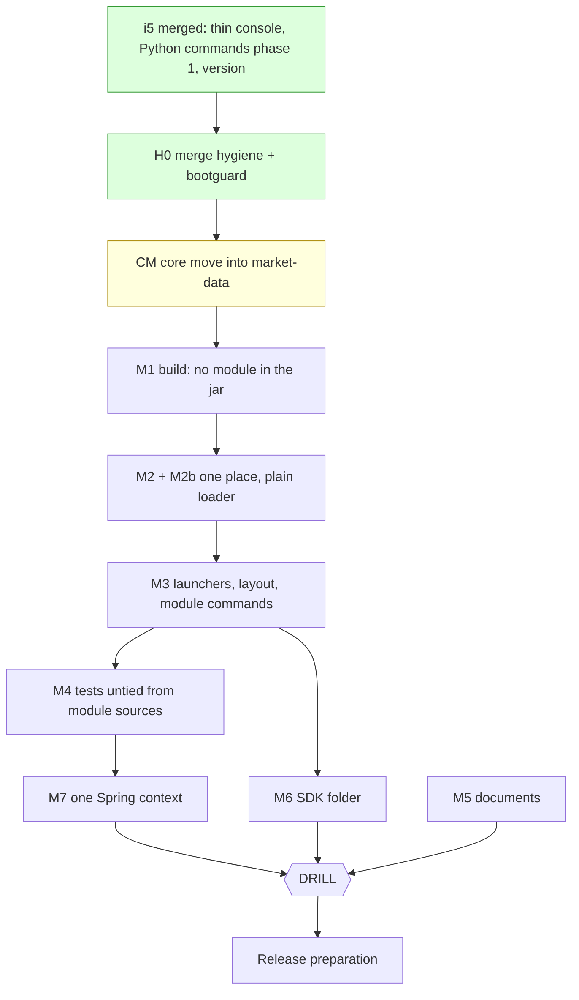

<!--
  Project Drishti · Any data. Any domain. One grammar.
  Copyright (c) 2026 Ashutosh Sinha <ajsinha@gmail.com>. All rights reserved.
  PROPRIETARY AND CONFIDENTIAL. See the LICENSE file in the root of this repository.
-->

# Release i6: the build plan (modules out of the server jar)

*Internal plan, re-cut 2026-11-16 at the owner's word from the single i5 plan written earlier that day. Planning only: no product code is in this change. Builders follow this document; each builder brief links to its step in [section 2](#2-steps-order-and-the-graph) and to the same step in [section 6](#6-side-effects-and-what-builders-must-be-mindful-of). Sizes are the designs' own builder-days (one builder, one day). The design is `docs/MODULE_JARS_I5_DESIGN.md` on `origin/wip/i5-module-jars-design` (steps M1–M7, approved by the owner as Q1–Q11); this plan orders it and adds nothing to it.*

## Roadmap

| Release | What it is | Plan |
|---|---|---|
| **i5** | The thin console S0–S8, the version from one place, Python commands phase 1, a few screen fixes. One drill, then the release | [I5_BUILD_PLAN.md](I5_BUILD_PLAN.md) |
| **i6** | Module re-engineering only: modules out of the server jar (M1–M7 of the modules design) and what it strictly needs (the core move into market-data) | [I6_BUILD_PLAN.md](I6_BUILD_PLAN.md) |
| **i7** | Everything else of the former i5 plan: the cluster, live L7–L10, trade tables, Python commands phase 2, drill lanes, the Polars proof, the API sweep, the screenshots, the binding designer's choice. Begins with Phase 0 (prove the waiting branches) | [I7_BUILD_PLAN.md](I7_BUILD_PLAN.md) |
| **i8** | What was i6: the console on Spring Boot and single sign-on, market-risk expansion (FRTB, SIMM), lake-writing tests, Polars from P3, `drill.sh` into Python, cluster C7 and C12. Anything later shifts by one | — |

**Scope.** Module re-engineering only: no module in the server jar, one modules folder, one Spring context, and what that strictly needs: the core pack moves into the market-data module first (so that `modules/` holds every pack the build packs). Everything else of the former i5 plan is in [i7](I7_BUILD_PLAN.md). **i5 is merged before this release starts**: the thin console (the console reads no module, pack or distribution folder; the console's Python resolver is gone and every tool asks the Java resolver), Python commands phase 1 (every launcher is a Python command in `tools/launch/`; the one jar lookup in `tools/javacmd.py`) and the version in one place.

## Contents

1. [The plan on one page](#1-the-plan-on-one-page)
2. [Steps, order and the graph](#2-steps-order-and-the-graph)
3. [Overlaps and what i5 already settled](#3-overlaps-and-what-i5-already-settled)
4. [Checkpoints and the one drill](#4-checkpoints-and-the-one-drill)
5. [Critical path and risks](#5-critical-path-and-risks)
6. [Side effects and what builders must be mindful of](#6-side-effects-and-what-builders-must-be-mindful-of)
7. [Decisions of the owner that apply](#7-decisions-of-the-owner-that-apply)
8. [Builder rules](#8-builder-rules)

## 1. The plan on one page

- **One lane, two helpers.** Lane A is serial: core move → M1 → M2 (with M2b) → M3 → M4 → M7, in one branch family so there is never a mixed state. A second builder takes M6 (the SDK folder, after M3) and the documents (M5, with each step); a third is free for the drill's fixes. At most three builders.
- **Nothing new on unproven code.** The core move is written and impact-reviewed but its tests have not run: it is proven and merged first. The hygiene and boot-guard branches (finished) merge with it, because the boot guard is the gate of M2 and M7.
- **The one thing that must not change: VaR.** The VaR golden tests are run exactly on the branch gate after each of the core move, M1, M2, M3, M4 and M7. A difference stops the step; nothing is re-baselined.
- **One drill, then the release.** After M7, M6 and M5 are merged and the tree is frozen: one full drill; a second run only for the lanes a fix touched (a fix to a shared kernel class means a full repeat). Release steps then wait for the owner.
- **Size.** About 18 builder-days of steps plus 3 of release preparation: **about 21**. Critical path 15: core move 1 → M1 1.5 → M2 4.5 → M3 2 → M4 2 → M7 4.

## 2. Steps, order and the graph

### 2.1 The graph

### 2.2 Models

Fable designs only (this plan, and a design question a builder raises). **Opus**: M2 and M7. **Sonnet**: the core move, M1, M3, M4, M6. **Haiku**: H0, M5 and the file moves of M4. The model is set on every Agent call.

### 2.3 The steps

| Step | Goal | Branch | Model | Inputs | Outputs | Days | Tests that prove it | Merges at |
|---|---|---|---|---|---|---|---|---|
| **H0** | The two finished branches are on develop (the third, `wip/i4-fix4`, is in i5) | `wip/i5-hygiene`, `wip/i5-bootguard` | Haiku | develop with i5 merged in | merged; the boot guard becomes a gate | 0 (merge only; the 0.5 day of the former H0 is counted in i5) | their own tests; the gate | CP0 |
| **CM** | Core move proven and merged. After i5 it adds nothing to the console image (the console reads no module folder); its edits to the console's Python resolver are dropped at the merge of develop (the Java resolver holds the change) | `wip/i5-core-move` | Sonnet | written; the impact review's notes | merged; market-data 1.1.0 | 1 | market-data-off test, `test_packs_in_modules.py`, resolver fixtures (Java), contract docs regenerated with no diff, VaR goldens | CP0 |
| **M1** | The build writes twelve `.dmod` into `packaging/dist/target/modules`; the server jar holds no module | `wip/i5-modules` | Sonnet | CM | one server jar, `-Pmodules`, guard G1 | 1.5 | G1; the jar starts with an empty modules folder (G7 early) | with M2 |
| **M2 + M2b** | One place: discovery from `<home>/modules/*.dmod`, cache by hash and its sweep, leftovers named in Health (stale `installed`, **and** leftover generated connector files and `config/bindings.yaml`); the plain loader, kernel first, the duplicate-library warning | `wip/i5-modules` | **Opus** | M1 (no Python twin to follow: i5) | `installed`/`store`/`shipped`/`active.yaml` and three settings deleted; G3, G4, G8, G9, G10 | 4.5 | G3–G10; `ConfigResolution` tests; **VaR goldens exact on the branch gate**; the boot guard | CP1 |
| **M3** | Launchers (Python only), run-configs, Docker, systemd, the stack and the drill name the modules folder; the release layout; `drishti.py module list/verify/install/remove/rollback` | `wip/i5-modules` | Sonnet | M2, Python commands phase 1 (i5) | G5, G7; the launch-matrix test | 2 | G5, G7, `test_launch.py` matrix, container smoke | CP1 |
| **M4** | Kernel tests untied from module sources (28 + 9 files), `testing/drishti-modules-it`, G2 | `wip/i5-modules` | Sonnet (Haiku for the file moves) | M2 | G2 | 2 | full Java test run of the touched modules (one heavy slot); VaR goldens | CP1 |
| **M7** | One Spring context; child-context and unload code deleted | `wip/i5-modules-ctx` | **Opus** | M4 green on develop | G11, G12; conformance C13–C15 changed | 4 | prototype on genomics, then banking; G11, G12; boot guard; `ModuleSwitchFollowsTest`; VaR goldens exact; module on/off browser test | CP2 |
| **M6** | SDK folder in the install; `DrishtiException`, `ErrorCode` into `drishti-api`; G6 | `wip/i5-sdk` | Sonnet | M3 | `sdk/` | 2 | genomics built from the SDK folder with no kernel source; G6 | CP2 |
| **M5** | The modules documents; `MODULE_JARS_I5_DESIGN.md` deleted, its facts in KERNEL_AND_MODULES and the guides | with each M step; closed here | Haiku | — | docs | 1 | link check; CONFIGURATION regenerated | CP2 |
| | **Drill** | | | | | | | |

Totals: core move 1, M1 1.5, M2 4.5, M3 2, M4 2, M7 4, M6 2, M5 1 = **18 builder-days**; release preparation (README rewrite, deck refresh, CHANGELOG, RELEASE_NOTES, PDFs, benchmark document) 3: **about 21**. Why M7 is in this release: the owner's rule (one Spring context in the same release as the modules work), and the cluster's engine lookup (C5, i7) is then built once on the final context.

---

## 3. Overlaps and what i5 already settled

| # | Shared code | Who touches it | Decision | Repeated work removed |
|---|---|---|---|---|
| **O2** | The resolver's Python twin: `drishti-console/core/resolution.py` (1,276 lines), `tests/test_resolution.py`, the shared fixtures `pack-resolution/cases.yaml`, `connector-layers/cases.yaml` | core move (edited it); live L1 (edited it: `companion-of`); modules M2 (would re-point it to the `.dmod` folder and cache); thin console S5 (**deletes it whole**; tools ask the Java resolver through the jar) | **S5 is front-loaded: before M2.** Order: core move → live → S5 → M2. M2 then changes the Java resolver only | M2's "Python twin re-pointed" and M4's "Python fixture" (about 1 of M2+M4's 6.5 days) are never written; no third and fourth round of keeping the twin equal; the bug class of 11-15 ends before the largest change to module discovery |
| **O3** | Where the jar and the home are found: `DRISHTI_HOME`, `<home>/lib`, `tools/javacmd.py` | Python commands; S5 (tools call the jar); M3 (release layout); Polars and the lake build (the Java loader) | One lookup, in `tools/javacmd.py`, from phase 1. S5, M3 and the loaders call it and add nothing | no second "find the jar" in `tools/resolved.py`; `DRISHTI_JAR` and the `target/` fallback retired once |
| **O4** | Module files and their readers: `modules/**`, `packaging/**`, the registry, the module node, `data/modules/installed` | core move (moves files inside `modules/`; adds `modules/` to the console and loader images); M1/M2 (packs them, deletes `installed`/`store`/`shipped`/`active.yaml`); thin console S2 (the console stops reading module and distribution folders); the upgrade finding (stale installed modules shadow the shipped ones) | Core move → M1. The upgrade finding **is** M2's rules 3 and 5 (the cache is swept, leftovers are named in Health): no separate item. The leftover generated connector files get the same Health line in M2 (half a day). `modules/` in the console image, added by the core move, is removed by S2 | the "upgrade detects stale modules" item is not built as its own mechanism; the console image is not re-cut twice |
| **O5** | Spring contexts and engine beans: the module runtime, `EngineRegistry`, banking's engine classes, `ModuleSwitchFollowsTest`, the boot guard | M7 (one context; "lookups by loader"; child-context code deleted); cluster C5 (`EngineLookup`, six changes to `EngineRegistry`, banking's contracts, engines stop holding `VarService`); `wip/i4-fix4` (a test that depends on one resolution per context); the boot guard | **M7 before C5, both before Drill 1's base is frozen for the cluster's engine half; the same builder (lane A) does M7 then C5.** The fix4 test merges now and M7 owns it afterwards | `EngineRegistry` and banking's engine wiring are changed once in each direction instead of C5 being rewritten for the new context; one builder holds the context for both |
| **O11** | Generated and shared documents: `docs/admin/CONFIGURATION.md`, `settings_schemas.yaml`, `application.yaml`, `CLI_REFERENCE.md`, `API_REFERENCE.md`, `OPERATIONS_GUIDE.md`, `ADMIN_GUIDE.md`, `KERNEL_AND_MODULES.md`, `CHANGELOG.md` | every lane (the largest file intersection of all) | Generated files are **never merged by hand**: take develop's, run the generator, commit. Hand-written guides: each lane edits only its own sections; `CHANGELOG.md` is a union merge. `KERNEL_AND_MODULES.pdf` and the other PDFs are regenerated once, at release prep | no conflict fixing in generated text; the PDFs are built once |
| **O13** | The drill's tooling: `tools/drill.sh`, `tools/drillkit/drill_lanes.py` | hygiene (waves); Python commands (small edits); M3 (modules folder, state to clear); the containers and java21-docker lanes; timing tests into the performance lane | All drill tooling changes land **before Drill 1** and are frozen after it (lesson of 2.9.11: no drill tool change mid-release). `drill.sh` into Python is not in i6 (section 6) | Drill 1 proves the tooling once; Drill 2 reuses it unchanged |

The rows above keep their original wording; the S-steps they name (S2, S5) are delivered in i5. Settled by i5: the launchers are Python commands (every launcher change here is made once, in `tools/launch/`); the resolver's Python twin is gone (M2 changes the Java resolver only); the one jar and home lookup is in `tools/javacmd.py`; the version is read from its one place; `ModuleSwitchFollowsTest` reads its own server's resolution. Not in this release (i7): the cluster, live, trade tables, drill lanes, API sweep.

---

## 4. Checkpoints and the one drill

A checkpoint is a merge window on develop. Each merge passes its **pre-merge gate** (the affected tests from `tools/drillkit/affected.py`, the guards, VaR goldens where marked) on the rebased branch (a merge of develop into the branch, never a force push), then develop is pushed. `wip/*` branches are pushed after every step.

| # | Merges, in this order | Gate on develop after the window |
|---|---|---|
| **CP0** foundations | H0 (hygiene, bootguard) → CM | one Maven build with tests of the touched modules; tools tests; launch tests; VaR goldens; pre-drill check |
| **CP1** one place | M1+M2+M2b+M3+M4 (one branch) | full Java run; G1–G10; launch matrix; container smoke; VaR goldens |
| **CP2** structure final | M7 → M6 → M5 | G11, G12; module and engine switch browser tests; VaR goldens; pre-drill check; **freeze** |
| **Drill** | | the one drill |

**The drill.** When: after CP2. Scope: every existing lane in two waves (CPU-heavy lanes first, then browser, other, anywhere), including the detached thin console of i5; the shared read-only test lake; lake-writing tests stay parked with their reason. Additional checks for this release: start-up time against the last drill's figure (M7 changes the start order); an upgrade rehearsal on a copy of an i5 data folder (stale `data/modules/installed`, generated connector files, `lib` in the data folder: Health names every leftover, nothing is read from them, nothing is deleted by the server); the launch matrix on every launcher; container smoke; module on and off. A second run only for what the first one's fixes touched; a fix to a shared kernel class means a full repeat. During the drill: edits only. Between the drill and the release no change to `tools/drill.sh` or `tools/drillkit/` (the drill state list change of M3 is in before the freeze), and the merge worktree is never checked out or reset for a read (`git show`). Then the release steps wait for the owner.

---

## 5. Critical path and risks

**Critical path:** CM (1) → M1 (1.5) → M2 (4.5) → M3 (2) → M4 (2) → M7 (4) → drill = **15 builder-days**. M6 (2) runs beside M4 and M7; M5 beside every step. What lengthens it: a red M2 or M7 (the two medium-to-high risks) and waiting for the heavy slot, so lane A has first call on it. The calendar is not estimated here; it is set at CP0 from the measured pace.

| # | Risk | Effect | Mitigation |
|---|---|---|---|
| R1 | M2 or M7 breaks the server's start in a way only the browser lane shows | critical path slips | M2 in one branch with G3–G10; M7 prototyped on genomics first; VaR goldens on the branch gate after each of CM, M1–M4 and M7 |
| R2 | The core move's tests, never run, fail | CP0 slips | it merges first and alone; nothing else is written on it until green |
| R3 | The one heavy slot starves the helpers | untested code piling up | lane A has priority; helpers do edits and documents while they wait; the rule "no new step on an unproven one" holds |
| R4 | The bootstrap's module list of the thin console changes shape when M2 changes discovery | wrong menus | the answers come from the registry's API, which M2 does not change; the recorded `bootstrap.json` (a Java test) is the check, run at M2 and M7 |
| R5 | An existing install holds old module folders and settings | wrong module loaded | M2's rules: the cache is swept, leftovers named in Health, removed settings named, never read; the drill's upgrade rehearsal |
| R6 | The owner's three-node stack and data folder are changed by a builder's test | lost demo state | builders never start or stop `drishti-stack`; tests use `@TempDir` and the shared read-only lake; the stack's upgrade is one rehearsed step after the tag (Q7) |
| R7 | Generated documents conflict at every merge | hours lost | regenerate, never merge by hand; `CHANGELOG.md` is a union merge |
| R8 | Windows cannot be checked here | a module command or launcher fails there | the Windows check list run by QA at CP1 and after the drill (Q6) |

---

## 6. Side effects and what builders must be mindful of

For each step: what else it can break, what to scan before changing, what to
run after, and who goes first when two lanes meet. A builder brief links to its step here. The general rules are in
[section 8](#8-builder-rules).

Words used below. **Twin**: Python code that repeats Java logic. **Stack**: the owner's running three-node cluster
(`drishti-stack/`, ports 18480/17480) and its data folder, which no builder starts, stops or writes. **Goldens**: the VaR
golden tests, which must stay exactly equal.

### 6.1 Lane A

**CM, core move**

| | |
|---|---|
| Can break | every pack that named `core` (routes for CORE and the ten party words), a server with market-data **off** (the core kinds vanish: the test exists, read it), `docs/contracts/packs/core.md`, the resolver fixtures (the Java side; the Python side was deleted in i5), `tools/packgen/source_module.py`, pack guides and Help links, the loader image, demo lakes' table names, an existing install whose site folder overrides `config/packs/core/**` (now not used: Health must say so), goldens (the party and book reference data VaR's hierarchy reads) |
| Scan first | `git grep -n "packs/core\|pack: core\|\"core\""` in `modules/`, `config/`, `tools/`, `drishti-console/`, `kernel/**/test`; the impact review's notes on the branch |
| Run after | market-data-off test; `test_packs_in_modules.py`; resolver fixture tests (Java); contract docs and CONFIGURATION regenerated; goldens; a demo lake from the cache still opens |
| Cross-lane | before M1 (which packs `modules/` as it finds it) and before the live work of i7 (L8 edits market-data contracts). The console's Python resolver no longer exists (i5): at the merge of develop into the branch take the deletion and keep the change in the Java resolver. The loader image gets `modules/`; the console image gets nothing (it reads no module folder). The Pack designer's shared-table layout is gone; nothing to merge |
**M1–M4, modules outside the server jar**

| | |
|---|---|
| Can break | **everything that starts a server**: launchers, run-configs, Docker, systemd, ECS task definitions, the drill, test stacks, the stack; every reader of a module folder (the design's resolver inventory, `docs/architecture/pack-resolution-inventory.md`); kernel tests that read `modules/banking/**` (28 + 9 files); `testing/drishti-it`; banking's tests against the server's test jar; module on/off (`ModuleSwitchFollowsTest`, the engine switches); the module commands (`tools/modulecli.py`); the developer switch that reads source folders; distributions (a distribution was "what is in the jar"); cluster nodes with different `.dmod` files; an **existing install**: `data/modules/installed/*-1.0.0` and `store`, `shipped`, `active.yaml`, the three removed settings in a site's files |
| Scan first | `git grep -n "modules/installed\|module-deploy\|modules\.path\|modules\.shipped\|active\.yaml\|DRISHTI_MODULES_HOME"` everywhere; `packaging/**`; root `pom.xml` reactor; `tools/drill.sh` (state it clears); `deploy/docker/**`; `tools/test_config_readers_guard.py`'s allow-list |
| Run after | G1–G10; the boot guard; a full Java run (heavy slot); goldens on the branch gate after **each** of M1, M2, M3, M4; the launch matrix; container smoke; the upgrade rehearsal on a planted old data folder (Health names the leftovers, nothing is read from them, nothing is deleted by the server) |
| Mindful | the server never writes the modules folder by default (read-only, opt-in write); the cache is under `<data>/cache/modules` and may be deleted at any time; a removed setting found in a site file is named in Health, not silently ignored; no version of the code may read both the old and the new place |
| Cross-lane | The thin console and the Python resolver twin are already i5: M2 changes the Java resolver only. The i7 cluster's digest (C4) reads M3's package hash: the hash and `module list` output are the contract, kept as designed. The drill's changes (`drill.sh:578` state list, `DRISHTI_MODULES_HOME`) are made here, before the freeze; `tools/drill.sh` is not edited after |
**M7, one Spring context**

| | |
|---|---|
| Can break | the server's start order; bean name clashes between a module and the kernel; anything that looked a bean up in a module's child context (engine registration, module REST controllers, module security filters, scheduled jobs, `@Value` settings of a module); module off at run time (no unload any more: off means not registered at the next start; check what the Admin switch now says); each context's own `ConfigResolution` (commit 9e8d318f1 and the fix4 test); conformance C13–C15; start-up time and the CDS archive (`tools/drillkit/server_cds.py`); goldens |
| Scan first | the module runtime package; `EngineRegistry`; every `ApplicationContext` and `getBean` use under `kernel/drishti-server`; `modules/banking/**/config`; `ModuleSwitchFollowsTest`; the boot guard test |
| Run after | G11, G12; genomics first, then banking; the boot guard; module and engine switch browser tests; goldens; start-up time against the last drill's figure |
| Cross-lane | the engine lookup (C5, i7) is written on this base: `EngineRegistry` and banking's engine wiring are left as M7 finishes them. The thin console's bootstrap lists modules from the registry: the answer's shape must not change; the recorded `bootstrap.json` is the check |

**M6, SDK folder; M5, documents**

| | |
|---|---|
| Can break | M6: the release layout (a new `sdk/` folder; the archetype's generated project and its build), `DrishtiException` and `ErrorCode` moving into `drishti-api` (every import of them in the kernel and in modules), the module developer's path in the guides. M5: links between guides, the generated CONFIGURATION document |
| Scan first | M6: `git grep -n "DrishtiException\|ErrorCode"`; the archetype; `docs/MODULE_JARS_I5_DESIGN.md` section 6.2. M5: the design's section 9 list of documents that change |
| Run after | M6: a build of genomics from the SDK folder with no kernel source (G6); the kernel's full compile. M5: the link check; CONFIGURATION regenerated with no hand edit |
| Cross-lane | none: both are after M3 and touch no launcher or drill file |

---

## 7. Decisions of the owner that apply

Q1–Q13 of the former plan and Q1–Q11 of the modules design were approved by the owner on 2026-11-16. Those that shape this release:

| # | Decision |
|---|---|
| Modules design Q1–Q11 | approved as designed: `.dmod` files, one modules folder, a cache by hash, one Spring context, the kernel's libraries always win |
| **Q4** | M7 (one Spring context) is in this release, before the drill, so the engine lookup (i7) is built once on the final context |
| **Q5** | Every Python tool and generator needs a built jar (thin console Q2): done in i5, before this release |
| **Q6** | The Windows QA machine runs one check list at CP1 and after the drill (one hour each); without it Windows stays an open risk named in the release notes |
| **Q7** | The owner's three-node stack is upgraded once after the tag, with the rehearsed upgrade (modules folder, `lib/ext`, leftovers moved aside); until then it stays on its current version and no builder touches it |
| **Q8** | The version's one place: delivered in i5 |

---

## 8. Builder rules

Every brief carries these; a change that breaks one is not merged.

1. **No dual machinery.** A step's merge holds the new way and the deletion of the old. No flag choosing between them, no fallback.
2. **Docs with the change.** The affected guides, tutorials, CHANGELOG and generated documents are in the same push. Documents say how it works now: no bugs, no history.
3. **The kernel's libraries win.** A module brings a library only when the kernel has none; a duplicate loads with a warning and the kernel's copy is used. Spring and kernel libraries are never bundled in a `.dmod`.
4. **Connectors are read-only to the server and the tools.** Nothing generates, rewrites or retires a connector file; no `.history`, no `.migrated`. Template, override and secrets meet in memory.
5. **Explicit paths.** Absolute, or anchored to a named root (`${module.dir}`, `${lake.root}`, the data folder). No bare relative path, no invisible default; resolved paths are shown. Everything Drishti creates is under the data folder; no hidden file names.
6. **Python-only commands.** Every operator command is `python tools/drishti.py …`. No new `.sh`, `.ps1` or `.cmd`; a deleted one is never restored.
7. **One shared, read-only test lake.** Tests read it and never write it. Lake-writing tests stay parked to i8 with their reason. Local data at most 10,000 trades. Tests use `@TempDir` and clean their temp files.
8. **VaR goldens exactly equal.** Run where a step is marked; a difference stops the step, it is never re-baselined.
9. **Prove before writing more.** Compile and test what is written before the next step. During a drill: edits only.
10. **One heavy job at a time on the machine**: a full Maven build or test run (`mvn clean` first), a lake build, the browser lane (alone), a cluster test. Builders run the affected tests, not whole suites.
11. **At most three builders.** A finished builder is not replaced while three run. The model is set on every Agent call (section 2.2).
12. **Rebase by merging develop into the branch, test, then merge.** Never force-push. Push `wip/*` after every step; develop after every merge; main only after a green drill and the owner's word.
13. **Generated files are regenerated, never hand-merged.**
14. **Scan every consumer first** (section 6's "scan first"), and change engine, console, tools, documents, run-configs, deploy files and demo data together.
15. **Optional externals.** Every module starts with no Kafka, no AI, no outside API; absence turns that feature off and says so.
16. **The server computes; the console displays.** No risk figure and no access decision in Python or JavaScript.
17. **No bespoke UI.** Screens are built from Drishti Elements; extend a library instead. Vendored libraries only, no CDN; own assets are named `drishti_<name>`.
18. **Session isolation.** Nothing per person in a global or a shared cache.
19. **Cluster members advertise the real IP**, never localhost; no multicast.
20. **The owner's stack and data folder are not a test bed.** No builder starts, stops, upgrades or writes them.
21. **Commits are by ajsinha only**, with the copyright header on every new file.
22. **Drishti never prices.** Missing inputs are named exactly; nothing is estimated in their place.
