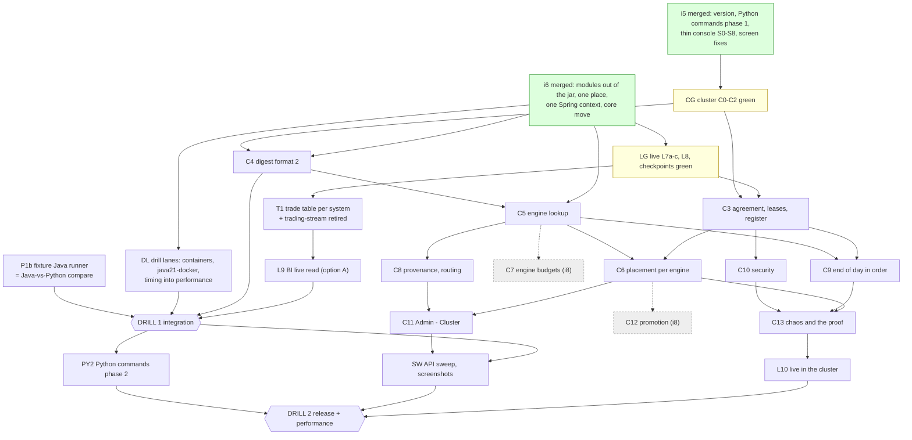

<!--
  Project Drishti · Any data. Any domain. One grammar.
  Copyright (c) 2026 Ashutosh Sinha <ajsinha@gmail.com>. All rights reserved.
  PROPRIETARY AND CONFIDENTIAL. See the LICENSE file in the root of this repository.
-->

# Release i7: the build plan

*Internal plan, re-cut 2026-11-16 at the owner's word, from the single i5 plan written earlier that day. Planning only: no product code is in this change. Builders follow this document; each builder brief links to its step in [section 2](#2-dependency-graph-and-lanes) and to the same step in [section 8](#8-side-effects-and-what-builders-must-be-mindful-of). Sizes are the designs' own builder-days (one builder, one day); the calendar is in [section 5](#5-critical-path-calendar-risks).*

## Roadmap

| Release | What it is | Plan |
|---|---|---|
| **i5** | The thin console S0–S8, the version from one place, Python commands phase 1, a few screen fixes. One drill, then the release | [I5_BUILD_PLAN.md](I5_BUILD_PLAN.md) |
| **i6** | Module re-engineering only: modules out of the server jar (M1–M7 of the modules design) and what it strictly needs (the core move into market-data) | [I6_BUILD_PLAN.md](I6_BUILD_PLAN.md) |
| **i7** | Everything else of the former i5 plan: the cluster, live L7–L10, trade tables, Python commands phase 2, drill lanes, the Polars proof, the API sweep, the screenshots, the binding designer's choice. Begins with Phase 0 (prove the waiting branches) | [I7_BUILD_PLAN.md](I7_BUILD_PLAN.md) |
| **i8** | What was i6: the console on Spring Boot and single sign-on, market-risk expansion (FRTB, SIMM), lake-writing tests, Polars from P3, `drill.sh` into Python, cluster C7 and C12. Anything later shifts by one | — |

**The re-cut.** The former i5 plan is split three ways. i5 is small and ships first (the thin console, the version, Python commands phase 1, screen fixes). i6 holds only the module re-engineering ([I6_BUILD_PLAN.md](I6_BUILD_PLAN.md)). **This document is the rest.** Merged on develop before i7 starts: i5 (the thin console, so the console's Python resolver is gone and every tool asks the Java resolver; Python commands phase 1, so every launcher is a Python command; the version in one place) and i6 (no module in the server jar, one modules folder, one Spring context, the core pack inside market-data). Rows of this plan that say "(i5)" or "(i6)" are satisfied before it begins.

The owner's original ask (2026-11-16): *"The i5 steps should be planned so that we have optimum steps benefitting parallel and sequential builds with reduction of repeated work and front loading where possible."* The decisions Q1–Q13 of [section 7](#7-decisions-of-the-owner) were approved by the owner and stand.

## Contents

1. [Overlap analysis: where items touch the same code](#1-overlap-analysis)
2. [Dependency graph and lanes](#2-dependency-graph-and-lanes)
3. [Front-loading and what must be sequential](#3-front-loading-and-what-must-be-sequential)
4. [Integration checkpoints and the two drills](#4-integration-checkpoints-and-the-two-drills)
5. [Critical path, calendar, risks](#5-critical-path-calendar-risks)
6. [Moves to i8 and what stays](#6-moves-to-i8-and-what-stays)
7. [Decisions of the owner](#7-decisions-of-the-owner)
8. [Side effects and what builders must be mindful of](#8-side-effects-and-what-builders-must-be-mindful-of)
9. [Builder rules](#9-builder-rules)

## The plan on one page

- **Three lanes.** A = drill lanes, then the cluster's engine half (engine lookup, provenance and routing). B = the API sweep, the screenshots and Python commands phase 2. C = live (make green, merge, trade tables), then the cluster's base (membership, agreement, digest, placement, security, chaos) and live L10.
- **Phase 0 writes nothing new.** It begins by merging develop (with i5 and i6 in it) into each waiting branch, then proves the written code: cluster C0–C2, live L7a–L8 and the checkpoints, Polars P0–P2. Each lane first makes its own written code green and merges it. No lane writes a new step on top of unproven code.
- **Orderings that remove repeated work** (section 1): live merges before the cluster's schema (O7); the engine lookup (C5) is built on the one Spring context of i6 (O5); the digest carries the module package hash of i6's module commands (O6); live L10 comes last, on leases and the engine lookup (O10). The orderings of the former plan that concern launchers, the resolver's Python twin, the modules and the version are satisfied by i5 and i6.
- **Two drills.** Drill 1 (integration) after every structural change is in: live L1–L9, trade tables, cluster C0–C4, the new drill lanes. Drill 2 (release, with the performance lane) after engines anywhere, live L10, chaos and the release work. A second run of either only if the first needed fixes.
- **Size.** About 61 builder-days as scoped (section 2.6). Critical path about 19 builder-days: CG → C4 → C5 → C6 → C13 → L10 → Drill 2.
- **Moved to i8** (section 6): cluster promotion C12 and engine budgets C7, Polars P3–P8, `drill.sh` into Python, the binding designer's build.

---
## 1. Overlap analysis

Found by intersecting the changed files of every branch of the former i5 plan against `origin/develop` (6929cdd51) and by reading the five
designs' own "what changes" tables. Rows O1 to O6 and O14 concern work delivered by i5 and i6; they stay as the record of why those orderings were chosen, and as the rule for how each waiting branch is rebased over them.

### 1.1 Where the work stands (state of 2026-11-16 08:00; rows marked i5 or i6 are merged before i7 starts)

| Item | Branch | State | Behind develop |
|---|---|---|---|
| Hygiene (time-bomb dates, drill waves, failure files, Delta cache retry) | `wip/i5-hygiene` | done; **merged in i6** | — |
| Guard: every module boots with no externals | `wip/i5-bootguard` | done; **merged in i6** | — |
| `ModuleSwitchFollowsTest` reads its own server's resolution | `wip/i4-fix4` | **merged in i5** | — |
| Core pack into the market-data module; Pack designer shared-table option removed | `wip/i5-core-move` | **merged in i6** | — |
| Thin console S0–S8 | `wip/i5-thin-console` and the `wip/i5-thin-*` steps | **merged in i5** | — |
| Cluster C0–C2 (wrapper, JGroups membership, gossip deleted) | `wip/i5-cluster` | **code only, never compiled or run**; the C0 spike on Windows not done | 98 |
| Live L1–L7 | `wip/i5-live` | L1–L7 green (kernel and transports) | 98 |
| Live L7a–c, L8, checkpoints in the database | `wip/i5-live`, `wip/i5-live-checkpoints` | **edits, not compiled** | 98 |
| Polars P0–P2 (fixture, row rule, pins) | `wip/i5-polars` | Python side built; Java runner and three file rules left | 98 |
| Python commands, phase 1 | `wip/i5-python-cli` | **merged in i5** | — |
| Modules outside the server jar | `wip/i5-module-jars-design` | **built in i6** | — |
| Binding designer | `wip/i5-binding-mockups` | three mock-ups; no choice yet | — |

The cluster, live and Polars branches forked 98 commits ago (more, once i5 and i6 have merged). **Phase 0 begins** by merging develop into each of them (never a force push) **before** its tests run, so that a test is run once, on what will merge. The cluster and live branches also edited launcher shell files, the console's Python resolver and the module files: at that merge, **take develop's deletion** of every shell file and of `drishti-console/core/resolution.py`, and re-apply the intent in `tools/launch/`, in the Java resolver and in the modules folder layout of i6 (section 8.4).

### 1.2 The overlaps, and the repeated work each ordering removes

| # | Shared code | Who touches it | Decision | Repeated work removed |
|---|---|---|---|---|
| **O1** | The launchers: `bin/start-server.*`, `bin/start-console.*`, `tools/rolling-upgrade.*`, `deploy/stack/**`, `run-configs/*.run.xml`, `deploy/docker/**`, `deploy/systemd` | Python commands (deletes the `.sh`/`.ps1`, adds `tools/launch/*.py`); cluster C2 and C3 (ports, the witness start script, 20 shared files); thin console S1 (9 shared files); modules M3 (modules folder in every launcher); `--iceberg` and `lake demo --lake` writing `config/connectors` | **Python commands phase 1 merges first (CP0).** Cluster, thin console and M3 then make each launcher change once, in `tools/launch/`. The `--iceberg`/`--lake` fix is done inside phase 1 (the start command is being rewritten there anyway) | every launcher change written once instead of three times (`.sh`, `.ps1`, run-config); the cluster's and thin console's edits to deleted shell files are ported once at their rebase instead of merged by hand; `<home>/lib`, `lib/ext` and `<home>/modules` laid out by one command (`setup`), not by M3 again |
| **O2** | The resolver's Python twin: `drishti-console/core/resolution.py` (1,276 lines), `tests/test_resolution.py`, the shared fixtures `pack-resolution/cases.yaml`, `connector-layers/cases.yaml` | core move (edited it); live L1 (edited it: `companion-of`); modules M2 (would re-point it to the `.dmod` folder and cache); thin console S5 (**deletes it whole**; tools ask the Java resolver through the jar) | **S5 is front-loaded: before M2.** Order: core move → live → S5 → M2. M2 then changes the Java resolver only | M2's "Python twin re-pointed" and M4's "Python fixture" (about 1 of M2+M4's 6.5 days) are never written; no third and fourth round of keeping the twin equal; the bug class of 11-15 ends before the largest change to module discovery |
| **O3** | Where the jar and the home are found: `DRISHTI_HOME`, `<home>/lib`, `tools/javacmd.py` | Python commands; S5 (tools call the jar); M3 (release layout); Polars and the lake build (the Java loader) | One lookup, in `tools/javacmd.py`, from phase 1. S5, M3 and the loaders call it and add nothing | no second "find the jar" in `tools/resolved.py`; `DRISHTI_JAR` and the `target/` fallback retired once |
| **O4** | Module files and their readers: `modules/**`, `packaging/**`, the registry, the module node, `data/modules/installed` | core move (moves files inside `modules/`; adds `modules/` to the console and loader images); M1/M2 (packs them, deletes `installed`/`store`/`shipped`/`active.yaml`); thin console S2 (the console stops reading module and distribution folders); the upgrade finding (stale installed modules shadow the shipped ones) | Core move → M1. The upgrade finding **is** M2's rules 3 and 5 (the cache is swept, leftovers are named in Health): no separate item. The leftover generated connector files get the same Health line in M2 (half a day). `modules/` in the console image, added by the core move, is removed by S2 | the "upgrade detects stale modules" item is not built as its own mechanism; the console image is not re-cut twice |
| **O5** | Spring contexts and engine beans: the module runtime, `EngineRegistry`, banking's engine classes, `ModuleSwitchFollowsTest`, the boot guard | M7 (one context; "lookups by loader"; child-context code deleted); cluster C5 (`EngineLookup`, six changes to `EngineRegistry`, banking's contracts, engines stop holding `VarService`); `wip/i4-fix4` (a test that depends on one resolution per context); the boot guard | **M7 before C5, both before Drill 1's base is frozen for the cluster's engine half; the same builder (lane A) does M7 then C5.** The fix4 test merges now and M7 owns it afterwards | `EngineRegistry` and banking's engine wiring are changed once in each direction instead of C5 being rewritten for the new context; one builder holds the context for both |
| **O6** | A `.dmod` reaching a node: the digest, placement "code staging", promotion | modules M2/M3 (`module install`, the package hash); cluster C4 (digest format 2), C6 (staging), C12 (promotion) | C4, C6 and C12 start after M3. C4 adds the package hash to the digest in the same change as `modules` and `engines` | the digest format changes once; staging and promotion are written once, against the modules folder |
| **O7** | The database schema files `schema-postgres.sql`, `schema-sqlite.sql` (no migrations) | live checkpoints (`drishti_live_checkpoint`, `drishti_live_position`); cluster C3 (`DatabaseAgreement`, leases, the register) | Live checkpoints merge first (CP1); C3 is written on top | one edit of both files per lane, no interleaved hand merge |
| **O8** | Trade connectors: `trade-<system>.yaml`, `trade-<system>-live.yaml`, `tools/packgen/source_module.py`, the Java loader's trade tables | core move; live L3 (`companion-of`); "one trade table per system"; the lake-build follow-up "Java trade tables"; retiring the old trading-stream feed | Core move → live merge → **one step T1** = trade table per system (default) and the common table with filter (both tested), on the Java loader and the Python path together, with the old trading-stream feed deleted in the same step | "Java trade tables" and "trade table per system" are one piece of work, not two; the live companion follows its lake connector, so the table switch needs no live change; the six templates are regenerated once |
| **O9** | Loader equality | Polars P1 (the 75-case contract fixture, Java runner outstanding); lake-build follow-up "Java-vs-Python compare" | The fixture's Java runner **is** the comparison. One step P1b | the compare tool is not built separately |
| **O10** | Engine lease and lookup | live L10; cluster C3, C5 | L10 last, on `Leases` and `EngineLookup` (both designs already say so) | no interim singleton code in live |
| **O11** | Generated and shared documents: `docs/admin/CONFIGURATION.md`, `settings_schemas.yaml`, `application.yaml`, `CLI_REFERENCE.md`, `API_REFERENCE.md`, `OPERATIONS_GUIDE.md`, `ADMIN_GUIDE.md`, `KERNEL_AND_MODULES.md`, `CHANGELOG.md` | every lane (the largest file intersection of all) | Generated files are **never merged by hand**: take develop's, run the generator, commit. Hand-written guides: each lane edits only its own sections; `CHANGELOG.md` is a union merge. `KERNEL_AND_MODULES.pdf` and the other PDFs are regenerated once, at release prep | no conflict fixing in generated text; the PDFs are built once |
| **O12** | Screens and their pictures: Admin → Cluster (C11), the Live column (L7), thin console pages, the five small screen fixes, the 20 QA screenshots, the API sweep's endpoint list | lanes A, B, C | Screens are fixed whenever a lane is free; **screenshots and the API sweep are run once, after Drill 1's fixes**, when the pages and the endpoint list (5 new console answers, `/admin/live`, the cluster's) are final | no second screenshot pass; the sweep's seed data and expected list written once |
| **O13** | The drill's tooling: `tools/drill.sh`, `tools/drillkit/drill_lanes.py` | hygiene (waves); Python commands (small edits); M3 (modules folder, state to clear); the containers and java21-docker lanes; timing tests into the performance lane | All drill tooling changes land **before Drill 1** and are frozen after it (lesson of 2.9.11: no drill tool change mid-release). `drill.sh` into Python is not in i7 (section 6) | Drill 1 proves the tooling once; Drill 2 reuses it unchanged |
| **O14** | The version | root `pom.xml` and 5 module poms, 5 Dockerfiles, `compose.yaml`, `deploy/aws/env.example`, `drishti-console/core/app.py`, `help.yaml`, the archetype, `under-construction.yaml`; thin console S0 (the console shows the server's version) | **V0 first** (the owner's first item): one source; the console half is already done by S0 (the server's `/public/about`), so V0 covers the build, the images, the tools and the release check only | the console's own version constant is not touched twice |

### 1.3 What does not overlap (safe in parallel at any time)

- Live L7a–L9 and the thin console, except `drishti-console/routes/admin_routes.py` (the Live column): live merges first.
- Polars and everything else, except `tools/lake/build.py` and `writers.py` with the Python commands (two small edits; rebase).
- Cluster C0–C3 and the modules work: membership and agreement do not read a module file.
- Thin console S3, S4, S6, S7 and the modules work: they serialise what the server already decides.

---

## 2. Dependency graph and lanes

### 2.1 The graph



Green = merged before i7 starts, yellow = written and unproven, dashed = moved to i8.

### 2.2 Models

Fable designs only (this plan, and a design question a builder raises). **Opus**: deep coding and debugging (cluster C2, C3, C5, C6, C13; live green-up and L10). **Sonnet**: routine coding (T1, L9, C4, C8–C11, PY2, drill lanes). **Haiku**: repetitive work (merges of finished branches, regenerating documents, screenshot retakes, the remaining shell-to-Python wrappers, CHANGELOG lines). The model is set on every Agent call.

### 2.3 Lane A: drill lanes, then the cluster's engine half

| Step | Goal | Branch | Model | Inputs | Outputs | Days | Tests that prove it | Merges at |
|---|---|---|---|---|---|---|---|---|
| **DL** | Drill lanes: containers and java21-docker run again; timing tests move to the performance lane (wall-clock tests keep hang bounds only); VLIM cold timing joins the performance lane | `wip/i5-drill-lanes` | Sonnet | M3 (Docker layout) | `drill_lanes.py`, `affected-map.txt`, TEST_HARNESS | 2.5 | `test_drill_lanes.py`, `test_drill_plan.py`; each new lane run once alone before Drill 1 | CP3 |
| | **Drill 1** | | | | | | | |
| **C5** | `EngineLookup`, contracts, the generated stub, deadlines, fail-over; banking's contracts; engines stop holding `VarService` | `wip/i5-cluster-engines` | **Opus** | M7, C4 | `EngineCluster`'s node choice deleted | 5 | lookup contract suite on `SimMembership`; VaR, FRTB-SA, SIMM goldens exact; C16 | CP4 |
| **C8** | Provenance names the computing node; routing by open dates; shards on the view; lake-root check | same | Sonnet | C5 | — | 2.5 | provenance in API, Explain and records; two-node test | CP4 |

Lane A total: about 10 days. Lane A has no step before DL except edits; a builder slot not needed here helps lane C.

### 2.4 Lane B: the sweep, the pictures and Python commands phase 2

The thin console (S0–S8), the five screen fixes and Python commands phase 1 are in i5. Lane B of i7 starts after Drill 1.

| Step | Goal | Branch | Model | Inputs | Outputs | Days | Tests that prove it | Merges at |
|---|---|---|---|---|---|---|---|---|
| **SW** | API sweep with seeded data over every endpoint (list generated from the server, on the shared read-only lake); 20 QA screenshots retaken; push of the stamps (thin console Q8) | `wip/i5-sweep` | Sonnet (sweep), Haiku (screenshots) | Drill 1 fixes merged, UI, C11 | sweep test in the `other` lane; pictures | 4 | the sweep itself; picture diff reviewed | CP5 |
| **PY2** | Python commands phase 2: every remaining `.sh`/`.ps1` except `drill.sh`, `mvnw*` and a minimal container entrypoint (`tools/load-*`, `bench`, `pvgen`, `feeds`, `deploy/aws/**`, the public-data refresh wrappers) | `wip/i5-python-cli-2` | Haiku, Sonnet for `deploy/aws` | Drill 1 | 50 shell files → 3 | 5 | each command's test; `test_no_shell_scripts` guard (allow-list of three) | CP5 |

Lane B total: about 9 days. Lane B has no step before Drill 1.

### 2.5 Lane C: live, then the cluster's base

| Step | Goal | Branch | Model | Inputs | Outputs | Days | Tests that prove it | Merges at |
|---|---|---|---|---|---|---|---|---|
| **LG** | Live L7a–c, L8 and the checkpoints compile and pass; `wip/i5-live-checkpoints` folded into `wip/i5-live`; one merge of L1–L8 | `wip/i5-live` | **Opus** | the core move (i6): L8 edits market-data contracts that it touched | file checkpoint store deleted; both schema files | 5 | `Live*Test` family, `JdbcLiveCheckpointStoreTest`, broker tests (RabbitMQ parked with a reason if it fights), `test_livecli`, the blotter's browser test, `VarPvStreamTest` family, **VaR goldens exact**, contract docs regenerated | CP1 |
| **P1b** | The loader fixture's Java runner (= the Java-vs-Python comparison) and the three file rules of P2 | `wip/i5-polars` | Sonnet | — | findings list for the owner | 2 | 75 cases on the Java loader and the Python path | CP2 |
| **T1** | One trade table per trading system by default; a common table with filter or query by connector YAML only; both first-class; Java loader and Python path; the old trading-stream feed and `TradingStreamTest` retired | `wip/i5-trade-tables` | Sonnet | LG, the core move (i6) | six templates regenerated; DATA_GUIDE, the daily-load runbook | 3 | one test per layout for each of the six systems (read, live companion, row-rule RBAC); loader fixture cases for both; the boot guard | CP2 |
| **CG** | Cluster C0–C2 proven: the C0 spike's facts (Java 21, three nodes on one machine with real addresses, TCP only, TLS); compile; provider contract suite; no-multicast guard | `wip/i5-cluster` | **Opus** | Python commands phase 1 (i5): the launcher edits are ported to Python | gossip deleted for good | 4 | contract suite on `SimMembership` and `JGroupsMembership`; three-node kill and partition; `drishti.py net check`; the Windows spike items (Q6) | CP2 |
| **L9** | BI and pivot live read for `mode: live`, the snapshot chip; no incremental measures (option A) | `wip/i5-live-l9` | Sonnet | LG | BI's own live table copy deleted | 2.5 | BI live browser test; snapshot-by-default test | CP3 |
| **C3** | `DatabaseAgreement`, `RatisAgreement`, `FirstLiveAgreement`, `auto`, the witness (a Python command), leases, the register; run and inbox leases folded | `wip/i5-cluster` | **Opus** | CG, LG (schema files) | `FirstLiveElection`, `SwitchSync`'s transport deleted | 5 | agreement contract suite in each mode; lost-majority behaviour; singleton never twice (except `first-live`, stated) | CP3 |
| **C4** | Digest format 2: modules with the package hash, engines, lake roots | `wip/i5-cluster` | Sonnet | CG, M3 (i6) | the `engines` service string deleted | 2.5 | drift shown for a node whose `.dmod` differs | CP3 |
| | **Drill 1** | | | | | | | |
| **C6** | Placement per engine (`format: 2`), plan and apply on the register, staging on the union | `wip/i5-cluster-place` | **Opus** | C3, C5 (lane A) | per-node switch differences deleted | 2.5 | VaR on node A, sensitivities and exposure on node B | CP4 |
| **C10** | `[net.tls]` on the three ports, certificate identity, reload, `drishti.py net certs` | same | Sonnet | C3 | — | 2.5 | TLS matrix; refusal of a wrong certificate in words | CP4 |
| **C9** | End of day in `needs` order across nodes | same | Sonnet | C3, C5 | *every member captures* deleted | 2.5 | one ordered run on two nodes; VaR goldens | CP4 |
| **C11** | Admin → Cluster (option A with C's needs line and SPOF card) on Drishti Elements in the Python console | `wip/i5-cluster-admin` | Sonnet | C4–C8 | — | 2.5 | browser test; layout checks | CP4 |
| **C13** | Chaos suite and the proof scenario as the release gate; the lost-majority runbook tested | `wip/i5-cluster-chaos` | **Opus** | C5–C10 | BENCHMARK fail-over timings | 2.5 | the suite | CP5 |
| **L10** | Live in the cluster: the singleton feed on `Leases`, relay, fail-over; an engine's live input through `EngineLookup` | `wip/i5-live-l10` | **Opus** | C3, C5, L1–L9 | — | 2.5 | fail-over of a queue feed with no loss and no duplicate | CP5 |

Lane C total: about 39 days (the step days below add to 39; the former plan's figure of 42 was a mis-sum). Lanes A and C share the cluster after Drill 1: lane A owns the engine side (C5, C8), lane C the
membership side (C6, C9, C10, C11, C13). The one shared class is `EngineRegistry`: lane A changes it, lane C only calls it.

### 2.6 Totals

| | Days |
|---|---|
| Lane A (DL 2.5, C5 5, C8 2.5) | 10 |
| Lane B (SW 4, PY2 5) | 9 |
| Lane C | 39 |
| Release preparation (README rewrite, deck refresh, CHANGELOG, RELEASE_NOTES, PDFs, benchmark document) | 3 |
| **i7 as scoped** | **about 61** |
| Moved to i8 (C12 5, C7 2.5, Polars P3–P8 12, `drill.sh` 2, binding designer build) | about 21.5 plus the build |

---

## 3. Front-loading and what must be sequential

### 3.1 Can start now, with no dependency

| Work | Why it is free |
|---|---|
| **LG** compile fixes (edits and module-level compile) | may begin at once; its **merge** waits for develop with i6 (the core move) in it |
| **P1b** | independent of everything |
| **C0 spike facts** on the Windows QA machine and **P0** wheel check | need only the owner or QA (Q6); the answers are needed at CG, so ask now |
| Briefs for T1, C5 | Fable or Opus writes them while phase 0 runs, from this plan's section 8 |

### 3.2 Front-loaded on purpose (moved earlier than their designs said)

| Moved | From | To | Gain |
|---|---|---|---|
| **DL** drill lanes | "sometime in i7" | before Drill 1 | O13: the new lanes are debugged in the integration drill, not in the release drill |
| **M7** and **S5** | later in the plan | i6 and i5, before this release | O5: C5 is built once on the final context |

### 3.3 Must be sequential, and why

| Chain | Reason |
|---|---|
| i5 → CG | the cluster's launcher edits are ported to the Python commands of i5 |
| i6 → LG | L8 edits the market-data contracts the core move (i6) re-homes |
| LG → C3 | both schema files |
| M3 (i6) → C4; M7 (i6) → C5; C5 → C6, C8, C9; C3, C5 → L10 | sections 1.2 O5, O6, O10 |
| Drill 1 fixes, C11 → SW | pictures and the sweep's list are taken once |
| Heavy jobs | one at a time for the whole machine: a full Maven build or test run, a lake build, the browser lane. A lane that waits for the slot edits only (a UI fix, documents, the next brief) |

---

## 4. Integration checkpoints and the two drills

A checkpoint is a merge window on develop. Order inside a window is fixed; each merge passes its **pre-merge gate** (the
affected tests from `tools/drillkit/affected.py`, the guards, VaR goldens where marked) on the rebased branch, then develop is
pushed. `wip/*` branches are pushed after every step.

| # | Merges, in this order | Gate on develop after the window |
|---|---|---|
| **CP0** foundations | develop (with i5 and i6) merged into each waiting branch | one Maven build with tests of the touched modules; tools tests; launch tests; VaR goldens; pre-drill check |
| **CP1** proven code in | LG (live L1–L8, one merge) | Java tests of kernel, plugins, banking; the browser lane **once**, alone; VaR goldens |
| **CP2** proven | P1b → T1 → CG | the affected Java tests; three-node cluster test; the loader fixture; VaR goldens |
| **CP3** structure final | C3 → C4 → L9 → DL | agreement suite; each new drill lane once alone; pre-drill check; **freeze** |
| **Drill 1** | | integration |
| **CP4** | Drill 1 fixes → C5 → C8 → C6 → C9 → C10 → C11 | affected tests; two-node proof scenario; goldens of VaR, FRTB-SA, SIMM |
| **CP5** | C13 → L10 → SW → PY2 → release preparation | chaos suite; sweep; pre-drill check; **freeze** |
| **Drill 2** | | release |

**Drill 1, integration.** When: after CP3. Scope: every lane, in two waves (CPU-heavy lanes first, then browser, other,
containers, anywhere), including the new containers and java21-docker lanes; the shared read-only
test lake; lake-writing tests stay parked with their reason; no performance lane. Purpose: prove the structural changes
together (live L1–L9, trade tables, the cluster's membership and agreement) while the
cluster's engine half is not yet written, so its fixes cannot collide with new code in the same classes. During the drill:
edits only (C5 and C6 are written, not run). A second run only for what the first one's fixes touched (the affected lanes), not
a full repeat, unless a fix changed a shared kernel class.

**Drill 2, release.** When: after CP5. Scope: everything of Drill 1, plus the performance lane (the timing tests that moved,
VLIM cold timing, the thin console's page latency gates (i5), live throughput floors, fail-over timings), the chaos suite and the proof
scenario (VaR and a second engine on different nodes), the API sweep, an upgrade rehearsal on a copy of an i6 data folder
(a node's old gossip settings). i7 moves performance tests, so the rule "always two for
performance releases" applies: plan for a second run of the performance lane alone. Then the release steps wait for the owner.

**Between drills** no change to `tools/drill.sh` or `tools/drillkit/` (lesson of 2.9.11), and the merge worktree is never
checked out or reset for a read (`git show`).

---

## 5. Critical path, calendar, risks

### 5.1 Critical path

```
CG (4) → C4 (2.5) → C5 (5) → C6 (2.5) → C13 (2.5) → L10 (2.5) → Drill 2
```

About 19 builder-days of steps and the two drills: **about 19 builder-days on one chain.** Lane C carries it, with C5 written by lane A. Second chain: LG (5) → C3 (5) → C6, and LG → T1 → L9 (10.5 days) to Drill 1. Lanes A and B have no step before Drill 1 except DL: their builders take edits-only work from a named list (documents, briefs, the screens' words) or help lane C.

What shortens the path: nothing by adding builders (the chain is serial and the cap is three). What lengthens it: a red C2 or C3 (the cluster is the one design never compiled), and waiting for the heavy slot. So lane C has first call on the heavy slot.

### 5.2 Calendar

Two figures, because the designs' builder-days and the observed pace differ widely.

| Basis | Build | Drills | Total |
|---|---|---|---|
| **Designs' builder-days taken literally** (19 on the critical path, three lanes) | not recomputed here | 1 week | set at CP1 from the measured pace |
| **Observed pace** (2026-11-15: live L1–L7, about 22 design-days, was written and made green by one builder in one calendar day; cluster C0–C2 were written the same day but **not** tested) | — | — | re-measured when Phase 0 ends |

The second figure is the planning figure, with one caution: on 11-15 writing was fast and **testing** was the limit, because
every heavy job shares one slot. i7's remaining steps are heavier on that slot than live was (three-node cluster tests, the cluster's chaos runs). The figure is re-measured at CP1 and CP2: if phase 0
(CP0 + CP1) takes more than two calendar days, the cuts of section 6 are not optional.

### 5.3 Risks

| # | Risk | Effect | Mitigation |
|---|---|---|---|
| R1 | The written, unproven code of the former plan that is still open (cluster C0–C2 never compiled; live L7a–L8; Polars) hides design-level faults | phase 0 grows; later steps built on sand | phase 0 writes nothing new; each lane proves its own; the cluster's is proven last because nothing before Drill 1 except C3 and C4 depends on it |
| R3 | The one heavy slot starves two lanes | idle builders, or untested code piling up again | lane C has priority; waiting lanes take edits-only work from a named list (UI, P1b edits, briefs, documents); the rule "no new step on an unproven one" holds even when a lane waits |
| R4 | JGroups or Ratis misbehaves on Windows or Java 21 | the cluster's agreement mode changes | the C0 spike's facts at CG (Q6); `jgroups-raft` behind the same wrapper; the database lease mode covers sites with Postgres |
| R7 | The owner's running three-node stack and data folder are changed by a builder's test | lost demo state | builders never start or stop `drishti-stack`; tests use `@TempDir` and the shared read-only lake; the upgrade of the stack is one rehearsed step after the tag (Q7) |
| R8 | Generated documents conflict at every merge | hours lost | rule O11: regenerate, never merge |
| R9 | RabbitMQ tests fight the machine | LG slips | owner's rule of 11-15: park with an explicit reason, plugin ships off, work to i8 |
| R10 | Scope: the cluster and live together are large | i7 is not shippable | section 6; Drill 1 is a natural tag point if the owner wants a release earlier (Q9) |
| R12 | Windows cannot be checked here (no `pwsh`, no QA machine) | the cluster's spike facts or a Python command fail on Windows | one Windows check list run by QA at CP0 and CP5 (Q6) |

---

## 6. Moves to i8 and what stays

| # | Item | Days | Recommendation | Reason |
|---|---|---|---|---|
| X1 | **Cluster C12, promotion between clusters** | 5 | **move to i8** | It is the cluster's last and most separable step; its signature waits for release j anyway; after M3 an operator already has `drishti.py module install` and `rollback` per node, which is the offline-bundle path in plain form. i7 still delivers the owner's cluster requirement (engines local or remote, VaR and a second engine on different nodes) |
| X2 | **Cluster C7, engine budgets and pools** | 2.5 | **move to i8** | It folds VaR's and exposure's memory settings: a change next to the goldens with no functional need for the proof scenario; it fits i8, where six engines share a node |
| X3 | **Polars P3–P8** (the engine, benchmark, retiring the Python path) | 12 | **move to i8; keep P1b** | Every Polars step is proven by lake-**writing** tests, and those are parked to i8 by the owner's decision of 11-15. Building a third loader engine while its proof is parked is untested code by design. P1b (the fixture's Java runner) stays: it is also the Java-vs-Python comparison |
| X4 | **Thin console S8 jobs** | 5 | in i5 | the owner's re-cut put the thin console S0–S8 in i5 |
| X5 | **`tools/drill.sh` into Python** | 2 | **first item of i8** | The owner's rule: last, on its own, never during a drill; the lesson of 2.9.11: no drill tool change mid-release. Changing the drill between two drills of a release this large breaks both rules. `drillkit/` is already Python |
| X6 | **Binding designer build** | — | i8 (the owner picks the mock-up in i7, Q13) | only mock-ups exist; live's Admin column already changes the Data bindings page in i7 |
| X7 | **L9 incremental additive measures** | 2.5 | not in i7 (option A) | the live read and the snapshot chip meet decision Q4; incremental is an optimisation with no user yet |
| X8 | **M6 SDK folder** | 2 | in i6 | the modules release |

Kept although large: C13 (the release's proof).

---

## 7. Decisions of the owner

Q1–Q13 were answered by the owner on 2026-11-16 (approved as recommended). They are kept as the record. Q4, Q5 and Q8 are carried out in i5 and i6; Q6 applies at CP0 and CP5 of this release; Q7 after the tag.

| # | Question | Decision |
|---|---|---|
| **Q1** | Move cluster promotion (C12) and engine budgets (C7) to i8? | **Yes** (X1, X2). i7 keeps engines local or remote with the two-node proof. Saves 7.5 days on the busiest lane |
| **Q2** | Move Polars P3–P8 to i8 and keep only the fixture's Java runner in i7? | **Yes** (X3): its proof is lake-writing tests, parked to i8 |
| **Q3** | `drill.sh` into Python: first item of i8 rather than inside i7? | **Yes** (X5). Every other shell file goes in i5 (phase 1) and i7 (PY2) |
| **Q4** | M7 (one Spring context) before Drill 1 instead of last? | **Yes.** In i6, so the engine lookup is built once on the final context |
| **Q5** | S5 before M2 means every Python tool and generator needs a built jar (thin console Q2, approved). Confirm it may start that early | **Yes.** S5 is in i5, before the modules work of i6 |
| **Q6** | The Windows QA machine: can QA run one check list at CP0 (the Python commands; JGroups and Ratis spike items; the Polars wheel check P0) and again at CP5? | **Yes, one hour each.** Nothing else in the plan can prove Windows; without it CG proceeds on Linux facts and Windows stays an open risk named in the release notes |
| **Q7** | The owner's three-node stack: upgrade it only once per release, after the tag, with a short full stop for the cluster move (cluster design Q, approved) and a rehearsed upgrade? | **Yes.** i5 and i6 each take one rehearsed step; the cluster move (no rolling upgrade from gossip) is in i7. No builder touches the stack |
| **Q8** | (done in i5) The version's one place: a committed file read by Maven (`${revision}`), Python, the images and the release command, with a release check that the tag equals it; or the git tag itself read at build time? | **The committed file plus the check.** An installed product and a source archive have no git; the check gives "never drifts from the tag" |
| **Q9** | If the calendar slips: tag at Drill 1 as i7 (live L1–L9, trade tables, the cluster's membership) and ship engines anywhere and L10 as i7.1? | **Decide at CP2 from the measured pace.** Default: one release |
| **Q10** | "L9 option A" is read here as: the BI live read and the snapshot chip, **without** incremental additive measures. Correct? | assumed yes (X7) |
| **Q11** | Common trade table with filter: is `where: SOURCE_SYSTEM = …` in the connector YAML enough, or is a free query also needed in i7? | **Filter first; query only where the plugin already supports one** (no new query language in a connector) |
| **Q12** | The retired trading-stream feed: delete `config/connectors.examples/other/trading-stream.yaml`, `TradingStreamTest` and `tools/samplegen/stream.py`'s old mode in T1, with a Health line for a site file that still names it? | **Yes** (no dual machinery; the live companions replace it) |
| **Q13** | Binding designer: which mock-up (A, B or C)? | choose in i7, build in i8 (X6) |

---

## 8. Side effects and what builders must be mindful of

Added at the owner's request (2026-11-16 07:48). For each step: what else it can break, what to scan before changing, what to
run after, and who goes first when two lanes meet. A builder brief links to its step here. The general rules are in
[section 9](#9-builder-rules).

Words used below. **Twin**: Python code that repeats Java logic. **Stack**: the owner's running three-node cluster
(`drishti-stack/`, ports 18480/17480) and its data folder, which no builder starts, stops or writes. **Goldens**: the VaR
golden tests, which must stay exactly equal.

### 8.1 Lane A


**C5, C8 (lane A, after Drill 1)**

| | |
|---|---|
| Can break | VaR, FRTB-SA, SIMM, sensitivities and exposure wiring (direct `VarService` and `FrtbService` injections go); `EngineGateFilter`; Explain and "Why it moved" (they call engines); pivots and computed kinds that need an engine; provenance fields in API answers (clients, the console's record panel, official records); latency of FRTB-SA → VaR chains; a single server (must load no cluster library) |
| Scan first | `git grep -n "VarService\|FrtbService\|EngineCluster\|EngineRegistry"`; `META-INF/drishti/engines.yaml` of every module; API_REFERENCE's engine answers |
| Run after | goldens of VaR, FRTB-SA, SIMM, exact; the lookup contract suite; the single-server boot guard; the two-node test; the API sweep's engine endpoints |
| Cross-lane | lane C writes C6, C9, C10 against `EngineLookup`'s interface (agreed in the brief before C5 starts); C5 merges first, then C8, then lane C's steps |

**DL, drill lanes**

| | |
|---|---|
| Can break | the drill's memory budget and waves (a new container lane beside the browser lane), lane selection (`affected-map.txt`), tests that silently stop running when moved to the performance lane |
| Scan first | `tools/drillkit/drill_lanes.py`, `drill_plan.py`, `affected-map.txt`, `tools/drill.sh`; every test with a wall-clock assertion (`git grep -n "assertTimeout\|elapsed\|perf_counter"` in tests) |
| Run after | `test_drill_lanes.py`, `test_drill_plan.py`; each new lane once, alone; a count: tests before = tests after, across lanes (none lost) |
| Cross-lane | all drill tooling changes (hygiene's and M3's in i6, these) are in before Drill 1; then frozen |


### 8.2 Lane B

**SW, PY2**

| | |
|---|---|
| Can break | SW: nothing in the product; it must not write the shared lake (read-only) and seeds only through a temp data folder. PY2: AWS deploy flows that nobody can run here (`deploy/aws/**`), the public-data refresh schedules, pvgen and bench callers in the documents |
| Scan first | SW: the server's endpoint list (generated), `API_REFERENCE.md`; PY2: `git ls-files '*.sh' '*.ps1' '*.cmd'` and every document that names one |
| Run after | SW: the sweep twice (same result); PY2: each command's `--help` and a dry run; the guard that allows only `mvnw`, `mvnw.cmd`, `tools/drill.sh` and one container entrypoint |
| Cross-lane | SW's screenshots after C11 (the pages and the endpoint list are final); PY2 never touches `tools/drill.sh` and merges before the CP5 freeze |


### 8.3 Lane C

**LG, live L7a–L8 and the checkpoints**

| | |
|---|---|
| Can break | the live trade blotter's hot path; Kafka, ActiveMQ and RabbitMQ plugins (their own index and state store are gone); VaR intraday landing (`VarPvStream` family) and therefore goldens; a server with **no broker** (must start; feeds say NOT CONFIGURED); a site's `pv-updates` override or `mode:` setting (read for one release, named in Health; the server rewrites nothing); both schema files (new tables; no migration, so an existing SQLite or Postgres database needs the tables created at start: check how); 19 market-data contracts and their generated pages; Admin → Data bindings; `drishti.py live`; cluster nodes (which node consumes: until L10, one node, stated) |
| Scan first | `kernel/drishti-common/**/live`, `SourceRegistry`, `Bindings.java`, the three broker plugins, `schema-*.sql`, `modules/market-data/packs/market-data/contracts`, `drishti-console/routes/admin_routes.py`, `tools/livecli.py` |
| Run after | the `Live*Test` family, the broker tests against real brokers one at a time, the broker-absent tests, `VarPvStream*` and `VarIntradayApiTest`, goldens, the boot guard, contract docs regenerated, the blotter's browser test |
| Cross-lane | merges before C3 (schema files). `drishti-console/routes/admin_routes.py` (the Live column) was also edited by the thin console (i5): LG rebases over it. `wip/i5-live-checkpoints` is folded into `wip/i5-live` first (it is 1 commit beside 2); one branch, one merge |

**T1, trade tables**

| | |
|---|---|
| Can break | every reader of trades: pivots, BI models, VaR's position inputs (goldens), the six source-system modules, row-rule RBAC, record pages, the live companions, the demo and test lakes' table names (the **shared read-only test lake** and the lake cache must be rebuilt once: one heavy job, planned), tutorials and screenshots that show `trades`, the daily-load runbook, a site on the common table (must keep working by config only) |
| Scan first | `git grep -n "trades_\|table: trades\|SOURCE_SYSTEM"`; `tools/packgen/source_module.py`; `tools/lake/**`; the Java loader's table naming; `config/connectors.examples/**`; `trading-stream` references (section 7 Q12) |
| Run after | both layouts for all six systems; the loader fixture; goldens; the boot guard; the lake cache rebuilt and its key changed |
| Cross-lane | after LG and the core move (i6). The lake rebuild is the one heavy job of its hour: announce it; lanes A and B hold their heavy jobs |

**CG, C3, C4, C6, C9, C10, C11, C13**

| | |
|---|---|
| Can break | a **single server** (must load no JGroups or Ratis class and need no setting); every consumer of membership (`NetService`, `RunCluster`, routing, drain, readiness, the digest, `members.json`); the settings (old gossip keys are refused with the new key named: an existing node's `net/node.yaml` and `peers/` stop the start in words); ports 7946/7947 on a machine that already runs the stack; multicast (never: guard test); both schema files (C3); singletons (scheduler, live feeds, end-of-day capture: never twice); switches and placement adopted from the register instead of the digest; an existing cluster (short full stop to move to i7: no rolling upgrade from gossip); the Docker and ECS node definitions; tutorial 22 and `deploy/stack/nodes/**`; end-of-day VaR capture (C9) and goldens |
| Scan first | `net/**`; `git grep -n "Gossip\|MemberTable\|PeersFile\|FirstLiveElection\|SwitchSync"`; `deploy/stack/**`; `drishti-console/tests/net_stack.py`; `tools/bench/net_soak.py`; `tools/settings_schemas.yaml`; CLUSTER_GUIDE |
| Run after | the provider and agreement contract suites; three nodes on one machine on **real addresses** (never localhost; ports chosen away from the stack's); kill and partition; the single-server boot guard; the no-multicast guard; goldens after C9 |
| Mindful | cluster tests are heavy: one at a time, not beside the browser lane; they use their own temp data folders and ports; the stack is not a test bed |
| Cross-lane | launcher edits go to `tools/launch/` (i5). C3 after LG (schema). C4 reads the package hash of i6's module commands. C6, C9 after lane A's C5: the `EngineLookup` interface is fixed in the briefs first. The witness is a Python command, not a script |

**L9, L10**

| | |
|---|---|
| Can break | L9: BI `mode: live` reports and their tick events, pivot caches (a snapshot must stay a snapshot unless live is chosen), the row cap. L10: a queue feed's state on fail-over, duplicate consumption on two nodes, an engine's live input when the engine is on another node |
| Scan first | BI's live table code and `materialize:`; `Leases`, `EngineLookup`; LIVE_CONNECTORS_DESIGN sections 7.3 and 7.8 |
| Run after | BI live browser test; snapshot-by-default test; fail-over with no loss and no duplicate; throughput floors in the performance lane |
| Cross-lane | L10 is the last code step; it needs C3 and C5 merged, and it is the only step that may not be parallel with C13's chaos runs on the machine |
### 8.4 Cross-lane conflicts in one table

| Files | Lanes | First | Second does |
|---|---|---|---|
| `bin/**`, `tools/launch/**`, `deploy/stack/**`, `run-configs/**` | C (CG, C3) | Python commands phase 1 (i5) | re-applies its intent in `tools/launch/`; never restores a shell file |
| `drishti-console/core/resolution.py`, `test_resolution.py`, shared fixtures | C (LG) | the thin console S5 (i5) deleted them | LG takes the deletion at the merge of develop; the Java resolver holds the logic |
| `schema-postgres.sql`, `schema-sqlite.sql` | C (LG), C (C3) | LG | C3 appends its tables |
| `EngineRegistry`, the module runtime | A (C5), C (C6, C9) | C5 (on i6's one context) | lane C calls the interface only |
| `drishti-console/routes/admin_routes.py`, Admin pages | C (LG L7c, C11) | the thin console (i5) | LG rebases over it; C11 registers through the server's `admin-pages` answer |
| `modules/market-data/**/contracts` | C (LG L8) | the core move (i6) | LG rebases; contract pages regenerated |
| Trade templates, `source_module.py` | C (LG, T1) | LG | T1 regenerates the six |
| `tools/drill.sh`, `tools/drillkit/**` | A (DL) | hygiene and M3 (i6), then DL, all before Drill 1 | frozen after |
| `application.yaml`, `settings_schemas.yaml`, CONFIGURATION.md, CLI/API references | all | whoever merges | takes develop's, adds own keys, **regenerates**; never hand-merges generated text |
| `CHANGELOG.md`, guides | all | — | union merge; own sections only |
| `tools/lake/build.py`, `writers.py` | C (P1b) | Python commands phase 1 (i5) | P1b rebases (two small edits) |

---

## 9. Builder rules

Every brief carries these; a change that breaks one is not merged.

1. **No dual machinery.** A step's merge holds the new way and the deletion of the old. No flag choosing between them, no fallback.
2. **Docs with the change.** The affected guides, tutorials, CHANGELOG and generated documents are in the same push. Documents say how it works now: no bugs, no history.
3. **The kernel's libraries win.** A module brings a library only when the kernel has none; a duplicate loads with a warning and the kernel's copy is used. Spring and kernel libraries are never bundled in a `.dmod`.
4. **Connectors are read-only to the server and the tools.** Nothing generates, rewrites or retires a connector file; no `.history`, no `.migrated`. Template, override and secrets meet in memory.
5. **Explicit paths.** Absolute, or anchored to a named root (`${module.dir}`, `${lake.root}`, the data folder). No bare relative path, no invisible default; resolved paths are shown. Everything Drishti creates is under the data folder; no hidden file names.
6. **Python-only commands.** Every operator command is `python tools/drishti.py …`. No new `.sh`, `.ps1` or `.cmd`; a deleted one is never restored.
7. **One shared, read-only test lake.** Tests read it and never write it. Lake-writing tests stay parked to i8 with their reason. Local data at most 10,000 trades. Tests use `@TempDir` and clean their temp files.
8. **VaR goldens exactly equal.** Run where a step is marked; a difference stops the step, it is never re-baselined.
9. **Prove before writing more.** Compile and test what is written before the next step. During a drill: edits only.
10. **One heavy job at a time on the machine**: a full Maven build or test run (`mvn clean` first), a lake build, the browser lane (alone), a cluster test. Builders run the affected tests, not whole suites.
11. **At most three builders.** A finished builder is not replaced while three run. The model is set on every Agent call (section 2.2).
12. **Rebase by merging develop into the branch, test, then merge.** Never force-push. Push `wip/*` after every step; develop after every merge; main only after a green drill and the owner's word.
13. **Generated files are regenerated, never hand-merged.**
14. **Scan every consumer first** (section 8's "scan first"), and change engine, console, tools, documents, run-configs, deploy files and demo data together.
15. **Optional externals.** Every module starts with no Kafka, no AI, no outside API; absence turns that feature off and says so.
16. **The server computes; the console displays.** No risk figure and no access decision in Python or JavaScript.
17. **No bespoke UI.** Screens are built from Drishti Elements; extend a library instead. Vendored libraries only, no CDN; own assets are named `drishti_<name>`.
18. **Session isolation.** Nothing per person in a global or a shared cache.
19. **Cluster members advertise the real IP**, never localhost; no multicast.
20. **The owner's stack and data folder are not a test bed.** No builder starts, stops, upgrades or writes them.
21. **Commits are by ajsinha only**, with the copyright header on every new file.
22. **Drishti never prices.** Missing inputs are named exactly; nothing is estimated in their place.
