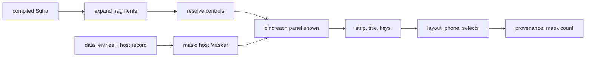

<!-- Copyright (c) 2026 Ashutosh Sinha. Specification licence: ../../LICENSE-SPEC.md (draft, not yet in force). -->
# The Rachana specification, `rachana: 1`

**Normative.** This is the specification of `rachana: 1`, the language of Sutra files, at levels 1.0 to 1.2: the document model, Rachana-EL, the Core function catalogue, the error model, versions and what conformance pins. The conformance suite (`conformance/1/`) is its executable form; where a case and this text disagree, the case wins until the defect is fixed in one of them.

Companion files in this folder (the end of this text, "Files of this folder", says which is generated and which is written):

| File | Normative for |
|---|---|
| this text | meaning: document model, evaluation, functions, errors, versions; then the translation rules (Sutra + data to ViewModel) and the ViewModel contract |
| [rachana-el.ebnf](rachana-el.ebnf) | expression syntax (ISO 14977) |
| [functions.yaml](functions.yaml) | every Core function: signature, types, nulls, errors, examples |
| [formats.yaml](formats.yaml) | the Core format names and how each prints (2.6) |
| [reserved.yaml](reserved.yaml) | the tokens and names held back for later minors, and the profile names to be promoted (4.15) |
| `rachana.lang.json`, `sutra.schema.json` | every key, kind, option; document structure (generated) |
| [viewmodel.schema.json](viewmodel.schema.json) | the ViewModel |
| [PROTOCOL.md](PROTOCOL.md) and the JSON Schemas in [data-protocol/](data-protocol/) | the Data Protocol v1: tables, rows, query and filter tree, live patches, errors, bridge |

## 0. Conventions

- **MUST**, **MUST NOT**, **SHOULD**, **MAY** are used as in RFC 2119.
- An **implementation** is a compiler, binder or linter that claims to implement `rachana: 1`.
- **[today]** marks behaviour of the reference implementation now; **[planned]** marks a settled addition not yet
  built; it gets its `since` minor version when it ships.
- **[CS]** marks a rule whose exact output the conformance suite (`conformance/1/`) will pin. Where this text and the
  suite disagree, that is a defect in one of them and a release blocker; until it is fixed, **the suite wins**.
- Examples use `→` for "evaluates to". `empty` is the empty value (section 4.2).

## 1. Scope

`rachana: 1` defines **Sutra Core**: a YAML document that describes one screen (title, headline strip, controls,
panels, layout, keys, forms) over named data, and **Rachana-EL**, the expression language its values are written in.

A **profile** is a named set of additions a host registers (extra keys, panel kinds, source forms, functions, formats,
problem codes). A profile MUST NOT change the meaning of anything in Core and MUST NOT make a valid Core Sutra invalid.
`drishti` is the first profile; what belongs to it is listed where it matters (sections 2.6 and 5.11).

## 2. Document model

### 2.1 The file

1. A Sutra is **one YAML 1.2 document** in one UTF-8 file named `<name>.sutra.yaml`. The older form
   `<name>.v<N>.sutra.yaml` MUST still be read.
2. YAML is read **strictly**: a key repeated in one mapping, a second document after `---`, and any tag (`!x`) are
   errors (`RCH-2033`). Anchors and aliases are allowed. Every node keeps its line and column.
3. Every string value that holds an expression or template is a YAML string. Single quotes inside a double-quoted YAML
   string are the usual way to write Rachana text: `value: "sum($.sales, 'revenue')"`.
4. **The level.** The first key, `rachana:`, declares the language level the Sutra is written for: `MAJOR.MINOR`, the minor
   optional. `rachana: 1` (or `rachana: 1.0`) is level 1.0, so every Sutra written before levels existed keeps its meaning;
   `rachana: 1.2` (or `"1.2"`) is level 1.2; the minor is read as written (`1.10` is ten). A host reads each Sutra at the level it
   declares, never at its own when that is higher: the same text means the same on every host that reads it. A level above the host's
   is `RCH-2008` ("this Sutra is written for Rachana 1.2; this host runs 1.1 (raise the host's language level)"); a minor no level
   has is `RCH-2009` ("'rachana: 1.7' is a language level this host does not read; the newest it reads is 1.2 (rachana: 1 is 1.0)");
   another major or form keeps `RCH-2009` ("'rachana: 2' is not a language version this server reads (it reads 1)"). A name of a
   later level in a Sutra that declares a lower one is `RCH-2008` with the Sutra's words ("'grid' panels need Rachana 1.1; this
   Sutra is written for 1.0 (declare rachana: 1.1 or later at its top)"). This key is the one place a level is declared: no project
   file, command-line flag or element attribute sets it. A fragment's `rachana:` key is its level in exactly the same way (`1` or
   `1.0` is 1.0, `1.N` is 1.N); a fragment without the key is level 1.0. **A Sutra uses fragments of its own level only**: a use of a
   fragment or block (directly or inside another fragment) whose level is not the Sutra's is `RCH-2008` naming both levels ("fragment
   total@1 is written for Rachana 1.0 and the Sutra that uses it for 1.2: a Sutra uses fragments of its own level only (write the fragment at the Sutra's level)"), so one screen never mixes two meanings of the same text. A file is read at the level it declares and nothing rewrites it to a later level (cases `problem/level-declaration`, `sutra/level-declaration`).
5. An unknown key is an error with its position (`RCH-2011`; `RCH-2023` for a panel option), never ignored. A key that
   belongs to a profile the implementation does not have is `RCH-2060` with words that name the profile, not "unknown".

```yaml
rachana: 1
sutra: regional-sales
version: 1
title: { id: "'Regional sales'" }
data:
  sales: { table: sales, key: [region, month] }
panels:
  - { id: by-region, kind: hbar, rows: "group($.sales, 'region', 'revenue')", label: label, value: value, fmt: amount0 }
```

### 2.2 Top-level keys of Sutra Core

| Key | Req. | Type | Default | Meaning | State |
|---|---|---|---|---|---|
| `rachana` | yes | `1` or `1.N` | | the language level the Sutra is written for (2.1 rule 4): `1` is 1.0 | level declaration 2026-11-21 |
| `sutra` | yes | text matching `[a-z][a-z0-9-]{1,63}` | | the screen's name (`RCH-2020`) | today |
| `version` | today yes | integer 1..2³¹−1 | `1` (1.1) | `name@version` identifies a Sutra | optional: planned (D11) |
| `profiles` | | list of text | `[core]` | profiles the file needs; the checker verifies the claim (`RCH-2061`, `RCH-2062`) | planned |
| `description`, `notes` | | text | | prose for people; never used to build the view (`RCH-2012` if not text) | today |
| `doc` | | mapping | | the doc block (2.9): `summary`, `description`, `category`, `tags`, `use-when`, `avoid-when`, `data`, `example`, `see-also`, `keywords` (`RCH-2055` missing, `RCH-2093` thin) | today; GenUI fields 2026-11-22 |
| `title` | | mapping `{pill?, id, with?}`; text (1.1) | the name | heading (Translation 2.2) | text form planned (D11) |
| `strip` | | list (≤ 8) of `{label?, bind, fmt?, tone?, emphasis?}` | `[]` | headline figures | today |
| `controls` | | list (≤ 12) | `[]` | what the reader sets; read as `ctl.<id>` | today |
| `data` | | mapping name → source | `{}` | the screen's tables and records, each a field of `$` (2.4) | since 1.1 (D10); below it the key is `RCH-2008` (7.2 rule 6) |
| `panels` | | list of panels and `{use: …}` entries | `[]` | the body | today |
| `libraries` | | list of `name@major` | `[]` | the libraries whose fragments the Sutra uses (2.5, LIBRARIES 7.1); the exact version comes from the host's lock | since 1.2 |
| `let` | | mapping name → expression | `{}` | named values (2.7): read as the bare name in every expression; each may read the ones written before it | since 1.2 |
| `functions` | | mapping name → `{params, is, doc?, returns?, examples?}` | `{}` | pure functions (2.7), called `name(...)`; a library's are called `<library>.<name>(...)` | since 1.2 |
| `state` | | mapping id → `{type, default?, doc?}` (≤ 40, fragments' private state included) | `{}` | named values with no widget (2.8): read as `state.<id>`, written only by an effect (`on:`) | since 1.2 |
| `layout` | | mapping | panels flow | 12-column grid: `areas`, `columns`, `split`, `tabs`, `sections`, `sticky`, `arrange`, `phone`, `tablet` | today |
| `phone` | | mapping | | phone order, default tier, summary | today |
| `keys` | | mapping `F1`..`F12` → action | `{}` | function keys (Translation 2.5) | today |
| `refresh` | | seconds, or `{every, user-can-pause}` | none | re-read interval for top-level panels without their own | today |

`match` and `domain` exist today but belong to the `drishti` profile (decision D12). A Core implementation answers
them with `RCH-2060` ("'match' belongs to the profile of a data platform; a Core screen reads its data from 'data:'").

### 2.3 Panels

A panel is a mapping `{id, kind, …}`. `id` is unique in the Sutra (`RCH-2024`). Keys every panel accepts [today]:
`title` (template), `description`, `key` (`F1`..`F12`), `code`, `area` (`main` | `right`), `order`, `section`,
`span` (1..12), `height` (1..24) (`RCH-2030`), `collapsible`, `phone`, `refresh`, `when`, `where`, `on-select`,
`source`, `emits`, `waits`, `children`, `columns`, `form`, `infer`.

Core has **twenty panel kinds**. Each has required and accepted options; any other option is `RCH-2023` with the
accepted ones in `expected`; a missing required option is `RCH-2022`.

| Kind | Requires | Accepts |
|---|---|---|
| `kv` | | `rows`, `columns`, `fields` |
| `table` | `rows` | `totalLabel`, `limit`, `moreLabel`, `link`, `highlight`, `search`, `pivot`, `children`, `expand`, `levels`, `crumb`, `root`, `empty` |
| `ladder` | `rows` | as `table` without `limit`, `moreLabel`, `link` |
| `tabs` | `each` | `tabTitle`, `layout`, `body` or `panels` |
| `line` | | `rows`, `x`, `y`, `mark`, `footer`, `unit`, `fmt`, `step` |
| `area` | `rows` | `x`, `series`, `limit`, `limitLabel`, `unit` |
| `hbar` | `rows` | `label`, `value`, `fmt`, `tone`, `shape` (`bars`, `donut`) |
| `metric` | `value` | `label`, `fmt`, `tone`, `delta`, `deltaFmt`, `deltaTone`, `unit`, `caption` |
| `gauge` | `value` | `max`, `label`, `fmt` |
| `status` | | `fields` |
| `markdown` | `text` | |
| `surface` | `rows`, `y` | `fmt`, `unit`, `view` |
| `waterfall` | `rows` | `label`, `value`, `total`, `sum`, `fmt`, `unit`, `colors` |
| `histogram` | `rows` | `value`, `bins`, `markers`, `fmt`, `unit` |
| `scatter` | `rows`, `x`, `y` | `size`, `label`, `group`, `fmt`, `xFmt`, `xLabel`, `yLabel` |
| `candlestick` | `rows` | `x`, `open`, `high`, `low`, `close`, `volume`, `fmt`, `unit` |
| `graph` | `nodes` | `edges`, `label`, `group`, `layout` |
| `timeline` | `rows` | `date`, `label`, `detail`, `status`, `tone` |
| `pivot` | `rows`, `by`, `across` | `value`, `agg`, `fmt`, `tone`, `heat`, `totals`, `expand` |
| `map` | | `highlight`, `region`, `link`, `shade`, `fmt`, `unit` |

`links` and `provenance` are `drishti` profile kinds.

**What the common panel keys mean.** `id`: unique in the Sutra (`RCH-2024`), used by function keys, patches, controls (`panel:`) and `on-select`;
`kind` one of the kinds below (`RCH-2021`); `title` a template (shown as written when it cannot be rendered); `key` a function key `F1`..`F12`,
unique (`RCH-2025`), scrolling to the panel; `code` a short tag at the right of the panel header; `area` `main` (default) or `right`, or on a
screen with `layout.areas` one of its areas (`RCH-2059` for a name the picture does not have, `RCH-2027` for a name without `layout.areas`);
`order` 0 to 999, the place within its area or flow (not inside a tab); `section` the id of a `layout.sections` entry; `collapsible` lets the
reader fold the panel; `span` 1 to 12 and `height` 1 to 24 grid rows (`RCH-2030`; not on a `tabs` body or a panel inside a tab); `when` an
expression: the panel is left out, with no empty box, where it is false (a panel inside a tab reads `@` as the tab's element);
`where` (every kind with `rows` except `kv`) a condition on each row, `@` the row; `on-select` (`table`, `ladder`, `hbar`) sets a control from a click;
`body` and `panels` for `tabs` only (`RCH-2023` elsewhere); `description` plain text, never evaluated. Every other key is a kind option
(`RCH-2023`), and a missing required option is `RCH-2022`.

**Columns** (`kv`, `table`, `ladder`, `tabs` in the body, `surface`): a mapping `{label, bind, fmt, tone, total, link, emphasis}`. `bind` (required) is an
expression, `@` the row and `#index` its position; `label` the header (a column with none is labelled from its expression); `fmt` a format name
(in a table a column whose format is not `date` or `text` is right-aligned); `tone`; `total: true` adds the column into the total row of a
`table` or `ladder`; `link: true` makes the value a link where the host knows the kind. Any other key is `RCH-2011`.

**Since 1.1: the dataset kinds.** Three kinds of language 1.1 put their rows into the view's `datasets` (ViewModel
contract 1.1, [the ViewModel contract](#the-viewmodel-contract-1x)) as raw values, which the painter formats; the panel's data names the dataset.

| Kind | Requires | Accepts |
|---|---|---|
| `grid` | `rows` | `dataset`, `rowKey`, `group`, `sort`, `limit`, `search`, `empty` |
| `tree` | `rows`, `node` | `parent`, `path`, `label`, `mode` (`grid`, `org`, `sunburst`, `icicle`), `open`, `dataset`, `rowKey`, `limit`, `fmt` (1.2) |
| `chart` | `rows`, `x`, `y` | `type` (`bar`, `line`, `area`, `scatter`, `pie`, `donut`, `heatmap`, `histogram`), `by`, `agg` (`sum`, `count`, `min`, `max`, `avg`, `first`, `last`, `distinct`), `stack` (`sum`, `percent`), `horizontal`, `xLabel`, `yLabel`, `bins`, `top`, `fmt`, `dataset`, `rowKey`, `limit` |

- The dataset's fields are the panel's `columns` (each column's `bind` read per row, raw; its name the field the bind
  reads, `@.notional` gives `notional`, else its label in letters and digits, else `c<n>`; its `label` and `fmt` kept), or,
  without columns, every plain field of the first 50 rows in order of appearance. A field's type is read from its values:
  `number`, `boolean`, `date` (ISO), `datetime`, else `string`. A link is its id; a masked value is `{"$masked": true}`;
  NaN and the infinities are null; lists and records are left out.
- `dataset` names the dataset (default: the panel's id); panels naming one dataset share it, with the rows of the first
  bound. `rowKey` (a field or a list) identifies a row and is kept only when every field exists. `limit` is the most rows
  sent (default 10,000, at most 50,000); the rows left out are counted in the dataset's `more`. `where` filters first.
- `grid`: `group` (fields), `sort` (`field` or `field desc`, a list of up to six), a column's `total: true` is its group
  figure `sum`, a column's word `tone` (`sign`) is kept. `tree`: `node`, `parent`, `path`, `label` are field names; every
  number field that is not one of them is a measure, added up by a node no row names; a measure prints with its column's
  `fmt`, else (level 1.2) the panel's `fmt`. `chart`: `x`, `by` are field names,
  `y` a field or a list; `agg` and `fmt` apply to every `y`; `top` is the most categories drawn.
- Field-name options must be names (`[A-Za-z_][A-Za-z0-9_]*`): `RCH-2029` otherwise, as for every wrong option value.
- **Since 1.2: several series on a `line`.** `layers` (a list of 1 to 12 `{ y, label, mark, tone, axis }`; `mark` `line`, `bar`, `area`
  or `point`, `axis` `left` or `right`) draws fields of wide rows over one `x`; `by` (a field) splits long rows into one series per value
  in order of appearance (at most 12), `x` the values of `x` in order of appearance, a series' missing point null. On a panel that
  emits on `point-click`, a split line's points carry `ev` per series (`Series.ev` beside `x`); a split line writes no state on a click
  (`RCH-2057`). Both are `RCH-2008` below 1.2.
- **Since 1.2: `treemap`** (requires `rows`; accepts `label`, `value`, `group`, `color` (field names), `fmt`): a rectangle per row with a
  positive `value`, nested by `group`, toned `pos` or `neg` by the sign of `color`; `point-click` marks are the cells (`ev`, `set`).
  **`bullet`** (requires `value`; accepts `label`, `fmt`, `min`, `limit`, `lower`, `upper`, `warnAt` (0 to 1, default 0.8), `tone`,
  `caption`): one figure on a band against `limit` (one-sided, from `min`, default 0) or between `lower` and `upper`; within `warnAt` of a
  bound is `warn`, past it `bad`, else `ok` (the figure's tone unless `tone` says otherwise).
- **Since 1.2: `live`** (requires `rows`; accepts `dataset`, `rowKey`, `group`, `sort`, `search`, `empty`, `window`, `top`, `bars`, `edit`): a
  grid over a live host table read a window at a time. `rows` is `$.<entry>` of a `table` entry of `data:` (`RCH-2029`); the entry's
  `key` or the panel's `rowKey` identifies a row (`RCH-2072` without one); each column reads one field (`bind: "@.qty"`, `RCH-2029`);
  it is a panel of the screen, not of a tab (`RCH-2023`). The dataset carries the fields (typed from the rows read) and `live`
  (`table`, `window` 1..5,000, default 200, `top`, and the entry's and the panel's `where` as one filter tree, PROTOCOL 7; a condition
  outside that subset fails the panel), never rows: the painter reads the first window through the page's data client in the panel's
  `sort`, subscribes with those keys (PROTOCOL 16) and applies the patches. A table read only by live panels is planned one window at
  a time (`window` in the plan, FORMAT 5.10). `bars` (also on `grid` from 1.2; `RCH-2008` below it) names number fields drawn with a
  bar in the cell. `edit` (`none`, the default, `cells` or `beside`) offers the table's guarded edit path (PROTOCOL 16 Writes) in
  the grid's cells or in a record panel beside it: the columns offered are those the table's schema lists under `write` for the
  reader (none: the panel stays read only), each change is sent as a protocol `write`; a change shows when the host's table sends it.
- At language level 1.0 these kinds are not offered (the `expected` list of `RCH-2021` is the twenty-two of 1.0) and
  using one is `RCH-2008` (section 7.2). Which options hold an expression, a template, a field name or a
plain word is fixed per kind in `rachana.lang.json` [CS]; the translation rules, section 3 states each one's effect.

### 2.4 Data: the `data:` entries [since 1.1, D10]

`data:` is a key of level 1.1: at level 1.0 the key itself is `RCH-2008` ("'data' needs Rachana 1.1; this host runs 1.0"), as
every name of a later level is (7.2 rule 6). `data:` names the screen's inputs. **Each entry becomes a field of `$`** (a table is a list of rows, a record an
object), so every expression form works unchanged:

```yaml
data:
  sales:   { table: sales, key: [region, month] }   # a name the host resolves (Data Protocol)
  targets: /data/targets.csv                         # text: shorthand for { url: /data/targets.csv }
  regions: { rows: [ { code: N, name: North }, { code: S, name: South } ] }
  summary: { url: /api/summary.json, as: record }
panels:
  - { id: north, kind: metric, value: "sum($.sales[?@.region == 'N'], 'revenue')", fmt: amount0 }
```

A source written as a mapping has **exactly one** of these (`RCH-2073` otherwise):

| Key | Meaning |
|---|---|
| `table: <name>` | a table the host resolves by name (Data Protocol); unknown name: `RCH-2070` |
| `url: <address>` | a file or endpoint read whole; `format: json \| csv \| ndjson \| arrow` (from the extension when absent); `path` picks rows out of a wrapped JSON answer. The host's allow-list decides addresses; an address is never built by an expression |
| `rows: [ … ]` | rows written in the file |
| `record: { … }` | one record written in the file |

Common keys: `key` (field or list of fields identifying a row; required for live changes, selection and drills,
`RCH-2072`), `fields` (`{name: {type, label?, fmt?}}`), `as: rows | record`, `where` (expression over each row `@`;
may read controls), `limit`, `refresh` (seconds), `live: true | false`, `mode: auto | client | server`.

A data name that equals a field of a host's own record is `RCH-2073` in a checked host and a warning otherwise.
**A data name is a field name**, because it is read as `$.<name>`: a letter or `_`, then letters, digits and `_`
(`[A-Za-z_][A-Za-z0-9_]*`). Any other name (`2nd-table`) is `RCH-2073` at the name.

**`as`.** A `table`, `url` or `rows` source is a list of rows and a `record` source one object, unless `as` says otherwise.
`as: record` over rows gives **the first row**, in the order the source gives them and after the entry's `where`; with no row
it gives a record with no fields (`size` 0; every field of it is empty), never an error. `as: rows` over a record gives a list of
that one record.

**A table the host does not have.** `RCH-2070` is reported wherever the host's tables are known: by the plan (FORMAT 5.10) and
by a host's check of the Sutra. When a view is built all the same, the entry has **failed** (PROTOCOL 10.1,
`rdp.table.unknown`): every panel that reads it is in the state `error` with the words of `RCH-2070` (Translation 4 and 10), and
the other panels bind. A missing table is never read as a table with no rows: `count($.t)` over it is an error, not `0`.
A panel's own `source: { table: <name>, where?, limit? }` [today] gives that panel its rows as `$src`; `<name>` is a
`data:` entry or a host table. `source: { kind: … }` is a profile form. There is deliberately no source type for a
function, REST paging or a topic: a host exposes those as named tables.

**Live tables.** A host table may be a *live table*: declared in its own file `<name>.live.yaml` (`rachana: 1`,
`live-table: <name>`, its snapshot source, live stream, key, version and change columns, columns, order, `narrow`,
`retention` and, for a blotter, an `edit:` form; [LIVE_TABLES](../../docs/DESIGN.md#live-tables-design) section 2). A Sutra reads it as
any table (`table: <name>`); it needs no new syntax. A declaration is checked with every problem reported at once
(`RCH-2080`..`2083` below, and the structure codes of 6.2); its Data Protocol additions are PROTOCOL section 16.

### 2.5 Controls, events, forms, fragments (summary)

- **Controls** [today]: `{id, kind, label?, options?, from?, default?, remember?, required?, placement?, panel?,
  parent?, min?, max?, step?, range?}`; kinds `dropdown`, `multi-select`, `cascading`, `toggle`, `segmented`, `date`,
  `date-range`, `number-range`, `top-n`, `search`; codes `RCH-2034`..`2039`. `default` is a value of the control or
  the word `first` (the first option; `multi-select` also `all`); a `top-n` default is a whole number above 0.
  A control's value is read as `ctl.<id>`
  (text; a list of text for `multi-select`; a whole number for `top-n`; `from..to` text for a range). A control
  option form that names an entity kind (`options: { kind: … }`) is a profile form.
- **Events** [today]: a panel `emits: [{name, on}]` (`row-click`, `bar-click`, …; from level 1.2 `point-click` on a `line`, `area`,
  `scatter`, `waterfall`, `timeline` or `candlestick` mark, each a row of its `rows`, and on a `metric`, `gauge`, `kv` or `status`
  as one mark whose payload reads the panel's context, and on a `pivot` cell or a `surface` point, `@` the mark: a cell's
  `{row, path?, column, value}`, a point's `{x, y, z}`, `#index` its place row by row; another kind is `RCH-2057`); another reads them as
  `@<panel>.<event>.<field>`; `waits` says what a panel shows until an event fires; `children` nests panels shown
  `always` or on selection (depth limit `RCH-2056`). `on-select: {by, field?, filter?}` sets a control from a click.
- **Forms** [today, D2]: `form:` with fields, rules, hints, steps and drafts is Core; it raises a `submit` action.
  `form.save` (targets, connectors, approvals) and `editable-by` are the `drishti` profile's (`RCH-2058` for Core shape).
- **Fragments** [today]: a `panels` entry `{use: name@version, with?}` is replaced by the fragment's panels before
  checking; where fragments come from is the host's `FragmentResolver` (`RCH-2048` when not found).
- **Typed fragments** [since 1.2, C1; design [LIBRARIES](../../docs/DESIGN.md#sutra-libraries-the-fragment-library-framework) 4]: a fragment whose every
  `params:` entry is a mapping with a `type`. The file keeps the header `fragment:`; a file is wholly in the text form
  (`%{param}` substituted as text, unchanged) or wholly typed (a mixture is `RCH-2048`). Parameters are of three classes:
  **value** (`text`, `number`, `integer`, `decimal`, `boolean`, `date`, `datetime`, `duration`, `money`, `list<T>`,
  `record{…}`, `T?`): written at the use as an expression in the user's context, read inside as `arg.<name>`; a YAML
  number or `true`/`false` at the use is a literal checked against the type, `min` and `max`; a `text` parameter takes its
  text as written; `arg.x` as a whole value becomes the expression or literal itself, inside a longer expression or
  template the expression in parentheses or the literal as EL text. A `list<T>` or `record{f: T, …}` (fields `name: type`,
  `?` optional; `list<record{…}>` a list of them; no record inside a record) may also be written out at the use as YAML, a
  list of items or a mapping: checked item by item and field by field (a field the type does not declare, a required field
  missing, a field of the wrong type, more items than `max` or fewer than `min`: `RCH-2116`); as a whole value it is placed
  as written (`fields: arg.fields`), inside an expression it is the EL list or record literal. A `text` parameter declared
  `dynamic: true` (only a `text`; else `RCH-2048`) takes a template at the use, read in the caller's context: as a whole
  value it is the template, inside an expression `concat` of its texts and parts; its parts may not read `@`, `^` or
  `#index` (`RCH-2116`); text without `${` and a default stay text as written. A **function** value `fn(T, …) -> U` (one name or
  more; X13) is written at the use as a lambda in the user's context, `lambda x: x / 1000`, with the type's count of names
  and a body that reads its names and the user's screen but not `@`, `^` or `#index` (`RCH-2116`); inside, `arg.f(x)`
  calls it (the expression is wrapped in `let(fn_f = <lambda>, …)`) and `arg.f` as a whole argument of `map`, `sort`,
  `reduce` or `group` is the lambda itself. **table** (`type: table`, `columns:`, `optional`):
  an expression giving rows; a panel with `when-bound: <param>` is left out when an optional table is not given.
  **name** (`id`, `format`, `tone`, `icon`, `variant`, `area`, `palette`, `key`, `enum` with `options`, `columns`):
  fixed at compile time and put in as a checked token where the fragment writes `%{name}` (only name parameters may be
  written so). Each parameter says `required: true`, a literal `default`, or `optional: true`, and has a one-line `doc`
  (`RCH-2055`); `doc.summary` is required (≤ 120 characters). `slots: {name: {accepts: panels, max, doc}}` are filled at
  the use by `slots: {name: [panels]}` and placed by `{slot: name}` in the fragment. At a use: unknown parameter or slot
  `RCH-2114`, required parameter missing `RCH-2115`, wrong type or constraint `RCH-2116`, slot content over `max`
  `RCH-2118`. Below level 1.2 a use of a typed fragment is `RCH-2008`. **Fragments are functions** (decision L-21): a
  table parameter names its local columns (`columns:`) or a published contract (`contract: <name>`, the file
  `contracts/<name>.json` of its library or host, Data Protocol schema form); the use binds it to the caller's table,
  `rows: $.t` (identity) or `rows: { from: $.t, columns: { <local>: <caller column> } }` (a caller column may hold `-`:
  `@.<local>` and a `bind` become `@['bid-size']`; such a name in a field-name option is `RCH-2121`), and the compiler renames the
  local columns to the caller's at compile time: in the panels that read the table its field-name options and `bind`s (a panel
  reads the table when its `rows` gives the table's own rows: `arg.<t>`, filtered, through `sort`, `take`, `drop`, `unique`,
  `difference`, `intersect` or a pipe of them; over `map(arg.<t>, {k: …})`, a record literal, the panel reads the fixed names `k`
  and nothing is renamed; a field-name option or `@.<column>` naming a local column over rows derived any other way is
  `RCH-2121`, never a silent read); in every
  expression `@.<column>` where `@` is a row of the table (such a panel, a filter of the table, the per-element argument of `map`,
  `sort`, `reduce`, `group` over it), a lambda element's field, the field of `first`/`last`/an index of its rows, and the text of a
  Core **column parameter** over it (`sum(arg.rows, 'amount')`; the parameters marked `role: column` in `functions.yaml`). A column
  named where the mapping cannot reach it is `RCH-2121`: a column parameter given a computed text, a local column's text over a
  list that is not the table, a column the table does not declare, a bare name that is a local column (write `@.<name>`). When the
  caller's columns are known (a `data:` entry's `fields`, or its written rows) each required local column must be there
  (`RCH-2115`), a mapped caller column must exist and fit the type (`RCH-2116`); a mapping to a column the fragment does
  not declare is `RCH-2114`; a mapping the fragment never reads is the advisory `RCH-2120` (severity warning). A typed
  fragment reads nothing of the screen (`RCH-2117`). `as: <name>` on a use scopes every id it brings (`<name>-<id>`).
  `emits: [{name, payload, doc}]` declares the events the fragment returns, each raised by one inner panel's `emits`
  with that payload; the screen reads them as `@<as>.<event>.<field>`; `on: {<event>: {set: <control>, field: <name>}}`
  sets a control from the event's row; an effect list `on: {<event>: [{set: {state: <id>, to: <expression>}}]}` writes the
  screen's state, reading the payload as `event.<name>` (2.8). **Private state** (S1): a fragment's `state:` (the shape of
  2.8) is private to each use and held as `<as>.<name>`; a fragment that has state is used with `as:` (`RCH-2115`); its own
  panels read it as `state.<name>` and write it with `set` (any other state is `RCH-2117`). `outputs: {name: type}` names
  private state (of that type; `RCH-2048` otherwise) the screen reads as `state.<as>.<name>`; reading any other private state,
  or writing one, outputs included, is `RCH-2117`. **Nested uses**: a use named `x` inside a fragment used as `a` is the
  instance `a-x`: its ids are `a-x-<id>`, its private state `a-x.<name>`, its events `@a-x.<event>`, so two uses of the outer
  fragment, or two inner uses of one fragment, never collide. The outer fragment reads the inner use as written
  (`state.x.<output>`, `@x.<event>`) and reads only its outputs (`RCH-2117`); the screen reads no nested instance
  (`RCH-2117`), only the outputs of its own uses. **A state parameter** (LIBRARIES 6.3) `{type: state, of?: <state type>}`
  is handed one name of the screen's state at the use (`into: desk`); the fragment writes it, and only it, as
  `set: { state: "%{into}", to: ... }` (written anywhere else, `RCH-2048`). The name must be a state the Sutra holds, of
  type `of` when given (`RCH-2116`). A `selection` parameter waits for selections (I2, `RCH-2023`). A compile result lists the libraries it was built from with their exact
  version and SHA-384 (`Sutra.libraries()`). Not yet at this level: a fragment's `let`, overlays, host actions in `on:`.
- **Libraries** [since 1.2, X42; LIBRARIES 3, 7, 9 to 12]: `libraries: [demo@1]` names each library and its major;
  `use: demo/figure@1` uses a library's fragment (the major is required); `use: demo@1/figure@1` (the long form) is
  accepted without a `libraries:` key. Unqualified names and `<pack>/<name>@N` of the host's resolver keep their meaning.
  The host's `LibraryResolver` finds a library (memory, a folder `rachana_libs/<name>/`, a folder of `.rlib` files;
  never the network); its `rachana.lock` pins the exact version and the SHA-384 of the library's canonical archive.
  A library is a folder of data files with a manifest `<name>.rachana-lib.yaml` (`rachana: 1`, `library`, `version`
  semver, `summary`, `licence`, `scope: public|private`, `profiles`, `depends`, generated `exports`) and
  `MANIFEST.sha384` (a SHA-384 per file); an optional `SIGNATURE` holds Ed25519 signatures of `MANIFEST.sha384`. Inside
  a library every use is `<library>/<fragment>@N` of itself or a declared dependency; a typed fragment of a public
  library reads only its parameters (`RCH-2117` for `$`, `ctl.`, `state.`, `sel.`, `source:`, `data:`, `url:`). Codes:
  `RCH-2110` not found, `2111` not in the lock or another major, `2112` invalid library (also a malformed
  `contracts/<name>.json`), `2113` integrity (hashes, lock, signature). The `.rlib` archive is a ZIP written deterministically (sorted entries, stored, fixed time, no extras), so
  a folder and its archive have one identity.

### 2.6 Formats and tones

`fmt:` and `fmt(value, 'name')` name a **format**; `tone:` names a **tone**. Both are names, never styles. Core's
format names are those of [formats.yaml](formats.yaml) (the table shared with Drishti Elements); a profile MAY add
names, never redefine one.
An unknown format name formats as plain text (`Values.text`) [today, CS]. Core tones: `sign` (→ `pos`/`neg` by the
number's sign, none for 0, empty or non-numbers), `status` (→ `bad` for text containing *fail*, *reject*, *dispute*,
*breach*; `warn` for *pending*, *unmatched*, *warn*; else `ok`; none for empty text), and the fixed tones `pos`, `neg`,
`link`, `accent`, `ok`, `warn`, `bad`. Any other tone word gives no tone [today, CS].

### 2.7 Declared names: `let` and `functions` [since 1.2]

1. **`let:`** maps a name (letters, digits, `_`, starting with a letter) to an expression. In every expression of the
   Sutra the bare name reads that value; a name bound inside the expression (`let(...)`, a lambda's) hides it. A value
   reads the document, the controls and the lets written **before** it (a later one, or itself, is `RCH-2101`); it has
   no current row (`@`, `^`, `#index` outside a list it walks are `RCH-2101`). It is evaluated at most once per bind.
   A let named like a control or a `data:` entry is `RCH-2024`.
2. **`functions:`** maps a name to `{params: {name: type}, is: <expression>, doc?, returns?, examples?}`. A call
   `f(a, b)` (by place or by the parameters' names, exactly as many as declared; piped `a |> f(b)`) evaluates the
   arguments where the call is written, then the body with the parameters bound. A body reads only its parameters
   and other functions: `$`, a bare field, `ctl.`, `@<panel>`, `$src`, a let, or a current row is `RCH-2101`. The
   call graph has no cycle (`RCH-2101`). A Core function's name is `RCH-2020`; a name a later level reserves is an
   advisory (`RCH-2092`) and the local one wins.
3. **Library functions (X42)**: a library declares functions in its manifest's `functions:` and in
   `functions/<file>.yaml` (each a mapping of functions, the same shape). A Sutra naming the library in `libraries:`,
   and every fragment of a loaded library, calls them as `<library>.<name>(...)`; a library function calls only
   library functions, by their library's name.
4. Both are compile-time: the ViewModel never shows them.

### 2.8 State and the effect list [since 1.2]

1. **`state:`** (SUTRA_EXPANSION S1) maps an id (letters, digits, `_`, starting with a letter, at most 32 characters) to
   `{type, default?, doc?}`. `type` is `text`, `number` (an exact decimal, 4.16), `boolean`, `date` (an ISO date text) or
   `list` (a list of text) (`RCH-2023` otherwise); a `default` is a literal of that type (`RCH-2020` otherwise); without one
   the value is empty. An id named like a control, a `let` or a `data:` entry is `RCH-2024`. At most 40 values per screen,
   fragments' private state included (`RCH-2012`). `url: true` and `remember: user` wait for the view-state document (S4)
   and are `RCH-2023` at this level.
2. **Reading.** In a Sutra that holds state, `state.<id>` in any expression is that value (a field named `state` is then
   read as `$.state` or `@.state`); an id it does not hold does not compile (`RCH-2101`, naming the ids it holds). A
   function's body may not read it (2.7, `RCH-2101`); a `let` may. Below level 1.2 the key is `RCH-2008` and `state.x` keeps
   its 1.0 meaning (a field).
3. **The bind.** A bind request carries the values the host kept for the reader as `state.<id>=<text>` (`StateValues`,
   beside `ControlValues`; a list's items joined by commas). A value of an id the Sutra does not hold, or one that does not
   fit its type, is ignored and the default stands. The ViewModel lists every value (contract 1.2): `state[]
   {id, value, url, reads}`, `reads` naming the parts whose expressions read it, directly or through a `let`.
4. **`on:`** (I1) on a panel maps a trigger to a list of effects, run in order. Built at this level: the triggers
   `row-click` (table, ladder; on a tree, `children:`, and a drill table, `levels:`, every node at every level, `@`
   that node), `bar-click` (hbar) and `point-click` (`line`, `area`, `scatter`, `waterfall`, `timeline`,
   `candlestick`: the mark's row; `metric`, `gauge`, `kv`, `status`: one mark, read in the panel's context; `pivot` cells and
   `surface` points: the cell or point as `@`), and the effect
   `set` in two forms: `set: { state: <id>, to: <expression> }` writes a state value, the expression read with `@` the
   clicked row and evaluated per row when the panel binds (the mark's `set` in the ViewModel; a value that fails or does
   not fit the state's type stops the list there);
   `set: <control>` with an optional `field:` sets a control from the clicked row and is the panel's `on-select` (one
   control per click, `RCH-2038`). A `set` naming a state the Sutra does not hold is `RCH-2020`. Also built: `toggle:
   <state>` (a boolean state, `RCH-2020` otherwise), `clear: <state>` (back to its default), `notify: <template>` (with
   `tone:` one of `ok`, `warn`, `bad`, `accent`) and `host: <action>` (a dotted name, with `with: { name: <expression> }`):
   the host's own action, handed over and never run by Rachana (the host decides; a typed fragment never names one,
   `RCH-2117`). Any effect but `set: <control>` takes `when: <expression>`, evaluated per mark: false leaves the effect
   out for that mark. A list that holds only plain state writes is carried as the mark's `set`; any other list as the
   mark's `on` (VIEWMODEL contract 1.2, `EffectView`). The other triggers of the closed list (`row-dblclick`,
   `cell-click`, `change`, `open`, `close`), a trigger the panel's kind does not fire, and the other effects (`open`,
   `close`, `go`, `fire`, `submit`, `refresh`, `export`, `copy`) are `RCH-2023` until their step. `on:` is not offered
   inside a tab.
5. **The form panel** (`kind: form`, SUTRA_EXPANSION 3.6): a standalone form, its `form:` required (`RCH-2022`) and the
   panel itself (no `edit`, `new`, `new-label` or `key`, `RCH-2058`; the fields, rules and hints of RACHANA_REFERENCE 10).
   `initial: { <field>: <expression> }` gives starting values over state and controls (a name that is not a field,
   `RCH-2029`), then each field's `default`; `submitLabel` and `cancelLabel` name the buttons. Its triggers are `submit`
   and `cancel`: a `submit`'s effects run only after the form's own checks pass (a refused form runs none; each failing
   check is said, `ScreenWire.submit`); `cancel` runs without checks. Their effects may read the sent values: a `to:` or a
   `with:` value written `event` or `event.<field>` is filled in when the form is sent (elsewhere `RCH-2012`). Always
   carried as the panel's `on` (`FormPanel`, VIEWMODEL contract 1.2).
6. **`actions:`** (I1): buttons in a panel's header (at most 8, `RCH-2029`), each `{id?, label, tone?, confirm?, requires?,
   do: [effects]}`: `label` and `confirm` are templates (`confirm: true` asks without words), `requires` a permission name
   the host answers, `id` (default: the button's place) unique in the panel (`RCH-2024`); `do` is an effect list as in item
   4, evaluated over the panel's context (no row), `set: <control>` excepted (`RCH-2012`). Carried as `PanelView.actions`.
7. **A control's `on:`** (I1): `on: { change: [effects] }` on a control runs its effects when the reader picks a new
   value (the control takes it as always): the effects of item 4, evaluated over the screen, `event` the new value read
   whole (a text, a multi-select's list, a range's `from..to`; `event.<name>` and `set: <control>` are `RCH-2012`). A
   control fires `change` only (any other trigger `RCH-2023`). Carried as `ControlView.on` (contract 1.2); a host runs
   them with `ScreenWire.change`. Below level 1.2 `on` in a control is `RCH-2011`.

### 2.9 The doc block [GenUI fields 2026-11-22]

Every Sutra, fragment and block carries a `doc:` block: **data the compiler checks**, not a comment. People, component browsers, the
generated library pages, the GenUI catalogue and AI agents read it, and nothing else describes a fragment: a catalogue built from
anything else (comments, READMEs) is not conforming. Its JSON Schema is `$defs/doc` of [sutra.schema.json](sutra.schema.json); a
parameter, a slot, a column, an event and a panel take `$defs/docOf`: one line, or a whole doc block whose `summary` is its line.

```yaml
doc:
  summary: One limit - the amount used against it, with a warning band and, when given, the recent history.
  description: >-
    Give the amount used and the limit. The gauge shows the share used and a word says within the limit, near it or over it.
  category: limits
  tags: [limit, utilisation, gauge]
  use-when:
    - "One limit deserves its own panel: amount used against the limit, with recent history."
  avoid-when:
    - "Many limits at once: use finance/limit-table."
  data:
    table: history
    in-words: "Two numbers (used and limit) and optionally one row per day of history: date and amount used."
    sample-row: { date: "2026-11-20", used: 1850000 }
  example: { use: finance/limit-gauge@1, with: { used: "$.lim.USED_USD", limit: "$.lim.LIMIT_USD" } }
  see-also: [finance/limit-table, finance/limit-band]
  keywords: [limit, utilisation, gauge, headroom, breach]
```

| Key | Type | Fragment, block | Sutra | Rule |
|---|---|---|---|---|
| `summary` | text | required | required | one line, four words or more, at most 120 characters |
| `description` | text | required | required | what it shows and how, 40 characters or more |
| `category` | text | required | required | the group it is listed under (a category of its library) |
| `tags` | list of text | | | the library index's words |
| `use-when` | list of text | required | required | sentences of four words or more: when it is the right choice |
| `avoid-when` | list of text | required | required | sentences: when not, each naming what to use instead |
| `data` | `{table?, in-words, sample-row}` | required | when written | the rows in words (one row per what, which columns); one **synthetic** sample row in the fragment's own column names, with every required column of the parameter `table` names |
| `example` | `{use, with}` | required | when written | a minimal use of it: every required parameter, declared parameters only |
| `see-also` | list of `library/name[@major]` | required (one or more) | when written | related fragments |
| `keywords` | list of text | three or more | three or more | what a user would type to find it |
| `intents`, `params`, `emits`, `expects`, `examples`, `since`, `uses` | | | | the earlier docstring keys (`RCH-2055`), still read |

Any other key is a problem. **`RCH-2093`** reports a missing or thin block field by field, each problem placed at its node with
its JSON Pointer (`/doc/use-when/0`). It is not part of a compile (a compile's warnings are recorded by the conformance cases): a
host runs it where docs matter, a library's quality gate (LIBRARIES 15.2, LG3) fails on any of its problems, and the GenUI kit's
catalogue reports them. Sample rows are synthetic: a doc block never carries real data.

### 2.10 Function keys, control kinds and format files [reference tables]

These tables restate, for authors, rules the implementation applies; where one differs from a section above, the section above rules.

**Function keys.** A function key comes from a panel's `key:` (`F1`..`F12`: the panel is scrolled to; the key's label is the panel's title cut
at the first ` · ` or ` (`) or from the top-level `keys:` mapping, whose value is `link(...)` (opens the entity; no key when the id is
empty or its kind cannot be told), the id of a panel to scroll to (any other text; not checked when the Sutra loads, so a wrong id gives a
key that does nothing), or a profile action (`raw`, `impact`). A key is unique across panels and `keys` (`RCH-2025`, also for a name that is
not `F1`..`F12`), and the key bar shows them in key-number order.

**Control keys** (2.5; `RCH-2034`, a bad key, kind or placement; `2035` a duplicate id; `2036` a reference to a control the Sutra does not
declare; `2037` a `cascading` parent declared after its child; `2038` an `on-select` naming no control or panel; `2039` a default that does
not fit the kind).

| Key | Required | Meaning |
|---|---|---|
| `id` | yes | the name read as `ctl.<id>`: a letter, then letters, digits and underscores, at most 32; unique; `ctl` is reserved |
| `kind` | yes | one of the kinds below |
| `label` | | the text beside the control (the id when absent) |
| `options` | for `dropdown`, `multi-select`, `cascading`, `toggle`, `segmented`, `top-n` | a list of values or `{value, label}` items, or an expression over the data (a list of records offers their `id`); kinds that take none refuse it |
| `default` | | a value, `first`, `all` (`multi-select`), or a relative date token; it must fit the kind (`RCH-2039`) |
| `remember` | | `user` or `none` (default) |
| `required` | | `true`: the reader cannot clear it |
| `placement` | | `strip` (default), `header` (needs `panel`) or `side` |
| `parent` | for `cascading` | the control whose value the options depend on, declared before this one |
| `min`, `max`, `step`, `range` | `min` and `max` for `slider` and `number-range` | bounds (a number or an expression), the step (above zero, default 1) and `range: true` for a slider with two handles whose value is `from..to` |

At most 12 controls; any other key is `RCH-2011`.

| Kind | `ctl.<id>` holds |
|---|---|
| `dropdown`, `toggle`, `segmented` | the chosen value as text (a dropdown's *(all)* is empty text) |
| `multi-select` | a list of the chosen values; an empty list is everything to `oneOf` |
| `cascading` | as a dropdown; its `options` may read `ctl.<parent>` |
| `date` | an ISO date as text, or empty |
| `date-range` | `from..to` as text (either end may be empty) |
| `number-range` | `min..max` as text |
| `slider` | one handle: a number (empty when the scale has no bounds); two handles: `from..to` as text |
| `top-n` | a whole number |
| `search` | the text |

Relative-date defaults: `today`, `yesterday`, `previous-business-day`, `this-week`, `this-month`, `last-month`, `next-month`,
`this-quarter`, `this-year`, `ytd`, `mtd`, `next-90d`, `last-30d` and, on the host's business calendar, `next-5bd`, `last-3bd`; a
`date-range` holds the range they resolve to.

**Format files.** A host or a profile adds formats in a mapping `formats:` of name → definition; a profile MUST NOT redefine a Core name
(2.6). The keys of a definition are those of [formats.yaml](formats.yaml):

| Key | Default | Meaning |
|---|---|---|
| `type` | `number` | `number`, `compact`, `date` or `text` (anything else is treated as `number`) |
| `decimals` | `0` | fraction digits (`number`, `compact`) |
| `grouping` | `true` | thousands separators |
| `sign` | `auto` | `auto` (minus only) or `always` (also `+` on positives; never on zero) |
| `scale` | `1` | multiplier applied first (`100` for a percentage of a fraction) |
| `suffix` | none | appended text (`"%"`, `" bp"`) |
| `pattern` | none | `date` only: a date pattern; `yyyy-MM-dd` or none shows the text unchanged |

```yaml
formats:
  pct4:  { type: number, decimals: 4, scale: 100, suffix: "%" }
  usdm:  { type: number, decimals: 1, scale: 0.000001, suffix: " m" }   # 242000000 -> 242.0 m
  month: { type: date, pattern: "MMM yyyy" }                           # 2026-09-30 -> Sep 2026
```

**Core formats at work.** Output of each Core format (and, at level 1.2, the four promoted names) for two inputs, checked against the
implementation. Negative numbers use the true minus sign `−` (U+2212); rounding is half away from zero; a zero after rounding has no sign;
a text that reads as a number is formatted as a number, any other text is shown as is.

| Name | Definition | `1234567.891` | `-0.040829` | Other |
|---|---|---|---|---|
| `text` | as text | `1234567.891` | `-0.040829` | |
| `amount0` | 0 decimals, grouped | `1,234,568` | `0` | |
| `amount2` | 2 decimals, grouped | `1,234,567.89` | `−0.04` | `'12.5'` (text) → `12.50` |
| `signed0` | 0 decimals, `+` on positives | `+1,234,568` | `0` | `0` → `0` |
| `signed2` | 2 decimals, `+` on positives | `+1,234,567.89` | `−0.04` | |
| `pct0` | × 100, 0 decimals, `%` | `123,456,789%` | `−4%` | `0.83` → `83%` |
| `pct2` | × 100, 2 decimals, `%` | `123,456,789.10%` | `−4.08%` | |
| `price2` | 2 decimals, grouped | `1,234,567.89` | `−0.04` | |
| `compact` | k / m / bn, 1 decimal | `1.2m` | `0.0` | `46000000` → `46.0m`, `2500000000` → `2.5bn`, `999` → `999.0` |
| `date` | `yyyy-MM-dd` | | | text is shown as is, time included (`2025-07-25T09:45:00Z`) |
| `dmy` | `dd MMM yyyy` | | | `2026-09-30` → `30 Sep 2026` (the first ten characters are read as a date) |
| `pct4` (1.2) | × 100, 4 decimals, `%` | | `−4.0829%` | `0.040829` → `4.0829%` |
| `price4` (1.2) | 4 decimals, grouped | | `−0.0408` | `0.040829` → `0.0408` (a price per unit, not scaled) |
| `bp1` (1.2) | 1 decimal, `+` on positives, ` bp` | | `0.0 bp` | `2.5` → `+2.5 bp` (no scaling: give it basis points) |
| `df4` (1.2) | 4 decimals, grouped | | `−0.0408` | `0.991063` → `0.9911` |

## 3. Where expressions appear

A YAML string in a Sutra is one of four things, fixed per key [CS]:

| Form | Examples of keys | Read as |
|---|---|---|
| expression | strip `bind`, column `bind`, `rows`, `each`, `when`, `where`, `highlight`, `value`, `delta`, `max`, `limit` (when text), `title.id`, `title.with`, `children`, `tabTitle`, `moreLabel`, `mark`, `source` (text form), area `limit`, a control's `from`, `min`, `max`, `step`, a `keys` entry beginning `link(` | Rachana-EL (section 4) |
| template | a panel's `title`, `title.pill`, `markdown.text`, metric `caption` | text with `${…}` parts (4.11) |
| field name | `label`, `value`, `x`, `y`, `date` … of chart kinds | a field of each row; see Translation 3.0 for the field-or-expression rule |
| word | `kind`, `fmt`, `tone`, `area`, `layout`, `shape`, `colors`, `view` | a closed set or a name |

Every expression and template of a Sutra MUST be compiled when the Sutra loads; a compile error is `RCH-2101` with the
Sutra position and the offset inside the expression (section 7). Field names are not checked unless types are known
(checked mode, 4.14).

## 4. Rachana-EL

The syntax is [rachana-el.ebnf](rachana-el.ebnf). This section gives the meaning.

### 4.1 Principles

1. **Closed and pure.** No loops, no assignment outside `let`, no I/O. An expression reads only its context (4.3).
2. **Total paths.** A missing field, an index out of range, a path through a non-container: `empty`. Never an error.
3. **Null in, null out.** Operators and scalar functions on `empty` give `empty`, with the exceptions stated.
4. **Wrong types in functions are errors** (`RCH-2102`), which `iferror` catches; operators never raise one, except
   exact arithmetic that would lose a whole unit (4.16).
5. **Deterministic.** The same expression over the same context gives the same value in every implementation: no clock,
   locale or random source except through the context (`asof()`), which the host sets [CS].
6. **One level, the whole text.** Every expression is read at the one language level of Rachana 1 (1.2), wherever it is
   written: a Sutra, a template's part, checked mode (4.14), a host's measure functions (4.10 rule 9) and form rules. An
   expression is the whole text: a token after a complete expression is `RCH-2101` `unexpected '<token>'` at that token
   (`$.a 1`, `net(n) total`), never ignored.

### 4.2 Values

| Value | Written | Notes |
|---|---|---|
| empty | `null`, a missing field | missing and `null` are the same value |
| boolean | `true`, `false` | |
| number | `42`, `0.5`, `.5`, `1e6` | three kinds (4.16): an **integer** (`42`) and a **decimal** (`0.5`, `.5`) are exact, 34 significant digits; a literal with an exponent (`1e6`) and every real-number result is a **number**, an IEEE 754 double. A whole double below 10¹⁵ in magnitude prints without decimals (`1e0 + 1` → `2`) |
| text | `'a'`, `"a"` | Unicode; `''` is a text, not empty |
| date, timestamp | `'2026-11-17'`, `'2026-11-17T09:30:00Z'` | carried as ISO-8601 text; typed only in checked mode |
| list | `[1, 2]`, `$.legs` | ordered |
| object | `$`, `$.legs[0]`, `{a: 1, ...r}` (level 1.1) | fields in written order; a record literal from level 1.1 (4.17) |
| link | `link('CP-1', 'counterparty')` | prints its label or id; what it opens is the host's |
| masked | (from the host) | a value the reader may not see; prints `•••` (4.9) |

**Truthiness**: `empty` false; boolean as is; number true unless 0 or NaN; text true unless `''` (`'false'` and `'0'`
are true); list and object true unless they have no elements; link true; masked never true.

**Text form** of a value (used by `+` joining, templates, comparisons as text) [CS]: empty → `''`; a whole number below
10¹⁵ → digits (`2`, `-7`); an integer or a decimal → plain digits with no exponent and no trailing zeros after the point
(`0.1`, never `1E-1`; `1.10 * 3` → `3.3`; `0.0` → `0`); another number → the shortest round-trip decimal of the double as
the reference prints it (`0.30000000000000004`, `1.0E20`, `NaN`, `Infinity`);
a `decimal` cell of a Data Protocol table (level 1.1, 4.16 rule 8) → the digits the host sent, its zeros after the point kept (`0.10`);
boolean → `true`/`false`; link → its label, else its id; list → `[n]`; object → `{n}` (n = size).

### 4.3 The context: names an expression reads

| Written | Is | Outside its place |
|---|---|---|
| `$` | the screen's record; each `data:` entry is a field | always present (may be empty) |
| `@` | the current row or element (`rows`, `each`, a filter, `map`, `sort`, `reduce`, a row condition) | empty |
| `^`, `^^`, … | the element the current one is in; for a table row, the record | empty |
| `#index` | 0-based position of the current row in its list | `-1` |
| bare `name` | a `let` name in scope; else a field of `@` inside a row; else of `$` | |
| `ctl.<id>` | the current value of control `id` | empty when not set |
| `state.<id>` | the current value of state `id` (2.8; level 1.2, read so only in a Sutra that holds state) | empty when not set |
| `@<panel>` | what panel `<panel>` emitted: `{event: payload}`; `@parent` the parent panel's | empty until it fires |
| `$src` | what the panel's own `source:` names | empty |
| `@acc` | inside `reduce`'s third argument only: the value so far | elsewhere: the events of a panel `acc` |

```text
$.legs[0].notional          a path from the record
@.amount * 2                the row's field
amount * 2                  the same inside a row (a bare name)
$.legs[?^.desk == 'FX']     inside the filter, ^ is the record the list is in
ctl.region                  'North' when the control region is set to North
@trades.select.id           the id the trades panel's select event carried
```

### 4.4 Paths, filters, projection

| Selector | Rule | Example → result |
|---|---|---|
| `.name` | field of an object; empty for anything else; a masked target gives the mask | `$.ccy` → `'USD'`; `'abc'.x` → empty |
| `[n]` | element `trunc(n)` of a list; negative counts from the end; out of range → empty | `$.legs[-1]` → the last leg |
| `['name']` | a field by text (any characters) | `$['day-count']` |
| `[?p]` | the elements for which `p`, with `@` each element and `^` the container's holder, is truthy; a non-list → empty | `$.legs[?@.type == 'FLOAT']` → a list |
| `[*]` | the list itself (a non-list → empty); a following `.name` takes that field of **each** element | `$.legs[*].id` → `[1, 2]` |

A filter result is a list, so `.name` after it is empty: write `first($.legs[?…]).name`. A `.name` after `[*]` keeps
projecting: `$.a[*].b.c` is the `c` of each `b`. An index of a masked list is masked.

### 4.5 Arithmetic and text joining

| Expression | Rule | Examples |
|---|---|---|
| `a + b` | empty if one side is empty and the other is empty or a number; number + number adds; otherwise both sides' text forms are joined | `1 + 2` → `3`; `'Leg ' + 1` → `'Leg 1'`; `'1' + 1` → `'11'`; `empty + 1` → empty; `'x' + empty` → `'x'`; `true + 1` → `'true1'` |
| `a - b`, `a * b`, `a / b`, `a % b` | empty if either side is empty; otherwise both sides as numbers (number-like text counts, read as a literal is (4.16); `true` is 1, `false` 0, other text is NaN) | `'5' * 2` → `10`; `'0.1' * 3` → `0.3`; `'x' * 2` → NaN |
| `a / 0`, `a % 0` | empty | `1 / 0` → empty |
| `a % b` | remainder with the sign of `a` (truncated division) | `-3 % 2` → `-1` (`mod(-3, 2)` → `1`) |
| date − date | two texts that both read as dates (ISO, or a timestamp's first 10 characters followed by `T` or a space) subtract to whole days | `'2026-11-17' - '2026-11-01'` → `16` |
| `-a` | empty stays empty; otherwise the negated number | `-'3'` → `-3` |
| `!a` | the negation of truthiness; masked stays masked | `!empty` → `true`; `!'0'` → `false` |

Which kind of number a result is, and how exact, is 4.16: integers and decimals are exact (`0.1 + 0.2` → `0.3`), `/`
rounds half-even to 34 significant digits, and a double on either side makes the result a double. [CS] pins the text of
every result.

### 4.6 Equality

`a == b`:

1. If either side is empty: true only when both are (`empty == null` → `true`; `empty == 'X'` → `false`;
   `empty != 'X'` → **`true`**).
2. Else if either side is a number: both as numbers (`1 == '1.0'` → `true`; `1 == true` → `true`; `1 == 'a'` → `false`;
   NaN equals nothing). Two exact numbers compare exactly (`0.1 + 0.2 == 0.3` → `true`); an exact number against a double
   compares as two doubles (4.16).
3. Else both text forms compared exactly, case-sensitive (`'USD' == 'usd'` → `false`; `true == 'true'` → `true`).

`!=` is the negation of `==`. A masked side gives the mask.

### 4.7 Ordering

`<`, `<=`, `>`, `>=`:

1. A masked side gives the mask.
2. Both sides as numbers; if both are numbers the comparison is numeric (`'10' > '9'` → `true`), exact between exact
   numbers and as doubles when either is a double (4.16).
3. If either is not a number **and both are texts**, compared as text, character by character by Unicode **code point**
   (ISO dates order correctly: `'2026-01-31' < '2026-02-01'` → `true`; `'｡' < '😀'` → `true`) (4.13) [CS]. **At language level 1.0
   the order is by UTF-16 code unit** (the reference's recorded behaviour, `el/determinism#d-u02-a`: there `'｡' < '😀'` is `false`);
   from level 1.1 it is by code point, as written here.
4. Otherwise `false`: anything against empty, a number against a non-numeric text, a list or object.

A chain `0 < x < 10` parses as `(0 < x) < 10` (a boolean against 10, numerically); write `0 < x && x < 10`.

### 4.8 Logic, conditional, membership

- `a && b`: masked `a` → mask; falsy `a` → `false` without evaluating `b`; else masked `b` → mask, else `truthy(b)`.
- `a || b`: truthy `a` → `true` without evaluating `b`; truthy `b` → `true`; else mask if either is masked, else `false`.
  Results are booleans, never operands: `$.strategy || 'n/a'` → `true`; use `nonblank($.strategy, 'n/a')`.
- `and`, `or`, `not` are the same operators written as Python writes them (DECISIONS PY1): `a and b` is `a && b`, `a or b` is
  `a || b`; `not x` is `!x` read below the comparisons, as Python reads it (`not a == b` is `!(a == b)`; `!a == b` is `(!a) == b`).
  `and` binds tighter than `or`; `x not in list` stays membership.
- `c ? a : b`: masked `c` → mask (either branch would reveal it); else only the chosen branch is evaluated.
  `if(c, a, b?)` and `ifs(c1, a1, …, else?)` are the same conditional in call form; `if` without `b` gives empty.
- `x in list`: true when an element (not masked) equals `x` by 4.6. **Strict**: an empty list, empty, `''` or an
  object holds nothing; a scalar is a list of one. `x not in list` is its negation. Masked `x` or list → mask.

```text
'FX' in ['FX', 'RATES']        → true        empty in [null, 'A']   → true
'FX' in []                     → false       'FX' not in []         → true
'FX' in 'FX'                   → true        one_of('FX', [])       → true   (controls: nothing chosen holds all)
```

### 4.9 Masked values

A host's `Masker` marks values the reader may not see. A masked value prints `•••` in every format and:

1. propagates through every path, operator and function: a result computed from it is masked;
2. is never truthy, so a condition on it is never true (`!` included);
3. in lists: functions that read elements return the mask if any element they read is masked;
4. exceptions: `coalesce` and `nonblank` pass it on only if it is the first value they would return; `a || b` is
   `true` when the other side is truthy; `iferror` returns a masked first argument as it is; `map` masks only the
   element concerned; `if`, `ifs`, `switch`, `choose` are masked only when the masked value decides;
5. a list literal keeps a masked item masked in its place.

### 4.10 Functions: calls, arguments, forms

1. **Closed set.** A name not in the function table of the loaded profiles is a compile error listing near matches
   (`RCH-2101`; with types known, `RCH-9152`). An argument count out of range is a compile error
   (`size takes 1 argument(s), got 2`).
2. **Literal checks.** A wrong literal argument is found at compile time: an unknown day-count basis, interval,
   calendar, unit, fill method, a refused regular expression, a `pad` fill of two characters, a `sequence` length
   outside 0..10,000 [today, CS]. From level 1.1 every literal argument is also checked against the function catalogue
   (`functions.yaml`), the one place, where a function has no check of its own words: a text written for a parameter with an
   `enum` is one of its words (`group($.rows, @.d, sum(@.x), 'decade')` does not compile); a parameter typed
   `boolean-literal`, `integer-literal`, `number-literal` or `string-literal` takes that literal written in the expression
   (`rank(agg, desc = 'sideways')`, `lag(agg, 1.5, order)`, `measure($.x)` do not compile); and a profile function of the
   engine (runs `E`) takes its keyword-only parameters by name only (`rank(agg, 'sideways')` gives `rank` a second argument by
   place, which it has not). Each is `RCH-2101` at the argument. Level 1.0 keeps the reference's acceptance.
3. **Named arguments.** `f(x, name = v)`: names come after positional arguments; the name MUST be a parameter of the
   signature, given once and not also by place. A Core function binds every named argument to its position (a skipped
   optional parameter before it is empty, i.e. its default). A keyword-only parameter (`where`, `by`, `ignore`, …)
   exists only for profile functions; over a list it is refused at evaluation (`RCH-2102`). From level 1.1 a Core
   function's parameter names are those of the function catalogue (`functions.yaml`, the contract: `avg(list, field?)`,
   so `avg($.rows, field = 'x')`); a repeatable parameter (`...values`) is given by place only (`RCH-2101`).
4. **Eager and lazy.** Most functions receive evaluated arguments and return a masked result if any argument is
   masked (4.9). **Forms** receive their arguments unevaluated: `switch`, `iferror`, `is_error`, `choose` evaluate
   lazily; `map`, `sort`, `reduce`, `group` evaluate an argument once per element with `@` the element, `#index` its
   position and `^` the previous `@` (or `$`); `$` is still the record. `if`, `ifs`, `let` are built by the parser.
5. **`reduce` refuses a hand-written sum**: a third argument that adds or subtracts `@acc` with `+`/`-` (also inside
   a conditional's branches) does not compile; use `sum(…)` or `concat(…)`.
6. **Errors.** A function given a value of the wrong type or outside its domain raises `RCH-2102`
   (`round_up: 'abc' is not a number`, `sqrt: -4 is negative`, `eomonth: 'soon' is not a date (yyyy-mm-dd)`).
   Number-like text counts as a number; a number counts as the text it prints (`left(20261016, 4)` → `'2026'`).
7. **Decimals stay decimal.** Rounding, multiples, remainders, whole powers up to ±64, `sqrt`, `clamp`,
   `least`/`greatest`, `sequence`, `yearfrac` compute in decimal arithmetic; an integer or decimal argument is taken as it
   is, a double argument is first read to 15 significant digits (`round_up(1e-1 + 2e-1, 1)` → `0.3`; `power(1.1, 2)` →
   `1.21`). Real-number functions (`exp`, `ln`, trigonometry, distributions, discounting) compute in binary floating point
   and return a number (4.16) [CS]. This project's runtimes compute them with one set of algorithms (the fdlibm ones, in Core's
   own code), so they agree in every bit and RUNNER 7 rule 2 holds byte for byte. That result is not always the correctly
   rounded one (`exp(1)` is `2.7182818284590455`; the nearest double to e is `2.718281828459045`), and no implementation is
   held to the last digit: a case whose expected digits are not the correctly rounded result states a `tolerance` and names no
   `text` (FORMAT 5.2; section 8 item 5), so an implementation that rounds correctly conforms as well.
8. **Dates** are ISO text in and out; a timestamp counts by its date. `asof()` is the as-of date the host sets.
9. **Measure functions** (a host's, such as a BI model's `functions: { net: { params: [x], expr: "x - 1" } }`): before an
   expression is read, each call of one is replaced in its text by the function's expression with the call's arguments in
   place of the parameters, by place only, exactly as many as declared; a function may call another, never itself (a cycle is
   refused). The expression and each function's expression are read whole at the one level (4.1 rule 6), so
   `net(n) if a else 0` is `(n - 1) if a else 0`, never `n - 1`. A problem is `RCH-2101` [today, CS].

### 4.11 Templates

A template is text with `${expression}` parts (EBNF part C). Each part is evaluated and inserted as its text form
(4.2): a link as its label, a list as `[n]`. Text without `${` is used as written. Braces inside a part are matched
(`"${size($.legs)} legs"`); brace matching ignores quotes. An unclosed `${` is `RCH-2101` at the template offset of
`${`; an error inside a part is reported at the offset inside that part [today; CS pins positions].

A host MAY render a template **leniently**, writing a placeholder for a part that fails at evaluation and counting it;
the translation rules say where.

```text
"Leg ${#index + 1} · ${@.type}"        → "Leg 2 · FLOAT"
"${size($.sales)} rows"                → "12 rows"
"Cost: $5"                             → "Cost: $5"   (no ${: literal)
```

### 4.12 Limits

| Bound | Default | Beyond it |
|---|---|---|
| nesting depth (parentheses, brackets, calls, unary operators, `?:` branches, each operand of a binary chain: `a + b + c` is 3) | 200 | `RCH-2101` "expression nested deeper than 200 levels" at the position reached |
| expression length | 10,000 characters | `RCH-2101` at offset 10,000 |
| items in a list literal | 1,000 | `RCH-2101` at the `[` |
| names in one `let` | 63 | `RCH-2101` |
| `sequence` length | 10,000 | compile error for a literal, `RCH-2102` otherwise |
| `group` result | 500 groups | further groups left out [CS] |
| significant digits of a number literal without an exponent | 34 | `RCH-2101` "number '…' has more than 34 significant digits" at the literal (4.16) |
| fields of a record literal (level 1.1) | 1,000 | `RCH-2101` at the <code>{</code>; through spreads `RCH-2102` |
| `range` length (level 1.1) | 10,000 | `RCH-2102` "range: gives at most 10000 values" |

A host MAY lower the depth and length bounds (settings `rachana.max-expression-depth`, `rachana.max-expression-length`)
and MUST report the bound in the message.

### 4.13 Characters

Expressions and texts are sequences of Unicode characters, and a character is a **code point** (decision XD4, EL_EXPANSION
X31): every length, position and order of a text value is counted in code points, in every runtime.

1. **Lengths and positions.** `len`, `left`, `right`, `mid`, `find`, `search`, `pad`, `reverse`, `rept`'s limit, `code`
   (the first character), every position a text function takes or gives, and the 10,000-character bound of an expression
   (4.12) count code points: `len('😀')` → `1`; `mid('a😀b', 2, 1)` → `'😀'`; `code('😀')` → `128512`; `reverse('a😀')` →
   `'😀a'`. A combining mark is a code point of its own (`len('é')` written as `e` and U+0301 → `2`): graphemes are a
   later minor's functions (X31), not the meaning of a length.
2. **Order.** Texts are ordered code point by code point, then the shorter first (4.7, `sort`, and `least` and
   `greatest` over texts): U+FF61 `'｡'` sorts before U+1F600 `'😀'`, although its UTF-16 code unit is larger. No
   locale collation and no case folding: `'B' < 'a'` → `true`. This is the rule **from level 1.1**; **level 1.0 orders by UTF-16
   code unit** (the recorded answers of 1.0 are never changed; see 4.16 for the same split of numbers and 7.2 rule 6), and there
   `'｡' < '😀'` is `false`.
3. **Lone surrogates.** A text from the host may hold an unpaired surrogate (U+D800 to U+DFFF); it counts as one code
   point with that value. An expression's own text cannot hold one (the file is UTF-8).
4. **Source positions are not text values.** The offsets of a problem (6.1, `expr.start`, `range`) and the `at <offset>`
   of a message stay in **UTF-16 code units**, the unit editors and the Language Server Protocol use, so a tool can place
   them without converting (FORMAT 6).

Only characters outside the Basic Multilingual Plane are counted differently from the reference's UTF-16 code units; the
reference changes to this rule (KNOWN_DIFFERENCES, `el/text-code-points`).

### 4.14 Checked mode

Where types are known (a `data:` table with a schema, a profile's models), every expression is also type-checked
before it runs. Types: `integer`, `decimal`, `number`, `string`, `boolean`, `date`, `timestamp`, `none`, `list`,
`table`, `any`. Numeric types fit each other; `date` and `timestamp` fit each other; `any` and `none` fit anywhere.
`integer op integer` is `integer` for `+ - * %`, else `decimal` if either side is, else `number`; `/` is `decimal`;
`date - date` is `integer` days. Checked mode refuses: non-boolean conditions, implicit casts (a text with `+`, a date
against `'9 Oct'`), chained comparisons, screen-only roots (`ctl`, `@panel`, `$src`, `#index`) in data scopes, old
spellings (`RCH-9127`); functions without a signature yet (`RCH-9129`); unknown names with "did you mean"
(`RCH-9152`); a filter, `in`, sort or grouping on a field masked for the reader (`RCH-9161`). **Checked mode only
refuses more; it never changes what a text means.** From level 1.2, a Sutra's plan over the host's schemas (DataPlan, `rachana
explain`) reads each row condition over a table (the entry's `where`, a reading panel's `where`) in checked mode against the table's
columns, with the controls' values in place; an unknown column stays `RCH-2071`. A literal's type is `integer` (whole, no exponent), `decimal` (a
fraction, no exponent) or `number` (with an exponent), as 4.16 says.

**Checked mode in detail** (what the paragraph above leaves open; `check` cases pin it, FORMAT 5.4).

1. **Two types join** wherever an expression gives one of several values: the two branches of `c ? a : b` (and `if`), the two
   sides of `??` (level 1.1), the results of `switch` (every answer, and the else), the arguments of `coalesce`, `least` and `greatest`.
   The types joined MUST fit each other, else `RCH-9127` ("the two values of 'c ? a : b' have different types"). The join
   does not depend on the order written: equal types give that type; `none` (a `null`) gives the other; two numeric types
   join as `+` joins them (`integer` only when both are, else `decimal` when either is, else `number`); `date` with
   `timestamp` gives `timestamp`; `any` with anything gives `any`. So `$.n > 0 ? $.mtm : 0` and `$.n > 0 ? 0 : $.mtm`
   are both `decimal`, and `switch($.status, 'A', 1, 'B', 2, 0)` is `integer`.
2. **`switch`** is typed by rule 1 over its answers; `returns: any` in `functions.yaml` is its unchecked word.
3. **The functions checked mode types.** "Without a signature yet" means: not in this list. Checked mode has a signature for
   these 36 Core functions: `abs`, `all_of`, `any_of`, `asof`, `avg`, `business_days_between`, `coalesce`, `contains`,
   `count`, `date`, `day`, `days_between`, `distinct`, `ends_with`, `floor`, `greatest`, `has`, `if`, `least`, `len`, `lower`,
   `max`, `min`, `month`, `percentile`, `power`, `quarter`, `round`, `shift_date`, `starts_with`, `sum`, `switch`,
   `timestamp`, `upper`, `week`, `year` (and for a profile's own functions, its catalogue). Every other Core function
   (`concat`, `left`, `sqrt`, …), `let(...)`, a record literal, a slice and a lambda are `RCH-9129` in checked mode, at the
   call. A later minor may type more of them (that only refuses less); it never changes the type of one typed here.
4. **`in` and `not in` take a list written in the expression**: `x in ['A', 'B']`. Each item MUST fit the type of the value
   (`null` always fits); an item that does not is its own `RCH-9127`, at that item (`$.status in [1, 2]` is two problems). A
   right side that is not a list literal is `RCH-9127` ("'in' takes a list"), a scalar included: the list of one of 4.8 is
   an implicit cast, which checked mode has none of. A profile may also allow a list attribute of the reader or a parameter
   there (`user.<attribute>`, `param.<name>`). The result is `boolean`.
5. **Parameters that are literals.** Where a value decides the type or the plan, checked mode wants it written in the
   expression (`RCH-9127` otherwise): `round`'s `n` and `shift_date`'s `n` are whole number literals, a leading `-` allowed
   (`round($.mtm, $.n)` is refused: "n is a whole number written in the expression"); `percentile`'s `p` is a number
   literal from 0 to 1; `shift_date`'s `unit` and a `calendar` are text literals.
6. **`date('…')` and `timestamp('…')` take a text literal in ISO 8601 form**, checked when the expression is checked:
   `yyyy-mm-dd`, for a timestamp followed by `T` or a space and `hh:mm`, optionally `:ss` and a fraction, optionally `Z` or an
   offset `±hh:mm`. Anything else is `RCH-9127` ("date('09/10/2026') is not an ISO date"). Unchecked, the same text is
   refused only when it is evaluated (4.10 rule 6).

### 4.15 Reservations

`rachana: 1.0` holds back what its later minors need, so that each of them stays an addition (7.2; decision XD2,
EL_EXPANSION X1). The list is [reserved.yaml](reserved.yaml); everything in it is refused in 1.0 with a message that names it
as reserved, and leaves the file only when a minor defines it.

**Status (2026-11-21).** Level 1.0 is the reference (decision N5): it refuses these tokens with the reference's words
(`unexpected character '|'`, `el/syntax-at-1-0`) and calls a reserved name an unknown function. Level 1.1 defines `|>`, `??`,
`...`, <code>{</code>, <code>}</code>, `/* */` and the digit separator (4.17); `=>`, `..` and a stray `*/` stay refused there, with the
Python spelling as the fix; the reserved names are refused there with this section's message (`el/reserved`).

1. **Tokens.** `|>`, `??`, `=>`, `...`, `..`, `{`, `}`, `/*`, `*/` are tokens of the grammar (EBNF `reserved-token`) and
   are always `RCH-2101`, with the reason reserved.yaml gives (6.3), at the token's offset: `$.a ?? 0` →
   `expression '$.a ?? 0': '??' is reserved for a later version of Rachana: write coalesce(a, b) at 4`. The lexer reads
   them greedily, before the operators: `...` before `..`, and a number stops before `..` (`1..5` is `1`, `..`, `5`).
   An underscore directly inside a number (`1_000`) is refused the same way (`'_' in a number is reserved …`), so digit
   separators can come later. Inside a quoted text none of these is anything but characters (`'{'` is a text).
2. **Core names.** reserved.yaml's `names` (278 function names, by the addition each is held for) are not Core
   functions in 1.0 and are never offered (not in `expected`, near-match lists, completion or the prompt kit). A call of
   one is `RCH-2101` "'<name>' is reserved for a later version of Rachana", in place of "unknown function"; a profile
   that registers one is refused at registration, **unless** reserved.yaml lists it under `promoted` for that profile:
   the profile keeps it, with its meaning, until Core defines the name with the same meaning proven by the profile's own
   cases (EL_EXPANSION rule 9). A call of a name a known profile owns keeps that profile's problem when the profile is not
   loaded (`RCH-2060`, 5.11). A field of that name (`$.filter`, `@.rank`) is a field as before: only calls are held.
3. **Answers are open sets.** Words a function answers from a closed list today may gain members in a later minor:
   `type_of` (`'decimal'`, `'date'`, `'money'`, …), the kinds of `sort` keys, the tones. A host and a caller MUST accept a
   word they do not know, as a painter accepts an unknown tone (it draws nothing for it); a runtime of 1.0 itself answers
   only the 1.0 words (`type_of` of an integer or a decimal is `'number'`).
4. **Names an author defines win.** A name an author defines (a `let` name today; a function or a library alias in a later
   minor, X41) is never taken away by a Core name a later minor adds: where it is in scope it keeps its meaning, and the
   compiler warns that it hides a Core name (the warning's code is assigned with X41). Core's new names therefore never
   change what an existing Sutra means.

### 4.16 Numbers: integer, decimal, number

**Built at language level 1.1** (2026-11-21, EL phase 1); level 1.0 keeps the reference's doubles for literals and operators
(decision N5; KNOWN_DIFFERENCES). Three kinds of number, as checked mode names them (decision XD3, EL_EXPANSION X2). The arithmetic is Core's own code
(`CoreDecimal`, `CoreMath`) in every runtime, so the same expression gives the same digits everywhere.

| Kind | What it is | Written as |
|---|---|---|
| **integer** | an exact whole number of at most 34 digits; an integer is a decimal with no fraction, so 64-bit identifiers survive (`9007199254740993` stays itself) | `42`, `0`, `1234567890123456789` |
| **decimal** | an exact decimal of at most 34 significant digits: IEEE 754 **decimal128** values, exponent range included | `0.1`, `.5`, `1.10`, `1.` |
| **number** | an IEEE 754 binary64 double | a literal with an exponent (`1e-3`, `2.5E3`), a real-number function's result, a double from the host |

1. **Literals.** A number literal without an exponent is an integer or a decimal, exactly as written; one with more than
   34 significant digits does not compile (`RCH-2101` "number '…' has more than 34 significant digits"). A literal with
   an exponent is a double: write `1e-3` for a double, `0.001` for an exact thousandth. Number-like text that an operator
   or a function reads as a number follows the same rule (`'0.1' * 3` → `0.3`).
2. **`+`, `-`, `*`, `%` and unary `-` on integers and decimals are exact**: `0.1 + 0.2` → `0.3`; `1.10 * 3` → `3.3`;
   `5.5 % 2` → `1.5`. A result that needs more than 34 significant digits is rounded **half to even** to 34 digits
   (decimal128 rounding), and only digits after the point can be lost that way: a result whose integer part has more
   than 34 digits (its magnitude is 10³⁴ or more) is `RCH-2102` "the result needs more than 34 digits before the point",
   never a silent loss of a unit. `date − date` (4.5) is an integer of days.
3. **`/` on integers and decimals** gives the quotient rounded half to even to 34 significant digits: `1 / 3` →
   `0.3333333333333333333333333333333333`; `2 / 3` → `0.6666666666666666666666666666666667`; `10 / 4` → `2.5`. `/ 0`
   and `% 0` are empty, as for every kind (4.5).
4. **A double on either side makes a double.** An integer or decimal meeting a number is converted to the nearest
   double and the operation is binary floating point: `1e-3 * 2` → `0.002` (a number); `0.1 + 1e-1` →
   `0.2` (a number). Equality and ordering follow the same rule: two exact numbers compare exactly, anything with a
   double compares as doubles (`0.1 == 1e-1` → `true`).
5. **Real-number functions** (`exp`, `ln`, `log`, the trigonometry, `power` beyond whole exponents, distributions,
   discounting) take doubles and return a number; the decimal functions of 4.10 rule 7 keep their exact results.
6. **Values from the host** keep the kind the host gives: a JSON number in a record is a double; a column the Data
   Protocol types `decimal` or `integer` arrives exact. `$.qty * 2` with a JSON `qty` of `3` is the double `6`, which
   prints `6`.
7. **List aggregates** add as `+` does: exact over integers and decimals (`sum([0.1, 0.2])` → `0.3`). `avg` is that exact
   sum divided by the count of values as `/` divides (rule 3: decimal128, half to even to 34 significant digits; a computed
   value, so no trailing zeros): `avg([1, 2, 2])` → `1.666666666666666666666666666666667`, `avg([1.25, 2.75])` → `2`, the
   digits a host gives for `avg` of a decimal column (PROTOCOL 3.1). `min(list)` and `max(list)` are the element chosen,
   exact (`min([0.3, 0.10])` → `0.1`, printed by rule 8). Once a double is among the elements, the whole aggregate is the
   double one of 5.7 (the sum compensated, the mean that sum over the count). `median`, `percentile` and the statistics of
   5.7 and 5.8 (`variance`, `stddev`, …) are real-number aggregates at every level: they answer a number, as a host's
   `median` and `percentile` do (PROTOCOL 6.3). Over no value `sum` is `0` and every other of these empty (5.1).
8. **Text form**: 4.2. A decimal never prints an exponent, trailing zeros after the point, or a negative zero.
   **One exception, for a cell as the host sent it.** A `decimal` cell of a Data Protocol table is exact and keeps the digits
   after the point it arrived with (PROTOCOL 3.1: the column's `scale`): the cell `"0.10"` prints `0.10`, by itself, joined
   to a text and in a template, so a price shows as the source states it. It is the same value as `0.1` (`$.fees[0].fee ==
   0.1` is true; it adds and orders exactly). The result of any operator or function is a new decimal and prints by the rule
   above: `$.fees[0].fee * 1` → `0.1`, `sum($.fees, 'fee')` over `0.10` and `0.20` → `0.3`. A decimal literal has no such
   scale: `0.10` written in an expression prints `0.1`. A `fmt` decides the digits wherever they matter (2.6).

`type_of` answers `'number'` for all three kinds in 1.0 (4.15 rule 3); `expr` cases name the kind in their `type`
(`number` for a double, `decimal` for an exact result: FORMAT 5.2).

### 4.17 Level 1.1: the syntax batch

Level 1.1 adds, in one grammar revision (EBNF part D; EL_EXPANSION XD5), the constructs below, spelled as Python spells them
(DECISIONS PY1 to PY8) with Excel's function names. A host at level 1.0 reads none of them: each is refused with the reference's
words (`el/syntax-at-1-0`). Every one is pinned by `el/syntax-1-1`.

| Construct | Meaning | Example → result |
|---|---|---|
| record <code>{k: v, 'k-2': v, ...r}</code> | an object, keys in written order; a key written twice does not compile; a later key or spread replaces an earlier one in its place; spreading empty adds nothing, a masked value masks the record, a non-record is `RCH-2102`; at most 1,000 fields | `{...$.r, b: 9}` → `{b: 9, c: 3}` |
| list spread `[...a, b]` | the elements of `a` in place; empty adds nothing; a non-list is `RCH-2102` | `[...[1, 2], 3]` → `[1, 2, 3]` |
| slice `t[a:b]`, `t[a:b:c]` | Python's: end-exclusive, each part optional, a negative end from the end, clamped; a list gives a list, a text a text by code point; step 0 is `RCH-2102`; empty gives empty | `[10, 20, 30, 40][1:3]` → `[20, 30]` |
| `range(stop)`, `range(start, stop, step?)` | Python's, end-exclusive, whole numbers, at most 10,000; `..` stays reserved (PY4). Only the sequence (DECISIONS EL1-1): a list or a text written as an argument does not compile and one met at evaluation is `RCH-2102`, both naming `span` | `range(10, 0, -3)` → `[10, 7, 4, 1]` |
| `span(list, field?)` | max − min, the aggregate level 1.0 spells `range(list, field?)` (split step A9; the same kernel); not a name at 1.0 (EL1-1) | `span([3, 9, 4])` → `6` |
| pipe `x \|> f(a)` | `f(x, a)`, rewritten before anything else; the lowest precedence; the right side is a call | `1 + 2 \|> round(0)` → `3` |
| `a ?? b` | `a` unless it is empty, else `b` (evaluated only then); `''` and `0` are values; a masked `a` is passed on; between the conditional and `\|\|` | `$.missing ?? 'n/a'` → `'n/a'` |
| `a if c else b` | the conditional in Python's order (PY2); `c ? a : b` and `if(c, a, b)` stay | `'big' if 5 > 3 else 'small'` → `'big'` |
| `lambda x: body`, `lambda acc, x: body` | a function, **second class** (XD8): an argument of `map`, `sort` (a key), `reduce` (two names) or `group` (the key), or a `let` value called as `f(…)`; never stored, compared or printed; a `let` name is not in scope in its own value, so there is no recursion; inside, `@`, `^`, `#index` keep their outer meaning; `=>` stays reserved (PY3) | `let(bp = lambda x: x * 10000, bp(0.0125))` → `125` |
| `a ** b`, `a ^ b` | power (PY6), right-associative, tighter than a sign on its left (`-2 ** 2` → `-4`, Python's rule); a sign written right before a power spelled `^` without parentheses does not compile (`-2 ^ 2` is `RCH-2101`: Excel reads it as `4`; write `-(2 ^ 2)` or `(-2) ^ 2`; EL1-2 as amended by gate 2, O6); checked mode warns `RCH-2091` on `-x ** n`, with both readings as the fix; exact for an exact base and a whole exponent of at most 64, else a double; `^` before an operand is still the parent | `2 ** 3 ** 2` → `512` |
| comment `/* … */` | white space; not nested; not kept by the printer | `1 /* one */ + 2` → `3` |
| digit separator `1_000_000` | an underscore only between two digits | `1_000.000_1` → `1000.0001` |
| exact numbers | 4.16 | `0.1 * 3 == 0.3` → `true` |
| texts by code point | 4.13: `left`, `right`, `mid`, `find`, `search`, `pad`, ordering, `sort`, `least`, `greatest` | `'｡' < '😀'` → `true` |
| reserved names | a call of a name of reserved.yaml that no loaded table has is "'<name>' is reserved for a later version of Rachana" (4.15) | `group_by(…)` |

Problem messages at level 1.1 are `expression '<source>': <reason> at <offset>` (6.3), and `expr.end` is the end of the offending
token where it is known (a reserved token, a number, a reserved name).

## 5. Function catalogue (Core)

Core has **208 functions** and 7 deprecated spellings. Each entry's full signature, parameter types, defaults, null and error
behaviour and examples are in `functions.yaml`; each example there is a conformance case. Arity is
written `min–max`; `?` marks an optional argument; `…` a repeatable one.

### 5.1 Rules every function keeps

- Empty in, empty out, unless stated. Exceptions: the text tests (`contains`, `starts_with`, `ends_with`, `matches`,
  `matches_case`, `has`, `any_of`, `all_of`) answer `false`; `is_*` and `type_of` answer for empty; `concat`,
  `coalesce`, `nonblank`, `least`, `greatest` skip empty arguments; `size` gives `0`; `sum` and `count` of nothing give
  `0`, other aggregates empty.
- Tests answer `true` or `false`, never empty.
- Masked in, masked out (4.9).
- Wrong type → `RCH-2102` naming the function and the value. An aggregate over a list (5.7) refuses a first argument
  that is not a list, empty or masked from level 1.1; level 1.0 keeps its recorded answer (empty, `0` for `sum` and
  `count`). A host value the runtime cannot read is `RCH-2102` at every level: it is never added up as `0`.

### 5.2 Logic and choice (21)

| Function | Arity | Result | Example |
|---|---|---|---|
| `if(c, a, b?)` | 2–3 | `a` if `c` is truthy else `b` (empty); lazy | `if($.qty > 0, 'long', 'short')` |
| `ifs(c1, a1, …, else?)` | 2–64 | the answer of the first truthy condition; odd count: last is else | `ifs($.n > 1e9, 'L', $.n > 1e8, 'M', 'S')` |
| `switch(x, v1, a1, …, else?)` | 3–64 | the answer of the first `vi == x` (4.6); even count: last is else; lazy | `switch($.type, 'FIXED', 'F', 'FLOAT', 'V', '?')` |
| `iferror(x, y)` | 2 | `x`, or `y` when `x` raises `RCH-2102`, is empty or NaN; `y` lazy | `iferror($.a / $.b, 0)` |
| `is_error(x)` | 1 | whether `x` raises an error | `is_error(date('soon'))` → `true` |
| `let(n = v, …, r)` | 2–64 | `r` with the names bound in turn | `let(n = $.notional, n / 1e6)` |
| `choose(i, a1, a2, …)` | 2–64 | the `i`-th value (1-based); lazy | `choose(2, 'a', 'b')` → `'b'` |
| `coalesce(a, …)` | 1–8 | first non-empty (`''` counts as a value) | `coalesce($.book, 'UNBOOKED')` |
| `nonblank(a, …)` | 1–8 | first that is neither empty nor blank text | `nonblank($.pkg, 'n/a')` |
| `within(v, 'from..to')` | 2 | `v` in the range; either end may be empty; an empty range holds all; numbers as numbers, else text | `within($.date, ctl.when)` |
| `one_of(v, list)` | 2 | `v` equals an element; **empty choice holds everything** | `one_of($.desk, ctl.desks)` |
| `has(list, v)`, `any_of(list, vs)`, `all_of(list, vs)` | 2 | list attribute tests | `has($.tags, 'fx')` |
| `link(id, kind?, label?)` | 1–3 | a link value; empty when `id` is empty | `link($.cpty, 'counterparty')` |
| `is_number`, `is_text`, `is_date`, `is_boolean`, `is_blank` | 1 | type tests (`is_blank`: empty, NaN or blank text) | `is_blank('  ')` → `true` |
| `type_of(x)` | 1 | `'empty'`, `'number'`, `'text'`, `'boolean'`, `'link'`, `'list'`, `'object'` | `type_of([1])` → `'list'` |

### 5.3 Math (43)

`abs`, `sign`, `sqrt`, `exp`, `ln`, `log10` (1); `log(x, base?)` (1–2); `round(x, n?)`, `round_up`, `round_down`,
`ceiling(x, m?)`, `floor(x, m?)` (1–2); `round_sig(x, digits)`, `mround(x, m)`, `mod(x, y)`, `power(x, y)`,
`combin`, `permut`, `atan2(x, y)`, `decimal(text, radix)` (2); `base(n, radix, min_len?)` (2–3); `clamp(x, lo, hi)`
(3); `fact`, `even`, `odd` (1); `gcd(…)`, `lcm(…)`, `least(…)`, `greatest(…)` (1–64); `pi()` (0); `sin`, `cos`,
`tan`, `asin`, `acos`, `atan`, `sinh`, `cosh`, `tanh`, `radians`, `degrees` (1); `min`, `max` (1–8: over one list,
the list aggregate; with several arguments, the deprecated spelling of `least`/`greatest`).

| Example | Result |
|---|---|
| `round(2.675, 2)` | `2.68` (half away from zero, in decimal) |
| `round_up(2.671, 2)`, `round_down(-2.679, 2)` | `2.68`, `-2.67` |
| `mod(-3, 2)` | `1` (sign of the divisor; empty when `y` is 0) |
| `ceiling(4.2, 0.5)` | `4.5` |
| `power(2, -1)`, `power(0, -1)` | `0.5`, empty |
| `least($.maturity, '2030-12-31')` | the earlier ISO date (no numbers: compared as text) |
| `max($.legs[*].notional)` | the largest number in the list |

### 5.4 Text (32)

`upper`, `lower`, `proper`, `trim`, `clean`, `len`, `char`, `code`, `reverse` (1); `left(t, n)`, `right(t, n)`,
`rept(t, n)`, `exact(a, b)`, `split(t, sep)`, `contains(t, part)`, `starts_with`, `ends_with`, `matches(t, re)`,
`matches_case(t, re)`, `fmt(v, 'format')`, `text(v, 'excel-format')` (2); `mid(t, start, n)`, `replace(t, old,
new)`, `regex_replace(t, re, by)` (3); `find(part, t, start?)`, `search(part, t, start?)`, `text_before(t, sep,
n?)`, `text_after(t, sep, n?)`, `regex_extract(t, re, group?)` (2–3); `value(t, decimal_sep?, group_sep?)` (1–3); `pad(t, n, char?, side?)`
(2–4); `concat(…)` (1–64).

Rules: `contains`, `starts_with`, `ends_with`, `matches` ignore case; `matches_case`, `regex_*`, `replace`, `exact`
do not. Regular expressions run on a linear-time engine: classes, groups `( )` and `(?: )`, alternation, `* + ? {n,m}`
and lazy forms, `^`, `$`, a leading `(?i)`; back-references, look-around, atomic groups, possessive quantifiers and
`\b` are refused at compile time for a literal pattern; patterns ≤ 200 characters; input cut at 8,192 characters
[CS]. Positions are 1-based (`mid`, `find`); `find`/`search` give 0 when absent.

| Example | Result |
|---|---|
| `left('MX-2000', 3)`, `mid('MX-2000', 4, 2)` | `'MX-'`, `'20'` |
| `split('2032-06-25', '-')` | `['2032', '06', '25']` |
| `pad(7, 3, '0')` | `'007'` |
| `concat($.book, ' / ', $.ccy)` | `'BOOK-3 / AUD'` (empty parts add nothing; a list is an error) |
| `regex_extract('MX-1', '^([A-Z]+)-', 1)` | `'MX'` |
| `fmt(1234.5, 'amount0')` | `'1,235'` (the named format) |

### 5.5 Dates (22)

`asof()` (0); `date(text)` or `date(y, m, d)` (1–3); `timestamp(text)`, `year`, `quarter`, `month`, `week` (ISO),
`day`, `hour`, `minute`, `second` (1); `weekday(d, type?)`, `eomonth(d, n?)`, `is_business_day(d, calendar?)` (1–2);
`days_between(a, b)`, `edate(d, n)` (2); `days360(a, b, european?)`, `business_days_between(a, b, calendar?)` (2–3);
`datedif(a, b, unit)`, `yearfrac(a, b, basis)` (3); `intck(interval, a, b, calendar?)` (3–4);
`shift_date(d, n, unit?, calendar?)` (2–4).

Fixed vocabularies (compile-time checked when literal): `yearfrac` bases `ACT/360`, `ACT/365F`, `30/360`, `30E/360`,
`ACT/ACT`; `intck` intervals `day`, `week`, `month`, `quarter`, `year`, `business_day`; `datedif` units `Y`, `M`,
`D`, `MD`, `YM`, `YD`; `shift_date` units `business-day` (default; `business_day` accepted), `day`, `week`, `month`,
`quarter`, `year`. Calendars come from the host's `Calendars` hook; **without one, weekends are the only non-business
days** [planned; today the reference defaults to its `USNY` calendar].

| Example | Result |
|---|---|
| `days_between('2026-11-01', '2026-11-17')` | `16` |
| `edate('2024-01-31', 1)` | `'2024-02-29'` |
| `date(2026, 14, 1)` | `'2027-02-01'` (Excel carry-over) |
| `week('2027-01-01')` | `53` |
| `shift_date(asof(), -1)` | the business day before the as-of date |

### 5.6 Lists (21)

`size`, `first`, `last`, `flatten`, `unique` (1); `take(l, n)`, `drop(l, n)` (2); `sequence(n, start?, step?)` (1–3);
`map(l, expr)` (2); `reduce(l, init, expr)` (3); `sort(l, key?, desc?, key2?, desc2?, …)` (1–17);
`group(l, key, aggregate?, by?)` (2–4); `fillmissing(l, method, value?)` (2–3); `interp1(xs, ys, x, method?)` (3–4);
`polyval(coeffs, x)` (2); `trapz(ys)` or `trapz(xs, ys)`, `cumtrapz` likewise (1–2); `union`, `intersect`, `difference`,
`is_member` (2).

| Example | Result |
|---|---|
| `size($.legs)`, `size('abc')`, `size(5)` | `2`, `3`, `0` |
| `take(sort($.events, @.date, true), 3)` | the three latest events |
| `map($.legs, @.notional / 1e6)` | `[242, 242]` |
| `reduce($.legs, '', concat(@acc, left(@.type, 2)))` | `'FIFL'` |
| `group($.sales, 'region', 'revenue')` | `[{label, value, count}, …]` in key order; ≤ 500 groups |
| `group($.sales, @.region, avg(@.price))` | the average price per region |
| `sequence(3, 0.1, 0.1)` | `[0.1, 0.2, 0.3]` (decimal) |

`sort` orders numbers (and number-like text) as numbers and before text; text by character; empty keys last either
way; stable. `unique` keeps the first of each (`1` and `1.0` are one; `'1'` differs). `group`'s key is a quoted field
(dotted path) or an expression over `@`; its aggregate a quoted field (summed) or an aggregate call over `@`; `by`
`'month'`/`'year'` cuts an ISO date key.

### 5.7 List aggregates (11, plus `min` and `max`; the kernel moving into Core)

`sum(l, 'field'?)`, `avg`, `median`, `variance`, `stddev`, `variance_pop`, `stddev_pop`, `distinct` (1–2);
`count(l?, 'field'?)` (0–2); `percentile(l, 'field'?, p)` (2–3); `wavg(l, 'x', 'w')` or `wavg(xs, ws)` (2–3);
`min(l)`, `max(l)` (above); from level 1.1 `span(l, 'field'?)`, max − min (4.17). Number-like text counts; other non-numbers are skipped; a masked element masks the result;
`sum` uses compensated summation [CS]. `percentile` is Excel's `PERCENTILE.INC`.

`sum($.legs, 'notional')` → `484000000`; `percentile($.pnl[*].v, 0.99)`; `wavg($.legs, 'price', 'qty')`.

### 5.8 Statistics (32)

`norm_dist(x, mean, sd, cumulative?)`, `norm_inv(p, mean, sd)`, `norm_s_dist(z, cumulative?)`, `norm_s_inv(p)`,
`lognorm_dist`, `lognorm_inv`, `t_dist`, `t_inv`, `chisq_dist`, `chisq_inv`, `f_dist`, `f_inv`, `binom_dist`,
`binom_inv`, `poisson_dist`, `expon_dist`, `gamma_dist`, `gamma_inv`, `gamma`, `gamma_ln`, `beta_dist` (3–6),
`beta_inv` (3–5), `weibull_dist`, `hypgeom_dist` (4–5), `negbinom_dist`, `erf`, `erfc`, `standardize`,
`confidence_norm`, `confidence_t`, `fisher`, `fisher_inv`: Excel's functions of the same name with `.` written `_`.
`norm_s_inv(0.99)` → `2.3263478740408408` [CS: real-number results are pinned to a tolerance stated per case].

### 5.9 Finance on given flows (25)

`npv(rate, flows)`, `xnpv(rate, flows, dates)`, `irr(flows, guess?)`, `xirr(flows, dates, guess?)`, `mirr`, `pv`,
`fv`, `pmt`, `nper` (3–5), `ipmt`, `ppmt` (4–6), `rate` (3–6), `cumipmt`, `cumprinc` (6), `effect`, `nominal`,
`fvschedule` (2), `rri`, `pduration` (3), `accrued(rate, start, end, …)` (3–5), `dollarde`, `dollarfr` (2),
`macaulay_duration`, `modified_duration`, `convexity` (3–5). Root finders (`irr`, `xirr`, `rate`) use Newton's method
from the guess, then a sign-change scan, to 1e-12; no root is `RCH-2102`, never a non-root figure. A flow list with an
empty element gives empty.

### 5.10 Deprecated spellings (read, never offered; warning `RCH-2090` with a fix)

| Old | Write | Note |
|---|---|---|
| `startsWith`, `matchesCase`, `oneOf` | `starts_with`, `matches_case`, `one_of` | same results |
| `today()` | `asof()` | same result |
| `days(a, b)` | `days_between(a, b)` | `days` gives empty, not an error, for a non-date |
| `min(a, b, …)`, `max(a, b, …)` | `least`, `greatest` | the old form skips non-numbers |

### 5.11 Not in Core

**Drishti profile functions** (they need a model or a platform): `measure`, `cell`, `ratio`, `convert`, `fx`,
`related`, `related_rows`, `calc`, `share_of`, `parent_of`, `as_of`, `avg_by`, `sum_by`, `min_by`, `max_by`,
`avg_over`, `latest`, `earliest`, `opening`, `closing`, the time functions `ytd`, `mtd`, `qtd`, `fiscal_ytd`,
`prior_period`, `same_period_last_year`, `running`, and the windows `lag`, `lead`, `rank`, `dense_rank`,
`percent_rank`, `moving_avg`, `moving_sum`, `moving_min`, `moving_max`. A Core implementation that meets one answers
`RCH-2060` naming the profile.

**Not yet classified** (supplied today by a host's pivot engine as list functions; Core or profile is
not yet settled, so a Core implementation MAY lack them): `sum_once`, `count_once`, `avg_once`, `sumproduct`, `sumsq`,
`product`, `devsq`, `avedev`, `geomean`, `harmean`, `mode`, `mode_multi`, `range` (spelled `span` from level 1.1, EL1-1), `iqr`, `cv`, `stderr`, `nmiss`,
`kurtosis`, `skewness`, `skewness_pop`, `covar`, `covar_pop`, `corr`, `rsq`, `slope`, `intercept`, `steyx`,
`trimmean`, `percentile_exc`, `rank_avg`, `percent_rank_of`, `kth_largest`, `kth_smallest`, `string_agg`, `cumsum`,
`cumprod`, `cummax`, `cummin`, `movsum`, `movmean`, `movstd`, `movmedian`, `maxk`, `mink`, `bounds`, `zscore`,
`rescale`, `isoutlier`, `polyfit`.

### 5.12 Equivalents in Excel, SAS and MATLAB [informative]

An analyst coming from Excel, SAS or MATLAB finds these families in Core, each function under one name (the arguments, rules and
examples are 5.2 to 5.9 and [functions.yaml](functions.yaml); the host's list functions, such as running and moving statistics, are
[not in Core](#511-not-in-core)).

| Family | Functions | Example |
|---|---|---|
| Math | `round`, `round_sig`, `log(x, base?)`, `fact`, `combin`, `permut`, `gcd`, `lcm`, `even`, `odd`, `pi`, `sin` ... `atan2`, `sinh`, `cosh`, `tanh`, `radians`, `degrees`, `base`, `decimal` | `round(242000000 / 1e6, 1)` is `242` |
| Information and choice | `is_number`, `is_text`, `is_date`, `is_boolean`, `is_blank`, `is_error`, `type_of`, `choose` | `choose(2, 'a', 'b', 'c')` is `b` |
| Text | `len`, `proper`, `rept`, `exact`, `char`, `code`, `find`, `search` (positions, 0 when not there), `text_before`, `text_after`, `regex_replace`, `reverse`, `clean`, `value` (text to a number), `text` (a number or date with an Excel format code) | `text(242000000, '#,##0')` is `242,000,000` |
| Dates | `date(text)`, `date(y, m, d)`, `year`, `quarter`, `month`, `week` (ISO), `day`, `hour`, `minute`, `second`, `weekday(d, type?)`, `days360`, `datedif(a, b, unit)`, `shift_date(d, n, unit?, calendar?)` | `shift_date('2025-07-25', 2)` is `2025-07-29` |
| Lists (MATLAB's) | `fillmissing`, `interp1`, `polyval`, `trapz`, `cumtrapz`, `union`, `intersect`, `difference`, `is_member` | `trapz([1, 2, 3])` is `4` |
| Distributions | `norm_dist`, `norm_inv`, `norm_s_dist`, `norm_s_inv`, `lognorm_dist`, `lognorm_inv`, `t_dist`, `t_inv`, `chisq_dist`, `chisq_inv`, `f_dist`, `f_inv`, `binom_dist`, `binom_inv`, `poisson_dist`, `expon_dist`, `gamma_dist`, `gamma_inv`, `gamma`, `gamma_ln`, `beta_dist`, `beta_inv`, `weibull_dist`, `hypgeom_dist`, `negbinom_dist`, `erf`, `erfc`, `standardize`, `confidence_norm`, `confidence_t`, `fisher`, `fisher_inv` | `norm_s_inv(0.99)` is `2.3263478740408408` |
| Finance on given flows | `npv`, `xnpv`, `irr`, `xirr`, `mirr`, `pv`, `fv`, `pmt`, `ipmt`, `ppmt`, `nper`, `rate`, `cumipmt`, `cumprinc`, `effect`, `nominal`, `fvschedule`, `rri`, `pduration`, `accrued`, `dollarde`, `dollarfr`, `macaulay_duration`, `modified_duration`, `convexity` | `accrued(0.04, '2026-01-01', '2026-07-01')` is `0.02` |

`irr`, `xirr` and `rate` find their root by Newton's method from the guess, then by a scan for a change of sign, to 1e-12; when no rate
makes the value 0 they say so (`RCH-2102`), never a figure that is not a root. A list of flows with an empty element gives an empty figure (a
missing flow is never skipped).

## 6. Problems (the error model)

### 6.1 Shape

A compile returns **all** problems of a file, sorted by position (deterministic, [CS]):

```json
{ "ok": false, "language": "1.0",
  "problems": [ {
    "code": "RCH-2101", "severity": "error",
    "message": "expression 'sum($.sales 'revenue')': expected ')' but found 'revenue' at 12",
    "file": "sales.sutra.yaml",
    "range": { "start": { "line": 9, "column": 14, "offset": 201 }, "end": { "line": 9, "column": 37, "offset": 224 } },
    "path": "/panels/0/value",
    "expr": { "source": "sum($.sales 'revenue')", "start": 12, "end": 21 } } ] }
```

| Field | Always | Meaning |
|---|---|---|
| `code` | yes | `RCH-` and four digits; stable for ever |
| `severity` | yes | `error` (the Sutra does not load), `warning`, `info` |
| `message` | yes | one plain sentence naming the thing and what is allowed; names only, never data values |
| `file` | when known | as given |
| `range` | yes | the YAML node's start and end: 1-based line and column (a column in code points), 0-based offset in UTF-16 code units (4.13); `end` exclusive (from the key to the end of the value when the problem names an entry) |
| `path` | yes | RFC 6901 JSON Pointer to the YAML node (`/panels/2/limit`; `""` the document), so a tool can find it without positions |
| `expr` | expression problems | the source and 0-based `start`/`end` inside it |
| `expected` | closed sets, **from a later minor** | valid names, nearest first, at most 40 (then `"more": n`); until then the message names them |
| `fix` | when certain | text edits; applying every fix of a result MUST NOT increase the number of problems [CS]. Checked mode gives it (4.14); a compile's problems carry it **from a later minor** |
| `doc` | **from a later minor** | a stable page per code |

`path` and the full `range` are given for every problem of the file compiled. A problem located in another file (a fragment
or library file, a library's lock) carries that file's name in `file` and its start only, since the compile did not read that
file's text. The conformance answers recorded for level 1.0 (`compat/levels/1.0`) hold the start line and column only, and a
runtime answers level 1.0 cases in that shape so the replay stays byte for byte; from level 1.1 the answers carry `path` and the
full `range` (gate 2, O4). `doc`, `fix` on compile problems and `expected` are deferred to a later minor: a 1.0 or 1.1 runtime
need not give them.

An API that serves compile results wraps the same list (HTTP 422).

### 6.2 Code ranges

Core keeps the reference's numbers with the prefix `RCH-` (decision D8; Drishti maps them to `DRS-` one to one).

| Range | Family | Codes |
|---|---|---|
| `RCH-2001`..`2009` | file and YAML | `2001` YAML syntax, `2004` file name, `2008` newer than this runtime, `2009` language version |
| `RCH-2010`..`2039` | structure | `2010` missing key, `2011` unknown key, `2012` wrong shape, `2020` bad name or value, `2021` unknown kind, `2022` missing option, `2023` invalid option, `2024` duplicate id, `2029` bad option value, `2030` span/height, `2031` pivot, `2033` strict YAML, `2034`..`2039` controls |
| `RCH-2048`..`2059` | reuse, docstring, wiring, forms, layout | `2048` fragment not found, `2055` docstring, `2056` children depth, `2057` event or source read, `2058` form, `2059` layout |
| `RCH-2060`..`2069` | profiles | `2060` key, kind or function of a profile not loaded, `2061` profile claimed but unused, `2062` unknown profile |
| `RCH-2070`..`2079` | data | `2070` unknown table, `2071` unknown column (`expected`), `2072` key missing for a live table, `2073` source shape, a data name that is not a field name, or a name clash, `2074` not push-down-able over a server table |
| `RCH-2090`..`2099` | deprecation, style (warnings) | `2090` deprecated spelling, `2091` a sign before a `**` power without parentheses (level 1.1, checked mode: `-x ** n` is `-(x ** n)`; EL1-2; `-x ^ n` does not compile), `2092` a declared name a later level reserves (the local one wins; 2.7), `2093` a doc block missing or too thin (2.9; an error in a library's gate) |
| `RCH-2110`..`2119` | libraries and typed fragments (since 1.2) | `2110` library not found, `2111` not in the lock or another major, `2112` invalid library, `2113` integrity, `2114` unknown parameter or slot, `2115` required parameter missing, `2116` wrong type or constraint, `2117` reads outside its scope, `2118` slot content; `2119` reserved (a library needs a profile or level the host lacks); `2120` advisory (warning): a column mapping the fragment never reads (L-21) |
| `RCH-2080`..`2089` | live table declarations (`<name>.live.yaml`) | `2080` `edit` needs a key and a `version` column, `2081` a column that cannot be edited (the key, the version, `changed-by`, `changed-at`) or an edit field that binds none, `2082` a heavy column where a list needs it (key, order, grouping, narrowing), `2083` retention; `2084`..`2089` reserved |
| `RCH-2101`, `2102` | expressions | `2101` does not compile (syntax, unknown function, arity, literal check, limits); `2102` evaluation error |
| `RCH-9127`, `9129`, `9152`, `9161` | checked mode | type or scope; not yet available; unknown name; masked field filtered |

Codes outside these ranges belong to a host. A code never changes meaning; wording may improve; tools match on codes.

### 6.3 Expression messages

An expression problem's message is **level-gated** (decision N5): at language level 1.0, byte for byte as the reference gives it,
`<reason> at <offset>` for a problem found compiling an expression on its own (and `expression '<source>': <reason> at <offset>`
for one reported inside a Sutra, as the reference writes it there); from level 1.1 it is always
`expression '<source>': <reason> at <offset>` (or `template '<source>': …`). The reasons are the same at both levels. The
reasons the parser gives (exact words pinned by [CS]):

| Reason | Example input |
|---|---|
| `unexpected character '&'` | `$.a & $.b` |
| `'**' is not Rachana: write power(x, y)` | `2 ** 3` |
| `unterminated string` | `'abc` |
| `bad number '1.2.3'` | `1.2.3` |
| `unexpected '='` | `$.ccy = 'AUD'` |
| `expected ')' but the expression ends` | `round($.a, 2` |
| `expected a field name but found '.5'` | `$.items.5` |
| `the expression ends early: a value is missing` | `$.qty >` |
| `unknown function 'roundd'; known: …` | `roundd(1)` |
| `size takes 1 argument(s), got 2` | `size($.a, 'b')` |
| `round has no argument named digits; its arguments: [x, n]` | `round(1, digits = 2)` |
| `round: n is given twice (by place and by name)` | `round(1, 2, n = 3)` |
| `round: a value without a name follows a named one; …` | `round(n = 2, 1)` |
| `let: 'in' cannot be a name` | `let(in = 1, in)` |
| `reduce does not add up a list: use sum(...) …` | `reduce($.l, 0, @acc + @.v)` |
| `a list written in an expression holds at most 1000 values` | a list of 1,001 items |
| `'??' is reserved for a later version of Rachana: write coalesce(a, b)` (each token of reserved.yaml with its reason) | `$.a ?? 0` |
| `'_' in a number is reserved for a later version of Rachana: write the digits without it` | `1_000` |
| `'group_by' is reserved for a later version of Rachana` | `group_by($.t, 'desk')` |
| `number '12345678901234567890123456789012345' has more than 34 significant digits` | a 35-digit literal |
| (1.1) `'=>' is reserved for a later version of Rachana: write lambda x: ...` | `map($.l, x => x)` |
| (1.1) `'..' is reserved for a later version of Rachana: write range(start, stop)` | `$.l[0..1]` |
| (1.1) `'*/' closes no comment`, `a comment '/*' is not closed` | `1 */ 2`, `1 + /* note` |
| (1.1) `'_' in a number stands only between two digits: '1__0'` | `1__0` |
| (1.1) `the record names 'a' twice`, `a record's key is a name or a quoted text, not '1'` | `{a: 1, a: 2}`, `{1: 2}` |
| (1.1) `the right side of '\|>' is a call, as in x \|> round(2)` | `$.a \|> $.b` |
| (1.1) `expected 'else' …: write a if c else b` | `1 if true` |
| (1.1) `a lambda is passed to map, sort, reduce or group, or bound by let(...); …` | `lambda x: x` |
| (1.1) `map needs a lambda of 1 name (lambda x: ...); this one has 2`, `f takes 1 value(s), got 2`, `'f' is a function: call it, f(...)` | |

### 6.4 Run-time states are not problems

A panel whose data is absent, denied, pending or failed is a **state** in the ViewModel (translation rules 4), with
words; the rest of the screen is built. An `RCH-2102` during binding is that panel's `error`. Only a Sutra that does
not compile produces problems.

## 7. Versions and compatibility

### 7.1 What is versioned

| Thing | Version | Where |
|---|---|---|
| Language | `major.minor` | major in the file (`rachana: 1`); minor in each definition entry's `since` |
| Grammar, schema, definition, catalogue | the language's | `spec/1/…`, `x-rachana-language` inside |
| ViewModel | its own `major.minor` (`1.0` today) | the ViewModel's `contract` field |
| Data Protocol | its own major | `v` in the base document and the bridge `hello`; `/v1/` in addresses by convention |
| Conformance suite | the language's | `conformance/1/`, each case has `since` |

The first published minor is **1.0**: the language as the reference implements it when the conformance suite is cut,
less the profile keys. Settled additions ([planned] above: optional `version`, text `title`, `data:`, `profiles`,
`RCH-2060`..`2079`) take the minor in which they ship.

### 7.2 Within `rachana: 1`

1. Minors only **add**: keys, options, kinds, functions, formats, problem codes, each with `since`.
2. Nothing is removed and nothing changes meaning: a Sutra valid in 1.x is valid, with the same ViewModel, in every
   later 1.y; the 1.x conformance suite passes unchanged on 1.y (a release gate).
3. Deprecation is a warning (`RCH-2090`) with a machine-applicable fix, never an error.
4. A check that would refuse existing files ships as a warning for at least two minors and becomes an error only in the
   next major.
5. A runtime given something newer than itself says so (`RCH-2008`: "`flash` needs Rachana 1.4; this runtime is 1.2").
6. **Levels.** A host names the newest minor it runs (`Rachana.language("1.1")`, `Grammar.atLevel`); every instance starts at
   1.0. Each Sutra is read at the level its `rachana:` key declares (2.1 rule 4), at most the host's: a host of 1.2 reads a
   `rachana: 1` Sutra exactly as a host of 1.0 does. At level L a name with `since` above L is not offered (problem lists, schema) and using it is `RCH-2008`
   ("'grid' panels need Rachana 1.1; this host runs 1.0 (raise the host's language level)"). A conformance case runs at
   the level of its `since`, so a case pins the bytes of the level it was written for. Levels implemented: 1.0, 1.1
   (the dataset kinds of section 2.3), 1.2 (typed fragments, `libraries:`, library uses; section 2.5). The generated `rachana.lang.json` and `sutra.schema.json` still describe 1.0
   (they are generated from the reference's tables); the 1.1 names are listed here until the generator reads Rachana's own.

   **The level of a Sutra and of a host.** A Sutra's `rachana:` key names its level (2.1 rule 4): `rachana: 1` is 1.0 (until levels
   1.0 and 1.1 retire: `Grammar.MAJOR_ONLY`, one switch), `rachana: 1.2` is 1.2. A host's level is the newest it reads. The Java
   library's `Rachana.core()` starts at **1.0**, so a host that names nothing is never moved by an upgrade; the tools (the Node
   command, `<rachana-view>`, the server, Studio and the Python command) read up to the **newest level built**,
   `Grammar.DEFAULT_LEVEL` (written once, in Core), each Sutra at its own. `rachana new` writes the newest level into the Sutra it
   creates; no project file, flag or attribute names a level.

### 7.3 Majors

A major is cut only for a change that cannot be an addition. Every runtime of major N reads N and N−1, the latter for
at least 24 months after N ships; every breaking change ships with a `rachana migrate` rule that rewrites files
mechanically, keeping comments and layout (decision D13). `spec/1/` stays published for ever.

### 7.4 Profiles

A profile versions with its host. It may add, never change Core's meaning, never make a valid Core Sutra invalid.
Core's conformance suite MUST pass with every profile loaded.

## 8. Conformance

An implementation conforms to `rachana: 1.x` when it passes every case of `conformance/1/` with `since` ≤ x, as
[CONFORMANCE.md](../../conformance/CONFORMANCE.md#the-runner-contract) section 7 states. The case kinds are those of
[CONFORMANCE.md](../../conformance/CONFORMANCE.md#conformance-case-format-rachana-1) section 5: `expr`, `expr-error`, `check`, `grammar`, `format`,
`sutra` (Sutra + data → ViewModel, see the translation rules), `problem`, `patch`, `plan`, `edit` and, for Data Protocol
hosts, `protocol`. The suite pins, in particular:

1. the text form of non-whole numbers, NaN and the infinities (4.2), and every result of 4.16;
2. text ordering and lengths by code point, outside the Basic Multilingual Plane too (4.13);
3. the exact words of problem messages and their offsets, including inside templates (6.3, 4.11);
4. the order of problems and the effect of fixes (6.1);
5. real-number function results, each with its tolerance (5.8, 5.9);
6. regular-expression acceptance and match choice (5.4);
7. aggregate summation (compensated) and `percentile` (5.7);
8. formats and tones over every value kind (2.6);
9. every example in `functions.yaml` and in this text.

The grammar is proven against the parser by a grammar-driven recogniser that reads every expression of every shipped
Sutra.

## 9. Known differences

Behaviours the text and the reference settle at a stated level; the conformance cases pin each (the table of cases is in the conformance document).

1. **Default calendar.** The reference defaults date functions to `USNY`; Core says weekends only without a host
   calendar (5.5).
2. **Checked-mode syntax errors** are reported as `RCH-9127` by the reference, not `RCH-2101`.
3. **Template error offsets** are relative to the part, except an unclosed `${` (relative to the template) (4.11).
4. **Ordering by UTF-16 code unit**, where the design said code point (4.7, 4.13). **Settled** (XD4, 2026-11-19): code
   point from level 1.1 (cases `el/text-code-points`); level 1.0 keeps the UTF-16 code unit order it was recorded with.
5. **`+` with booleans** joins text (`true + 1` → `'true1'`) while `*` and `==` treat `true` as 1 (4.5, 4.6).
6. **Links in a list literal** become their display text (the link is lost) (4.2).
7. **Named keyword-only arguments** of profile functions compile in Core and fail only at evaluation (4.10); from level 1.1
   their literals are checked against the catalogue when they compile (4.10 rule 2).
8. **Message prefix, regex refusal, `standardize`** (settled, decision N5, 2026-11-19): at language level 1.0 the reference
   wins byte for byte (Q1): a compile problem of an expression alone has no `expression '<source>': ` prefix (6.3), a
   refused regular expression raises `RCH-4010`, and `standardize` gives a decimal. Each changes only at a raised level
   (1.1: the prefix, `RCH-2102`, a number); the cases `el/messages-level-1-1`, `*-l11` carry the 1.1 behaviour,
   unverified until the reference changes at that level.
9. **Problem paths and expression offsets inside a Sutra.** The reference's Sutra problems carry a line and column but no
   JSON Pointer `path` and no `expr` offsets, and it reports one problem where a later one depends on the first (a panel
   with an unknown kind hides its duplicate id). Level 1.0 is the reference; the paths and the complete list are level 1.1.
   A Core runtime with no profile does not require `match` (D12); the reference always loads the Drishti profile.
10. **`and` is the canonical form from level 1.2**. Every level reads
   `and`, `or`, `not` beside `&&`, `||`, `!` (PY1); the printer writes `&&` at level 1.0 and `and` from 1.1 (4.17). A host
   that upgrades to 1.2 keeps a formula written with `and` exactly as written (`sum(PNL, where=DESK == 'RATES' and PNL > 0)`
   is already a 1.2 formula, so there is nothing to migrate); only a 1.0 text is rewritten, and it becomes `and`, not `&&`.
11. **`geomean` and `skewness_pop` in the last digit.** Core's aggregate kernel (`com.ash.rachana.agg`, CoreMath) is
   authoritative : `geomean`'s state and `skewness_pop`'s figure may differ in the last place from
   Drishti's retired kernel, which summed in another order; every other aggregate's state and figure is the same bytes.
   They are real-number aggregates (5.8): a host compares a state recorded by the old kernel with a relative tolerance of one
   unit in the last place, never byte for byte, and records new states with Core's kernel.

## Translation: Sutra + data → ViewModel, `rachana: 1`

Normative together with the first part of this text. **The conformance suite is the executable form of these rules.** Its `sutra` cases (a Sutra, its data, control values,
as-of date → the expected ViewModel) live in `conformance/1/`. Where this prose and a case differ, **the case wins**
and the difference is a defect to fix in one of them.

### 0. The ViewModel schema

The ViewModel is specified by `spec/1/viewmodel.schema.json` (JSON Schema draft 2020-12; see the ViewModel contract, below) and by the shapes the rules produce, listed in this part (sections 2 to 4); field names and types here are those of contract `1.0`, and later minors add to them (contracts 1.1 and 1.2).
The ViewModel versions independently of the language (`contract: "1.0"`; a renderer refuses a major it does not know,
Drishti Render's `DRS-9105`, and ignores what a newer minor adds).

Principles every rule obeys:

1. **Data, no logic.** The output holds no expression, no format name to apply, nothing to evaluate. A painter walks it.
2. **Formatted text plus a tone.** Every value a person reads is already text (`text`) with an optional tone word;
   numbers travel beside their text only where a chart must draw them (`value`, `x`, `from`, …).
3. **Masks applied before.** A masked value arrives as `•••`; nothing in the output lets a client recover it.
4. **Failures stay local.** A panel that cannot bind carries `error` and no `data`; a strip value that fails is blank.
5. **Absent means default.** Fields are left out when null (and, where marked, when empty or `false`); a reader MUST
   treat a missing field as its default. Conformance compares after dropping `timings`, `provenance.fetchedAt` and
   `provenance.updatedAt`.

### 1. The translation in order



Inputs: the compiled Sutra; the record `$` (the host's record, with each `data:` entry added as a field, SPEC 2.4);
the request's control values (`ctl.<id>=…`); the as-of date (`asof()`); the events fired so far (`@panel`); the host
hooks (`Masker`, `LinkResolver`, `Calendars`, `Clock`, `TableProvider`, formats).

| Step | Rule |
|---|---|
| T1 fragments | every `{use: name@version}` is replaced by the fragment's panels before anything else; the output never shows that a panel came from a fragment, except `phone.panels.<id>.from: fragment` |
| T2 controls | each control's value is resolved (section 5) and bound as `ctl.<id>` for every later step |
| T3 masking | the host's `Masker` replaces values the reader may not see with the mask before any expression reads them (section 9) |
| T4 panels | top-level panels in Sutra order; a panel whose `when` is falsy, masked or fails is **left out of `panels`** (a `when` that reads an event is kept: it waits). Each shown panel is bound independently (section 3); the order of `panels` is the Sutra order |
| T5 strip, title, keys | section 2 |
| T6 layout, phone | copied and resolved (section 2.6) |
| T7 provenance | `masked` counts the cells shown as `•••` across title, strip and every panel; `maskedPanels` the ids holding one |

Evaluation errors never stop the translation: a strip or title part that fails is blank (or the identifier), a panel
that fails carries `error`.

#### 1.1 Common rules used below

**R-CELL (a value becomes a Cell).** Given a value `v`, a label, a format `fmt`, a tone `tone`, `emphasis` and a path:
- `v` a link → `{label, text: link label or id, link: LinkView}` (no tone);
- otherwise `text` = `v` formatted by `fmt` (R-FMT), `tone` = R-TONE(`tone`, `v`), `emphasis` if set, `path` if known.

```text
bind: "$.mtm", fmt: signed0, tone: sign, emphasis: true, with $.mtm = 1209000
→ {"label": "MTM", "text": "+1,209,000", "tone": "pos", "emphasis": true, "path": "$.mtm"}
```

**R-FMT.** No format: the value's text form (SPEC 4.2; empty → `""`). A known format: that format's rendering (the
[formats.yaml](formats.yaml)), a masked value → `•••`, a link → its label, empty → `""` [CS]. An unknown name: the text form.

**R-TONE.** SPEC 2.6. No tone word → no tone. A masked value never gets `pos`/`neg`.

**R-LINK.** A `link(id, kind?, label?)` value becomes `LinkView {kind, id, mnemonic?}` through the host's
`LinkResolver`; without a kind the resolver may recognise the id; when it cannot, the cell has no `link`. A link the
reader may not follow is removed by the host before the view is sent.

**R-PATH.** A cell's `path` is the first document path its expression reads (`$.legs[0].rate`), when the expression is
rooted at `$`; table rows carry `<rows path>[<index in the data>]`. Paths are diagnostic and address live patches.

**R-ROWS.** A list option (`rows`, `each`, `nodes`) is an expression that MUST give a list; anything else is treated
as no rows. Then the panel's `where` (an expression over each row `@`) keeps the rows for which it is truthy; a row
whose condition is masked or fails is dropped. `#index` inside a row is its index **in the data**, not among the kept.

**R-FIELD (chart field options).** Options naming a field of each row (`label`, `value`, `x`, `y`, `open`, `date`, …)
are read as: an **expression over the row** when the text starts with `@` or `$` or contains `(` or a space; else a
**dotted path** when it contains `.`; else the **field**, falling back to the same name in upper case when the row has
no such field (`close` reads `CLOSE`). [today; the heuristic is pinned by CS and is a candidate for an explicit form in
a later minor.]

### 2. Top level

#### 2.1 The envelope

```json
{"contract": "1.0", "title": {"pill": null, "id": "Regional sales", "with": null}, "strip": [], "panels": [ … ],
 "keys": [], "provenance": { … }, "timings": { … }}
```

| Field | Rule |
|---|---|
| `contract` | always `"1.0"` for this specification |
| `ref`, `mnemonic` | the host's entity address and command code when the screen is opened on a host record (profile); a Core screen without one: see the ViewModel contract |
| `title` | 2.2 |
| `strip` | 2.3, always present |
| `panels` | T4 and section 3, always present |
| `keys` | 2.5, always present (may be empty) |
| `controls`, `selects` | section 5; left out when empty |
| `layout` | 2.6; left out when the Sutra has none |
| `phone` | 2.6; left out when the Sutra says nothing |
| `provenance` | T7; the rest of its fields (`layout`, `fingerprint`, `source`, `generation`, `businessDate`, `live`, `stale`, …) are the host's |
| `timings` | the host's diagnostics; excluded from conformance |

#### 2.2 `title` → `TitleView {pill, id, with}`

| Sutra | ViewModel |
|---|---|
| `title.id` (expression) | `id` = its text form; when it fails or is blank, the host's id for the screen |
| `title.pill` (template) | `pill` rendered; `null` when absent or failing |
| `title.with` (expression) | `with` = R-CELL of the value with no label, format or tone (a link keeps its link); `null` when absent, empty or failing |
| `title: "text"` [planned, 1.1] | `id` = the text, `pill` and `with` null |
| no `title` | `id` = the host's id or the Sutra name |

```yaml
title: { pill: "Trade · ${$.product}", id: "$.trade_id", with: "link($.cpty, 'counterparty', $.cpty_name)" }
```
```json
{"pill": "Trade · Swap", "id": "MX-1", "with": {"text": "Northbridge", "link": {"kind": "counterparty", "id": "CP-N"}}}
```

#### 2.3 `strip` → `Cell[]`

One cell per item, in order: R-CELL(`label`, value of `bind`, `fmt`, `tone`, `emphasis`, path of `bind`). A `bind`
that fails gives the value empty (its text `""`). No item is ever left out (live patches address strip cells by index).

```yaml
strip: [ { label: Notional, bind: "$.notional", fmt: amount0 }, { label: MTM, bind: "$.mtm", fmt: signed0, tone: sign, emphasis: true } ]
```
```json
[{"label": "Notional", "text": "25,000,000", "path": "$.notional"},
 {"label": "MTM", "text": "+1,209,000", "tone": "pos", "emphasis": true, "path": "$.mtm"}]
```

#### 2.4 `description`, `notes`, `doc`

Never in the ViewModel.

#### 2.5 `keys` → `KeyView[]`

1. Every bound panel with `key: Fn` gives `{key, label, action: "panel", panel: id}`; `label` is the panel's title cut at
   the first ` · ` or ` (`.
2. Each `keys:` entry: `raw` → `{action: "raw", label: "Raw JSON"}` and `impact` → `{action: "impact"}` are profile
   actions; a value starting `link(` is evaluated: a link → `{action: "link", link, label: the kind in words}`, anything
   else → no key; any other text is a panel id → `{action: "panel", panel: text, label: text}`.
3. Sorted by key number (`F2` before `F10`).

#### 2.6 `layout`, `phone`, `refresh`

- `layout:` is copied as an object (`areas`, `columns`, `split`, `tabs`, `sections`, `sticky`, `arrange`, `phone`,
  `tablet`) with `place: {panelId: {area, order?, section?, collapsible?}}` for each top-level panel. A panel's `area:
  main | right` maps to the first or last named area. Without `layout:` the field is left out and each panel's `area`
  (`main` by default) says its column.
- `phone:` becomes `phone: {panels: {id: {tier, from, rows, columns, sort, series, figures, tab}}, order, default,
  summary}`; `summary` is a template rendered against `$`.
- A panel's `refresh` (or the top-level one for a top-level panel without its own) becomes
  `refresh: {every, userCanPause}`.

### 3. Panels

#### 3.0 The panel envelope → `PanelView`

| Field | From | Sent |
|---|---|---|
| `id`, `kind` | the panel | always |
| `title` | the `title` template rendered against the panel's context; when rendering fails, the template as written | when set |
| `code`, `key` | as written | when set |
| `area` | `main` or `right` | always |
| `span`, `height` | as written | when set |
| `inferred`, `explanation` | `false` and absent for a Core Sutra (inference is not Core) | `inferred` always |
| `data` | the kind's record (3.1 to 3.20) | unless `error` or `denied` |
| `empty` | section 4 | always |
| `error`, `denied` | section 4 | when set |
| `wire`, `refresh`, `form`, `provenance`, `compute` | sections 6, 2.6, 7; `provenance` and `compute` are host states | when set |

The **panel's context**: `$` the record; with a `source: { table }` [today], `$src` is that table's rows and list
options read them; inside `tabs`, `@` is the tab's element.

#### 3.1 `kv` → `Fields {fields: Cell[]}`

Without `rows`: one R-CELL per `columns` entry (`label`, `bind`, `fmt`, `tone`, `link`), path from `bind`. With `rows`
(an expression giving one record): the columns are evaluated with `@` that record, no paths. With `rows` and no
`columns`: one cell per plain field of the record (no lists, no objects, names starting `_` skipped), labelled by the
field name in words. A column with `link: true`, or whose `bind` is a path ending in an id-like name (`_ID`, `_REF`,
`Id`, `Ref`, `_id`) [today; profile-flavoured, see section 11], links its value through R-LINK.

```yaml
- { id: terms, kind: kv, columns: [ { label: Coupon, bind: "$.coupon", fmt: pct2 } ] }
```
```json
{"fields": [{"label": "Coupon", "text": "4.25%", "path": "$.coupon"}]}
```

#### 3.2 `table` and 3.3 `ladder` → `Table`

| Output | Rule |
|---|---|
| `columns` | the columns' labels |
| `numeric` | per column: `true` when it has a `fmt` other than `date` and `text` |
| `rows` | R-ROWS, then for each kept row up to `limit`: `{cells, highlight, path}`; each cell R-CELL with `@` the row; `highlight` = truthiness of `highlight` for the row; `pick` = the row's `on-select.field` (else the control id) as text, omitted when empty or masked; `ev` = the row's index in the data when the panel emits on `row-click` |
| `total` | when any column has `total: true`: one cell per column, the sum over **all kept rows** (not only those shown) of the column's numbers (non-numbers count 0; a masked value makes that column's total `•••`), formatted and toned as the column; other columns `{}`; the label `totalLabel` (default `Total`) is put in the first blank cell before the first total column |
| `more` | when kept rows exceed `limit`: `moreLabel` evaluated, else `"<n> more"` |
| `search` | `false` only when `search` is `false` or `no` |
| `limit` | a number, or an expression (`ctl.top`); below 1, empty or failing → no limit |
| `expand`, `levels`, `root`, `crumb` | trees (`children`: rows nest, `expand` levels open, depth ≤ 12, ≤ 10,000 rows) and drill tables (`levels`) [CS] |
| `emptyLabel` | the `empty` option |
| `pivot` | the profile's pivot screen; absent in Core |

```yaml
- { id: legs, kind: table, rows: "$.legs", limit: 1,
    columns: [ { label: Leg, bind: "@.id" }, { label: Notional, bind: "@.notional", fmt: amount0, total: true } ] }
```
```json
{"columns": ["Leg", "Notional"], "numeric": [false, true],
 "rows": [{"cells": [{"label": "Leg", "text": "1"}, {"label": "Notional", "text": "242,000,000"}], "highlight": false, "path": "$.legs[0]"}],
 "total": {"cells": [{"text": "Total"}, {"text": "484,000,000"}], "highlight": false},
 "more": "1 more", "search": true}
```

A ladder is the same translation without `limit`, `moreLabel` and `link`; `highlight` marks the current row.

#### 3.4 `tabs` → `Tabs {layout, tabs: [{title, fields, panels?}]}`

For each element of `each` (index `i`): `@` = the element; `title` = `tabTitle` evaluated (default `'#' + (#index +
1)`); `fields` = the `body` columns as R-CELL; `panels` = each panel of `panels:` whose `when` holds, bound as in 3.0
with `@` the element (not part of `layout.place`). `layout` = the option, default `tabs` (or `columns`).

#### 3.5 `line` → `Chart`

`rows` (default the field `points`) by R-ROWS; `x` = the text of field `x` (default `tenor`) of each row; one series
`{label: the panel's title as written, values: field y (default value) of each row as numbers (null where not a
number), tone: "link"}`; `mark` = the `mark` expression's text when non-empty, and when it is one of the `x` labels,
`markText` = `"<mark> point <value in fmt><unit>"`; `unit`; `step: true` when `step` is `true`. A `source` naming a
linked entity (profile) adds `source: LinkView` and reads the rows from it.

#### 3.6 `area` → `Chart`

`x` as for `line`; one series per `series` entry `{label, value (field), tone}` with that field's numbers; `limit` =
the `limit` expression as a number when finite, with `limitLabel`; `unit`.

#### 3.7 `hbar` → `Bars {bars, shape?, total?}`

For each kept row whose `value` field (default `value`) is a finite number: `{label: field label (default label),
value, text: value in fmt, tone: R-TONE(tone, value) or, without tone, neg below 0 else pos, ev?}`. Rows without a
number are not bars. `shape: donut` adds `shape` and `total` = the sum in `fmt`.

```yaml
- { id: by-region, kind: hbar, rows: "group($.sales, 'region', 'revenue')", fmt: amount0 }
```
```json
{"bars": [{"label": "North", "value": 1200.0, "text": "1,200", "tone": "pos"}, {"label": "South", "value": -80.0, "text": "−80", "tone": "neg"}]}
```

#### 3.8 `metric` → `Metric {value, delta, unit, caption}`

`value` = R-CELL(`label`, value of `value` (a failure reads as empty), `fmt`, `tone`, emphasis `true`, path); `delta`
= R-CELL(no label, value of `delta`, `deltaFmt` or `fmt`, `deltaTone` or `sign`) when `delta` is set and its value is
not empty (masked counts as a value); `unit` as written; `caption` = the template rendered (as written on failure).

#### 3.9 `gauge` → `Gauge {value, max, text, label}`

`max` = the `max` expression as a finite number, else `1`. When `value` is a finite number: `text` = `value / max`
(max 0 read as 1) in `fmt` (default `pct0`). Otherwise `value` = null and `text` = `•••` if masked, else `—`. `label`
as written.

#### 3.10 `status` → `Fields`

One R-CELL per `fields` entry `{label, bind, fmt?, tone?}`, path from `bind`; usually `tone: status`.

#### 3.11 `markdown` → `Text {text}`

The `text` template rendered. Treated as plain text by painters (never as HTML).

#### 3.12 `surface` → `Surface {x, y, z, min, max, fmt, unit, view}`

`x` = the columns' labels; for each kept row: `y` label = the row's `y` (expression when it starts `@` or `$`, else the
field) as text; `z` row = each column's `bind` as a number, null where not finite; `min`/`max` over finite values
(null when none); `view` default `heatmap`.

#### 3.13 `waterfall` → `Waterfall {steps, unit}`

Rows (at most 5,000) in order; a row whose `value` (default `value`) is not finite is skipped. A row whose `total`
field (default `total`) is truthy is a total step `{from 0, to v, tone muted, total true}` and resets the running total
to `v`; any other is `{from run, to run + v, tone: rise/fall}` with rise/fall `ok`/`bad` (`colors: gain-loss`, the
default) or `pos`/`neg` (`colors: theme`). `sum: <label>` appends a total step with the running total (`•••` if any
value was masked). `text` = the value in `fmt`.

#### 3.14 `histogram` → `Histogram {bins, markers, count, dropped, fmt, unit}`

Values: each row itself, or its `value` field; at most 100,000; non-finite values counted in `dropped`. `k` = `bins`
when given, else `round(sqrt(count))` held to 5..40; one bin when all values are equal. Equal-width bins from the
smallest to the largest value, `[from, to)` except the last (closed); `label` = `"<from> to <to>"` in `fmt`.
`markers`: each `{label, value (expression), tone}` with a finite value, `text` in `fmt`, tone default `accent`.

#### 3.15 `scatter` → `Scatter {points, groups, xLabel, yLabel, sized, more}`

For each kept row with finite `x` and `y`: a point `{x, y, size? (absolute value), xText (in xFmt or fmt), yText (in
fmt), label?, group?, link?}`; at most 5,000 points, the rest counted in `more`. `groups` = distinct non-empty groups
in first-seen order. `xLabel`/`yLabel` default to the `x`/`y` options as written; `sized` = `size` given.

#### 3.16 `candlestick` → `Candles`

The last 5,000 rows; a row needs four finite prices (`open`, `high`, `low`, `close`, default those names). `high` and
`low` are widened to include open and close. Each candle carries its prices and their texts in `fmt`, and volume (with
`volumeText` in `amount0`) when the `volume` field is finite. `last` = the last close in `fmt`; `change` = sign + the
absolute change against the previous close (or the bar's own open) in `fmt` and, when that is not 0, `(±pct2)`; the
sign is `+` or the minus sign `−` (U+2212); `tone` = `sign` of the change.

#### 3.17 `graph` → `Graph {nodes, edges, layout, more}`

Nodes from `nodes` (R-ROWS): `id` = field `id` (or `ID`), required and unique; `label` (default field `label`, the id
when empty); `group` (default field `type`); `link` via R-LINK using field `kind`; `focus` when the id equals the
host's record id (profile; always `false` in a Core screen without one). At most 300 nodes (`more` counts the rest).
Edges from `edges`: `{from, to, label?}` (fields lower or upper case), kept only when both ends are nodes; at most 600.
`layout` default `tree`.

#### 3.18 `timeline` → `Timeline {events, more}`

For each kept row: `date` (default field `date`), `label` (default `event`), `detail` (default `description`), `status`
(default `status`) as text, `tone` = R-TONE(`tone` (default `status`), status); a row with neither date nor label is
skipped. Sorted by `date` as text (stable); at most 500, keeping the **latest**, with `more` the number dropped.

#### 3.19 `pivot` → `Pivot`

Rows (at most 100,000) grouped by `by` (one field or a list, outermost first) and `across`; the cell value is: `count`
of rows when `value` is absent; an aggregate call over `@` when `value` is one (`sum(@.mtm)`, `percentile(@.pnl,
0.99)`); else the `value` field aggregated with `agg` (default `sum`). `fmt` (ignored for `count`), `tone`, `heat`,
`totals` (default on: column totals then the grand total). Row keys first-seen order, at most 200 (`more`); column
keys first-seen order, at most 40 (values under further keys count in totals only). Nested `by` adds `levels`,
`expand`, `across`, and per row `path` and `group` [CS for the full shape; aggregation by the list-aggregate kernel].

#### 3.20 `map` → `GeoMap {mode, highlight, region, link, shade, unit}`

`mode` `world` or `region`; `highlight` and `region` evaluated as text; `link` (`{kind, template, codes, note}`) and
`shade` (`{label, unit, items: [{code, value, text}], note}`) need entity lookups and are filled by the host (profile
behaviour; a Core host without them leaves them out). Shapes are the painter's vendored files.

#### 3.21 Profile kinds

`links` (`Links`) and `provenance` (`Fields`) are produced by the `drishti` profile's binders; a Core host that has the
declaration but not the binder marks them `unsupported here` (CORE_AND_PROFILES 3.1).

### 4. Panel states

Exactly one of these explains a panel without drawable data, decided in this order:

| State | Set when | Output |
|---|---|---|
| waits | a `when` or list reads an event not yet fired | `wire.waits` = the `waits` text; data per kind may be empty |
| denied | the panel's `source` names data the host refuses for this reader | `denied: "<words>"`, no `data`, `empty: true` |
| error | binding raised (an `RCH-2102`, data that does not fit the kind, a missing required list) | `error: "<code and words>"`, no `data`, `empty: true` |
| computing, failed (host) | the host's `compute` state | `compute: {state, …}` |
| empty | the bound data has nothing to draw | `empty: true`, `data` present |

`empty` per kind: `kv`/`status` every cell blank; `table`/`ladder` no rows; `tabs` no tab, or every tab blank with every
inner panel empty; `line`/`area` no `x` or no finite value in any series; `hbar` no bar; `markdown` blank text;
`metric` blank value; `gauge` value not finite; `surface` no finite value; `waterfall`, `scatter`, `candlestick`,
`graph`, `timeline`, `pivot` nothing listed; `histogram` count 0; `map` empty only in `region` mode without a region.
A painter shows the table's `emptyLabel`, else "No data available".

### 5. Controls → `controls`, `selects`

Each control gives `ControlView {id, kind, label (default the id), placement (default strip), panel?, parent?,
options: [{value, label}], value, values?, required, remember, min?, max?, step?, range, reads, truncated}`:

1. **Options**: the written `options` as `{value, label}`; else `from` evaluated against `$` (with `ctl.<parent>` known
   for a cascading control): the scalar values of the list (or the value), in first-seen order, empty and masked
   values left out, records offering their `id` (or `ID`); a `from` that fails gives no options. A date-range control's
   options are its presets resolved on the calendar. Options are cut at the maximum (`truncated: true`). A masked value
   is never an option.
2. **Value** (single-valued kinds): the request's value when it is an option; `""` when the request cleared it and the
   control may be empty; else `default` when it is an option; else, when the control must have a value (`required`,
   `default: first`, `toggle`, `segmented`, `top-n`), the first option; else `""`.
3. **Values** (`multi-select`): the request's comma-separated values that are options; else `default: all` → every
   option, `default: first` → the first, a written default → those of its values that are options.
4. `reads` = the ids of the panels (and `strip`, `title`) whose expressions read `ctl.<id>`: only they change when it
   does.

Each panel's `on-select: {by, field?, filter?}` adds `SelectView {panel, by, filter}`, and its rows carry `pick`
(3.2).

### 6. Events and children → `wire`

`wire: {emits: [{name, on}], waits?, children: [{place, show}], source?, parent?}` for a panel with events, children
or its own source. A child panel is bound with `@parent` the parent's events; a group with `show: always` is bound at
once, any other only after the parent fired; a child's `when` decides as in T4. A row-click or bar-click payload
refers to the row by its data index (`ev`). The full event round trip (what a host sends back and which panels it
rebuilds) is pinned by [CS].

### 7. Forms → `form`

A panel's `form:` becomes `form: {fields: [{id, label, bind, type, required, readonly, options?, value, …}], rules,
hints, steps, …}`, with each field's current value evaluated against the panel's row or record, choices of lookups
resolved, and for a table each row's values. Fields the reader may not edit come `readonly` or `locked` with a
`reason`; masked fields come `masked`. The keys `save`, `target`, `approval`, `editableBy`, `roles` are the profile's
(`form.save`, decision D2) and are absent in Core. Core raises a `submit` action with the field values; the host
saves. The exact field list is pinned by [CS].

### 8. Formats, tones, determinism

- Every `fmt` resolves through the shared format table at translation time; the output carries text, never a format
  to apply, except `fmt` echoed on `histogram`, `surface` and `candlestick` for axis labels a painter draws.
- Order is deterministic: panels in Sutra order (fragments expanded in place), cells in column order, keys by number,
  options and groups in first-seen order, timeline by date, pivot keys first-seen.
- Numbers that a chart draws are doubles; NaN and the infinities are written `null`.

### 9. Masking

The host's `Masker` decides which values are masked, with the reader's context; Core only carries the mask
(SPEC 4.9). In the output: any cell whose value is masked has `text: "•••"` and no tone from `sign`; totals, sums,
gauges and waterfall sums computed from a masked value are `•••`; a chart point or bar whose number is masked is left
out (it has no finite value); a control never offers a masked value; `provenance.masked` and `maskedPanels` count
them (T7).

### 10. `data:` entries [planned]

Before T4, each `data:` entry is read through its source (SPEC 2.4) and set as the field of `$` of the same name: a
table as a list of row objects (columns in schema order), a record as an object. `where` and `limit` of the entry apply
first; `as: record` takes the first row left, or a record with no fields when there is none (SPEC 2.4). A table the host
marks server-side is never summed locally: panels over it bind from the host's push-down
answer (Data Protocol). A failed or denied entry makes the panels that read it `error` or `denied` (section 4); the
others bind. A `table` entry whose table the host does not have is a failed entry (`RCH-2070`), never a table with no rows. Live changes to a keyed table produce ViewModel patches for the panels and cells whose paths read the
changed columns and whose ViewModel differs afterwards: a panel that reads the change and shows the same as before is not
patched (FORMAT 5.9, "The frames of a step").

### 11. Differences found in the reference

To settle with the conformance suite (each is a defect in the reference or a rule to change here):

1. `line`'s series label is the panel's title **as written**, not rendered (a `${…}` would show raw).
2. R-FIELD's heuristic (an option is an expression if it contains a space or `(`) means a field name with a space is
   read as an expression.
3. The id-like column rule in 3.1 (`_ID`, `Ref` … link automatically) is a data-platform convention; Core should keep
   linking only with `link: true` or a `link(...)` value, the convention moving to the `drishti` profile.
4. The ViewModel contract (reference) says a missing value's text is "missing or `—`"; the reference formats empty as `""` (only `gauge`
   writes `—`).
5. `graph.focus` and `line.source` need a host record; for a Core screen they are always `false` / absent.
6. `ref`, `mnemonic` and most of `provenance` describe a platform entity; their Core values for a screen over `data:`
   are described by the ViewModel contract.

## The ViewModel, contract 1.x

The machine form is [viewmodel.schema.json](viewmodel.schema.json) (JSON Schema draft 2020-12, 77 definitions; contract 1.2), checked against the reference's own `ViewModelSchema.build()` by `tools/conformance/compare_viewmodel_schema.py`. Where this text and the schema disagree, the schema is the one to correct against the records.

### What the contract is

The ViewModel is the JSON a runtime produces from a Sutra and its data (see [the translation rules](#translation-sutra--data--viewmodel-rachana-1)): everything a
client draws, nothing it must compute. Every value is already formatted text plus a tone, so all clients show numbers
identically. It is one document per screen, and a stream of `Frame`s of patches that keep it current.

Decision N3: there is **one** ViewModel contract, and its home is this folder. Version 1 keeps the reference
implementation's field names exactly (including `fmt`, `ev`, `emptyLabel`, `title.pill`, `ref`, `mnemonic`, `provenance`);
a painter draws them as they are. The contract version is carried in the document: `"contract": "1.0"` (major.minor). The
minor moves for additions (a field, a kind, a tone); the major for a break. A client refuses a major it does not know and
ignores what a newer minor adds.

#### Shape

- Root: `ViewModel`. Required: `ref`, `title`, `strip`, `panels`, `keys`, `provenance`, `timings`, `contract`. Optional:
  `mnemonic`, `controls`, `selects`, `layout`, `phone`.
- `panels[]` are `PanelView`s (`id`, `kind` required). `kind` is one of the 22 kinds; the kind decides which record `data`
  carries (`allOf` of `if/then` pairs): `kv`, `status`, `provenance` → `Fields`; `table`, `ladder` → `Table`; `line`, `area` →
  `Chart`; `hbar` → `Bars`; and one record each for `tabs`, `links`, `markdown`, `gauge`, `surface`, `waterfall`,
  `histogram`, `scatter`, `candlestick`, `graph`, `timeline`, `pivot`, `metric`, `map`. `data` is null when the panel failed
  (`error`) or is denied (`denied`).
- Live: `Frame` (`seq`, `generation`, `patches`, `latencyMs`, `p99Ms`); a `Patch` has `op` (`strip`, `panel`, `provenance`,
  `deleted`, `restored`) and the field that op names (`index` + `cell`, `panel`, `provenance`, `at`).
  A frame carries a patch only for what differs from the view before it; when nothing differs there is no frame. `seq` counts a
  view's frames from `1`, by one per frame. `generation` (the source's generation), `latencyMs` and `p99Ms` (the host's measured
  delay from the change to the frame, the last one and the 99th percentile) are **the host's facts**: a runtime with no host
  writes `0` for all three (FORMAT 5.9), and a painter never reads them to decide what to draw.
- Tones: `pos`, `neg`, `link`, `accent`, `ok`, `warn`, `bad`, `muted`, `inactive` (`Tone`). `Series.tone` is the author's
  own word and stays free text.

#### Optional, null and closed

Each definition names its Java record (`x-java`) and its Jackson inclusion (`x-include`):

- `ALWAYS` records write every component: all are required, and a reference-typed one may be `null`.
- `NON_NULL`, `NON_DEFAULT` and `NON_EMPTY` records (and components annotated so) leave a component out when it is null,
  default (a `false` flag, a `0`) or empty; such a component is optional and **never null**.
- Numbers may be `null`: the server writes NaN and the infinities as null.
- Definitions are closed (`additionalProperties: false`), as the reference's schema is. This is a statement about what a
  producer may write. **A consumer must ignore unknown fields**: a validator for a live runtime of a newer minor should use
  that runtime's own schema, not an older copy.

### Contract 1.1

Appended to 1.0 (SUTRA_EXPANSION 6.3): every addition is optional, comes after the fields of its record, and is **left out
when unused**, so a document that uses none of it is byte for byte a 1.0 document. `contract` is the **smallest minor that
describes the document**: `"1.1"` only when it has `datasets`, a panel of kind `grid`, `tree` or `chart` (nested in tabs
too) or a map with `points`; otherwise `"1.0"`. The released 1.0 schema is kept in
[released/viewmodel-1.0.schema.json](released/viewmodel-1.0.schema.json) and `ContractAppendOnlyTest` (CG4) proves this
schema contains it. New definitions carry `x-since: "1.1"`.

| Addition | Where | What |
|---|---|---|
| `datasets` | ViewModel, after `phone` | `{name: Dataset}`: rows that `grid`, `tree` and `chart` panels read; two panels may read one dataset and a `rows` patch reaches both |
| `Dataset` | new | `key` (fields), `fields` (`DataField`: `name`, `type` `string`/`number`/`boolean`/`date`/`datetime`, `label`, `fmt`), and exactly one source: `values` (rows as lists in the order of `fields`, what Rachana writes), `rows` (objects), `name` (rows the page hands the painter), `arrow` (`{url}` or `{base64}`), `pages` (`{url, size, mode offset/cursor, total, sort, filter}`, `sort`/`filter` `server` to push them to the server), `server` (`{url}`, a server-side row model); `more`: rows the producer left out |
| raw values | Dataset only | Unlike every other part of the document a dataset's values are **raw** (numbers, text, booleans, null) and formatted by the painter with the field's `fmt`; a value the reader may not see is `{"$masked": true}` (Data Protocol 3.2) |
| kind `grid` | PanelView | data `Grid`: `dataset`, `columns` (`GridColumn`: `field`, `label`, `fmt`, `tone` (`sign` or a tone word), `width`, `pinned` left/right, `agg`, `hidden`), `group`, `sort` (`SortKey`: `field`, `desc`), `pivot` (`GridPivot`: `rows`, `columns`, `values` of `Measure`), `search`, `emptyLabel` |
| kind `tree` | PanelView | data `Tree`: `dataset`, `node`, `parent` or `path`, `label`, `measures` (`Measure`), `mode` grid/org/sunburst/icicle, `open` |
| kind `chart` | PanelView | data `DataChart`: `dataset`, `type` bar/line/area/scatter/pie/donut/heatmap/histogram, `x`, `y` (`Measure`: `field`, `agg`, `label`, `fmt`), `by`, `stack` sum/percent, `horizontal`, `xLabel`, `yLabel`, `bins`, `limit` |
| `Measure.agg`, `GridColumn.agg` | | `sum`, `count`, `min`, `max`, `avg`, `first`, `last`, `distinct`: the painter combines the rows (per `x` and `by` for a chart) |
| `GeoMap.points` | map data, after `unit` | `GeoPoint`: `label`, `lat`, `lon` (always written), `value` (sizes the bubble), `text`, `tone`, `link`: places drawn as bubbles over the map |
| op `rows` | Patch | `dataset`, then `reset` (every row), `remove` (keys; a compound key joined by U+001F), `update` (merged by key; an unknown key added), `add` (appended; an existing key updated), applied in that order |

Rachana writes `datasets` only when a Sutra of language level 1.1 has a `grid`, `tree` or `chart` panel (SPEC 2.3); it
never writes `rows`, `name`, `arrow`, `pages`, `server` or map `points` itself: those are for hosts and other producers.
Drishti's screens, at level 1.0, stay byte-identical.

### Contract 1.2

Appended to 1.1 by the same rules (optional, after the fields of its record, left out when unused; new definitions carry
`x-since: "1.2"`). `contract` is `"1.2"` only when the document has `state`, a mark's `ev` (a pivot cell's and a surface point's too), a `live`, `treemap` or `bullet` panel, a column `bar` or a series' `mark`, `axis` or `ev` of the table below; otherwise as for 1.1. A painter that knows only
1.0 or 1.1 ignores what 1.2 adds (decision S1-OPEN b): the screen still draws, and a click simply writes no state.

| Addition | Where | What |
|---|---|---|
| `state` | ViewModel, after `datasets` | the screen's state values (SUTRA_EXPANSION S1), in declared order, a fragment use's private state as `<as>.<name>` |
| `StateView` | new | `id`; `value` (text, a number, `true`/`false`, an ISO date text, a list of text, or `null`: always written); `url` (the host keeps it in the address; `false` until the view-state document, S4); `reads` (the panels, `strip` or `title` whose expressions read it, directly or through a `let`: only those are rebuilt when it changes) |
| `ev` | `Point`, `Step`, `Event`, `Candle` (after their fields); `Chart.ev` (a list beside `x`); `Metric`, `Gauge`, `Fields` | on a panel that emits on `point-click` (I1): a mark's row in the panel's data (before `where`), sent back by a click as a row's `ev` is; `"0"` on a figure or a record, the panel one mark (its payload reads the panel's context, no row); absent otherwise |
| `Series.mark`, `axis`, `ev` | line and area series, after `tone` | a line panel's `layers` or `by` (level 1.2): `mark` `bar`, `area` or `point` (absent: a line), `axis` `right` (absent: the left), `ev` beside `x` each point's row in the data (null where the series has no point) on a split line that emits on point-click |
| `Cell.ev`, `set`, `on` | a pivot's cells, after `path` | on a pivot that emits on `point-click`: a cell with a figure is a mark, `ev` its place among the cells row by row (`row * columns + column`; an empty cell keeps its place and carries nothing), `set` and `on` as a point's, `@` the cell `{row, path?, column, value}` |
| `Surface.ev`, `set`, `on` | after `view`, lists of lists beside `z` | on a surface that emits on `point-click`: each point's place row by row (`row * x + column`, `null` where there is no number), what a click writes, its whole effect list; `@` the point `{x, y, z}` |
| kinds `treemap`, `bullet` | PanelView | data `Treemap` (`cells`: `TreemapCell` `label`, `group`, `value`, `text`, `tone`, `ev`, `set`; `total`) and `Bullet` (`value`, `text`, `label`, `min`, `max`, `bands`: `Band` `from`, `to`, `tone`; `lower`, `lowerText`, `upper`, `upperText`, `tone`, `caption`) |
| kind `live` | PanelView | data `Grid` (as `grid`) over a dataset whose source is `live`; drawn by reading and following the table, never from `values` |
| `Dataset.live` | Dataset, after `server` | `LiveRef`: `table`, `window` (rows read and followed at a time), `top` (new rows of a newest-first order inserted on top), `filter` (a filter tree, PROTOCOL 7): the painter asks the page's data client for the first window in the panel's `sort`, subscribes with its keys and applies the patches; a gap reads the page again; `edit` (after `filter`): `cells` or `beside` when the panel offers the table's guarded edit path (PROTOCOL 16 Writes): the painter offers, for the reader, the columns the table's schema lists under `write` (with their rules) and sends each change as a protocol `write` with a client-made change id; absent: read only |
| `GridColumn.bar` | grid and live columns, after `hidden` | `true`: each number drawn with a bar in its cell against the column's largest; the text still says the value |
| `Row.set`, `Bar.set` | table and ladder rows (a tree's and a drill table's children too, each evaluated for its own node), hbar bars, after `ev` | what a click writes into the state (I1 `set: { state, to }`): state id to the value, already evaluated for that row or bar and in the state's type; absent when the panel's `on:` writes no state |
| `set` (point-click) | `Point`, `Step`, `Event`, `Candle`, `Metric`, `Gauge`, `Fields` after `ev`; `Chart.set` (a list beside `x`, `null` for a point whose effects failed) | what a `point-click` on the mark writes into the state (I1 `on: { point-click: [ { set: { state, to } } ] }`), evaluated as `Row.set` is: `@` the mark's row, `#index` its place before `where`; a figure or a record in the panel's context; absent when the panel's `on: point-click` writes no state |
| `on`, `EffectView` | after `set` on every mark that has one; `Chart.on` beside `x` | a mark's whole effect list when it holds more than plain state writes (I1: a `when`, `toggle`, `clear`, `notify`, `host`): trigger to `[EffectView]`, each evaluated for the mark (`{do: set, state, value}`, `{do: toggle, state}`, `{do: clear, state}`, `{do: notify, text, tone?}`, `{do: host, action, with?}`), an effect whose `when` is false left out; the mark then has no `set`. The painter runs `set`, `toggle` and `clear` on the state (a cleared state is no longer sent back: its default stands) and hands `notify` and `host` to the host, which decides; Rachana never runs a host action |
| `form` panels, `FormPanel` | `PanelView.kind` gains `form`; its `data` | a standalone form (SPEC 2.8 item 5): `values` (field id to starting value, `null` when none: always written), `submitLabel?`, `cancelLabel?`, `on` (`submit`, `cancel` to `[EffectView]`). The fields, rules and hints are the panel's `form`, as for a table's form. The painter checks the values as it does a table's form, hands them to the host (`ScreenWire.submit` checks them again, then runs the effects) and applies the state writes that come back |
| `EffectView.event`, `EffectView.withEvent` | after `with` | an effect of `submit` or `cancel` that reads the sent values: `event` the field (dotted inside a value; empty for every value) whose value a `set` writes, `withEvent` a `host`'s arguments filled from fields; both filled in when the form is sent |
| `PanelView.actions`, `ActionView` | after `compute` | the buttons of the panel's header (SPEC 2.8 item 6): `{id, label, tone?, confirm?, requires?, effects: [EffectView]}`, the label and question rendered, the effects evaluated over the panel's context. The painter asks first when `confirm` is set, asks the host about `requires`, then runs the effects as a mark's |
| `ControlView.on` | after `truncated` | a control's effect lists (SPEC 2.8 item 7): `change` to `[EffectView]`, evaluated over the screen; an effect that reads the event (`event: ""`, `withEvent`) takes the new value. The painter sends the new value as `ctl.<id>` as always, runs the effects as a mark's and sends the state they write with the same bind (`ScreenWire.change` runs them for a host) |

The painter keeps the values, applies a clicked mark's `set` (a row, a bar, a point, a step, an event, a candle, a figure or a record) (then rebuilds the parts its states' `reads` name), and
sends every value back with the next bind as a request parameter `state.<id>=<text>` (a list's items joined by commas;
`StateValues`), exactly as it sends `ctl.<id>`. A value that does not fit its state's type is ignored there (the default
stands). `set: <control>` in `on:` is written as today's `selects` entry and row `pick` (one mechanism).

### Differences found (for N3)

Between the Java records (the contract-1.0 truth, now this schema) and the Views design (VIEWS_DESIGN, the `design/views`
branch of Elements) field names and shapes:

| Java record / schema (contract 1.x) | Views design | Resolution under N3 |
|---|---|---|
| `contract: "1.0"` | `spec: "1.0"` | contract 1.x keeps `contract`; the painter reads it |
| `fmt` (Surface, Histogram, Candles) | `format` | stays `fmt` in 1; rename is contract 2 |
| `ev` (Row, Bar) | `key` | stays `ev` in 1 |
| `Table.emptyLabel` | `emptyText` | stays `emptyLabel` in 1 |
| `title {pill, id, with}` | `title {tag, text, subtitle, link}` | stays; the painter draws `pill`, `id`, `with` |
| `ref {kind, id}`, `mnemonic`, `provenance.sutra`, `fingerprint`, `generation`, `timings` (top level) | all under `meta` | Core emits host facts under `meta.<profile>`; Drishti's contract writer maps them to these top-level fields (C17); contract 2 (parked) retires the writer |
| `provenance` (`fetchedAt`, `updatedAt`, `staleAfter`, `stale`, `partial`, `missing`, `masked`, `maskedPanels`) | `status {updatedAt, source, stale, partial, notes}` | stays `provenance` in 1 |
| panel `empty`, `error`, `denied`, `wire.waits`, `compute.state` | one `state.is` | stays separate fields in 1 |
| `Link {kind, id, mnemonic}` | `{ref: {kind, id, mnemonic}}` | stays |
| `keys[].action` words `panel`, `link`, `raw`, `impact`, `denied` | actions the adapter handles | the record's own javadoc lists four; `denied` is in the generator's enum and is kept |
| frames: ops `strip`, `panel`, `provenance`, `deleted`, `restored` | `cell` by index, `panel`, `status`, `frozen`, `thawed` | stays; the stream's vocabulary is separate from the document's |
| streamed `skeleton`, `panel-add`, `panel-replace`, `patch`, `done`, `error` | `view` with pending panels, `panel-add`, `panel`, `done`, `state` | not part of this schema (transport, not document) |
| Cell `emphasis` written only when `true` | Cell, unchanged | same |
| `Frame` has no `contract` stamp | `spec` on frames | not stamped in 1 |
| no `a11y`, `formats`, `live`, `layout.narrow` | present in the design | not in contract 1; additions would come as 1.x minors or contract 2. `datasets` and the kinds `grid`, `tree`, `chart` came in 1.1 (above), with fields `values` (columnar), `fmt` and `key` as lists, and the design's derived reads (`where`, `groupBy`) left to the producer |

Other things the transcription found:

- `ControlView.kind` and `.placement` are free strings in the schema (the reference does not enumerate them); the
  documented words are in each field's description.
- `PanelView.kind` lists 22 kinds, the same set the reference's `DATA_BY_KIND` maps, so the schema and the grammar agree.
- `Chart.step` and `PivotRow.group` are boxed booleans in Java (optional, never null); `ViewModel.layout`, `phone`,
  `PanelView.form`, `PanelCompute.progress`/`stamp` and `Table.pivot` are open objects whose inner shape is described in prose
  in the reference's description, not as records.
- The schema's `$id` is this specification's address, `https://ajsinha.github.io/drishti-rachana/spec/1/viewmodel.schema.json`

## The Rachana specification: decisions

The decisions behind the specification and why; they repeat none of the rules, which are in this text (the document model, Rachana-EL, the function catalogue, the problem model, versions and compatibility, conformance), the ViewModel contract and [the Data Protocol](PROTOCOL.md). This note keeps only the decisions behind
them and why; it repeats none of the rules. Related: [DECISIONS](../../docs/DECISIONS.md), [CORE_AND_PROFILES](../../docs/DESIGN.md#sutra-core-and-profiles-design),
[COMPILER_AND_RUNTIMES](../../docs/DESIGN.md#compiler-and-runtimes-design).

### The specification is open, the runtime is not

Anyone may read the specification and write Sutras (LICENSE-SPEC.md). The runtime that implements it is proprietary.

### One source of truth

The parser's own tables (`PanelKind`, `ControlKind`, `Functions`, `Wiring`, `Form`, `PivotSpec`) are the truth.
`rachana.lang.json` and `sutra.schema.json` are generated from them at build time and committed; a gate test fails when a committed
file is stale. So an editor never offers what the parser refuses, and nothing is written by hand twice. Where the text and the
conformance suite disagree, it is a defect in one of them and a release blocker: the suite is the executable meaning.

### Publication

Each release publishes `spec/<major>/` unchanged at a stable address (the schema's `$id` is that address), the pattern Drishti
Elements uses for its docs site. A tagged release is immutable; `spec/1/` on `main` is the newest minor of major 1.

### Compatibility

- A minor adds only: nothing is removed and nothing changes meaning, so a Sutra valid in 1.x is valid, with the same ViewModel, in every
  later 1.y, and the conformance suite of 1.x passes unchanged (a release gate).
- Deprecation is a warning with a machine-applicable fix, never an error; an old spelling keeps compiling and is never offered.
  A check that would refuse existing files ships as a warning for at least two minors.
- A major is cut only for a change that cannot be an addition. A runtime reads N and N-1; every breaking change comes with its
  migration rule; a breaking change without one is not accepted. The ViewModel and the Data Protocol version
  independently, so a language major forces no painter or server upgrade.
- A profile may add; it may not change the meaning of anything in Core or make a valid Core Sutra invalid. Core's conformance suite
  runs with every profile loaded.

### Problems

Core keeps the numbers the product had, with the prefix changed from `DRS-` to `RCH-`, so existing knowledge and tests carry over;
the product maps one to the other in its profile adapter. A code never changes meaning (wording may improve; tools match on codes).
Messages carry names, never values from a user's tables, so a problem is safe to send to a model. A panel without data is a state
of that panel, not a problem: only a Sutra that does not compile produces problems.

## Files of this folder, precedence, licence and publication

This folder is the open specification of `rachana: 1`, the language of Sutra files. It says what a Sutra means; it does not describe any one runtime. `rachana.lang.json` and `sutra.schema.json` are generated from Rachana's own tables by `rachana-tools` `LangFiles` (`tools/conformance/spec_files.py` and a test fail when they are stale; never edited by hand); `viewmodel.schema.json` is checked against the reference's generated schema by `tools/conformance/compare_viewmodel_schema.py`; the other files are written.

### Precedence

The conformance suite (`conformance/1/`) is the executable form of this specification. Where a case and this
text disagree, the case wins until the defect is fixed in one of them. Within this folder, generated files win over
prose for the names they list (keys, options, functions), and the first part of this text wins over the translation rules for the meaning of an
expression.

### Licence

Everything in `spec/` is covered by [LICENSE-SPEC.md](../../LICENSE-SPEC.md): free to read, implement and test
against; the names "Rachana" and "Drishti Rachana" only for implementations that pass the conformance suite of the
version they claim. **That licence is still a draft and not yet in force.** The runtime in this
repository stays under [LICENSE](../../LICENSE).

### Publication

Each release publishes `spec/1/` unchanged at a stable address (planned:
`https://ajsinha.github.io/drishti-rachana/spec/1/`). `spec/1/` on `main` is always the newest minor of major 1; a
future major gets its own folder and this one stays published.
