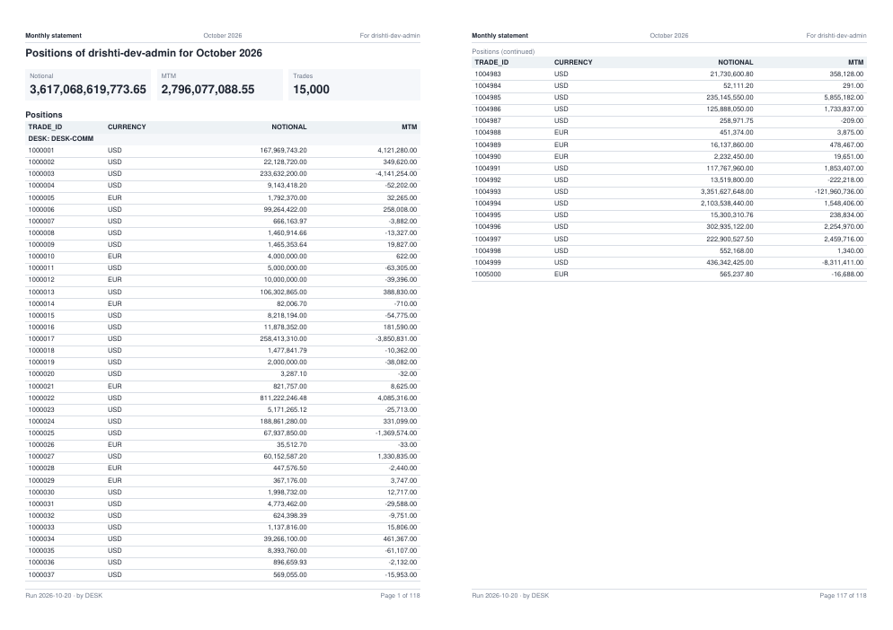
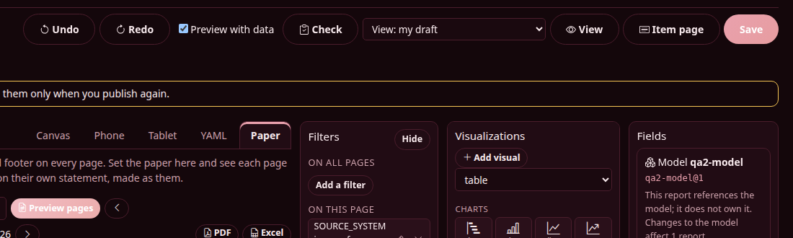
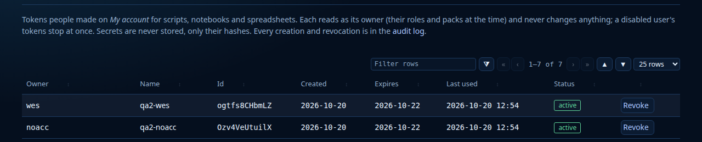

<!--
  Project Drishti · Any data. Any domain. One grammar.

  Copyright (c) 2026 Ashutosh Sinha <ajsinha@gmail.com>.
  All rights reserved.

  PROPRIETARY AND CONFIDENTIAL.

  This file is the confidential and proprietary property of Ashutosh Sinha.
  Unauthorised copying, use, modification, distribution or disclosure of this
  file, via any medium, is strictly prohibited except with the express prior
  written permission of the copyright holder.

  See the LICENSE file in the root of this repository for the full terms.
-->
# QA-2 findings, round 1 (2026-10-20): BI author and administrator

Author: ajsinha. Plan: [QA_PLAN.md](QA_PLAN.md) sections 2, 3 and 5 (rows B-1 to B-10). Report only: no product code was changed.

## The stack

| | |
|---|---|
| Version | `develop` at `20c236eb0` (2.6.5 and the QA plan), built once with `./mvnw -q -T 4 -DskipTests install`, JDK 21 |
| Server, console | `18620` / `17620`, security on, heap 4 GB, `DRISHTI_DEMO_ENABLED=false`, `DRISHTI_OFFLINE=true` |
| Data | `drishti.py lake demo --no-signal` into a scratch data folder (seven business days, 2026-10-09 to 2026-10-20); scratch connector, packs, BI, AI and MCP folders |
| Mail | a small SMTP sink on `127.0.0.1:2526` (`SPRING_MAIL_HOST`, `SPRING_MAIL_PORT`), each mail saved as a file |
| B-9 probe | TCP listeners on `127.0.0.1:9042` and `127.0.0.1:27017` that log every connection, open through two server starts |
| Users | `drishti-dev-admin`; roles `qa-head` (raw, BI viewer, row rule `DESK in user.desks`), `qa-analyst` (no raw), `qa-author` (raw, `bi-author`), `qa-author-noraw` (`bi-author`, no raw); users `hfx` (head, DESK-FX), `hcomm` (head, DESK-COMM), `ana` (analyst), `noacc` (analyst, not a member of the workspace), `wes` (author), `noraw` (author without raw) |
| BI items | tutorial 20's `fp-desk` model and `monthly-statement` report (CLI, as documented); my own `qa2-trade` dataset (rows by desk, `MTM` masked), `qa2-model`, `qa2-stmt` statement (CALYPSO only, sorted by MTM, grouped by DESK) and a copy with `PORTFOLIO` masked; workspace `qa2-desk` |
| Iceberg | `IcebergLoader --engine native` (the steps of `tools/load-iceberg.sh`, heap 3 GB) into a scratch folder; a pyiceberg 0.x table (SQL catalog) for `iceberg-external` |
| Cassandra | Cassandra 5.0.6 started by Testcontainers (the image and settings of `CassandraNode`), `tools/load-cassandra.sh … --trades 1000 --days 3` |
| B-10 | `git worktree add` of `v2.5.0`, its server run on `18621` on a fresh data folder, then the 2.6.5 jar on the same folder |

All data is synthetic (the committed test data, `bulk_trades.py`, and rows I generated). Every process I started was stopped by its PID.

## Summary

| Severity | Count | Findings |
|---|---|---|
| P1 | 1 | QA2-01 |
| P2 | 8 | QA2-02 to QA2-09 |
| P3 | 16 | QA2-10 to QA2-25 |

| # | Row | Result |
|---|---|---|
| B-1 | statements: rows, groups, tokens, paper, margins | **P1** (QA2-01), P2 (QA2-02), P3s; the layout itself held |
| B-2 | bursting | works: masks and row rules per recipient, the user without access skipped; P3s (QA2-17, QA2-18) |
| B-3 | statement endpoints with an API token | works: preview and file are read-only posts, nothing stored |
| B-4 | field parameters | works: wells, slicer, what-if, dataset reports all refused or switched correctly; P3 wording |
| B-5 | themes | P2 (QA2-03: Crimson Terminal buttons), P3 (designer layout, phone width) |
| B-6 | Iceberg without Hadoop | works (native, library, `iceberg-external`, history); P2 (QA2-04, QA2-05, QA2-09) |
| B-7 | Cassandra | works: reload while reading never shows half a day, history from `entity_days`; P2 (QA2-04) |
| B-8 | Admin pages, bad `history:` block | deploy refuses it with DRS-2061; P2 (QA2-06, QA2-08) |
| B-9 | start with no Cassandra or MongoDB | works: no connection to `:9042` or `:27017` in two starts and an Admin → Health visit |
| B-10 | data folder from 2.5.0 | works: starts, connector files unchanged, Health names nothing stale |

Every row was reached. Not covered: S3 and REST catalogs (B-6), a TLS Cassandra (B-7), Admin → Net with a real cluster (B-8: the page
was only opened on a single server), dialogs one by one under each theme (B-5).

---

## P1

### QA2-01 · A statement's table silently stops at 5,000 rows

- **Severity:** P1 (wrong data: a statement leaves out rows and does not say so)
- **Area:** statements (B-1, B-2): `StatementService`, the preview, the PDF, the Excel and every burst statement
- **Steps:**
  1. Sign in as `drishti-dev-admin`; publish tutorial 20's model and report (`drishti.py bi item new …desk-params.model.yaml`, then
     `monthly-statement.report.yaml`, both in a shared workspace).
  2. `drishti.py bi statement preview <report>` (today, 2026-10-20: 15,000 trade valuations, 5,000 per source system).
  3. `drishti.py bi statement file <report> -o full.pdf`, and the same with `--format xlsx`.
  4. `pdftotext -layout full.pdf -` and count the trade ids.
- **Expected:** every row of the table, or the band's note *The first N rows* (STATEMENTS.md section 9: `max-rows` is 10,000 "past it the
  band says so"); a statement longer than 500 pages is refused, never cut.
- **Actual:** `118 pages, 5156 rows`. The Positions table holds exactly 5,000 trades: ENDUR `1000001` to `1005000` (sorted by
  `TRADE_ID`); not one CALYPSO or MUREX trade appears. No note anywhere. The *Trades* card on page 1 says **15,000**, so the statement
  contradicts itself. The Excel's Positions sheet has 5,001 rows (title and 5,000). The burst statements are cut the same way.
  Cause, as far as I can see: the band is asked with `limit: 10001`, but the engine caps a JSON answer at `drishti.bi.query.json-max-rows`
  (5,000) and answers `truncated: true, total: 15000, limit: 5000`; `StatementService.band` only adds a note when the rows exceed
  `max-rows` (10,000), so the engine's `truncated` is dropped.
- **Evidence:** `POST /api/v1/bi/reports/query {page: statement, visual: positions, state: {limit: 10001}}` answers `rowCount 5000,
  total 15000, truncated true`; preview `rows: 5156`, `pageCount 118`; `pdftotext` finds 5,000 ids, the last `1005000`.
  
- **Doc:** [STATEMENTS.md](../../guides/REPORTS.md#24-statements-paginated-reports-page-exact-one-per-reader) sections 3 and 9.
- **Reproduced:** three times (preview, PDF, Excel), and in the bursting run.

## P2

### QA2-02 · `{page}`, `{pages}` and `{as-of}` are printed as typed in a text band and a visual title; `{param.nope}` is not refused

- **Severity:** P2 (does not work as documented)
- **Area:** statements, tokens (B-1)
- **Steps:**
  1. Preview a draft of tutorial 20's statement (`POST /api/v1/bi/reports/statement/preview {yaml}`) whose intro text is
     `Page {page} of {pages} {param.metric} {as-of} {from} {to} {run-time}`.
  2. Another draft whose Positions title is `Positions {param.breakdown} p{page}`.
  3. Another whose header left is `{param.nope}`.
- **Expected:** STATEMENTS.md section 2: these tokens work "in the header, the footer, a text band and a visual's title", and "an
  unknown token is refused (DRS-9038)".
- **Actual:** 1 prints `Page {page} of {pages} MTM {as-of} 2026-10-01 2026-10-31 08:49` (`{param.metric}`, `{from}`, `{to}`,
  `{run-time}` are filled; `{page}`, `{pages}`, `{as-of}` are not). 2 prints `Positions DESK p{page}` and `… p{page} (continued)`.
  3 is accepted (200) and prints `{param.nope}` in the header of every page. Check accepts all three. In the header and footer
  `{page}`/`{pages}` work.
- **Evidence:** preview `ops` with `role: text` and `role: title` as quoted.
- **Doc:** [STATEMENTS.md](../../guides/REPORTS.md#24-statements-paginated-reports-page-exact-one-per-reader) section 2.
- **Reproduced:** twice (two separate runs).

### QA2-03 · Crimson Terminal: Save and Preview pages are pale pink under white labels (about 2:1)

- **Severity:** P2 (a broken theme)
- **Area:** themes (B-5), BI Studio report designer
- **Steps:**
  1. Theme Crimson Terminal (`terminal-crimson`); BI Studio → open a statement report in the designer → **Paper**.
  2. Look at **Save** (top right) and **Preview pages**.
- **Expected:** USER_GUIDE "The contrast rule": buttons fill with `--d-fill` and carry `--d-on-fill` at 4.5:1; "Crimson Terminal … fills its
  buttons with a deep crimson under white labels".
- **Actual:** both buttons are `linear-gradient(135deg, rgb(233,161,173), …)` with `color: #fff`, not enabled-looking deep crimson:
  about 2.1:1. `--d-fill` on them is `#b3203a` and `--d-on-fill` `#ffffff`, so the gradient overrides the theme's fill. Not disabled
  (`disabled=false`, opacity 1). Terminal Blue's same buttons are blue with a dark label (fine).
- **Evidence:** computed style read with Playwright at 1920 px; 
- **Doc:** [USER_GUIDE.md](../../guides/USER_GUIDE.md) "The contrast rule".
- **Reproduced:** twice.

### QA2-04 · The shipped Iceberg and Cassandra connector files (and the docs' "complete file") are refused when copied as documented

- **Severity:** P2 (a dead end in a documented workflow)
- **Area:** connectors (B-6, B-7): `config/connectors.examples/iceberg/*.yaml`, `config/connectors.examples/cassandra/*.yaml`,
  ICEBERG_CONNECTOR.md "As a connector file"
- **Steps:**
  1. CASSANDRA_CONNECTOR.md walk-through step 3: `cp config/connectors.examples/cassandra/trading-store.yaml config/connectors/`
     (contact point changed to the Testcontainers node), against a development node with no sign-in.
  2. ICEBERG_CONNECTOR.md "As a connector file": paste the complete `trade-endur.yaml` (plus `engine: native`), a path-based lake.
- **Expected:** the connector starts (the walk-through says "The server picks the files up without a restart").
- **Actual:** both are refused: `connector file trading-store.yaml is not usable; nothing was started: 'password' refers to an
  environment variable that is not set (${DRISHTI_CASSANDRA_PASSWORD})`, and the same for `credential: ${DRISHTI_ICEBERG_CREDENTIAL}`.
  Both lines have no default (`${…:}`), unlike `username`, `uri` and `warehouse` next to them, so a site with no password or a
  path-based lake must set an empty environment variable or edit every file. Also: the examples are named `trading-store` (the packs
  now read `trade-endur`, `trade-calypso`, `trade-murex`), so copying `*.yaml` adds a fourth `trade` connector beside the three Delta
  ones; and `iceberg/trading-store.yaml` promotes camelCase columns (`tradeId,productType,…,counterparty.id`) that no 2.6 document has.
- **Evidence:** server log lines quoted; Admin → Health `connectors.problems`.
- **Doc:** [CASSANDRA_CONNECTOR.md](../../connectors/CASSANDRA_CONNECTOR.md) "Walk-through" step 3, [ICEBERG_CONNECTOR.md](../../connectors/ICEBERG_CONNECTOR.md) "As a connector file".
- **Reproduced:** twice (Cassandra and Iceberg files).

### QA2-05 · `tools/load-iceberg.sh --trades N --days D` deletes the sample trades of those days

- **Severity:** P2 (data missing from the demo lake; does not work as documented)
- **Area:** Iceberg loader script (B-6)
- **Steps:**
  1. Run the steps of `tools/load-iceberg.sh <root> --engine native --trades 1000 --days 3` (the samples' load, then the book's load:
     two `IcebergLoader` runs).
  2. Open `TRD 1000001` (the samples' ENDUR ComSwap) on 2026-09-30, and `drishti.py history trade 1000001 --days 30`.
- **Expected:** "the 1,791 sample documents x 10 days … and a book of 10,000 trades" (ICEBERG_CONNECTOR.md section 6): both.
- **Actual:** the book's load overwrites its days as a whole (`overwrite, added 3000, deleted 2295`), so the samples' 765 trades of each
  of those days are gone: `DRS-1001 no source holds trade/1000001` on 2026-09-28 to 09-30, and the history stops at 2026-09-25 (7 days,
  not 10). `tools/load-cassandra.sh` already streams the samples and the book as one input "so each business day is loaded once and
  appears whole"; the Iceberg script does not.
- **Evidence:** table metadata snapshots (`append 7650`, then `overwrite added 200 deleted 765` for a one-day book in the second run).
- **Doc:** [ICEBERG_CONNECTOR.md](../../connectors/ICEBERG_CONNECTOR.md) section 6, `tools/load-iceberg.sh` header.
- **Reproduced:** twice (three-day and one-day books, fresh folders).

### QA2-06 · A bad `history:` block in a pack on disk is invisible to the administrator

- **Severity:** P2 (does not work as documented)
- **Area:** Admin → Packs, Admin → Health, pack checks (B-8)
- **Steps:**
  1. Add to the `news-and-markets` pack in the server's packs folder:
     `history: {listed-company: {chart: [PRICE], headline: PRICE2}}`.
  2. Restart the server. Open Admin → Packs and Admin → Health (`GET /api/v1/admin/packs`, `/admin/health`).
  3. `drishti.py history listed-company CO-AAPL`.
- **Expected:** tutorial 21 step 6: "a pack with a bad block shows its problem on Admin → Packs after a reload"; PACK_DEVELOPER_GUIDE:
  "the running server logs it".
- **Actual:** nothing at start; Admin → Packs `problem: null`; Health `packsWithProblems: 0`, status OK. The WARN `pack news-and-markets:
  error: history.listed-company.headline: PRICE2 is not one of chart` appears only at the first history request. (The deploy path is
  right: an archive with a bad block fails *sutra lint* with every DRS-2061 listed and gets no upload id.)
- **Evidence:** the two JSON answers; server log.
- **Doc:** [tutorial 21](../../tutorials/21-an-entity-over-time.md) step 6, [PACK_DEVELOPER_GUIDE.md](../../guides/PACK_DEVELOPER_GUIDE.md) history block.
- **Reproduced:** twice (after the start, again after the history request).

### QA2-07 · Tutorial 20 step 6's command line cannot work: `/me/subscriptions` refuses API tokens

- **Severity:** P2 (a documented step that fails)
- **Area:** tutorial 20, subscriptions (B-2)
- **Steps:** step 6 "From the command line": `curl -X PUT -H "Authorization: Bearer $DRISHTI_TOKEN" $DRISHTI_SERVER/api/v1/me/subscriptions/monthly -d …`,
  then `POST …/monthly/run`, with a token that has every scope.
- **Expected:** the subscription saved and run.
- **Actual:** both `403 DRS-5002 API tokens may not call this endpoint`. API_GUIDE says every `/me/**` write is never open to a token, so
  the tutorial is what is wrong (the UI's *Subscribe* works; I used the console's form for the bursting test).
- **Doc:** [tutorial 20](../../tutorials/20-statements-and-field-parameters.md) step 6; [API_GUIDE.md](../../guides/API_GUIDE.md) scopes section.
- **Reproduced:** twice (PUT and run).

### QA2-08 · Admin → Tokens says tokens "never change anything", with write-scoped tokens listed

- **Severity:** P2 (a misleading page)
- **Area:** Admin → Tokens (B-8)
- **Steps:** make a token with `bi:write` and other scopes on *My account*; create a workspace and publish items with it; open Admin → Tokens.
- **Expected:** the page says what each token may do (its scopes, or at least *read only* vs *writes*).
- **Actual:** the intro reads "Each reads as its owner (their roles and packs at the time) and never changes anything"; there is no scopes
  column, so `qa2-admin-rw` (which published BI items) looks the same as a read-only token. *Last used* is also in UTC with no label
  while the other admin pages show New York time (12:54 vs 08:45).
- **Evidence:** 
- **Doc:** [API_GUIDE.md](../../guides/API_GUIDE.md) scopes (tokens with write scopes exist since 2.x).
- **Reproduced:** twice (two loads of the page, two themes).

### QA2-09 · `iceberg-external`: a table pyiceberg wrote is "no table" at the folder the docs name

- **Severity:** P2 (misleading message; doc)
- **Area:** `iceberg-external` (B-6)
- **Steps:**
  1. Write two tables with pyiceberg (`SqlCatalog`, locations `<root>/qa/positions` and `<root>/qa/noid`, identity partition on a date).
  2. Connector file: `plugin: iceberg-external`, `root: <root>`, `tables: {qa-position: {table: qa.positions, id: POSITION_ID}}`.
- **Expected:** ICEBERG_EXTERNAL_CONNECTOR.md: pyiceberg tables are served; "for path-based tables `table: risk_mart.trades` is the folder
  `<root>/risk_mart/trades`".
- **Actual:** `DOWN: no table served: qa-noid: no table qa.noid; qa-position: no table qa.positions`, although the folders and their
  metadata exist. pyiceberg names its metadata `00003-<uuid>.metadata.json` and writes no `version-hint.text`, and the path-based
  catalog only finds `vN.metadata.json`. With `metadata-location.<kind>` the same tables are served correctly (documents, dates, time
  travel, history, and the `no id` problem named in Health). The message should say why, and the page should say a pyiceberg (or
  any catalog-written) table needs `metadata-location` or its catalog.
- **Doc:** [ICEBERG_EXTERNAL_CONNECTOR.md](../../connectors/ICEBERG_EXTERNAL_CONNECTOR.md) sections 1 and 2.
- **Reproduced:** twice (two tables).

## P3

| ID | Area | Steps (short) | Expected | Actual |
|---|---|---|---|---|
| QA2-10 | connectors | with `trade-endur` disabled and the Cassandra `trading-store` serving `trade`, open a trade id that does not exist | `DRS-1001 no source holds …` | `DRS-1002 connector trade-endur is disabled (kind 'trade' is routed to it)`, for any missing id |
| QA2-11 | statements | `POST …/statement/file {format: docx}` | "a statement is made as pdf or xlsx" (what `png` and `csv` get) | `DRS-9060 format is pdf, png, xlsx or csv`, then `png` and `csv` are refused |
| QA2-12 | statements | preview with `date: 9999-12-31` or `1999-01-01` | a hint that no data is held | 200, an empty two-page statement for *December 9999* |
| QA2-13 | statements | `paper: letter` vs `orientation: Landscape` | both case-insensitive, or both refused | `letter` accepted, `Landscape` refused |
| QA2-14 | statements | a card with no rows (tutorial report on 2026-10-08) | `0` or `–` | blank (`''`); a masked one reads `–`; the Trades card reads `0` |
| QA2-15 | designer, B-5 | Paper tab at 1400 px wide | a readable preview | the sheet is about 130 px wide and the fourth margin box runs under the preview column ([screenshot](img/qa2-paper-tab-1400.png)); Page Down only pages after a click on the sheet |
| QA2-16 | Admin → Health, B-5 | 375 px wide | no horizontal scroll | 154 px of horizontal scroll: the external-library path does not wrap ([screenshot](img/qa2-health-phone.png)) |
| QA2-17 | bursting | disable `hcomm`, run a subscription naming `hcomm` and `role:qa-head` | `hcomm` listed as skipped with the reason | `hcomm` is simply absent from the run's deliveries ("1 sent") |
| QA2-18 | bursting | a statement table sorted by a masked measure, burst to an analyst | the band drawn unsorted, or the delivery flagged | the analyst's table is *No rows.* with `DRS-9021 … cannot be sorted on`; the run says `sent` |
| QA2-19 | bursting | the noaccess recipient's skip reason | "may not open the report" | `DRS-9001 no item 'bi-d158f73f98'` |
| QA2-20 | field parameters | a field parameter in the wrong well | one problem | DRS-9037 is listed once per choice (two identical lines); through `/bi/mq`, `param.metric` among fields answers `DRS-9152 a field names its dataset: 'MTM' is trade.MTM` (names the default, not the parameter); "metric is one of the fields [MTM, NOTIONAL]" calls measures fields |
| QA2-21 | loaders | `tools/load-iceberg.sh`, `tools/load-cassandra.sh` | heap and files under the data folder | Iceberg's loader is `-Xmx6g` fixed; Cassandra's has no `-Xmx` (a quarter of RAM); `make_data.py` writes `data/feeds/…` and load-iceberg `data/banking.jsonl` in the repository even with `DRISHTI_DATA_DIR` set |
| QA2-22 | Iceberg | a table moved after loading (or `relocate` with `engine: library`) | one clear problem | a WARN with a full stack trace every 5 s; `relocate` is silently ignored by the library engine |
| QA2-23 | connectors | disable two Delta connectors in their files | quiet | one `trade log cannot be read: RejectedExecutionException` per stopped connector about 50 s later |
| QA2-24 | docs | GETTING_STARTED step 5 | one rule | "ending on the last business day before today" and "moved to end on today's business date" in the same bullet; the lake ends today (2026-10-20) |
| QA2-25 | docs | API_GUIDE scopes | one rule | "workspaces … are never open to a token" while `bi:write` opens `POST /bi/workspaces` (which works) |

## What worked

- **Statements (B-1):** every paper size and orientation gives the right `MediaBox` (A5 419.53 x 595.28, Letter landscape 792 x 612); margins
  0 and 60 (too little paper: a clear DRS-9038), out of range and malformed margins, font sizes, periods, `groupBy` on a field not shown,
  `pageBreak: always`, a chart on a statement page, a table sharing its row, `header: middle`, `{nope}`: each a DRS-9038/9032 naming the
  path. 0 rows (*No rows.*), 1 row (2 pages), more than 500 pages (refused, never cut), 20,000 words of text (flows). Groups that fit a page
  are never split (checked over 15 groups, portrait and landscape); column titles repeat with *(continued)*, and not with `repeatHeader:
  false`. Excel: `paperSize`, orientation, margins, header and footer codes and `Print_Titles` on every sheet.
- **Bursting (B-2):** one subscription to five people: the desk head saw only DESK-FX with MTM, the analyst every desk with MTM `•••`
  (PDF and Excel), the author everything, the non-member skipped; file names per recipient; `statement: true` and page counts in the run.
  A masked field used as `groupBy` reads `PORTFOLIO: •••`; report-only measures over a masked measure (`/1000`, `*1`, `max`, conditional
  counts, `NOTIONAL + MTM`) stay masked; a filter on a masked field is refused (DRS-9021).
- **API tokens (B-3):** a read-only token gets preview and file (PDF, Excel), a YAML draft only with `bi-author`, a disabled user's token
  `401`, no token `401`; nothing new under the data folder.
- **Field parameters (B-4):** the slicer switches field and measure (the viewer asks again with `params`); every wrong value, a masked
  field, an expression, a list, a what-if parameter in a well, a parameter on a 2.1 dataset report: refused with a clear message;
  what-if ranges enforced.
- **Themes (B-5):** the three Terminal themes on BI Studio, the designer, the viewer and nine Admin pages: no blood-red text found in
  Crimson; the choice follows the user to a second browser within a few seconds.
- **Iceberg (B-6):** native load and read with no Hadoop class in the log; `engine: library` switched live and read the same; `iceberg-external`
  over pyiceberg tables (decimals, timestamps with zone, lists, structs, UTF-8) with `metadata-location`; history on both.
- **Cassandra (B-7):** loader in 80 s; a reload while polling four trades 2,000 times: no miss, the generation switched once; history
  10 days from `entity_days`.
- **Admin (B-8):** Connectors and Health name a bad connector file and its reason; the pack deploy refuses a bad `history:` block with
  every DRS-2061 (shape, more than 4 chart fields, headline, max-days, default-days, path and expr) and warns on `colums:`.
- **B-9:** no connection reached `127.0.0.1:9042` or `:27017` in two starts.
- **B-10:** 2.6.5 started on a 2.5.0 data folder; its connector files were left as they were and Health reports no template change.
