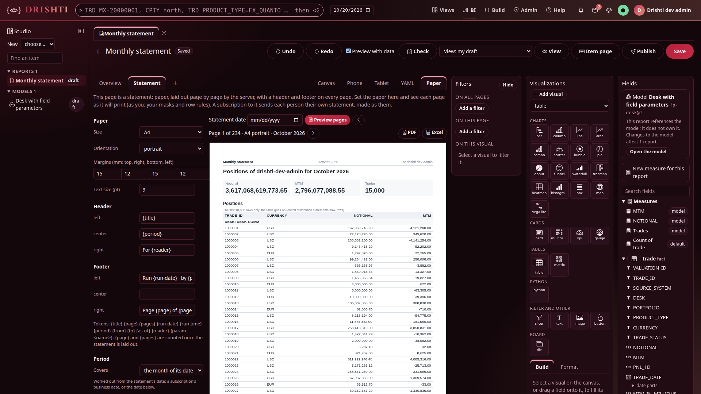
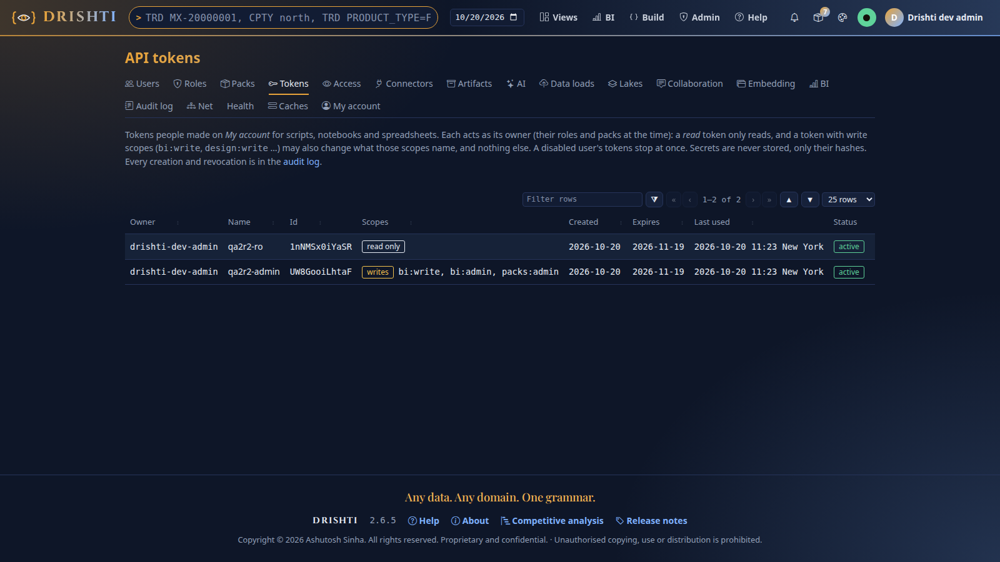

<!--
  Project Drishti · Any data. Any domain. One grammar.

  Copyright (c) 2026 Ashutosh Sinha <ajsinha@gmail.com>.
  All rights reserved.

  PROPRIETARY AND CONFIDENTIAL.

  This file is the confidential and proprietary property of Ashutosh Sinha.
  Unauthorised copying, use, modification, distribution or disclosure of this
  file, via any medium, is strictly prohibited except with the express prior
  written permission of the copyright holder.

  See the LICENSE file in the root of this repository for the full terms.
-->
# QA-2 round 2 (2026-10-20): re-test of the fixed QA2 findings

Author: ajsinha. Tester QA-2. Scope: [QA_PLAN.md](QA_PLAN.md) section 1 (round 2) and section 8; every finding of
[QA2_FINDINGS.md](QA2_FINDINGS.md) fixed by Fix-1, Fix-2 and Fix-3 (QA2-01 to QA2-09, QA2-11, QA2-13, QA2-24, QA2-25), each re-run with its
own steps and then the area next to it; plus the QA1-10 demo-data fix and the `lake maintain` layout fix. Report only: no product code
was changed. Round 2 ran from 10:52 to 11:35 local time.

## The stack

| | |
|---|---|
| Version | `develop` at `051c98f6e` (Fix-1, Fix-2, Fix-3), built once with `./mvnw -q -T 4 -DskipTests install`, `drishti-server-2.6.5-exec.jar`, JDK 21 |
| Server, console | `18620` / `17620`, security on, heap 4 GB, `DRISHTI_DEMO_ENABLED=false`, `DRISHTI_OFFLINE=true`; scratch data, connectors, packs, BI (a copy of `config/bi`), AI, MCP and net folders |
| Data | a fresh `drishti.py lake demo --no-signal` into the scratch lake: 66 tables, sixty business days 2026-07-27 to 2026-10-20, 969 s |
| Iceberg | `tools/load-iceberg.sh <scratch> --engine native --trades 1000 --days 3`, and `--trades 600 --days 1` into a second folder (`DRISHTI_LOADER_HEAP=2g`); two pyiceberg 0.x tables (SQL catalog, no version hint) |
| Cassandra | Cassandra 5.0.6 started by Testcontainers (the image and settings of `CassandraNode`), `tools/load-cassandra.sh localhost:<mapped> datacenter1 --create --create-keyspace 1 --trades 600 --days 2` |
| Mail | an SMTP sink on `127.0.0.1:2526` (`SPRING_MAIL_HOST`, `SPRING_MAIL_PORT`), each mail saved as a file |
| Users | `drishti-dev-admin` (given an e-mail address for the burst); `ana` (role `viewer`, not a member of the report's workspace); tokens `qa2r2-ro` (read) and `qa2r2-admin` (`bi:write`, `bi:admin`, `packs:admin`) |
| BI | tutorial 20's `fp-desk` model and `monthly-statement` report from `docs/tutorials/data` (`drishti.py bi item new me …`), and YAML drafts of it |

All data is synthetic. Every process I started (server, console, SMTP sink, the Testcontainers holder and its container) was stopped by
its PID, and the scratch data was deleted.

## Verdicts

| Finding | Sev. | Verdict | Evidence, short |
|---|---|---|---|
| QA2-01 statement table cut at 5,000 | P1 | **Fixed** | 15,000 rows: 10,000 in the table (5,000 ENDUR, 5,000 CALYPSO, all distinct) and the note *The first 10,000 rows only* in the PDF, the preview's `cut`, the Excel's About sheet and the burst PDF; 5,000 and 10,000 rows read whole, no note |
| QA2-02 tokens in text bands and titles | P2 | **Fixed** | `Page 1 of 234 MTM 2026-10-20 2026-10-01 2026-10-31 11:23`; title `Positions DESK p2 of 234 (continued)`; `{param.nope}`, `{nope}`, `{PAGE}`, `{param.}`, `{as_of}` refused with DRS-9038 in header, text and title |
| QA2-03 Crimson Terminal buttons | P2 | **Fixed** | Save and Preview pages `linear-gradient(rgb(179,32,58), rgb(201,42,70))` under white (about 5.4:1 at the lighter end); no filled button under 4.5:1 in any of the ten themes over 11 pages |
| QA2-04 example connector files | P2 | **Fixed** | `iceberg/*.yaml` and `cassandra/*.yaml` copied as they are (only the contact point changed to the Testcontainers port): every connector `UP`, no environment variable set |
| QA2-05 load-iceberg.sh keeps the samples | P2 | **Fixed** | one `append` snapshot (9,318 rows); 2026-09-28 to 09-30 hold the 765 sample trades and the book; trade `1000001` on all ten days; history 10 days |
| QA2-06 bad history block at load and reload | P2 | **Fixed** | at start: WARN in the log, Admin → Packs `problem` and `historyProblems`, Health pack `DEGRADED`; a second bad block picked up by the pack watcher; the good block clears both |
| QA2-07 tutorial 20 step 6 | P2 | **Fixed** | the tutorial now saves in the console and reads back with a token: `PUT` answers `403 DRS-5002` as it says, `GET /me/subscriptions` with a read token lists the subscription and its runs |
| QA2-08 Admin → Tokens | P2 | **Fixed** | intro says read tokens only read and write scopes change what they name; Scopes column `read only` / `writes bi:write, bi:admin, packs:admin`; *Last used* `2026-10-20 11:23 New York`; no horizontal scroll at 375 px |
| QA2-09 iceberg-external, no version hint | P2 | **Fixed** (one P3 next to it: QA2-203) | pyiceberg tables at `<root>/qa/positions` served with `table: qa.positions`; a later pyiceberg append seen after 8 s; the table with no id named in Health |
| QA2-11 statement format | P3 | **Fixed** | `docx`, `png`, `csv` and `''`: `422 DRS-9038 a statement is made as pdf or xlsx, not 'docx'`; `PDF`, `Xlsx` accepted |
| QA2-13 orientation case | P3 | **Fixed** | `Landscape`, `LANDSCAPE`, `letter`, `LeTTer` all accepted; `sideways` refused |
| QA2-24 GETTING_STARTED step 5 | P3 | **Fixed** | one rule: "ending on today's business date (on a weekend or holiday, the business day before)"; the real run ended on 2026-10-20 |
| QA2-25 API_GUIDE never-open workspaces | P3 | **Fixed** | "your console workspaces (`/me/workspaces`; BI workspaces are opened by `bi:write` and `bi:admin` above)" |
| QA1-10 demo market history | P2 | **Fixed** (one new P2 next to it: QA2-201) | `EQ EQ-CSCA 3M`: 60 rows, `missing: []`, embedded `HISTORY` ends 2026-10-20, 60 distinct `CHANGE_1D`, each the day's price move (59 of 59) |
| `lake maintain` per-source trade tables | - | **Fixed** | `relayout --dry-run` skips all 60 dates of `trade_calypso` (already in the layout); `--force` on two dates keeps `business_date` and `PRODUCT_TYPE` (51 files a day) and the same rows and documents; `--once` compacts nothing out of order |

Not re-tested (Fix-4 still working): QA2-10, QA2-12, QA2-14 to QA2-23, QA1-14 to QA1-16. What I saw of them in passing is under
*Fix-4's findings, as seen*.

New findings: **no P1**, one P2 (QA2-201), four P3 (QA2-202 to QA2-205).

---

## Re-tests

### QA2-01 · Fixed

Steps of the finding: tutorial 20's model and report (`bi item new me …`), then `drishti.py bi statement preview <report>`,
`bi statement file <report> -o full.pdf` and `--format xlsx`, `pdftotext -layout`.

- Preview `234 pages, A4 portrait, October 2026, 10156 rows`; `POST /bi/reports/statement/preview` answers
  `cut: ["Positions: The first 10,000 rows only: the table goes on (drishti.distribution.statements.max-rows)."]`.
- The PDF holds 10,000 distinct trade ids (5,000 ENDUR, 5,000 CALYPSO: the first 10,000 by `TRADE_ID`), and the note under the
  Positions title on page 1. The Trades card says 15,000, and the note now says why the table holds fewer.
- The Excel's Positions sheet has 10,001 rows; its *About* sheet says *Positions: The first 10,000 rows only …*.
- Next to it: a draft with `filters: [SOURCE_SYSTEM in [CALYPSO]]` (5,000 rows, the old cap): 118 pages, 5,000 distinct CLY ids,
  `cut: []`. CALYPSO and MUREX (exactly 10,000 rows, the new cap): 234 pages, 10,000 ids, `cut: []`.
- Bursting: a subscription saved in the console (`monthly`, pdf, `drishti-dev-admin, ana`), **Run now**: the mail
  *Monthly statement · 2026-10-20 · 234 pages* carries a PDF with the same 10,000 ids and the note; the delivery shows
  `statement: true, pages: 234`. (`ana` skipped with `DRS-9001 no item …`: QA2-19, Fix-4.)

The CLI does not repeat the note (QA2-204).



### QA2-02 · Fixed

`POST /bi/reports/statement/preview {yaml}` with the intro text `Page {page} of {pages} {param.metric} {as-of} {from} {to} {run-time}`
and the Positions title `"Positions {param.breakdown} p{page} of {pages}"`:

```text
text  'Page 1 of 234 MTM 2026-10-20 2026-10-01 2026-10-31 11:23'
title 'Positions DESK p1 of 234'
title 'Positions DESK p2 of 234 (continued)'
```

Refused, each with DRS-9038 naming the path, in the header, a text band and a title: `{param.nope}` (*names no parameter of the
report's model: [{param.breakdown}, {param.metric}]*), `{nope}`, `{PAGE}`, `{as_of}` (*is not a token: [{as-of}, …] or
{param.<name>}*), `{param.}`. An unclosed `{page` is printed as typed (not a token; acceptable).

### QA2-03 · Fixed

Crimson Terminal, BI Studio → the report → Statement page → Paper → Preview pages (Playwright, 1920 px): **Save**
`linear-gradient(135deg, rgb(179,32,58), rgb(201,42,70))`, **Preview pages** the same reversed, both `color: #fff`, enabled
(screenshot above). Next to it: every visible, enabled, labelled filled button on the designer, Admin → Tokens, Health, Packs,
Connectors, Users, Lakes, Subscriptions, the BI catalogue and a trade page, in all ten themes (the worst stop of each gradient against
the label): **0 below 4.5:1**; lowest per theme 5.33 (terminal, wallstreet, crimson-dark, the three Terminal themes), 5.47 (light),
5.53 (blue), 7.48 (crimson), 7.69 (green).

### QA2-04 · Fixed

- **Iceberg:** `cp config/connectors.examples/iceberg/*.yaml <connectors>/` with `DRISHTI_ICEBERG_ROOT` at the loaded folder and no
  other variable: `reference-store`, `market-store`, `trade-endur` … `iceberg`, `UP (engine: native)`; no bad file. `trade-endur`
  replaced the Delta file of that name; `trade-calypso` and `trade-murex` stayed on Delta. History of `1000001` read from Iceberg
  (2026-09-17 to 09-30, source `trade-endur`).
- **Cassandra:** the six `cassandra/*.yaml` with only `localhost:9042` changed to the container's port, no
  `DRISHTI_CASSANDRA_PASSWORD` or `USERNAME` set: all six `UP`; history of `1000001` from Cassandra. The example names are now
  `trade-endur.yaml` with UPPER_SNAKE columns, as the docs say.

During each swap the trade kind was unreachable for 3 to 5 s with a contradictory message (QA2-202).

### QA2-05 · Fixed

`DRISHTI_DATA_DIR=<scratch> DRISHTI_LOADER_HEAP=2g tools/load-iceberg.sh <scratch>/iceberg --engine native --trades 1000 --days 3`:
`loaded 28,710 rows into 47 tables`. The trade table has one snapshot, `append 9318`. Per day: 765 rows on 2026-09-17 … 09-25, 1,321
on 09-28 … 09-30 (the 765 samples, unchanged document for document, and 556 clones `MX-30000000 …`; the book of 1,000 is the 444
MUREX samples and their clones, as `bulk_trades.py` says). `1000001` is on all ten days; the server's history of it has ten days.
Again with `--trades 600 --days 1` into a fresh folder: 765 on 09-28 and 09-29, 921 on 09-30, `1000001` present. The input
`banking.jsonl` went under the data folder and was removed.

### QA2-06 · Fixed

1. `history: {listed-company: {chart: [PRICE], headline: PRICE2}}` added to the scratch `news-and-markets/pack.yaml`, server started:
   at start `WARN … HistoryDefinitions : pack news-and-markets: error: history.listed-company.headline: PRICE2 is not one of chart
   (the kinds keep the default history)`; `GET /admin/packs`: `problem: "history block: …"`, `historyProblems: ["error: …"]`;
   `GET /admin/health`: the pack `DEGRADED` with the same problem, overall `DEGRADED`.
2. Reload: the block replaced by `chart: [PRICE, A, B, C, D]` and `max-days: -3`. The pack watcher reloaded it
   (`packs reloaded: … reloaded [news-and-markets]`); Packs and Health list both new problems (`at most 4 chart fields (5 given)`,
   `-3 is not between 1 and 366`), the old one gone.
3. The good file back: `problem: None`, `historyProblems: []`, pack `OK`.

`POST /admin/packs/news-and-markets/load` on a pack of the site configuration answers `DRS-5001 … is already loaded` (unload: *it is in
the site configuration*), so on such a pack the reload is the watcher's or a restart; that is as documented.

### QA2-07 · Fixed

Tutorial 20 step 6 now says the subscription is saved and run in the console and read back with a token. As written: `PUT
/me/subscriptions/monthly` with the write token answers `403 DRS-5002 API tokens may not call this endpoint`; after saving `monthly`
in the console (`POST /reports/subscribe`, then **Run now**), `GET /me/subscriptions` with the **read** token lists it with
`format: pdf`, its recipients and both runs.

### QA2-08 · Fixed

Admin → Tokens (1600 px and 375 px): the intro reads "Each acts as its owner (their roles and packs at the time): a *read* token only
reads, and a token with write scopes (`bi:write`, `design:write` …) may also change what those scopes name, and nothing else."
Columns Owner, Name, Id, **Scopes** (`read only`; `writes bi:write, bi:admin, packs:admin`), Created, Expires, **Last used**
`2026-10-20 11:23 New York`, Status. At 375 px the page does not scroll sideways (scroll width 375).



### QA2-09 · Fixed

pyiceberg (`SqlCatalog`, locations `<root>/qa/positions` and `<root>/qa/noid`, metadata `00000-<uuid>` … `00003-<uuid>.metadata.json`,
no `version-hint.text`); connector `plugin: iceberg-external`, `root: <root>`, `tables: {qa-position: {table: qa.positions, id:
POSITION_ID, date: business_date}, qa-noid: {table: qa.noid, …}}`, no `metadata-location`:

- `UP (qa-noid (qa.noid): no id: the table has no identifier fields; set tables.qa-noid.id)`;
- `GET /entities/qa-position/P-1/raw`: the 2026-10-20 row; `GET /history/qa-position/P-1?days=5`: 2026-10-16 to 10-20;
- a pyiceberg append of `P-99` (a new `00004-…` file): served 8 s later.

A folder with no metadata at all is reported without the files looked for (QA2-203).

### QA2-11 and QA2-13 · Fixed

`POST /bi/reports/statement/file`: `format: docx`, `png`, `csv` and `''` → `422 DRS-9038 a statement is made as pdf or xlsx, not
'docx'` (one answer for all); `PDF` and `Xlsx` → 200; no format → PDF. Preview with `orientation: Landscape` / `LANDSCAPE` →
`landscape`; `paper: letter` / `LeTTer` → `Letter`; `orientation: sideways` → `DRS-9038 … orientation is portrait or landscape`.
A read-only token still gets the file (B-3 unchanged).

### QA2-24 and QA2-25 · Fixed

GETTING_STARTED step 5 now has one rule ("ending on today's business date … on a weekend or holiday, the business day before"), and
the run ended on 2026-10-20 (a Tuesday). API_GUIDE's never-open list names *your console workspaces (`/me/workspaces`)* and says BI
workspaces are opened by `bi:write` and `bi:admin`.

### QA1-10 · Fixed

Fresh `lake demo` (2026-07-27 to 2026-10-20), `GET /history/equity/EQ-CSCA?range=3M`: 60 rows, `missing: []`, no carried row; the raw
document's `HISTORY` runs 2026-09-08 to **2026-10-20** (30 points); `CHANGE_1D` has 60 distinct values and each equals the day's move of
`PRICE` (59 of 59, e.g. 2026-10-19 `+2.467 %`, 10-20 `+0.842 %`); the summary's high is 22.86 on 2026-07-27, not the old
"21.84 on 2026-09-30". `FX-AUDUSD`, `EQX-NDX` and `BND-CACASC059511`: `missing: []` as well. But see QA2-201 for what the same pages
show next to the moved price.

### `lake maintain` layout · Fixed

On a copy of the demo's `trading/trade_calypso` (60 dates, partitions `business_date`, `PRODUCT_TYPE`):

- `maintain.py relayout --root <copy> --domain trading --packs <packs> --dry-run`: `rewritten: []`, all 60 dates `skipped` (already
  in the layout).
- `--dates 2026-10-19..2026-10-20 --force`: both rewritten; partitions still `business_date`, `PRODUCT_TYPE`, 51 files a day as before;
  5,000 distinct ids a day, and a hash over (id, document) identical to the untouched lake's.
- `maintain.py --config <file naming the copy> --once` (and `--dry-run` first): `compact: {relaid-dates: [], files: 0}`, checkpoint
  written, the same rows and hashes after.

---

## New findings

### QA2-201 · P2 · Demo lakes: FX bid and ask, and bond yields, do not move with the moved price (mid outside bid/ask on 59 of 60 days)

- **Area:** demo data (`lake demo`, the QA1-10 change), market pages, history
- **Steps:**
  1. `drishti.py lake demo` (default `--as-of today`), server on the lake.
  2. `GET /history/fx-spot/FX-EURUSD?range=3M` (or `FX FX-EURUSD 3M` in the console); the same for `FX-AUDUSD`.
  3. `GET /history/bond/BND-CACASC059511?range=3M`.
- **Expected:** a quote a trader can believe: `BID ≤ MID ≤ ASK` every day, and a bond's yield moving against its price (the Bloomberg
  bar).
- **Actual:** `MID` moves every day (the QA1-10 fix), but `BID` and `ASK` are one value for all 60 days (`0.66097` / `0.66103` for
  AUDUSD), so `MID` lies outside the bid/ask on 59 of 60 days for EURUSD and 56 of 60 for AUDUSD (2026-10-14: `MID 0.661268`, `ASK
  0.66103`). The bond's `PRICE` moves (98.16 → 99.52 → 98.39 on 10-14 … 10-16) while `YIELD 0.057`, `Z_SPREAD 280.2` and
  `MOD_DURATION 4.35` never change. Synthetic data, but it is what a demo shows next to the price chart.
- **Reproduced:** twice (two FX pairs, and the bond), on the API.

### QA2-202 · P3 · During a connector file swap, reads of the kind answer `404 DRS-1002 connector trade-endur is running`

- **Area:** connectors, hot reload (next to QA2-04; the DRS-1002 wording is QA2-10's area)
- **Steps:** with `trade-endur` on Delta, poll `GET /entities/trade/1000001/raw` every 50 ms and replace `trade-endur.yaml` by the
  Cassandra example (then back).
- **Expected:** the old connector answers until the new one is up, or a 503 that says the connector is restarting.
- **Actual:** for 3 to 5 s every read answers `404 DRS-1002 connector trade-endur is running (kind 'trade' is routed to it)`: a "not
  found" whose text says the connector is running. Counts: Delta → Cassandra 92 such answers (2.3 s to 7.3 s), Cassandra → Delta 56
  (2.3 s to 5.4 s).
- **Reproduced:** twice (both directions).

### QA2-203 · P3 · `iceberg-external`: a table folder with no metadata says only "no table", and the connector stays `ok`

- **Area:** `iceberg-external`, Admin → Connectors and Health (next to QA2-09)
- **Steps:** add `qa-ghost: {table: qa.ghost, id: POSITION_ID}` to the connector, with `<root>/qa/ghost/metadata/` empty (then with a
  stray `00001-abc.metadata.json.tmp`).
- **Expected:** ICEBERG_EXTERNAL_CONNECTOR.md section 2: "A folder with neither is `no table …`, and Health says which files it looked
  for"; the connector flagged.
- **Actual:** `UP (qa-ghost: no table qa.ghost; …)`, `problems: []`, `level: ok`; no file names in Health or in Admin → Connectors.
- **Doc:** [ICEBERG_EXTERNAL_CONNECTOR.md](../../connectors/ICEBERG_EXTERNAL_CONNECTOR.md) section 2.
- **Reproduced:** twice (empty folder, and with the stray file).

### QA2-204 · P3 · The command line does not say a statement's table was cut

- **Area:** CLI, statements (next to QA2-01)
- **Steps:** `drishti.py bi statement preview <tutorial 20 report>` on 2026-10-20 (15,000 rows); `drishti.py bi statement file … -o
  full.pdf`.
- **Expected:** the note the API returns in `cut` (STATEMENTS.md: "the band says so … the preview's `cut`").
- **Actual:** `Monthly statement: 234 pages, A4 portrait, October 2026, 10156 rows` and `wrote full.pdf (649,813 bytes)`: no word of
  the 10,000-row cut (the PDF itself has the note). A script reading the CLI cannot tell a whole statement from a cut one.
- **Reproduced:** twice (preview and file).

### QA2-205 · P3 · `lake demo` builds 66 tables; the docs say 64

- **Area:** docs (GETTING_STARTED 218 and 725, PACKS 283, DEMO_DATA 40, tutorial 01 lines 78 and 87, QA_ON_WINDOWS 214,
  data/testdata/README 63)
- **Steps:** `drishti.py lake demo --lake <scratch> --no-signal -q`.
- **Expected:** the summary as documented, `64 tables`.
- **Actual:** `Demo lake ready: …: 66 tables, 60 business days 2026-07-27 to 2026-10-20 …, 969 s`; 66 `_delta_log` folders on disk.
- **Reproduced:** twice (the summary line and a count of the tables on disk).

---

## Fix-4's findings, as seen (not filed again)

| Finding | Seen in passing |
|---|---|
| QA2-10 | a missing trade answers `DRS-1001 no source holds …` while every source is up; the disabled-connector case not re-run (see also QA2-202) |
| QA2-19 | still `DRS-9001 no item 'bi-…'` as the skip reason for a recipient who may not open the report |
| QA2-21 | partly: `load-iceberg.sh` and `load-cassandra.sh` take `DRISHTI_LOADER_HEAP` and write their input under the data folder; `make_data.py` (both loaders) and `lake demo` still write `data/feeds/fixing/SOFR-HISTORY.csv` in the repository, so a server on another data folder has its `file` connector `DOWN: no directory <data>/feeds` and Health `DEGRADED` |
| QA2-23 | still `trade-endur: trade log cannot be read: RejectedExecutionException` after a Delta connector is stopped |
| QA2-12, 14 to 18, 20, 22; QA1-14 to 16 | not looked at |

## Not covered

Masked recipients in the burst (only an unmasked admin and a non-member were sent to), the designer's Paper tab at 1400 px (QA2-15,
Fix-4), a TLS Cassandra, REST and S3 Iceberg catalogs.
