<!--
  Project Drishti · Any data. Any domain. One grammar.

  Copyright (c) 2026 Ashutosh Sinha <ajsinha@gmail.com>.
  All rights reserved.

  PROPRIETARY AND CONFIDENTIAL.

  This file is the confidential and proprietary property of Ashutosh Sinha.
  Unauthorised copying, use, modification, distribution or disclosure of this
  file, via any medium, is strictly prohibited except with the express prior
  written permission of the copyright holder.

  See the LICENSE file in the root of this repository for the full terms.
-->
# BI runs 2.6.7: the console and the real server together

2026-10-21. The console lane of [BI_RUNS.md](../../architecture/BI_RUNS.md) was built against a stand-in server
(`drishti-console/tests/bi_runs_backend.py`). This round puts it in front of the real server (develop at `542543925`, the contract of
sections 14.3 and 14.5) and checks every flow in Chromium (Playwright), over the API and from the CLI.

## The stack

| Part | What |
|---|---|
| Server | `drishti-server-2.6.5-exec.jar` built from develop, port 18720, `-Xmx3g`, security on, packs `core,trading,counterparty-risk,market-risk`, offline, demo off |
| Console | port 17720, `--server.workers=2`, sign-in on, its data and temporary folders in the scratch folder |
| Data | `drishti.py lake demo --testdata <slim copy>`: the committed test data cut to 4 business days (2026-07-08 to 2026-07-13) and 5 datasets (`market-risk/trade-valuation` capped at 6,000 trades a day, `core/counterparty`, `core/desk`, `core/book`, `counterparty-risk/netting-set`). Synthetic data only |
| BI content | the shipped models `trades-basic` and `trading-risk`, the reports `trades-overview` and `counterparty-risk` |
| Users | `rita` (raw), `ann` (analyst, no raw: `COUNTERPARTY` and counterparty `NAME` masked), `wes`, `drishti-dev-admin` |
| Runs settings | `config/runs/runs.yaml` of the scratch server, tightened so 6,000 rows are "heavy": `interactive.max-rows: 5000`, `confirm.above-seconds: 20` then `confirm.above-rows: 5000`, `estimate.rates.build-rows-per-second: 100`, `workers: 1`, `store.min-seconds: 0` |

The server was restarted four times (settings changes and check 7). Everything ran in the scratch folder and was removed at the end; the
user's cluster and the repository's `data/` were not touched.

## Results

| # | Check | Result | Evidence |
|---|---|---|---|
| 1 | Runs tab lists runs live; filters, drawer, cancel, open result | **pass after fixes** (BIR-01 to BIR-04) | A run submitted over the API appeared in the open tab and turned *Done* with no reload (hello, then `run` events through the live channel). Status filter: All, Active, Waiting for you, Done, Failed, Cancelled, Expired each listed only their states. Source, Since filters correct. *Who: Shared with me* listed the person's own runs (BIR-03, fixed). The drawer showed source, runner, as of, estimate with its basis and actual, tier, actions from `can`. *Open* on an MQ run went to `/bi/runs/<id>`, a console 404 (BIR-02, fixed: it opens the run in the Runs tab). Cancel: an awaiting-confirm run cancelled through the server (`bi runs cancel`) read *Cancelled: cancelled by you* in the tab. Cancelling a queued or running run from the drawer could not be caught in the browser: on 6,000 rows a run is done within milliseconds of its `202` (the drawer opened on a run already *Done*, which offers no Cancel). 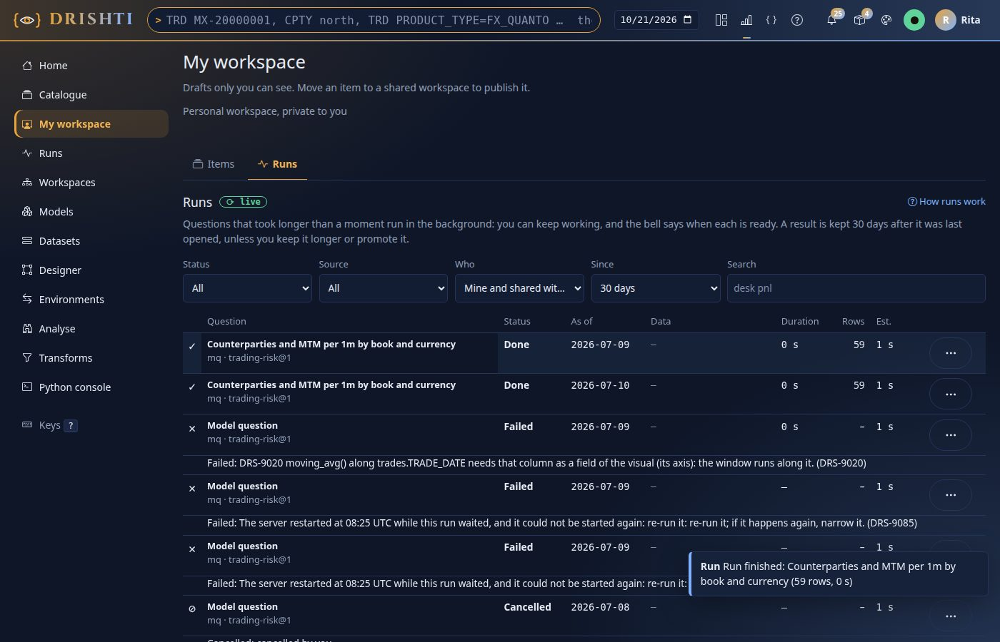 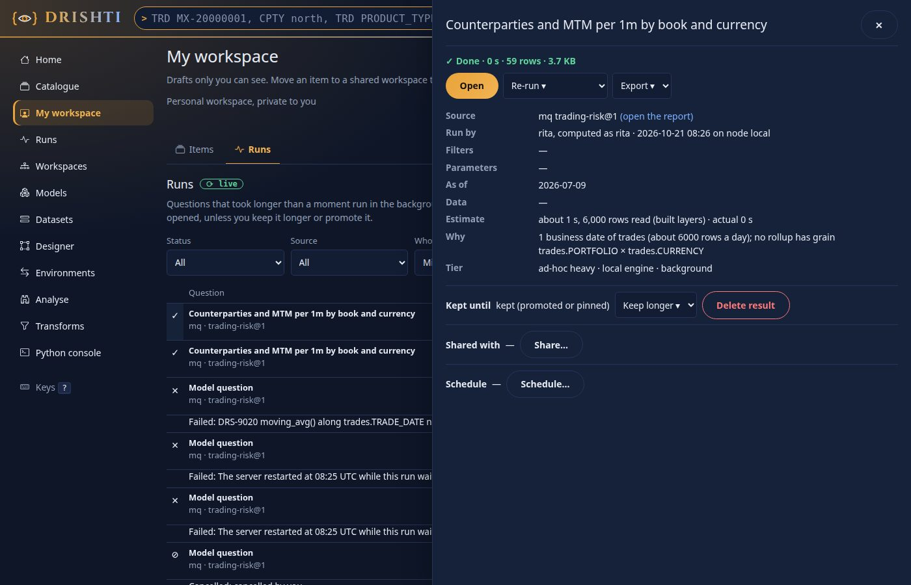 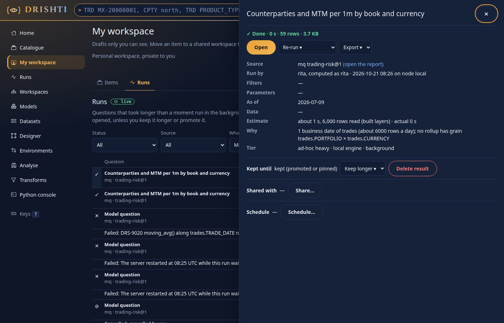 |
| 2 | Report visual forced into a background run | **pass after fix** (BIR-01) | `Prefer: wait=0` set on the `mtm-by-counterparty` visual's request (Playwright route). The server answered `202`, the visual showed its run card; the run was *done* at once, but the card said *Queued* for ever: it subscribed after the run ended (BIR-01, fixed: it now draws the table without a reload). `/bi/run/<id>` opened `/bi/r/file:report:counterparty-risk/exposure?run=<id>` with *Drawn from the run of …* 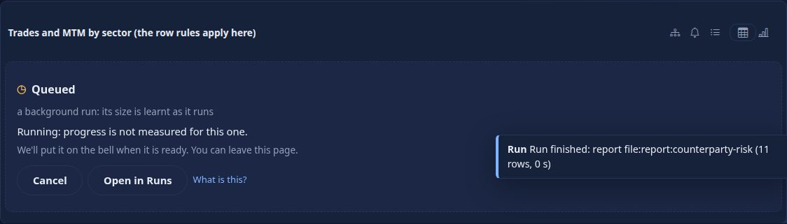 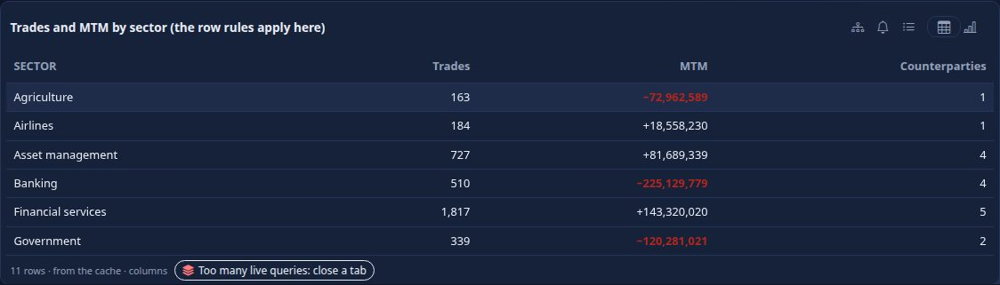 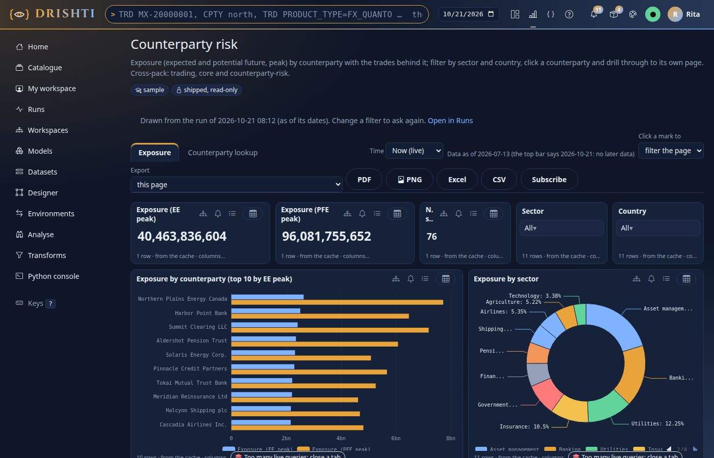 |
| 3 | Confirm flow (DRS-9082) | **pass** (over MQ; see BIR-06 for reports) | The console's own `B.ask` and `B.runs.settle` against the real server's `/bi/api/mq`: `409` carried `code, confirmToken, detail, estimate, run, runId`; the confirm card drew the estimate with its basis; the run was listed *Waiting for you* in the Runs tab; *Run in background* sent `POST /runs/{runId}/confirm` and the answer (500 rows) arrived. Asking again with `confirm: true` and the `confirmToken` returned `202` with **the same run id** as the waiting one; no awaiting run was left. 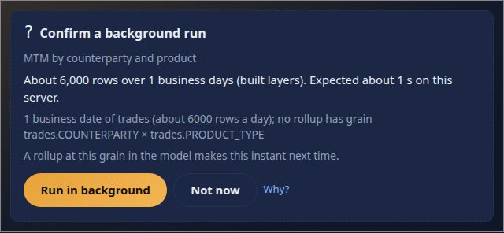 |
| 4 | DRS-9089 on an interaction, then Run in background | **pass** (over MQ; see BIR-06) | `interaction: true` on a heavy MQ: `409 DRS-9089` with the estimate, the *This selection needs a background run* card; *Run in background* re-asked with `interaction: false, confirm: true` and drew 348 rows. 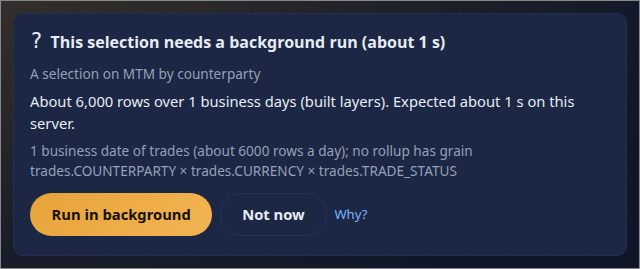 |
| 5 | A slicer pressed twice quickly; the explain panel | **pass** | Two sector values checked back to back on *Counterparty risk*: 20 report queries, all `200`, no `DRS-9080` anywhere on the page, no visual in error. The explain panel of a card was *ready* with its plan, tiers and times; under `Prefer` an MQ with `options.explain` answers `200` at once (no run) with `meta.sql`. 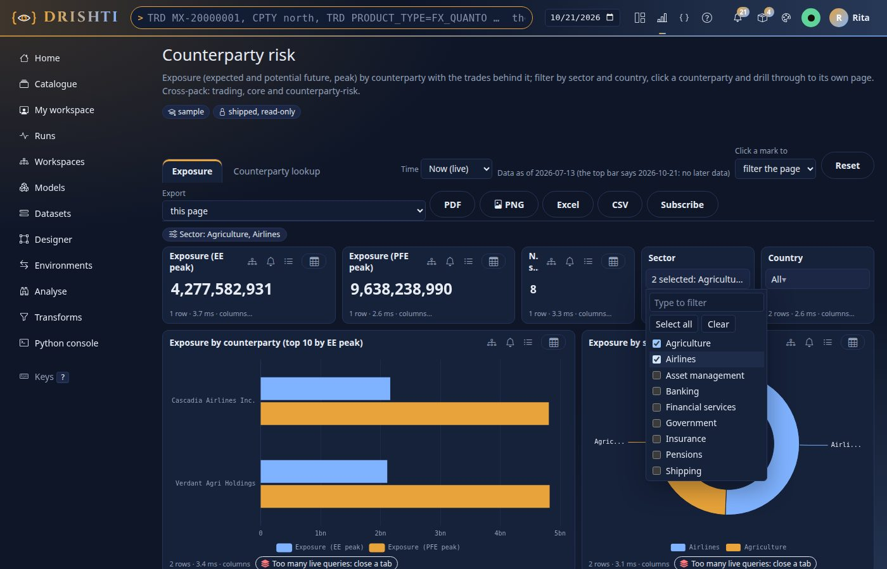 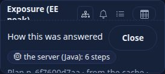 |
| 6 | Reuse; a masked role never gets another person's result | **pass** | The same MQ twice by rita: `reused`, `reuse.of` the first run. Then ann (analyst): her own run (`queued`, not reused), `•••` for every counterparty, then `reused` of **her** run. Rita's run id is `404 DRS-9080` for ann (run and result), and ann opening rita's `?run=` link got *The run in this address could not be opened* and her own masked chart. On screen: rita's bar shows names, ann's one bar `•••` (column `masked`). 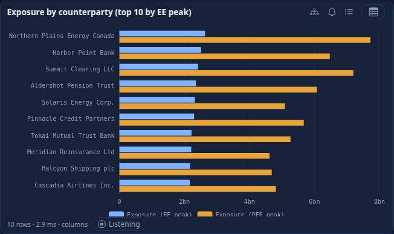 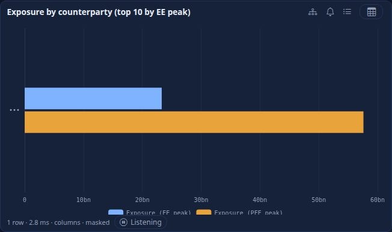 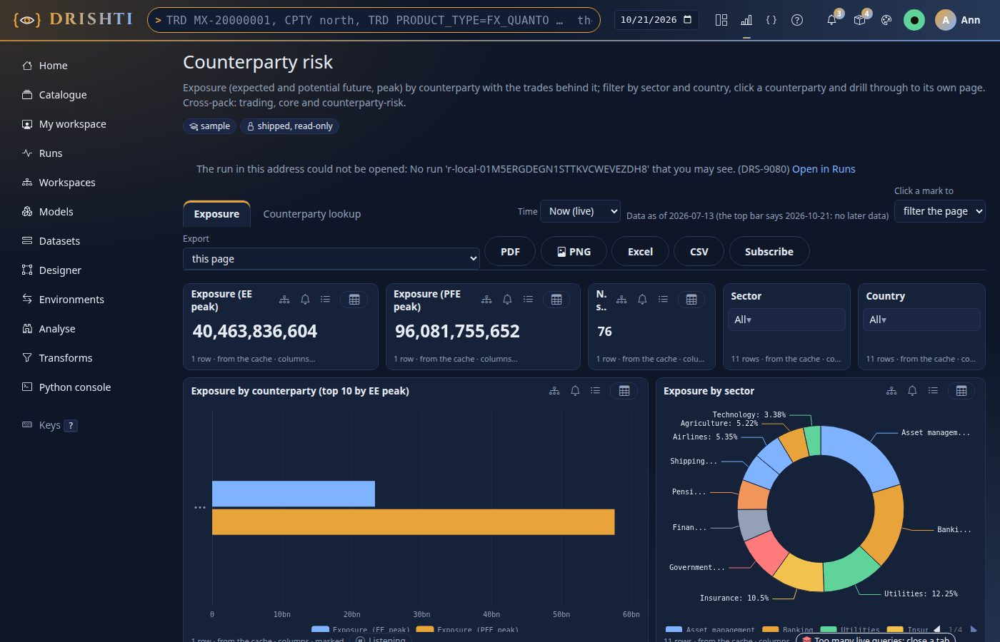 |
| 7 | Restart: runs and results survive; reuse when the data is unchanged | **pass, with BIR-07** | 14 of 14 runs listed after the restart with the same states, and an old result read back (348 rows). Reuse after restart worked in 3 of 4 restarts: once the model part of the data version changed (`dv:…:b09baeefb81a2b10` before, `…:ade5f2ffb1fb3d1b` after, the data vector identical), so the question ran again (BIR-07). Two runs that were waiting for confirmation at a restart became *Failed* `DRS-9085` with a bell notice (BIR-08). |
| 8 | The bell and the inbox | **pass after fix** (BIR-02) | The bell went 19 → 20 when a run submitted over the API finished; *Inbox → Runs* listed *Run finished: Open MTM by counterparty and book (220 rows, 0 s)* with a link to `/bi/run/<id>`, which 404'd for an MQ run before the BIR-02 fix.  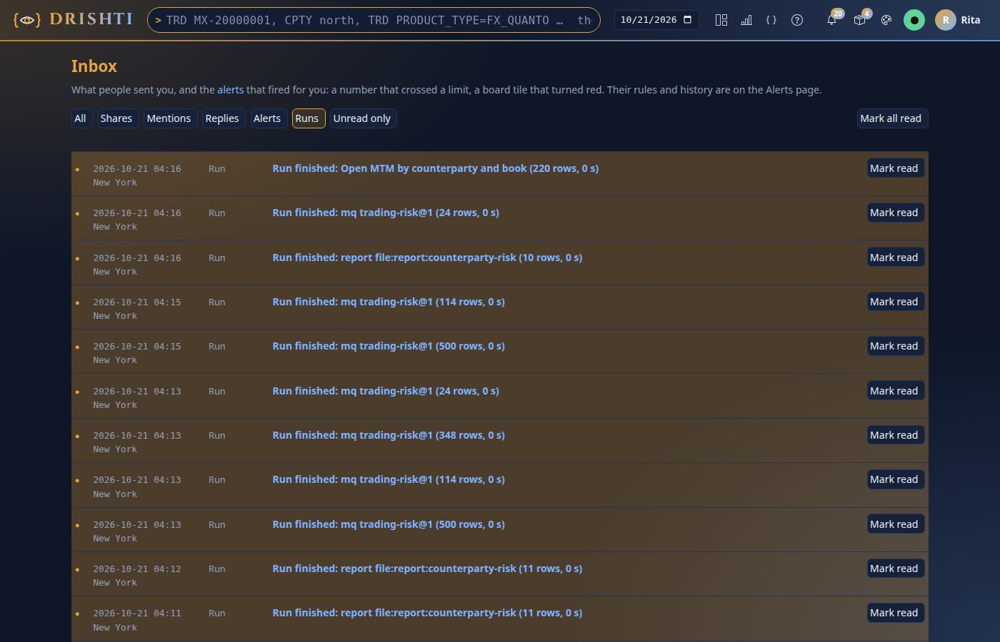 |
| 9 | The CLI against the real server | **pass after fix** (BIR-05) | `bi runs list` (words, estimate, storage line), `submit --wait 0 --yes` (run id and *follow it*), `wait` (exit 0, *done · 0 s · 75 rows*), `result --format csv --out`, `get`, `estimate` (*asks to confirm*, *a stored result answers it*), `submit` without `--yes` (exit 2, DRS-9082 in words), `cancel` (*cancelled: cancelled by you*), `storage` (403 for a non-admin, as designed). `bi mq --async` answered inline for a small question and refused a large one with "add --yes", which `bi mq` did not accept (BIR-05, fixed). |
| 10 | Admin → BI → Runs with real data | **pass** | Slots per class, queue, storage with top users, estimate accuracy (median 0.203, p10–p90), inline share 87 %, settings file; no `undefined`, `NaN`, `null` or `[object Object]` on the page; the not-built parts are simply absent. 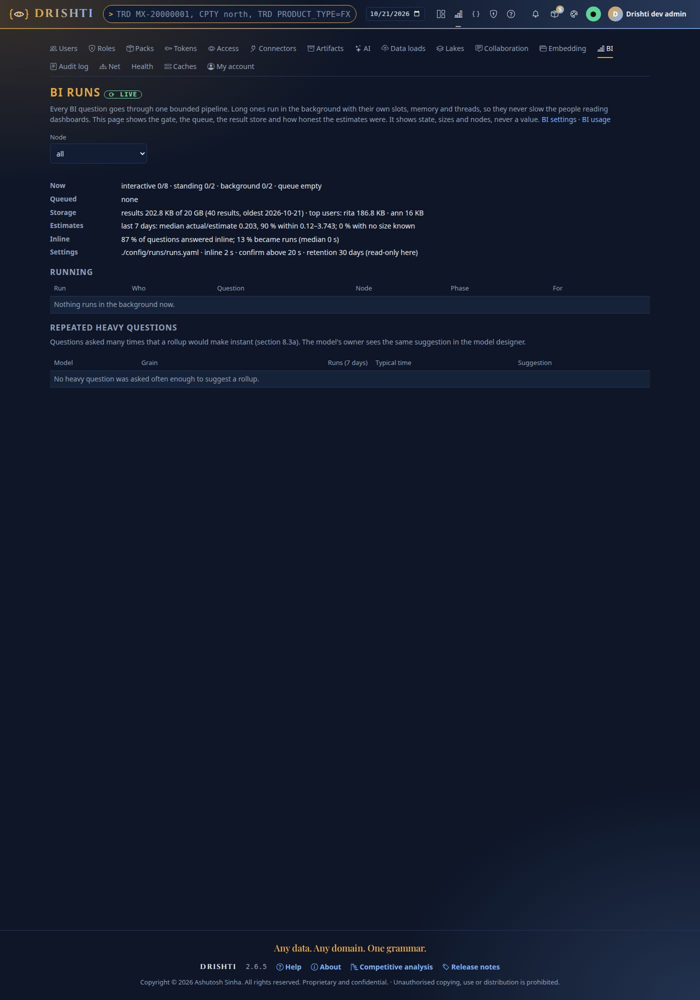 |
| 11 | `test_bi_wave_b_browser.py`: `test_a_parameter_slicer_shocks_the_report`, `test_the_explain_panel_shows_tiers_layers_and_times` | **pass** | 2 passed in 43 s with the server jar built (setup 17 s, the calls 3.8 s and 1.9 s). |
| 12 | The whole console suite (`-n 3 --dist loadfile`) | **fail: 3 (BIR-14), not from this round** | 2,756 passed, 7 skipped, 4 failed in 34 min; alone, 1 of the 4 passed (load) and 3 fail the same way (BIR-14). See [the suite](#the-whole-console-suite) |

## Findings

| Id | Severity | Finding | Status |
|---|---|---|---|
| BIR-01 | High | A run card stays *Queued* for ever when its run ends before the card subscribes | fixed `4baed349f` |
| BIR-02 | Medium | *Open* (drawer) and the inbox notice of an MQ or SQL run go to a console 404 | fixed `4baed349f` |
| BIR-03 | Medium | *Who: Shared with me* lists the person's own runs | fixed `6530df136` |
| BIR-04 | Medium | The Runs tab's storage line is the node's total and names the largest users to everyone | fixed `6530df136` |
| BIR-05 | Low | `bi mq --async` / `bi sql --async` refuse a large question with "add --yes" but have no `--yes` | fixed `93a608630` |
| BIR-06 | Medium | Report visuals are never planned, so a report never shows the confirm or *needs a run* card | fixed `4a168468b` |
| BIR-07 | Medium | Reuse after a restart sometimes fails: the model part of the data version changed across one restart | fixed `303e22966` |
| BIR-08 | Low | A run waiting for confirmation fails `DRS-9085` at a restart and rings the bell | fixed `8b626b135` |
| BIR-09 | Low | The run object leaves `data.words` null and `data.tables` empty, so *Data* is "–" everywhere | fixed `381efcced` |
| BIR-10 | Low | A report visual's run is titled with the report's id (`file:report:counterparty-risk`), not the visual's title; `source.title` null | fixed `a4c1b4937` |
| BIR-11 | Low | `can.share` and `can.export` are true on done runs while sharing and export answer `DRS-5001` (R6 not built) | fixed `42f5f5280` (R6 is built now; `can` follows what the server can do) |
| BIR-12 | Low | A done run with `expiresAt` null reads *Kept until: kept (promoted or pinned)* in the drawer | open |
| BIR-13 | Low | A DRS-9085 row reads "…could not be started again: re-run it: re-run it; if it happens again, narrow it" | server side fixed `4ff724649` (a plain reason); console lane: its fix line |
| BIR-14 | Medium | The workspace page's member form is hidden behind the new Members tab: three browser tests fail | open: console lane |

### BIR-01 A run card stays Queued for ever (high, fixed)

* **Steps:** open *Counterparty risk*; make one visual's question a run (`Prefer: wait=0`). On this data the run is done within milliseconds of its `202`.
* **Expected:** the card turns into the table without a reload (BI_RUNS 6.2).
* **Actual:** *Queued … progress is not measured for this one* for ever, although `GET /runs/{id}` said `done`. The card's `R.follow` listened for events only;
  the run's `done` event was sent before it listened, and `hello` lists only unfinished runs. The stand-in's runs took 3 s, which hid it.
* **Fix:** `bi-runs.js` `R.follow` asks for the run once when the stream is already open and again at every `hello` (a reconnect).
  `test_a_run_that_ended_before_its_card_listens_still_draws` fails without the fix and passes with it.

### BIR-02 Open goes to a 404 for an MQ or SQL run (medium, fixed)

* **Steps:** Runs tab → an MQ run → *Open*; or the inbox notice of an MQ run.
* **Expected:** the result (BI_RUNS 7.3 names a result grid at `/bi/runs/<id>`).
* **Actual:** `/bi/run/<id>` redirected to the server's `source.href` `/bi/runs/<id>`: *The console has no page at /bi/runs/…*. The result grid was not built.
* **Fix:** `/bi/run/<id>` follows only a report's or a board's page (`/bi/r/`, `/bi/b/`); any other run opens in the Runs tab with its drawer,
  where Export has its rows. The result grid page stays a console item.

### BIR-03 Shared with me lists my own runs (medium, fixed)

* **Steps:** Runs tab, *Who: Shared with me*.
* **Expected:** none (nothing is shared until R6).
* **Actual:** every own run; the server ignored `mine` and `shared`.
* **Fix:** `GET /runs` takes `mine` and `shared`; `mine=false` lists nothing until runs can be shared. `ModelAcceptanceTest`.

### BIR-04 The storage line shows the node and other people (medium, fixed)

* **Steps:** as rita, `GET /api/v1/bi/runs`.
* **Expected:** `storage: {bytes, results}` of the caller (14.1).
* **Actual:** the node's total with `topUsers: [{user: rita, …}, {user: ann, …}]`: other people's names and sizes to anyone with BI.
* **Fix:** `RunStore.usageOf(user)`; the list answers the caller's own bytes and count. Admin keeps the node's view. `RunStoreTest`, `ModelAcceptanceTest`.

### BIR-05 bi mq --async has no --yes (low, fixed)

* **Steps:** `drishti.py bi mq q.json --async` on a large question, then the hint's `--yes`.
* **Actual:** `unrecognized arguments: --yes`.
* **Fix:** `--yes` on `bi mq` and `bi sql`, sending `confirm: true` (14.5 point 1). `test_cli_biruns`; TOOLS, CLI_GUIDE, BI_RUNS 14.4, BI_RUNS_GUIDE.

### BIR-06 Reports never show the confirm or the needs-a-run card (medium, fixed)

* **Steps:** a heavy report visual with `Prefer`, first draw or `interaction: true` (a slicer).
* **Expected (BI_RUNS_GUIDE, *Confirming a large run* and *A selection that needs a run*; BI_RUNS 19.6 steps 2 and 4):** `409 DRS-9082` or `DRS-9089`.
* **Actual:** `200` inline every time: the server does not plan report visuals yet (18.2b R3: "they wait inline as before"). The console's cards work (checks 3
  and 4 drew them from the real server's MQ answers) but no report reaches them. A heavy report visual becomes a run card only when it takes longer than the
  inline wait. Either plan report visuals (their MQ is known after the report's compile) or say so in the guide.

### BIR-07 Reuse after a restart is not reliable (medium, fixed)

* **Steps:** ask an MQ (`trades.COUNTERPARTY` × `MTM`, 2026-07-13), restart, ask again; repeat over several restarts.
* **Expected:** `reused` while the data is unchanged (14.5, 18.2b R5).
* **Actual:** reused after 3 of 4 restarts. After one, the data version was `dv:dv_32b97d588cb03c27:ade5f2ffb1fb3d1b` against
  `dv:dv_32b97d588cb03c27:b09baeefb81a2b10` before and after: the data vector equal, the model view's hash (`RunSources.version`,
  `b.view().hash()`, `ModelCatalog.view`) different for that one boot. The run computed again (safe, but the reuse promise fails). Look for an input of
  the view hash that depends on start-up order (a dataset resolved before the packs or masks were complete).

* **Root cause and fix (`303e22966`):** the model view's hash was taken of `ResolvedDataset.masked`, a `Set.copyOf`. Its iteration order is
  salted per JVM (`ImmutableCollections.SALT`), so a model with two or more masked columns could hash differently after a restart while
  nothing changed. The hash is now taken of a canonical text (datasets by alias, masks sorted) and the masks keep their order.
  `ModelViewHashTest` compares the hash across four fresh JVMs (it fails with the old code) and across shuffled load orders.

### BIR-08 Waiting for confirmation becomes Failed at a restart (low, fixed)

`RunService.recover` fails `awaiting-confirm` and `planned` runs with `DRS-9085` "…while this run waited, and it could not be started again", and tells the
bell *Run failed*. Nothing ran and nobody confirmed: discarding it quietly (cancelled, "the confirmation lapsed at a restart") reads better.

### BIR-09 to BIR-13 (low, open)

* **BIR-09** `data.words` null and `data.tables` `[]` on every run, so the Runs tab's *Data* column and the drawer's *Data* say "–" (14.3 has `trade_endur delta v412`).
* **BIR-10** a report visual's run is titled `file:report:counterparty-risk` with `source.title` null; 14.2 says the default title is the visual's.
* **BIR-11** `can.share` and `can.export` are `true` on a done run while those endpoints answer `DRS-5001` (R6 not built); the drawer offers *Share…* and *Export ▾*.
* **BIR-12** a done run with `expiresAt` null: the drawer says *kept (promoted or pinned)*; the server should give the retention date (last open + 30 days), or the console say "30 days after the last open".
* **BIR-13** the reason of a `DRS-9085` run ends "re-run it" and the console adds its fix "re-run it; if it happens again, narrow it".

Also seen, not findings: an unknown report id with `Prefer` is accepted `202` and fails `DRS-9001` (without `Prefer` it is a `404` at once); a run answered
inline is invisible, so its `Drishti-Run` id is `404` (by design, 6.1); pages log retried `429`s from the per-person query limit while several visuals draw.

## The whole console suite

`pytest tests -n 3 --dist loadfile` with the built jar and these fixes: **2,756 passed, 7 skipped, 4 failed** (34 min). Run again alone:

| Test | Alone | Why |
|---|---|---|
| `test_bi_reports_browser.py::test_designer_move_resize_duplicate_and_delete_from_the_keyboard` | passed | load (three workers with Chromium) |
| `test_bi_wizard_and_controls_browser.py::test_a_member_is_found_by_typing_part_of_a_name` | failed | BIR-14 |
| `test_bi_browser.py::test_a_workspace_is_created_and_shared_from_the_page` | failed | BIR-14 |
| `test_bi_browser.py::test_review_before_publish_needs_a_second_person` | failed | BIR-14 |

### BIR-14 The member form is behind the Members tab (medium, open, console lane)

* **Steps:** open a shared workspace `/bi/w/<id>` and add a member.
* **Expected (the three tests):** the *Add a member* form is on the page.
* **Actual:** `locator resolved to hidden <form data-add-member …>`: since the console lane's `f1f6420bf` (workspace tabs Items · Runs · Members) the form
  sits in the Members panel, hidden until that tab is chosen. Not caused by this round (`workspace.html`, `bi.js` and `bi-runs-tab.js` unchanged here).
  Either the tests choose the Members tab first, or a workspace with no members yet opens its Members tab; the console lane decides.

## Commits

| Commit | What |
|---|---|
| `4baed349f` | console: BIR-01 (run card), BIR-02 (`/bi/run/<id>`); `test_bi_runs_browser.py`, `test_bi_runs_page.py` |
| `93a608630` | CLI: BIR-05 (`--yes` on `bi mq` and `bi sql --async`); `test_cli_biruns.py`; docs |
| `6530df136` | server (`RunsController.list`, `RunStore.usageOf` only): BIR-03, BIR-04; `RunStoreTest`, `ModelAcceptanceTest` |
| `303e22966` | server: BIR-07 (the model view's hash canonical); `ModelViewHashTest` |
| `4a168468b` | server: BIR-06 (report visuals planned under `Prefer`; unknown size waits inline); `ModelAcceptanceTest` order 19, `RunServiceTest` |
| `8b626b135` | server: BIR-08 (awaiting-confirm kept across a restart, else cancelled quietly); `RunServiceTest` |
| `381efcced` | server: BIR-09 (`data.tables`, `data.words`); `RunDataWordsTest` |
| `a4c1b4937` | server: BIR-10 (the visual's title, `source.title`); `ModelAcceptanceTest` order 19 |
| `42f5f5280` | server: BIR-11 (`can` follows what is built); `RunCanTest` |
| `4ff724649` | server: BIR-13 server side (a plain `DRS-9085` reason); `RunServiceTest` |
