<!--
  Project Drishti · Any data. Any domain. One grammar.

  Copyright (c) 2026 Ashutosh Sinha <ajsinha@gmail.com>.
  All rights reserved.

  PROPRIETARY AND CONFIDENTIAL.

  This file is the confidential and proprietary property of Ashutosh Sinha.
  Unauthorised copying, use, modification, distribution or disclosure of this
  file, via any medium, is strictly prohibited except with the express prior
  written permission of the copyright holder.

  See the LICENSE file in the root of this repository for the full terms.
-->
# Tutorial 1 · Your first 15 minutes

From nothing to a running Drishti: install it, build the demo lakes, start the server and the console with sign-in on, sign in, open a trade, search, try the search form, look at business intelligence and make a token for the command line. Every step says what to do in the UI, on the command line and, where there is one, in YAML. The next four tutorials build on it: [look up anything](02-look-up-anything.md), [query by form](03-query-by-form.md), [share and collaborate](04-share-and-collaborate.md) and [an entity over time](05-an-entity-over-time.md).

**Someone already runs a demo server for you?** Skip steps 1 and 2: ask for its address, start at [Step 3](#step-3--sign-in) and use [Step 9](#step-9--make-a-token-for-the-command-line) for your token. Steps 1 and 2 are the install, done once per machine.

## Time to complete

About 25 minutes after the one-time build (a few minutes) and the demo lakes (about 15 minutes for the sixty business days, once).

## Before you start

You need a Linux, macOS or Windows machine with Java 21 or newer, Python 3.13 ([the minimum](../guides/OPERATIONS_GUIDE.md#21-prerequisites)) and git ([uv](https://docs.astral.sh/uv/) only when you build Drishti Lake's wheel from a git clone; the source zip and the wheel pack carry it). Nothing else: no database, no Docker. On Windows follow [OPERATIONS_GUIDE.md (Windows)](../guides/OPERATIONS_GUIDE.md#4-drishti-on-windows) for the same steps in PowerShell, and write every `python3 tools/drishti.py ...` below as `py -3.13 tools\drishti.py ...`.

These tutorials run on the **quick-start environment** of [data/testdata/README.md](../../data/testdata/README.md): the seven packs (`core`, `market-data`, `trading`, `counterparty-risk`, `market-risk`, `world-economy`, `news-and-markets`) reading the **demo lakes**, sixty business days of production-shaped test data (5,000 trades from each of three booking systems, ENDUR, CALYPSO and MUREX, and everything the packs need around them). Every field name is UPPER_SNAKE (`TRADE_ID`, `COUNTERPARTY`, `QUANTITY`), as in production. The banking data is synthetic; the world data and its licences are in [WORLD_DATA_GUIDE.md](../guides/WORLD_DATA_GUIDE.md).

In these tutorials `<GO>` means "press Enter", commands are run from the repository root (the folder called `drishti`), and the server and the console are the two programs of [OPERATIONS_GUIDE.md](../guides/OPERATIONS_GUIDE.md#2-install-and-run-on-one-machine): the **server** reads the data (port 18480), the **console** is the web pages you open (port 17480).

## What you will learn

- how to build Drishti, build the demo lakes and start it with sign-in on (the way every tutorial here runs);
- how to sign in, and what the home page and the top bar offer;
- how to open an entity by typing a command (`TRD MX-20000001`), and what a view is made of;
- how to find entities by what they contain, and by filling in a form;
- where business intelligence (BI) lives;
- how to make a token so the command line can use your server.

### Part A · Install, start and look around

Install Drishti, build the demo lakes, start it, sign in, open a trade, search, try the search form and look at business intelligence. At the end you will also have a token that lets the command line talk to your server, which the data and build tutorials use.

## Step 1 · Install, build and check the machine

**In the UI.** In IntelliJ IDEA run **Drishti: build all**, then in PyCharm run **Drishti: build demo lakes** ([IDE_GUIDE.md](../guides/IDE_GUIDE.md#13-the-maven-build-launchers)).

**From the command line:**

```bash
# in the platform folder: the source zip, or `python3 clone_all.py --release <release>` (QUICKSTART_DEVELOPERS.md sections 1 and 2); a clone of drishti alone cannot build
export JAVA_HOME=/usr/lib/jvm/java-21-openjdk-amd64     # your Java 21 or newer
export PATH="$JAVA_HOME/bin:$PATH"
python3 build_all.py --release <release> --skip-tests    # the products, then Drishti's jar AND modules (Windows: py -3.13 build_all.py ...)
cd drishti                                               # or, in drishti/ alone later: python3 tools/drishti.py build all
(cd drishti-console && python3.13 -m pip install --no-index --find-links ~/drishti-wheels -r requirements.txt)                          # your pip command 1
(cd drishti-console && python3.13 -m pip install --no-index --find-links ~/drishti-wheels -r ../config/compute/locks/python.lock)       # your pip command 2
python3 tools/drishti.py setup        # checks them: "Drishti is ready."
```

(The Python is yours: the system's, a dedicated one, or a virtual environment you made yourself; Drishti makes none.)

Then build the demo lakes, sixty business days ending on today's business date, so that past dates and **Compare** work in Part B. The lake tool also tells a
running server that the data changed (here none is running yet, so it leaves a note the server reads at its first start):

```text
$ python3 tools/drishti.py lake demo
  trading/trade_endur: … rows over 60 days
  trading/trade_calypso: … rows over 60 days
  trading/trade_murex: … rows over 60 days
  ...
  news/news-topic: … rows over 60 days

Demo lake ready: ~/drishti/data/delta/demo: 116 tables, 60 business days 2026-07-08 to 2026-09-30, built in 943 s
Feeds: ~/drishti/data/feeds/fixing.jsonl (the file connector's sample feed)
Server: no server at http://localhost:18480: left ~/drishti/data/bi-store/lake-rebuilt.json, so a server clears its stored BI columns and rollups at its next start
Connector files:
  civic-store: generated by the server at its first start (reads ~/drishti/data/delta/demo)
  ...
  trade-murex: generated by the server at its first start (reads ~/drishti/data/delta/demo)
```

You should see a line for each of the 116 tables, then `Demo lake ready` with sixty business dates ending on *your* today's business date (the summary above is from a
sixty-day run that kept the test data's own dates, 2026-07-08 to 2026-09-30; the table lines' row counts, captured on seven-day lakes, are left out).
It takes about 15 minutes and about 3.4 GB of disk. The other outputs in these tutorials were captured on Saturday 17 October 2026 on seven-day lakes
(Friday **2026-10-16** back to **2026-10-07**): on the sixty-day lakes the ids are the same, but a captured count or value may differ.

Now ask the machine whether it is ready: `python3 tools/drishti.py doctor` prints green, yellow and red lines, each red or yellow with a fix.


You should see no red line and `doctor: all clear` (the exit is 0). The two `port` lines say what is on the ports: with nothing started they say *free*; once the server and the console run they say
*in use by Drishti*.

## Step 2 · Start the server and the console with sign-in on

**In the UI.** Run **Drishti: run server (demo)**, then **Drishti: run console**. The first reads the lakes with the samples off (`DRISHTI_DEMO_ENABLED=false`), with
security on and a development administrator; the second signs people in with the same token secret.

**From the command line.** In the repository root, `tools/drishti.py` starts both with the same settings as the run configurations
(`--demo`: the lakes with the samples off, security on, a development administrator, the same token secret for the two):

```bash
export JAVA_HOME=/usr/lib/jvm/java-21-openjdk-amd64
python3 tools/drishti.py start server --demo --background     # Windows: py -3.13 tools\drishti.py start server --demo --background
python3 tools/drishti.py start console --demo --background    # Windows: py -3.13 tools\drishti.py start console --demo --background
python3 tools/drishti.py status
```

The secrets `--demo` uses are the development ones of the run configurations, and the command says so: fine on your own machine, never on
a shared one ([production checklist](../DEPLOYMENT_AND_QA_GUIDE.md#14-a-production-checklist-step-by-step)). Every option: [DEPLOYMENT_AND_QA_GUIDE.md › section 7](../DEPLOYMENT_AND_QA_GUIDE.md#7-start-the-server-and-the-console).

You should see `server: up on http://<this machine's address>:18480` and `console: up on http://<this machine's address>:17480`, then
`status` listing both `running` and `UP`. In the server's log, `data/logs/server.log`, `Started DrishtiApplication`, and before it the line
`The lake was rebuilt while the server was stopped ...: the BI store's columns and rollups were cleared` (the note `lake demo` left). Check the
server from the command line too:

```bash
curl -s localhost:18480/actuator/health
```

You should see `{"status":"UP","groups":["liveness","readiness"]}`. `python3 tools/drishti.py stop all` stops both when you are done.

(`DRISHTI_STUDIO_SAVE=true` lets the Build pages of tutorial 19 save work. Tutorial 4 needs two people, so all the tutorials run with sign-in on.)

## Step 3 · Sign in

Open <http://localhost:17480>. You are sent to the sign-in page. On the very first start the server makes a development administrator for you: the user
`drishti-dev-admin`, password `drishti-dev-admin123`. Type them in.

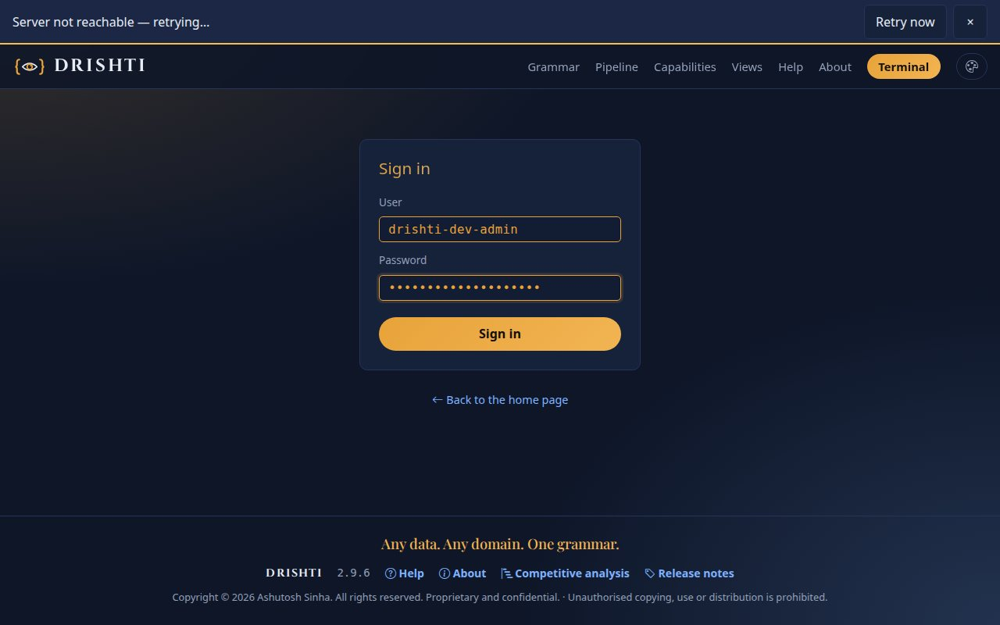

You should see the page above, then, after **Sign in**, the terminal's home page with your name at the top right. (The page tells you to change the development password: do that
under **My account** before you ever put real data in; tutorials here leave it so that the screenshots match.)

## Step 4 · Find your way around the home page

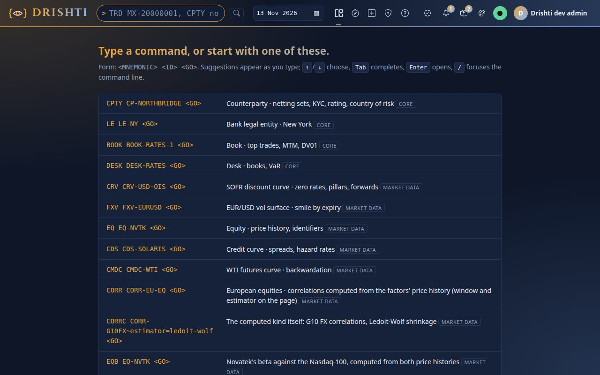

You should see, from left to right in the top bar: the **command line** (the rounded box, `> TRD MX-20000001, CPTY ...` is its hint), the **business date** box, the menu icons
(**Views**, then Risk, BI, Build, Admin, Help; **Risk** holds the pages of the risk engines your roles open, VaR, exposure, FRTB-SA and SIMM among them), the bell for your inbox, the packs icon with a count, the theme button, the round **Live** button and your name.
Below it is a list of commands you can click.

The command line is the heart of Drishti. A command is a **mnemonic** (a short code for a kind of thing: `TRD` is a trade) and an **identifier**:

```text
TRD MX-20000001 <GO>
```

Press `/` anywhere to jump to the command line. Type `TRD MX-200000` and stop: do not press Enter yet.

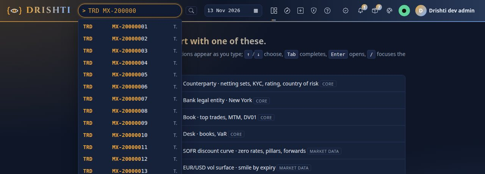

You should see a dropdown of trades whose id starts with what you typed (`MX-20000001`, `MX-20000002`, ...), each with its mnemonic. Use the arrow keys to move, `Tab` to copy a
suggestion into the box and `Enter` to open it. The trades come from three booking systems; their ids tell them apart: MUREX `MX-...`, CALYPSO `CLY-...`, ENDUR plain numbers
(`1000001`).

## Step 5 · Open a trade

Clear the box, type `TRD MX-20000001` and press Enter.

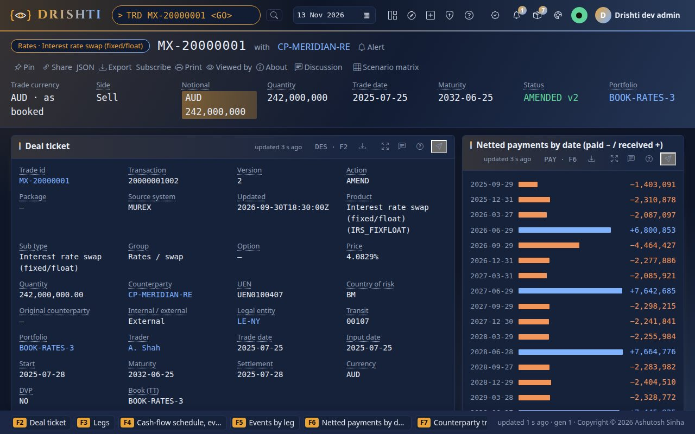

You should see the **view** of an interest rate swap booked in MUREX: the title line (`Rates · Interest rate swap (fixed/float)`, `MX-20000001` with `CP-MERIDIAN-RE`), the
**strip** of key figures under it (source system, side, notional `AUD 242,000,000`, quantity, trade date, maturity, status `AMENDED v2`, portfolio `BOOK-RATES-3`), then panels:
the **Deal ticket**, the **Legs** side by side, the **Cash-flow schedule** of every leg, **Events by leg**, and the **Netted payments by date** ladder. The function keys at the
bottom (`F2 Deal ticket`, `F3 Legs`, ... `F7 Counterparty trades`) jump to a panel or another page; click a blue name (the counterparty, the portfolio) to open that entity.

**Note.** The status `AMENDED v2` here and in the output below was captured on seven-day lakes. On the sixty-day lakes `MX-20000001` is cancelled part-way through: on its last seven business days it reads `CANCELLED`, version 7; on an earlier date it reads `AMENDED` (pick one in the business date box to see it).

On a phone the same view is one column. This is the same trade at 390 px:

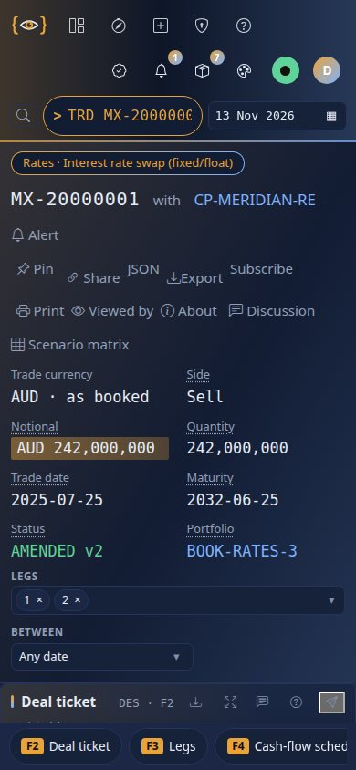

You should see the title, the strip as a grid and the panels stacked, with the function keys as a scrolling row at the bottom.

**From the command line.** The view has a twin, `view get`, which prints it as text. It needs the token of Step 9; for now just look at what it prints:

```text
$ python3 tools/drishti.py view get trade/MX-20000001
Rates · Interest rate swap (fixed/float)  MX-20000001  with CP-MERIDIAN-RE   [TRD]

Key figures
  figure      value
  ----------  ---------------
  Source      MUREX
  Side        Sell
  Notional    AUD 242,000,000
  ...
```

Each label is the meaning of an UPPER_SNAKE field of the trade (`Trade id` is `TRADE_ID`, `Portfolio` is `PORTFOLIO`); press `?` on the page for the glossary.

## Step 6 · Search by what is inside

Press `/` and type:

```text
TRD where QUANTITY > 1bn order by QUANTITY desc limit 50
```

Press Enter.

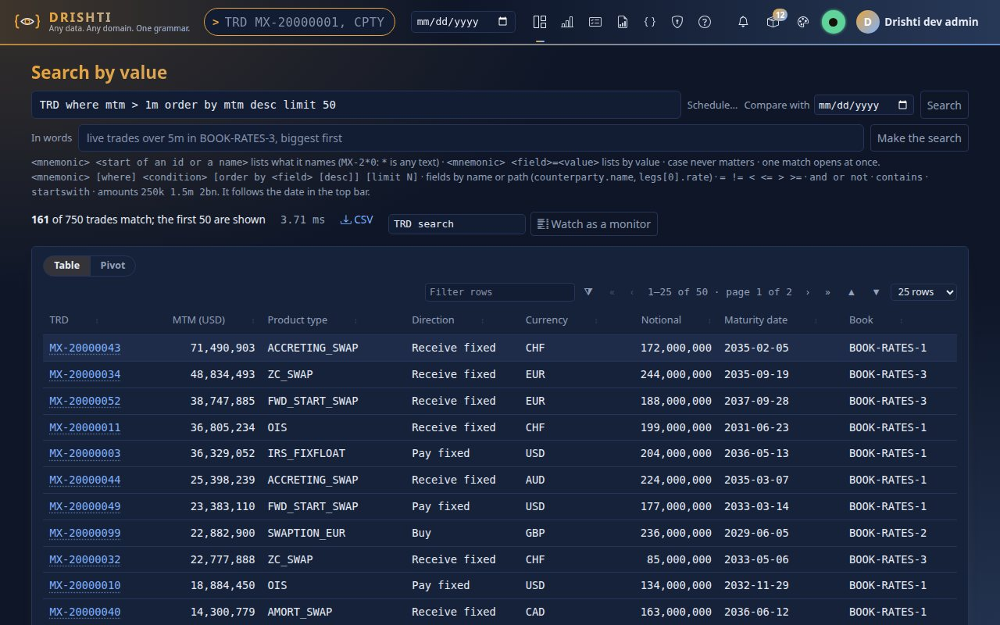

You should see a page headed **Search by value** with the search in a box, the line `236 of 15000 trades match; the first 50 are shown` and how long it took, then a table with
one row per trade, the biggest first, and the columns the trading pack chose (quantity, source system, product type, status, trade date, buy/sell, currency, maturity,
portfolio, counterparty). The search reads all three booking systems at once. Click a trade id to open it, sort by a heading, or type in **Filter rows**. **CSV** downloads the table;
**Watch as a monitor** keeps the first 50 rows as a live list. Amounts take `k`, `m` and `bn`; `and`, `or`, `not`, `contains`, `startswith` and `matches()` work too. Field names are
the document's own (`QUANTITY`, `SOURCE_SYSTEM`); one that does not exist is refused with the fields it has (`DRS-4004 no trade has a field 'mtm'; its fields include TRADE_ID,
SOURCE_SYSTEM, ...`).

**From the command line** the same search is one REST call (with the token of Step 9):

```text
$ curl -s -G -H "Authorization: Bearer $DRISHTI_TOKEN" http://localhost:18480/api/v1/search --data-urlencode "q=TRD where QUANTITY > 1bn order by QUANTITY desc limit 50" \
    | python3 -c "import json,sys; d=json.load(sys.stdin); print(d['matched'], 'of', d['scanned'], 'match;', len(d['rows']), 'rows')"
192 of 15000 match; 50 rows
```

## Step 7 · Fill in a form instead

If you would rather click than write, open **Views** (the first icon in the top bar) and choose **Forms**.

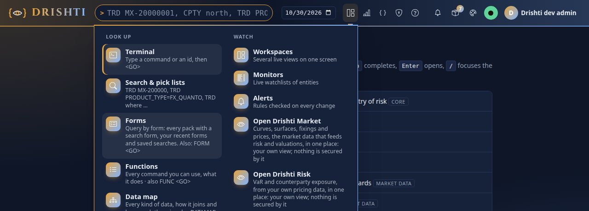

You should see two columns: **Look up** (the terminal, search, **Forms** and **Reports**: every report you have: scheduled ones, subscriptions, alerts and the BI reports) and **Watch** (workspaces of live views, monitors and alerts). **Forms** opens **All forms**:

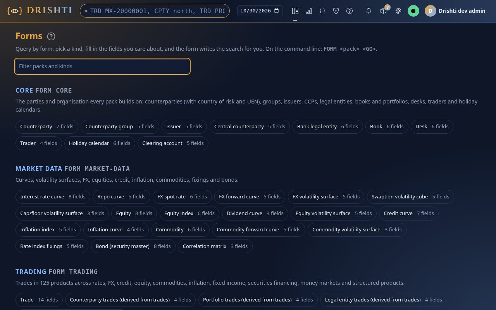

You should see one card for each pack that offers a form. Pick **Trading**, kind **Trade**:

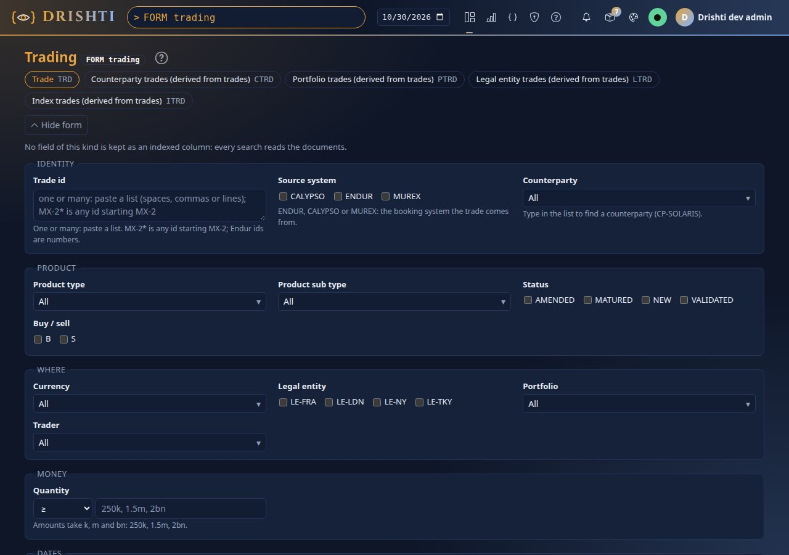

You should see a form with a box, a list or a set of tick boxes for each field people search by, grouped as **Identity** (trade id, source system, counterparty), **Product**
(product type, sub type, status, buy / sell), **Where** (currency, legal entity, portfolio, trader), **Money** (quantity) and **Dates** (trade date, maturity date). Part C
uses it. The form is written in the pack (`form:` in `modules/banking/packs/trading/pack.yaml`):

```yaml
form:
  trade:
  - { path: TRADE_ID, label: Trade id, type: id, group: Identity, order: 1 }
  - { path: SOURCE_SYSTEM, label: Source system, type: enum, group: Identity, order: 2 }
  - { path: COUNTERPARTY, label: Counterparty, type: enum, group: Identity, order: 3 }
  # ... product, where, money and dates
```

## Step 8 · Look at business intelligence

Click the **BI** icon (or type `BI` and press Enter).

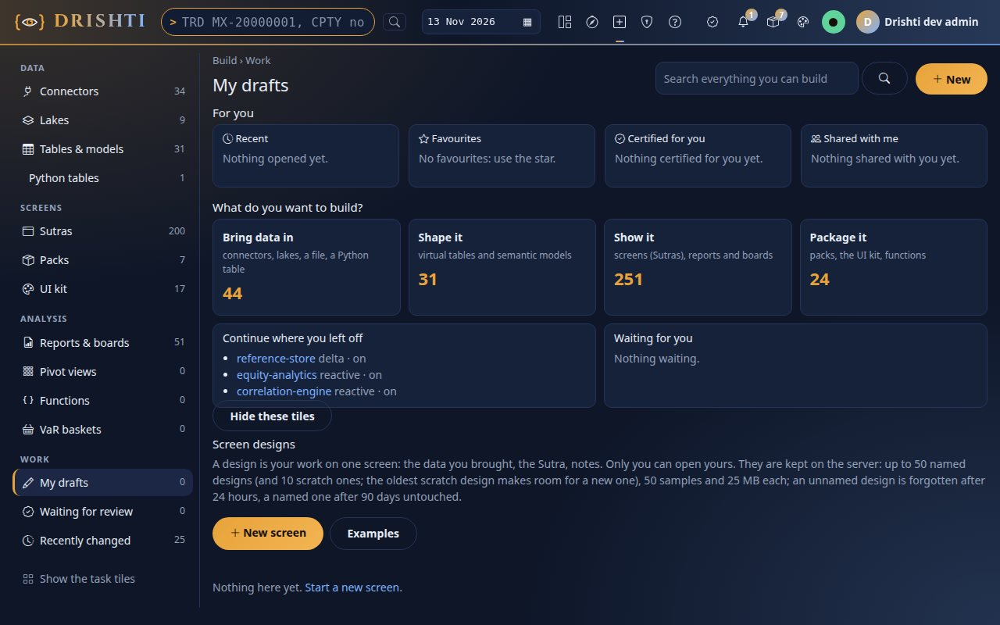

You should see the BI home: a menu on the left (Home, Catalogue, My workspace, Datasets, Insights and so on) and, in the middle, the sections *Recent*, *Favourites*, *Certified for you* and *Shared with me*, which fill as you use BI. Business intelligence is Drishti's second front: reports and boards built on models and datasets, with their own guide ([../guides/bi/README.md](../guides/bi/TABLES_AND_MODELS.md)) and tutorial
([the reports tutorial, Part A](../guides/bi/REPORTS.md#part-a--your-first-bi-report)). The shipped models read the same sixty days of the lakes.

**From the command line** (with the token of Step 9) `python3 tools/drishti.py bi catalogue list` prints the catalogue, one model or dataset a line.

## Step 9 · Make a token for the command line

The command line (`tools/drishti.py ...`) talks to your server over REST, and a server with sign-in on wants a token. Open **My account** (click your name), scroll to **API tokens**,
name a token `tutorials`, set **Days** to 30 and tick the four write scopes the tutorials use: `design:write`, `loads:write`, `packs:admin` and `bi:write`. (A token with a write scope must
expire, and it can never do more than you can.)

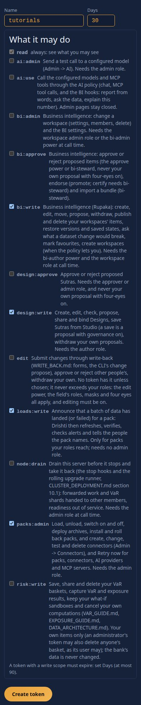

Press **Create token**.

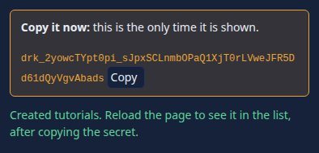

You should see the secret (it starts `drk_`). It is shown **once**: copy it now and keep it in a file only you can read, then point the command line at it:

```bash
mkdir -p ~/drishti-tokens && cat > ~/drishti-tokens/tutorial.token     # paste the secret, press Enter, then Ctrl+D
chmod 600 ~/drishti-tokens/tutorial.token
export DRISHTI_SERVER=http://localhost:18480
export DRISHTI_TOKEN=$(cat ~/drishti-tokens/tutorial.token)
```

(The IDE's QA walk keeps it in `data/qa/token.txt` instead: [IDE_GUIDE.md](../guides/IDE_GUIDE.md). The folder `data/` is git-ignored.)

Without a token a signed-in server says no, in plain words:

```text
$ python3 tools/drishti.py server health        # no token
drishti: the server said 401 DRS-5010: DRS-5010 missing bearer token (no or bad token: set DRISHTI_TOKEN or --token-file)
[exit 1]
```

With it, `doctor` checks the token too, and the server answers:

```text
$ python3 tools/drishti.py doctor --server http://localhost:18480
...
GREEN  server                  http://localhost:18480: version <version>, java 21, status OK
GREEN  token                   accepted; this token acts as drishti-dev-admin: scopes design:write, loads:write, packs:admin, bi:write
doctor: all clear
```


You should see `doctor: all clear`. `python3 tools/drishti.py server health` then lists every source (a connector to a store) with its state: all `UP` on the demo lakes ([tutorial 15](15-connect-your-data.md) shows a connector that is not).

## Next steps

- [Tutorial 2 · Look up anything](02-look-up-anything.md): mnemonics, type-ahead, links, a past date, Compare.
- [Tutorial 3 · Query by form](03-query-by-form.md): the form in depth, and keeping a search.
- The [User guide](../guides/USER_GUIDE.md) describes every feature of the console; [CLI_REFERENCE.md](../guides/CLI_REFERENCE.md) every command; [data/testdata/README.md](../../data/testdata/README.md) the test data and its demo pages.

## If something goes wrong

| You see | Do this |
|---|---|
| The build says `Drishti needs Java 21 or newer` | `JAVA_HOME` is older than 21; point it at 21 or newer and run the build again |
| `lake demo` says `No module named 'drishti_lake'` | the same Python lacks the libraries: run the two pip commands of Step 1 (or the line `setup` prints); Drishti installs nothing |
| The sign-in page says the password is wrong | the development password is `drishti-dev-admin123` until you change it; five wrong tries lock the account for 15 minutes |
| Every page says `DRS-5010 missing bearer token` | the console was started without `DRISHTI_TOKEN_SECRET` (or with another value than the server's): start it as in Step 2 |
| A view says *No data held for that date* | the demo lakes are not built, or were built for other dates: run `lake demo` again (a running server re-reads them) |
| `address already in use` | something else holds 18480 or 17480; set `DRISHTI_PORT` (server) or `DRISHTI_CONSOLE_PORT` (console), and tell the console where the server is with `DRISHTI_BACKEND_URL` |
