<!--
  Project Drishti · Any data. Any domain. One grammar.

  Copyright (c) 2026 Ashutosh Sinha <ajsinha@gmail.com>.
  All rights reserved.

  PROPRIETARY AND CONFIDENTIAL.

  This file is the confidential and proprietary property of Ashutosh Sinha.
  Unauthorised copying, use, modification, distribution or disclosure of this
  file, via any medium, is strictly prohibited except with the express prior
  written permission of the copyright holder.

  See the LICENSE file in the root of this repository for the full terms.
-->
# Tutorial 1 · Your first 15 minutes

From nothing to finding anything. Part A installs Drishti, builds the demo lakes, starts it with sign-in on, opens a trade, searches, tries
the search form, looks at business intelligence and makes a token for the command line. Part B looks anything up: mnemonics, type-ahead, links, a
past business date against Live, and Compare. Part C finds trades by filling in a form and keeps the search. Part D shares a filtered view with a
colleague and discusses it. Part E opens an entity over time: a range after an id. Every step says what to do in the UI, on the command line and,
where there is one, in YAML.

**Someone already runs a demo server for you?** Skip steps 1 and 2: ask for its address, start at [Step 3](#step-3--sign-in) and use
[Step 9](#step-9--make-a-token-for-the-command-line) for your token. Steps 1 and 2 are the install, done once per machine.

## Time to complete

About 1 h 50 min in all; each part can be done on its own day.

- Part A · Install, start and look around: About 15 minutes, plus the first build (a few minutes, once) and the demo lakes (about 15 minutes for the sixty business days, once).
- Part B · Look up anything: About 20 minutes.
- Part C · Query by form: About 20 minutes.
- Part D · Share and collaborate: About 25 minutes.
- Part E · An entity over time: About 30 minutes.

## Before you start

You need a Linux, macOS or Windows machine with Java 21 or newer, Python 3.13 ([the minimum](../guides/OPERATIONS_GUIDE.md#21-prerequisites)), [uv](https://docs.astral.sh/uv/) and git. Nothing else: no database, no
Docker. On Windows follow [OPERATIONS_GUIDE.md (Windows)](../guides/OPERATIONS_GUIDE.md#4-drishti-on-windows) for the same steps in PowerShell.

These tutorials run on the **quick-start environment** of [data/testdata/README.md](../../data/testdata/README.md): the seven packs (`core`, `market-data`, `trading`,
`counterparty-risk`, `market-risk`, `world-economy`, `news-and-markets`) reading the **demo lakes**, sixty business days of production-shaped test data (5,000 trades from
each of three booking systems, ENDUR, CALYPSO and MUREX, and everything the packs need around them). Every field name is UPPER_SNAKE (`TRADE_ID`, `COUNTERPARTY`,
`QUANTITY`), as in production.

In these tutorials `<GO>` means "press Enter", commands are run from the repository root (the folder called `drishti`), and the server and the console are the two
programs from [OPERATIONS_GUIDE.md](../guides/OPERATIONS_GUIDE.md#2-install-and-run-on-one-machine): the **server** reads the data (port 18480), the **console** is the web pages you open (port 17480).
Every step says what to do **in the UI** (IntelliJ IDEA and PyCharm run configurations, or the console's pages) and **from the command line** where a command exists.

**Where this data comes from.** The banking packs' data is synthetic test data (fictitious names, `tools/testdata/make_testdata.py`); the `world-economy` pack's figures are published data from the World Bank (CC BY 4.0), UNDP (CC BY 3.0 IGO) and the CIA World Factbook (public domain), plus IMF forecasts that are **internal only**, fetched by `drishti.py feed run world-economy`; the `news-and-markets` pack's quotes and headlines are a captured snapshot of Yahoo Finance and Google News, **internal only** (`drishti.py feed run news-and-markets`). Each source, its licence and how to refresh it: [External data](../guides/EXTERNAL_DATA.md).

**Part B · Look up anything.**

- [Part A](#part-a--install-start-and-look-around) done: the demo lakes built (`lake demo`), server and console running with sign-in on, and you signed in as `drishti-dev-admin`.
- The sixty business days of the lakes are what the past-date steps read. The outputs here were captured on seven-day lakes, ending on **2026-10-16**
  (first day 2026-10-07); `lake demo` printed your own sixty dates: use your last date where this tutorial says 2026-10-16 and the one before it for 2026-10-15.
  On the sixty-day lakes a captured value may differ, and `MX-20000001` is cancelled part-way through the sixty days (its last seven days read `CANCELLED`,
  version 7): pick an earlier date to see it live. The trades amended most often (ten times each) are ENDUR `1000279` and `1001049`, CALYPSO
  `CLY-4000509` and MUREX `MX-30001745`.
- For the command-line steps: `DRISHTI_SERVER` and `DRISHTI_TOKEN` set, as at the end of Part A.

**Part C · Query by form.**

[Part A](#part-a--install-start-and-look-around) done (demo lakes built, server and console running, signed in). The form belongs to the `trading` pack, one of the seven the tutorials
switch on, and searches the trades of all three booking systems (ENDUR, CALYPSO, MUREX) at once.

**Part D · Share and collaborate.**

- [Part A](#part-a--install-start-and-look-around) done, with sign-in **on**: sharing needs two people.
- Two browsers or two sessions: one for you (the development administrator), one for Vera, a colleague you create in Step 22. (A second private window is the easy way; each sign-in replaces the session of the same window.)
- The demo lakes built (Part A), so the shared view can be pinned to a past date: the outputs use 2026-10-15, the day before the lakes' last date; use yours.

**Part E · An entity over time.**

- Part B done: a running server and console with the `trading` and `market-data` packs and their demo lakes (`drishti.py lake demo`),
  signed in. Part B also shows how a view, the business date and Compare work.
- The token of [Step 9](#step-9--make-a-token-for-the-command-line) in `DRISHTI_TOKEN`, and `DRISHTI_SERVER=http://localhost:18480`.

The screens and outputs below come from this version's console and `drishti.py`, reading the history contract's two reference answers:
trade `1000015` over 30 data days and equity `EQ-CSCA` over 3 months
(`drishti-testkit/src/main/resources/history/`, [DATA_ARCHITECTURE.md › History queries: an entity over time, section 8](../architecture/DATA_ARCHITECTURE.md#8-the-json-contract)).
Your dates and values are your data's. Trade `1000015` and its *Trader* column are the reference answer's: on the demo lakes the
trading pack's `history:` block (step 32) lists no trader column. On the sixty-day demo lakes, the
trades amended most (ten times each) are ENDUR `1000279` and `1001049`, CALYPSO `CLY-4000509` and MUREX `MX-30001745`: try
`TRD 1000279 60`. `MX-20000001` is cancelled part-way through the sixty days.

## What you will learn

**Part A · Install, start and look around**

- how to build Drishti, build the demo lakes and start it with sign-in on (the way every tutorial here runs);
- how to sign in, and what the home page and the top bar offer;
- how to open an entity by typing a command (`TRD MX-20000001`), and what a view is made of;
- how to find entities by what they contain, and by filling in a form;
- where business intelligence (BI) lives;
- how to make a token so the command line can use your server.

**Part B · Look up anything**

- the command line's grammar: mnemonics, ids, bare ids and names, pick lists;
- what the type-ahead offers and how to use the keys;
- how links and function keys take you from a trade to its counterparty's trades, the counterparty and its netting set;
- the **Live** toggle against a past business date, and what the amber date box means;
- **Compare**: every field that changed between two days, and one number over time.

**Part C · Query by form**

- the inputs a form offers and what each one asks: text and its operators, amounts (`100m`), dates (between, relative), choices;
- why a long list of values is **one dropdown with tick boxes**, and a short one a row of tick boxes;
- the search the form writes, and how to copy or edit it;
- regular expressions, and what the safe engine refuses and why;
- saving a search under a name and as a live monitor.

**Part D · Share and collaborate**

- how to make a second user, and why her view can differ from yours;
- the **Share** dialog: a note, a date, the controls and filters you had set;
- the bell, the inbox and what the recipient opens;
- **Discussion**: threads on a view or a panel, `@mentions`, quoting a number as `{...}`;
- what masking does to a shared number.

**Part E · An entity over time**

- how to type a range after an id, and what each range means;
- how to read the history table: changed cells, restated days, masks and the days with no data;
- how changes only and DIFF find what moved, and how to open a day as it was;
- how a market kind's chart and headline numbers work;
- how to export the history and send a link that shows the same rows later;
- what a pack's `history:` block controls, and the limits and errors.

### Part A · Install, start and look around

Install Drishti, build the demo lakes, start it, sign in, open a trade, search, try the search form and look at business intelligence. At the end you
will also have a token that lets the command line talk to your server, which tutorials 12, 15 and 19 use.

## Step 1 · Install, build and check the machine

**In the UI.** Open the repository in IntelliJ IDEA (its run configurations are in `run-configs/`, [OPERATIONS_GUIDE.md (IDE)](../guides/OPERATIONS_GUIDE.md#3-other-ways-to-build-and-run-maven-intellij-idea-and-pycharm)) and run **Drishti build server jar**.
Then, in PyCharm opened on `drishti-console/` (its run configurations are in `drishti-console/run-configs/`), run **Build demo lakes**.

**From the command line:**

```bash
git clone https://github.com/ajsinha/drishti.git
cd drishti
export JAVA_HOME=/usr/lib/jvm/java-21-openjdk-amd64     # your Java 21 or newer
export PATH="$JAVA_HOME/bin:$PATH"
./mvnw -q package -DskipTests -pl drishti-app -am
uv venv --python 3.13 drishti-console/.venv
uv pip install --python drishti-console/.venv/bin/python -r drishti-console/requirements.txt
```

(`python3 -m venv` works too where your Python has `ensurepip`; on Ubuntu's system Python without the `python3-venv` package it does not, and `uv venv` does.)

Then build the demo lakes, sixty business days ending on today's business date, so that past dates and **Compare** work in Part B. The lake tool also tells a
running server that the data changed (here none is running yet, so it leaves a note the server reads at its first start):

```text
$ drishti-console/.venv/bin/python tools/drishti.py lake demo
  trading/trade_endur: … rows over 60 days
  trading/trade_calypso: … rows over 60 days
  trading/trade_murex: … rows over 60 days
  ...
  news/news-topic: … rows over 60 days

Demo lake ready: ~/drishti/data/delta/demo: 89 tables, 60 business days 2026-07-08 to 2026-09-30, built in 943 s
Feeds: ~/drishti/data/feeds/fixing.jsonl (the file connector's sample feed)
Server: no server at http://localhost:18480: left ~/drishti/data/bi-store/lake-rebuilt.json, so a server clears its stored BI columns and rollups at its next start
Connector files:
  civic-store: generated by the server at its first start (reads ~/drishti/data/delta/demo)
  ...
  trade-murex: generated by the server at its first start (reads ~/drishti/data/delta/demo)
```

You should see a line for each of the 89 tables, then `Demo lake ready` with sixty business dates ending on *your* today's business date (the summary above is from a
sixty-day run that kept the test data's own dates, 2026-07-08 to 2026-09-30; the table lines' row counts, captured on seven-day lakes, are left out). This output is to be re-run: it predates the test data's conversion to dated files, so the lines `lake demo` prints now may read differently.
It takes about 15 minutes and about 3.4 GB of disk. The other outputs in these tutorials were captured on Saturday 17 October 2026 on seven-day lakes
(Friday **2026-10-16** back to **2026-10-07**): on the sixty-day lakes the ids are the same, but a captured count or value may differ.

Now ask the machine whether it is ready. `doctor` prints green, yellow and red lines, each red or yellow with a fix:

```text
$ drishti-console/.venv/bin/python tools/drishti.py doctor
GREEN  java                    /usr/lib/jvm/java-21-openjdk-amd64/bin/java: Java 21.0 (Ubuntu)
GREEN  server jar              ~/drishti/drishti-server/target/drishti-server-2.9.11.b-exec.jar (version 2.5.0)
GREEN  python                  ~/drishti/drishti-console/.venv/bin/python: Python 3.13.15
GREEN  python pyyaml           installed
GREEN  python deltalake        installed
GREEN  python pyarrow          installed
GREEN  repo config/packs/      ~/drishti/config/packs
GREEN  console venv            ~/drishti/drishti-console/.venv
GREEN  configured directories  none of DRISHTI_DELTA_ROOT, DRISHTI_FILES_ROOT, DRISHTI_PACKS_INSTALLED is set
GREEN  port 18480              free
GREEN  port 17480              free
doctor: all clear
```

(This output is to be re-run: the jar name in it is newer than the run that printed the versions.)

You should see no red line (the exit is 0). The two `port` lines say what is on the ports: with nothing started they say *free*; once the server and the console run they say
*in use by Drishti*.

## Step 2 · Start the server and the console with sign-in on

**In the UI.** Run **Drishti server (demo lakes)**, then **Drishti console**. The first reads the lakes with the samples off (`DRISHTI_DEMO_ENABLED=false`), with
security on and a development administrator; the second signs people in with the same token secret.

**From the command line.** In the repository root, the scripts of `bin/` start both with the same settings as the run configurations
(`--demo`: the lakes with the samples off, security on, a development administrator, the same token secret for the two):

```bash
export JAVA_HOME=/usr/lib/jvm/java-21-openjdk-amd64
bin/start-server.sh --demo --background           # Windows: bin\start-server.cmd --demo --background
bin/start-console.sh --demo --background          # Windows: bin\start-console.cmd --demo --background
bin/status.sh
```

The secrets `--demo` uses are the development ones of the run configurations, and the script says so: fine on your own machine, never on
a shared one ([tutorial 21](21-run-it-in-production.md)). Every option: [DEPLOYMENT_AND_QA_GUIDE.md › section 6](../DEPLOYMENT_AND_QA_GUIDE.md#6-start-the-server-and-the-console).

You should see `server: up on http://<this machine's address>:18480` and `console: up on http://<this machine's address>:17480`, then
`status` listing both `running` and `UP`. In the server's log, `data/logs/server.log`, `Started DrishtiApplication`, and before it the line
`The lake was rebuilt while the server was stopped ...: the BI store's columns and rollups were cleared` (the note `lake demo` left). Check the
server from the command line too:

```bash
curl -s localhost:18480/actuator/health
```

You should see `{"status":"UP","groups":["liveness","readiness"]}`. `bin/stop-all.sh` stops both when you are done.

(`DRISHTI_STUDIO_SAVE=true` lets the Build pages of tutorial 19 save work. Tutorials 1 and 8 need two people, so all the tutorials run with sign-in on.)

## Step 3 · Sign in

Open <http://localhost:17480>. You are sent to the sign-in page. On the very first start the server makes a development administrator for you: the user
`drishti-dev-admin`, password `drishti-dev-admin123`. Type them in.

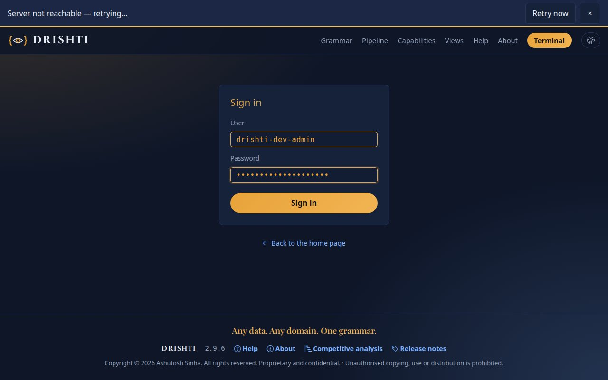

You should see the page above, then, after **Sign in**, the terminal's home page with your name at the top right. (The page tells you to change the development password: do that
under **My account** before you ever put real data in; tutorials here leave it so that the screenshots match.)

## Step 4 · Find your way around the home page

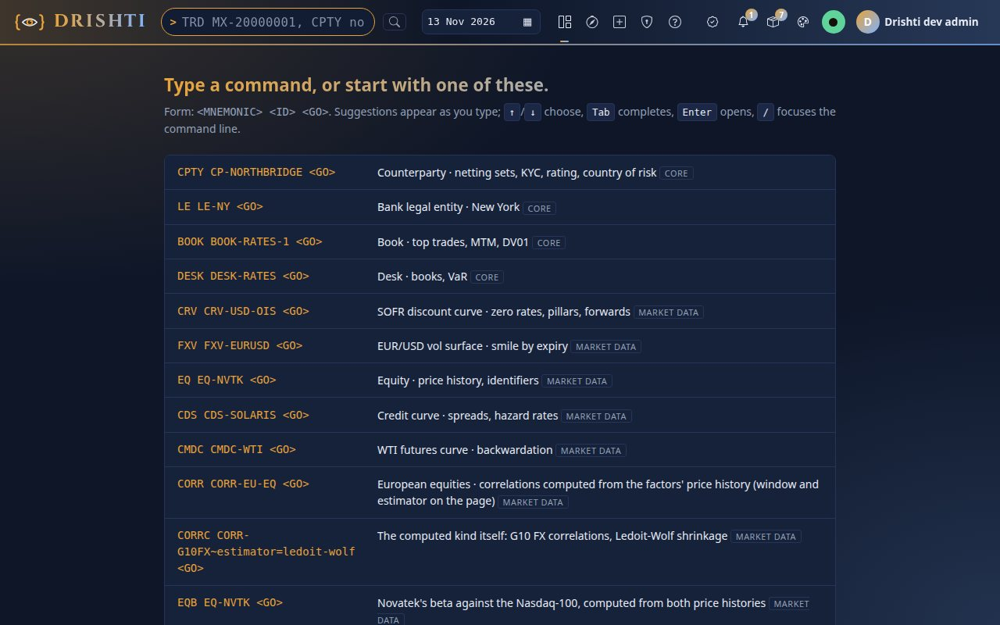

You should see, from left to right in the top bar: the **command line** (the rounded box, `> TRD MX-20000001, CPTY ...` is its hint), the **business date** box, the menu icons
(**Views**, then Engines, BI, Build, Admin, Help; **Engines** lists the compute engines your roles open, VaR, exposure, FRTB-SA and SIMM among them, and is not in this picture, which is to be re-run), the bell for your inbox, the packs icon with a count, the theme button, the round **Live** button and your name.
Below it is a list of commands you can click.

The command line is the heart of Drishti. A command is a **mnemonic** (a short code for a kind of thing: `TRD` is a trade) and an **identifier**:

```text
TRD MX-20000001 <GO>
```

Press `/` anywhere to jump to the command line. Type `TRD MX-200000` and stop: do not press Enter yet.

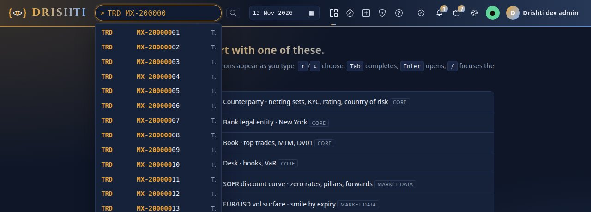

You should see a dropdown of trades whose id starts with what you typed (`MX-20000001`, `MX-20000002`, ...), each with its mnemonic. Use the arrow keys to move, `Tab` to copy a
suggestion into the box and `Enter` to open it. The trades come from three booking systems; their ids tell them apart: MUREX `MX-...`, CALYPSO `CLY-...`, ENDUR plain numbers
(`1000001`).

## Step 5 · Open a trade

Clear the box, type `TRD MX-20000001` and press Enter.

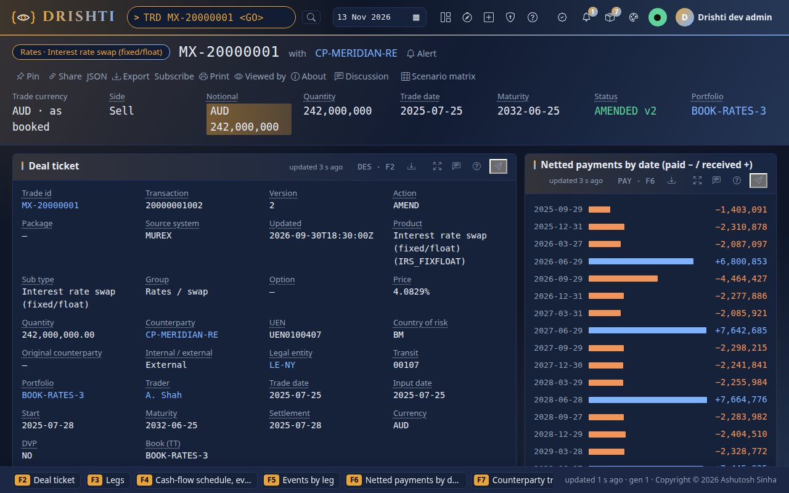

You should see the **view** of an interest rate swap booked in MUREX: the title line (`Rates · Interest rate swap (fixed/float)`, `MX-20000001` with `CP-MERIDIAN-RE`), the
**strip** of key figures under it (source system, side, notional `AUD 242,000,000`, quantity, trade date, maturity, status `AMENDED v2`, portfolio `BOOK-RATES-3`), then panels:
the **Deal ticket**, the **Legs** side by side, the **Cash-flow schedule** of every leg, **Events by leg**, and the **Netted payments by date** ladder. The function keys at the
bottom (`F2 Deal ticket`, `F3 Legs`, ... `F7 Counterparty trades`) jump to a panel or another page; click a blue name (the counterparty, the portfolio) to open that entity.

**Note.** The status `AMENDED v2` here and in the output below was captured on seven-day lakes. On the sixty-day lakes `MX-20000001` is cancelled part-way through: on its last seven business days it reads `CANCELLED`, version 7; on an earlier date it reads `AMENDED` (pick one in the business date box to see it).

On a phone the same view is one column. This is the same trade at 390 px:

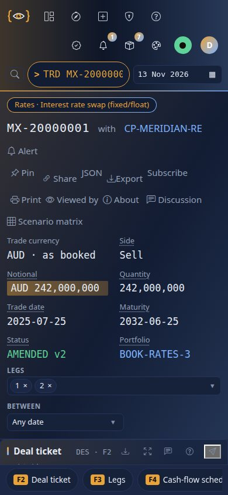

You should see the title, the strip as a grid and the panels stacked, with the function keys as a scrolling row at the bottom.

**From the command line.** The view has a twin, `view get`, which prints it as text. It needs the token of Step 9; for now just look at what it prints:

```text
$ drishti-console/.venv/bin/python tools/drishti.py view get trade/MX-20000001
Rates · Interest rate swap (fixed/float)  MX-20000001  with CP-MERIDIAN-RE   [TRD]

Key figures
  figure      value
  ----------  ---------------
  Source      MUREX
  Side        Sell
  Notional    AUD 242,000,000
  Quantity    242,000,000
  Trade date  2025-07-25
  Maturity    2032-06-25
  Status      AMENDED v2
  Portfolio   BOOK-RATES-3

Deal ticket  (kv, ticket, F2)
  field                  value
  ---------------------  -----------------------------------------------
  Trade id               MX-20000001
  Transaction            20000001002
  Version                2
  Action                 AMEND
  Package                –
  Source system          MUREX
  Updated                2026-10-07T18:30:00Z
  Product                Interest rate swap (fixed/float) (IRS_FIXFLOAT)
  ...
  Counterparty           CP-MERIDIAN-RE
  UEN                    UEN0100407
  Country of risk        BM
  Legal entity           LE-NY
  Portfolio              BOOK-RATES-3
  Trader                 A. Shah
  ...

Cash-flow schedule, every leg  (table, flows, F4)
  Flow         Start       End         Payment     Fixing         Notional  Rate / price  Resets
  -----------  ----------  ----------  ----------  ----------  -----------  ------------  ------
  20000001001  2025-07-28  2026-06-25  2026-06-29  –           242,000,000       4.0829%  0
  20000001002  2026-06-25  2027-06-25  2027-06-29  –           242,000,000       4.0829%  0
...
```

Each label is the meaning of an UPPER_SNAKE field of the trade (`Trade id` is `TRADE_ID`, `Portfolio` is `PORTFOLIO`); press `?` on the page for the glossary.

## Step 6 · Search by what is inside

Press `/` and type:

```text
TRD where QUANTITY > 1bn order by QUANTITY desc limit 50
```

Press Enter.

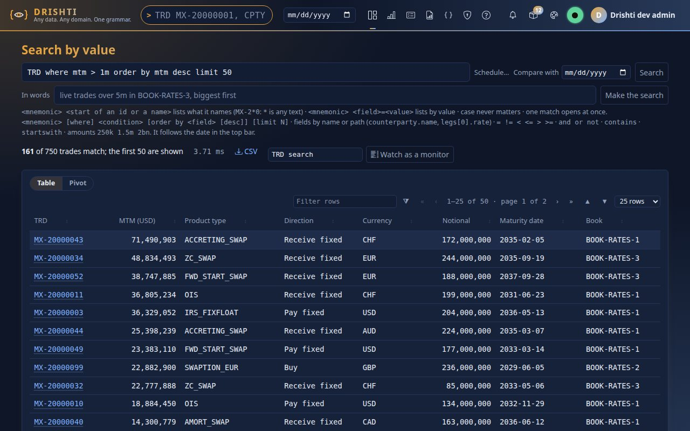

You should see a page headed **Search by value** with the search in a box, the line `236 of 15000 trades match; the first 50 are shown` and how long it took, then a table with
one row per trade, the biggest first, and the columns the trading pack chose (quantity, source system, product type, status, trade date, buy/sell, currency, maturity,
portfolio, counterparty). The search reads all three booking systems at once. Click a trade id to open it, sort by a heading, or type in **Filter rows**. **CSV** downloads the table;
**Watch as a monitor** keeps the first 50 rows as a live list. Amounts take `k`, `m` and `bn`; `and`, `or`, `not`, `contains`, `startswith` and `matches()` work too. Field names are
the document's own (`QUANTITY`, `SOURCE_SYSTEM`); one that does not exist is refused with the fields it has (`DRS-4004 no trade has a field 'mtm'; its fields include TRADE_ID,
SOURCE_SYSTEM, ...`).

**From the command line** the same search is one REST call (with the token of Step 9):

```text
$ curl -s -G -H "Authorization: Bearer $DRISHTI_TOKEN" http://localhost:18480/api/v1/search --data-urlencode "q=TRD where QUANTITY > 1bn order by QUANTITY desc limit 50" \
    | python3 -c "import json,sys; d=json.load(sys.stdin); print(d['matched'], 'of', d['scanned'], 'match;', len(d['rows']), 'rows')"
192 of 15000 match; 50 rows
```

## Step 7 · Fill in a form instead

If you would rather click than write, open **Views** (the first icon in the top bar) and choose **Forms**.

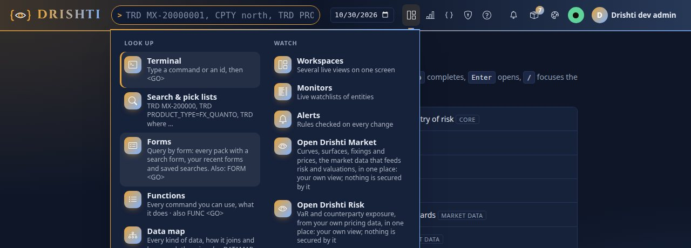

You should see two columns: **Look up** (the terminal, search, **Forms** and **Reports**: every report you have: scheduled ones, subscriptions, alerts and the BI reports) and **Watch** (workspaces of live views, monitors and alerts). **Forms** opens **All forms**:

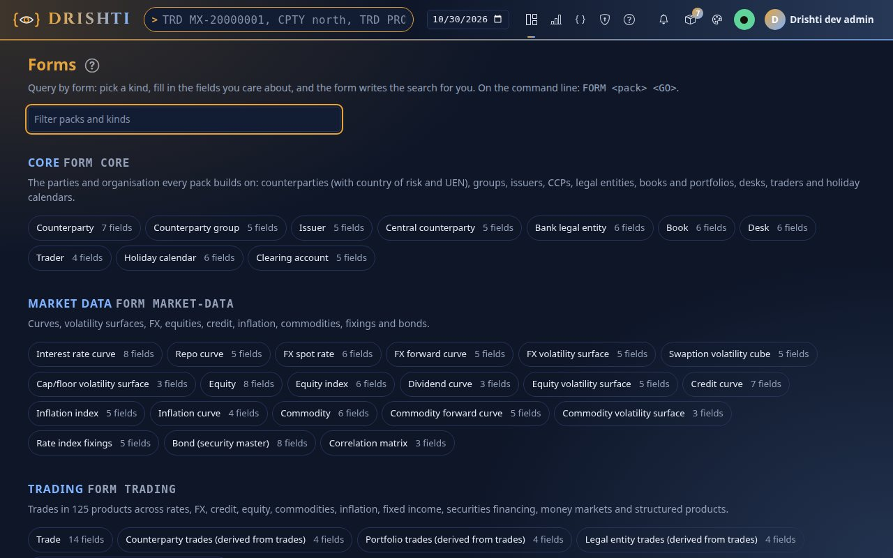

You should see one card for each pack that offers a form. Pick **Trading**, kind **Trade**:

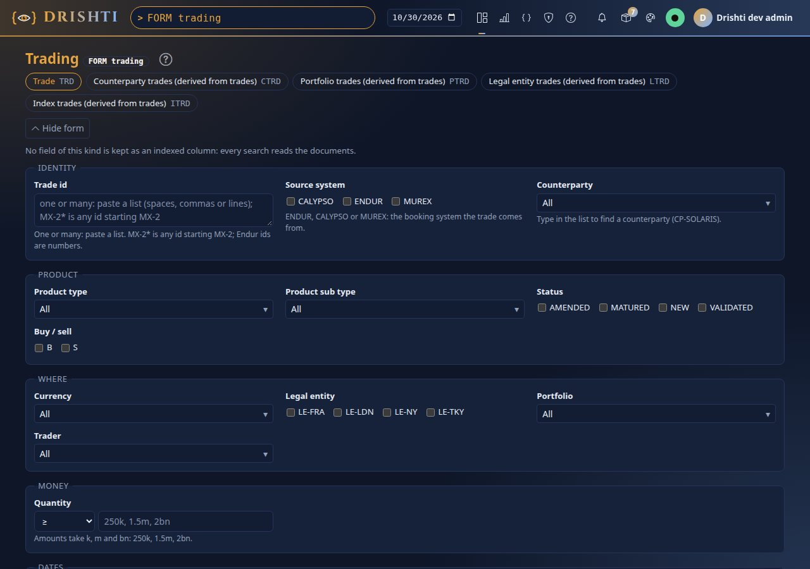

You should see a form with a box, a list or a set of tick boxes for each field people search by, grouped as **Identity** (trade id, source system, counterparty), **Product**
(product type, sub type, status, buy / sell), **Where** (currency, legal entity, portfolio, trader), **Money** (quantity) and **Dates** (trade date, maturity date). Part C
uses it. The form is written in the pack (`form:` in `config/packs/banking/trading/pack.yaml`):

```yaml
form:
  trade:
  - { path: TRADE_ID, label: Trade id, type: id, group: Identity, order: 1 }
  - { path: SOURCE_SYSTEM, label: Source system, type: enum, group: Identity, order: 2 }
  - { path: COUNTERPARTY, label: Counterparty, type: enum, group: Identity, order: 3 }
  # ... product, where, money and dates
```

## Step 8 · Look at business intelligence

Click the **BI** icon (or type `BI` and press Enter).

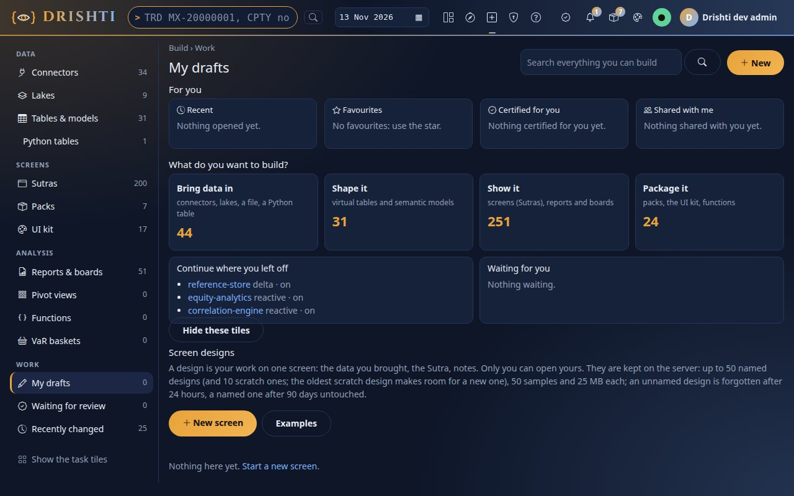

You should see the BI home: a menu on the left (Home, Catalogue, My workspace, Datasets, Insights and so on) and, in the middle, the sections *Recent*, *Favourites*, *Certified for you* and *Shared with me*, which fill as you use BI. Business intelligence is Drishti's second front: reports and boards built on models and datasets, with their own guide ([REPORTS_GUIDE.md](../guides/REPORTS_GUIDE.md)) and tutorial
([tutorial 8, Part A](08-reports-and-dashboards.md#part-a--your-first-bi-report)). The shipped models read the same sixty days of the lakes.

**From the command line** (with the token of Step 9), the catalogue as you may see it:

```text
$ drishti-console/.venv/bin/python tools/drishti.py bi catalogue list
...
file:model:trades-basic                             model    promoted  published v1   Trades, the basics  (Shipped content, shipped)
file:dataset:trades-basic-trade                     dataset  promoted  published v1   Trades, the basics: trade  (Shipped content, shipped)
file:model:trading-cashflows                        model    promoted  published v1   Trade legs and cashflows  (Shipped content, shipped)
...
```

## Step 9 · Make a token for the command line

The command line (`tools/drishti.py ...`) talks to your server over REST, and a server with sign-in on wants a token. Open **My account** (click your name), scroll to **API tokens**,
name a token `tutorials`, set **Days** to 30 and tick the four write scopes the tutorials use: `design:write`, `loads:write`, `packs:admin` and `bi:write`. (A token with a write scope must
expire, and it can never do more than you can.)

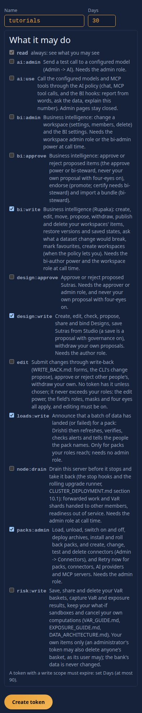

Press **Create token**.

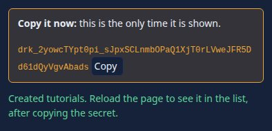

You should see the secret (it starts `drk_`). It is shown **once**: copy it now and keep it in a file only you can read, then point the command line at it:

```bash
mkdir -p ~/drishti-tokens && cat > ~/drishti-tokens/tutorial.token     # paste the secret, press Enter, then Ctrl+D
chmod 600 ~/drishti-tokens/tutorial.token
export DRISHTI_SERVER=http://localhost:18480
export DRISHTI_TOKEN=$(cat ~/drishti-tokens/tutorial.token)
```

(The IDE's QA walk keeps it in `data/qa/token.txt` instead: [OPERATIONS_GUIDE.md (IDE)](../guides/OPERATIONS_GUIDE.md#3-other-ways-to-build-and-run-maven-intellij-idea-and-pycharm). The folder `data/` is git-ignored.)

Without a token a signed-in server says no, in plain words:

```text
$ drishti-console/.venv/bin/python tools/drishti.py server health        # no token
drishti: the server said 401 DRS-5010: DRS-5010 missing bearer token (no or bad token: set DRISHTI_TOKEN or --token-file)
[exit 1]
```

With it, `doctor` checks the token too, and the server answers. `server health` lists every source (a connector to a store) and says whether it is up:

```text
$ drishti-console/.venv/bin/python tools/drishti.py doctor --server http://localhost:18480
...
GREEN  server                  http://localhost:18480: version 2.9.2, java 21.0.12.1, status OK
GREEN  token                   accepted; this token 'SLq29IMYJkTj' acts as drishti-dev-admin: scopes design:write, loads:write, packs:admin, bi:write, expires 2026-11-16T21:47:27.779Z
doctor: all clear
```

```text
$ drishti-console/.venv/bin/python tools/drishti.py server health
status OK  version 2.5.0  java 21.0.12.1  uptime 214s
packs 7  sources 14 (degraded 0, down 0)  packs with problems 0  failed to start 0
  civic-store                 UP        UP (engine: native)
  collateral-store            UP        UP (engine: native)
  credit-store                UP        UP (engine: native)
  file                        UP        UP
  legal-store                 UP        UP (engine: native)
  macro-store                 UP        UP (engine: native)
  market-store                UP        UP (engine: native)
  news-store                  UP        UP (engine: native)
  reference-store             UP        UP (engine: native)
  risk-store                  UP        UP (engine: native)
  trade-calypso               UP        UP (engine: native)
  trade-endur                 UP        UP (engine: native)
  trade-murex                 UP        UP (engine: native)
  trade-pages                 UP        UP
```

You should see `status OK`, the seven packs and fourteen sources, all `UP`: the Delta stores of the packs over the demo lakes (one per source system for the trades), the
file connector's feed, and `trade-pages`, which derives the counterparty, portfolio, legal-entity and index pages from the trades. Tutorial 15 shows how a connector reports its
state when it is not up.

### Part B · Look up anything

Open any entity in seconds: type a mnemonic and an id, let the type-ahead finish it, follow links from one entity to the next, look at an earlier business day instead of the
latest, and compare two days. The examples use the demo lakes' trades (three booking systems), counterparties and netting sets, and one country from a pack of real public data.

## Step 10 · Mnemonics: type one letter

Press `/` and type `T`.

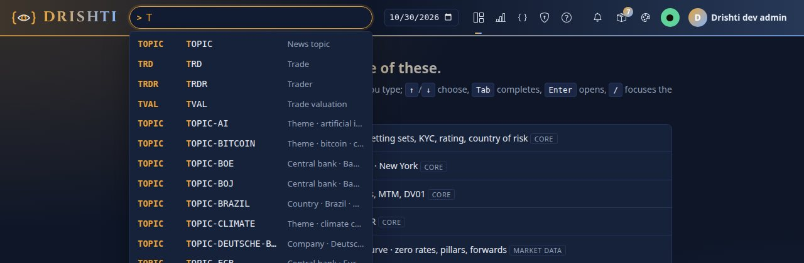

You should see the mnemonics that start with T (`TOPIC` news topic, `TRD` trade, `TRDR` trader, `TVAL` trade valuation), each with its short name, then entities you opened
lately. A mnemonic is the first word of a command; every pack that is switched on brings its own. `TRD` is a trade, `CPTY` a counterparty, `NSET` a netting set (the trades with
one counterparty under one agreement), `CTRD` a counterparty's trades, `BOOK` a book, `CRV` a curve. [BUILD_GUIDE.md](../guides/BUILD_GUIDE.md#31-the-packs-that-ship-turning-them-on-who-sees-which) lists them all.

**From the command line**, the same suggestions come from one call (the answer trimmed to type, mnemonic, id and title):

```text
$ curl -s -H "Authorization: Bearer $DRISHTI_TOKEN" 'http://localhost:18480/api/v1/command/suggest?q=T&limit=12'
mnemonic TOPIC  News topic
mnemonic TRD    Trade
mnemonic TRDR   Trader
mnemonic TVAL   Trade valuation
recent   TRD    MX-20000001   Rates · Interest rate swap (fixed/float) · CP-MERIDIAN-RE
...
```

## Step 11 · Type-ahead for an entity

Clear the box and type `NSET SUMMIT`.

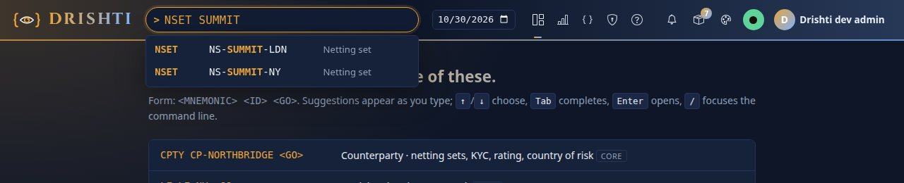

You should see two lines: `NS-SUMMIT-LDN` and `NS-SUMMIT-NY`, each with where it comes from (`netting-set · credit-store`). The type-ahead matches the start of an id **or** a
word in its title. Keys: `↓` and `↑` move, `Tab` copies the highlighted line into the box (the first, when none is highlighted), `Enter` opens it, `Esc` closes the list. Clear
the box and type `CPTY north`:

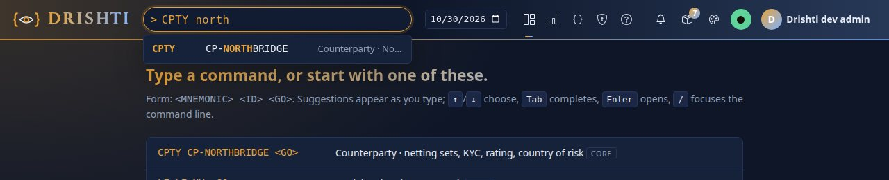

You should see two lines, `CP-NORTHBRIDGE` and `CP-NORTHPLAINS` (a look-alike energy counterparty of the test data). You typed part of a word, not an id.

**From the command line**, the call behind the dropdown:

```text
$ curl -s -H "Authorization: Bearer $DRISHTI_TOKEN" 'http://localhost:18480/api/v1/command/suggest?q=NSET%20SUMMIT&limit=5'
[
    {
        "type": "entity",
        "mnemonic": "NSET",
        "kind": "netting-set",
        "id": "NS-SUMMIT-LDN",
        "title": "NS-SUMMIT-LDN",
        "subtitle": "netting-set · credit-store",
        "complete": "NSET NS-SUMMIT-LDN"
    },
    {
        "type": "entity",
        "mnemonic": "NSET",
        "kind": "netting-set",
        "id": "NS-SUMMIT-NY",
        "title": "NS-SUMMIT-NY",
        "subtitle": "netting-set · credit-store",
        "complete": "NSET NS-SUMMIT-NY"
    }
]
```

### Type-ahead for a past date

Pick a past business date (Step 14 shows how) and type `TRD ` again: the dropdown now offers the ids that existed **on that
date**, not today's. A connector that keeps several days (an administrator's `index.days: 5`) answers this from memory
at once; one that keeps only the newest day offers today's ids and opening one that was not held then says so. The
subtitle `last seen <date>` marks an id offered only because it existed on an earlier day (`index.any-recent-day`).

## Step 12 · Open one entity, or pick from many

Press Enter on `CPTY north`.

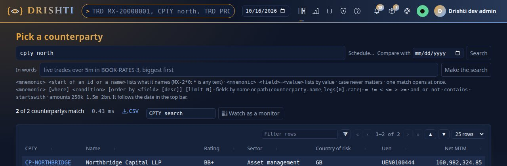

You should see *Pick a counterparty* with `2 of 2 counterparties match` and the two rows: the command names more than one, so Drishti asks. The rule: **one match opens; several
give a pick list**. Type `CPTY northb` and press Enter: it names exactly one, and `CP-NORTHBRIDGE` opens straight away (its name *Northbridge Capital LLP*, LEI, rating `BB+`,
country of risk `GB`, UEN, and its netting sets). Now type `TRD MX-200000` (the start of an id) and press Enter:

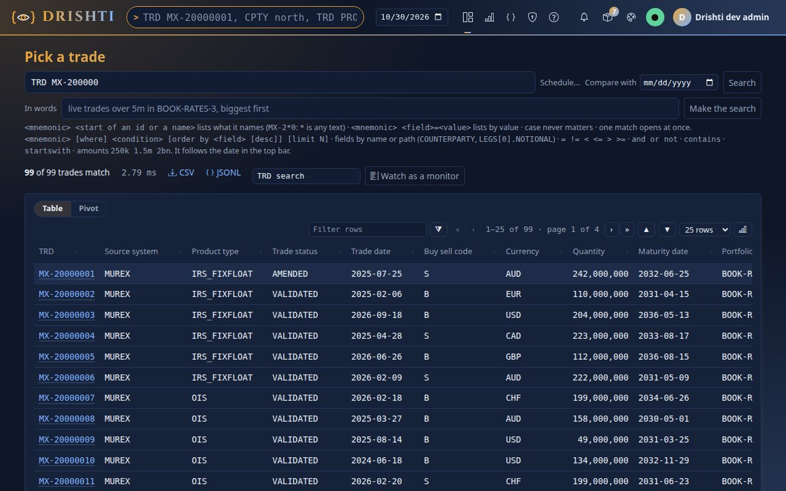

You should see *Pick a trade* with `99 of 15000 trades match` and a table. Click an id to open it. A bare id also works when its shape tells Drishti the kind: type
`MX-20000001` alone and it opens the same trade as `TRD MX-20000001`. Case never matters (`mx-20000001` works too).

**From the command line**, the command is resolved by one call; the answer says whether it opens an entity (`ref`) or lists (`matched`):

```text
$ curl -s -X POST -H "Authorization: Bearer $DRISHTI_TOKEN" -H 'Content-Type: application/json' -d '{"text":"TRD MX-200000"}' http://localhost:18480/api/v1/command
{"ref": null, "mnemonic": "TRD", "list": "TRD MX-200000", "matched": 99, "pack": null}
$ curl -s -X POST -H "Authorization: Bearer $DRISHTI_TOKEN" -H 'Content-Type: application/json' -d '{"text":"mx-20000001"}' http://localhost:18480/api/v1/command
{"ref": {"kind": "trade", "id": "MX-20000001"}, "mnemonic": "TRD", "list": null, "matched": null, "pack": null}
```

## Step 13 · Follow the links

Open `TRD MX-20000001` and look at the title, the strip and the panels.

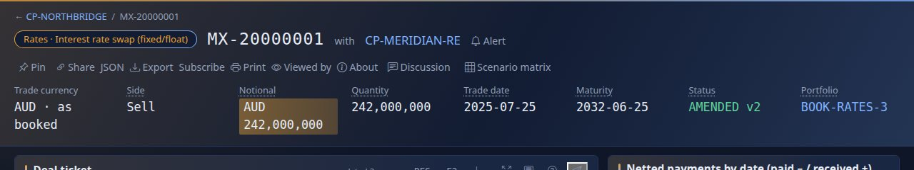

You should see blue names. In the title line `CP-MERIDIAN-RE` is the counterparty; in the strip `BOOK-RATES-3` is the portfolio; **Linked entities** at the bottom lists the
counterparty, the legal entity `LE-NY`, the portfolio, the trader `TRDR-ASHAH` and the desk `DESK-RATES`. Click one and that entity opens. Function keys do the same from the
keyboard: the bar at the bottom lists them, and **F7** opens **Counterparty trades** for `CP-MERIDIAN-RE`: every trade with that counterparty across the three booking systems
(670, with the payments due in the next 7, 30 and 90 days, notional by product type and by index, and a maturity ladder). There **F7** opens the counterparty itself, whose
**Netting sets** table lists `NS-MERIDIAN-RE-NY`. Open it.

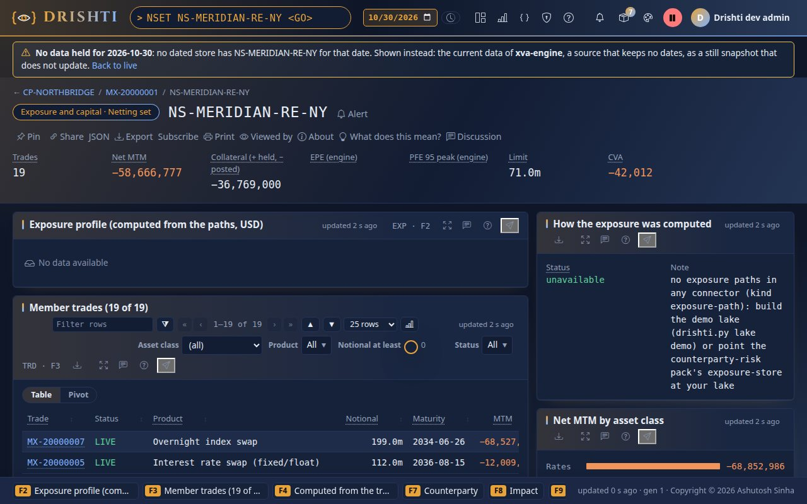

You should see the netting set `NS-MERIDIAN-RE-NY` with its strip (270 trades, net MTM `+400,908,419`, collateral after haircut `+284,354,426`, the exposure engine's
EPE `28.3m` and peak PFE 95 `212.7m`, limit `1.7bn`, and CVA *Under construction*: a stored figure, not yet computed by an engine, shown as the chip ([UNDER_CONSTRUCTION.md](../admin/UNDER_CONSTRUCTION.md))), its exposure profile and how it was computed, the member trades, net MTM split by asset class and,
further down, the figures computed from the trade valuations beside the stored ones (the strip shows no stored utilisation).
**Alt+←** takes you back. Links, impact (**F8**) and search all follow the date in the top
bar, which is the next step.

**From the command line:**

```text
$ drishti-console/.venv/bin/python tools/drishti.py view get netting-set/NS-MERIDIAN-RE-NY
Exposure and capital · Netting set  NS-MERIDIAN-RE-NY   [NSET]

Key figures
  figure                         value
  -----------------------------  ------------
  Trades                         270
  Net MTM                        +400,908,419
  Collateral (+ held, − posted)  +284,354,426
  EPE (engine)                   28.3m
  PFE 95 peak (engine)           212.7m
  Limit                          1.7bn
  CVA                            −994,231
...
```

## Step 14 · A past date, and the Live toggle

The **business date** box in the top bar says which day you are looking at. Empty means **live**: the latest business date (2026-10-16 here). The demo lakes are daily
snapshots: they change only when a day is loaded, so nothing ticks on these pages. (With `DRISHTI_DEMO_ENABLED=true` the demo source ticks about twice a second and a live view
moves as a whole: [tutorial 8, Part F](08-reports-and-dashboards.md#part-f--live-bi-and-boards).) Open `TRD MX-20000022` (a MUREX cross-currency swap that was amended on the last day), click the date box and type
`2026-10-15`, then press Enter.

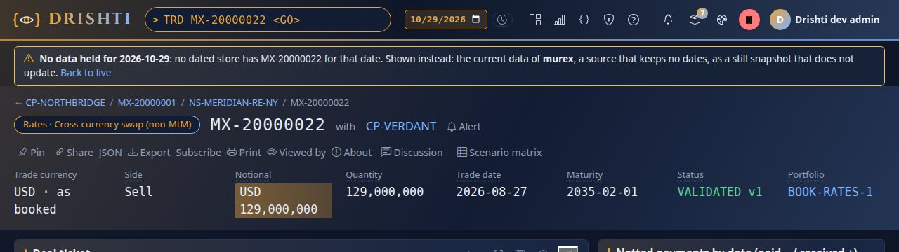

You should see the same layout with that day's figures: the status reads `VALIDATED v1`. The date box is amber, the round **Live** button beside it turns red with two pause bars
(it is paused: this is a still snapshot), and a **Compare** link appears in the title line. Click the red button.

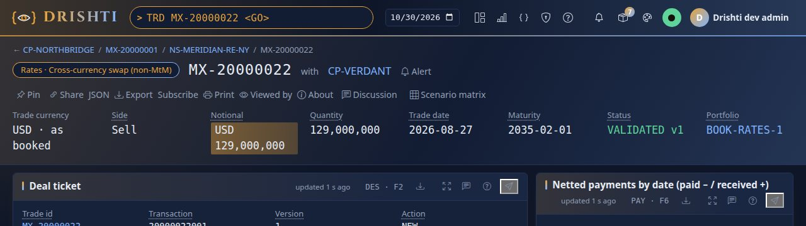

You should see the date go back to live and the status read `AMENDED v2`; the button turns green with a filled dot. The Live button is a toggle: green pauses live updates (a
snapshot of the current business date), red resumes. You can pick another date while paused. The choice follows you from page to page. If you pick a Saturday the box shows
`↩ 2026-10-09` (for Saturday the 10th) and the data is Friday's; Monday 12 October is a New York holiday (Columbus Day), so the lakes have no day for it.

The date is one call to the server too:

```text
$ curl -s -H "Authorization: Bearer $DRISHTI_TOKEN" http://localhost:18480/api/v1/business-date    # without the holiday list
{
  "current": "2026-10-16",
  "selected": "2026-10-16",
  "live": true,
  "knownAt": null,
  "previous": "2026-10-15",
  "earliest": "2021-10-15",
  "calendar": "USNY",
  "zone": "America/New_York"
}
```

And the command line reads the past just as well; this is the same trade on 15 October:

```text
$ drishti-console/.venv/bin/python tools/drishti.py view get trade/MX-20000022 --date 2026-10-15
Rates · Cross-currency swap (non-MtM)  MX-20000022  with CP-VERDANT   [TRD]

Key figures
  figure      value
  ----------  ---------------
  Source      MUREX
  Side        Sell
  Notional    USD 129,000,000
  Quantity    129,000,000
  Trade date  2026-08-27
  Maturity    2035-02-01
  Status      VALIDATED v1
  Portfolio   BOOK-RATES-1
...
```

## Step 15 · Compare two days

Pick `2026-10-16`, open `TRD MX-20000022` and click **Compare**.

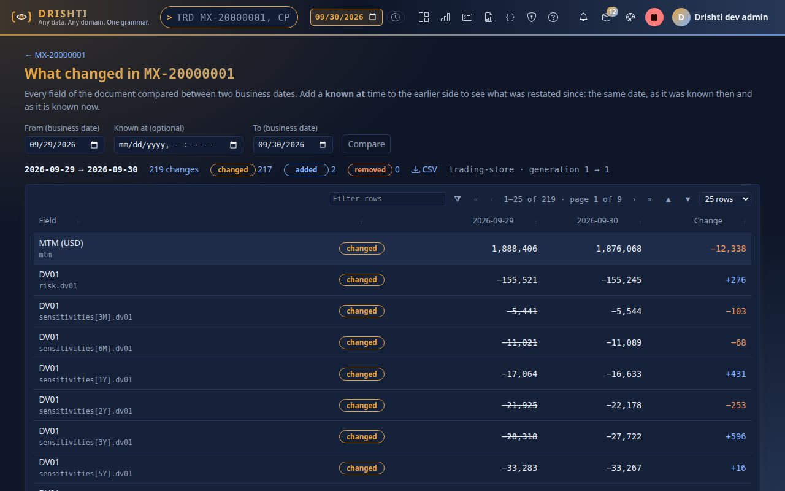

You should see *What changed in MX-20000022*, comparing 16 October with the business day before, and a table: one row per field that differs, with its label and path, the value on
each date and the change: five rows, the amendment as the booking system recorded it (`TRADE_STATUS` `VALIDATED` → `AMENDED`, `TRADE_ACTION` `NEW` → `AMEND`,
`TRADE_VERSION` `1` → `2`, a new `TRANSACTION_ID`, a new `SOURCE_UPDATE_TIME`). Lists are matched by their keys, so a row inside `LEGS` or `CASH_FLOWS` reads by the leg's or
flow's id rather than a position. Choose any two dates at the top to compare further apart; filter to *changed*, *added* or *removed*; **CSV** downloads the table. About 6% of
each book is amended each day in the test data: the trades whose `TRADE_VERSION` moved. Programs ask the server for the same thing:

```text
$ curl -s -H "Authorization: Bearer $DRISHTI_TOKEN" 'http://localhost:18480/api/v1/history/trade/MX-20000022/diff?from=2026-10-15&to=2026-10-16'    # shortened to the first three changes
{
  "from": "2026-10-15",
  "to": "2026-10-16",
  "changed": 5,
  "added": 0,
  "removed": 0,
  "changes": [
    {
      "path": "SOURCE_UPDATE_TIME",
      "label": "Source update time",
      "kind": "changed",
      "before": "2026-10-07T18:30:00Z",
      "after": "2026-10-16T17:39:00Z",
      "delta": null
    },
    {
      "path": "TRADE_STATUS",
      "label": "Trade status",
      "kind": "changed",
      "before": "VALIDATED",
      "after": "AMENDED",
      "delta": null
    },
    {
      "path": "TRADE_ACTION",
      "label": "Trade action",
      "kind": "changed",
      "before": "NEW",
      "after": "AMEND",
      "delta": null
    }
  ]
}
```

(The answer's `from` and `to` also carry each date's provenance: the source, here `trade-murex`, and its generation.) Back on the view, click a number, for example the
**Status** in the strip.

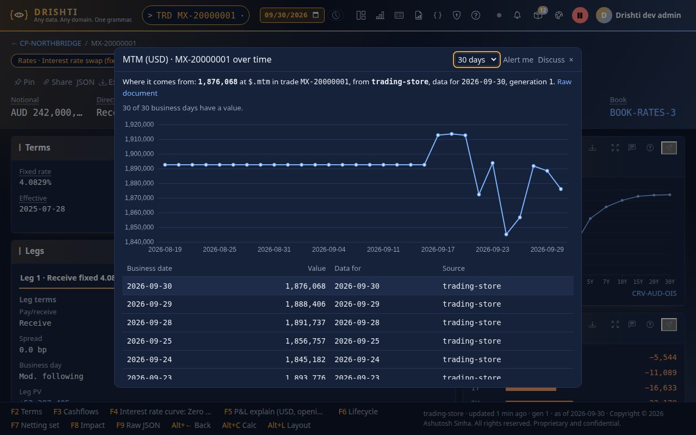

You should see a window with the value on each business day, newest first, each with *Data for* and its source: `2` on 2026-10-16, `1` on the days before, and no value
before 2026-10-07 (the lakes start there). The first line says where the number comes from (the path in the document, the connector, the business date and the source's
generation). Choose 10, 30, 90 or 250 days at the top. The call behind it:

```text
$ curl -s -H "Authorization: Bearer $DRISHTI_TOKEN" 'http://localhost:18480/api/v1/history/trade/MX-20000022/series?path=$.TRADE_VERSION&days=10'    # shortened
{"ref": {"kind": "trade", "id": "MX-20000022"}, "path": "$.TRADE_VERSION", "label": "Trade version", "points": [{"date": "2026-10-02", "value": null, ...},
 {"date": "2026-10-07", "value": "1", "dataDate": "2026-10-07", "source": "trade-murex", "generation": 517}, ...]}
```

## Step 16 · A different domain: real public data

The packs of other industries use exactly the same commands. The `world-economy` pack holds published data about countries (World Bank, UNDP and the CIA World Factbook, public sources;
[EXTERNAL_DATA.md (world-economy)](../guides/EXTERNAL_DATA.md#the-world-economy-data-in-detail) lists them and their licences). Type `JUR JUR-USA`.

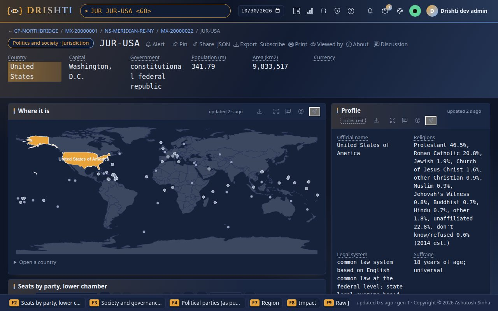

You should see the United States as a jurisdiction: its government type, capital, a world map with the country highlighted, the legislature and social indicators, each linked to
related entities (office holders, elections, parties, the region). The command line prints the same view:

```text
$ drishti-console/.venv/bin/python tools/drishti.py view get jurisdiction/JUR-USA
Politics and society · Jurisdiction  JUR-USA   [JUR]

Key figures
  figure          value
  --------------  -------------------------------
  Country         United States
  Capital         Washington, D.C.
  Government      constitutional federal republic
  Population (m)  341.79
  Area (km2)      9,833,517
  Currency

Where it is  (map, geography)
  {"mode": "world", "highlight": "USA", "link": {"kind": "jurisdiction", "template": "JUR-{iso3}", ...

Seats by party, lower chamber  (table, legislature, F2)
  Party             Seats
  ----------------  -----
  Republican Party    220
  Democratic Party    215

Society and governance (latest)  (table, indicators, F3)
  Indicator                                    Value  Year  Unit
  -------------------------------------------  -----  ----  -----------------
...
```

### Part C · Query by form

Find trades by filling in boxes, not by writing a search. You will combine a choice of counterparty, an amount, a date range and a choice of currencies, read the
search the form wrote for you, turn it into a regular expression, and then keep the search: name it, watch it as a live monitor, or schedule it (tutorial 8, Part E).

## Step 17 · Open the form

**In the UI.** Type `FORM trading trade` and press Enter (or **Views**, **Forms**, **Trading**, then **Trade**).

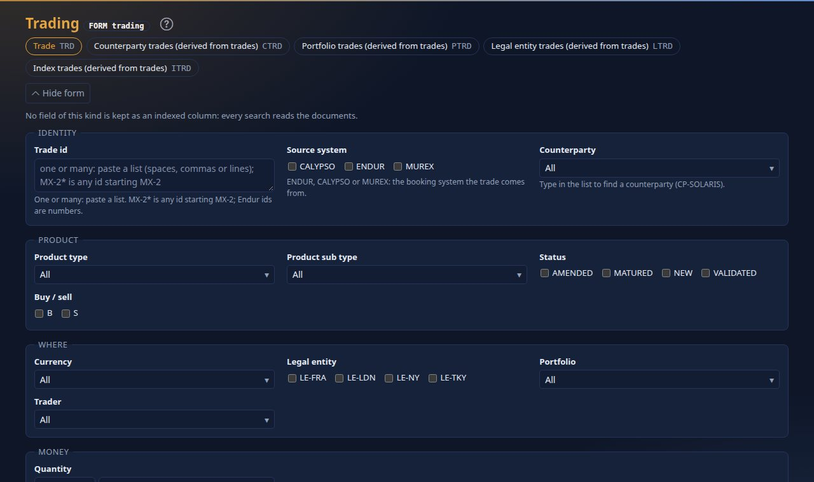

You should see a form headed **Trading** with the kind **Trade** selected, and groups of inputs: **Identity** (trade id, source system, counterparty), **Product** (product
type, product sub type, status, buy / sell), **Where** (currency, legal entity, portfolio, trader), **Money** (quantity) and **Dates** (trade date, maturity date). Each kind of
field has its input:

| The field holds | The input |
|---|---|
| text (a name, a description) | a box, an operator (equals, contains, starts with, matches regex) and *Match case* |
| a number or an amount (`QUANTITY`) | an operator (`≥`, `≤`, between, `=`) and a box; amounts take `250k`, `1.5m`, `2bn` |
| a date (`TRADE_DATE`, `MATURITY_DATE`) | on, between, before, after, or *relative* (`next 10 business days`, `last 30 days`, `month to date`) |
| one of **a few** values (source system, status, buy / sell) | a row of tick boxes |
| one of **many** values (counterparty, product type, currency, portfolio, trader) | **one dropdown** that shows *All*, one value, or `2 selected: EUR, USD` |
| a list of ids (`TRADE_ID`) | a box where you paste ids separated by spaces, commas or lines; `MX-2*` means any id starting `MX-2` (ENDUR ids are numbers) |

Leave a field empty and it takes no part in the search. Below the fields choose how to sort and how many to show. The trading pack's form has no free-text field: its
counterparty is a dropdown of the 24 counterparty ids the data holds. A pack whose kind has text fields (a name, a description) offers the text operators.

**From the command line.** The form is the pack's `form:` (in `config/packs/banking/trading/pack.yaml`), and the server serves it with the values the data holds:

```yaml
form:
  trade:
  - { path: COUNTERPARTY, label: Counterparty, type: enum, group: Identity, order: 3, help: "Type in the list to find a counterparty (CP-SOLARIS)." }
  - { path: QUANTITY, label: Quantity, type: amount, group: Money, order: 12, operators: [">=", "<=", between, "="], help: "Amounts take k, m and bn: 250k, 1.5m, 2bn." }
  - { path: TRADE_DATE, label: Trade date, type: date, group: Dates, order: 13 }
  # ... and the rest
```

```text
$ curl -s -H "Authorization: Bearer $DRISHTI_TOKEN" 'http://localhost:18480/api/v1/forms/trading?kind=trade' \
    | python3 -c "import json,sys; [print(f['path'], f['type'], f['operators'], len(f.get('values') or [])) for f in json.load(sys.stdin)['form']['fields']]"
TRADE_ID id ['in'] 0
SOURCE_SYSTEM enum ['in'] 3
COUNTERPARTY enum ['in'] 24
PRODUCT_TYPE enum ['in'] 130
PRODUCT_SUB_TYPE enum ['in'] 132
TRADE_STATUS enum ['in'] 5
BUY_SELL_CODE enum ['in'] 2
CURRENCY enum ['in'] 7
LEGAL_ENTITY enum ['in'] 4
PORTFOLIO enum ['in'] 30
TRADER_ID enum ['in'] 20
QUANTITY amount ['>=', '<=', 'between', '='] 0
TRADE_DATE date ['on', 'between', 'relative', 'before', 'after'] 0
MATURITY_DATE date ['on', 'between', 'relative', 'before', 'after'] 0
```

## Step 18 · Say what you want

Fill in:

1. **Counterparty**: open the dropdown, type `meridian` in its filter and tick `CP-MERIDIAN-RE`.
2. **Quantity**: operator `≥`, `100m`.
3. **Trade date**: operator *between*, from `2025-01-01` to `2025-12-31`.
4. **Currency**: open the dropdown (click it, or press Enter or Space on it).

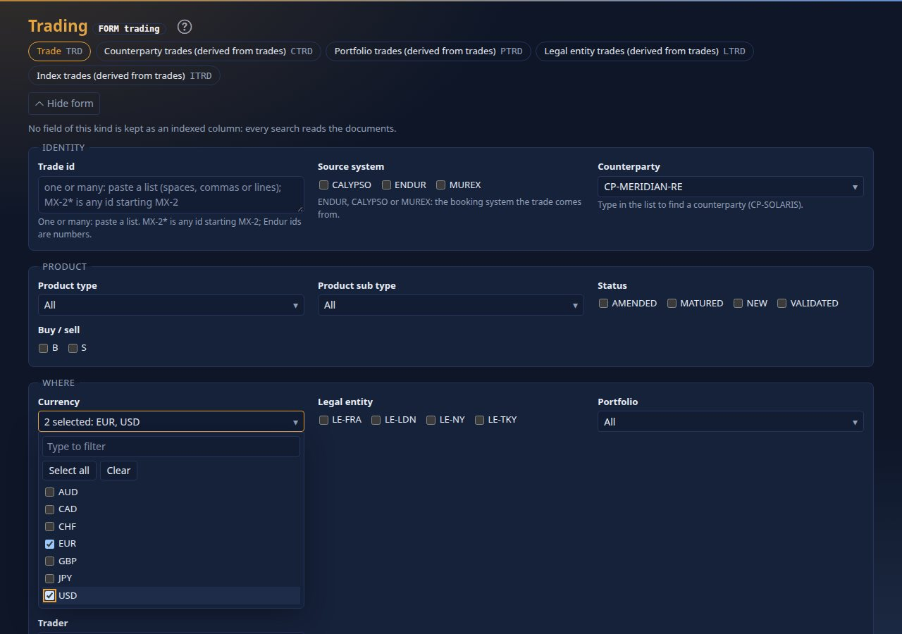

You should see, inside the dropdown, a box to filter the values as you type, **Select all** and **Clear** (they act on the values the filter leaves), and a tick box for each of
the seven currencies (`AUD`, `CAD`, `CHF`, `EUR`, `GBP`, `JPY`, `USD`). Tick `EUR` and `USD`. The arrow keys move, Space ticks, a letter jumps to a value, Enter or Esc closes.
When it is closed:

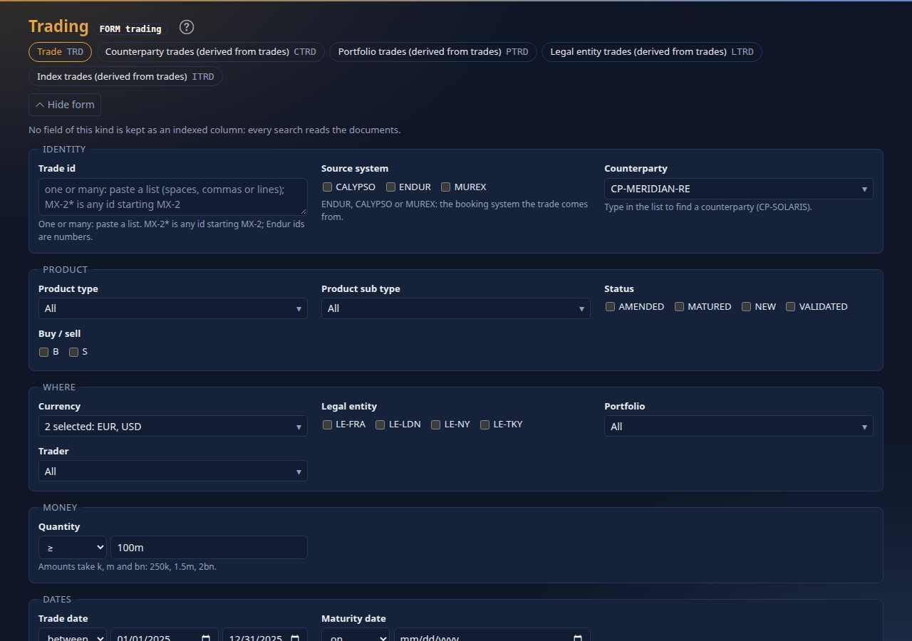

You should see the dropdown read `2 selected: EUR, USD` and your other boxes filled as above. Press **Search** (or Enter).

## Step 19 · Read the search it wrote

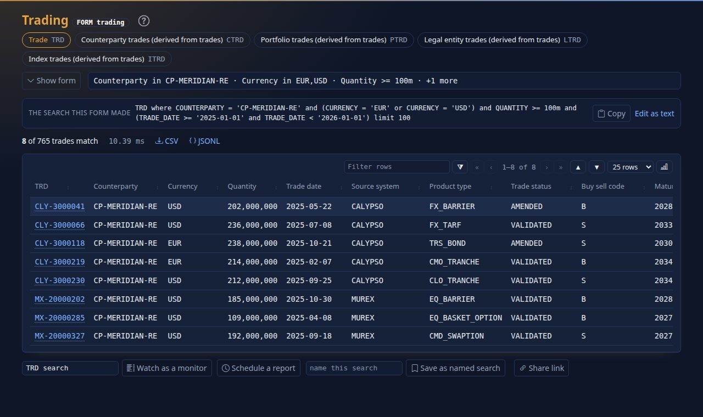

You should see the form fold to **one line of your criteria** (`Counterparty in CP-MERIDIAN-RE · Currency in EUR,USD · Quantity >= 100m · +1 more`) so the table gets the room.
Under it is **the search this form made**, in the grammar of Search by value:

```text
TRD where COUNTERPARTY = 'CP-MERIDIAN-RE' and (CURRENCY = 'EUR' or CURRENCY = 'USD') and QUANTITY >= 100m and (TRADE_DATE >= '2025-01-01' and TRADE_DATE < '2026-01-01') limit 100
```

then the line `65 of 15000 trades match`, and the table (CALYPSO, ENDUR and MUREX trades together; `CLY-3000041` first): click a heading to sort, a funnel to filter a
column, an id to open the trade. **Copy** puts the command on the clipboard (paste it into the command line); **Edit as text** opens it in the search box. Click the one-line
summary, press **Show form** or `Alt+F` to unfold the form with every box as you left it. Everything you filled in is in the page's address, so bookmark it or send it to a
colleague; `Alt+←` from a trade returns here with the results:

```text
/form/trading?kind=trade&op.COUNTERPARTY=in&v.COUNTERPARTY=CP-MERIDIAN-RE&op.CURRENCY=in&v.CURRENCY=EUR&v.CURRENCY=USD&op.QUANTITY=%3E%3D&v.QUANTITY=100m&op.TRADE_DATE=between&v.TRADE_DATE=2025-01-01&v2.TRADE_DATE=2025-12-31&run=1
```

**From the command line.** The server turns the same criteria into the command, and the command into the answer (the page makes exactly these two calls):

```text
$ curl -s -X POST -H "Authorization: Bearer $DRISHTI_TOKEN" -H 'Content-Type: application/json' http://localhost:18480/api/v1/forms/trading/trade/compile -d '{"limit": 100, "criteria": [
    {"path": "COUNTERPARTY", "op": "in", "values": ["CP-MERIDIAN-RE"]}, {"path": "CURRENCY", "op": "in", "values": ["EUR", "USD"]},
    {"path": "QUANTITY", "op": ">=", "values": ["100m"]}, {"path": "TRADE_DATE", "op": "between", "values": ["2025-01-01", "2025-12-31"]}]}'
{"command": "TRD where COUNTERPARTY = 'CP-MERIDIAN-RE' and (CURRENCY = 'EUR' or CURRENCY = 'USD') and QUANTITY >= 100m and (TRADE_DATE >= '2025-01-01' and TRADE_DATE < '2026-01-01') limit 100"}
$ curl -s -G -H "Authorization: Bearer $DRISHTI_TOKEN" http://localhost:18480/api/v1/search --data-urlencode "q=TRD where COUNTERPARTY = 'CP-MERIDIAN-RE' and ..." \
    | python3 -c "import json,sys; d=json.load(sys.stdin); print(d['matched'], 'of', d['scanned'], 'trades match')"
65 of 15000 trades match
```

## Step 20 · A regular expression

Press **Edit as text**: the command opens in the search box. Replace the counterparty condition with a regular expression over the field, and drop the rest:

```text
TRD where matches(COUNTERPARTY, '^CP-(MERIDIAN|NORTHBRIDGE)$') limit 100
```

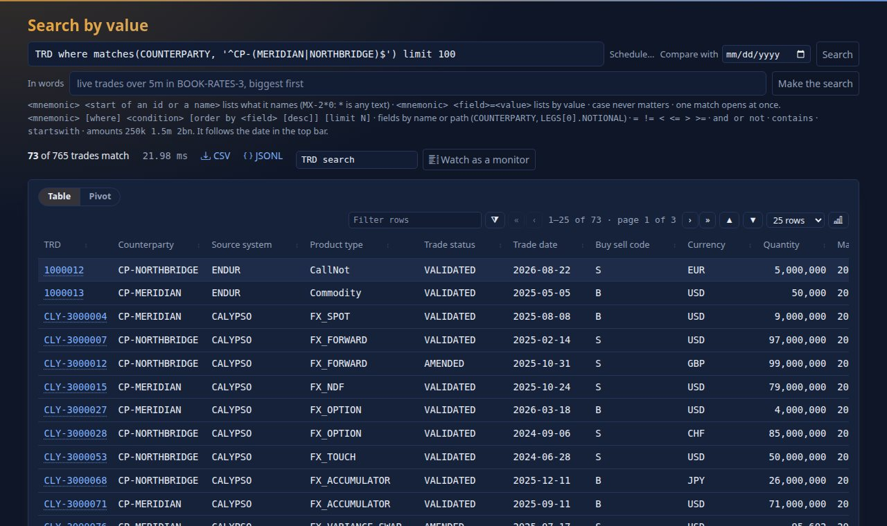

You should see `1200 of 15000 trades match`: the trades of `CP-MERIDIAN` and `CP-NORTHBRIDGE` (not `CP-MERIDIAN-RE`: the `$` anchors the end). On a form with a text field the
same is the operator *matches regex*. The regex engine is a safe one: it cannot run for ever whatever the pattern. It reads classes (`[A-Z]`, `\d`), groups, `|`,
`* + ? {n,m}`, `^` and `$`. Try a back-reference, `TRD where matches(COUNTERPARTY, '(a)\1')`:

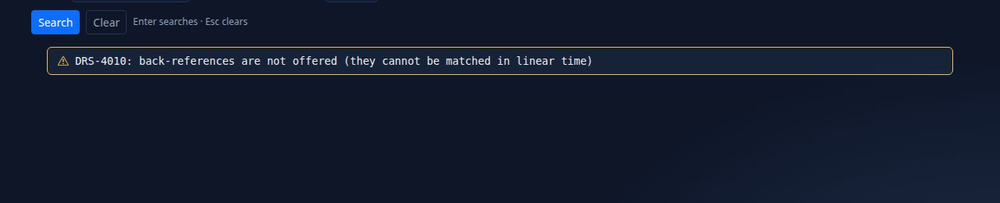

You should see a message in an amber box: `DRS-4010 back-references are not offered (they cannot be matched in linear time)`. Back-references, look-around and `\b` are refused
for that reason, patterns over 200 characters too (`DRS-4010`), and a pattern that takes over 50 ms on one value stops with `DRS-4011`.

**From the command line:**

```text
$ curl -s -G -H "Authorization: Bearer $DRISHTI_TOKEN" http://localhost:18480/api/v1/search --data-urlencode "q=TRD where matches(COUNTERPARTY, '(a)\1') limit 100"
{"type":"about:blank","title":"bad search","status":400,"detail":"DRS-4010 back-references are not offered (they cannot be matched in linear time)", ...,"code":"DRS-4010"}
```

## Step 21 · Keep the search

Go back to the results of Step 19. Under the table are four ways to keep it.

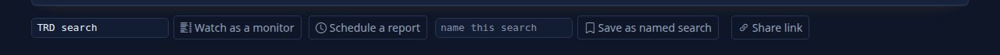

You should see a box with a button **Watch as a monitor**, a link **Schedule a report**, a box **name this search** with **Save as named search**, and **Share link**. Type
`Meridian RE EUR and USD 2025` in the name box and press **Save as named search**.

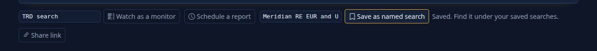

You should see `Saved. Find it under your saved searches.` The search now appears under *Your saved searches* on the forms home and under the form, with its criteria. Next, name the
monitor `Meridian RE big trades` and press **Watch as a monitor**.

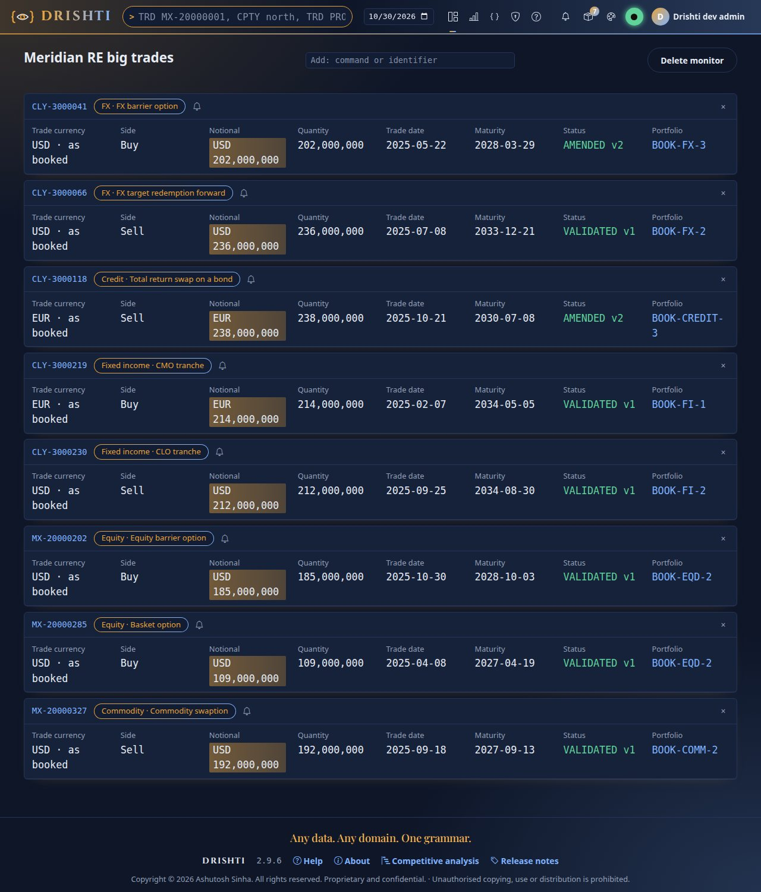

You should see a monitor page: a list with one card for each of the first 50 results, each showing that trade's strip (source system, side, notional, status, portfolio). The
monitor is kept under your account. **Add an entity** adds a row (type `TRD MX-20000001`), **×** removes one, **Delete monitor** removes the list. **Share link** copies the
form's address, which opens the same form with the same criteria for anyone who may see the pack. **Schedule a report** is tutorial 8, Part E. (On the demo lakes the cards change when
a day is loaded; a live source would make them tick.)

### Part D · Share and collaborate

Send a colleague exactly what you are looking at, filter and date included, and talk about it where the numbers are. In this part you share a filtered view of a swap with a second person, who
sees it with **her own** access, write in the view's discussion and mention her, and watch her answer arrive in your inbox.

## Step 22 · Make a colleague

Open **Admin**, then **Users**, and press **New user**: user name `vera`, display name `Vera Lim`, the role `viewer`, an email address, a password of at least ten characters with letters and digits, and tick *must change password* only if you
want that to be part of your test. (Roles and packs per user are explained in [ADMIN_GUIDE.md](../guides/ADMIN_GUIDE.md).)

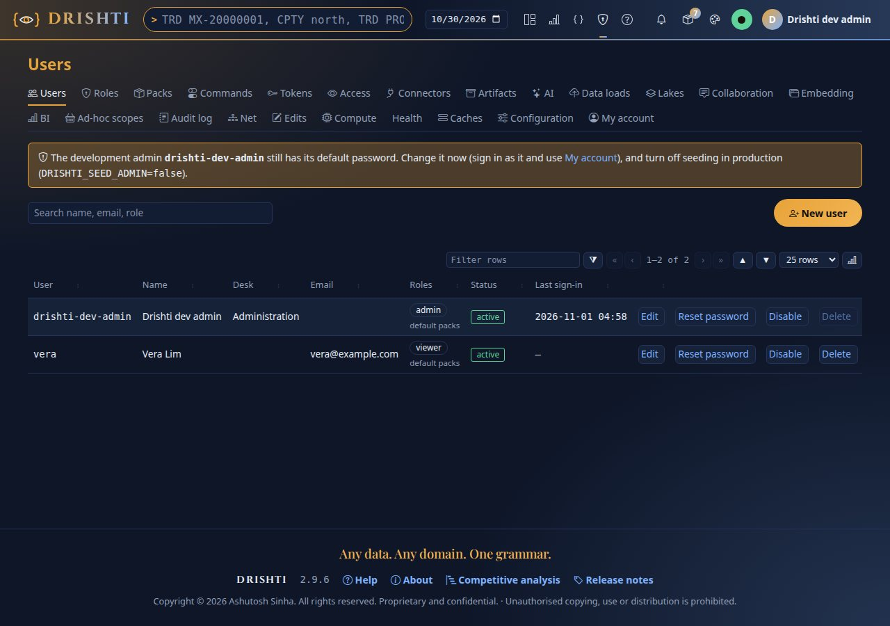

You should see Vera in the list with the role `viewer`. The bundled `viewer` role cannot see the fields the site masks (the trader on a trade, `TRADER_ID`, for instance): that matters in Step 25.

**From the command line** there is no user command: users are an administrator's page (a personal API token cannot create one), and the list is one call from a signed-in
session, `GET /api/v1/admin/users`:

```text
{"username": "vera", "displayName": "Vera Lim", "email": "vera@example.com", "desk": "", "roles": ["viewer"], "enabled": true, "mustChangePassword": false, "locked": false, ...}
```

## Step 23 · Filter a view, then share it

Sign in as yourself, pick `2026-10-15` in the date box and open `TRD MX-20000001`. The **Events** panel has two controls in its header: set **Between** to *Next 90 days*
and untick leg `2` in **Legs**.

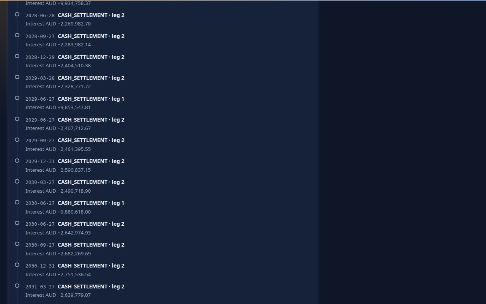

You should see the date box amber, and the events table showing only leg 1's events in the next 90 days. What you chose is in the page's address, so a link reproduces it. Press `Alt+S` (or **Share** in the title line).

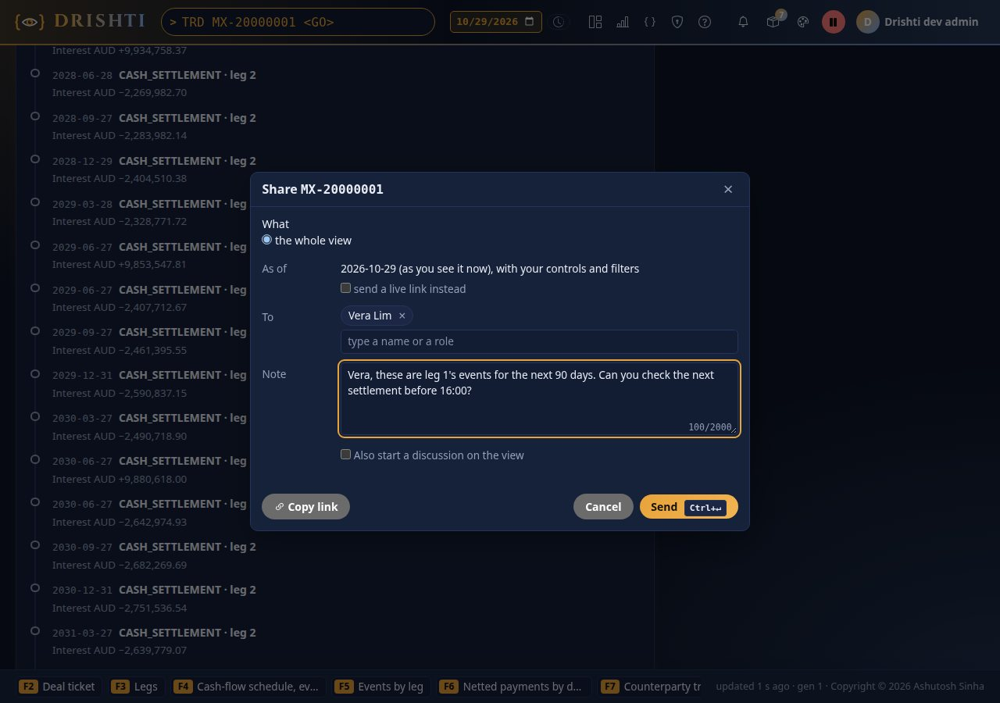

Type `ver` in **To** and press Enter to pick `Vera Lim` (you can also pick a role: everyone who holds it), write a note, and press `Ctrl+Enter` or **Send**. You should see the dialog name what is shared (*the whole view* as of the date, with your controls and
filters), a **Copy link** button, and an option to start a discussion on the view alongside.

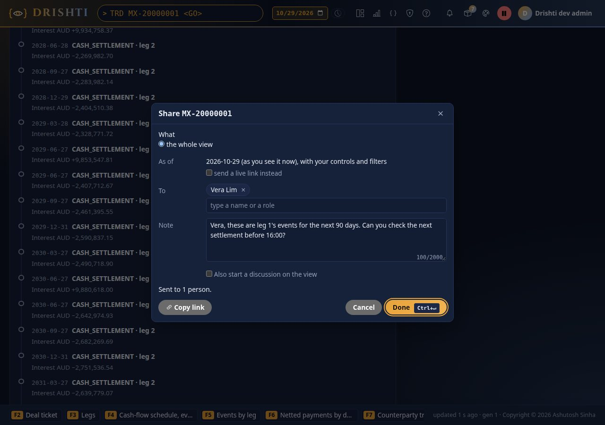

You should see `Sent to 1 person.` Nothing is emailed by default: the share goes to Vera's inbox and bell.

## Step 24 · The recipient opens it

Sign in as `vera` in the other window.

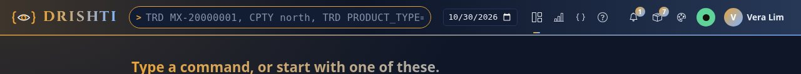

You should see a count on the bell. Click it (or press `Alt+I`).

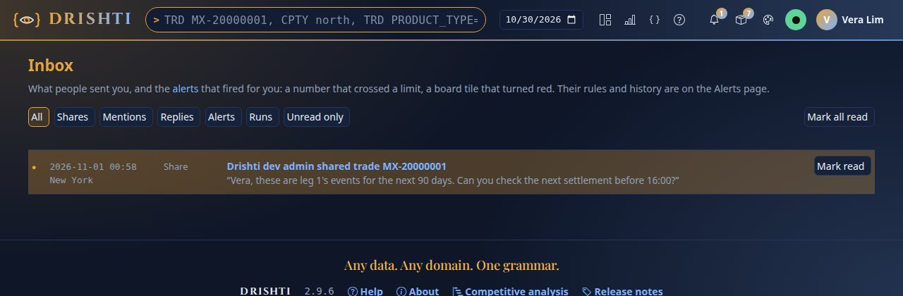

You should see one row: *Shared by Drishti dev admin*, the time, the title of the view and your note. Filter the inbox by *Shares*, *Mentions*, *Replies* or *Alerts*, or mark all as read. Open the row:

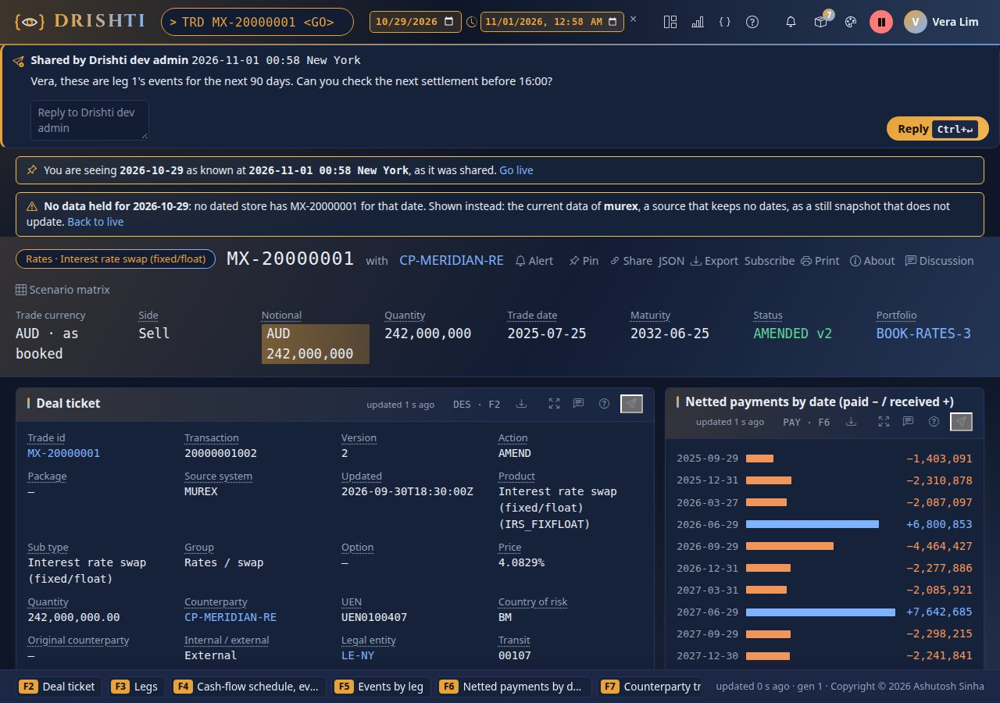

You should see a banner at the top: *Shared by Drishti dev admin*, your note, and a **Reply** box. Below it the banner says *You are seeing 2026-10-15 as known at ... as it was shared*, with **Go live** to
leave the pinned date. The view is drawn **for Vera**: whatever her roles do not allow is masked (`•••`) even though you saw it: in the **Deal ticket** her *Trader* reads `•••` where yours reads `A. Shah`. A note that quotes a masked number in `{...}` reads `•••` for her too, and the
picture of a shared panel is rendered with the rights of the sender *and* the recipient, whichever is less.

On a phone the same share is one column:

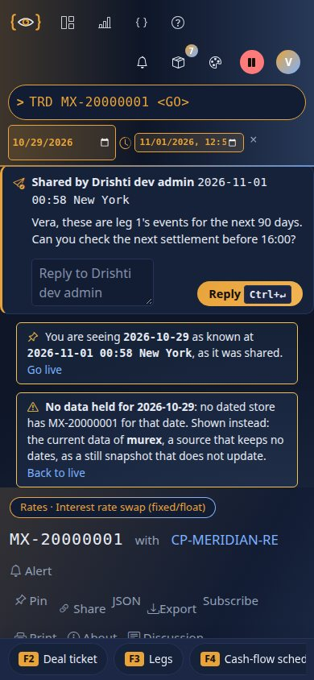

You should see the banner, the date notice and the title above the first panel.

## Step 25 · Discuss it, and mention her

Back as yourself, on the same view, press `Alt+N` (or **Discussion**). In the drawer type `@ver` and press Enter to pick Vera, then ` who booked this? the ticket says {` and type `trader` to pick the field to quote (*Trader*, `TRADER_ID`), Enter, and finish the sentence.

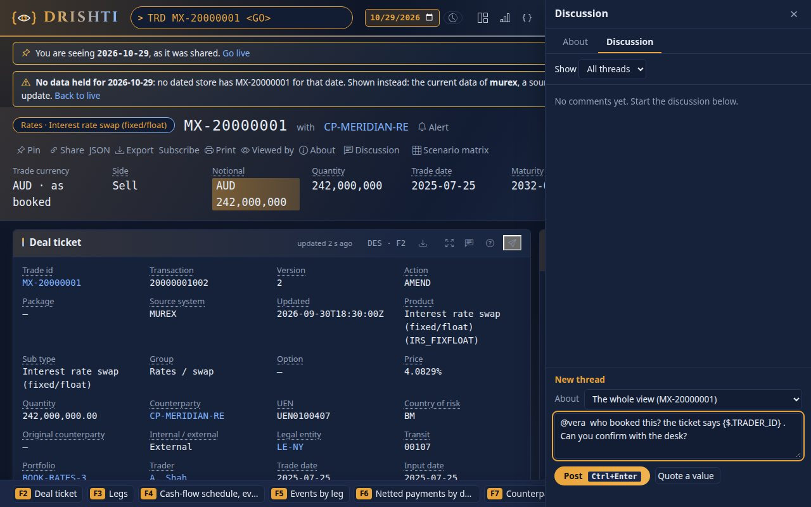

You should see a suggestion list for the mention and another for the `{` quote (fields of the view). A `{...}` in a comment is filled **when the reader opens it**, with the reader's own view of the value: you see `A. Shah`, Vera sees `•••`
because the trader is masked for her, and a field she may see shows its value. Press `Ctrl+Enter` to post.

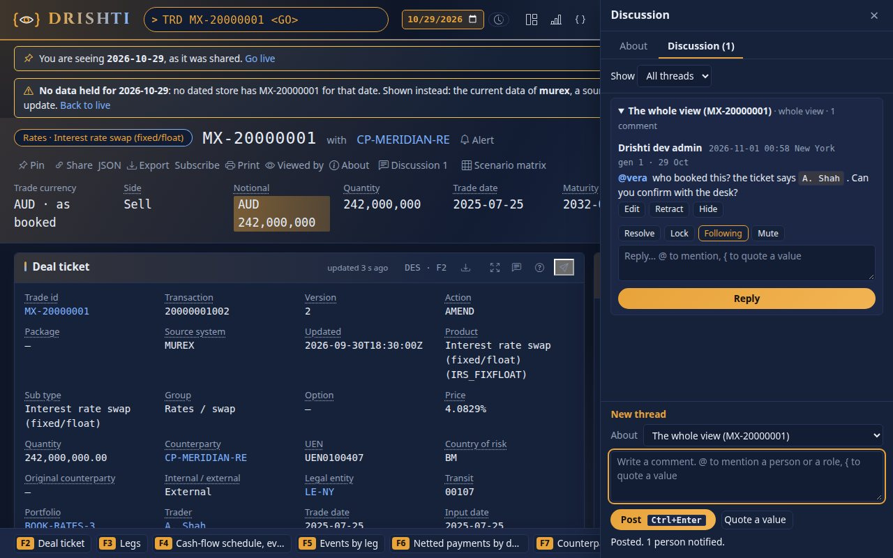

You should see your comment as the first message of a thread on *The whole view* (a thread can also belong to one panel: use the speech-bubble icon in a panel's header), with **Reply**, **Following** and
**Mute** under it. A thread can be edited by its author, resolved, and followed or muted by anyone in it.

## Step 26 · Vera answers

As Vera, open the inbox.

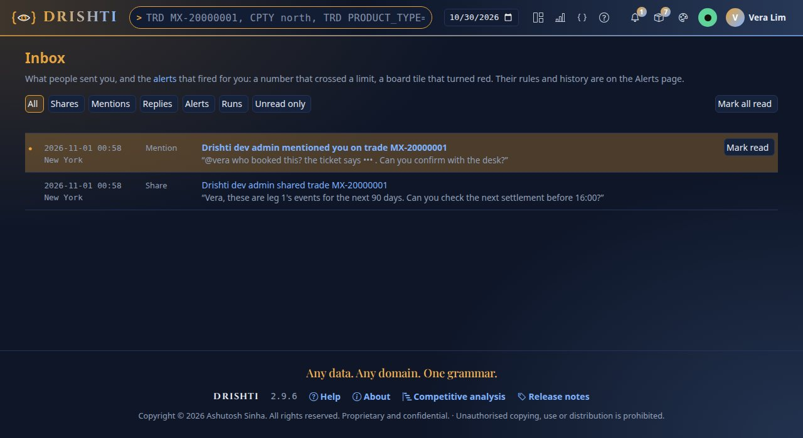

You should see a new row, *Drishti dev admin mentioned you*, with the text. Open the view, press `Alt+N` and answer:

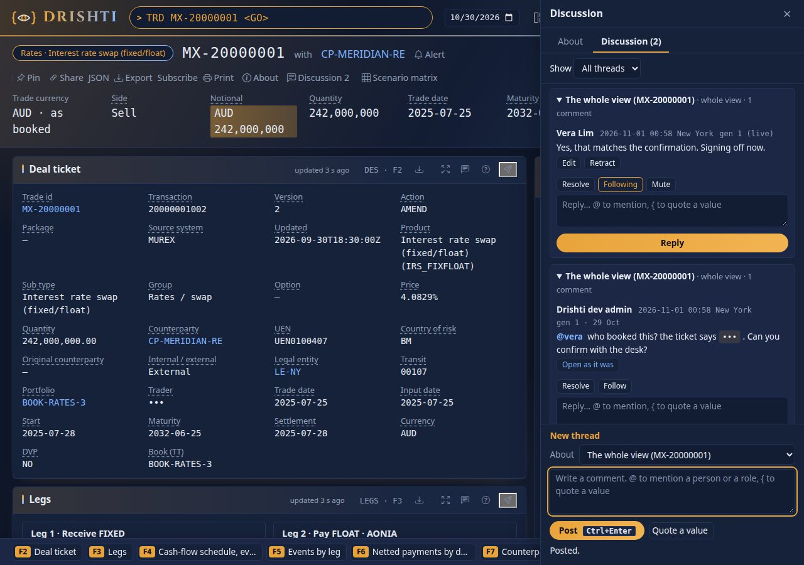

You should see Vera's reply under your comment, any value she quotes shown as *she* may see it. Back in your own window the bell now shows a reply; the thread is followed by both of you, and the **Viewed by** list in the title line says who has looked at the view.

### Part E · An entity over time

Add a range after an id and the screen becomes that entity over time: `TRD 1000015 30 <GO>` shows the trade's last 30 business days with
data, one row per day. What moved is tinted, and you can open any day as it was. `EQ EQ-CSCA 3M <GO>` adds a price chart and the headline
numbers. This part walks through a trade and an equity, changes only and DIFF, opening a day, exporting, the `history:` block that
shapes a kind's screen, and the limits. Each step shows the UI, the command line and, where there is one, the YAML. The references are
[USER_GUIDE › History](../guides/USER_GUIDE.md#history-an-entity-over-time),
[CLI_GUIDE › history](../guides/CLI_REFERENCE.md#history-an-entity-over-time) and the design,
[DATA_ARCHITECTURE.md](../architecture/DATA_ARCHITECTURE.md#2-history-queries-an-entity-over-time).

## Step 27 · A range after the id

**In the UI.** Press `/` to reach the command line and type `TRD 1000015` followed by a space. Once the id names one trade, the
suggestions offer ranges:

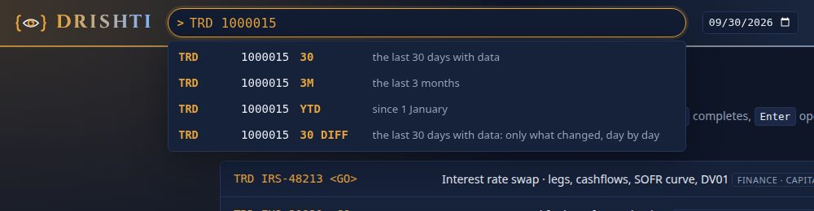

Choose `30`, or type `TRD 1000015 30` and press Enter. The address becomes `/v/trade/1000015/history?days=30`.

| You type | You get |
|---|---|
| `TRD 1000015 30` | the last 30 business days on which the trade has data |
| `TRD 1000015 30D`, `2W`, `3M`, `1Y` | every business day with data in the last 30 calendar days, 2 weeks, 3 months, 1 year |
| `TRD 1000015 YTD`, `MTD`, `QTD` | since 1 January, the first of the month, the start of the quarter |
| `TRD 1000015 FROM 2026-09-01 TO 2026-09-30` | between two dates (leave out `TO` to run to the date box) |
| `TRD 1000015 30 DIFF` | the same days, as a change log (step 29) |

The range always comes last. `TRD 30` still opens trade `30`, `TRD desk=rates 30` is still a search, and an alias keeps its range:
`MYTRD 30`, where `MYTRD` is `TRD 1000015`, works too. The short link `/v/trade/1000015?days=30` opens the same page.

**From the command line:**

```
$ drishti.py history trade 1000015 --days 30
```

```text
TRD 1000015  HISTORY  2026-09-07 -> 2026-10-19  30 days with data, 7 changed, no data on 2026-09-14
ComSwap ENGY-SWAP · CP-HARBORPT
Date           Trade status  Trade version  Quantity  Price        Maturity date  Portfolio     Counterparty  Trader  Legs  Events
-------------  ------------  -------------  --------  -----------  -------------  ------------  ------------  ------  ----  ------
2026-10-19     VALIDATED     3              72K       2,341.0500*  2028-07-31     BOOK-COMM-2   CP-HARBORPT   •••     2     5
2026-10-16     VALIDATED     3              72K*      2,336.1200*  2028-07-31     BOOK-COMM-2   CP-HARBORPT   •••     2     5
2026-10-15 ⟲2  VALIDATED     3*             75K*      2,338.4000*  2028-07-31     BOOK-COMM-2   CP-HARBORPT   •••     2     5*
2026-10-14     VALIDATED     2              72K       2,332.9131   2028-07-31     BOOK-COMM-2   CP-HARBORPT   •••     2     4
…
2026-09-08     NEW           1              72K       2,332.9131   2028-07-31     BOOK-COMM-2   CP-HARBORPT   •••     2     3
2026-09-07     NEW           1              72K       2,332.9131   2028-07-31     BOOK-COMM-2   CP-HARBORPT   •••     2     3
```

`--range 3M`, `--from 2026-09-01 --to 2026-09-30` and `--json` are the other forms.

**You should see:** the page titled *TRD 1000015 ▸ HISTORY* with *30 business days* at the right, the dates 2026-09-07 → 2026-10-19,
and 30 rows; the command line keeps `TRD 1000015 30 <GO>`, so `↑` recalls it as typed.

**Programs** read `GET /api/v1/history/trade/1000015?days=30`, or `Drishti.history("trade", "1000015", days=30)` in the Python client
([API_REFERENCE.md (clients)](../guides/DEVELOPER_GUIDE.md#113-clients-scripts-notebooks-and-excel)).

## Step 28 · Reading the table

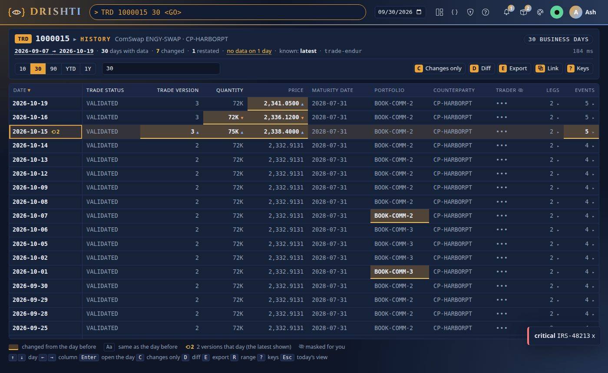

- **The header** gives the range (*30 business days*), the first and last dates, *30 days with data*, *7 changed*, *1 restated* and
  *no data on 1 day*. Hover the last one for the date (2026-09-14). *known: latest* means each day is shown as it is known now.
- **One row per business day, newest first.** The columns are the kind's top-level fields. `Legs` and `Events` are lists, shown as
  their counts with `▸`.
- **What moved stands out.** A cell that differs from the day before is tinted and bold, with `▲`/`▼` for a number. Hover it for the old
  value (*changed from 72K*). Values that stayed the same are dimmed. The oldest row is shown in full, because it is the starting point.
- **`⟲2`** beside 2026-10-15 means the store kept two versions of that day (a restatement). The row is the latest.
- **`•••`** under *Trader* is a field masked for you. It reads the same on every row, never shows as changed, and the column header
  carries the masked icon.

Move with `↑` `↓` (or `j` `k`). `←` `→` pick a column, and the cell is read out with its header. `?` lists every key.

**You should see:** seven days with tinted cells (2026-09-09, 09-22, 10-01, 10-07, 10-15, 10-16, 10-19); hovering *75K* on 2026-10-15
says *changed from 72K*; the selected row is marked on the left.

## Step 29 · Changes only, and DIFF

**Changes only.** Press `C`. The days on which nothing moved are hidden, and the header now reads *7 of 30 days*. The address gains
`&only=1`, so a link keeps it.

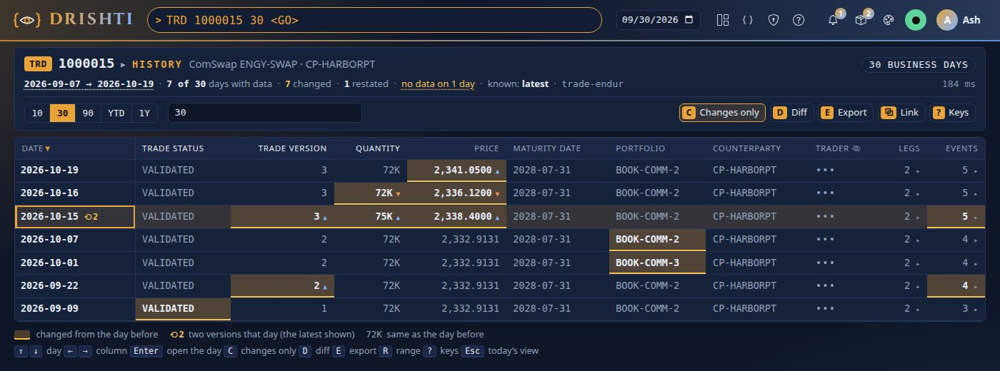

**DIFF.** Press `D`, or end the command with `DIFF` (`TRD 1000015 30 DIFF`). Each changed day becomes a block listing its changes, before
and after. *Compare* opens the full comparison of that day and the one before, and *Open the day* opens the view as it was.

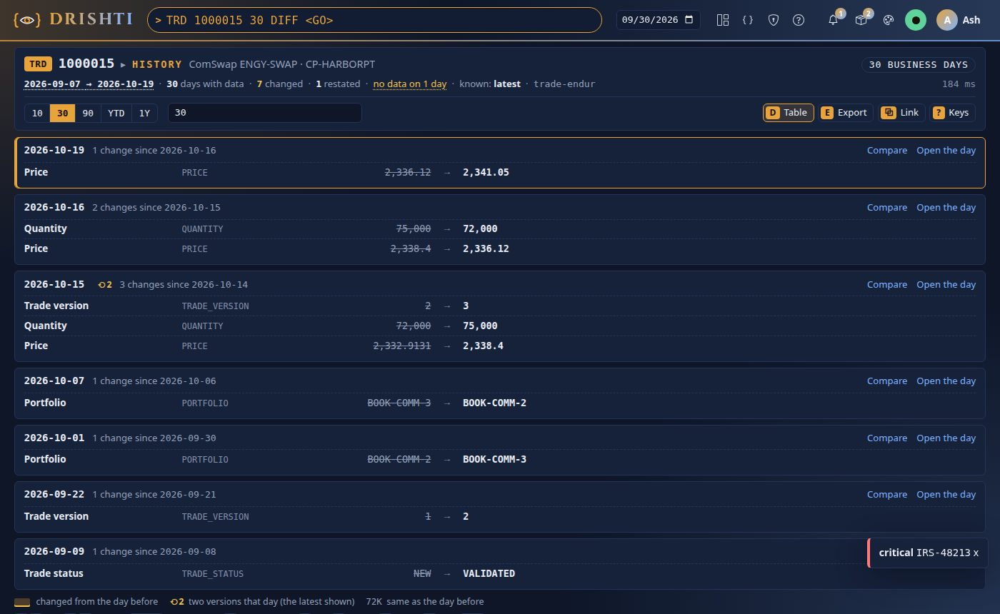

**From the command line:**

```
$ drishti.py history trade 1000015 --days 30 --changes-only
```

```text
TRD 1000015  HISTORY  2026-09-07 -> 2026-10-19  30 days with data, 7 changed, no data on 2026-09-14
ComSwap ENGY-SWAP · CP-HARBORPT
Date           Trade status  Trade version  Quantity  Price        Maturity date  Portfolio     Counterparty  Trader  Legs  Events
-------------  ------------  -------------  --------  -----------  -------------  ------------  ------------  ------  ----  ------
2026-10-19     VALIDATED     3              72K       2,341.0500*  2028-07-31     BOOK-COMM-2   CP-HARBORPT   •••     2     5
2026-10-16     VALIDATED     3              72K*      2,336.1200*  2028-07-31     BOOK-COMM-2   CP-HARBORPT   •••     2     5
2026-10-15 ⟲2  VALIDATED     3*             75K*      2,338.4000*  2028-07-31     BOOK-COMM-2   CP-HARBORPT   •••     2     5*
2026-10-07     VALIDATED     2              72K       2,332.9131   2028-07-31     BOOK-COMM-2*  CP-HARBORPT   •••     2     4
2026-10-01     VALIDATED     2              72K       2,332.9131   2028-07-31     BOOK-COMM-3*  CP-HARBORPT   •••     2     4
2026-09-22     VALIDATED     2*             72K       2,332.9131   2028-07-31     BOOK-COMM-2   CP-HARBORPT   •••     2     4*
2026-09-09     VALIDATED*    1              72K       2,332.9131   2028-07-31     BOOK-COMM-2   CP-HARBORPT   •••     2     3
7 of 30 days changed
```

`--diff` adds each day's changes after the table (`Quantity  72000.0 -> 75000.0`).

**You should see:** *7 of 30 days* in the header with `C` on, and with `D` one block per changed day, newest first; on the command line,
`7 of 30 days changed` under the table.

**The YAML.** A field that changes on every load but means nothing (a load timestamp) would make every day a change. The kind's
`history:` block in `pack.yaml` lists it under `ignore-changes`: it is still shown, but it is never counted as a change (step 32).

## Step 30 · Open a day

Select 2026-10-15 and press `Enter` (or double-click the row). The trade's normal view opens as of that day, at
`/v/trade/1000015?asOf=2026-10-15&gen=59&via=history`. Its banner says *You are seeing 2026-10-15, as it was, from its history* or, when the
data has moved on since, *changed since the history read that day*, with **Back to the history** (the same range); the back link above the
view leads there too. `Esc` on the history page goes back to today's view.

**From the command line,** the same day's view:

```
$ drishti.py view get trade/1000015 --date 2026-10-15
```

**You should see:** the trade's usual view with the date box on 2026-10-15 and the pinned banner, *Quantity* 75,000 as it was that day.

## Step 31 · An equity: the chart and the headline numbers

**In the UI.** Type `EQ EQ-CSCA 3M` and press Enter.

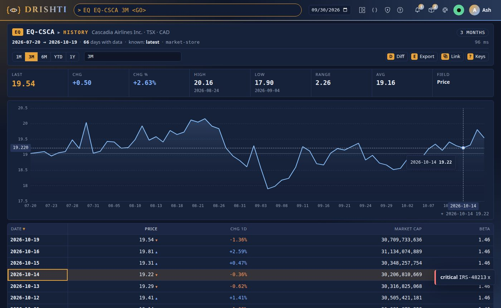

- **The headline numbers** come from the chart's field (*Price*): *Last* 19.54, *Chg* +0.50 (+2.63%) over the range, *High* 20.16 on
  2026-08-24, *Low* 17.90 on 2026-09-04, *Range* 2.26 and *Avg* 19.16.
- **The chart** is drawn in the theme's own colours: its *up* colour when the range ended higher, its *down* colour when lower. A dotted line marks where the
  range began. The crosshair follows the row you select, and hovering the chart shows the day and its value.
- **The range buttons** `1M` `3M` `6M` `YTD` `1Y` (keys `1` `3` `6` `T` `Y`) ask for a new range, and the address follows, so *Back* works.
  `R` lets you type any range in place: `90`, `2W`, `FROM 2026-08-01`.

**From the command line:**

```
$ drishti.py history equity EQ-CSCA --range 3M
```

```text
EQ EQ-CSCA  HISTORY  2026-07-20 -> 2026-10-19  66 days with data, 66 changed
Cascadia Airlines Inc. · TSX · CAD
PRICE: last 19.54  chg +0.50 (+2.63%)  high 20.16 (2026-08-24)  low 17.90 (2026-09-04)  range 2.26  avg 19.16
Date        Price   Chg 1D   Market cap       Beta
----------  ------  -------  ---------------  ----
2026-10-19  19.54*  -1.36%*  30,709,733,636*  1.46
2026-10-16  19.81*  +2.59%*  31,134,074,889*  1.46
2026-10-15  19.31*  +0.47%*  30,348,257,754*  1.46
…
```

**You should see:** eight headline boxes, a line chart of 66 days and the table under it; `1` reloads the page as one month
(`?range=1M`).

**The YAML** that makes a kind a market kind: `chart:` names the fields to draw, and `headline:` the one the numbers are taken from.

```yaml
history:
  equity:
    chart: [PRICE]                        # a chart makes the market shape
    headline: PRICE                       # high, low, change; default the first chart field
    columns: [PRICE, CHANGE_1D, MARKET_CAP, BETA]
```

## Step 32 · Your own pack's `history:` block

Every kind has history without any YAML. Its columns are then its key columns followed by every other top-level field, and its lists show
as counts. The `history:` block in `pack.yaml` changes that per kind, beside `ingest:`, `form:` and `mnemonics:`:

```yaml
history:
  trade:
    columns: [TRADE_STATUS, TRADE_VERSION, QUANTITY, PRICE, MATURITY_DATE, PORTFOLIO, COUNTERPARTY]   # default: key columns, then the rest
    exclude: [_meta]                     # never shown
    ignore-changes: [SOURCE_UPDATE_TIME] # shown, but a change here is not "a change"
    parts: [LEGS, EVENTS]                # the lists shown as counts
    default-days: 30
    max-days: 250                        # at most drishti.history.max-days
  news-topic:
    enabled: false                       # no history for this kind
```

The full schema is in [DATA_ARCHITECTURE.md › History queries: an entity over time, section 6](../architecture/DATA_ARCHITECTURE.md#6-the-history-block-in-packyaml). Check it the way
you check any pack (an unknown key is a warning, a bad value the error `DRS-2061`):

```
$ drishti.py sutra lint config/packs/banking/trading --strict
```

In the UI, a pack with a bad block shows its problem on Admin → Packs (and Health marks the pack DEGRADED) as soon as it is loaded: at the
server's start and after a reload.

**You should see:** `sutra lint` clean for a correct block; a misspelt key (`colums:`) as a warning naming it, and `headline: PRICE2`
(not one of `chart`) as `DRS-2061`.

## Step 33 · Export, and a link that shows the same rows

**In the UI.** Press `E` for the export menu: CSV, Excel, or the server's JSON as served. With *changes only* on, only the changed days are
exported, in all three. The JSON keeps the server's order (oldest first); CSV and Excel are newest first, and Excel's dates are dates. Every export reads through the server with your token, so your masks travel with it.


`Alt+S` (*Link*) copies a link that pins the last date: `…/v/trade/1000015/history?days=30&to=2026-10-19`. A colleague opening it next week
sees the same 30 rows. With *changes only* on, the link keeps `&only=1`. A link without `to` moves with the business date. You should see the
link in a field under the toolbar and *Copied: the link is on the clipboard.* beside it, on a LAN address too.

**From the command line:**

```
$ drishti.py history trade 1000015 --days 30 --csv > trade-1000015.csv
```

```text
Date,Trade status,Trade version,Quantity,Price,Maturity date,Portfolio,Counterparty,Trader,Legs,Events,Changed
2026-10-19,VALIDATED,3,72000.0,2341.05,2028-07-31,BOOK-COMM-2,CP-HARBORPT,•••,2,5,PRICE
2026-10-16,VALIDATED,3,72000.0,2336.12,2028-07-31,BOOK-COMM-2,CP-HARBORPT,•••,2,5,QUANTITY PRICE
…
```

Numbers stay numbers, the file opens in Excel with its accents (UTF-8 with a BOM), and text that a spreadsheet would run as a formula is
kept as text. The console's file is named `1000015-history-2026-09-07-2026-10-19.csv`.

**You should see:** 31 lines (the header and 30 days, newest first), the trader as `•••`, and the *Changed* column naming the paths
that moved each day.

## Step 34 · Limits and errors

A history reads one entity on many days, so the server bounds it. The settings (`drishti.history.*`, in
[CONFIGURATION.md](../admin/CONFIGURATION.md)) are: at most `max-days` business days (366 by default; a pack's `max-days` can only lower
it), `max-rows` rows and `timeout` for the whole request.

| You see | Why | What to do |
|---|---|---|
| `DRS-4021` *366 business days at most (asked 500)* | the range is larger than allowed | narrow it with `FROM … TO`, or follow the page's *The last 30 days* link |
| `DRS-4022` *FROM 2026-10-15 is after TO 2026-10-01* | the dates are the wrong way round (a `FROM` after the business date is *FROM … is in the future*) | put the earlier date first (the page's range field says so too, and never swaps them) |
| `DRS-4022` *'-5' is not a range: use a number of days (30), a span …* | a range typed after the id that cannot be read (`0`, `-5`, `1.5M`, `3X`, `30.`, `1e3`, `FROM yesterday`, `FROM 2026-10-01 TO`, `TO 2026-10-01`, `DIFF DIFF`, `DIFF 30`, `30 30`, a bare `DIFF`; also after a bare id, `1000015 -5`) | type it as the message says; the command line shows the message, never today's view |
| `DRS-1013` *no data from … to …* | the entity has no data in the range | the message says from when to when it has data (*its days with data run from … to …*); with `knownAt` (the CLI's `--known-at`), it says nothing in that window was known then, and that the days it has now may have been loaded later: leave it out or ask with a later instant; the page links to it (*From its first day with data*) |
| `DRS-1012` *keeps no daily history here* | the kind's connector holds today's data only, or the pack turned history off | today's view is one link away |
| *Some days could not be read* | a source did not answer for some days in time (`DRS-1014`) | the rows that were read are shown, and the banner lists the missing days |

In the console every error keeps the page's header and gives a link to today's view. On the command line, `drishti.py history` exits
1 with the code and message.

**You should see:** for `TRD 1000015 500`, the page with `DRS-4021`, its fix, and the links *Today's view of 1000015* and *The last 30
days*.

## Next steps

- [Tutorial 2 · Look up anything](#part-b--look-up-anything): mnemonics, type-ahead, links, a past date, Compare.
- [Tutorial 3 · Query by form](#part-c--query-by-form): the form in depth, and keeping a search.
- The [User guide](../guides/USER_GUIDE.md) describes every feature of the console; [CLI_REFERENCE.md](../guides/CLI_REFERENCE.md) every command; [data/testdata/README.md](../../data/testdata/README.md) the test data and its demo pages.

## If something goes wrong

| You see | Do this |
|---|---|
| The build says `Drishti needs Java 21 or newer` | `JAVA_HOME` is older than 21; point it at 21 or newer and run the build again |
| `python3 -m venv` says `ensurepip is not available` | use `uv venv --python 3.13 drishti-console/.venv`, or install your system's `python3-venv` package |
| `lake demo` says `No module named 'deltalake'` | run it with the console's Python (`drishti-console/.venv/bin/python`), which has the requirements |
| The sign-in page says the password is wrong | the development password is `drishti-dev-admin123` until you change it; five wrong tries lock the account for 15 minutes |
| Every page says `DRS-5010 missing bearer token` | the console was started without `DRISHTI_TOKEN_SECRET` (or with another value than the server's): start it as in Step 2 |
| A view says *No data held for that date* | the demo lakes are not built, or were built for other dates: run `lake demo` again (a running server re-reads them) |
| `address already in use` | something else holds 18480 or 17480; set `DRISHTI_PORT` (server) or `DRISHTI_CONSOLE_PORT` (console), and tell the console where the server is with `DRISHTI_BACKEND_URL` |
| `DRS-4001 cannot read command` | the first word is not a mnemonic of a pack that is switched on: type its first letter and pick from the list |
| *Pick a trade ... 0 of 15000 trades match* | nothing starts with what you typed: type less of the id |
| *No data held for 2026-10-15* | the lakes do not hold that day: pick one of the sixty dates `lake demo` printed, or run it again |
| `DRS-1004 timed out reading counterparty-trades/...` | the page is built from every trade of the counterparty and the server is busy: open it again in a moment |
| the date box refuses a date | dates run from five years back to today |
| `0 of 15000 trades match` | the conditions together match nothing: loosen one (clear a field with `Esc` and search again) |
| *slower: not indexed* beside a field | the source does not keep it as a column, so documents are read to answer: fine for thousands, slow for millions |
| `DRS-4004 no trade has a field 'mtm'` | the search names a field the trades do not have: names are the document's own, in UPPER_SNAKE (`QUANTITY`, `COUNTERPARTY`) |
| `DRS-4010` or `DRS-4011` | the regular expression is refused or too slow; simplify it |
| a value is missing from a dropdown | the lists are built from the data the pack knows; ask the pack's author to add it |
| `Sent to 0 people` or the person is not offered | the user does not exist, is disabled, or may not open that kind of entity |
| the recipient sees `•••` | her roles mask that field: by design |
| `Share denied` | the share was to somebody else, or its link has expired |
| the bell stays at 0 | the bell counts unread items every few seconds: reload the page |
