<!--
  Project Drishti · Any data. Any domain. One grammar.

  Copyright (c) 2026 Ashutosh Sinha <ajsinha@gmail.com>.
  All rights reserved.

  PROPRIETARY AND CONFIDENTIAL.

  This file is the confidential and proprietary property of Ashutosh Sinha.
  Unauthorised copying, use, modification, distribution or disclosure of this
  file, via any medium, is strictly prohibited except with the express prior
  written permission of the copyright holder.

  See the LICENSE file in the root of this repository for the full terms.
-->
# Tutorial 1 · Your first 15 minutes

Install Drishti, build the demo lakes, start it, sign in, open a trade, search, try the search form and look at business intelligence. At the end you
will also have a token that lets the command line talk to your server, which tutorials 4, 5, 6 and 7 use.

## Time to complete

About 15 minutes, plus the first build (a few minutes, once) and the demo lakes (about 15 minutes for the sixty business days, once).

## Before you start

You need a Linux, macOS or Windows machine with Java 21 or newer, Python 3.11 or newer, [uv](https://docs.astral.sh/uv/) and git. Nothing else: no database, no
Docker. On Windows follow [GETTING_STARTED.md (Windows)](../guides/GETTING_STARTED.md#drishti-on-windows) for the same steps in PowerShell.

These tutorials run on the **quick-start environment** of [data/testdata/README.md](../../data/testdata/README.md): the seven packs (`core`, `market-data`, `trading`,
`counterparty-risk`, `market-risk`, `world-economy`, `news-and-markets`) reading the **demo lakes**, sixty business days of production-shaped test data (5,000 trades from
each of three booking systems, ENDUR, CALYPSO and MUREX, and everything the packs need around them). Every field name is UPPER_SNAKE (`TRADE_ID`, `COUNTERPARTY`,
`QUANTITY`), as in production.

In these tutorials `<GO>` means "press Enter", commands are run from the repository root (the folder called `drishti`), and the server and the console are the two
programs from [GETTING_STARTED.md](../guides/GETTING_STARTED.md): the **server** reads the data (port 18480), the **console** is the web pages you open (port 17480).
Every step says what to do **in the UI** (IntelliJ IDEA and PyCharm run configurations, or the console's pages) and **from the command line** where a command exists.

**Where this data comes from.** The banking packs' data is synthetic test data (fictitious names, `tools/testdata/make_testdata.py`); the `world-economy` pack's figures are published data from the World Bank (CC BY 4.0), UNDP (CC BY 3.0 IGO) and the CIA World Factbook (public domain), plus IMF forecasts that are **internal only**, fetched by `tools/publicdata/world_economy.py`; the `news-and-markets` pack's quotes and headlines are a captured snapshot of Yahoo Finance and Google News, **internal only** (`tools/publicdata/news_and_markets.py`). Each source, its licence and how to refresh it: [External data](../guides/PUBLIC_DATA.md).

## What you will learn

- how to build Drishti, build the demo lakes and start it with sign-in on (the way every tutorial here runs);
- how to sign in, and what the home page and the top bar offer;
- how to open an entity by typing a command (`TRD MX-20000001`), and what a view is made of;
- how to find entities by what they contain, and by filling in a form;
- where business intelligence (BI) lives;
- how to make a token so the command line can use your server.

## Step 1 · Install, build and check the machine

**In the UI.** Open the repository in IntelliJ IDEA (its run configurations are in `run-configs/`, [IDE_GUIDE.md](../guides/IDE_GUIDE.md)) and run **Drishti build server jar**.
Then, in PyCharm opened on `drishti-console/` (its run configurations are in `drishti-console/run-configs/`), run **Build demo lakes**.

**From the command line:**

```bash
git clone https://github.com/ajsinha/drishti.git
cd drishti
export JAVA_HOME=/usr/lib/jvm/java-21-openjdk-amd64     # your Java 21 or newer
export PATH="$JAVA_HOME/bin:$PATH"
./mvnw -q package -DskipTests -pl drishti-server -am
uv venv --python 3.13 drishti-console/.venv
uv pip install --python drishti-console/.venv/bin/python -r drishti-console/requirements.txt
```

(`python3 -m venv` works too where your Python has `ensurepip`; on Ubuntu's system Python without the `python3-venv` package it does not, and `uv venv` does.)

Then build the demo lakes, sixty business days ending on today's business date, so that past dates and **Compare** work in tutorial 2. The lake tool also tells a
running server that the data changed (here none is running yet, so it leaves a note the server reads at its first start):

```text
$ drishti-console/.venv/bin/python tools/drishti.py lake demo
  trading/trade_endur: … rows over 60 days
  trading/trade_calypso: … rows over 60 days
  trading/trade_murex: … rows over 60 days
  ...
  news/news-topic: … rows over 60 days

Demo lake ready: ~/drishti/data/delta: 84 tables, 60 business days 2026-07-08 to 2026-09-30, built in 943 s
Feeds: ~/drishti/data/feeds/fixing/SOFR-HISTORY.csv (the file connector's sample feed)
Server: no server at http://localhost:18480: left ~/drishti/data/bi-store/lake-rebuilt.json, so a server clears its stored BI columns and rollups at its next start
Connector files:
  civic-store: generated by the server at its first start (reads ~/drishti/data/delta)
  ...
  trade-murex: generated by the server at its first start (reads ~/drishti/data/delta)
```

You should see a line for each of the 84 tables, then `Demo lake ready` with sixty business dates ending on *your* today's business date (the summary above is from a
sixty-day run that kept the test data's own dates, 2026-07-08 to 2026-09-30; the table lines' row counts, captured on the seven-day lakes of 2.5.0, are left out).
It takes about 15 minutes and about 2.2 GB of disk. The other outputs in these tutorials were captured on Saturday 17 October 2026 on the seven-day lakes of 2.5.0
(Friday **2026-10-16** back to **2026-10-07**): on the sixty-day lakes the ids are the same, but a captured count or value may differ.

Now ask the machine whether it is ready. `doctor` prints green, yellow and red lines, each red or yellow with a fix:

```text
$ drishti-console/.venv/bin/python tools/drishti.py doctor
GREEN  java                    /usr/lib/jvm/java-21-openjdk-amd64/bin/java: Java 21.0 (Ubuntu)
GREEN  server jar              ~/drishti/drishti-server/target/drishti-server-2.9.2-exec.jar (version 2.5.0)
GREEN  python                  ~/drishti/drishti-console/.venv/bin/python: Python 3.13.15
GREEN  python pyyaml           installed
GREEN  python deltalake        installed
GREEN  python pyarrow          installed
GREEN  repo config/packs/      ~/drishti/config/packs
GREEN  console venv            ~/drishti/drishti-console/.venv
GREEN  configured directories  none of DRISHTI_DELTA_ROOT, DRISHTI_FILES_ROOT, DRISHTI_PACKS_INSTALLED is set
GREEN  port 18480              free
GREEN  port 17480              free
doctor: all clear
```

You should see no red line (the exit is 0). The two `port` lines say what is on the ports: with nothing started they say *free*; once the server and the console run they say
*in use by Drishti*.

## Step 2 · Start the server and the console with sign-in on

**In the UI.** Run **Drishti server (demo lakes)**, then **Drishti console**. The first reads the lakes with the samples off (`DRISHTI_DEMO_ENABLED=false`), with
security on and a development administrator; the second signs people in with the same token secret.

**From the command line.** Open two terminals in the repository root. The server, in the first (the same settings as the run configuration):

```bash
export JAVA_HOME=/usr/lib/jvm/java-21-openjdk-amd64
export DRISHTI_PACKS=core,market-data,trading,counterparty-risk,market-risk,world-economy,news-and-markets
export DRISHTI_DEMO_ENABLED=false
export DRISHTI_STUDIO_SAVE=true
export DRISHTI_SECURITY_ENABLED=true
export DRISHTI_TOKEN_SECRET=drishti-dev-only-token-secret-change-me-0123456789
export DRISHTI_SEED_ADMIN=true
mkdir -p data/tmp/server        # Java's temp folder for the server: native libraries unpack here, not in /tmp
java -Djava.io.tmpdir=data/tmp/server -jar drishti-server/target/drishti-server-2.9.2-exec.jar
```

The console, in the second (the same token secret, so the two trust each other):

```bash
export DRISHTI_TOKEN_SECRET=drishti-dev-only-token-secret-change-me-0123456789
export DRISHTI_AUTH_ENABLED=true
export DRISHTI_SESSION_SECRET=drishti-dev-only-session-secret-change-me-0123456789
export DRISHTI_SECURE_COOKIE=false        # plain http on your own machine only
drishti-console/.venv/bin/python drishti-console/run_drishti_web.py --server.port=17480 --backend.url=http://127.0.0.1:18480
```

The secrets above are the development ones of the run configurations: fine on your own machine, never on a shared one ([tutorial 17](17-run-it-in-production.md)).

You should see `Started DrishtiApplication` in the server's terminal, and before it the line `The lake was rebuilt while the server was stopped ...: the BI store's
columns and rollups were cleared` (the note `lake demo` left), and `Uvicorn running on http://0.0.0.0:17480` in the console's. Check the server from a third terminal:

```bash
curl -s localhost:18480/actuator/health
```

You should see `{"status":"UP","groups":["liveness","readiness"]}`.

(`DRISHTI_STUDIO_SAVE=true` lets the Build pages of tutorials 5 and 6 save work. Tutorials 8 and 9 need two people, so all the tutorials run with sign-in on.)

## Step 3 · Sign in

Open <http://localhost:17480>. You are sent to the sign-in page. On the very first start the server makes a development administrator for you: the user
`drishti-dev-admin`, password `drishti-dev-admin123`. Type them in.

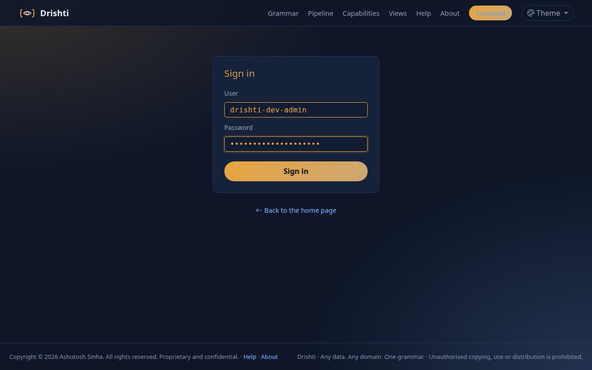

You should see the page above, then, after **Sign in**, the terminal's home page with your name at the top right. (The page tells you to change the development password: do that
under **My account** before you ever put real data in; tutorials here leave it so that the screenshots match.)

## Step 4 · Find your way around the home page

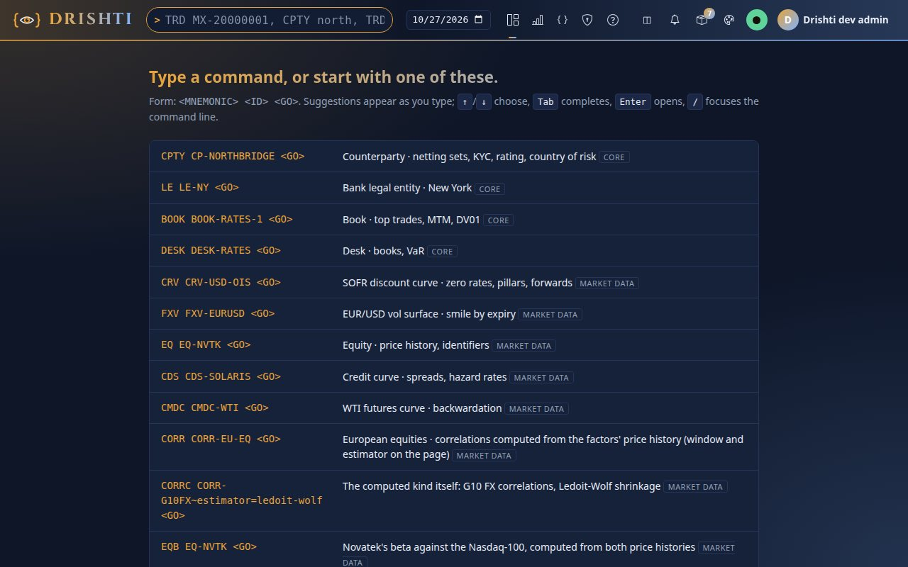

You should see, from left to right in the top bar: the **command line** (the rounded box, `> TRD MX-20000001, CPTY ...` is its hint), the **business date** box, the menu icons
(**Views**, then BI, Build, Admin, Help), the bell for your inbox, the packs icon with a count, the theme button, the round **Live** button and your name.
Below it is a list of commands you can click.

The command line is the heart of Drishti. A command is a **mnemonic** (a short code for a kind of thing: `TRD` is a trade) and an **identifier**:

```text
TRD MX-20000001 <GO>
```

Press `/` anywhere to jump to the command line. Type `TRD MX-200000` and stop: do not press Enter yet.

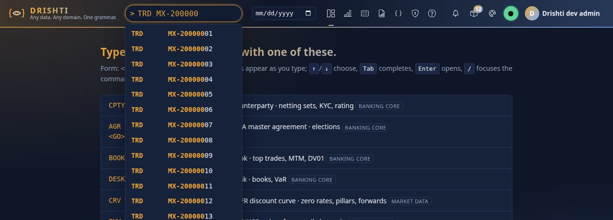

You should see a dropdown of trades whose id starts with what you typed (`MX-20000001`, `MX-20000002`, ...), each with its mnemonic. Use the arrow keys to move, `Tab` to copy a
suggestion into the box and `Enter` to open it. The trades come from three booking systems; their ids tell them apart: MUREX `MX-...`, CALYPSO `CLY-...`, ENDUR plain numbers
(`1000001`).

## Step 5 · Open a trade

Clear the box, type `TRD MX-20000001` and press Enter.

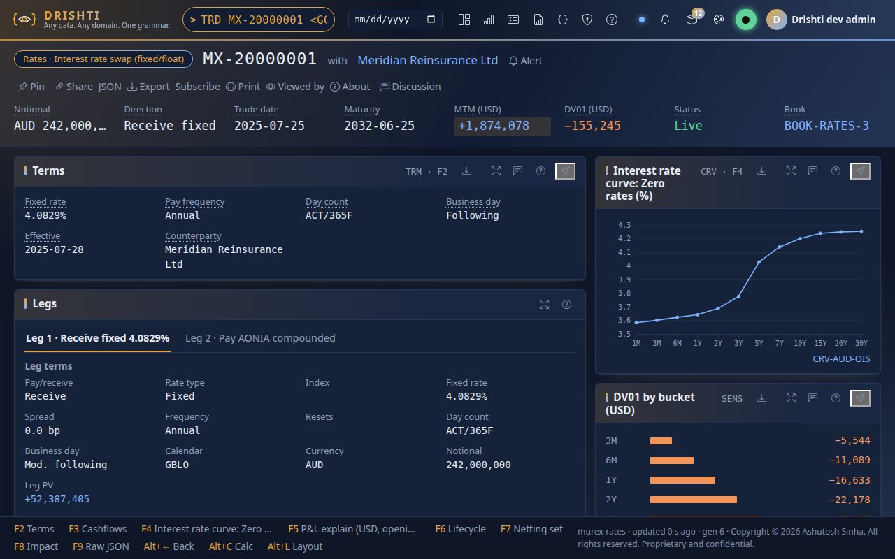

You should see the **view** of an interest rate swap booked in MUREX: the title line (`Rates · Interest rate swap (fixed/float)`, `MX-20000001` with `CP-MERIDIAN-RE`), the
**strip** of key figures under it (source system, side, notional `AUD 242,000,000`, quantity, trade date, maturity, status `AMENDED v2`, portfolio `BOOK-RATES-3`), then panels:
the **Deal ticket**, the **Legs** side by side, the **Cash-flow schedule** of every leg, **Events by leg**, and the **Netted payments by date** ladder. The function keys at the
bottom (`F2 Deal ticket`, `F3 Legs`, ... `F7 Counterparty trades`) jump to a panel or another page; click a blue name (the counterparty, the portfolio) to open that entity.

**Note.** The status `AMENDED v2` here and in the output below was captured on the seven-day lakes of 2.5.0. On the sixty-day lakes of 2.6.5 `MX-20000001` is cancelled part-way through: on its last seven business days it reads `CANCELLED`, version 7; on an earlier date it reads `AMENDED` (pick one in the business date box to see it).

On a phone the same view is one column. This is the same trade at 390 px:

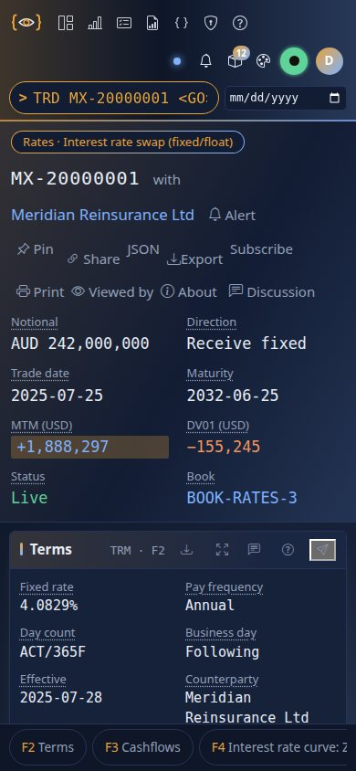

You should see the title, the strip as a grid and the panels stacked, with the function keys as a scrolling row at the bottom.

**From the command line.** The view has a twin, `view get`, which prints it as text. It needs the token of Step 9; for now just look at what it prints:

```text
$ drishti-console/.venv/bin/python tools/drishti.py view get trade/MX-20000001
Rates · Interest rate swap (fixed/float)  MX-20000001  with CP-MERIDIAN-RE   [TRD]

Key figures
  figure      value
  ----------  ---------------
  Source      MUREX
  Side        Sell
  Notional    AUD 242,000,000
  Quantity    242,000,000
  Trade date  2025-07-25
  Maturity    2032-06-25
  Status      AMENDED v2
  Portfolio   BOOK-RATES-3

Deal ticket  (kv, ticket, F2)
  field                  value
  ---------------------  -----------------------------------------------
  Trade id               MX-20000001
  Transaction            20000001002
  Version                2
  Action                 AMEND
  Package                –
  Source system          MUREX
  Updated                2026-10-07T18:30:00Z
  Product                Interest rate swap (fixed/float) (IRS_FIXFLOAT)
  ...
  Counterparty           CP-MERIDIAN-RE
  UEN                    UEN0100407
  Country of risk        BM
  Legal entity           LE-NY
  Portfolio              BOOK-RATES-3
  Trader                 A. Shah
  ...

Cash-flow schedule, every leg  (table, flows, F4)
  Flow         Start       End         Payment     Fixing         Notional  Rate / price  Resets
  -----------  ----------  ----------  ----------  ----------  -----------  ------------  ------
  20000001001  2025-07-28  2026-06-25  2026-06-29  –           242,000,000       4.0829%  0
  20000001002  2026-06-25  2027-06-25  2027-06-29  –           242,000,000       4.0829%  0
...
```

Each label is the meaning of an UPPER_SNAKE field of the trade (`Trade id` is `TRADE_ID`, `Portfolio` is `PORTFOLIO`); press `?` on the page for the glossary.

## Step 6 · Search by what is inside

Press `/` and type:

```text
TRD where QUANTITY > 1bn order by QUANTITY desc limit 50
```

Press Enter.

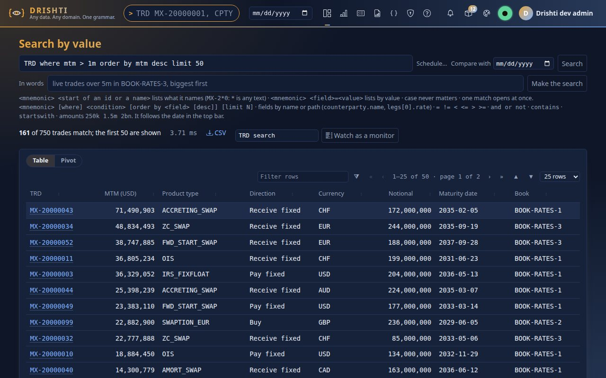

You should see a page headed **Search by value** with the search in a box, the line `192 of 15000 trades match; the first 50 are shown` and how long it took, then a table with
one row per trade, the biggest first, and the columns the trading pack chose (quantity, source system, product type, status, trade date, buy/sell, currency, maturity,
portfolio, counterparty). The search reads all three booking systems at once. Click a trade id to open it, sort by a heading, or type in **Filter rows**. **CSV** downloads the table;
**Watch as a monitor** keeps the first 50 rows as a live list. Amounts take `k`, `m` and `bn`; `and`, `or`, `not`, `contains`, `startswith` and `matches()` work too. Field names are
the document's own (`QUANTITY`, `SOURCE_SYSTEM`); one that does not exist is refused with the fields it has (`DRS-4004 no trade has a field 'mtm'; its fields include TRADE_ID,
SOURCE_SYSTEM, ...`).

**From the command line** the same search is one REST call (with the token of Step 9):

```text
$ curl -s -G -H "Authorization: Bearer $DRISHTI_TOKEN" http://localhost:18480/api/v1/search --data-urlencode "q=TRD where QUANTITY > 1bn order by QUANTITY desc limit 50" \
    | python3 -c "import json,sys; d=json.load(sys.stdin); print(d['matched'], 'of', d['scanned'], 'match;', len(d['rows']), 'rows')"
192 of 15000 match; 50 rows
```

## Step 7 · Fill in a form instead

If you would rather click than write, open **Views** (the first icon in the top bar) and choose **Forms**.

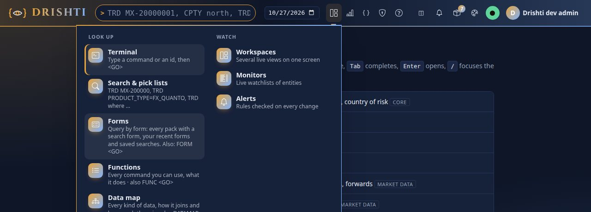

You should see two columns: **Look up** (the terminal, search, **Forms** and **Reports**: every report you have: scheduled ones, subscriptions, alerts and the BI reports) and **Watch** (workspaces of live views, monitors and alerts). **Forms** opens **All forms**:

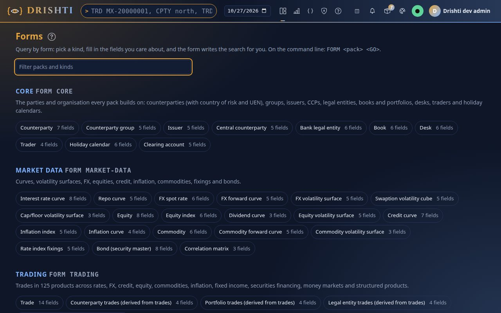

You should see one card for each pack that offers a form. Pick **Trading**, kind **Trade**:

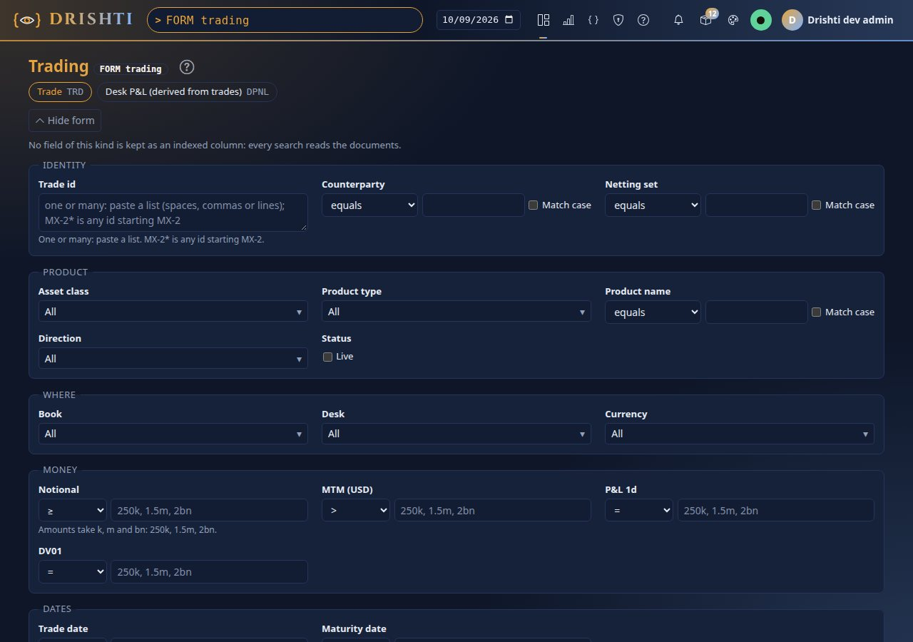

You should see a form with a box, a list or a set of tick boxes for each field people search by, grouped as **Identity** (trade id, source system, counterparty), **Product**
(product type, sub type, status, buy / sell), **Where** (currency, legal entity, portfolio, trader), **Money** (quantity) and **Dates** (trade date, maturity date). Tutorial 3
uses it. The form is written in the pack (`form:` in `config/packs/trading/pack.yaml`):

```yaml
form:
  trade:
  - { path: TRADE_ID, label: Trade id, type: id, group: Identity, order: 1 }
  - { path: SOURCE_SYSTEM, label: Source system, type: enum, group: Identity, order: 2 }
  - { path: COUNTERPARTY, label: Counterparty, type: enum, group: Identity, order: 3 }
  # ... product, where, money and dates
```

## Step 8 · Look at business intelligence

Click the **BI** icon (or type `BI` and press Enter).

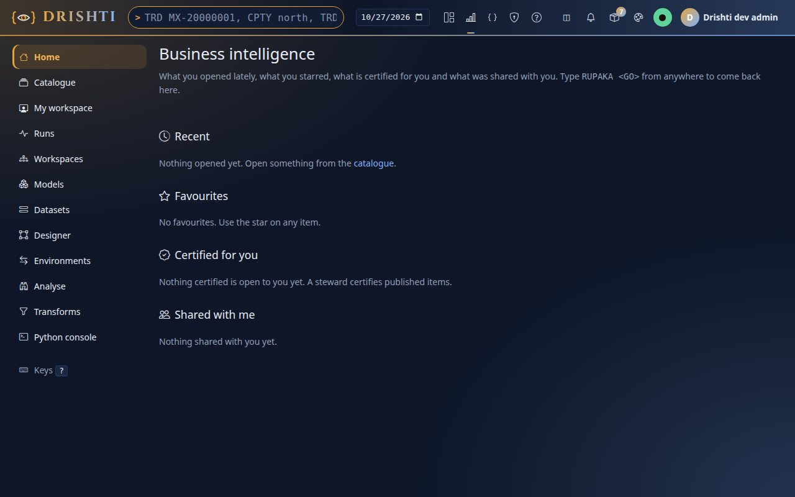

You should see the BI home: a menu on the left (Home, Catalogue, My workspace, Datasets, Insights and so on) and, in the middle, the sections *Recent*, *Favourites*, *Certified for you* and *Shared with me*, which fill as you use BI. Business intelligence is Drishti's second front: reports and boards built on models and datasets, with their own guide ([BI_GUIDE.md](../guides/BI_GUIDE.md)) and tutorial
([tutorial 10](10-first-bi-report.md)). The shipped models read the same sixty days of the lakes.

**From the command line** (with the token of Step 9), the catalogue as you may see it:

```text
$ drishti-console/.venv/bin/python tools/drishti.py bi catalogue list
...
file:model:trades-basic                             model    promoted  published v1   Trades, the basics  (Shipped content, shipped)
file:dataset:trades-basic-trade                     dataset  promoted  published v1   Trades, the basics: trade  (Shipped content, shipped)
file:model:trading-cashflows                        model    promoted  published v1   Trade legs and cashflows  (Shipped content, shipped)
...
```

## Step 9 · Make a token for the command line

The command line (`tools/drishti.py ...`) talks to your server over REST, and a server with sign-in on wants a token. Open **My account** (click your name), scroll to **API tokens**,
name a token `tutorials`, set **Days** to 30 and tick the four write scopes the tutorials use: `design:write`, `loads:write`, `packs:admin` and `bi:write`. (A token with a write scope must
expire, and it can never do more than you can.)

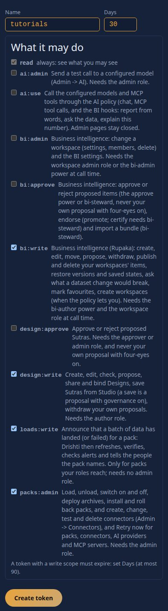

Press **Create token**.

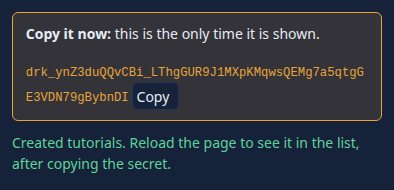

You should see the secret (it starts `drk_`). It is shown **once**: copy it now and keep it in a file only you can read, then point the command line at it:

```bash
mkdir -p ~/drishti-tokens && cat > ~/drishti-tokens/tutorial.token     # paste the secret, press Enter, then Ctrl+D
chmod 600 ~/drishti-tokens/tutorial.token
export DRISHTI_SERVER=http://localhost:18480
export DRISHTI_TOKEN=$(cat ~/drishti-tokens/tutorial.token)
```

(The IDE's QA walk keeps it in `data/qa/token.txt` instead: [IDE_GUIDE.md](../guides/IDE_GUIDE.md). The folder `data/` is git-ignored.)

Without a token a signed-in server says no, in plain words:

```text
$ drishti-console/.venv/bin/python tools/drishti.py server health        # no token
drishti: the server said 401 DRS-5010: DRS-5010 missing bearer token (no or bad token: set DRISHTI_TOKEN or --token-file)
[exit 1]
```

With it, `doctor` checks the token too, and the server answers. `server health` lists every source (a connector to a store) and says whether it is up:

```text
$ drishti-console/.venv/bin/python tools/drishti.py doctor --server http://localhost:18480
...
GREEN  server                  http://localhost:18480: version 2.9.2, java 21.0.12.1, status OK
GREEN  token                   accepted; this token 'SLq29IMYJkTj' acts as drishti-dev-admin: scopes design:write, loads:write, packs:admin, bi:write, expires 2026-11-16T21:47:27.779Z
doctor: all clear
```

```text
$ drishti-console/.venv/bin/python tools/drishti.py server health
status OK  version 2.5.0  java 21.0.12.1  uptime 214s
packs 7  sources 14 (degraded 0, down 0)  packs with problems 0  failed to start 0
  civic-store                 UP        UP (engine: native)
  collateral-store            UP        UP (engine: native)
  credit-store                UP        UP (engine: native)
  file                        UP        UP
  legal-store                 UP        UP (engine: native)
  macro-store                 UP        UP (engine: native)
  market-store                UP        UP (engine: native)
  news-store                  UP        UP (engine: native)
  reference-store             UP        UP (engine: native)
  risk-store                  UP        UP (engine: native)
  trade-calypso               UP        UP (engine: native)
  trade-endur                 UP        UP (engine: native)
  trade-murex                 UP        UP (engine: native)
  trade-pages                 UP        UP
```

You should see `status OK`, the seven packs and fourteen sources, all `UP`: the Delta stores of the packs over the demo lakes (one per source system for the trades), the
file connector's feed, and `trade-pages`, which derives the counterparty, portfolio, legal-entity and index pages from the trades. Tutorial 4 shows how a connector reports its
state when it is not up.

## Next steps

- [Tutorial 2 · Look up anything](02-look-up-anything.md): mnemonics, type-ahead, links, a past date, Compare.
- [Tutorial 3 · Query by form](03-query-by-form.md): the form in depth, and keeping a search.
- The [User guide](../guides/USER_GUIDE.md) describes every feature of the console; [CLI_GUIDE.md](../guides/CLI_GUIDE.md) every command; [data/testdata/README.md](../../data/testdata/README.md) the test data and its demo pages.

## If something goes wrong

| You see | Do this |
|---|---|
| The build says `Drishti needs Java 21 or newer` | `JAVA_HOME` is older than 21; point it at 21 or newer and run the build again |
| `python3 -m venv` says `ensurepip is not available` | use `uv venv --python 3.13 drishti-console/.venv`, or install your system's `python3-venv` package |
| `lake demo` says `No module named 'deltalake'` | run it with the console's Python (`drishti-console/.venv/bin/python`), which has the requirements |
| The sign-in page says the password is wrong | the development password is `drishti-dev-admin123` until you change it; five wrong tries lock the account for 15 minutes |
| Every page says `DRS-5010 missing bearer token` | the console was started without `DRISHTI_TOKEN_SECRET` (or with another value than the server's): start it as in Step 2 |
| A view says *No data held for that date* | the demo lakes are not built, or were built for other dates: run `lake demo` again (a running server re-reads them) |
| `address already in use` | something else holds 18480 or 17480; set `DRISHTI_PORT` (server) or `DRISHTI_CONSOLE_PORT` (console), and tell the console where the server is with `DRISHTI_BACKEND_URL` |
