<!--
  Project Drishti · Any data. Any domain. One grammar.

  Copyright (c) 2026 Ashutosh Sinha <ajsinha@gmail.com>.
  All rights reserved.

  PROPRIETARY AND CONFIDENTIAL.

  This file is the confidential and proprietary property of Ashutosh Sinha.
  Unauthorised copying, use, modification, distribution or disclosure of this
  file, via any medium, is strictly prohibited except with the express prior
  written permission of the copyright holder.

  See the LICENSE file in the root of this repository for the full terms.
-->
# Tutorial 2 · Look up anything

Open any entity in seconds: type a mnemonic and an id, let the type-ahead finish it, follow links from one entity to the next, look at an earlier business day instead of the
latest, and compare two days. The examples use the demo lakes' trades (three booking systems), counterparties and netting sets, and one country from a pack of real public data.

## Time to complete

About 20 minutes.

## Before you start

- [Tutorial 1](01-first-15-minutes.md) done: the demo lakes built (`lake demo`), server and console running with sign-in on, and you signed in as `drishti-dev-admin`.
- The sixty business days of the lakes are what the past-date steps read. The outputs here were captured on the seven-day lakes of 2.5.0, ending on **2026-10-16**
  (first day 2026-10-07); `lake demo` printed your own sixty dates: use your last date where this tutorial says 2026-10-16 and the one before it for 2026-10-15.
  On the sixty-day lakes a captured value may differ, and `MX-20000001` is cancelled part-way through the sixty days (its last seven days read `CANCELLED`,
  version 7): pick an earlier date to see it live. The trades amended most often (ten times each) are ENDUR `1000279` and `1001049`, CALYPSO
  `CLY-4000509` and MUREX `MX-30001745`.
- For the command-line steps: `DRISHTI_SERVER` and `DRISHTI_TOKEN` set, as at the end of tutorial 1.

## What you will learn

- the command line's grammar: mnemonics, ids, bare ids and names, pick lists;
- what the type-ahead offers and how to use the keys;
- how links and function keys take you from a trade to its counterparty's trades, the counterparty and its netting set;
- the **Live** toggle against a past business date, and what the amber date box means;
- **Compare**: every field that changed between two days, and one number over time.

## Step 1 · Mnemonics: type one letter

Press `/` and type `T`.

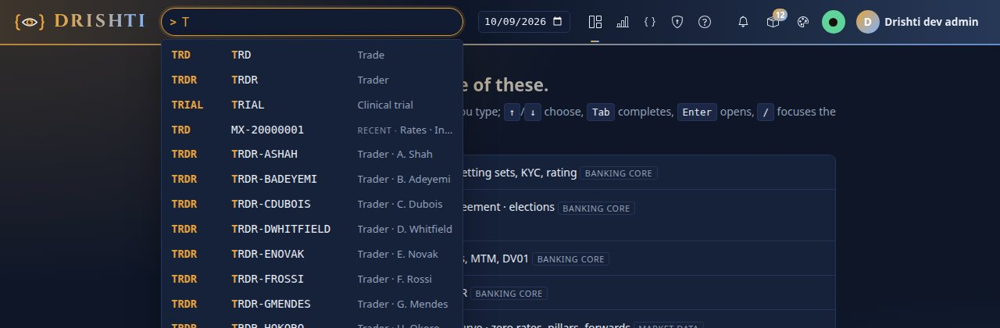

You should see the mnemonics that start with T (`TOPIC` news topic, `TRD` trade, `TRDR` trader, `TVAL` trade valuation), each with its short name, then entities you opened
lately. A mnemonic is the first word of a command; every pack that is switched on brings its own. `TRD` is a trade, `CPTY` a counterparty, `NSET` a netting set (the trades with
one counterparty under one agreement), `CTRD` a counterparty's trades, `BOOK` a book, `CRV` a curve. [PACKS.md](../guides/PACKS.md) lists them all.

**From the command line**, the same suggestions come from one call (the answer trimmed to type, mnemonic, id and title):

```text
$ curl -s -H "Authorization: Bearer $DRISHTI_TOKEN" 'http://localhost:18480/api/v1/command/suggest?q=T&limit=12'
mnemonic TOPIC  News topic
mnemonic TRD    Trade
mnemonic TRDR   Trader
mnemonic TVAL   Trade valuation
recent   TRD    MX-20000001   Rates · Interest rate swap (fixed/float) · CP-MERIDIAN-RE
...
```

## Step 2 · Type-ahead for an entity

Clear the box and type `NSET SUMMIT`.

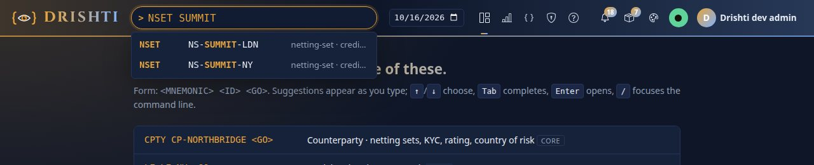

You should see two lines: `NS-SUMMIT-LDN` and `NS-SUMMIT-NY`, each with where it comes from (`netting-set · credit-store`). The type-ahead matches the start of an id **or** a
word in its title. Keys: `↓` and `↑` move, `Tab` copies the highlighted line into the box (the first, when none is highlighted), `Enter` opens it, `Esc` closes the list. Clear
the box and type `CPTY north`:

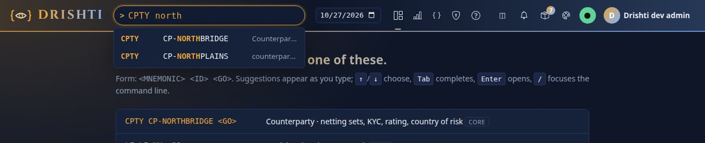

You should see two lines, `CP-NORTHBRIDGE` and `CP-NORTHPLAINS` (a look-alike energy counterparty of the test data). You typed part of a word, not an id.

**From the command line**, the call behind the dropdown:

```text
$ curl -s -H "Authorization: Bearer $DRISHTI_TOKEN" 'http://localhost:18480/api/v1/command/suggest?q=NSET%20SUMMIT&limit=5'
[
    {
        "type": "entity",
        "mnemonic": "NSET",
        "kind": "netting-set",
        "id": "NS-SUMMIT-LDN",
        "title": "NS-SUMMIT-LDN",
        "subtitle": "netting-set · credit-store",
        "complete": "NSET NS-SUMMIT-LDN"
    },
    {
        "type": "entity",
        "mnemonic": "NSET",
        "kind": "netting-set",
        "id": "NS-SUMMIT-NY",
        "title": "NS-SUMMIT-NY",
        "subtitle": "netting-set · credit-store",
        "complete": "NSET NS-SUMMIT-NY"
    }
]
```

### Type-ahead for a past date

Pick a past business date (Step 5 shows how) and type `TRD ` again: the dropdown now offers the ids that existed **on that
date**, not today's. A connector that keeps several days (an administrator's `index.days: 5`) answers this from memory
at once; one that keeps only the newest day offers today's ids and opening one that was not held then says so. The
subtitle `last seen <date>` marks an id offered only because it existed on an earlier day (`index.any-recent-day`).

## Step 3 · Open one entity, or pick from many

Press Enter on `CPTY north`.

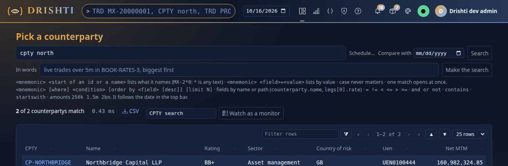

You should see *Pick a counterparty* with `2 of 2 counterparties match` and the two rows: the command names more than one, so Drishti asks. The rule: **one match opens; several
give a pick list**. Type `CPTY northb` and press Enter: it names exactly one, and `CP-NORTHBRIDGE` opens straight away (its name *Northbridge Capital LLP*, LEI, rating `BB+`,
country of risk `GB`, UEN, and its netting sets). Now type `TRD MX-200000` (the start of an id) and press Enter:

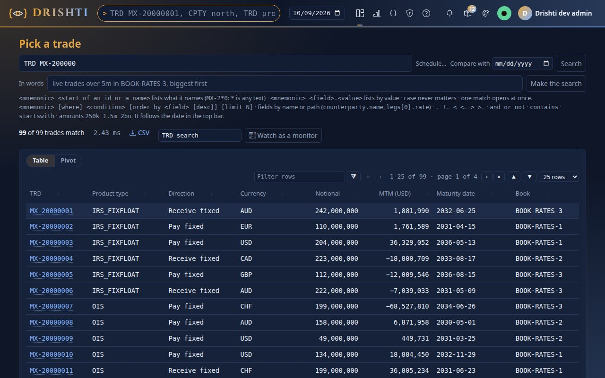

You should see *Pick a trade* with `99 of 15000 trades match` and a table. Click an id to open it. A bare id also works when its shape tells Drishti the kind: type
`MX-20000001` alone and it opens the same trade as `TRD MX-20000001`. Case never matters (`mx-20000001` works too).

**From the command line**, the command is resolved by one call; the answer says whether it opens an entity (`ref`) or lists (`matched`):

```text
$ curl -s -X POST -H "Authorization: Bearer $DRISHTI_TOKEN" -H 'Content-Type: application/json' -d '{"text":"TRD MX-200000"}' http://localhost:18480/api/v1/command
{"ref": null, "mnemonic": "TRD", "list": "TRD MX-200000", "matched": 99, "pack": null}
$ curl -s -X POST -H "Authorization: Bearer $DRISHTI_TOKEN" -H 'Content-Type: application/json' -d '{"text":"mx-20000001"}' http://localhost:18480/api/v1/command
{"ref": {"kind": "trade", "id": "MX-20000001"}, "mnemonic": "TRD", "list": null, "matched": null, "pack": null}
```

## Step 4 · Follow the links

Open `TRD MX-20000001` and look at the title, the strip and the panels.

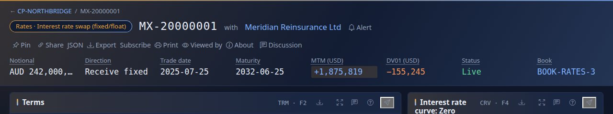

You should see blue names. In the title line `CP-MERIDIAN-RE` is the counterparty; in the strip `BOOK-RATES-3` is the portfolio; **Linked entities** at the bottom lists the
counterparty, the legal entity `LE-NY`, the portfolio, the trader `TRDR-ASHAH` and the desk `DESK-RATES`. Click one and that entity opens. Function keys do the same from the
keyboard: the bar at the bottom lists them, and **F7** opens **Counterparty trades** for `CP-MERIDIAN-RE`: every trade with that counterparty across the three booking systems
(670, with the payments due in the next 7, 30 and 90 days, notional by product type and by index, and a maturity ladder). There **F7** opens the counterparty itself, whose
**Netting sets** table lists `NS-MERIDIAN-RE-NY`. Open it.

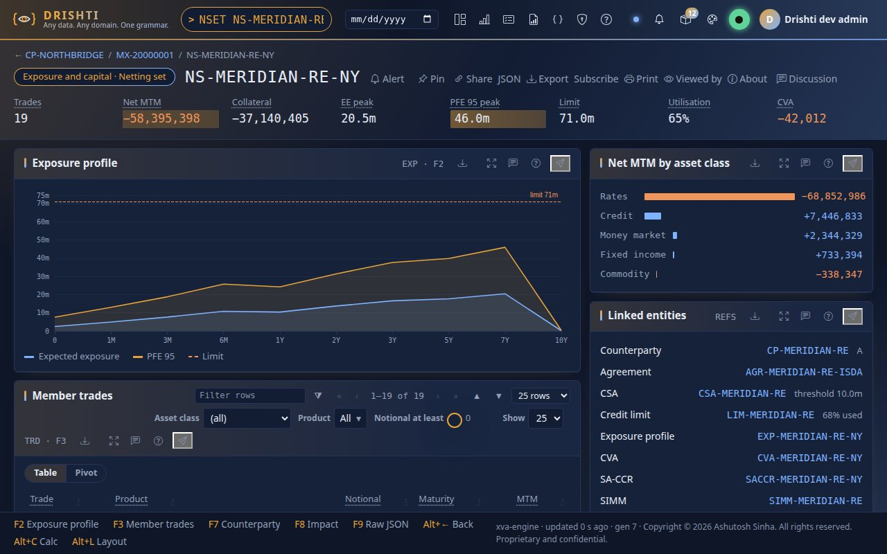

You should see the netting set `NS-MERIDIAN-RE-NY` with its strip (343 trades, net MTM `+99,704,064`, collateral, EE peak `483.3m`, PFE 95 peak `1.1bn`, limit, utilisation `65%`,
CVA `−976,429`), its exposure profile, the member trades and net MTM split by asset class. **Alt+←** takes you back. Links, impact (**F8**) and search all follow the date in the top
bar, which is the next step.

**From the command line:**

```text
$ drishti-console/.venv/bin/python tools/drishti.py view get netting-set/NS-MERIDIAN-RE-NY
Exposure and capital · Netting set  NS-MERIDIAN-RE-NY   [NSET]

Key figures
  figure                         value
  -----------------------------  -----------
  Trades                         343
  Net MTM                        +99,704,064
  Collateral (+ held, − posted)  +71,431,946
  EE peak                        483.3m
  PFE 95 peak                    1.1bn
  Limit                          1.7bn
  Utilisation                    65%
  CVA                            −976,429
...
```

## Step 5 · A past date, and the Live toggle

The **business date** box in the top bar says which day you are looking at. Empty means **live**: the latest business date (2026-10-16 here). The demo lakes are daily
snapshots: they change only when a day is loaded, so nothing ticks on these pages. (With `DRISHTI_DEMO_ENABLED=true` the demo source ticks about twice a second and a live view
moves as a whole: [tutorial 12](12-live-bi-and-boards.md).) Open `TRD MX-20000022` (a MUREX cross-currency swap that was amended on the last day), click the date box and type
`2026-10-15`, then press Enter.

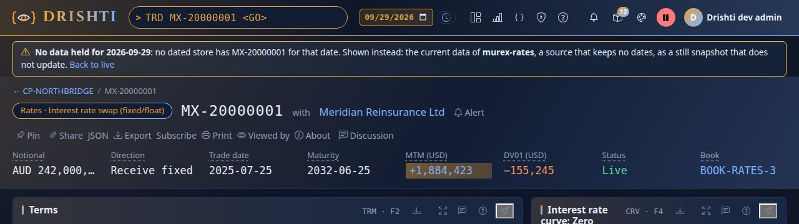

You should see the same layout with that day's figures: the status reads `VALIDATED v1`. The date box is amber, the round **Live** button beside it turns red with two pause bars
(it is paused: this is a still snapshot), and a **Compare** link appears in the title line. Click the red button.

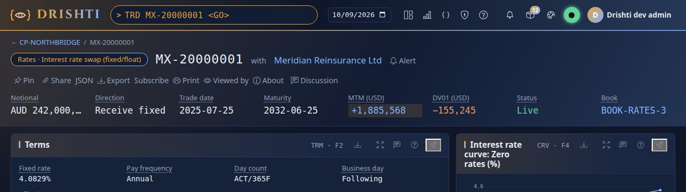

You should see the date go back to live and the status read `AMENDED v2`; the button turns green with a filled dot. The Live button is a toggle: green pauses live updates (a
snapshot of the current business date), red resumes. You can pick another date while paused. The choice follows you from page to page. If you pick a Saturday the box shows
`↩ 2026-10-09` (for Saturday the 10th) and the data is Friday's; Monday 12 October is a New York holiday (Columbus Day), so the lakes have no day for it.

The date is one call to the server too:

```text
$ curl -s -H "Authorization: Bearer $DRISHTI_TOKEN" http://localhost:18480/api/v1/business-date    # without the holiday list
{
  "current": "2026-10-16",
  "selected": "2026-10-16",
  "live": true,
  "knownAt": null,
  "previous": "2026-10-15",
  "earliest": "2021-10-15",
  "calendar": "USNY",
  "zone": "America/New_York"
}
```

And the command line reads the past just as well; this is the same trade on 15 October:

```text
$ drishti-console/.venv/bin/python tools/drishti.py view get trade/MX-20000022 --date 2026-10-15
Rates · Cross-currency swap (non-MtM)  MX-20000022  with CP-VERDANT   [TRD]

Key figures
  figure      value
  ----------  ---------------
  Source      MUREX
  Side        Sell
  Notional    USD 129,000,000
  Quantity    129,000,000
  Trade date  2026-08-27
  Maturity    2035-02-01
  Status      VALIDATED v1
  Portfolio   BOOK-RATES-1
...
```

## Step 6 · Compare two days

Pick `2026-10-16`, open `TRD MX-20000022` and click **Compare**.

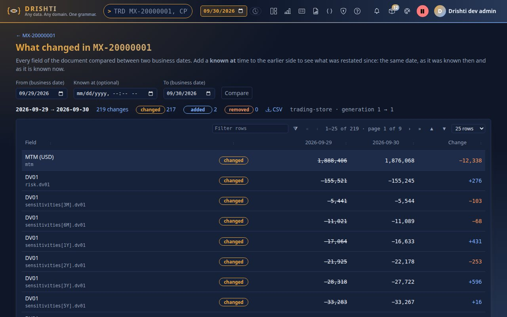

You should see *What changed in MX-20000022*, comparing 16 October with the business day before, and a table: one row per field that differs, with its label and path, the value on
each date and the change: five rows, the amendment as the booking system recorded it (`TRADE_STATUS` `VALIDATED` → `AMENDED`, `TRADE_ACTION` `NEW` → `AMEND`,
`TRADE_VERSION` `1` → `2`, a new `TRANSACTION_ID`, a new `SOURCE_UPDATE_TIME`). Lists are matched by their keys, so a row inside `LEGS` or `CASH_FLOWS` reads by the leg's or
flow's id rather than a position. Choose any two dates at the top to compare further apart; filter to *changed*, *added* or *removed*; **CSV** downloads the table. About 6% of
each book is amended each day in the test data: the trades whose `TRADE_VERSION` moved. Programs ask the server for the same thing:

```text
$ curl -s -H "Authorization: Bearer $DRISHTI_TOKEN" 'http://localhost:18480/api/v1/history/trade/MX-20000022/diff?from=2026-10-15&to=2026-10-16'    # shortened to the first three changes
{
  "from": "2026-10-15",
  "to": "2026-10-16",
  "changed": 5,
  "added": 0,
  "removed": 0,
  "changes": [
    {
      "path": "SOURCE_UPDATE_TIME",
      "label": "Source update time",
      "kind": "changed",
      "before": "2026-10-07T18:30:00Z",
      "after": "2026-10-16T17:39:00Z",
      "delta": null
    },
    {
      "path": "TRADE_STATUS",
      "label": "Trade status",
      "kind": "changed",
      "before": "VALIDATED",
      "after": "AMENDED",
      "delta": null
    },
    {
      "path": "TRADE_ACTION",
      "label": "Trade action",
      "kind": "changed",
      "before": "NEW",
      "after": "AMEND",
      "delta": null
    }
  ]
}
```

(The answer's `from` and `to` also carry each date's provenance: the source, here `trade-murex`, and its generation.) Back on the view, click a number, for example the
**Status** in the strip.

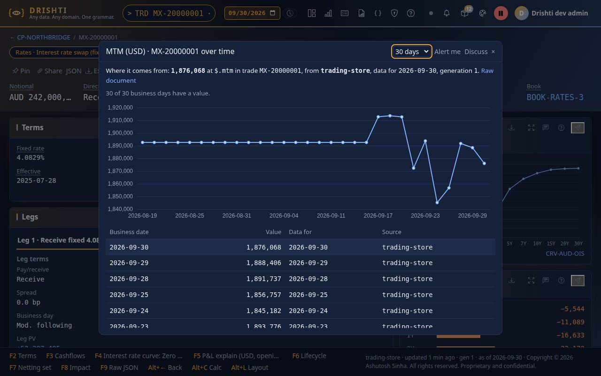

You should see a window with the value on each business day, newest first, each with *Data for* and its source: `2` on 2026-10-16, `1` on the days before, and no value
before 2026-10-07 (the lakes start there). The first line says where the number comes from (the path in the document, the connector, the business date and the source's
generation). Choose 10, 30, 90 or 250 days at the top. The call behind it:

```text
$ curl -s -H "Authorization: Bearer $DRISHTI_TOKEN" 'http://localhost:18480/api/v1/history/trade/MX-20000022/series?path=$.TRADE_VERSION&days=10'    # shortened
{"ref": {"kind": "trade", "id": "MX-20000022"}, "path": "$.TRADE_VERSION", "label": "Trade version", "points": [{"date": "2026-10-02", "value": null, ...},
 {"date": "2026-10-07", "value": "1", "dataDate": "2026-10-07", "source": "trade-murex", "generation": 517}, ...]}
```

## Step 7 · A different domain: real public data

The packs of other industries use exactly the same commands. The `world-economy` pack holds published data about countries (World Bank, UNDP and the CIA World Factbook, public sources;
[REAL_DATA.md](../guides/REAL_DATA.md) lists them and their licences). Type `JUR JUR-USA`.

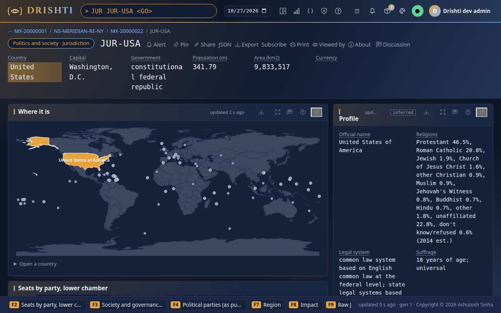

You should see the United States as a jurisdiction: its government type, capital, a world map with the country highlighted, the legislature and social indicators, each linked to
related entities (office holders, elections, parties, the region). The command line prints the same view:

```text
$ drishti-console/.venv/bin/python tools/drishti.py view get jurisdiction/JUR-USA
Politics and society · Jurisdiction  JUR-USA   [JUR]

Key figures
  figure          value
  --------------  -------------------------------
  Country         United States
  Capital         Washington, D.C.
  Government      constitutional federal republic
  Population (m)  341.79
  Area (km2)      9,833,517
  Currency

Where it is  (map, geography)
  {"mode": "world", "highlight": "USA", "link": {"kind": "jurisdiction", "template": "JUR-{iso3}", ...

Seats by party, lower chamber  (table, legislature, F2)
  Party             Seats
  ----------------  -----
  Republican Party    220
  Democratic Party    215

Society and governance (latest)  (table, indicators, F3)
  Indicator                                    Value  Year  Unit
  -------------------------------------------  -----  ----  -----------------
...
```

## Next steps

- [Tutorial 3 · Query by form](03-query-by-form.md) finds entities by what they hold.
- [USER_GUIDE.md › The command line](../guides/USER_GUIDE.md#the-command-line) lists every reserved word, alias and error message; [Business dates](../guides/USER_GUIDE.md#business-dates-live-or-a-day-in-the-past) explains *known at* (time travel).
- [data/testdata/README.md](../../data/testdata/README.md) lists more demo pages (an ENDUR ComSwap `1000001`, a CALYPSO bond `CLY-3000157`, `CP-NORTHPLAINS`).

## If something goes wrong

| You see | Meaning |
|---|---|
| `DRS-4001 cannot read command` | the first word is not a mnemonic of a pack that is switched on: type its first letter and pick from the list |
| *Pick a trade ... 0 of 15000 trades match* | nothing starts with what you typed: type less of the id |
| *No data held for 2026-10-15* | the lakes do not hold that day: pick one of the sixty dates `lake demo` printed, or run it again |
| `DRS-1004 timed out reading counterparty-trades/...` | the page is built from every trade of the counterparty and the server is busy: open it again in a moment |
| the date box refuses a date | dates run from five years back to today |
