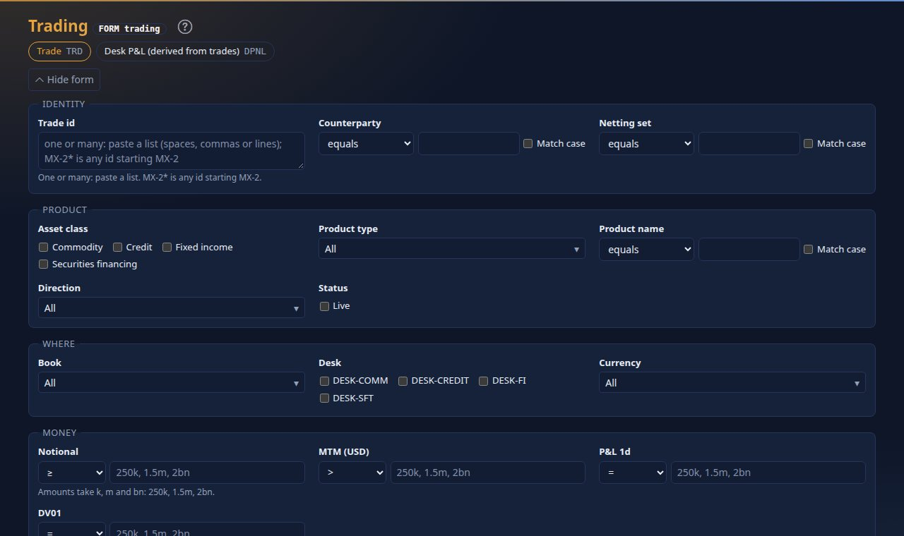
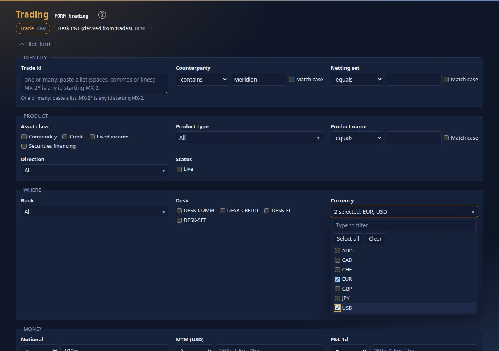
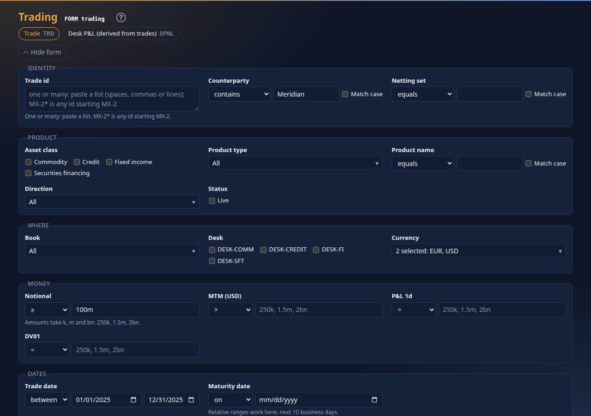
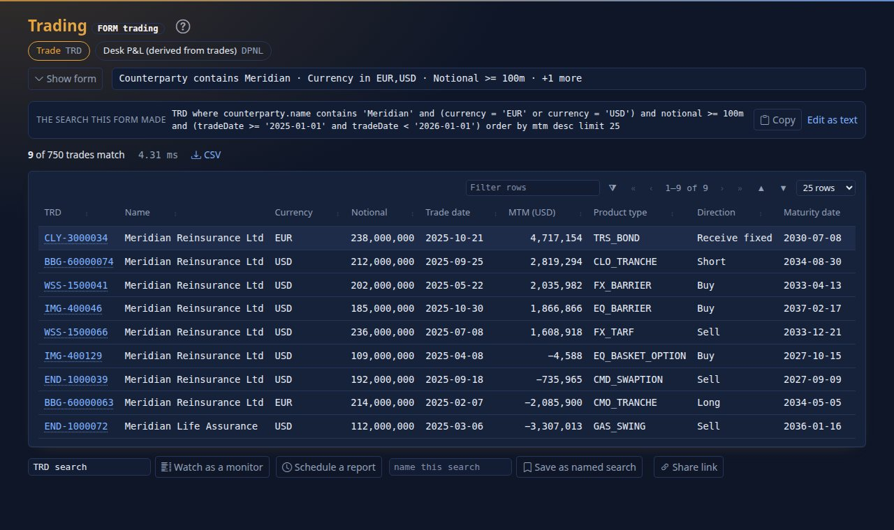
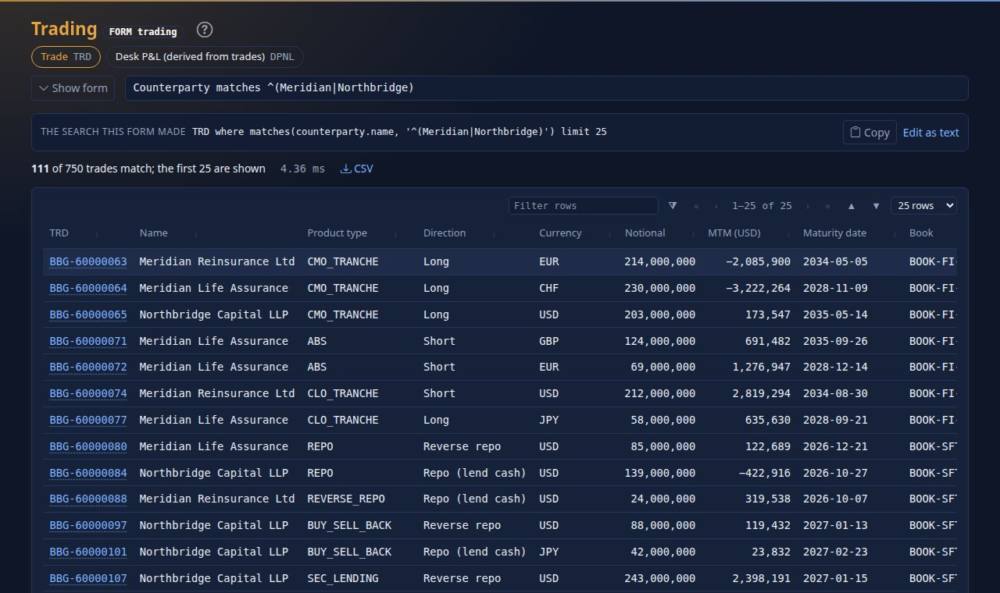
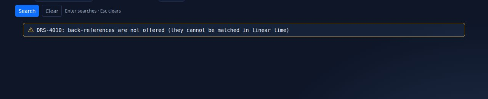
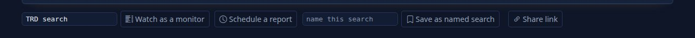
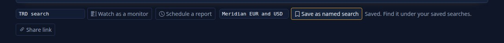
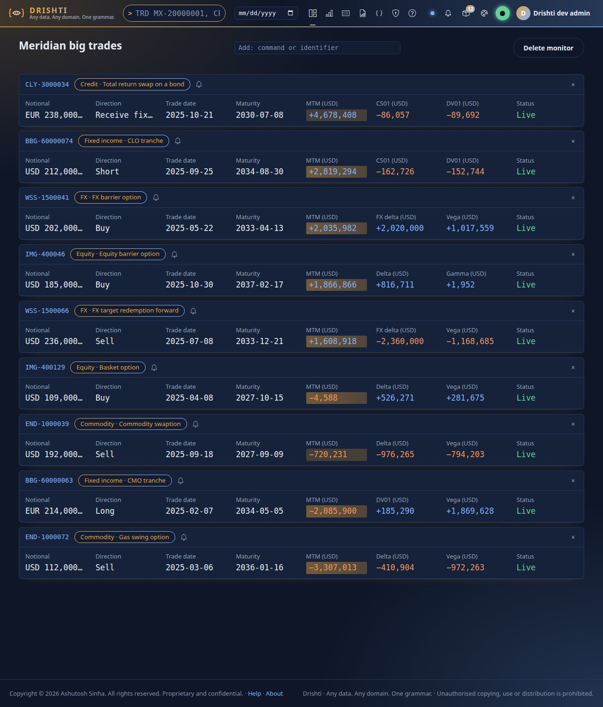

<!--
  Project Drishti · Any data. Any domain. One grammar.

  Copyright (c) 2026 Ashutosh Sinha <ajsinha@gmail.com>.
  All rights reserved.

  PROPRIETARY AND CONFIDENTIAL.

  This file is the confidential and proprietary property of Ashutosh Sinha.
  Unauthorised copying, use, modification, distribution or disclosure of this
  file, via any medium, is strictly prohibited except with the express prior
  written permission of the copyright holder.

  See the LICENSE file in the root of this repository for the full terms.
-->
# Tutorial 3 · Query by form

Find trades by filling in boxes, not by writing a search. You will combine a text condition, an amount, a date range and a choice of currencies, read the
search the form wrote for you, use a regular expression, and then keep the search: name it, watch it as a live monitor, or schedule it (tutorial 9).

## Time to complete

About 20 minutes.

## Before you start

[Tutorial 1](01-first-15-minutes.md) done (server and console running, signed in). The `trading` pack comes with `market-risk`, which the tutorials switch on.

## What you will learn

- the inputs a form offers and what each one asks: text and its operators, amounts (`100m`), dates (between, relative), choices;
- why a long list of values is **one dropdown with tick boxes**, and a short one a row of tick boxes;
- the search the form writes, and how to copy or edit it;
- regular expressions, and what the safe engine refuses and why;
- saving a search under a name and as a live monitor.

## Step 1 · Open the form

Type `FORM trading trade` and press Enter (or **Forms**, **Trading**, then **Trade**).



You should see a form headed **Trading** with the kind **Trade** selected, and groups of inputs:

| The field holds | The input |
|---|---|
| text (counterparty, product name) | a box, an operator (equals, contains, starts with, matches regex) and *Match case* |
| a number or an amount | an operator (`=`, between, `>`, `<`, `≥`, `≤`) and a box; amounts take `250k`, `1.5m`, `2bn` |
| a date | on, between, before, after, or *relative* (`next 10 business days`, `last 30 days`, `month to date`) |
| one of **a few** values (asset class, status) | a row of tick boxes |
| one of **many** values (product type, direction, book, currency) | **one dropdown** that shows *All*, one value, or `2 selected: EUR, USD` |
| a list of ids | a box where you paste ids separated by spaces, commas or lines; `MX-2*` means any id starting `MX-2` |

Leave a field empty and it takes no part in the search. Below the fields choose how to sort and how many to show.

## Step 2 · Say what you want

Fill in:

1. **Counterparty**: operator *contains*, text `Meridian`.
2. **Notional**: operator `≥`, `100m`.
3. **Trade date**: operator *between*, from `2025-01-01` to `2025-12-31`.
4. **Currency**: open the dropdown (click it, or press Enter or Space on it).



You should see, inside the dropdown, a box to filter the values as you type, **Select all** and **Clear** (they act on the values the filter leaves), and a tick box for each currency. Tick
`EUR` and `USD`. The arrow keys move, Space ticks, a letter jumps to a value, Enter or Esc closes. When it is closed:



You should see the dropdown read `2 selected: EUR, USD` and your other boxes filled as above. Press **Search** (or Enter).

## Step 3 · Read the search it wrote



You should see the form fold to **one line of your criteria** (`Counterparty contains Meridian · Currency in EUR,USD · Notional >= 100m · +1 more`) so the table gets the room. Under it is **the
search this form made**, in the grammar of Search by value, for example:

```text
TRD where counterparty.name contains 'Meridian' and (currency = 'EUR' or currency = 'USD') and notional >= 100m and (tradeDate >= '2025-01-01' and tradeDate < '2026-01-01') order by mtm desc limit 25
```

then a line such as `9 of 750 trades match`, and the table: click a heading to sort, a funnel to filter a column, an id to open the trade. **Copy** puts the command on the clipboard (paste it
into the command line); **Edit as text** opens it in the search box. Click the one-line summary, press **Show form** or `Alt+F` to unfold the form with every box as you left it. Everything you
filled in is in the page's address, so bookmark it or send it to a colleague; `Alt+←` from a trade returns here with the results.

## Step 4 · A regular expression

Show the form, set **Counterparty** to *matches regex* and the text to `^(Meridian|Northbridge)`. Clear the other fields (`Esc` clears every field) and search.



You should see the command `TRD where matches(counterparty.name, '^(Meridian|Northbridge)') limit 25` and the trades of both counterparties. The regex engine is a safe one: it cannot run for
ever whatever the pattern. It reads classes (`[A-Z]`, `\d`), groups, `|`, `* + ? {n,m}`, `^` and `$`. Try a back-reference, `(a)\1`:



You should see a message in an amber box: `DRS-4010: back-references are not offered (they cannot be matched in linear time)`. Back-references, look-around and `\b` are refused for that reason,
patterns over 200 characters too (`DRS-4010`), and a pattern that takes over 50 ms on one value stops with `DRS-4011`.

## Step 5 · Keep the search

Go back to the results of Step 3. Under the table are four ways to keep it.



You should see a box with a button **Watch as a monitor**, a link **Schedule a report**, a box **name this search** with **Save as named search**, and **Share link**. Type
`Meridian EUR and USD 2025` in the name box and press **Save as named search**.



You should see `Saved. Find it under your saved searches.` The search now appears under *Your saved searches* on the forms home and under the form, with its criteria. Next, name the
monitor `Meridian big trades` and press **Watch as a monitor**.



You should see a monitor page: a live list with one card for each of the first 50 results, each showing that trade's strip. The monitor is kept under your account. **Add an entity** adds
a row (type `TRD MX-20000001`), **×** removes one, **Delete monitor** removes the list. **Share link** copies the form's address, which opens the same form with the same criteria for anyone
who may see the pack. **Schedule a report** is tutorial 9.

## Next steps

- [Tutorial 9 · Reports](09-reports.md) runs this search on a schedule.
- [USER_GUIDE.md › Search with a form](../guides/USER_GUIDE.md#search-with-a-form-form-pack) is the reference, including keyboard and phone use; the pack's author decides what the form offers
  ([PACK_DEVELOPER_GUIDE.md](../guides/PACK_DEVELOPER_GUIDE.md#form-the-search-form-of-a-kind)).

The form has no command-line twin: the search it writes is an ordinary command, which you can paste into the command line or a scheduled report.

## If something goes wrong

| You see | Meaning |
|---|---|
| `0 of 750 trades match` | the conditions together match nothing: loosen one (clear a field with `Esc` and search again) |
| *slower: not indexed* beside a field | the source does not keep it as a column, so documents are read to answer: fine for thousands, slow for millions |
| `DRS-4010` or `DRS-4011` | the regular expression is refused or too slow; simplify it |
| a value is missing from a dropdown | the lists are built from the data the pack knows; ask the pack's author to add it |
