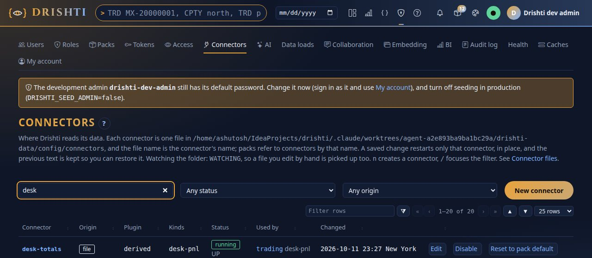
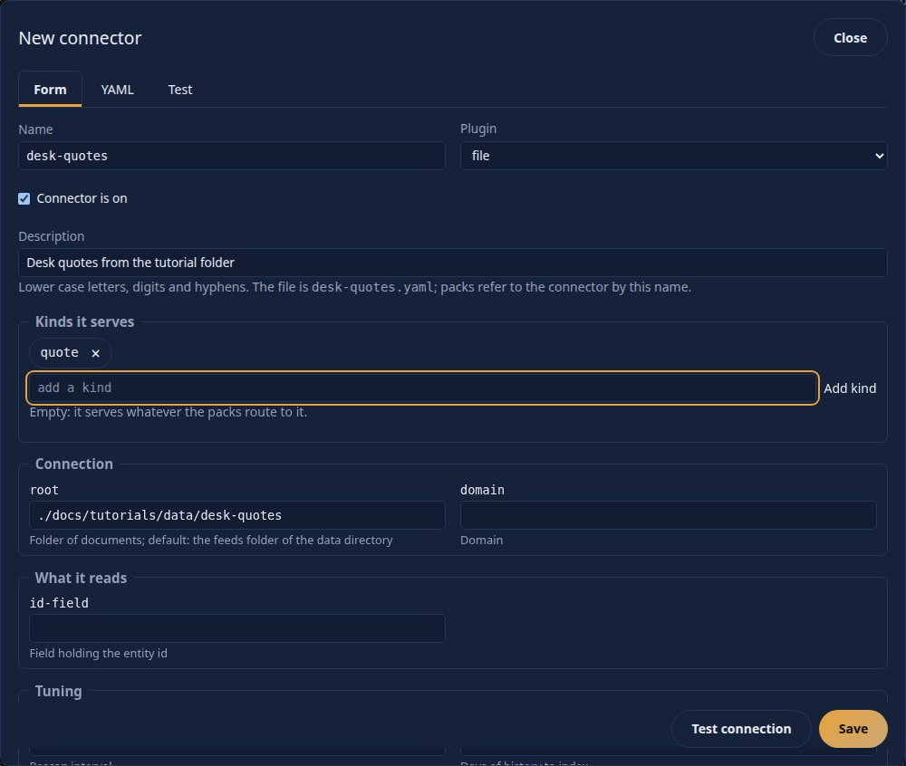
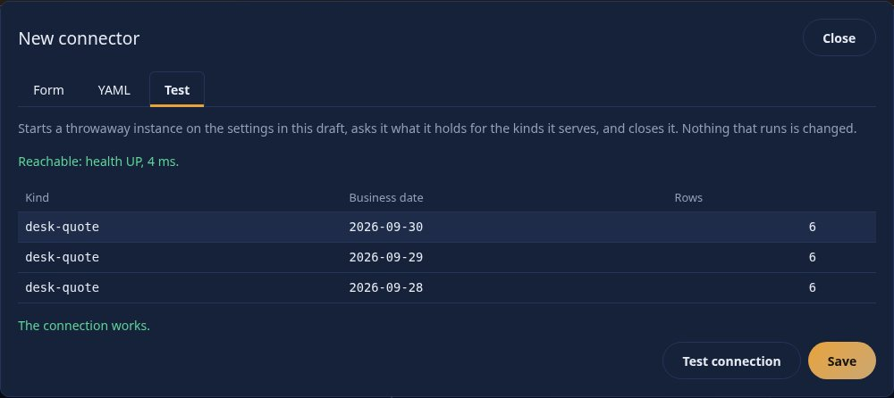
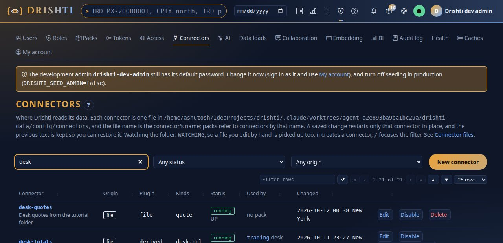
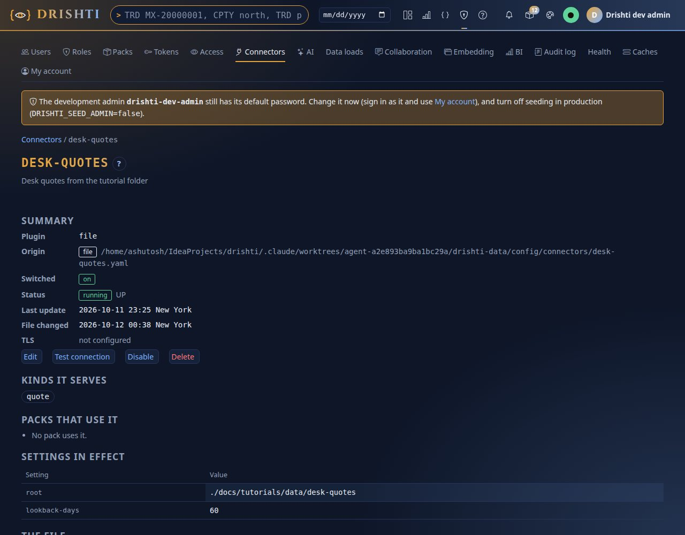
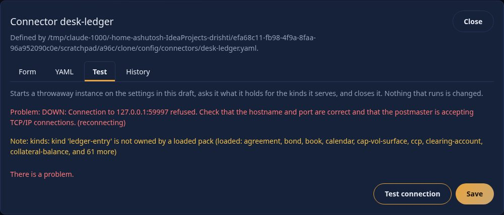
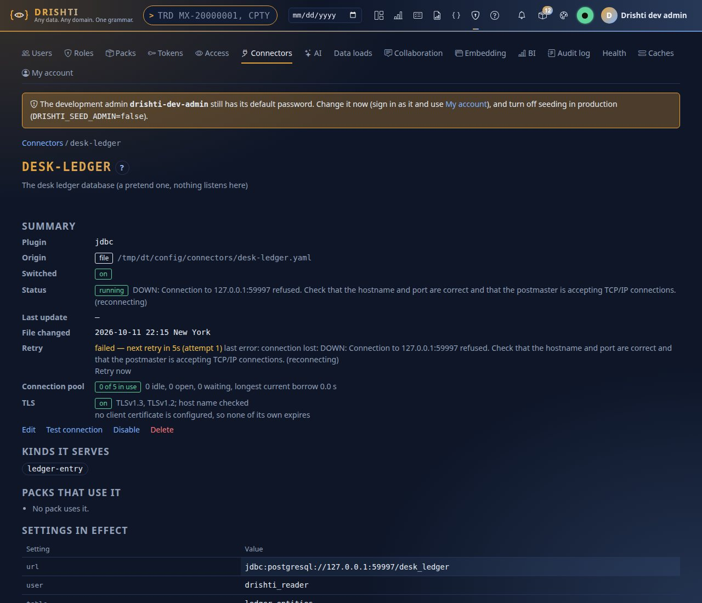
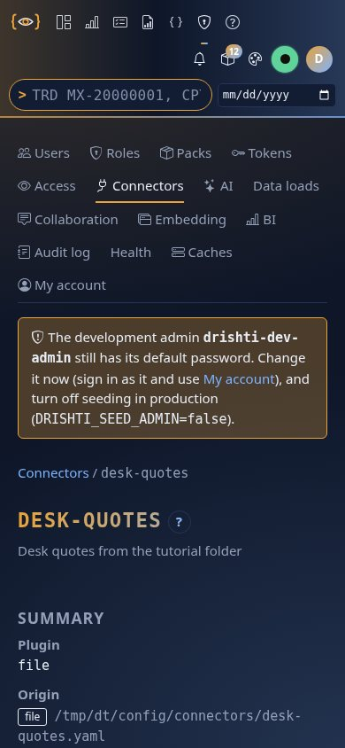

<!--
  Project Drishti · Any data. Any domain. One grammar.

  Copyright (c) 2026 Ashutosh Sinha <ajsinha@gmail.com>.
  All rights reserved.

  PROPRIETARY AND CONFIDENTIAL.

  This file is the confidential and proprietary property of Ashutosh Sinha.
  Unauthorised copying, use, modification, distribution or disclosure of this
  file, via any medium, is strictly prohibited except with the express prior
  written permission of the copyright holder.

  See the LICENSE file in the root of this repository for the full terms.
-->
# Tutorial 4 · Connect your data

A **connector** is one small YAML file that tells Drishti where a store of data is and how to read it. In this tutorial you connect a folder of JSON Lines files (a desk's end-of-day
quotes) with the shipped `file` plugin, use **Test connection**, read the connector's own page, and then see what a connector that cannot connect looks like: a PostgreSQL connector with TLS and
a pool size, aimed at a port where nothing listens, so it never touches a real database.

## Time to complete

About 30 minutes.

## Before you start

- [Tutorial 1](01-first-15-minutes.md) done, with the token for the command line (`DRISHTI_SERVER` and `DRISHTI_TOKEN` set). You sign in as the development administrator: connectors are an administrator's page.
- The sample data of this tutorial, in the repository: `docs/tutorials/data/desk-quotes/` (ten business days, one `quote.jsonl` of six quotes in each day's folder) and the two connector files
  in `docs/tutorials/data/connectors/`. Start the server from the repository root: the connector's `root` is relative to the folder the server runs in.

## What you will learn

- what a connector file holds, and that its **file name is the connector's name**;
- how to create one in the page (Form, YAML, Test, History tabs) and from the command line (`connector apply`);
- what **Test connection** reports, in words;
- the rule that a connector never holds a password, and what to write instead;
- TLS settings, the outbound proxy block, the connection pool, and the retry line of a connector that is down.

## Step 1 · Look at the data

```bash
ls docs/tutorials/data/desk-quotes | head -3
head -2 docs/tutorials/data/desk-quotes/2026-09-30/quote.jsonl
```

You should see folders named for business dates (`2026-09-17`, `2026-09-18`, ...), and two JSON documents: a quote with an `id` (`Q-EURUSD`), an `instrument`, a `bid`, `ask` and `mid`, a `venue` and an
`asOf` time. The `file` plugin reads exactly this layout: one folder for each business date, JSON Lines inside.

## Step 2 · Open Admin → Connectors

Choose **Admin**, then **Connectors**. Type `desk` in the filter box.



You should see every connector, one row each, with its origin (`file` means a file in the connector folder), plugin, kinds, state, which packs use it and when it last changed. Filtered by
`desk` there is one: `desk-totals`, which the trading pack suggests. (Without the filter you also see the stores of the packs with no lake built, running and retrying: that is normal.)

## Step 3 · Create the file connector

Press **New connector**. In the **Form** tab choose the plugin `file`, name it `desk-quotes`, describe it, set **root** to `./docs/tutorials/data/desk-quotes` and **lookback-days** to 60, and
add the kind `quote` (type it and press **Add kind**).



You should see a form generated from the plugin's own settings, grouped (connection, what it reads, tuning), each field with its description and the default as its hint. The **YAML** tab is the same draft as
text; leaving a tab carries the draft to the other. Now press **Test connection**.



You should see *Reachable: health UP* with the time it took, an amber note, and a table: kind `quote`, business dates `2026-09-30`, `2026-09-29`, `2026-09-28` and 6 rows each. The note says
`kind 'quote' is not owned by a loaded pack`: Drishti reads the data, but no pack yet knows what a quote *is*, so no screen exists for it. Tutorial 5 builds that pack. Test never changes what runs.
Press **Save**.



You should see `desk-quotes` in the list as origin `file`, plugin `file`, state `running`. The server applied it without a restart. On disk it is the file `config/connectors/desk-quotes.yaml`:

```yaml
plugin: file
kinds: [quote]
description: Desk quotes from the tutorial folder
settings:
  root: ./docs/tutorials/data/desk-quotes
  lookback-days: '60'
  rescan-seconds: '30'
```

Click the connector's name for its own page.



You should see its summary (plugin, where it is defined, whether it is switched on, its status and when the file changed), the kinds it serves, the settings in effect, the file as read-only text and the history of kept versions, with **Edit**, **Test connection**, **Disable** and **Delete** under the summary.

## Step 4 · The same from the command line

Everything the page does has a command. First, what the `file` plugin reads:

```text
$ python3 tools/drishti.py connector plugins file
plugin file
  setting            type        default             what it is
  -----------------  --------    ----------------    ------------------------------------------------------------------------------
  layout.*           string                          Per-kind promoted columns: layout.<kind>.columns: a, b, c
  root               path        <data dir>/feeds    Folder of documents; default: the feeds folder of the data directory
  domain             string                          Domain
  id-field           string                          Field holding the entity id
  rescan-seconds     int                             Rescan interval
  lookback-days      int                             Days of history to index
  max-load-rows      int                             Documents to load at most
  max-document-mb    int                             Largest document
  max-nesting-depth  int                             Deepest nesting
  index-cache-mb     int                             Index cache size
  source-name        string                          The name documents carry as their provenance (default: the connector's name)
  mode.*             string                          Per-kind read mode (mode.<kind>)
  stale-after        duration                        Mark the source stale when it has received nothing for this long (15m, 2h, 1d)
```

Delete the connector you just made (`python3 tools/drishti.py connector delete desk-quotes`) and make it from the file in the repository instead, **testing first**: `--test-first` starts a throwaway instance
and applies the file only if it works.

```text
$ python3 tools/drishti.py connector apply docs/tutorials/data/connectors/desk-quotes.yaml --test-first
applied desk-quotes: running; changed (new connector), root, lookback-days, rescan-seconds; version 205d5ca59094cc6c
  note kinds: kind 'quote' is not owned by a loaded pack (loaded: agreement, bond, book, branch, calendar, cap-vol-surface, card-account, ccp, and 88 more)
```

You should see `applied desk-quotes: running`, which settings changed, a version (the file's ETag), and the same note about the kind. `connector get` shows what is in effect and keeps the
file's text in its history:

```text
$ python3 tools/drishti.py connector get desk-quotes
connector desk-quotes   origin file   plugin file   running   version 205d5ca59094cc6c
  file ~/drishti/config/connectors/desk-quotes.yaml
  kinds quote
  settings (credentials masked):
  setting         value
  --------------  ---------------------------------
  root            ./docs/tutorials/data/desk-quotes
  lookback-days   60
  rescan-seconds  30
  1 earlier version(s) kept: `connector history desk-quotes`
```

And `connector test` is Test connection:

```text
$ python3 tools/drishti.py connector test desk-quotes
desk-quotes (file): reachable, health UP, 2 ms
  note: kinds: kind 'quote' is not owned by a loaded pack (loaded: agreement, bond, book, branch, calendar, cap-vol-surface, card-account, ccp, and 88 more)
  kind   business date  rows  note
  -----  -------------  ----  ----
  quote  2026-09-30     6
  quote  2026-09-29     6
  quote  2026-09-28     6
```

## Step 5 · A connector never holds a password

The second file, `desk-ledger-literal-password.yaml`, has `password: hunter2` in it. Apply it:

```text
$ python3 tools/drishti.py connector apply docs/tutorials/data/connectors/desk-ledger-literal-password.yaml
drishti: the server said 422 DRS-5031: DRS-5031 the connector is not valid: settings.password: a credential is never written into a connector file; use an environment reference such as ${PASSWORD} or a file: reference such as file:/run/secrets/password
[exit 1]
```

You should see the server refuse with `DRS-5031` before anything is written, and say what to use instead. A credential is always an environment reference, `password: ${DESK_LEDGER_PASSWORD}`, or a file
reference, `password: file:/run/secrets/desk-ledger-password`. The page refuses a literal too, in the form, before it sends anything. (If you set the environment variable on the server, a file with
the reference starts; an unset variable refuses the file and the last good one keeps running.)

## Step 6 · A connector that cannot connect: TLS, a pool, Test and retry

`desk-ledger.yaml` is a PostgreSQL connector (`jdbc` plugin) with `tls: enabled: true` and `pool-size: 5`, aimed at `127.0.0.1:59997`, where nothing listens. It is a stand-in for a database you do
not have, so it can fail safely. Test first:

```text
$ python3 tools/drishti.py connector apply docs/tutorials/data/connectors/desk-ledger.yaml --test-first
desk-ledger (jdbc): PROBLEM: DOWN: Connection to 127.0.0.1:59997 refused. Check that the hostname and port are correct and that the postmaster is accepting TCP/IP connections. (reconnecting)
  note: kinds: kind 'ledger-entry' is not owned by a loaded pack (loaded: agreement, bond, book, branch, calendar, cap-vol-surface, card-account, ccp, and 88 more)

not applied: the test failed
[exit 1]
```

You should see the test fail in words, with the reason, and `not applied: the test failed` (exit 1). The server itself explains: `Connection ... refused. Check that the hostname and port are correct`. Now apply
it anyway, as you would a connector for a database that is down for maintenance, and look at it:

```text
$ python3 tools/drishti.py connector apply docs/tutorials/data/connectors/desk-ledger.yaml
applied desk-ledger: running; changed (new connector), url, user, table, pool-size, pool-connection-timeout, tls.enabled; version fa9927d10e549f6a
  note kinds: kind 'ledger-entry' is not owned by a loaded pack (loaded: agreement, bond, book, branch, calendar, cap-vol-surface, card-account, ccp, and 88 more)
```



You should see the same words in the page's Test tab: a red problem line, `DOWN: Connection to 127.0.0.1:59997 refused`, and `reconnecting`. A connector that fails does not stop the server: it is
**retried** with a growing wait. Open its own page, the connector's name in the list.



You should see, in the summary: the status `running (DOWN)`, a **Retry** line (*failed: next retry in 5 s (attempt 1)*, the last error, and a **Retry now** button), the **Connection pool** line and
the **TLS** line. The pool line is the one to read when a database is slow:


It says how many of the pool's 5 connections are in use, idle, open and waiting, and how long the longest borrow has lasted. The pool size defaults to 20; this connector set 5 itself. A connection is
borrowed for one piece of work and handed back at once, and one held for over a minute is logged with the code that holds it. The same numbers are in Admin → Health. The TLS line says whether TLS is
on, which protocols it offers, whether the host name is checked, and when each certificate you configured expires. On a phone the page is one column:



The server's side of the same story, from the command line:

```text
$ python3 tools/drishti.py connector test desk-ledger
desk-ledger (jdbc): PROBLEM: DOWN: Connection to 127.0.0.1:59997 refused. Check that the hostname and port are correct and that the postmaster is accepting TCP/IP connections. (reconnecting)
  note: kinds: kind 'ledger-entry' is not owned by a loaded pack (loaded: agreement, bond, book, branch, calendar, cap-vol-surface, card-account, ccp, and 88 more)
[exit 1]
```

### The outbound proxy

A connector that speaks HTTP (`rest`, `feed`, the cloud stores) can go through a proxy. It is another block in `settings:`, shown as a **Proxy** section of the form; the password is an environment reference like any credential:

```yaml
settings:
  url: https://api.example.com/v1
  proxy:
    url: http://proxy.example.com:3128
    username: svc-drishti
    password: ${PROXY_PASSWORD}
    no-proxy: [localhost, .internal.example.com]
```

The page then shows the effective proxy, masked, and where it came from; **Test connection** goes through it and says so. [TLS.md (proxy)](../connectors/TLS.md#outbound-http-proxy-for-connectors-ai-providers-and-mcp-servers) is the reference.

## Step 7 · Look at all of it, then tidy up

```text
$ python3 tools/drishti.py connector list --origin file
24 connector(s) in ~/drishti/config/connectors   (watching: WATCHING)
  name              origin  plugin   kinds                                                   state           used by            problems
  ----------------  ------  -------  ------------------------------------------------------  --------------  -----------------  --------
  book-totals       file    derived  book-pnl                                                running
  civic-store       file    delta    jurisdiction,party,office-holder +3                     running (DOWN)  politics-society
  climate-store     file    delta    climate-profile,financed-emissions,climate-scenario +3  running (DOWN)  climate-risk
  collateral-store  file    delta    collateral-balance,margin-call,simm                     running         counterparty-risk
  credit-store      file    delta    netting-set,credit-limit,exposure-profile +2            running         counterparty-risk
  desk-ledger       file    jdbc     ledger-entry                                            running (DOWN)
  desk-quotes       file    file     quote                                                   running
  desk-totals       file    derived  desk-pnl                                                running         trading
  ecb-estr-feed     file    feed     rate-fixing                                             disabled        market-data
  ecb-fx-feed       file    feed     fx-spot                                                 disabled        market-data
  finance-lake      file    delta                                                            running (DOWN)
  fred-feed         file    feed     rate-fixing                                             disabled        market-data
  genomics-store    file    delta    gene,variant,protein +5                                 running (DOWN)  genomics
  liquidity-store   file    delta    lcr,nsfr,maturity-ladder +4                             running (DOWN)  liquidity-risk
  macro-store       file    delta    economy,macro-indicator,economic-forecast +3            running (DOWN)  economics
  market-store      file    delta    ir-curve,repo-curve,fx-spot +17                         running         market-data
  nyfed-sofr-feed   file    feed     rate-fixing                                             disabled        market-data
  oprisk-store      file    delta    loss-event,risk-control,key-risk-indicator +5           running (DOWN)  operational-risk
  reference-store   file    delta    counterparty,counterparty-group,issuer +9               running         banking-core
  retail-store      file    delta    customer,deposit-account,mortgage +5                    running (DOWN)  retail-banking
  risk-store        file    delta    var,stress-scenario,stress-result +2                    running         market-risk
  trading-store     file    delta    trade                                                   running         trading
  trading-stream    file    kafka    trade                                                   disabled        trading
  us-treasury-feed  file    feed     ir-curve                                                disabled        market-data
```

You should see one row for each connector, including `desk-quotes` running and, if you left it, `desk-ledger` failing. Every apply is kept in the connector's history, and `connector history` lists the
versions, which you can restore in the page's **History** tab or with the API:

```text
$ python3 tools/drishti.py connector history desk-quotes
  version             kept at                         bytes
  ------------------  ------------------------------  -----
  20261012T021556974  2026-10-12T02:15:56.974244006Z  221
```

Switch the ledger connector off, then delete it (a connector a pack uses asks first; one that is not used goes at once, its text kept in `.history`):

```text
$ python3 tools/drishti.py connector disable desk-ledger
desk-ledger is off (disabled)
```

```text
$ python3 tools/drishti.py connector delete desk-ledger
deleted desk-ledger (its text is kept in the connector folder's history/ folder)
```

Keep `desk-quotes`: tutorial 5 builds the pack that reads it.

## Next steps

- [Tutorial 5 · Build a pack from your data](05-build-a-pack.md) gives the `quote` kind a screen.
- [CONNECTOR_FILES.md](../connectors/CONNECTOR_FILES.md) is the reference, with an example for every store; [TLS.md](../connectors/TLS.md) the shared TLS settings;
  [POSTGRES_CONNECTOR.md](../connectors/POSTGRES_CONNECTOR.md) the real thing, with its own pool and a loader.
- To try a real PostgreSQL, start your own throwaway container and point a connector at it; never aim a tutorial at a database that matters.

## If something goes wrong

| You see | Meaning |
|---|---|
| `DRS-5031 ... not valid` | the file has a literal credential, a key that is not allowed, or bad YAML; the message names it |
| `DRS-5032` | the file changed since you read it (another editor), or a connector that packs use would be switched off: repeat with `--confirm` if you mean it |
| `DRS-5033` | no such connector |
| Test says `kind ... is not owned by a loaded pack` | the data is readable but no pack defines the kind; deploy one (tutorial 5) |
| Test says rows 0 | the `root` is wrong (the path is relative to where the server was started) or the date folders are outside `lookback-days` |
