<!--
  Project Drishti · Any data. Any domain. One grammar.

  Copyright (c) 2026 Ashutosh Sinha <ajsinha@gmail.com>.
  All rights reserved.

  PROPRIETARY AND CONFIDENTIAL.

  This file is the confidential and proprietary property of Ashutosh Sinha.
  Unauthorised copying, use, modification, distribution or disclosure of this
  file, via any medium, is strictly prohibited except with the express prior
  written permission of the copyright holder.

  See the LICENSE file in the root of this repository for the full terms.
-->
# Tutorial 5 · Build a pack from your data

A **pack** teaches Drishti about one kind of thing: what a desk quote is, which field is its id, how its screen looks, what each field means. In tutorial 4 you connected a folder
of desk quotes, but no pack knew what a desk quote is. Now you build that pack from a JSON Schema and the folder itself, check it, deploy it without a restart, roll it back, and
do the same from the command line with `pack make`.

## Time to complete

About 30 minutes.

## Before you start

- [Tutorial 4](04-connect-your-data.md) done: the connector `desk-quotes` exists and runs (check with `drishti-console/.venv/bin/python tools/drishti.py connector list --origin file`).
- Signed in as the development administrator. The server needs `DRISHTI_STUDIO_SAVE=true` (tutorial 1, Step 2), and deploying a pack needs the administrator.
- The console's Python (tutorial 1) for the command-line part: it has `deltalake` and `pyarrow`, which `pack make` uses to write its Delta store.
- The data: `docs/tutorials/data/schemas/desk-quote.schema.json` (a JSON Schema titled *Desk quote*, with a description for every field) and `docs/tutorials/data/desk-quotes/`
  (the ten day folders, one `desk-quote.jsonl` each).

## What you will learn

- what **Build → New pack** does with schemas and a folder, in five steps;
- how the schema's descriptions, enums and formats become labels, help text and the look of the screen;
- how to read the checks the server runs before it deploys, and what a deploy changes;
- how to roll a pack back, and what is kept for it;
- `pack make`, `pack verify`, `server packs deploy`, `history` and `rollback`.

## Step 1 · Bring the sources

Open **Build**, then **New pack**. Choose the file `desk-quote.schema.json`, then **Choose a folder** and pick `docs/tutorials/data/desk-quotes`.

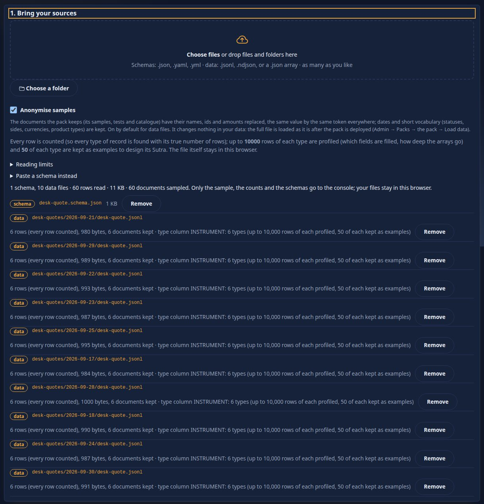

You should see the schema listed, then the ten `desk-quote.jsonl` files with their rows (6 each), sizes and *6 documents sampled*, and a total line: `1 schema, 10 data files, 60 rows read`. **Your files are
read in your browser**: a reservoir sample of each, with the counts and the schema, goes to the console, never the whole folder. Press **Next**.

## Step 2 · Read what was detected

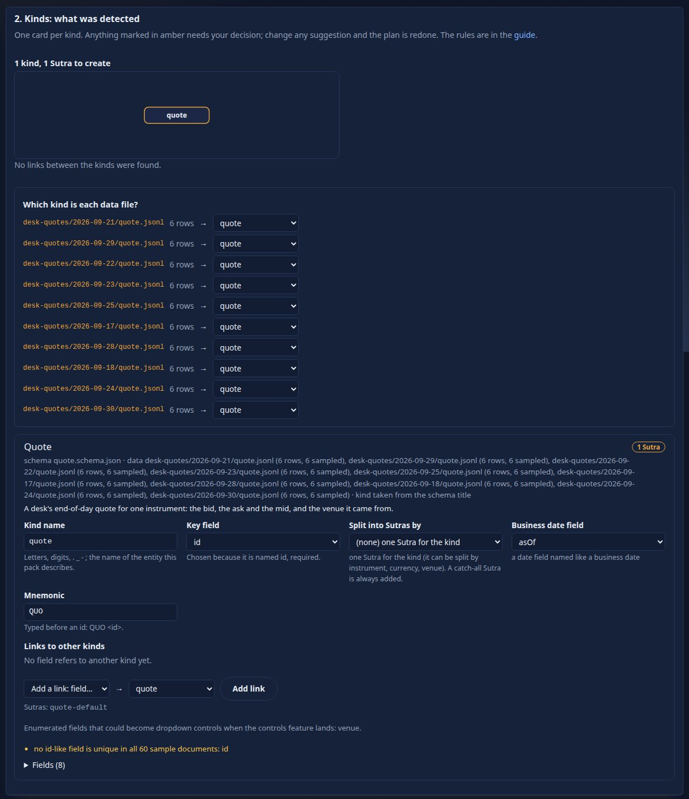

You should see one kind, **desk-quote** (named from the schema's title, *Desk quote*), with every data file matched to it (by its file name), and a card: **Key field** `ID`
(chosen because it is named id, and required), **Business date field** `AS_OF` (a date-time named like a business date), the **mnemonic** `DQ`, links to other kinds (none), and
the field list (8 fields). The amber line says `no id-like field is unique in all 60 sample documents: ID`. That is a heads-up, not an error: every day has a quote with the same
id, because each day is a snapshot of the same six instruments. Within one day `ID` is unique, and the business date separates the days.

The card is where you decide: rename the kind, pick another key, split into Sutras by a field (a Sutra is one screen layout) or add links. Every change redoes the plan. Had you
named the kind `quote`, the card would flag it: *another pack already defines it* (`news-and-markets`). Press **Next**.

## Step 3 · Name the pack

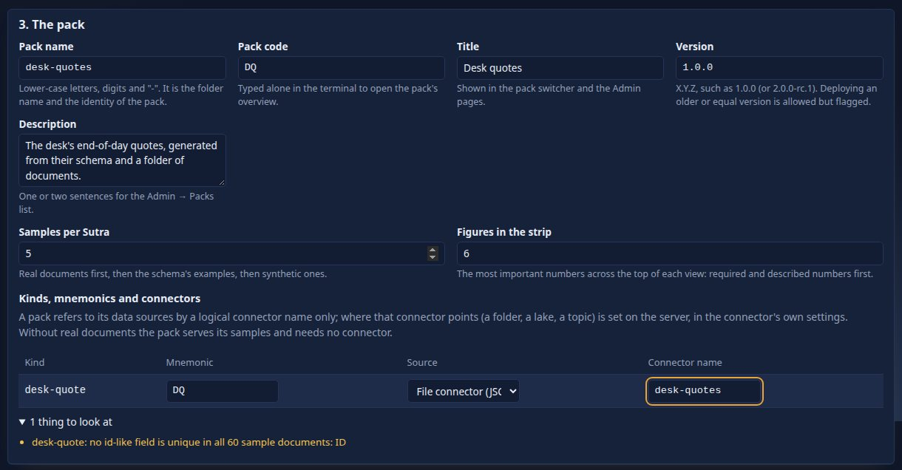

Set name `desk-quotes`, title `Desk quotes`, a description, leave the version `1.0.0` and set the code `DQP` (typed alone on the command line, `DQP` opens the pack's overview).
In the table of kinds set the **Source** of `desk-quote` to *File connector (JSON Lines per day)* and its **connector name** to `desk-quotes`: a pack refers to its data by a
logical connector name only, and that is the connector you made in tutorial 4. You should see the table read `desk-quote | DQ | File connector | desk-quotes`. Press **Next**.

## Step 4 · Preview every screen

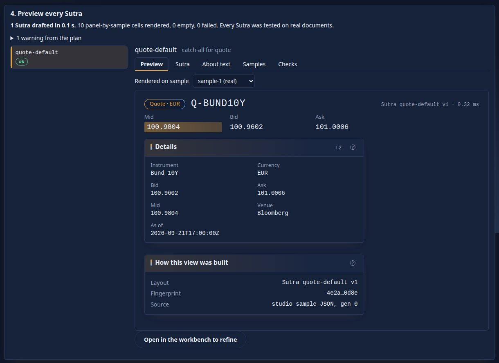

You should see the server draft the screen (a background job with a progress bar), then a list with one entry, `desk-quote-default`, badged *ok*, and its **Preview**: the real
view of a desk quote built from a real sample (`Q-BUND10Y` or another), with a strip of bid, ask and mid and a *Details* panel. The `df4` format on `BID`, `ASK` and `MID` is in the
schema (`x-drishti-format`), because a price of 1.0835 must not show as `1`. The tabs: **Sutra** is the YAML, **About text** is what *About this page* will say, **Samples** and
**Checks** show each panel against each sample.

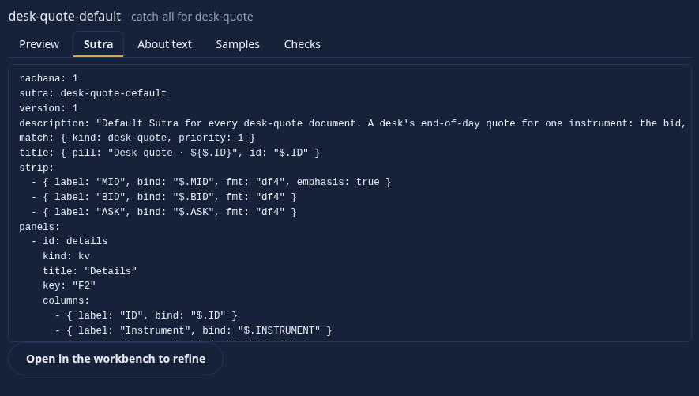

You should see the screen as text: a `match` (kind desk-quote), a `title`, a `strip` and a `kv` panel whose labels come from the schema, each bound to an UPPER_SNAKE path
(`bind: $.MID`). A Sutra is just a file; *Open in the workbench to refine* makes a design of it (tutorial 6).

## Step 5 · Output and deploy

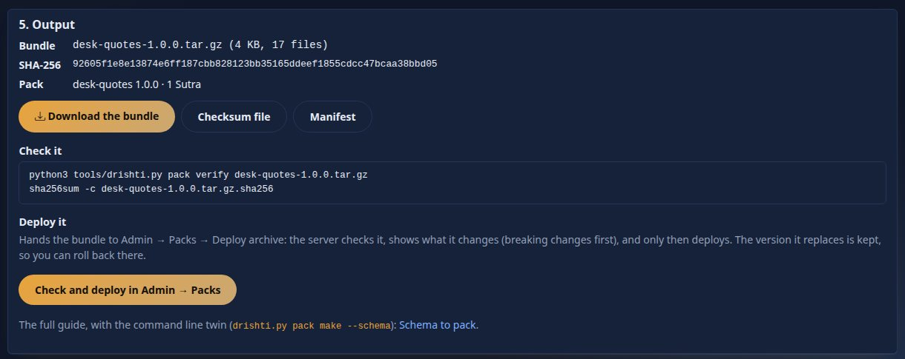

You should see the **bundle** `desk-quotes-1.0.0.tar.gz` with its SHA-256 and the command that verifies it (`drishti.py pack verify`). Press **Check and deploy in Admin → Packs**.

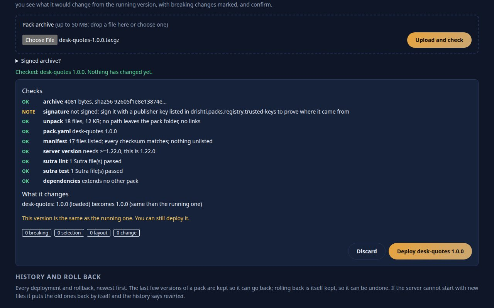

You should see the server unpack the archive and check it: checksum, unsigned (a note, not an error), no path leaves the pack folder, `pack.yaml`, every file listed and matching, the server version it
needs, `sutra lint` and `sutra test` passed, and the dependencies. Under **What it changes**: `desk-quotes 1.0.0 is a new pack: it is loaded when you deploy it`, with counters
for breaking, selection, layout and other changes (all 0 for a new pack). Press **Deploy desk-quotes 1.0.0** and confirm in the page's own dialog (the version must be X.Y.Z, as here).

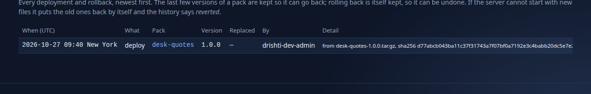

You should see, after a moment, a line in **History and roll back**: `deploy desk-quotes 1.0.0`. The pack is in use now, with no restart. Open one of its quotes:

```text
DQ Q-EURUSD <GO>
```

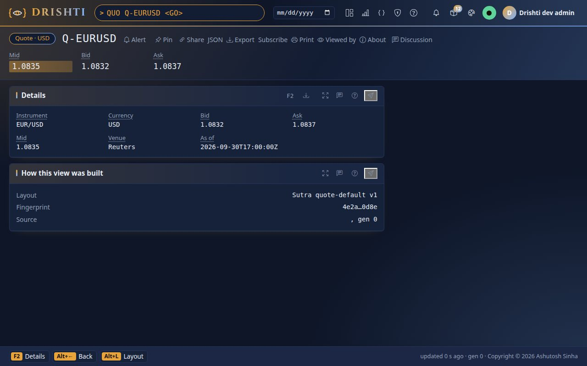

You should see the quote's view: `Q-EURUSD` with the title pill `Desk quote · Q-EURUSD`, the strip (mid, bid, ask), the panel of details (id, instrument, currency, bid, ask, mid, venue,
when it was struck). The panel *How this view was built* names the layout (`Sutra desk-quote-default v1`) and the source that served the view: `desk-quotes`, the connector of
tutorial 4. The figures are the ones of the desk's quotes of tutorial 4. Type `DQP` alone to see the pack at a glance.

If the deploy is refused with `DRS-5001 cannot load 'desk-quotes': kind quote is defined by both pack 'news-and-markets' and pack 'desk-quotes'`, the kind was left as `quote`:
the server puts the old files back by itself (the history says *reverted*); rename the kind in Step 2 and build again.

## Step 6 · Deploy again, and roll back

Build the pack a second time with the version `1.1.0` (it takes the same steps) and deploy it. Admin → Packs now keeps the version it replaced.

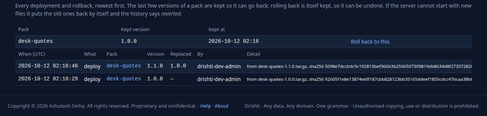

You should see a table **Versions kept for a rollback**: `desk-quotes 1.0.0`, with a **Roll back to this** button, above the history. Press it and confirm in the dialog. The running version is never offered here, and a version deployed twice is kept once.

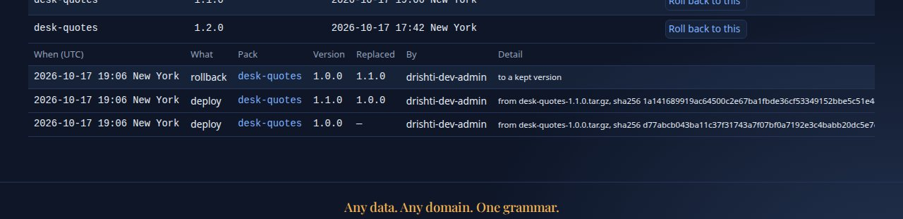

You should see a new line in the history, `rollback desk-quotes 1.0.0`, replacing `1.1.0`. A rollback is itself kept, so it can be undone. If a new version cannot be started the server puts the old
files back by itself, and the history says *reverted*.

**From the command line**, Steps 5 and 6 are `server packs deploy` and `server packs rollback` on the bundle the page downloaded (Step 7 shows both with real output).

## Step 7 · The same from the command line: `pack make`

Without the page: one command turns a folder of JSON Lines into one folder you can deploy: the pack, the data in a Delta Lake partitioned by business date, a checksummed bundle, a server
configuration and start scripts. `pack make` wants the ids in what it reads to be unique, so give it one day's file (later days are added with `data ingest`):

```text
$ drishti-console/.venv/bin/python tools/drishti.py pack make docs/tutorials/data/desk-quotes/2026-09-30/desk-quote.jsonl --kind desk-quote --match VENUE --name desk-quotes --version 1.2.0 --out build/desk-quotes
read 6 desk-quote document(s)
key:   ID  (named id, present and unique in all 6 documents)
date:  AS_OF  (date-valued, named like a business date, 1 distinct date(s))
6 documents, 1 kind(s), 2 group(s)
drafting 2 Sutra(s) with one `sutra design --each` run ...
kind            group                                          docs samples  sutra
desk-quote      VENUE=Reuters                                     6       5  desk-quote-reuters
desk-quote      (all)                                             6       5  desk-quote-default
  desk-quote 2026-09-30: 6 rows
kind                business date        rows
desk-quote          2026-09-30              6
total rows: 6
Dated store (delta): 6 rows written to build/desk-quotes/data/delta (domain desk-quotes); 0 document(s) without a date or id skipped
pack written to build/desk-quotes/pack/desk-quotes
sutra lint: exit 0
ok      build/desk-quotes/pack/desk-quotes/sutras/desk-quote/desk-quote-default.v1.sutra.yaml
ok      build/desk-quotes/pack/desk-quotes/sutras/desk-quote/desk-quote-reuters.v1.sutra.yaml
sutra test: exit 0
     desk-quote-default: help coverage 7/7 (100%)
ok   build/desk-quotes/pack/desk-quotes/sutras/desk-quote/desk-quote-default.v1.sutra.yaml (5 samples)
     desk-quote-reuters: help coverage 7/7 (100%)
ok   build/desk-quotes/pack/desk-quotes/sutras/desk-quote/desk-quote-reuters.v1.sutra.yaml (5 samples)

== pack check
== desk-quotes: sutra lint: exit 0
ok      build/desk-quotes/pack/desk-quotes/sutras/desk-quote/desk-quote-default.v1.sutra.yaml
ok      build/desk-quotes/pack/desk-quotes/sutras/desk-quote/desk-quote-reuters.v1.sutra.yaml
== desk-quotes: sutra test: exit 0
     desk-quote-default: help coverage 7/7 (100%)
ok   build/desk-quotes/pack/desk-quotes/sutras/desk-quote/desk-quote-default.v1.sutra.yaml (5 samples)
     desk-quote-reuters: help coverage 7/7 (100%)
ok   build/desk-quotes/pack/desk-quotes/sutras/desk-quote/desk-quote-reuters.v1.sutra.yaml (5 samples)

== pack bundle
bundled desk-quotes 1.2.0: 19 files
  build/desk-quotes/bundle/desk-quotes-1.2.0.tar.gz
  sha256 2ef97e13fb4c877ccacb3e784fac0e9155de9035db937dd793283c5a42940d5c

== pack verify
verify build/desk-quotes/bundle/desk-quotes-1.2.0.tar.gz: desk-quotes 1.2.0
  checksums ok
  schema    ok
  server    ok
  sutra     ok
verified

pack make: build/desk-quotes
  2 Sutra group(s) for 6 desk-quote document(s), 1 date(s) in data/delta; pack check passed, pack verify passed
next: read build/desk-quotes/README.txt; for a new server  DRISHTI_JAR=<exec jar> DRISHTI_PORT=18480 build/desk-quotes/run-server.sh; on a running one, copy build/desk-quotes/pack/desk-quotes into its ...
```

You should see it choose the key and the date and say why, one Sutra for each venue (Reuters has one of its own, plus a catch-all), then run `pack check` and `pack verify` and finish with
`pack check passed, pack verify passed`. (`pack make` reads the data only, not the schema: its Sutras show the prices with the default number format. The page of Steps 1 to 5 reads the
schema's `x-drishti-format: df4` too.) This is the folder it made:

```text
$ find build/desk-quotes -maxdepth 3
build/desk-quotes
build/desk-quotes/bundle
build/desk-quotes/bundle/desk-quotes-1.2.0.manifest.json
build/desk-quotes/bundle/desk-quotes-1.2.0.tar.gz
build/desk-quotes/bundle/desk-quotes-1.2.0.tar.gz.sha256
build/desk-quotes/config
build/desk-quotes/config/drishti-site.yaml
build/desk-quotes/data
build/desk-quotes/data/delta
build/desk-quotes/data/delta/desk-quotes
build/desk-quotes/MANIFEST.json
build/desk-quotes/pack
build/desk-quotes/pack/desk-quotes
build/desk-quotes/pack/desk-quotes/config
build/desk-quotes/pack/desk-quotes/generated
build/desk-quotes/pack/desk-quotes/pack.yaml
build/desk-quotes/pack/desk-quotes/README.md
build/desk-quotes/pack/desk-quotes/samples
build/desk-quotes/pack/desk-quotes/sutras
build/desk-quotes/pack/desk-quotes/tests
build/desk-quotes/README.txt
build/desk-quotes/run-server.ps1
build/desk-quotes/run-server.sh
```

The pack it made, `build/desk-quotes/pack/desk-quotes/pack.yaml`, names the kind, its mnemonic and the columns a search shows, and routes the kind to its own Delta store:

```yaml
pack: desk-quotes
version: 1.2.0
code: DQ
kinds:
- desk-quote
mnemonics:
  DQ:
    kind: desk-quote
    label: Desk quote
columns:
  desk-quote: [INSTRUMENT, CURRENCY, BID, ASK, MID, VENUE, AS_OF]
connectors:
- desk-quotes-store
routes:
  desk-quote: desk-quotes-store
```

On this server that store reads `<data>/delta/desk-quotes`, which is empty until you copy `build/desk-quotes/data/delta/desk-quotes` there (Admin → Health then lists
`desk-quotes-store` as `DOWN: cannot reach ...`); the quotes keep being served by the `desk-quotes` connector of tutorial 4, which serves the same kind.

Verify the bundle, as a colleague would before deploying it:

```text
$ drishti-console/.venv/bin/python tools/drishti.py pack verify build/desk-quotes/bundle/desk-quotes-1.2.0.tar.gz
verify build/desk-quotes/bundle/desk-quotes-1.2.0.tar.gz: desk-quotes 1.2.0
  checksums ok
  schema    ok
  server    ok
  sutra     ok
verified
```

Ask the server what a deploy would do, without doing it (`--preview` discards the upload):

```text
$ drishti-console/.venv/bin/python tools/drishti.py server packs deploy build/desk-quotes/bundle/desk-quotes-1.2.0.tar.gz --preview
archive desk-quotes-1.2.0.tar.gz (4559 bytes, sha256 2ef97e13fb4c877c...)
  ok    archive         4559 bytes, sha256 2ef97e13fb4c877c...
  ok    checksum        matches the sha256 you gave
  warn  signature       not signed; sign it with a publisher key listed in drishti.packs.registry.trusted-keys to prove where it came from
  ok    unpack          20 files, 16 KB; no path leaves the pack folder, no links
  ok    pack.yaml       desk-quotes 1.2.0
  ok    manifest        19 files listed; every checksum matches; nothing unlisted
  ok    server version  needs >=2.2.0, this is 2.6.7
  ok    sutra lint      2 Sutra file(s) passed
  ok    sutra test      2 Sutra file(s) passed
  ok    dependencies    extends no other pack

Preview: desk-quotes 1.0.0 (loaded) -> 1.2.0 (newer)
  CHANGE (1)
    version                    desk-quotes   1.0.0 -> 1.2.0
  summary: 1 change

preview only: nothing was deployed
```

You should see the checks again and a **Preview** that says `desk-quotes 1.0.0 (loaded) -> 1.2.0 (newer)` with the changes counted. (This output was captured with a 1.0.0 that
was itself made by `pack make`, so only the version differs; after the page's 1.0.0 the preview also lists `sutra added desk-quote-reuters` under SELECTION and the changed
Sutra and glossary under CHANGE.) Then deploy it for real, look at the history, roll back and look again:

```text
$ drishti-console/.venv/bin/python tools/drishti.py server packs deploy build/desk-quotes/bundle/desk-quotes-1.2.0.tar.gz
archive desk-quotes-1.2.0.tar.gz (4559 bytes, sha256 2ef97e13fb4c877c...)
  ok    archive         4559 bytes, sha256 2ef97e13fb4c877c...
  ok    checksum        matches the sha256 you gave
  warn  signature       not signed; sign it with a publisher key listed in drishti.packs.registry.trusted-keys to prove where it came from
  ok    unpack          20 files, 16 KB; no path leaves the pack folder, no links
  ok    pack.yaml       desk-quotes 1.2.0
  ok    manifest        19 files listed; every checksum matches; nothing unlisted
  ok    server version  needs >=2.2.0, this is 2.6.7
  ok    sutra lint      2 Sutra file(s) passed
  ok    sutra test      2 Sutra file(s) passed
  ok    dependencies    extends no other pack

Preview: desk-quotes 1.0.0 (loaded) -> 1.2.0 (newer)
  CHANGE (1)
    version                    desk-quotes   1.0.0 -> 1.2.0
  summary: 1 change

deployed desk-quotes 1.2.0 (replacing 1.0.0): Applied now; no restart.
```

```text
$ drishti-console/.venv/bin/python tools/drishti.py server packs history --pack desk-quotes --limit 6
  when (UTC)           action    pack         version  replaced  by
  -------------------  --------  -----------  -------  --------  -----------------
  2026-10-17 21:42:46  deploy    desk-quotes  1.2.0    1.0.0     drishti-dev-admin
  2026-10-17 21:41:43  rollback  desk-quotes  1.0.0    1.1.0     drishti-dev-admin
  2026-10-17 21:41:43  deploy    desk-quotes  1.1.0    1.0.0     drishti-dev-admin
  2026-10-17 21:41:01  deploy    desk-quotes  1.0.0              drishti-dev-admin
  kept for rollback, desk-quotes: 1.0.0, 1.1.0
```

```text
$ drishti-console/.venv/bin/python tools/drishti.py server packs rollback desk-quotes --version 1.0.0
rolled desk-quotes back to 1.0.0 (replacing 1.2.0): Applied now; no restart.
```

```text
$ drishti-console/.venv/bin/python tools/drishti.py server packs history --pack desk-quotes --limit 3
  when (UTC)           action    pack         version  replaced  by
  -------------------  --------  -----------  -------  --------  -----------------
  2026-10-17 21:42:47  rollback  desk-quotes  1.0.0    1.2.0     drishti-dev-admin
  2026-10-17 21:42:46  deploy    desk-quotes  1.2.0    1.0.0     drishti-dev-admin
  2026-10-17 21:41:43  rollback  desk-quotes  1.0.0    1.1.0     drishti-dev-admin
  kept for rollback, desk-quotes: 1.2.0, 1.1.0
```

You should see the rollback recorded and the pack back at `1.0.0`. A **breaking** change (a kind or mnemonic removed or renamed) makes `deploy` stop with exit 1 until you add `--accept-breaking`.

## Next steps

- [Tutorial 6 · Design a screen](06-design-a-screen.md) improves the screen the wizard drafted.
- [DATA_GUIDE.md](../guides/DATA_GUIDE.md#5-schema-to-pack-generate-a-pack-from-json-schema) lists every rule (keys, links, formats, enums, splitting a kind); [CLI_GUIDE.md](../guides/CLI_GUIDE.md) the commands; [PACK_DEVELOPER_GUIDE.md](../guides/PACK_DEVELOPER_GUIDE.md)
  how a pack is laid out; [OPERATIONALISING.md](../guides/OPERATIONALISING.md) how to promote a pack between servers.
- Tutorial 7 tells Drishti when a day's data lands, so the pack's screens refresh.

## If something goes wrong

| You see | Meaning |
|---|---|
| the amber `no id-like field is unique` | your ids repeat across days; with a business-date field that is correct. If the ids should be unique, pick another key in the card |
| a kind flagged *another pack already defines it*, or `DRS-5001 ... kind quote is defined by both pack ...` | rename your kind in the card (`desk-quote`): two packs cannot own one kind |
| the deploy checks show a red line | read it: a checksum, a `pack.yaml` problem or a Sutra that fails its tests; the pack is not deployed |
| `DQ` does not open anything | the pack is not loaded: look at Admin → Packs; and the connector must run (tutorial 4) |
| `pack make` says no unique key | pass `--key FIELD`, or give it one day's file |
