<!--
  Project Drishti · Any data. Any domain. One grammar.

  Copyright (c) 2026 Ashutosh Sinha <ajsinha@gmail.com>.
  All rights reserved.

  PROPRIETARY AND CONFIDENTIAL.

  This file is the confidential and proprietary property of Ashutosh Sinha.
  Unauthorised copying, use, modification, distribution or disclosure of this
  file, via any medium, is strictly prohibited except with the express prior
  written permission of the copyright holder.

  See the LICENSE file in the root of this repository for the full terms.
-->
# Tutorial 6 · Design a screen: in the workbench and on a live page

A screen in Drishti is a **Sutra**: a small YAML file that says which entities it applies to and what to show. There are two ways to make one, and this
tutorial does both on real data:

- **Part A, the Build workbench** (steps 1 to 8): a screen built from your own sample documents, with a live preview. You design a desk screen with a
  strip of key figures, **tabs that each hold two panels** (a currency's totals and its trades), a **slider** that narrows the trades by size, the text
  behind **About this page** and a **map**, see the column filters every table has, and check the Sutra from the command line.
- **Part B, the Sutra designer** (steps 9 to 15): an existing page changed in plain words, on the real page with real data. You take a book's trades
  page and make it a desk: a click on a trade opens the counterparty's credit limits beside the table, the trades refresh every 30 seconds with a pause
  button, and people may edit a trade in a form beside the table and start a new one in a drawer. Then you build the same screen from one line with
  **Describe**, and look at it in **Outline** and **Grid**.

Each step shows the UI, the command line where there is one, and the YAML. The references are
[RACHANA_REFERENCE.md › Screen designer and the Build workbench](../guides/RACHANA_REFERENCE.md#screen-designer-and-the-build-workbench) and its
[section 31, the Sutra designer](../guides/RACHANA_REFERENCE.md#31-the-sutra-designer-customize-describe-outline-and-grid); the grammar behind Part B is
[RACHANA_REFERENCE.md](../guides/RACHANA_REFERENCE.md#sutra-next-fragments-events-children-sources-layout-and-forms).

## Time to complete

About 75 minutes: 40 for Part A, 35 for Part B. Each part stands alone.

## Before you start

- [Tutorial 1](01-first-15-minutes.md) done: a running server and console with the `trading`, `core` and `counterparty-risk` packs (all on by default)
  and the demo lakes (`drishti.py lake demo`), signed in. Anyone may design; saving a Sutra for everyone needs an author and a reviewer, which this
  tutorial does not do.
- **Part A**: the server started with `DRISHTI_STUDIO_SAVE=true`. The data: three desk documents in `docs/tutorials/data/desks/` (`desk-rates.json`,
  `desk-fx.json`, `desk-credit.json`: each a desk with its currencies and their trades), and the Sutra itself, `docs/tutorials/data/desk-book.sutra.yaml`.
  The fields are UPPER_SNAKE (`DESK_ID`, `REGION`, `MTM`, `CURRENCIES[].TRADES[].NOTIONAL`), as production data is. For the command-line checks: the
  console's Python (tutorial 1); `sutra lint` and `sutra preview` run the server jar's Sutra tool locally, with no server needed.
- **Part B**: the designer switched on. It is off by default; in the console's `config/application.yaml` set `ui.designer: true`, or start the console
  with `DRISHTI_UI_DESIGNER=true` ([CONFIGURATION.md](../admin/CONFIGURATION.md)), and restart the console. Off, there is no **Customize** button and
  `/designer/*` answers 404. For its command-line steps: a token, `DRISHTI_SERVER=http://localhost:18480` and `DRISHTI_TOKEN=...` (My account → API
  tokens; [CLI_REFERENCE.md](../guides/CLI_REFERENCE.md#3-connecting-to-a-server-url-tokens-and-permissions)), and `B=$DRISHTI_SERVER/api/v1` for `curl`.
  Nothing you do there changes the pack's screen: the designer keeps **your own design**, which only you see until you share it.

**Where this data comes from.** The country pages of the map step are the `world-economy` pack's, published data from the World Bank (CC BY 4.0), UNDP (CC BY 3.0 IGO) and the CIA World Factbook (public domain), plus IMF forecasts that are **internal only**, fetched by `drishti.py feed run world-economy`. Each source, its licence and how to refresh it: [External data](../guides/EXTERNAL_DATA.md).

## What you will learn

- how to start a design from documents, and what the auto-design gives you;
- the parts of a Sutra: `match`, `title`, `strip`, `controls`, `panels`;
- a `tabs` panel with several panels inside each tab, and a **slider** that filters what is inside;
- column filters and phone width;
- the *About this page* text and glossary, and where it is written;
- the **`map`** panel: a country highlighted, its regions, a click that opens the country's page;
- `sutra lint` and `sutra preview` from the command line;
- how **Customize** moves, hides and adds panels on a live page, and what it writes;
- how to say what a click on a row opens: **a linked record** from another pack;
- how to make a panel **refresh**, and how readers pause it and read its freshness;
- how to **let people edit** a table's records, and where their drafts go;
- how **Describe** builds the same screen from one line, and how **Outline** and **Grid** show it;
- how to find, check and reset your page from the command line.

## Part A · The Build workbench: a screen from your own documents

## Step 1 · Bring your documents

Choose **Build**, then **New screen**. Choose the three desk files, name the design `Desk book` and give it the kind `desk`.

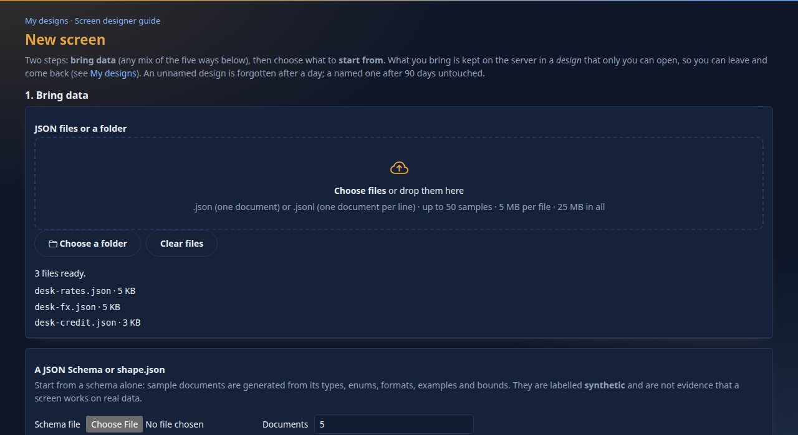

You should see `3 files ready.`, the name and the kind filled in, and the start choices (auto-design on). Press **Create**.

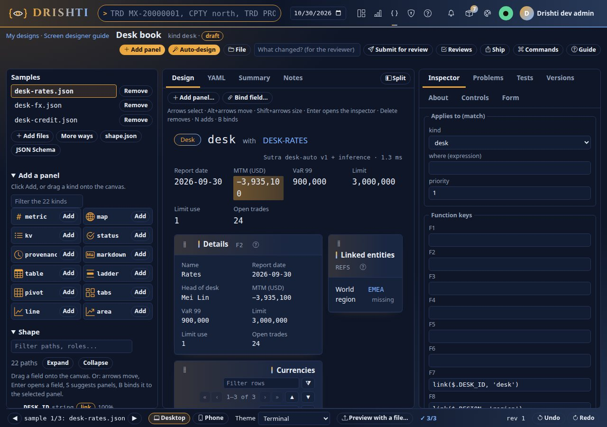

You should see the workbench: your files as **Samples** on the left (switch between them with the arrows at the bottom), the **Design** canvas in the middle with a first draft the auto-designer made
(a title, a strip of the document's figures, a *Details* panel, a *Currencies* table), and the **Inspector** on the right. The first draft is a start: its figures show as raw values
(`LIMIT_USE` as `0.58`, not `58%`), and the currencies are a plain table. Next you replace it with a designed one.

## Step 2 · Read the Sutra, and replace it

Open the **YAML** tab. Select everything, and paste the contents of `docs/tutorials/data/desk-book.sutra.yaml`.

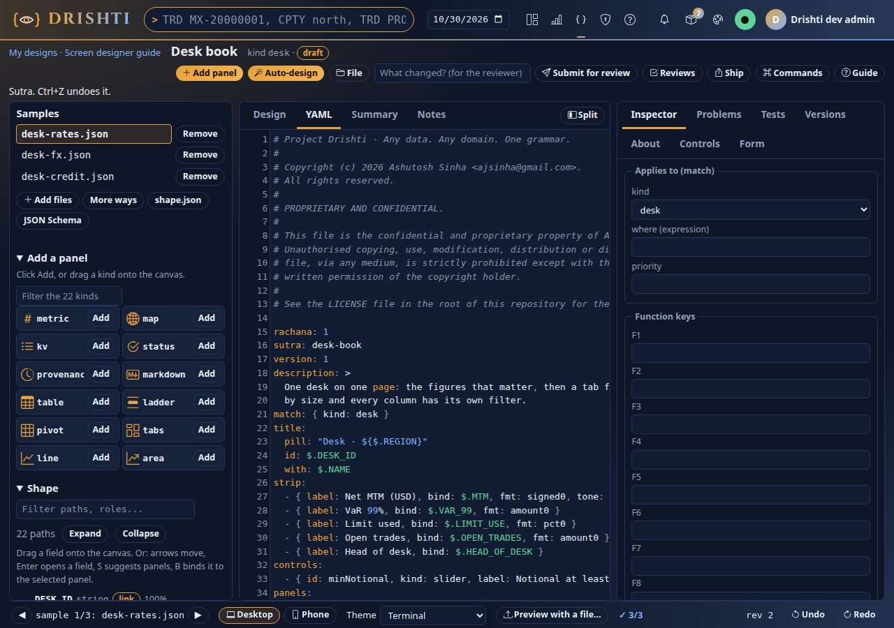

You should see the Sutra in the editor. Read it from the top:

- `match: { kind: desk }`: it applies to every document of the kind `desk`.
- `title`: a pill (`Desk · ${$.REGION}`), the id (`$.DESK_ID`) and the desk's name (`$.NAME`).
- `strip`: five key figures, each a label, a path into the document (`bind: $.MTM`) and a format (`signed0`, `pct0`); `tone: sign` colours a number by its sign.
- `controls`: one control, a slider called `minNotional`.
- `panels`: one `tabs` panel; `each: $.CURRENCIES` makes one tab for each currency, named by `tabTitle: "@.CODE"`, and `panels:` lists what each tab holds. Inside a tab `@` is that currency.
  The second panel's `where: "@.NOTIONAL >= ctl.minNotional"` keeps the trades at least as big as the slider says.

The top of the file, as you pasted it:

```yaml
match: { kind: desk }
title:
  pill: "Desk · ${$.REGION}"
  id: $.DESK_ID
  with: $.NAME
strip:
  - { label: Net MTM (USD), bind: $.MTM, fmt: signed0, tone: sign, emphasis: true }
  - { label: VaR 99%, bind: $.VAR_99, fmt: amount0 }
  - { label: Limit used, bind: $.LIMIT_USE, fmt: pct0 }
  - { label: Open trades, bind: $.OPEN_TRADES, fmt: amount0 }
  - { label: Head of desk, bind: $.HEAD_OF_DESK }
controls:
  - { id: minNotional, kind: slider, label: Notional at least, min: 0, max: 250000000, step: 25000000, placement: strip }
```

Click the **Design** tab.

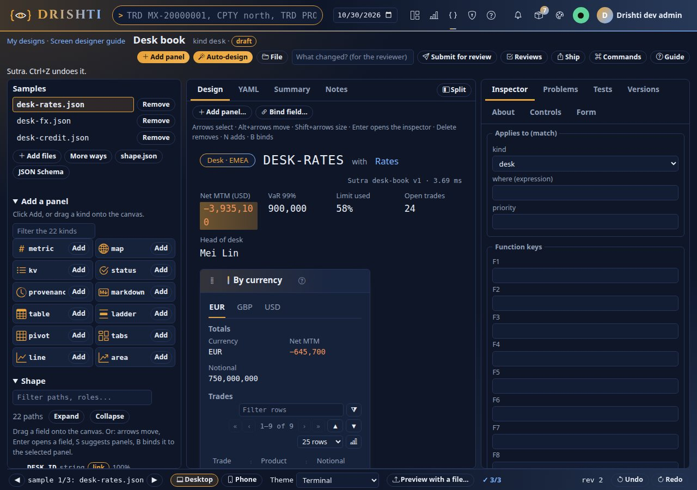

You should see `Desk · EMEA` and `DESK-RATES`, the strip, and a panel **By currency** with three tabs, `EUR`, `GBP`, `USD`. The selected tab holds two panels: **Totals** (currency, net MTM
coloured by sign, notional) and **Trades**, a table with a **Filter rows** box and paging. Click another tab, and switch sample with the arrow at the bottom: the tabs follow the data, however many currencies a desk has.
The panel is narrower than the canvas: **drag its edges** or press `Shift+→` on it to resize, `Alt+arrows` to move it.

## Step 3 · The slider

Open the **Controls** tab. The slider you wrote is there, as a card you can edit: its label, **Min** `0`, **Max** `250000000`, **Step** `25000000`, whether it has two handles (a range) and where it sits
(`strip`, `header` or `side`).

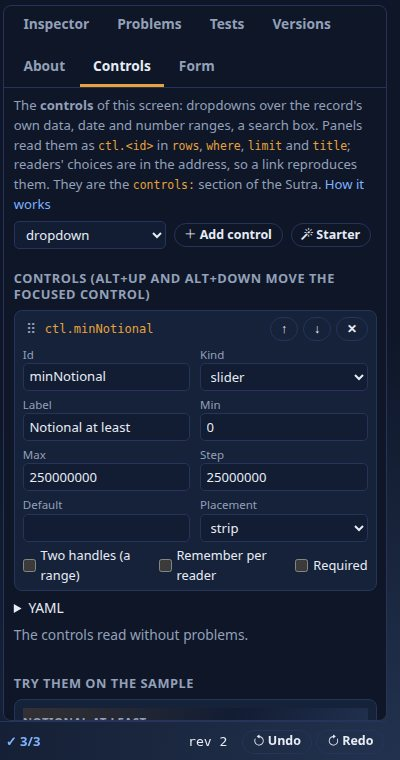

You should see the card and `The controls read without problems.` Scroll to **Try them on the sample** and drag the slider (or focus it and press `→` for one step).

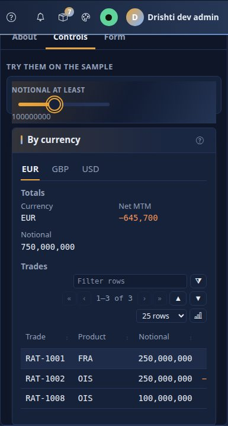

You should see the label `Notional at least`, the handle and its value, and the trades table shrink: with the handle at 100,000,000 only 3 of the 9 EUR trades are left
(GBP keeps 3 of 6, USD 2 of 9). A reader on the live screen gets the
same slider, and what they choose is in the page's address, so a link reproduces it. Keys: `←` `→` one step, `PageUp` `PageDown` ten, `Home` `End` the ends; on a phone the handle is 44 pixels. A slider
with `range: true` has two handles and gives `from..to`.

## Step 4 · Column filters, and the phone

Every table in Drishti has a funnel on each column heading, like a spreadsheet. The workbench preview is a sketch, so look at one on a live view: open `TRD MX-20000001`, find the
**Events** table (the trade's booking events and cash settlements, leg by leg) and click the funnel in the **Amount** heading.

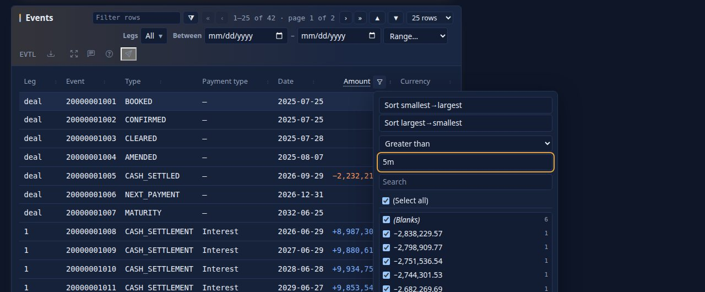

You should see a menu with two sort buttons, a **condition** (equals, greater than, between, top 10 ...) with its value box, a search box over the column's values and the list of values with tick boxes, and **OK**, **Cancel** and **Clear**. Choose *Greater than*, type `5m` and press **OK**: only the settlements above 5 million stay (`+8,987,301.85` on 2026-06-29 is one), and the funnel on the heading is filled in. The table's own **Legs** and **Between** controls, in the panel's header, narrow it too. A tick-box list works for text, a date condition for dates. [USER_GUIDE.md › Filter a table like Excel](../guides/USER_GUIDE.md#filter-a-table-like-excel) has them all.

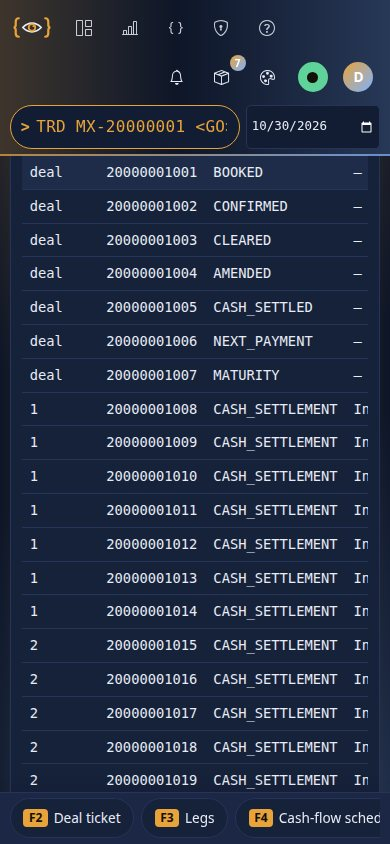

You should see the same table on a phone, one column, with 44-pixel targets. In the workbench use the **Phone** button at the bottom to see your own screen that way before you propose it.

## Step 5 · Check it

The Problems tab lists everything wrong; the Tests tab checks every sample.

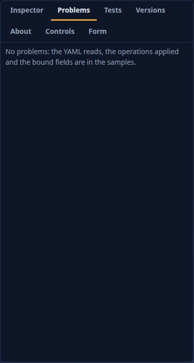

You should see `No problems: the YAML reads, the operations applied and the bound fields are in the samples.` Introduce a mistake (change `kind: tabs` to `kind: tab`) and the tab names the line and the
reason, with the code (`DRS-2021 unknown panel kind`). Undo with `Ctrl+Z`.

The command line runs the same checks, which is what a CI job would do. Put the Sutra and one document side by side and lint it:

```bash
mkdir -p desk-test && cp docs/tutorials/data/desk-book.sutra.yaml desk-test/
cp docs/tutorials/data/desks/desk-rates.json desk-test/desk-book.json
drishti-console/.venv/bin/python tools/drishti.py sutra lint desk-test/desk-book.sutra.yaml
```

```text
$ drishti-console/.venv/bin/python tools/drishti.py sutra lint desk-test/desk-book.sutra.yaml
ok      desk-test/desk-book.sutra.yaml
desk-test/desk-book.sutra.yaml:15 warning DRS-2047 field 'MTM' is shown but has no glossary entry (kinds.desk.glossary in config/about.yaml, or a vocabulary entry)
desk-test/desk-book.sutra.yaml:15 warning DRS-2047 field 'VAR_99' is shown but has no glossary entry (kinds.desk.glossary in config/about.yaml, or a vocabulary entry)
...
[exit 0]
```

You should see `ok desk-test/desk-book.sutra.yaml` and a list of warnings, one per field the screen shows, `DRS-2047 field 'MTM' is shown but has no glossary entry`: the screen works, but nothing yet says what its fields mean. (Lint is quiet by
default about help text: exit 0; `--strict` makes these warnings fail the run.)

```text
$ drishti-console/.venv/bin/python tools/drishti.py sutra lint --strict desk-test/desk-book.sutra.yaml
ok      desk-test/desk-book.sutra.yaml
desk-test/desk-book.sutra.yaml:15 warning DRS-2047 field 'MTM' is shown but has no glossary entry (kinds.desk.glossary in config/about.yaml, or a vocabulary entry)
desk-test/desk-book.sutra.yaml:15 warning DRS-2047 field 'VAR_99' is shown but has no glossary entry (kinds.desk.glossary in config/about.yaml, or a vocabulary entry)
desk-test/desk-book.sutra.yaml:15 warning DRS-2047 field 'LIMIT_USE' is shown but has no glossary entry (kinds.desk.glossary in config/about.yaml, or a vocabulary entry)
desk-test/desk-book.sutra.yaml:15 warning DRS-2047 field 'OPEN_TRADES' is shown but has no glossary entry (kinds.desk.glossary in config/about.yaml, or a vocabulary entry)
desk-test/desk-book.sutra.yaml:15 warning DRS-2047 field 'HEAD_OF_DESK' is shown but has no glossary entry (kinds.desk.glossary in config/about.yaml, or a vocabulary entry)
desk-test/desk-book.sutra.yaml:15 warning DRS-2047 field 'CODE' is shown but has no glossary entry (kinds.desk.glossary in config/about.yaml, or a vocabulary entry)
desk-test/desk-book.sutra.yaml:15 warning DRS-2047 field 'NET_MTM' is shown but has no glossary entry (kinds.desk.glossary in config/about.yaml, or a vocabulary entry)
desk-test/desk-book.sutra.yaml:15 warning DRS-2047 field 'NOTIONAL' is shown but has no glossary entry (kinds.desk.glossary in config/about.yaml, or a vocabulary entry)
desk-test/desk-book.sutra.yaml:15 warning DRS-2047 field 'TRADES.ID' is shown but has no glossary entry (kinds.desk.glossary in config/about.yaml, or a vocabulary entry)
desk-test/desk-book.sutra.yaml:15 warning DRS-2047 field 'TRADES.PRODUCT' is shown but has no glossary entry (kinds.desk.glossary in config/about.yaml, or a vocabulary entry)
desk-test/desk-book.sutra.yaml:15 warning DRS-2047 field 'TRADES.NOTIONAL' is shown but has no glossary entry (kinds.desk.glossary in config/about.yaml, or a vocabulary entry)
desk-test/desk-book.sutra.yaml:15 warning DRS-2047 field 'TRADES.MTM' is shown but has no glossary entry (kinds.desk.glossary in config/about.yaml, or a vocabulary entry)
desk-test/desk-book.sutra.yaml:15 warning DRS-2047 field 'TRADES.MATURITY' is shown but has no glossary entry (kinds.desk.glossary in config/about.yaml, or a vocabulary entry)
[exit 1]
```

`preview` renders every sample and reports panels in error:

```text
$ drishti-console/.venv/bin/python tools/drishti.py sutra preview desk-test/desk-book.sutra.yaml
desk-book / desk-book.json: 1 panels, 0 in error
```

You should see `1 panels, 0 in error`.

## Step 6 · About this page

The warnings point to the *About this page* text: press `?` on any view.

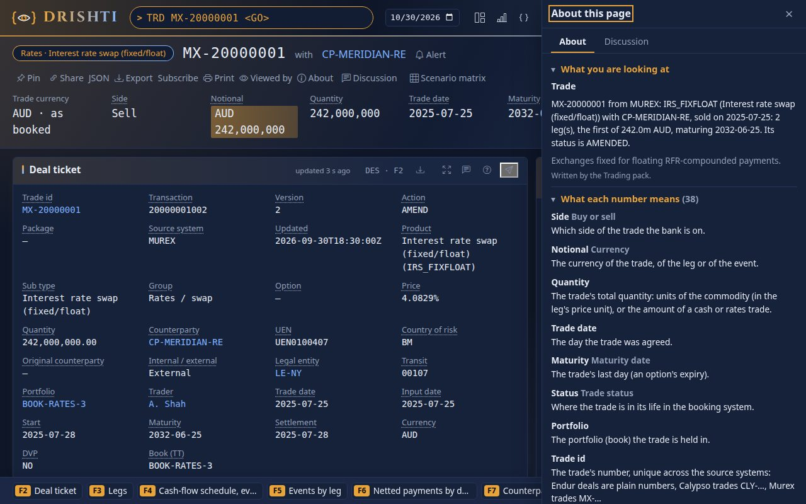

You should see a drawer with the page's text, a line for each panel, a glossary (term, meaning, unit) of the fields you can see, where the data came from and why this layout was chosen. Your Sutra's
`description` and each panel's `description` fill it; the glossary and the page text are the pack's `config/about.yaml`. In the workbench, open the **About** tab and press **Starter**.

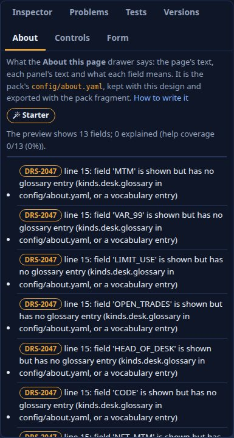

You should see a skeleton for the kind, the panel texts and a glossary entry for each field the preview shows, marked as still to write (`What mtm means.`), and the **About card** under it. The line under the
button counts the fields and how many are explained (the thirteen fields `--strict` listed above). Write real sentences in the box and the card updates as you type; the lint warnings vanish as entries appear. The text is saved with the design and
travels with the pack fragment you export; it goes live when an administrator deploys the pack ([RACHANA_REFERENCE.md › The About tab](../guides/RACHANA_REFERENCE.md#the-about-tab)).

## Step 7 · A map on a screen

A panel of kind **`map`** draws a world map from a country code in the document, with shapes that ship with the console (no tiles, no map service, nothing fetched from the internet). Look at one that is already in the world-economy pack: type `JUR JUR-AUS` and press Enter, the jurisdiction of Australia.

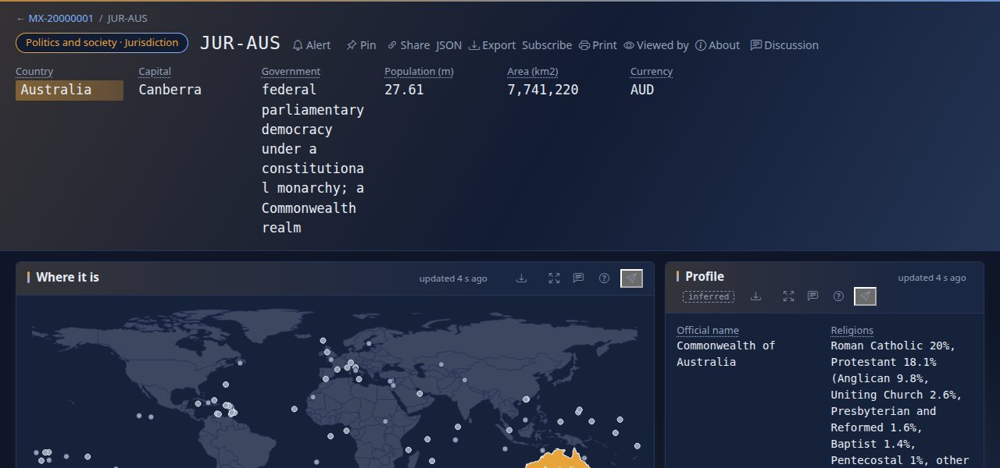

You should see, in the panel **Where it is**, the world with **Australia highlighted** and named, the small island states as **dots** (they are too small for the world shapes, but they can still be clicked), and **Open a country** under the map: the same countries as a list, for the keyboard and for screen readers. Move the pointer over another country.

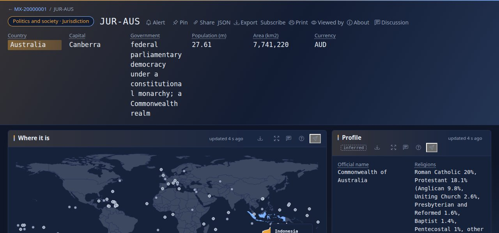

You should see the country change colour and a tip, `Indonesia · click to open`. Click it.

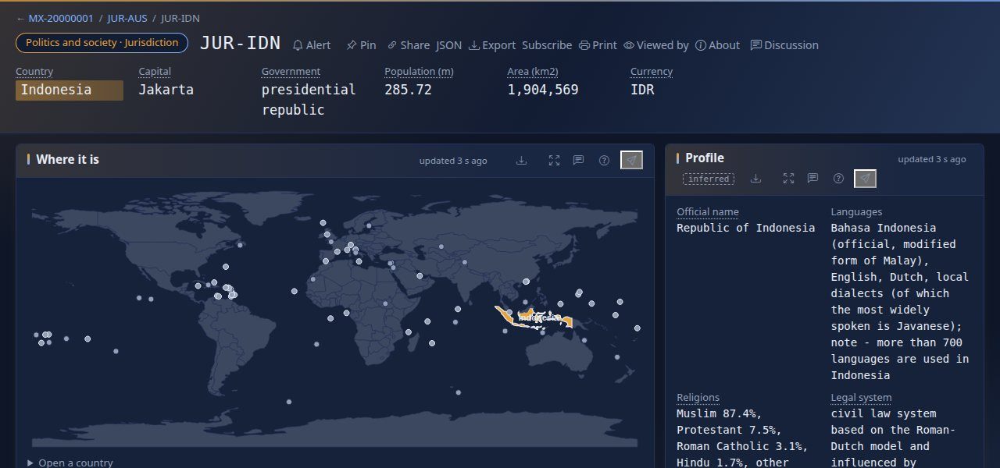

You should see **Indonesia's own page** (`JUR-IDN`), with the map now highlighting Indonesia, and the trail of pages you came by at the top (`JUR-AUS / JUR-IDN`). The panel that did all of this is three lines of the pack's Sutra, `config/packs/economy/world-economy/sutras/politics-and-society/jurisdiction.v1.sutra.yaml`:

```yaml
- id: geography
  kind: map
  title: Where it is
  highlight: $.ISO3                                   # the country to colour: an ISO alpha-3 or alpha-2 code, or its English name
  link: { kind: jurisdiction, id: "JUR-{iso3}" }      # a click on a country opens this entity (the id is built from the country's code)
  height: 11
```

`highlight` takes the country (or a list of them) from the document; `region: $.ISO3` draws the **regions** of a country instead (its states, provinces or counties, from ISO 3166-2 codes such as `AU-NSW`); `link` makes a click open another entity (`{iso3}` is the map's own code of the country clicked), and a `shade: { kind: economy, field: $.GDP_PER_CAPITA, by: $.ISO3, fmt: amount0, label: GDP per capita (USD) }` colours the countries by a figure read across a kind (the economy page of the same pack does exactly that). Now build one yourself in the workbench: **Build**, **New screen**, the tab **Examples**, and open **map**: it opens as **your own copy**, with its own sample document.

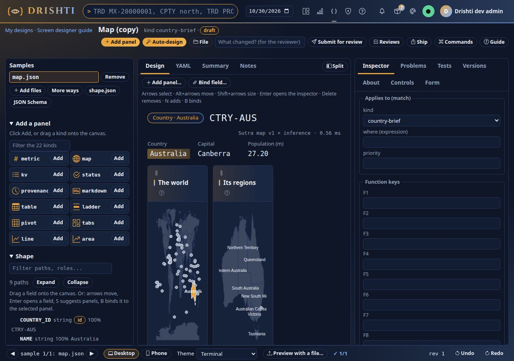

You should see the canvas with **two map panels** (the world with Australia in the accent colour, and Australia's regions: Northern Territory, Queensland, Western Australia, South Australia, New South Wales ...) and a **Facts** panel below them. The **palette** on the left, **Add a panel**, lists the kinds; `map` is the one with the globe.

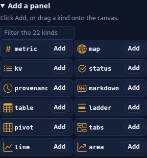

You should see `map` among the kinds with an **Add** button (or drag it onto the canvas); the **YAML** tab shows the lines above, and the **Inspector** takes `highlight`, `region`, `link` and `shade` as boxes. In the example's YAML the two panels are `highlight` and `region` on the same country field: the same field, two views of it. [RACHANA_REFERENCE.md](../guides/RACHANA_REFERENCE.md#screen-designer-and-the-build-workbench) and [RACHANA_REFERENCE.md](../guides/RACHANA_REFERENCE.md#panels-the-twenty-two-kinds-and-developing-a-new-one) have the rest of the options, and the reports have a map visual of their own ([tutorial 10](10-first-bi-report.md)).

## Step 8 · Save it, and how it goes live

The design is yours (see **My drafts** on the Build home). To make it live for everyone: **Submit for review**, a reviewer with the approve power reads the diff and the evidence, and approves; or export it as a pack
fragment (**Ship**) and put it in a pack. [RACHANA_REFERENCE.md](../guides/RACHANA_REFERENCE.md#screen-designer-and-the-build-workbench) walks through proposing and approving as two people; from the command line,
`drishti.py design create|save|check|propose|approve` do the same over REST ([CLI_REFERENCE.md](../guides/CLI_REFERENCE.md)).

You should see, under **Build → Build home → My drafts**, `Desk book` with the status *draft* and your edits listed.

## Part B · On a live page: the Sutra designer

When an administrator has switched the **Sutra designer** on, much of Part A is simpler on a page that already exists: open it, press **Customize** in
the page header and change it on the real page with real data. The result is kept as a design in **My drafts** on the Build home, like Part A's, so the same `design`
commands work on it.

## Step 9 · Open the page and press Customize

**In the UI.** Type `PTRD BOOK-RATES-2 <GO>`: the trades of book `BOOK-RATES-2`. Press **Customize** in the page header. A yellow bar
says *Customizing · only you see changes until you share*, with **Cancel** and **Done**; every panel gets a dashed outline, a handle
and its tools; the side panel on the right lists what you can do. The data stays live and is read as you (your roles and masks).

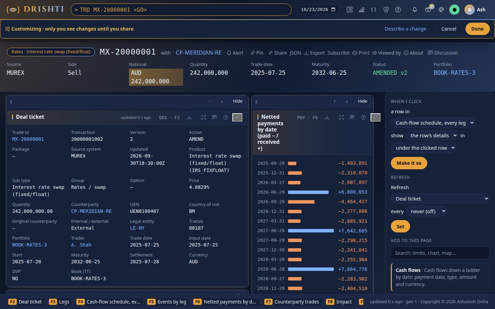

Try the basic tools: drag a panel's handle onto another panel (or use ↑ and ↓) to **move** it; **Hide** a panel (it is listed under
*Hidden*, where **Show** brings it back); on the trades table, **Columns** picks the fields to show. **Add to this page** searches the
UI kit by what a part shows (*limits*, *chart*, *note*): click a card or drag it onto the page.

**You should see** the yellow bar, a dashed outline and tools on every panel, and the side panel with *When I click*, *Refresh*
and *Add to this page*. A part you add opens its **settings** at once (*Which number? [NOTIONAL ▾]*, *Label*, *Format*); a part you
added has **Remove** (with **Undo** for a few seconds), the pack's panels have **Hide**.

**What it writes.** **Show the Sutra**, at the foot of the side panel, shows the whole YAML read-only. Your page has its own name, so
it never stands for the pack's Sutra:

```yaml
# My page, saved by the Sutra designer (Customize). Only I see it until I share it; Reset goes back to the pack's page.
rachana: 1
sutra: my-portfolio-trades
version: 1
match: { kind: portfolio-trades }
panels:
  - { use: trading/payments-metrics@1, with: { ... } }   # the pack's own fragments, as on the pack's page
  - { use: trading/trade-table@1, with: { ... } }
  - { use: explainer-note@1, with: { id: note } }         # added from the kit
```

A hidden panel is kept in the design's notes, not in the Sutra, so *Show* restores it exactly.

**Command line.** Nothing yet: the change is drawn at once but not kept until **Done** (step 13).

## Step 10 · A linked record on a click

**In the UI.** In the side panel, **When I click** a row in *[Trades ▾]* show *[what ▾]* in *[the right column ▾]*. Open *what*: it
lists the row's details, and every record linked to a trade the way the packs link entities, across packs, each with the pack that
serves it: *the trade itself (trading)*, *its events*, *its counterparty (core)*, *its counterparty's credit limits*... Pick **its
counterparty's credit limits (counterparty-risk)** and press **Make it so**. Click a trade: its counterparty's limits open on the right.
**Stop** removes it.

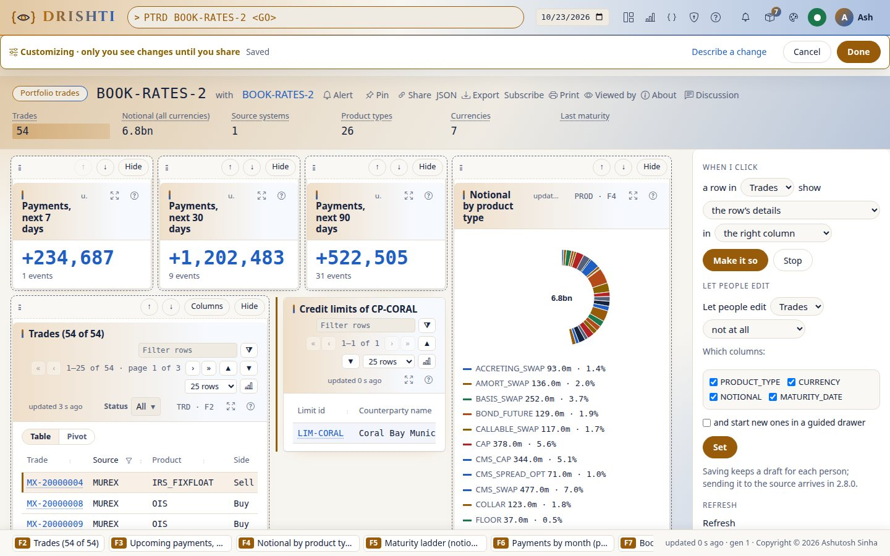

**You should see** *Pick a row of Trades to see it here* on the right until you click a trade, then a table of that
counterparty's credit limits titled *Credit limits of CP-...*.

**What it writes.** The table now emits an `open` event on a row click, and a child reads the clicked row through its own `source:`:

```yaml
  - id: trades
    kind: table
    ...
    emits:
      - name: open
        on: row-click
        payload: { SOURCE_SYSTEM: { bind: "@.SOURCE_SYSTEM", type: id }, COUNTERPARTY: { bind: "@.COUNTERPARTY", type: any }, ... }
    children:
      - place: detail-right
        waits: Pick a row of Trades to see it here
        source: { pack: counterparty-risk, kind: credit-limit, where: "@.COUNTERPARTY == @parent.open.COUNTERPARTY", limit: 20 }
        panels:
          - id: trades-credit-limit
            kind: table
            title: "Credit limits of ${@parent.open.COUNTERPARTY}"
            rows: $src
            columns: [ { label: Limit id, bind: "@.LIMIT_ID" }, { label: Counterparty name, bind: "@.COUNTERPARTY_NAME" }, ... ]
```

A table that came from a shared part of the page (a fragment) is first written out on the page, as above, so it can take the event.
The limits are read as you: a counterparty masked for you is never followed, and the panel says *Hidden for you*.

**Command line.** The pack's page as your token sees it, in text tables, and which Sutra draws it and why:

```bash
python3 tools/drishti.py view get portfolio-trades/BOOK-RATES-2
python3 tools/drishti.py view explain portfolio-trades/BOOK-RATES-2
```

The child's limits are read only when a row is clicked, so they are not in `view get`; your designed page is checked from the command
line in step 13.

## Step 11 · Refresh every 30 seconds

**In the UI.** In the side panel, **Refresh** *[Trades ▾]* every *[30 seconds ▾]* (*never (off)* removes it). The trades are fetched
again every 30 seconds without reloading the page: only panels that changed are redrawn, the picked row stays picked and the limits it
opened stay open. In the panel's header: **pause/resume**, **every …** (only as slow as the Sutra's interval or slower) and how fresh it
is, *updated 12 s ago*, ticking. **Pause all**, above the panels, pauses the page.

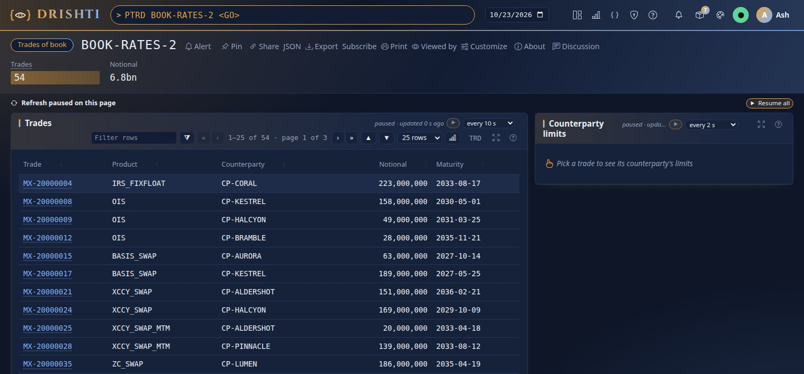

When a source is behind, the panel says *stale* in amber; when it fails, the panel keeps what it showed and names the source:
*trade-endur isn't answering; showing data from 10:42*.

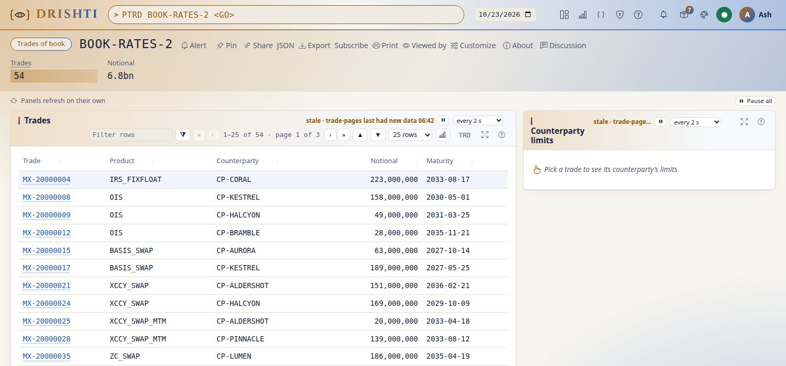

**You should see** *updated … s ago* ticking in the trades' header, and the panel fetched again every 30 seconds with the
page left where you scrolled.

**What it writes.** On the panel (or on the use, or the whole Sutra):

```yaml
  - id: trades
    kind: table
    refresh: 30                 # or { every: 30, user-can-pause: false }
```

Never faster than the console's `views.refresh_min_seconds` (default 5).

**Command line.** Your pause and interval choices are kept for you, per screen, in your settings:

```bash
curl -s -H "Authorization: Bearer $DRISHTI_TOKEN" $B/me/settings            # ... "refresh": {"portfolio-trades/my-portfolio-trades": {...}}
curl -s -X PATCH -H "Authorization: Bearer $DRISHTI_TOKEN" -H 'Content-Type: application/json' \
     -d '{"refresh": {"portfolio-trades/my-portfolio-trades": {"panels": {"trades": {"paused": true}}}}}' $B/me/settings
```

## Step 12 · Let people edit

**In the UI.** In the side panel, **Let people edit** *[Trades ▾]* *[in a form beside it ▾]* (or *in its cells*), tick the columns people
may change (the notional, the maturity date) and *and start new ones in a guided drawer*; press **Set**. Click a trade: a form opens
beside the table, the read-only fields saying why, a bad value explained under its field. **Save draft** keeps it; **Discard** forgets it.

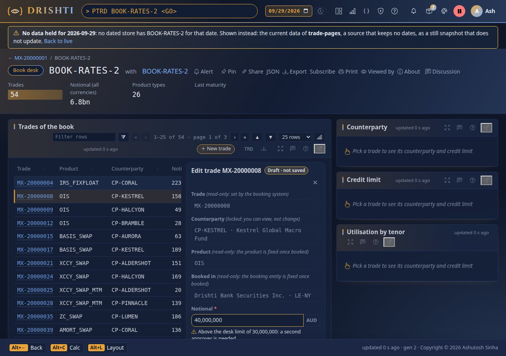

**New trade** opens the drawer: steps *Who → What → Check* over the dimmed page.

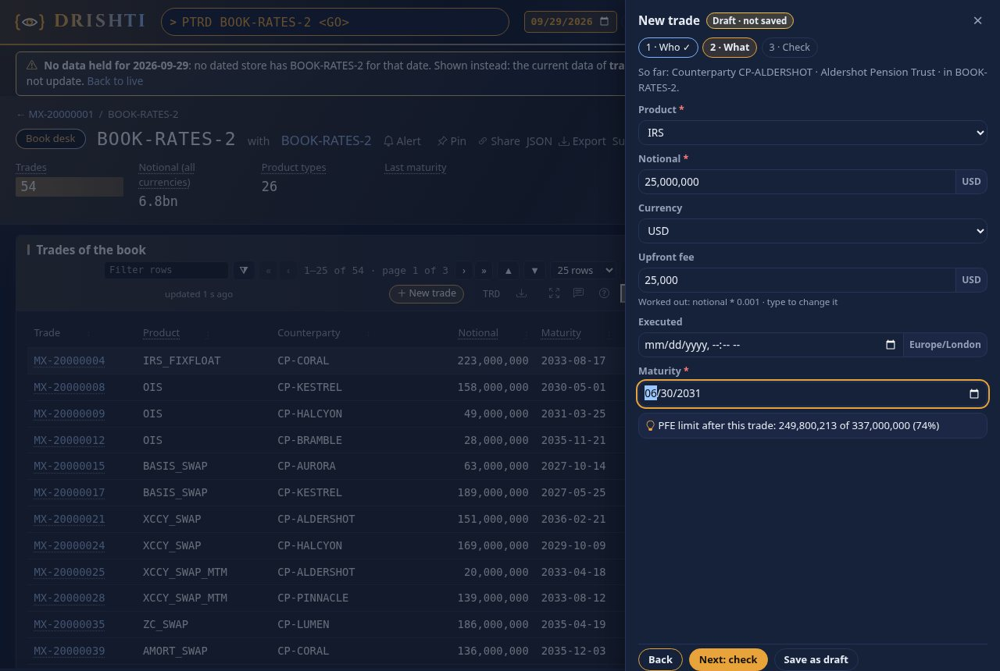

**You should see** a form beside the trades when you click one, the trade id read-only and the notional a number field.

**What it writes.** A `form:` on the table. The first column names the record and is read-only; a number column becomes a number
field, a `*_DATE` column a date field:

```yaml
  - id: trades
    kind: table
    ...
    form:
      key: trade_id
      edit: beside              # or cells
      new: drawer
      fields:
        - { id: trade_id, label: Trade, bind: TRADE_ID, readonly: true }
        - { id: notional, label: Notional, bind: NOTIONAL, type: number }
        - { id: maturity_date, label: Maturity, bind: MATURITY_DATE, type: date }
```

Rules, money and linked-record fields, masks and roles are in [WRITE_BACK.md](../guides/WRITE_BACK.md). Saving keeps a
**draft** for each person; nothing is written to the source system until write-back.

**Command line.** Your drafts, checked again on the server with the same rules:

```bash
curl -s -H "Authorization: Bearer $DRISHTI_TOKEN" "$B/drafts?kind=portfolio-trades&id=BOOK-RATES-2"
```

## Step 13 · Done: your page

**In the UI.** Press **Done**. The page now opens with your version, marked *Your page* in the header (that link opens the pack's page).
Customize again to go on; **Share** makes a read-only link to your design; **Reset to the pack's page** removes your version.

**You should see** the page without the yellow bar, with *Your page* in its header and your changes in place.

**Command line.** Your page is an ordinary design in **Build → Build home → My drafts** (first called *My page · portfolio-trades*), so the
`design` commands work on it, and a flag says which design is your version of each kind's page:

```bash
python3 tools/drishti.py design list                                    # find My page · portfolio-trades and its id
python3 tools/drishti.py design get <id> --yaml -o my-desk.sutra.yaml   # the Sutra the designer wrote
python3 tools/drishti.py sutra lint my-desk.sutra.yaml                  # the same checks the server runs
python3 tools/drishti.py design check <id>                              # run it against its samples
curl -s -H "Authorization: Bearer $DRISHTI_TOKEN" $B/me/pages            # {"portfolio-trades": "<id>"}
curl -s -X DELETE -H "Authorization: Bearer $DRISHTI_TOKEN" $B/me/pages/portfolio-trades   # Reset: the pack's page again
```

Edit `my-desk.sutra.yaml` in your editor and `design save <id> my-desk.sutra.yaml` puts it back: the page shows your edit.

## Step 14 · The same screen from one line: Describe

**In the UI.** **Build → New screen** offers *describe the screen in one line* (Customize has **Describe a change**). Type:

```
TRD BOOK-RATES-2 · click a trade → cash flows + CPTY limits · refresh 30s · edit trades beside · new trade in a drawer
```

and press **Build**. **Understood as** shows one token per part; an unsure one has a **fix…** list, a part it cannot read is red with a
sentence saying why. The live result below draws the screen as you: click a trade and its cash flows open under the row, the
counterparty's limits on the right. The parser is deterministic: the same line always gives the same screen, and no AI is involved.
**Save to my workspace** keeps it as a design (*My screen · Trades of book BOOK-RATES-2*).

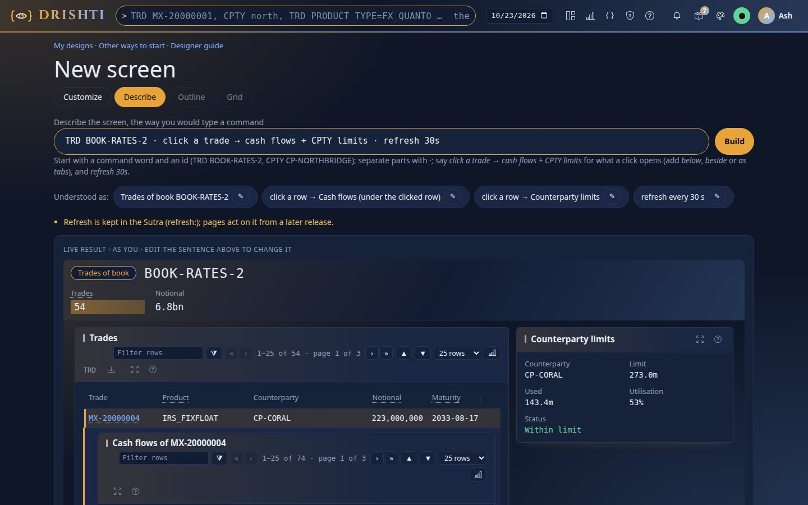

**You should see** one token per part under *Understood as*, none of them red, and the live result filling the cash flows
under a trade you click.

**What it writes** (shortened; the whole text is under **Show the Sutra**):

```yaml
rachana: 1
sutra: my-portfolio-trades-book-rates-2
version: 1
description: TRD BOOK-RATES-2 · click a trade → cash flows + CPTY limits · refresh 30s · ...
match: { kind: portfolio-trades }
refresh: 30
panels:
  - use: row-picker@1
    with: { id: trades, title: Trades, rows: $.TRADES, event: open, key: TRADE_ID, ref: COUNTERPARTY, ... }
    form: { edit: beside, new: drawer, ... }
    children:
      - place: expand-row
        waits: Pick a trade to see its cash flows
        source: { pack: trading, kind: trade, id: "@parent.open.id" }
        panels:
          - use: cashflow-ladder@1
            with: { id: flows, title: "Cash flows of ${@parent.open.id}", rows: $src.EVENTS, date: EVENT_DATE, amount: AMOUNT }
  - id: limit
    kind: kv
    title: Counterparty limits
    area: right
    waits: Pick a trade to see its counterparty's limits
    source: { pack: counterparty-risk, kind: credit-limit, where: "@.COUNTERPARTY == @trades.open.ref", limit: 1 }
    columns: [ ... ]
  - { use: data-provenance@1 }
```

The trading pack ships a screen written this way, by hand: the book desk, `/v/portfolio-trades/BOOK-RATES-2?sutra=book-desk`
(`config/packs/banking/trading/sutras/pages/book-desk.v1.sutra.yaml`).

**Command line.** As in step 13: `design list` shows *My screen · Trades of book BOOK-RATES-2*, and `design get <id> --yaml` prints it.

## Step 15 · Outline and Grid: the same draft, two other views

The four modes edit one draft; the switcher carries it from one to the other.

**You should see** the same draft in each mode: a change made in Outline is there in Grid and in Customize.

**Outline** shows the screen as a list: its sections, the panels in each, and under the trades table the panels a click opens, each
with a line in plain words. Drag to reorder; drag a panel onto a table's *Drop a panel here* line to make it open on a click (*nest*);
**Un-nest** puts it back; each item has its width, area, section and refresh interval.

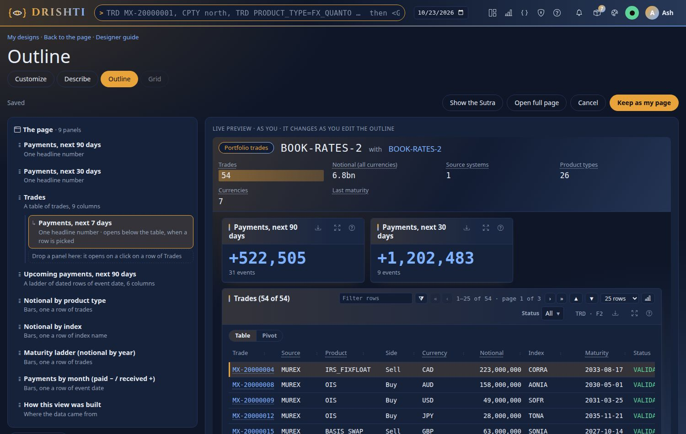

**Grid** shows the screen as a spreadsheet: columns A, B, C (each header says its width, such as *7/12*) over the Sutra's
`layout.areas`, and each cell's panels written as formulas. The cash flows a click opens are a cell of their own, `A2a`, under the
trades:

```
A2 = row-picker@1(id: trades, title: Trades of the book, rows: $.TRADES, event: open, key: TRADE_ID, ref: COUNTERPARTY)
A2a = cashflow-ladder@1(id: flows, title: Cash flows, rows: $src.EVENTS, date: EVENT_DATE, amount: AMOUNT) opens from A2
B2 = field-list@1(id: who, title: Counterparty, rows: $src; source: {pack: core, kind: counterparty, id: @A2.open.ref})
```

`@A2.open.ref` is `@trades.open.ref` in the Sutra: B2 waits until a trade is picked. A screen without areas is one column; **Make it a
grid** gives each panel an area. Drag the edge between two column headers to change the widths (`layout.columns`).

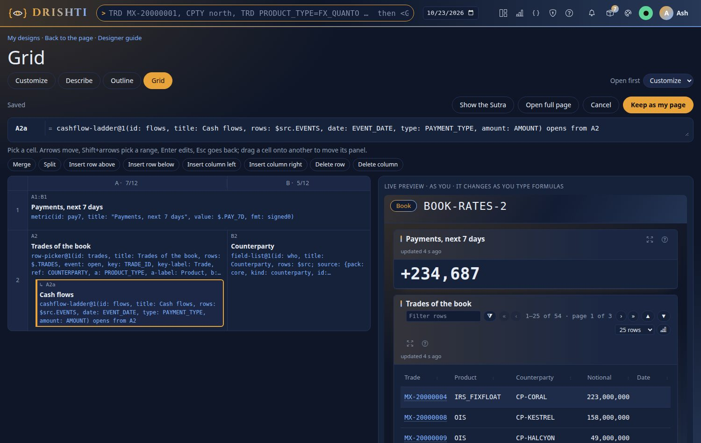

Grid edits two levels of panels a click opens as cells; pack screens nest at most two levels, and anything deeper is edited in Outline
or Customize. On a phone Grid offers Outline.

**Command line.** The mode you open first is a setting of yours (`customize`, `describe`, `outline` or `grid`; **Open first** beside
the modes does the same):

```bash
curl -s -X PATCH -H "Authorization: Bearer $DRISHTI_TOKEN" -H 'Content-Type: application/json' \
     -d '{"designerMode": "grid"}' $B/me/settings
```

With Grid or Outline, Customize on a page then opens that mode with the page's draft.

## What you have, and what comes next

A desk screen designed from your own documents (Part A), your own version of the book's trades page (a linked record on a click, a refresh, a form)
and a second screen from one line (Part B), all in **Build → Build home → My drafts**, seen by nobody else. To make one live for everyone, open it in the workbench
and **Submit for review** ([RACHANA_REFERENCE.md › Screen designer and the Build workbench, section 22](../guides/RACHANA_REFERENCE.md#22-saving-and-proposing)),
or `drishti.py design propose <id>`.

## Next steps

- [Tutorial 7 · Load data daily](07-load-data-daily.md) keeps the screens' data fresh.
- [Tutorial 24 · Correct a trade and approve it](24-correct-a-trade-and-approve-it.md): a form like the one of step 12 that writes back, with four eyes.
- [RACHANA_REFERENCE.md](../guides/RACHANA_REFERENCE.md#screen-designer-and-the-build-workbench) is the workbench reference and
  [its section 31](../guides/RACHANA_REFERENCE.md#31-the-sutra-designer-customize-describe-outline-and-grid) every mode of the designer in full;
  [RACHANA_REFERENCE.md](../guides/RACHANA_REFERENCE.md) lists every option of every panel and control;
  [RACHANA_REFERENCE.md](../guides/RACHANA_REFERENCE.md#panels-the-twenty-two-kinds-and-developing-a-new-one) shows each of the 22 panel kinds with a picture.
- [SUTRA_DEVELOPER_GUIDE.md](../guides/SUTRA_DEVELOPER_GUIDE.md) is the language guide; its
  [section 11a](../guides/SUTRA_DEVELOPER_GUIDE.md#11a-fragments-events-children-refresh-and-forms) writes Part B's screen by hand.

## If something goes wrong

| You see | Meaning |
|---|---|
| a problem naming a line | the Problems tab says which line and why; click it to put the cursor there |
| `DRS-2023` | an option on a panel that does not take it (`panels:` is only for `tabs`, `body` likewise) |
| the Trades table is empty | the slider is above every trade, or the `where` reads a control that has no value |
| the workbench says the design changed in another tab | reload it: the other tab's edit wins, nothing is lost (Versions) |
| no **Customize** button; `/designer/...` answers 404 | the designer is off: `ui.designer: true` (or `DRISHTI_UI_DESIGNER=true`) and restart the console |
| the linked-record list has no *credit limits* | the counterparty-risk pack is not enabled, or not among your active packs, or the table has no field the packs link |
| a panel says *Hidden for you* | the clicked row's value is masked for you; the panel is not looked up |
| a part of the Describe line is red | the sentence beside it says why; the result says *Fix the red part to see the screen* until it reads |
| a refresh interval faster than 5 s is not offered | the console's `views.refresh_min_seconds` (default 5) |
| `DRS-2057` in `sutra lint` | an event or source reads a panel that does not exist (a renamed panel id) |
| `DRS-2058` | the `form:` does not read: an unknown key or field type ([WRITE_BACK.md](../guides/WRITE_BACK.md)) |
| `DRS-2059` | the `layout:` names an area the picture does not have |
