<!--
  Project Drishti · Any data. Any domain. One grammar.

  Copyright (c) 2026 Ashutosh Sinha <ajsinha@gmail.com>.
  All rights reserved.

  PROPRIETARY AND CONFIDENTIAL.

  This file is the confidential and proprietary property of Ashutosh Sinha.
  Unauthorised copying, use, modification, distribution or disclosure of this
  file, via any medium, is strictly prohibited except with the express prior
  written permission of the copyright holder.

  See the LICENSE file in the root of this repository for the full terms.
-->
# Tutorial 6 · Design a screen

A screen in Drishti is a **Sutra**: a small YAML file that says which entities it applies to and what to show. You design it in the **Build workbench**, with a live preview over your own sample
documents. In this tutorial you design a desk screen with a strip of key figures, **tabs that each hold two panels** (a currency's totals and its trades), a **slider** that narrows the trades by size,
and the text behind **About this page**. You also see the column filters every table has, and check the Sutra from the command line.

## Time to complete

About 40 minutes.

## Before you start

- [Tutorial 1](01-first-15-minutes.md) done; the server started with `DRISHTI_STUDIO_SAVE=true`; signed in. Anyone may design; saving a Sutra for everyone needs an author and a reviewer, which this tutorial does not do.
- The data: three desk documents in `docs/tutorials/data/desks/` (`desk-rates.json`, `desk-fx.json`, `desk-credit.json`: each a desk with its currencies and their trades), and the Sutra itself,
  `docs/tutorials/data/desk-book.sutra.yaml`. The fields are UPPER_SNAKE (`DESK_ID`, `REGION`, `MTM`, `CURRENCIES[].TRADES[].NOTIONAL`), as production data is. The workbench guide
  ([SCREEN_DESIGNER.md](../guides/SCREEN_DESIGNER.md)) goes further; this tutorial is the shortest route to a finished screen.
- For the command-line checks: the console's Python (tutorial 1); `sutra lint` and `sutra preview` run the server jar's Sutra tool locally, with no server needed.

**Where this data comes from.** The country pages of the map step are the `world-economy` pack's, published data from the World Bank (CC BY 4.0), UNDP (CC BY 3.0 IGO) and the CIA World Factbook (public domain), plus IMF forecasts that are **internal only**, fetched by `tools/publicdata/world_economy.py`. Each source, its licence and how to refresh it: [External data](../guides/PUBLIC_DATA.md).

## What you will learn

- how to start a design from documents, and what the auto-design gives you;
- the parts of a Sutra: `match`, `title`, `strip`, `controls`, `panels`;
- a `tabs` panel with several panels inside each tab, and a **slider** that filters what is inside;
- column filters and phone width;
- the *About this page* text and glossary, and where it is written;
- the **`map`** panel: a country highlighted, its regions, a click that opens the country's page;
- `sutra lint` and `sutra preview` from the command line.

## Step 1 · Bring your documents

Choose **Build**, then **New screen**. Choose the three desk files, name the design `Desk book` and give it the kind `desk`.

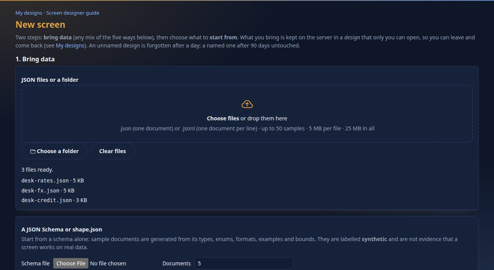

You should see `3 files ready.`, the name and the kind filled in, and the start choices (auto-design on). Press **Create**.

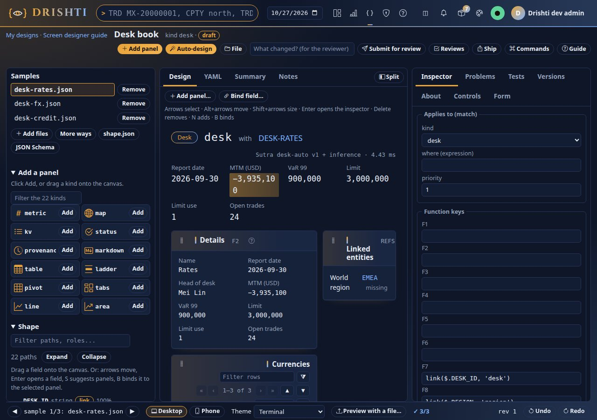

You should see the workbench: your files as **Samples** on the left (switch between them with the arrows at the bottom), the **Design** canvas in the middle with a first draft the auto-designer made
(a title, a strip of the document's figures, a *Details* panel, a *Currencies* table), and the **Inspector** on the right. The first draft is a start: its figures show as raw values
(`LIMIT_USE` as `0.58`, not `58%`), and the currencies are a plain table. Next you replace it with a designed one.

## Step 2 · Read the Sutra, and replace it

Open the **YAML** tab. Select everything, and paste the contents of `docs/tutorials/data/desk-book.sutra.yaml`.

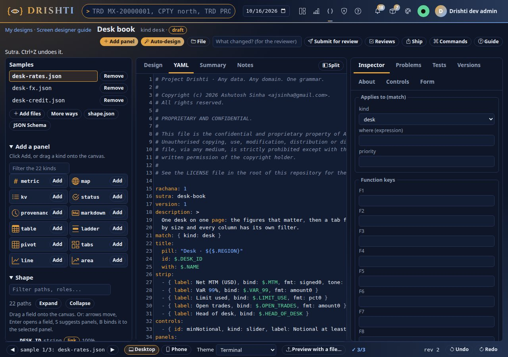

You should see the Sutra in the editor. Read it from the top:

- `match: { kind: desk }`: it applies to every document of the kind `desk`.
- `title`: a pill (`Desk · ${$.REGION}`), the id (`$.DESK_ID`) and the desk's name (`$.NAME`).
- `strip`: five key figures, each a label, a path into the document (`bind: $.MTM`) and a format (`signed0`, `pct0`); `tone: sign` colours a number by its sign.
- `controls`: one control, a slider called `minNotional`.
- `panels`: one `tabs` panel; `each: $.CURRENCIES` makes one tab for each currency, named by `tabTitle: "@.CODE"`, and `panels:` lists what each tab holds. Inside a tab `@` is that currency.
  The second panel's `where: "@.NOTIONAL >= ctl.minNotional"` keeps the trades at least as big as the slider says.

The top of the file, as you pasted it:

```yaml
match: { kind: desk }
title:
  pill: "Desk · ${$.REGION}"
  id: $.DESK_ID
  with: $.NAME
strip:
  - { label: Net MTM (USD), bind: $.MTM, fmt: signed0, tone: sign, emphasis: true }
  - { label: VaR 99%, bind: $.VAR_99, fmt: amount0 }
  - { label: Limit used, bind: $.LIMIT_USE, fmt: pct0 }
  - { label: Open trades, bind: $.OPEN_TRADES, fmt: amount0 }
  - { label: Head of desk, bind: $.HEAD_OF_DESK }
controls:
  - { id: minNotional, kind: slider, label: Notional at least, min: 0, max: 250000000, step: 25000000, placement: strip }
```

Click the **Design** tab.

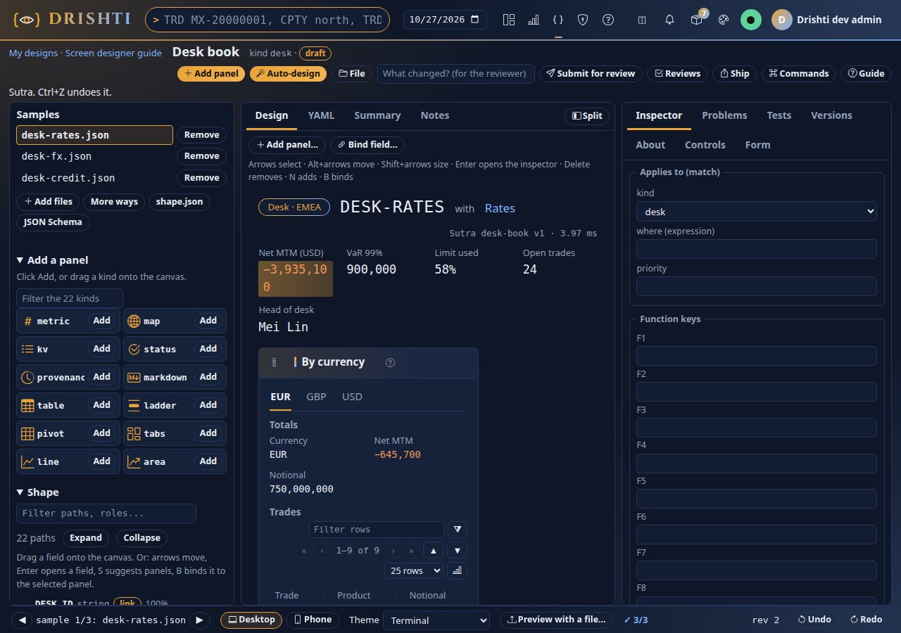

You should see `Desk · EMEA` and `DESK-RATES`, the strip, and a panel **By currency** with three tabs, `EUR`, `GBP`, `USD`. The selected tab holds two panels: **Totals** (currency, net MTM
coloured by sign, notional) and **Trades**, a table with a **Filter rows** box and paging. Click another tab, and switch sample with the arrow at the bottom: the tabs follow the data, however many currencies a desk has.
The panel is narrower than the canvas: **drag its edges** or press `Shift+→` on it to resize, `Alt+arrows` to move it.

## Step 3 · The slider

Open the **Controls** tab. The slider you wrote is there, as a card you can edit: its label, **Min** `0`, **Max** `250000000`, **Step** `25000000`, whether it has two handles (a range) and where it sits
(`strip`, `header` or `side`).

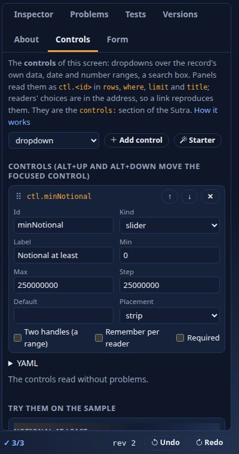

You should see the card and `The controls read without problems.` Scroll to **Try them on the sample** and drag the slider (or focus it and press `→` for one step).

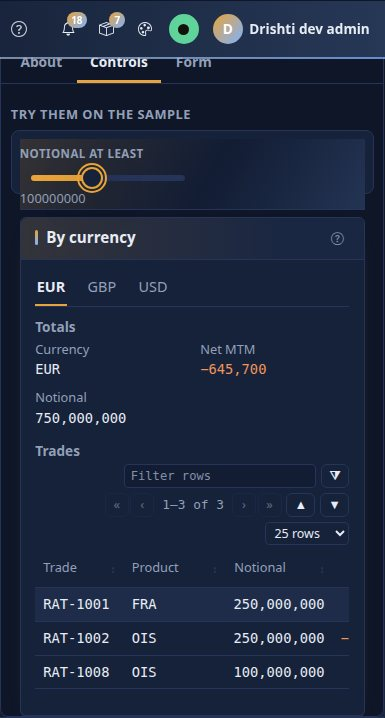

You should see the label `Notional at least`, the handle and its value, and the trades table shrink: with the handle at 100,000,000 only 3 of the 9 EUR trades are left
(GBP keeps 3 of 6, USD 2 of 9). A reader on the live screen gets the
same slider, and what they choose is in the page's address, so a link reproduces it. Keys: `←` `→` one step, `PageUp` `PageDown` ten, `Home` `End` the ends; on a phone the handle is 44 pixels. A slider
with `range: true` has two handles and gives `from..to`.

## Step 4 · Column filters, and the phone

Every table in Drishti has a funnel on each column heading, like a spreadsheet. The workbench preview is a sketch, so look at one on a live view: open `TRD MX-20000001`, find the
**Events** table (the trade's booking events and cash settlements, leg by leg) and click the funnel in the **Amount** heading.

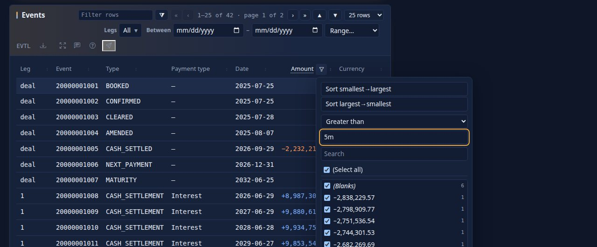

You should see a menu with two sort buttons, a **condition** (equals, greater than, between, top 10 ...) with its value box, a search box over the column's values and the list of values with tick boxes, and **OK**, **Cancel** and **Clear**. Choose *Greater than*, type `5m` and press **OK**: only the settlements above 5 million stay (`+8,987,301.85` on 2026-06-29 is one), and the funnel on the heading is filled in. The table's own **Legs** and **Between** controls, in the panel's header, narrow it too. A tick-box list works for text, a date condition for dates. [USER_GUIDE.md › Filter a table like Excel](../guides/USER_GUIDE.md#filter-a-table-like-excel) has them all.

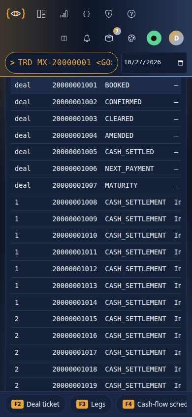

You should see the same table on a phone, one column, with 44-pixel targets. In the workbench use the **Phone** button at the bottom to see your own screen that way before you propose it.

## Step 5 · Check it

The Problems tab lists everything wrong; the Tests tab checks every sample.

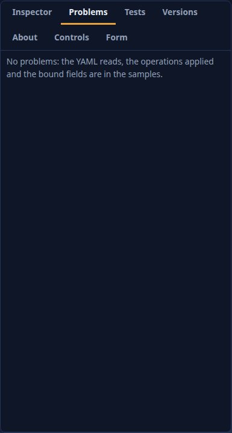

You should see `No problems: the YAML reads, the operations applied and the bound fields are in the samples.` Introduce a mistake (change `kind: tabs` to `kind: tab`) and the tab names the line and the
reason, with the code (`DRS-2021 unknown panel kind`). Undo with `Ctrl+Z`.

The command line runs the same checks, which is what a CI job would do. Put the Sutra and one document side by side and lint it:

```bash
mkdir -p desk-test && cp docs/tutorials/data/desk-book.sutra.yaml desk-test/
cp docs/tutorials/data/desks/desk-rates.json desk-test/desk-book.json
drishti-console/.venv/bin/python tools/drishti.py sutra lint desk-test/desk-book.sutra.yaml
```

```text
$ drishti-console/.venv/bin/python tools/drishti.py sutra lint desk-test/desk-book.sutra.yaml
ok      desk-test/desk-book.sutra.yaml
desk-test/desk-book.sutra.yaml:15 warning DRS-2047 field 'MTM' is shown but has no glossary entry (kinds.desk.glossary in config/about.yaml, or a vocabulary entry)
desk-test/desk-book.sutra.yaml:15 warning DRS-2047 field 'VAR_99' is shown but has no glossary entry (kinds.desk.glossary in config/about.yaml, or a vocabulary entry)
...
[exit 0]
```

You should see `ok desk-test/desk-book.sutra.yaml` and a list of warnings, one per field the screen shows, `DRS-2047 field 'MTM' is shown but has no glossary entry`: the screen works, but nothing yet says what its fields mean. (Lint is quiet by
default about help text: exit 0; `--strict` makes these warnings fail the run.)

```text
$ drishti-console/.venv/bin/python tools/drishti.py sutra lint --strict desk-test/desk-book.sutra.yaml
ok      desk-test/desk-book.sutra.yaml
desk-test/desk-book.sutra.yaml:15 warning DRS-2047 field 'MTM' is shown but has no glossary entry (kinds.desk.glossary in config/about.yaml, or a vocabulary entry)
desk-test/desk-book.sutra.yaml:15 warning DRS-2047 field 'VAR_99' is shown but has no glossary entry (kinds.desk.glossary in config/about.yaml, or a vocabulary entry)
desk-test/desk-book.sutra.yaml:15 warning DRS-2047 field 'LIMIT_USE' is shown but has no glossary entry (kinds.desk.glossary in config/about.yaml, or a vocabulary entry)
desk-test/desk-book.sutra.yaml:15 warning DRS-2047 field 'OPEN_TRADES' is shown but has no glossary entry (kinds.desk.glossary in config/about.yaml, or a vocabulary entry)
desk-test/desk-book.sutra.yaml:15 warning DRS-2047 field 'HEAD_OF_DESK' is shown but has no glossary entry (kinds.desk.glossary in config/about.yaml, or a vocabulary entry)
desk-test/desk-book.sutra.yaml:15 warning DRS-2047 field 'CODE' is shown but has no glossary entry (kinds.desk.glossary in config/about.yaml, or a vocabulary entry)
desk-test/desk-book.sutra.yaml:15 warning DRS-2047 field 'NET_MTM' is shown but has no glossary entry (kinds.desk.glossary in config/about.yaml, or a vocabulary entry)
desk-test/desk-book.sutra.yaml:15 warning DRS-2047 field 'NOTIONAL' is shown but has no glossary entry (kinds.desk.glossary in config/about.yaml, or a vocabulary entry)
desk-test/desk-book.sutra.yaml:15 warning DRS-2047 field 'TRADES.ID' is shown but has no glossary entry (kinds.desk.glossary in config/about.yaml, or a vocabulary entry)
desk-test/desk-book.sutra.yaml:15 warning DRS-2047 field 'TRADES.PRODUCT' is shown but has no glossary entry (kinds.desk.glossary in config/about.yaml, or a vocabulary entry)
desk-test/desk-book.sutra.yaml:15 warning DRS-2047 field 'TRADES.NOTIONAL' is shown but has no glossary entry (kinds.desk.glossary in config/about.yaml, or a vocabulary entry)
desk-test/desk-book.sutra.yaml:15 warning DRS-2047 field 'TRADES.MTM' is shown but has no glossary entry (kinds.desk.glossary in config/about.yaml, or a vocabulary entry)
desk-test/desk-book.sutra.yaml:15 warning DRS-2047 field 'TRADES.MATURITY' is shown but has no glossary entry (kinds.desk.glossary in config/about.yaml, or a vocabulary entry)
[exit 1]
```

`preview` renders every sample and reports panels in error:

```text
$ drishti-console/.venv/bin/python tools/drishti.py sutra preview desk-test/desk-book.sutra.yaml
desk-book / desk-book.json: 1 panels, 0 in error
```

You should see `1 panels, 0 in error`.

## Step 6 · About this page

The warnings point to the *About this page* text: press `?` on any view.

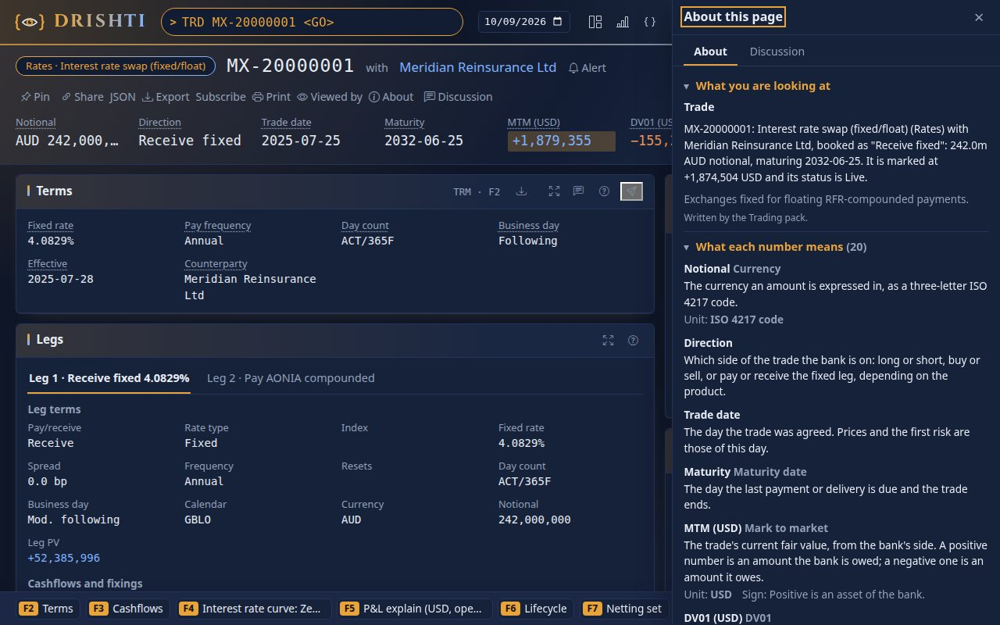

You should see a drawer with the page's text, a line for each panel, a glossary (term, meaning, unit) of the fields you can see, where the data came from and why this layout was chosen. Your Sutra's
`description` and each panel's `description` fill it; the glossary and the page text are the pack's `config/about.yaml`. In the workbench, open the **About** tab and press **Starter**.

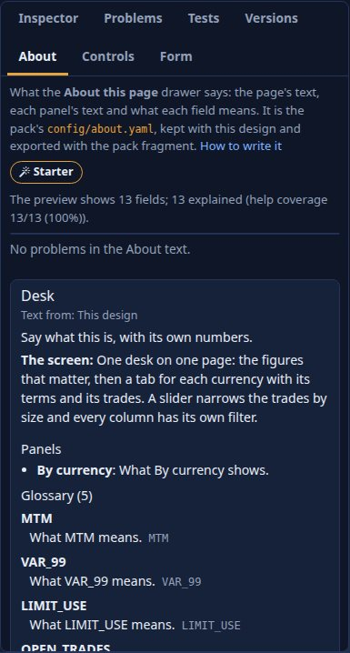

You should see a skeleton for the kind, the panel texts and a glossary entry for each field the preview shows, marked as still to write (`What mtm means.`), and the **About card** under it. The line under the
button counts the fields and how many are explained (the thirteen fields `--strict` listed above). Write real sentences in the box and the card updates as you type; the lint warnings vanish as entries appear. The text is saved with the design and
travels with the pack fragment you export; it goes live when an administrator deploys the pack ([SCREEN_DESIGNER.md › The About tab](../guides/SCREEN_DESIGNER.md#the-about-tab)).

## Step 7 · A map on a screen

A panel of kind **`map`** draws a world map from a country code in the document, with shapes that ship with the console (no tiles, no map service, nothing fetched from the internet). Look at one that is already in the world-economy pack: type `JUR JUR-AUS` and press Enter, the jurisdiction of Australia.

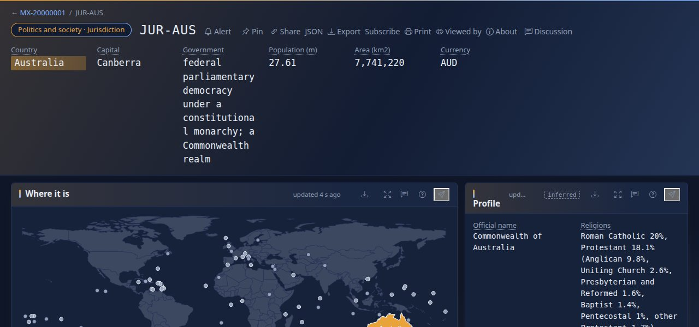

You should see, in the panel **Where it is**, the world with **Australia highlighted** and named, the small island states as **dots** (they are too small for the world shapes, but they can still be clicked), and **Open a country** under the map: the same countries as a list, for the keyboard and for screen readers. Move the pointer over another country.

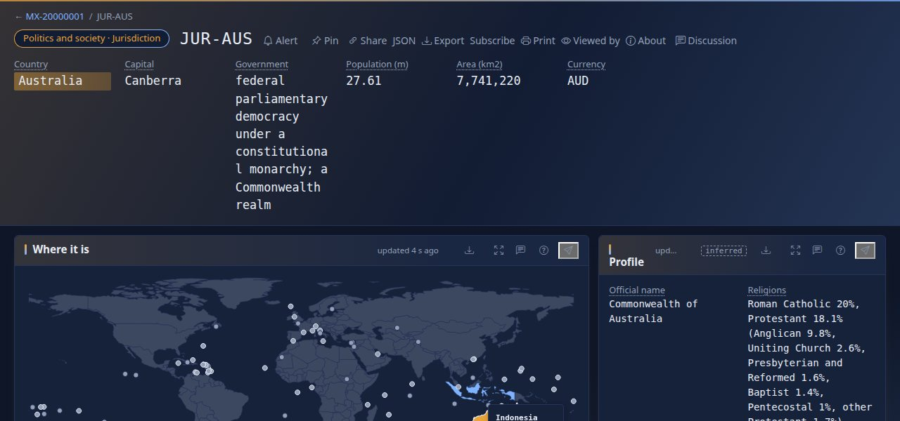

You should see the country change colour and a tip, `Indonesia · click to open`. Click it.

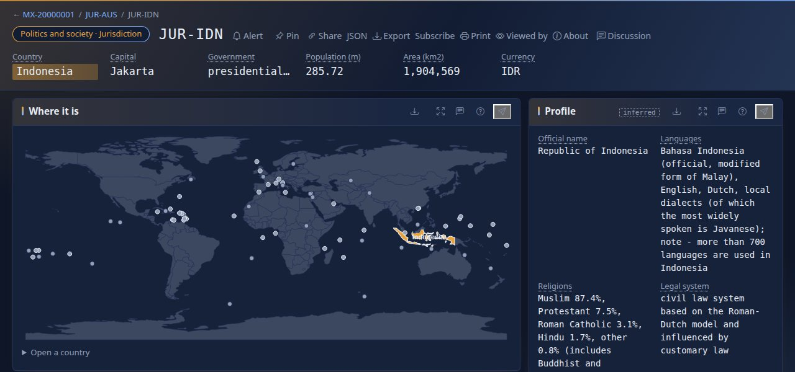

You should see **Indonesia's own page** (`JUR-IDN`), with the map now highlighting Indonesia, and the trail of pages you came by at the top (`JUR-AUS / JUR-IDN`). The panel that did all of this is three lines of the pack's Sutra, `config/packs/world-economy/sutras/politics-and-society/jurisdiction.v1.sutra.yaml`:

```yaml
- id: geography
  kind: map
  title: Where it is
  highlight: $.ISO3                                   # the country to colour: an ISO alpha-3 or alpha-2 code, or its English name
  link: { kind: jurisdiction, id: "JUR-{iso3}" }      # a click on a country opens this entity (the id is built from the country's code)
  height: 11
```

`highlight` takes the country (or a list of them) from the document; `region: $.ISO3` draws the **regions** of a country instead (its states, provinces or counties, from ISO 3166-2 codes such as `AU-NSW`); `link` makes a click open another entity (`{iso3}` is the map's own code of the country clicked), and a `shade: { kind: economy, field: $.GDP_PER_CAPITA, by: $.ISO3, fmt: amount0, label: GDP per capita (USD) }` colours the countries by a figure read across a kind (the economy page of the same pack does exactly that). Now build one yourself in the workbench: **Build**, **New screen**, the tab **Examples**, and open **map**: it opens as **your own copy**, with its own sample document.

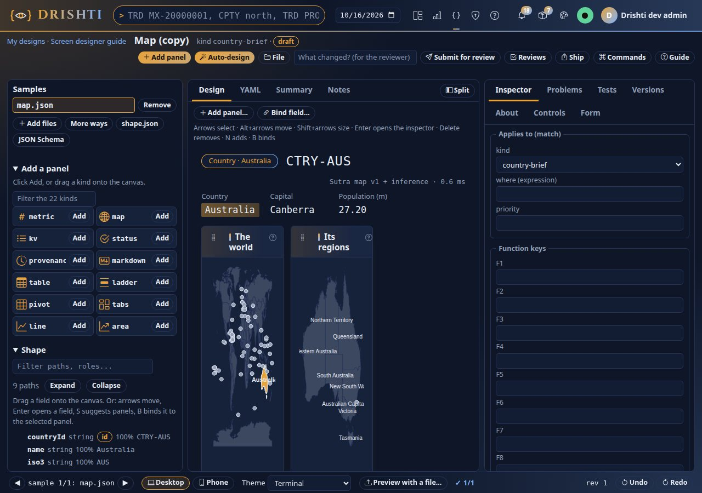

You should see the canvas with **two map panels** (the world with Australia in the accent colour, and Australia's regions: Northern Territory, Queensland, Western Australia, South Australia, New South Wales ...) and a **Facts** panel below them. The **palette** on the left, **Add a panel**, lists the kinds; `map` is the one with the globe.

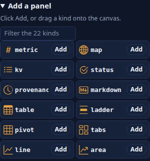

You should see `map` among the kinds with an **Add** button (or drag it onto the canvas); the **YAML** tab shows the lines above, and the **Inspector** takes `highlight`, `region`, `link` and `shade` as boxes. In the example's YAML the two panels are `highlight` and `region` on the same country field: the same field, two views of it. [SCREEN_DESIGNER.md](../guides/SCREEN_DESIGNER.md) and [PANELS.md](../guides/PANELS.md) have the rest of the options, and the reports have a map visual of their own ([tutorial 10](10-first-bi-report.md)).

## Step 8 · What you have, and what comes next

The design is yours (see **My designs** under Build). To make it live for everyone: **Submit for review**, a reviewer with the approve power reads the diff and the evidence, and approves; or export it as a pack
fragment (**Ship**) and put it in a pack. [SCREEN_DESIGNER.md](../guides/SCREEN_DESIGNER.md) walks through proposing and approving as two people; from the command line,
`drishti.py design create|save|check|propose|approve` do the same over REST ([CLI_GUIDE.md](../guides/CLI_GUIDE.md)).

You should see, under **Build → My designs**, `Desk book` with the status *draft* and your edits listed.

### Or with the designer

When an administrator has switched the **Sutra designer** on (`ui.designer: true`, or `DRISHTI_UI_DESIGNER=true`), much of this is
simpler on a page that already exists: open it, press **Customize** in the page header, and move or hide panels, pick a table's
columns, say what a click on a row opens (*When I click*), refresh a panel every 30 seconds or let people edit, all on the real page
with real data. **Describe** (Build → New screen) writes a screen from one line, such as
`TRD BOOK-RATES-2 · click a trade → cash flows + CPTY limits · refresh 30s`. Both keep the result as a design in **My designs**,
so `drishti.py design list|get|save|check` work on it as on this one. [Tutorial 22](22-build-a-screen-with-the-designer.md) walks
through it; the workbench stays the place for a screen built from your own sample documents, as here.

## Next steps

- [Tutorial 7 · Load data daily](07-load-data-daily.md) keeps the screens' data fresh.
- [Tutorial 22 · Build a screen with the designer](22-build-a-screen-with-the-designer.md): the same kind of work on a live page, in plain words.
- [SCREEN_DESIGNER.md](../guides/SCREEN_DESIGNER.md) is the workbench reference; [RACHANA_REFERENCE.md](../guides/RACHANA_REFERENCE.md) lists every option of every panel and control; [PANELS.md](../guides/PANELS.md)
  shows each of the 22 panel kinds with a picture; [SUTRA_DEVELOPER_GUIDE.md](../guides/SUTRA_DEVELOPER_GUIDE.md) is the language guide.

## If something goes wrong

| You see | Meaning |
|---|---|
| a problem naming a line | the Problems tab says which line and why; click it to put the cursor there |
| `DRS-2023` | an option on a panel that does not take it (`panels:` is only for `tabs`, `body` likewise) |
| the Trades table is empty | the slider is above every trade, or the `where` reads a control that has no value |
| the workbench says the design changed in another tab | reload it: the other tab's edit wins, nothing is lost (Versions) |
