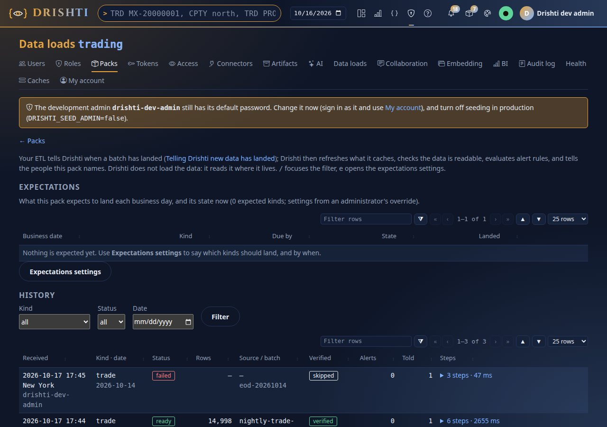
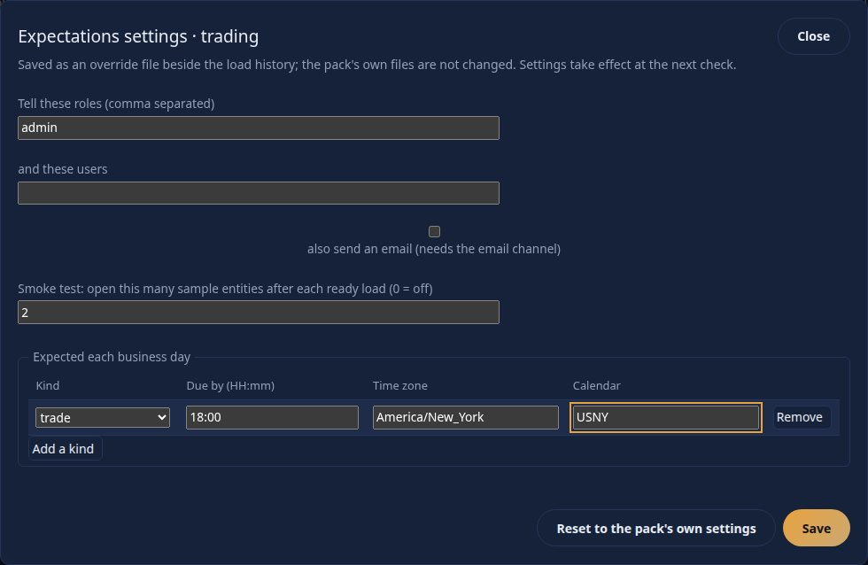
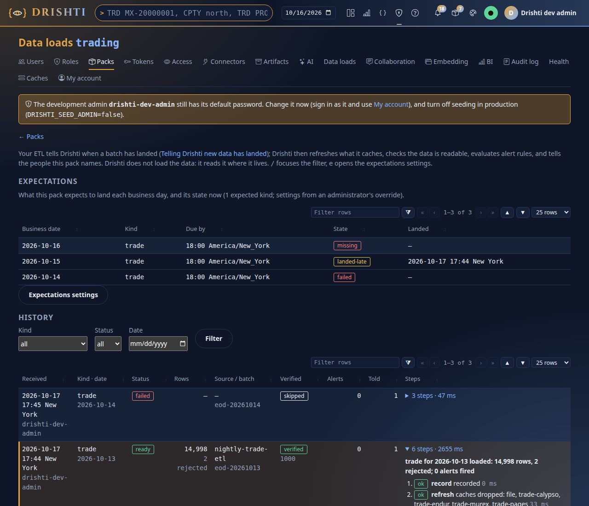
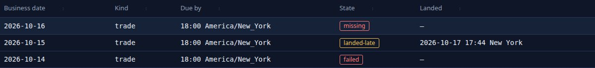
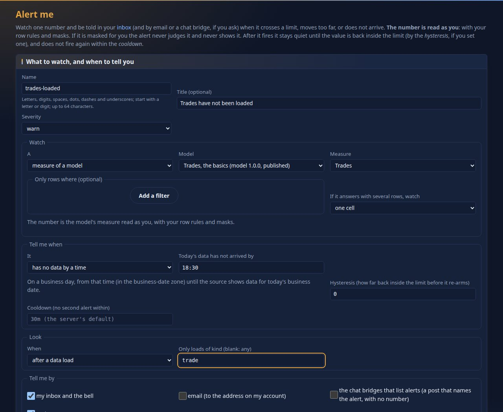
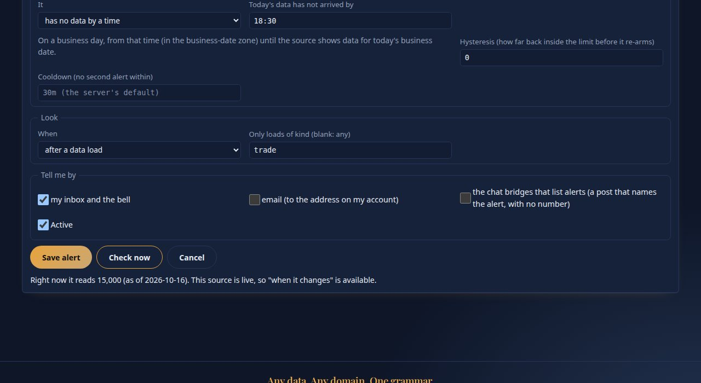
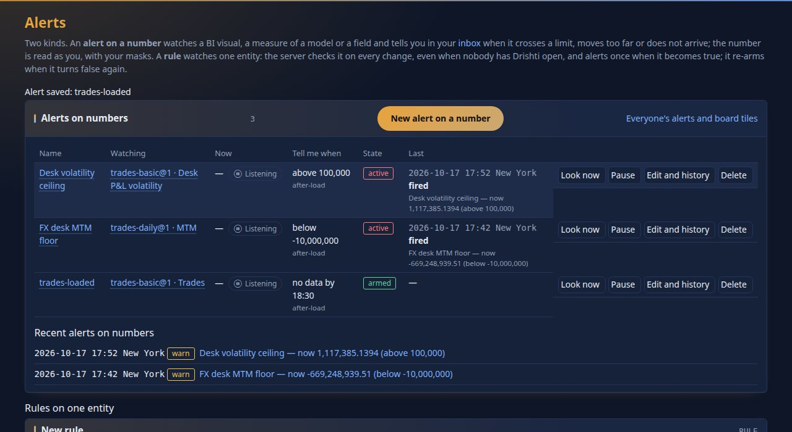

<!--
  Project Drishti · Any data. Any domain. One grammar.

  Copyright (c) 2026 Ashutosh Sinha <ajsinha@gmail.com>.
  All rights reserved.

  PROPRIETARY AND CONFIDENTIAL.

  This file is the confidential and proprietary property of Ashutosh Sinha.
  Unauthorised copying, use, modification, distribution or disclosure of this
  file, via any medium, is strictly prohibited except with the express prior
  written permission of the copyright holder.

  See the LICENSE file in the root of this repository for the full terms.
-->
# Tutorial 7 · Load data daily

In production your own job loads the store every day, and its last step tells Drishti: *this pack's data for this business date has landed*. Drishti then refreshes what it caches, checks that the data
can be read, looks at the alerts that follow loads and tells the right people. If the job never calls, Drishti notices that too. In this tutorial you play the job: set an expectation, announce
loads from the command line and the API, watch a failure and a late day, and make an alert that fires when a day's trades are not there.

## Time to complete

About 30 minutes.

## Before you start

- [Tutorial 1](01-first-15-minutes.md) done, with the token for the command line. The token must have the scope `loads:write` (tutorial 1 ticked it). A real nightly job should use its own token with that one scope and nothing else.
- Signed in as the development administrator for the pages. The pack here is `trading` and its kind is `trade`: one kind served by three connectors (`trade-endur`,
  `trade-calypso`, `trade-murex`), 15,000 trades a day on the demo lakes. The dates below are the lakes' (2026-10-13 to 2026-10-16 here); use yours.
- Drishti never copies or transforms your data: it reads the store your job loaded (see [DATA_LOADS.md](../guides/DATA_LOADS.md) for the whole story). `lake demo` and
  `lake build --signal URL` send this same signal for every table and date they write.

## What you will learn

- the **data-load signal** (`ready` and `failed`), through the command line and through the REST API;
- why announcing the same batch twice is harmless;
- an **expectation** (`trade by 18:00 New York time`) and its states: on time, late, landed late, missing, failed;
- where late data shows: Data loads, Admin → Health, and a notice to the people the pack names;
- a **measure alert** with the condition *no data by a time*, triggered after a load.

## Step 1 · Say when you expect data

Open **Admin**, then **Data loads**, then the pack `trading`.



You should see two tables: **Expectations** (*Nothing is expected yet*) and **History** (*No loads recorded yet*), with the command your ETL would use. Press `e` or **Expectations settings**.



You should see a dialog: **Tell these roles** (`admin`), users, an email box, a **smoke test** count (after each ready load Drishti opens that many sample entities to prove they render), and a table *Expected each business day*. Set the smoke test to `2`. **Add a kind**: `trade`, due by
`18:00`, zone `America/New_York`, calendar `USNY` (a day that is not a business day of that calendar expects nothing). **Save**. The setting is an override file beside the load history: the pack's own files are not touched.

**From the command line** there is no command for it: the page saves it with `PUT /api/v1/admin/loads/trading/config` from your signed-in session, and a personal API token
is refused (`403 DRS-5002 API tokens may not call this endpoint`), so a script cannot change who is told. `GET` the same address (or `drishti.py data loads --expectations`,
Step 5) reads it. What the page writes:

```yaml
notify: { roles: [admin], users: [], email: false }
smoke: 2
expect:
  trade: { by: "18:00", zone: America/New_York, calendar: USNY }
```

## Step 2 · Announce a load from the command line

Your job's last step is one command:

```text
$ drishti-console/.venv/bin/python tools/drishti.py data landed --pack trading --kind trade --date 2026-10-15 --rows 15000 --rejected 0 --batch eod-20261015 --source nightly-trade-etl
trade for 2026-10-15 loaded: 15,000 rows, 0 rejected; 0 alerts fired
  load mvcxcxas-1  status ready  verified verified  attempt 1
  record  ok      recorded
  refresh ok      caches dropped: file, trade-calypso, trade-endur, trade-murex, trade-pages
  verify  ok      1000 or more trade entities on 2026-10-15
  alerts  ok      0 alerts fired
  smoke   ok      opened 2 of 2 sample entities
  notices ok      1 person told
```

You should see a summary line and six steps. `record` stored the announcement; `refresh` dropped the caches of every connector of the kind (the three trade stores and the
trade pages built from them), so screens and BI read the new data; `verify` opened the kind for that date and counted (it stops counting at `1000 or more`);
`alerts` evaluated the alerts that follow loads; `smoke` opened sample entities; `notices` told one person. The exit is 0 unless a `ready` load cannot be verified, so a scheduler sees failures.

Announce the very same batch again:

```text
$ drishti-console/.venv/bin/python tools/drishti.py data landed --pack trading --kind trade --date 2026-10-15 --rows 15000 --rejected 0 --batch eod-20261015 --source nightly-trade-etl
trade for 2026-10-15 loaded: 15,000 rows, 0 rejected; 0 alerts fired
  load mvcxcxas-1  status ready  verified verified  attempt 1  (already announced: nothing ran again)
  record  ok      recorded
  refresh ok      caches dropped: file, trade-calypso, trade-endur, trade-murex, trade-pages
  verify  ok      1000 or more trade entities on 2026-10-15
  alerts  ok      0 alerts fired
  smoke   ok      opened 2 of 2 sample entities
  notices ok      1 person told
```

You should see `(already announced: nothing ran again)` on the load line. A load is keyed by pack, kind, business date **and batch id**: the same key with the same facts is a duplicate and does nothing, so a job may
be retried safely. (The step lines below repeat the first record.) A different batch id for the same date is a reload, and runs the steps again.

## Step 3 · A failed batch

If the copy breaks, say so (quote the note: it has spaces):

```text
$ drishti-console/.venv/bin/python tools/drishti.py data landed --pack trading --kind trade --date 2026-10-14 --status failed --note "copy stopped: disk full" --batch eod-20261014
trade load for 2026-10-14 FAILED: copy stopped: disk full
  load mvcxd8um-3  status failed  verified skipped  attempt 1
  record  ok      recorded
  late    skipped a failed load does not clear a late-data flag
  notices ok      1 person told
```

You should see `FAILED`, the note, and only `record`, `late` and `notices`: Drishti tells people and does nothing else, and `late` says that a failed load does not clear a flag already raised. A later `ready` for the same kind and
date replaces a `failed`.

## Step 4 · The same through the API

The command is a wrapper for one REST call, which is what Airflow, cron or any scheduler would make:

```text
$ curl -s -X POST $DRISHTI_SERVER/api/v1/packs/trading/loads -H "Authorization: Bearer $DRISHTI_TOKEN" -H 'Content-Type: application/json' \
    -d '{"kind":"trade","businessDate":"2026-10-13","status":"ready","rows":14998,"rejected":2,"source":"nightly-trade-etl","batchId":"eod-20261013"}' | python3 -m json.tool
{
    "id": "mvcxcy6h-2",
    "pack": "trading",
    "kind": "trade",
    "businessDate": "2026-10-13",
    "status": "ready",
    "rows": 14998,
    "rejected": 2,
    "source": "nightly-trade-etl",
    "batchId": "eod-20261013",
    "receivedAt": "2026-10-17T21:44:48.137965280Z",
    "receivedBy": "drishti-dev-admin",
    "attempt": 1,
    "reload": false,
    "verified": "verified",
    "entities": 1000,
    "alerts": 0,
    "notices": 1,
    "steps": [
        {
            "name": "record",
            "status": "ok",
            "detail": "recorded",
            "ms": 0
        },
        {
            "name": "refresh",
            "status": "ok",
            "detail": "caches dropped: file, trade-calypso, trade-endur, trade-murex, trade-pages",
            "ms": 33
        },
        {
            "name": "verify",
            "status": "ok",
            "detail": "1000 or more trade entities on 2026-10-13",
            "ms": 15
        },
        {
            "name": "alerts",
            "status": "ok",
            "detail": "0 alerts fired",
            "ms": 0
        },
        {
            "name": "smoke",
...
```

You should see the same steps as JSON: `receivedBy` is the token's owner, `verified: verified`, `entities`, `alerts` fired and `notices` sent, and the list of `steps`. The status is `201` for a new load and `200` for a duplicate.
[DATA_LOADS.md](../guides/DATA_LOADS.md) has recipes for curl, Python, Airflow, a shell script after a copy, and DishtaYantra.

## Step 5 · Read the history and what is due

```text
$ drishti-console/.venv/bin/python tools/drishti.py data loads --pack trading --limit 6 --expectations
received             kind              date        status        rows    rej  verified  alerts told  batch / source
2026-10-17 21:45:01  trade             2026-10-14  failed                     skipped        0    1  eod-20261014
2026-10-17 21:44:48  trade             2026-10-13  ready        14998      2  verified       0    1  eod-20261013 nightly-trade-etl
2026-10-17 21:44:46  trade             2026-10-15  ready        15000      0  verified       0    1  eod-20261015 nightly-trade-etl
expectations:
  2026-10-16  trade             by 18:00 America/New_York    missing
  2026-10-15  trade             by 18:00 America/New_York    landed-late
  2026-10-14  trade             by 18:00 America/New_York    failed
```

You should see the history first, newest first: status, rows, rejected, whether it verified, alerts fired, people told, batch and source. Under `expectations:` is each business day of the lookback window and its state. Here the
date 2026-10-16 is `missing` (nothing ever landed `ready`: `lake demo` wrote it, but no server was running to hear its signal), 2026-10-15 is `landed-late` (it landed after its
18:00 deadline, because this tutorial announced it a day later), and 2026-10-14 is `failed` (its newest announcement says so).

The same on the page, with each load's steps on a click:



You should see a row for each announcement, a *ready* or *failed* badge, a *verified* badge, and the load's steps. A pop-up in the corner is the notice the pack sent: *load-late trade for 2026-10-16 is MISSING: expected
by 18:00 America/New_York*.



The states are: `pending` (today, deadline not yet passed), `on-time`, `landed-late`, `late` (today, the deadline passed, nothing ready), `missing` (an earlier day, nothing ever ready) and `failed` (the newest
announcement for the date says so). `late` and `missing` are flagged **once**: one notice to the people the pack names, and a line on Admin → Health that makes the overall status `DEGRADED`. A restart does not tell again; a `ready` load clears the flag.


You should see the late data listed on Health, linked to the pack's Data loads page.

## Step 6 · An alert for a missing day

An expectation tells the people the pack names. An **alert** can tell *you*, and carry a number. Open **Views**, then **Reports**, then **My alerts** (on the Reports page), then **New alert on a number**.



Fill in: name `trades-loaded`, title `Trades have not been loaded`, severity `warn`; **Watch** *a measure of a model*, model `file:model:trades-basic` (*Trades, the basics*: the
trade valuations of the market-risk pack, one row per trade), measure `Trades`; **Tell me when** *has no data by a time*, `18:30`; **Look** *after a data load*, only loads of kind
`trade`; **Tell me by** *my inbox and the bell*. You should see the form as in the picture. Press **Check now**.



You should see an answer in words that says what the alert read: here `15,000` trades, data of `2026-10-16`, the current business date, so *no data* is not true and nothing
would fire. On a business day whose data has not arrived by 18:30 the same check says there is nothing to read for the day, which is exactly what *no data* means. Check now
saves nothing and fires nothing. Press **Save alert**.

**From the command line** there is no command for alerts: the form sends `PUT /api/v1/me/measure-alerts/{name}` (and Check now `POST /api/v1/me/measure-alerts/preview`)
from your signed-in session; a personal API token is refused (`DRS-5002`). This is the body the form sends, and what Check now answered:

```yaml
title: Trades have not been loaded
severity: warn
source: { type: model, model: "file:model:trades-basic", query: { select: { measures: [Trades] } } }
condition: { type: nodata, by: "18:30" }
trigger: { mode: after-load, kind: trade }
delivery: { inbox: true }
```

```text
{"status": "ok", "value": 15000.0, "asOf": "2026-10-16", "note": "", "condition": "no data by 18:30", "live": true}
```

A *measure of a version 1 dataset* (the form's other choice) refuses a model's measure: `DRS-9062 ... dataset 'file:dataset:trades-basic-trade' has no measure 'Trades'`; since
2.2 the measures live on the model.



You should see `Alert saved: trades-loaded` and the alert in **Alerts on numbers**: *no data by 18:30*, *after-load*, state `armed`. On a business day, from 18:30 on, if the dataset shows no data for the day, it fires into your inbox; and
because a *no data* alert is looked at after **every** load, announcing a `ready` load clears it once the data is there. The number is read as you, with your row rules and masks.

## Next steps

- Wire your own job: [DATA_LOADS.md](../guides/DATA_LOADS.md) section 11 has copy-ready recipes; make a token with only `loads:write` for it ([Permissions](../guides/DATA_LOADS.md#10-permissions)).
- [DISTRIBUTION.md](../guides/DISTRIBUTION.md) section 4 covers alerts on numbers in full: thresholds, changes, hysteresis, cooldown, delivery.
- [Tutorial 8 · Share and collaborate](08-share-and-collaborate.md).

## If something goes wrong

| You see | Meaning |
|---|---|
| `403 ... lacks the scope loads:write` | the token was made without that scope; make another (tutorial 1, Step 9) |
| `verified: failed` and exit 1 | the load was announced `ready` but Drishti cannot read the kind for that date: the data is not where the connector looks |
| an expectation `missing` for a day you did load | the load was announced for another kind, pack or business date: compare with `data loads` |
| nothing is expected on a weekend | the calendar has no business day there, by design |
