<!--
  Project Drishti · Any data. Any domain. One grammar.

  Copyright (c) 2026 Ashutosh Sinha <ajsinha@gmail.com>.
  All rights reserved.

  PROPRIETARY AND CONFIDENTIAL.

  This file is the confidential and proprietary property of Ashutosh Sinha.
  Unauthorised copying, use, modification, distribution or disclosure of this
  file, via any medium, is strictly prohibited except with the express prior
  written permission of the copyright holder.

  See the LICENSE file in the root of this repository for the full terms.
-->
# Tutorial 7 · Pivot, cubes and explain

The pivot engine end to end. Part A pivots the demo trades, their legs and VaR by desk, with totals that are never a sum of what is shown.
Part B writes a custom function, proves and approves it, explains why a figure moved and runs a what-if. Part C is the market-risk cube on the same
engine: desks by risk class, with the right totals and the diversification. Every step shows the UI, the command line and the view's JSON or YAML.

## Time to complete

About 1 h 25 min in all; each part can be done on its own day.

- Part A · The pivot engine: trades by product, legs by desk, then VaR by desk: About 30 minutes.
- Part B · Custom functions, why did it move and what-if: About 25 minutes.
- Part C · The MR cube: desks by risk class, with the right totals: About 30 minutes.

## Before you start

- The server and console running on the demo lake (`drishti.py lake demo`, [tutorial 1, Part A](01-first-15-minutes.md#part-a--install-start-and-look-around)); `EXPORT trade <GO>` lists
  the trades. The figures below are those of the demo lake on business date 2026-09-30.
- For step 6, the VaR engine on with the demo risk lake (`VAR BANK <GO>` answers).
- A token for the command line in `DRISHTI_TOKEN` or a `--token-file` ([CLI_REFERENCE.md](../guides/CLI_REFERENCE.md)).

**Part B · Custom functions, why did it move and what-if.**

- [Part A](#part-a--the-pivot-engine-trades-by-product-legs-by-desk-then-var-by-desk) done: `PIVOT trade <GO>` answers with the demo trades.
- Two users: you (an analyst) and a second user who may approve: an administrator, or a member of the role named by
  `drishti.pivot.functions.approver-role` (`pivot-approver`, one of the built-in roles as shipped: give it to the second user in
  Admin → Users). See [ADMIN_GUIDE.md](../guides/ADMIN_GUIDE.md#3-roles).

**Part C · The MR cube: desks by risk class, with the right totals.**

- The server and console running with the demo risk lake ([tutorial 2, Part A](02-var-from-the-bank-to-a-trade.md#part-a--historical-var-from-the-bank-to-a-trade)): `VAR BANK <GO>` answers.
- The engines `var`, `pivot` and `mr-cube` on (Admin → Engines; `mr-cube` is on by default). For step 26, `sensitivities` and `frtb-sa` on too.

## What you will learn

**Part A · The pivot engine: trades by product, legs by desk, then VaR by desk**

- how a view is built from the View picker and the compact line (Rows, Columns, Filters, Values, a picker behind each) or the panes
  behind Customize, how a value's function is chosen from those valid for its field, and what the server computes;
- why only open rows are computed, and how "expand by" breaks one member down by another field;
- why Others and every total are made from their own members;
- where a cell's figures come from (provenance, rows, a reference);
- how a document's lists (a trade's legs) are pivoted with Rachana paths, and why a trade's figure is counted once per trade;
- why a non-additive total (VaR) is never a sum, and how the chart and the Excel export respect it;
- how the switches Exact / Auto / ≈, Progressive and Use rollups change how a figure is computed (never what it means), and how Live
  keeps a view current;
- how a comment stays on its cell through re-arrangements and new versions of a saved view.

**Part B · Custom functions, why did it move and what-if**

- how a formula of built-ins is one function whose totals are made from states, never from the figures shown;
- what the harness checks before a function is saved, shared or used;
- why sharing needs an approver who is not the author, and what a withdrawn function looks like;
- how a difference is split into steps that add up, for sums, ratios and holistic measures;
- how a what-if overlay changes only the cells it touches, each change listed against the original.

**Part C · The MR cube: desks by risk class, with the right totals**

- why every cell and every total of the cube is the VaR of its own trades, and what diversification is in money;
- where a cell's number comes from: its scope, its tail, why it moved;
- how the lens (horizon, confidence, scenario set, currency) and the scope are options of one view;
- how components add up exactly where VaR does not;
- how the ladder and the what-if read the same view.

### Part A · The pivot engine: trades by product, legs by desk, then VaR by desk

A pivot is "these measures, broken down by these fields, under these filters, on this date". In this part you pivot the demo trades,
open a row lazily and another by a different field, check a top N's Others by hand, read a cell's provenance and rows, pivot the trades'
legs with a document path, pivot VaR by desk and see that the bank's VaR is not the sum of the desks', chart a selection, and save, share
and export a view to Excel. Each step shows the UI, the command line and the view's JSON or YAML. The guide is
[PIVOT_GUIDE.md](../guides/PIVOT_GUIDE.md).

## Step 1 · A first pivot of the trades

**UI.** Type `PIVOT trade <GO>`. The screen opens as the **View** picker (*Default layout*) in front of one line, Rows · Columns ·
Filters · Values, with the first text field on Rows and `count()` in Values; there is no field list on screen. Press `R`: the Rows picker
opens with its search; type `product`, press `Enter` on *Product type*, then uncheck the first field. Press `V` and check *Counterparty*: a
text field arrives as a count; on its chip's **▾** choose **Distinct count** (a text offers only Count and Distinct count; *Sum* is shown
off, "not a number"). The **i** beside the title says what the view reads; the grid shows one row per product type and the grand total.

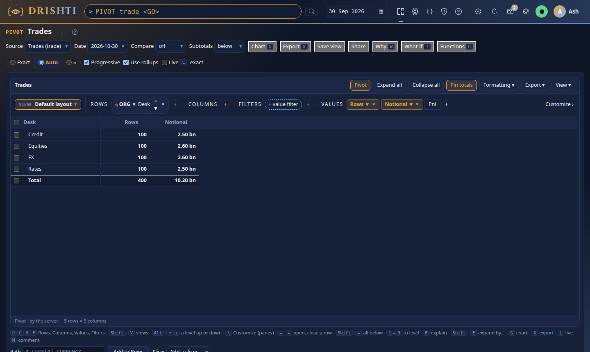

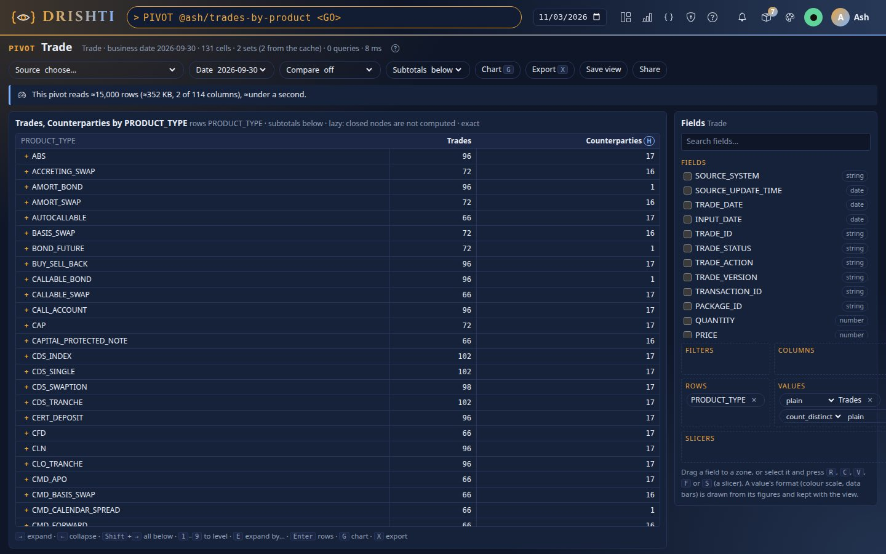

You should see 131 product types, **15,000** trades in the grand total and **24** distinct counterparties.

**CLI.**

```
drishti.py pivot fields trade
drishti.py pivot run --source trade --rows PRODUCT_TYPE --values "count()" --values "count_distinct(COUNTERPARTY)"
```

**JSON** (what the screen sent to `POST /api/v1/pivot/query`):

```json
{"source": "trade", "rows": ["PRODUCT_TYPE"], "values": [{"measure": "count()", "as": "Trades"}, {"measure": "count_distinct(COUNTERPARTY)", "as": "Counterparties"}]}
```

Check: the grand total's `count()` equals Export data's row count (`EXPORT trade`, "Rows").

## Step 2 · Open a row, then expand another by a different field

**UI.** Add `PORTFOLIO` to Rows (`R`, type `portf`, `Enter`: it goes after `PRODUCT_TYPE`; any number of fields may be nested). Nothing below level one is computed yet: the grid shows product types with **+**.
Press **+** on a product (or select its first cell and press `→`): it becomes a header with its portfolios and a total below them. The meta
line says how many sets were computed and how many came from the cache: only that product's children were asked. Now select another
product's row, press `E` and type `TRADE_DATE`: that product opens by date while the first stays by portfolio.

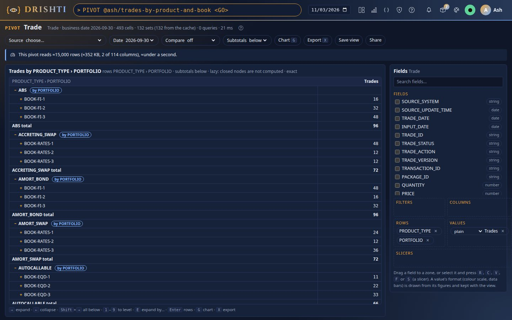

You should see each opened product's top 5 portfolios, an *Others* row and the product's total; the grand total is still 15,000.

**CLI.**

```
drishti.py pivot run --source trade --rows PRODUCT_TYPE,PORTFOLIO --values "count()" --level 2 --top PORTFOLIO=5
```

**JSON.**

```json
{"source": "trade", "rows": ["PRODUCT_TYPE", "PORTFOLIO"], "values": [{"measure": "count()", "as": "Trades"}],
 "expandTo": {"rows": 2}, "top": {"PORTFOLIO": {"n": 5}}}
```

## Step 3 · The top N and its Others

**UI.** Keep the top 2 product types by count (the CLI below, or `"top"` in the view). The grid shows the two and "Others (k of n)". Click
Others' count cell: its provenance counts its members. Check by hand: Others' count is the grand total less the two shown (for a count that
adds up); for a `median(...)`, Others is the median of Others' own rows, which no subtraction gives.

You should see two product types and Others (129 of 131), whose count is 15,000 less the two shown.

**CLI.**

```
drishti.py pivot run --source trade --rows PRODUCT_TYPE --values "count()" --values "median(PRICE)" --top PRODUCT_TYPE=2
```

**JSON.** `"top": {"PRODUCT_TYPE": {"n": 2, "by": "Trades"}}`

## Step 4 · A cell's provenance and its rows

**UI.** Click a product's total cell. The popover shows the figure, exact, the function and how its totals are made ("each cell and total
from its own rows' state"), the members counted, the condition (`PRODUCT_TYPE = '…'`), the data version and what was computed. Press
**Rows**: that product's trades, as you may see them. Press `Enter` on any cell for the same.

You should see the cell's count equal to the number of rows listed.

**CLI.** `drishti.py pivot export --source trade --rows PRODUCT_TYPE --values "count()" --what rows --cell PRODUCT_TYPE=IRS --format csv -o irs.csv`

**JSON** (`POST /api/v1/pivot/rows`): `{"view": {...}, "coords": {"PRODUCT_TYPE": "IRS"}, "limit": 50}`

## Step 5 · The legs of the trades: a document path

**UI.** A trade's record holds its legs. In the Rows picker (`R`; or the Fields pane behind **Customize ›**), under **Each leg (one row
per leg)**, are the legs' fields (*Legs › Notional*, *Legs › Leg type* …); type `$.LEGS[0].CURRENCY` into the **Path** box under the grid
and it joins Rows as *Your path*.

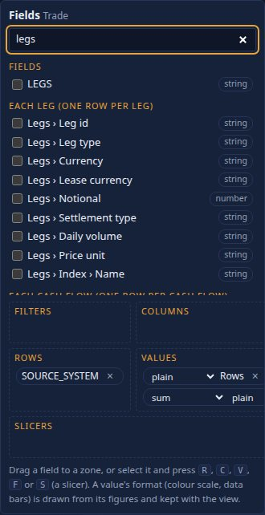

Put `TT_GROUP` (the desk) on Rows, filter `CURRENCY` to USD, and drop *Legs › Leg id* and `QUANTITY` on Values (a count of legs and a sum
of quantity). The legs make the view's grain, one row per leg, and each trade's quantity is added **once**, not once per leg.

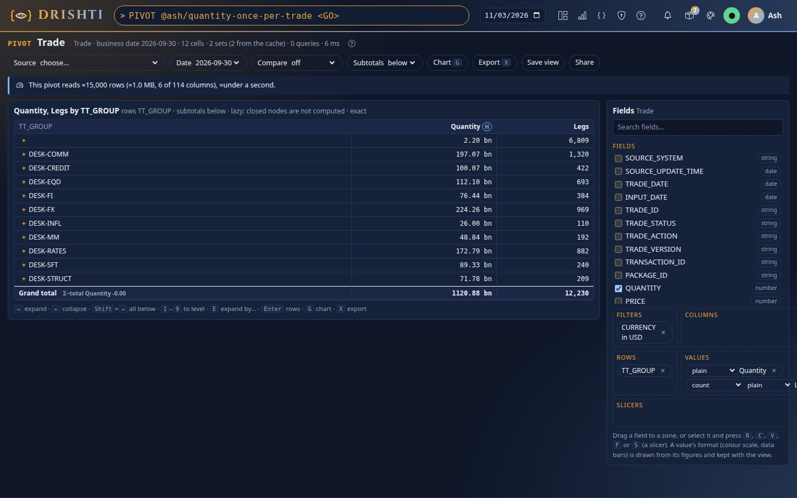

You should see **12,230** USD legs and a quantity total of **1,120,878,590,423.65**: exactly the sum over the 8,562 USD trades at the trade
grain (put `count()` alone in Values to see 8,562 trades). DESK-COMM has 1,320 legs of 990 trades. Now put *Events › Event type* on Columns:
the view is refused, because legs and events are separate lists that would multiply each other.

**CLI.**

```
drishti.py pivot run --source trade --rows '$.TT_GROUP' --filter '$.CURRENCY=USD' --values 'sum($.QUANTITY)' --values 'count($.LEGS[*].LEG_ID)'
```

**YAML** (the saved view):

```yaml
source: trade
rows: [$.TT_GROUP]
filters: {$.CURRENCY: {in: [USD]}}
values:
  - {measure: sum($.QUANTITY), as: Quantity}
  - {measure: count($.LEGS[*].LEG_ID), as: Legs}
```

More worked examples, each with its real figures: [PIVOT_GUIDE.md, Documents](../guides/PIVOT_GUIDE.md#documents-paths-lists-and-grains).

## Step 6 · VaR by desk: the total is not a sum

**UI.** Choose the source **VaR** (or type `PIVOT var <GO>`). The view opens with `var()` and `es()`; put `DESK` on Rows. Each cell's
popover shows its **scope** (`WHERE:DESK == 'DESK-X'`) and **Ask the VaR engine** opens it in VAR: the figure is the same to the cent. The
grand total is the bank's own VaR; the desks' VaRs add up to more, and the grand total row shows the gap as **diversification**
(total − Σ desks). VaR's **▾** offers no function: it is computed per cell by the VaR engine.

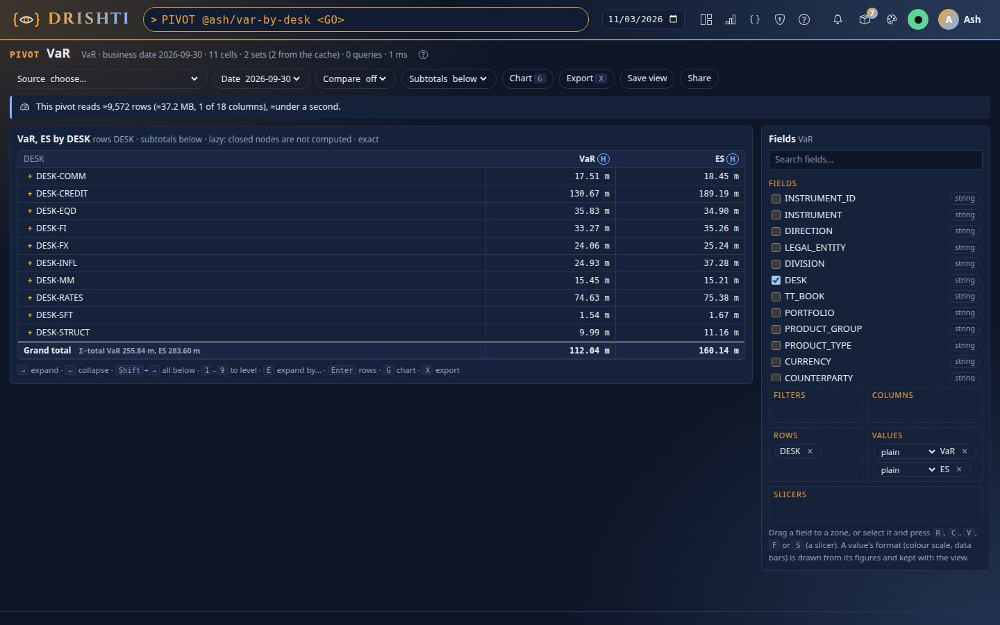

You should see the bank's VaR of **112,041,645.93** (ES 160,143,809.24), less than DESK-CREDIT (130,670,864.00) and DESK-RATES
(74,633,680.00) together.

**CLI.**

```
drishti.py pivot run --source var --rows DESK --values "var()" --values "es()"
drishti.py var show BANK
```

**JSON.** `{"source": "var", "rows": ["DESK"], "values": [{"measure": "var()", "as": "VaR"}, {"measure": "es()", "as": "ES"}]}`

## Step 7 · Chart the selection

**UI.** With nothing selected, press `G`: the desks' VaR as bars **beside** the bank's, with the diversification as its own bar, and a line
saying why it is not stacked. Go back to the trades pivot of step 1 and press `G`: a count adds up, so its bars sum to the total. Click a
bar to open that member in the grid.

You should see the VaR bars side by side, never stacked, and the trades' bars adding up to 15,000.

**CLI.** A chart is drawn on the screen; `drishti.py pivot export --format csv` writes the figures it draws.

## Step 8 · Save, share and export to Excel

**UI.** Press **Share**, name the view `desk-var` and share it with `role:risk`. The title becomes `you/desk-var @1`; a cell's popover now
shows its reference (`pivot://you/desk-var@1/VaR[DESK=DESK-X]`). Press `X`, keep "The pivot as shown" and press **Excel**. Open the file:
the rows are grouped with Excel's own + and −; in a trades pivot, a `count()` or `sum()` total is a `SUM` formula of its parts, while VaR
and any median are values; the Provenance sheet lists who exported, the data and how every measure's totals are made.

You should see `you/desk-var` in `drishti.py pivot views` and, in the workbook, VaR totals as values, not formulas.

**CLI.**

```
drishti.py pivot save desk-var --source var --rows DESK --values "var()" --share role:risk
drishti.py pivot export --view you/desk-var --format xlsx -o desk-var.xlsx
drishti.py pivot views
```

**JSON** (`POST /api/v1/pivot/views`): `{"name": "desk-var", "view": {...}, "sharedWith": ["role:risk"]}`

## Step 9 · Exact or ≈, rollups, and Live

**UI.** Back on the trades pivot, put `counterparty` on Rows and add `distinct(counterparty)` to Values. Under the toolbar, the line
beside the switches reads `exact`. Press **≈**: the distinct count now reads `≈ …`, the line says `≈ from a sketch (distinct(counterparty))`
and its tooltip the error (±1.6%). Keep the top 5 counterparties by `count()` (step 3): with ≈ on, the line adds
`top N ≈ by a summary, figures exact`: five counterparties were chosen by a Space-Saving summary before the level was read, and each
count shown is still exact; Others says "≈". Press **Exact** to rank every member again. Untick **Use rollups**: if an administrator
defined a rollup covering the view, the line no longer says `from rollup …` and the figures are the same. Press `L` (or tick **Live**):
the line ends `live`; when a load of the trades lands for this date (an administrator's `drishti.py data load` or Admin → Data loads),
the cells that moved flash with their new figures and nothing else is redrawn.

**CLI.**

```
drishti.py pivot run --source trade --rows counterparty --values "count()" --values "distinct(counterparty)" --top counterparty=5 --approximate
drishti.py pivot run --source trade --rows productType --values "count()" --no-rollups
drishti.py pivot live start --source trade --rows productType --values "count()"
drishti.py pivot live list
drishti.py pivot live stop lp-…
```

**JSON** (`POST /api/v1/pivot/query`, then `POST /api/v1/pivot/live`):
`{"view": {...}, "exact": false, "rollups": false}`; every answer's `computedAs.words` says how it was computed.

**You should see** the same counts under Exact and ≈ (only the distinct count and the choice of the top 5 change, each marked), the
line beside the switches change with every press, and with Live on a load's moved cells flash while the rest stay as they were.

## Step 10 · A comment on a cell

**UI.** Open the view you saved in step 8 (`PIVOT @you/desk-var <GO>`), click a desk's VaR cell and, in the popover, write "checked with
the desk" (`M` puts the cursor in the box) and press **Comment**. The cell gets a marker in its corner. Move CURRENCY to Columns and back,
or save the view again: the comment stays on its cell, named by its coordinates (`DESK=DESK-X`); after the new save it says "on an older
version". Press **Resolve**: the marker dims.

**CLI.**

```
drishti.py pivot comments you/desk-var --cell DESK=DESK-X --add "checked with the desk" --measure VaR
drishti.py pivot comments you/desk-var --open
drishti.py pivot comments you/desk-var --resolve c-…
```

**JSON** (`POST /api/v1/pivot/views/you/desk-var/comments`): `{"coords": {"DESK": "DESK-X"}, "measure": "VaR", "text": "checked with the desk"}`

**You should see** the marker on the commented cell wherever the cell moves, the comment in its popover with your name and the time,
"on an older version" after the view is saved again, and a dimmed marker once it is resolved.

#### What you learned

Every figure in a pivot is the server's, made from its cell's own members: a mergeable total from its own rows' state, a holistic one
(VaR, a median) from its own members, Others from its own rows. A document's lists are pivoted at their own grain with Rachana paths, a
coarser figure is counted once per parent, and two lists are never crossed. Open rows are computed on demand and the rest come from the
cache. A chart and an Excel file never add up what does not add up. The switches change how a figure is computed and say so, never what
it means; a live view sends only what moved; a comment belongs to a cell's coordinates, not its place on the screen.

### Part B · Custom functions, why did it move and what-if

The built-in measures cover most questions; the rest you write yourself. In this part you put a formula straight into a pivot, write a
weighted-return function in the playground and watch the harness prove that its split-and-merge answer equals one pass, save it, have
someone else approve it and use it in a view, withdraw it, then explain why one product's notional differs from another's in steps that
add up, and try a what-if. Each step shows the UI, the command line and the JSON or YAML. The guide is
[PIVOT_GUIDE.md, sections 19 to 22](../guides/PIVOT_GUIDE.md#19-custom-functions).

## Step 11 · A formula in a view

**UI.** `PIVOT trade <GO>`, `PRODUCT_TYPE` on Rows. In Values, edit a value's text to `sum(NOTIONAL, where=NOTIONAL > 100000000) / sum(NOTIONAL)`
(the share of notional in trades over 100 million). Every row and the grand total show the ratio; the grand total is the ratio over all the trades, not
an average of the rows' ratios.

**CLI.**

```
drishti.py pivot run --source trade --rows PRODUCT_TYPE --values "sum(NOTIONAL, where=NOTIONAL > 100000000) / sum(NOTIONAL)"
```

**JSON.**

```json
{"source": "trade", "rows": ["PRODUCT_TYPE"], "values": [{"measure": "sum(NOTIONAL, where=NOTIONAL > 100000000) / sum(NOTIONAL)", "as": "Large share"}]}
```

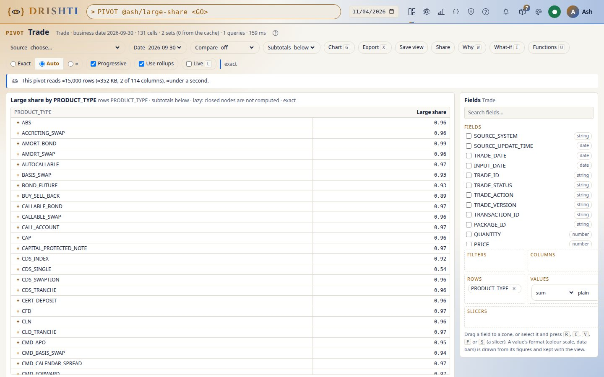

**You should see** one ratio per product type and a grand total that equals the sum of the notional of trades over 100 million divided by the sum of all notional (`EXPORT trade`, filter and sum).

## Step 12 · The playground: a function and its harness

**UI.** Press `U` (or **Functions**). Name `wret`, language **formula (Rachana)**, inputs `r, w`, code `sum(r * w) / sum(w)`; leave the sample
rows and the group column `g`. Press **Check**. You see *Passes the harness*, the checks (one pass; batches of 1, 7, 1,000 and 65,536;
2, 3 and 16 random parts merged left-deep and balanced under five seeds; an empty cell; a part of nulls; one row; equal rows; infinities;
the state read back; the same bits twice; the cost; the state's size), the state after each part and after each merge (two sums, `[Σrw, Σw]`
as the engine keeps them) with the final figure beside the one-pass figure, and the little pivot of the sample by `g` whose total is made
from the groups' states.

**CLI.** Write `wret.yaml` and `rows.csv`:

```yaml
name: wret
language: formula
code: sum(r * w) / sum(w)
inputs: [r, w]
description: the weighted mean of returns
```

```
r,w,g
0.012,3,A
-0.004,1,B
0.020,2,A
0.001,5,B
```

```
drishti.py pivot functions test wret.yaml --sample rows.csv --group g
```

```text
PASSED: fn:ravi/wret@0 (mergeable), one pass 0.007, 4 rows, 2245.0 ns a row, state 56 bytes
  ok  one pass             the figure is 0.007
  ok  batches and splits   36 runs within 1.0E-12 of the one pass
  ok  empty                an empty cell finishes to nothing (no values in the cell, or a division by zero)
  ok  nulls                a part of nulls merged equals one pass over the rows and the nulls
  ok  single row           one row finishes to 0.012000000000000002
  ok  all equal            100 equal rows finish to 0.012000000000000002, split or not
  ok  state round trip     the state read back finishes to the same figure
  ok  deterministic        the same rows in the same order gave the same bits
  ok  cost                 2245 ns a row (limit 2000); under 1,000 sample rows the cost is shown, not judged
  ok  state bound          the largest state was 56 bytes
  part 1 (rows 1 to 2)               0.008  (56 bytes)
  part 2 (rows 3 to 4)               0.0064285714285714285  (56 bytes)
  merged parts 1 to 2                0.007  (56 bytes)
```

(The author here is `ravi`: a function is named after the person who writes it, `fn:<you>/<name>@<version>`; `@0` is the unsaved draft.)

**JSON** (`POST /api/v1/pivot/functions/test`): the YAML's keys, plus `"sample": [{"r": 0.012, "w": 3, "g": "A"}, ...]` and `"group": "g"`.

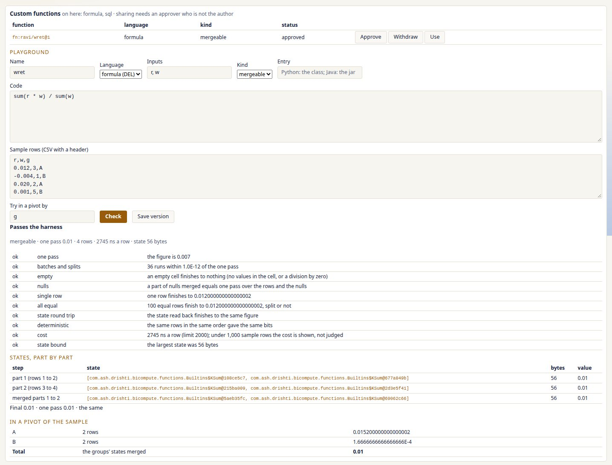

**You should see** *Passes the harness*; the final figure is (0.012·3 − 0.004·1 + 0.020·2 + 0.001·5) / 11 = 0.077 / 11 = 0.007.

## Step 13 · An SQL macro: rewritten into states, or holistic

**UI.** Language **SQL macro**, code `CREATE MACRO wret2(r, w) AS sum(r * w) / sum(w)`, **Check**: the kind is *mergeable* (the engine
rewrote the macro into the states of its sums). Now `CREATE MACRO slope(r, w) AS regr_slope(r, w)`: the kind is *holistic* (no merge;
each cell's figure is computed by DuckDB from its own rows) and the harness runs only the checks that apply.

**CLI.** The same with `language: sql` and `code: "CREATE MACRO slope(r, w) AS regr_slope(r, w)"`.

**You should see** *mergeable* for `wret2` and *holistic* for `slope`; a macro that names a table or a file (`read_csv(...)`) is refused in words (DRS-5710): a macro is SQL over its inputs only.

## Step 14 · Save, approve, use

**UI.** Back to `wret` (formula), **Save version**: `fn:you/wret@1`, private. As yourself, **submit** it for sharing; as the second user, open
**Views → Approvals**, choose `fn:you/wret@1` (or *In Approvals* beside it in **Functions**) and press **Approve**, with the comment
"reviewed: a weighted mean". As yourself, in Values add
`fn:you/wret@1(PRICE, NOTIONAL)` (the trades' price and notional): the column header is the call itself, `fn:ravi/wret@1(PRICE, NOTIONAL)`
for the author `ravi`.

**CLI.**

```
drishti.py pivot functions save wret.yaml --sample rows.csv
drishti.py approvals approve function you:wret@1 --comment "reviewed: a weighted mean"      # as the approver
drishti.py pivot run --source trade --rows PRODUCT_TYPE --values "fn:you/wret@1(PRICE, NOTIONAL)"
```

```text
saved fn:ravi/wret@1 (mergeable): private until an approver who is not you approves it
drishti: the server said 403 DRS-5712: an author never approves their own function (fn:ravi/wret@1): another approver must ...
fn:ravi/wret@1: approved
```

The refusal is the author's own `approve`; the approval is the second user's (`vera`, with her own token).

**JSON.** `POST /api/v1/approvals/function/you:wret@1/approve` with `{"comment": "reviewed: a weighted mean", "params": {"scope": "everyone"}}`; the view's
value is `{"measure": "fn:you/wret@1(PRICE, NOTIONAL)"}`.

```text
Trade · 2026-09-30 · 131 cells · 2 sets, 0 from the cache · 1 queries · 267 ms · exact
PRODUCT_TYPE                        fn:ravi/wret@1(PRICE, NO
+ ABS                                                      ·
+ ACCRETING_SWAP                                        0.05
+ AMORT_BOND                                           98.20
+ AMORT_SWAP                                            0.03
...
```

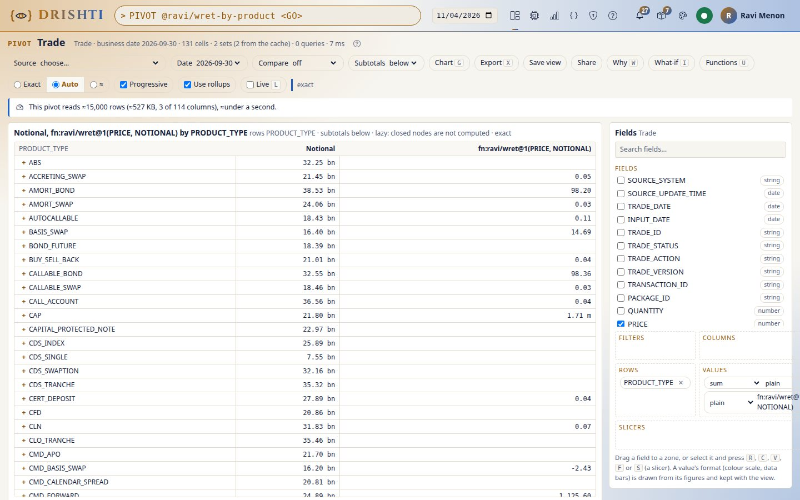

**You should see** the new column in every row and the total; approving your own function is refused (DRS-5712: "an author never approves their own function"); Admin → Audit shows
`pivot.function.save`, `pivot.function.approve` and `pivot.function.use`, with the version.

## Step 15 · Withdraw

**UI.** As the approver, **Withdraw** `fn:you/wret@1` with a reason. Run your view again: every cell of that column says "function withdrawn
by … on …: reason", with no figure; the other values answer as before.

**CLI.** `drishti.py pivot functions revoke you/wret@1 --reason "superseded"`.

**You should see** "function withdrawn by …" in each cell of the column and no figure; the function's list marks it *withdrawn*.

## Step 16 · Why did it move?

**UI.** In the `PRODUCT_TYPE` pivot with `sum(NOTIONAL)`, put `COUNTERPARTY` on Columns (**Split by** offers the view's own rows and
columns), select two product rows (click one, Shift-click the other) or type them as **First cell** and **Second cell**, and press `W`.
**Split by** `COUNTERPARTY`, **Explain**. The words say how much the second differs from the first and the largest steps; below them one
step per counterparty (its cause: new, gone or changed) and the steps add up to the difference. Change the value to `avg(NOTIONAL)` and explain again: each
step is now that counterparty's effect on the average given the steps before it, the order is shown (switch **Order** to "largest first"
and the same difference splits differently), and they still add up.

**CLI.**

```
drishti.py pivot explain --source trade --rows PRODUCT_TYPE --values "sum(NOTIONAL)" --cell PRODUCT_TYPE=FX_SWAP --other-cell PRODUCT_TYPE=FX_FORWARD --by COUNTERPARTY
```

```text
sum(NOTIONAL) moved from 35,644,171,130 to 25,679,859,409 (-9,964,311,721); the largest steps: CP-MERIDIAN-RE -2,196,462,950, CP-BRAMBLE -2,126,815,900, CP-VERDANT -2,055,678,300.
  each member's own change (the measure adds up)
  CP-ALDERSHOT                 changed     710,057,225.0000   cumulative 710,057,225.0000
  CP-AURORA                    changed   -1,669,308,280.0000   cumulative -959,251,055.0000
  CP-BRAMBLE                   changed   -2,126,815,900.0000   cumulative -3,086,066,955.0000
  ...
```

**JSON** (the one Explain, `POST /api/v1/explain`, kind `pivot`; the engine's steps are under `why.answer`):

```json
{"kind": "pivot", "measure": "cell", "part": "why",
 "view": {"source": "trade", "rows": ["PRODUCT_TYPE"], "values": ["sum(NOTIONAL)"]},
 "from": {"PRODUCT_TYPE": "FX_SWAP"}, "to": {"PRODUCT_TYPE": "FX_FORWARD"}, "by": "COUNTERPARTY"}
```

The old `POST /api/v1/pivot/explain` still answers for one release, as a deprecated alias of this (it says so in its `Deprecation` and
`Link` headers); move scripts to `/api/v1/explain`.

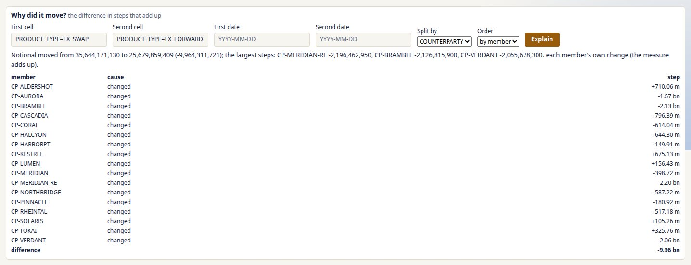

**You should see** the words and the steps; the sum of the steps plus the residual equals `difference`; the residual is named ("rounding"). For a cell on two dates, give
`fromDate` and `toDate` (`--from`, `--to`) instead of a second cell.

## Step 17 · What-if

**UI.** Press `I`. **Leave out** `PRODUCT_TYPE=FX_FORWARD`, **Change** `NOTIONAL*1.1 where COUNTERPARTY=CP-ALDERSHOT`, **Run the what-if**. The list
shows each cell that changes and by how much (what-if minus original); nothing was written anywhere.

**CLI.**

```
drishti.py pivot whatif --source trade --rows PRODUCT_TYPE --values "sum(NOTIONAL)" --exclude PRODUCT_TYPE=FX_FORWARD --scale NOTIONAL=1.1@COUNTERPARTY=CP-ALDERSHOT
```

```text
108 cell(s) change; differences are what-if minus original
  PRODUCT_TYPE=ABS|*                       sum(NOTIONAL) +138,863,064.00
  PRODUCT_TYPE=ACCRETING_SWAP|*            sum(NOTIONAL) +101,499,900.00
  PRODUCT_TYPE=AMORT_SWAP|*                sum(NOTIONAL) +155,982,800.00
  ...
```

**JSON** (`POST /api/v1/pivot/whatif`):

```json
{"view": {"source": "trade", "rows": ["PRODUCT_TYPE"], "values": ["sum(NOTIONAL)"]},
 "whatIf": {"exclude": {"PRODUCT_TYPE": ["FX_FORWARD"]}, "changes": [{"field": "NOTIONAL", "scale": 1.1, "where": {"COUNTERPARTY": ["CP-ALDERSHOT"]}}]}}
```

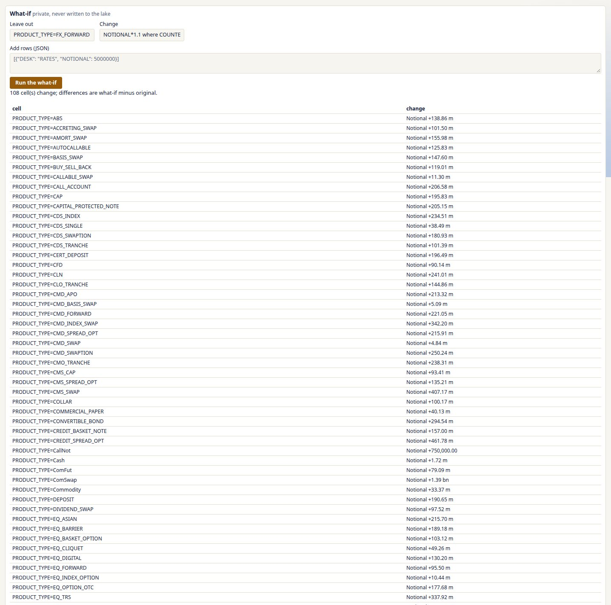

**You should see** *108 cell(s) change; differences are what-if minus original* and each changed cell with its change: FX_FORWARD's
cell is gone from the what-if, and the grand total moved by 10 % of CP-ALDERSHOT's notional less FX_FORWARD's.

## Step 18 · Python (an administrator turns it on)

Python functions are off as shipped. With `drishti.pivot.functions.python.enabled: true` in `config/engines/pivot.yaml` (and a restart),
language **Python** takes a class decorated with `@function` ([PIVOT_GUIDE.md section 19](../guides/PIVOT_GUIDE.md#19-custom-functions));
it runs in the node's sandboxed `pivot-fn` workers (no network, no files, no processes), fed Arrow batches over a pipe, and passes the same
harness. Python functions never read memory-only data.

**You should see** **Python** offered in the language list once it is on (and, while it is off, refused in words: DRS-5713).

## Step 19 · BI's totals are the engine's

Open a BI report with a matrix (the sample *trades overview*). Every total and subtotal row comes from the pivot engine's
one statement over the model's rows: the average's total is the average over all the trades, a sum's total is the engine's sum. A
year-to-date measure shows a dash in the total row; the answer's warnings say why ([REPORTS_GUIDE.md section 3.2](../guides/REPORTS_GUIDE.md#97-true-totals)).

**You should see** the matrix's totals and subtotals as before (the figures are the same: `BiParityTest`) and a dash, with its reason,
where a measure has no total.

### Part C · The MR cube: desks by risk class, with the right totals

The MR cube is the pivot engine on the VaR source with the market-risk lens around it. In this part you open the landing (desks by risk
class), check its totals against `VAR BANK` and see the diversification, read a cell's tail and why it moved, change the lens (10 days,
97.5%, stressed), re-pivot by currency and open a desk down to its trades, read the components and their waterfall, the DV01 ladder and a
what-if side by side, and save, share and export a view. Each step shows the UI, the command line and the view's JSON. The guide is
[PIVOT_GUIDE.md section 29](../guides/PIVOT_GUIDE.md#29-the-mr-cube-preset); the pivot screen itself is [Part A](#part-a--the-pivot-engine-trades-by-product-legs-by-desk-then-var-by-desk).

## Step 20 · The landing: desks by risk class

**UI.** Type `MCUBE <GO>` (or **VaR → MR cube**). The pivot screen opens with the MR lens: the short title (`MR cube · BANK 2026-09-30 ·
1d 99% · USD`) with the headline figures on its line (VaR, ES, limit use, Σ desks − total, stressed VaR, the data), the lens controls, the
slider, tabs A, B and C, and the pivot under one line: **VIEW By risk class × desk ▾**, then `Rows ⋔ MGMT ▾ Desk ▲▼ · Columns Risk class ·
Values VaR ▾` and the measure toggles. One row per desk of the management hierarchy, one column per risk class, each cell its VaR with a
sparkline when earlier dates are open.

**CLI.**

```
drishti.py pivot fields var
drishti.py pivot run --source var --rows MGMT.DESK --cols RISK_CLASS --values "var()"
drishti.py pivot mr headline --source var
```

**JSON** (the catalogue's `defaultView`, sent to `POST /api/v1/pivot/query`):

```json
{"source": "var", "rows": ["MGMT.DESK", "MGMT.BOOK", "POSITION", "TRADE"], "columns": ["RISK_CLASS"],
 "values": [{"measure": "var()", "as": "VaR"}], "options": {"scope": "BANK"}, "expandTo": {"rows": 1, "columns": 1}}
```

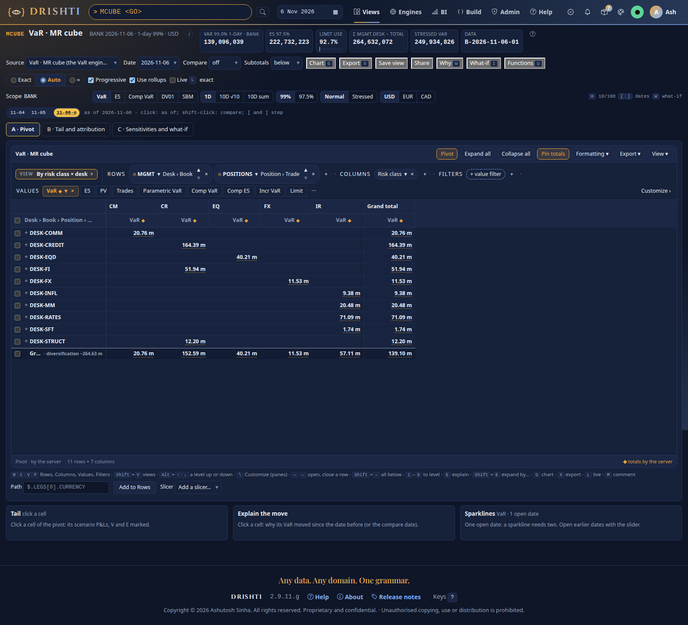

**You should see** desks by risk class with a grand total; the grand total equals `VAR BANK` to the cent, and the headline's VaR is the same number.

## Step 21 · The fields: the View picker, the Rows picker, VaR's menu and the panes

**UI.** Press `Shift+V`: the **View** picker lists the cube's ready-made views (*By risk class × desk*, *By desk*, *By book*, *By limit
letter* where the LL hierarchy is configured, *Top contributors*, *Trades in my scope*; keys `1`–`9`), then *My views* and *Shared with me*.
Press `3` (or click *By book*): rows `MGMT Desk › Book`, values VaR, ES and Limit use. Press `R`: the Rows picker shows **Hierarchies**
first, each one item (`MGMT Division › Desk › Book`, `LEGAL Legal entity › Desk › Book`, `Positions Position › Trade`); open MGMT with `→`
for its levels. The columns the levels are built from (`DIVISION`, `DESK`, `TT_BOOK`, `LEGAL_ENTITY`) are under **More fields**, closed.
`Esc`, then `Alt+↑`: MGMT goes up a level (Desk alone, the stepper's ▲); `Alt+↓` brings Book back (▼). Open VaR's **▾**: *computed per cell by the VaR engine*, no Sum, the VaR options (horizon,
confidence, scenario set) instead. Press `\`: the **Build** and **Fields** panes open beside the grid; drag *Currency* from Fields to
Columns; `\` again closes them.

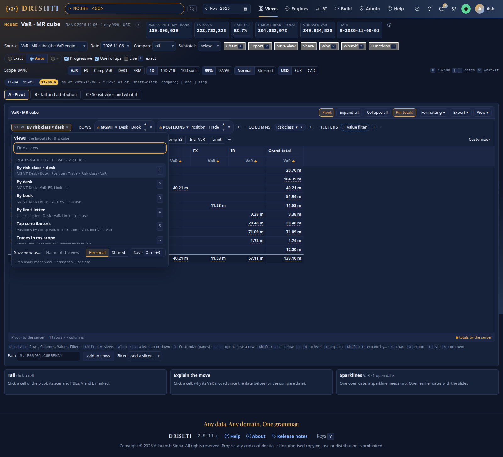

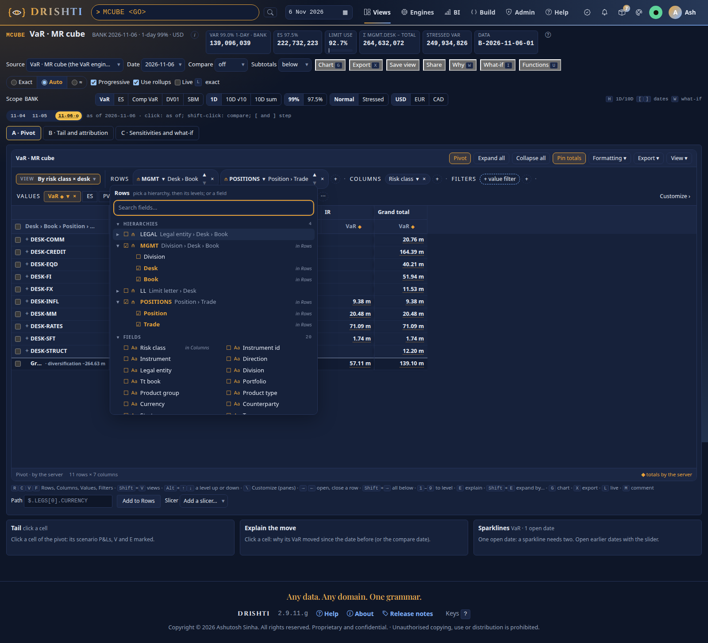

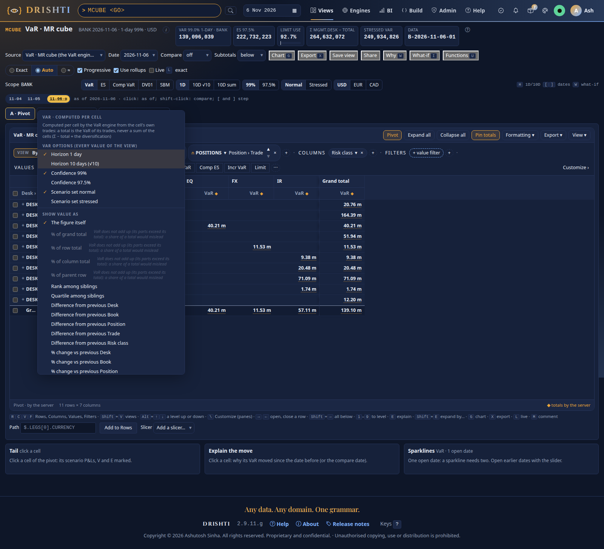

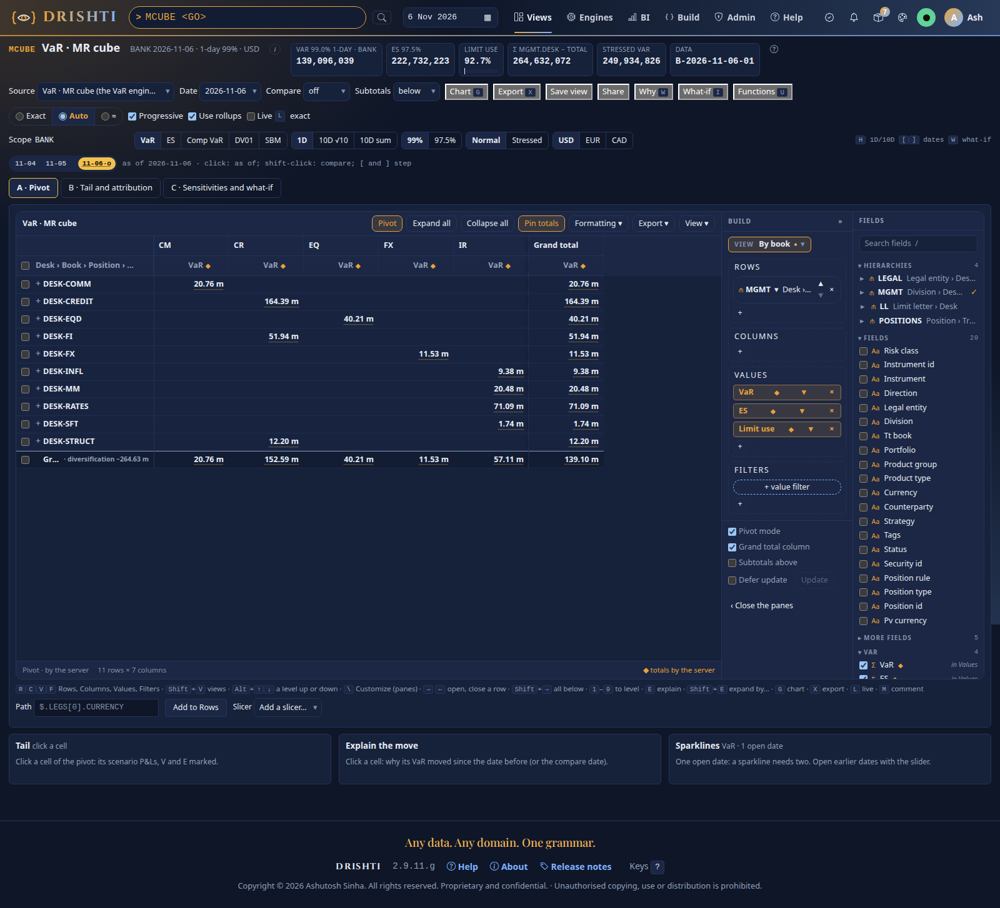

**CLI.**

```
drishti.py pivot fields var
drishti.py pivot run --source var --rows MGMT.DESK,MGMT.BOOK --values "var()" --values "es()" --values "limit_use()"
```

**YAML** (the ready-made view in `drishti-console/config/pivot-presets.yaml`, and a Sutra's pivot that opens in the panes):

```yaml
presets:
  mr:
    mode: views
    views:
      - id: by-book
        name: By book
        rows: [MGMT.DESK, MGMT.BOOK]
        values: [{measure: "var()", as: VaR}, {measure: "es()", as: ES}, {measure: "limit_use()", as: Limit use}]
```

```yaml
pivot: { rows: [CURRENCY], values: [{ field: NOTIONAL, agg: sum }], mode: panes }
```

**You should see** the books of each desk under it; the catalogue (`drishti.py pivot fields var`) lists MGMT once under `hierarchies`, its
levels hidden from the plain fields, and every VaR measure with `perCell: true` and no functions.

## Step 22 · Totals are never sums: the diversification

**UI.** Add up the desks' VaR in the *Grand total* column by hand: it is more than the bank's. The headline's **Σ desks − total** tile is
that difference, in money; the grand total row carries it too (`Σ−total` beside it).

**CLI.**

```
drishti.py pivot run --source var --rows MGMT.DESK --values "var()" --json | jq '.rows[] | select(.kind=="grand") | .diversification'
```

**JSON.** The answer's grand row: `{"kind": "grand", "diversification": {"VaR": <Σ desks − bank>}}`.

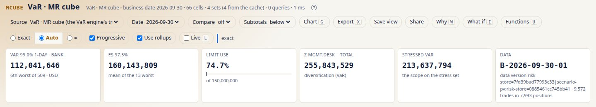

**You should see** a grand total below the desks' sum and the difference in the Σ desks − total tile; pick one desk's cell and run `VAR <its scope>` (the scope is in the cell's provenance, step 22): the same VaR to the cent.

## Step 23 · A cell's tail, provenance and why it moved

**UI.** Click the RATES × IR cell. The provenance popover shows its scope (`(NODE:MGMT~DESK-RATES) & (WHERE:PRODUCT_GROUP in (…))`), its
trades and how the figure is made. The rail under the pivot shows its scenario P&L histogram (the VaR scenario marked **V**, the ES tail
**E**) and *Explain the move*: the cell's VaR on the date before, each exact step, and today's VaR. Shift-click an earlier date on the slider
to explain against it instead.

**CLI.**

```
drishti.py pivot mr cell --source var --rows MGMT.DESK --cols RISK_CLASS --cell MGMT.DESK=DESK-RATES,RISK_CLASS=IR
drishti.py pivot mr explain --scope "(NODE:MGMT~DESK-RATES) & (WHERE:PRODUCT_GROUP in ('Rates'))"
```

**JSON** (`POST /api/v1/risk/mr/detail`):

```json
{"view": {"source": "var", "rows": ["MGMT.DESK"], "columns": ["RISK_CLASS"], "values": [{"measure": "var()"}]},
 "coords": {"MGMT.DESK": "DESK-RATES", "RISK_CLASS": "IR"}}
```

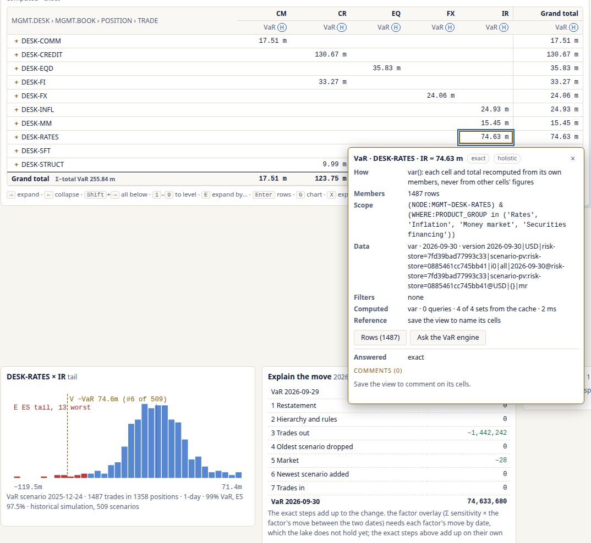

**You should see** the cell's scope, its scenario P&L histogram with V and E marked and its steps; the detail's `var` equals the cell's VaR, and its `k` says which worst loss it is (the 6th of 509 at 99%).

## Step 24 · The lens: 10 days, 97.5%, stressed, another currency

**UI.** Press **H** (or click *10D √10*): every cell is computed again at 10 days. Click *97.5%*, then *Stressed*: the stress set's VaR
(USD). Click *Normal* and *EUR*: the bank in euros. Type `DESK:RATES` in *Scope* and press Enter: the view starts from the rates desk.

**CLI.**

```
drishti.py pivot run --source var --rows MGMT.DESK --values "var()" --option horizon=10d --option confidence=0.975
drishti.py pivot run --source var --rows MGMT.BOOK --values "var()" --option scope=DESK:RATES --option ccy=EUR
```

**JSON.** The options of the view: `"options": {"scope": "DESK:RATES", "horizon": "10d", "confidence": "0.975", "ccy": "EUR"}`.

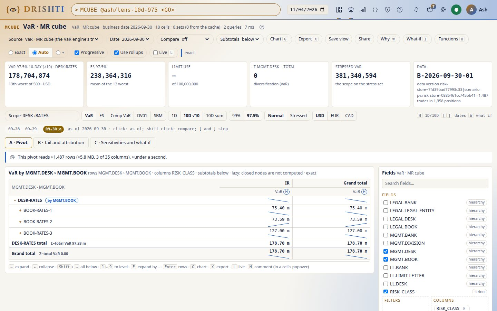

**You should see** every cell computed again for the lens; `VAR DESK:RATES H 10D` on the VaR explorer gives the total of the 10-day view.

## Step 25 · Re-pivot and open a desk down to its trades

**UI.** Press `C`, uncheck *Risk class* and check *Currency* (or drag it in the panes). Open RATES with →: its books are computed, nothing else. Open a book: its
positions; a position: its trades. Select a book and press **E**, type `COUNTERPARTY`: that book alone is broken down by counterparty.
Press Enter on a cell: its trades, as the VaR engine holds them.

**CLI.**

```
drishti.py pivot run --source var --rows MGMT.DESK,MGMT.BOOK --cols CURRENCY --values "var()" --open MGMT.DESK=DESK-RATES
drishti.py pivot export --source var --rows MGMT.DESK --values "var()" --what rows --cell MGMT.DESK=DESK-RATES -o rates-trades.csv
```

**JSON.** The node opened: `"expanded": [{"axis": "rows", "path": [["MGMT.DESK", "DESK-RATES"]], "by": "MGMT.BOOK"}]`.

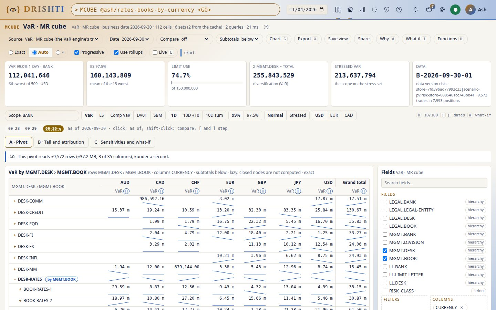

**You should see** RATES's books and nothing else computed; each book's VaR is its own (`VAR BOOK:<book>`), and the desk's subtotal is not their sum.

## Step 26 · Components, the waterfall, the ladder and a what-if

**UI.** Open tab **B**: each desk's component VaR and its share; a negative one is a hedge; they add up to the bank's VaR exactly. The
waterfall draws them, the total last; the histogram is the bank's; the heat map is DV01 by currency × tenor. Open tab **C**: the DV01 ladder
by currency and bucket (*Grid* switches between the bank's buckets and FRTB's vertices). In *What-if*, copy a booked trade with × -1 and add
it: every desk and the total, before, after and the change.

**CLI.**

```
drishti.py pivot run --source var --rows MGMT.DESK --values "comp_var()" --values "var()"
drishti.py pivot mr ladder --scope BANK --grid BANK-IR-TENOR
drishti.py pivot mr whatif --source var --rows MGMT.DESK --copy <a trade id> --factor -1
```

**JSON** (`POST /api/v1/risk/mr/what-if`): `{"view": {...}, "items": [{"copyOf": "<a trade id>", "factor": -1}]}`.

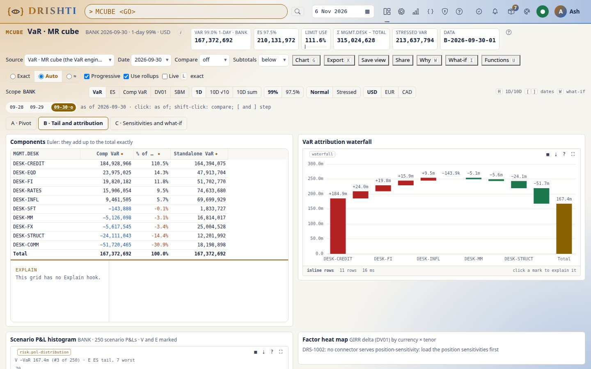

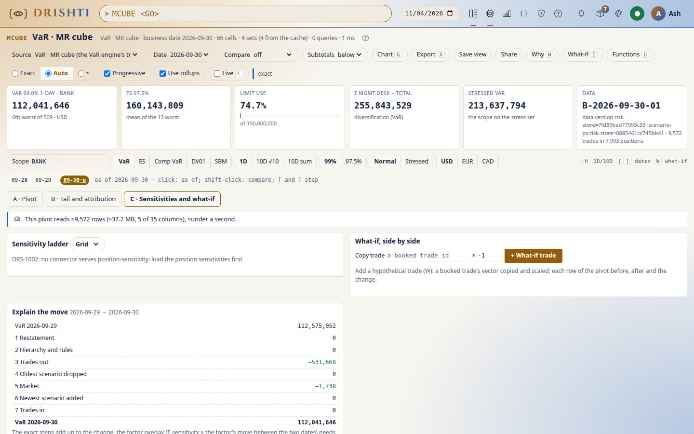

**You should see** the components with the hedges negative, the ladder and the what-if before and after; the components' sum equals the bank's VaR to the cent; the what-if's *Total* row's *before* equals the grand total.

## Step 27 · Save, share and export

**UI.** `Shift+V`, **Save view as…** `morning`, **Shared** with `role:risk`, `Ctrl+S` (or **Save view**, then **Share**). A colleague opens `MCUBE @you/morning <GO>` with their own rights.
**Export → Excel**: the outline of the rows, `SUM` formulas only for the measures that add up (`comp_var()`, `pv()`, `trades()`), the server's
values for VaR and ES, a Provenance sheet.

**CLI.**

```
drishti.py pivot save morning --source var --rows MGMT.DESK --cols RISK_CLASS --values "var()" --share role:risk
drishti.py pivot export --view you/morning --format xlsx -o morning.xlsx
```

**JSON.** The saved view is the view itself, options included; never its numbers.

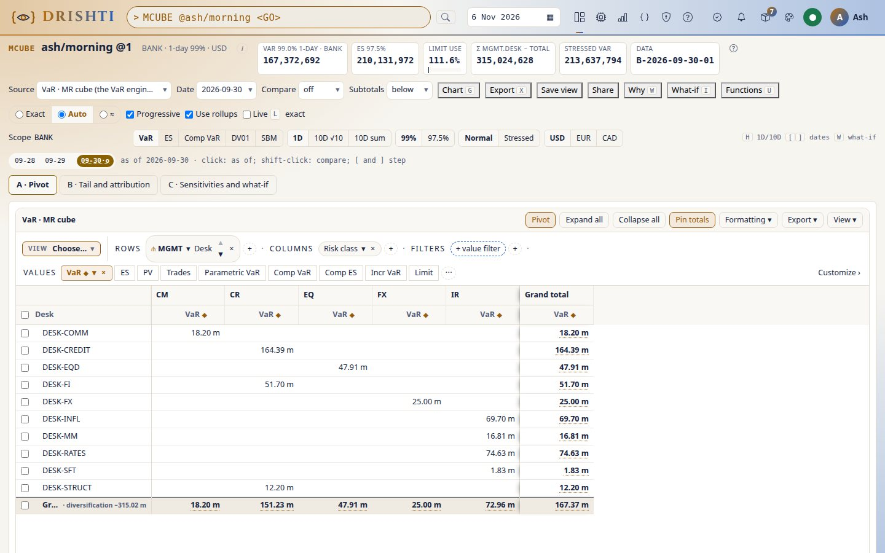

**You should see** the view in your saved views and its workbook; open the workbook: the VaR column's totals are values, not formulas; a Comp VaR total is a `SUM`.

## Next steps

- [PIVOT_GUIDE.md](../guides/PIVOT_GUIDE.md) section 2 (the screen: the View picker, the compact line, the panes and every key) and
  sections 24 to 26: the switches, live pivots and cell comments in full.

- The worked examples over documents, each with its figures, picture, command and saved view:
  [PIVOT_GUIDE.md, Documents](../guides/PIVOT_GUIDE.md#documents-paths-lists-and-grains).
- Every setting, the API and the refusals: [PIVOT_GUIDE.md](../guides/PIVOT_GUIDE.md) sections 14 to 17.
- Make a path a column read for everyone: promote it in the connector's `layout.<kind>.columns`
  ([../guides/DATA_GUIDE.md section 8](../guides/DATA_GUIDE.md#8-connectors)) or add it to a BI dataset as a `path:` column ([REPORTS_GUIDE.md](../guides/REPORTS_GUIDE.md)).
- [PIVOT_GUIDE.md](../guides/PIVOT_GUIDE.md) sections 19 to 22: the languages, the harness, approval, explain, what-if, BI's totals.
- [ARCHITECTURE.md section 26](../architecture/ARCHITECTURE.md#26-the-pivot-engine) sections 8, 10 and 12: the design.
- The guide: [PIVOT_GUIDE.md section 29](../guides/PIVOT_GUIDE.md#29-the-mr-cube-preset) (every measure, option, setting and code).
- The pivot screen: [PIVOT_GUIDE.md](../guides/PIVOT_GUIDE.md); the VaR engine: [VAR_GUIDE.md](../guides/VAR_GUIDE.md).
