<!--
  Project Drishti · Any data. Any domain. One grammar.

  Copyright (c) 2026 Ashutosh Sinha <ajsinha@gmail.com>.
  All rights reserved.

  PROPRIETARY AND CONFIDENTIAL.

  This file is the confidential and proprietary property of Ashutosh Sinha.
  Unauthorised copying, use, modification, distribution or disclosure of this
  file, via any medium, is strictly prohibited except with the express prior
  written permission of the copyright holder.

  See the LICENSE file in the root of this repository for the full terms.
-->
# Tutorial 8 · Reports and dashboards

Business intelligence from a first report to a governed one. Part A builds a report in BI Studio and publishes it. Part B puts two facts in
one model. Part C makes a statement page and field parameters. Part D lets reports run themselves: refresh, subscriptions, alerts and exports.
Part E schedules a search and subscribes a colleague to a view. Part F is live data and boards for a wall. Part G governs it all: history,
review, certification, lineage and moving between servers. Every step shows the UI, the command line where there is one, and the YAML.

## Time to complete

About 5 h 10 min in all; each part can be done on its own day.

- Part A · Your first BI report: About 60 minutes.
- Part B · Several datasets in one report: About 60 minutes.
- Part C · Statements and field parameters: About 40 minutes.
- Part D · BI that runs itself: About 45 minutes.
- Part E · Scheduled searches and subscriptions: About 25 minutes.
- Part F · Live BI and boards: About 30 minutes.
- Part G · Govern BI: About 50 minutes.

## Before you start

- **The quick-start environment** ([data/testdata/README.md](../../data/testdata/README.md)): the demo lakes built (`drishti-console/.venv/bin/python tools/drishti.py lake demo`, or the run configuration **Build demo lakes**), the server started on them (run configuration **Drishti server (demo lakes)**: sign-in on, the seven packs, the samples off) and the console (**Drishti console**). The figures below are from the default lake `lake demo` built on 26 October 2026: sixty business days ending **2026-10-26**, 5,000 trades in each of ENDUR, CALYPSO and MUREX, and the exposure run `lake demo` generates (all 76 netting sets): exposure is computed by the exposure engine, and the server publishes its official end-of-day results when it starts. `lake demo` moves the days to end on *your* business date, so your dates differ.
- Signed in as the development administrator (`drishti-dev-admin`, password `drishti-dev-admin123`, the run configuration's seed), and, for the command line, a **personal API token** in `DRISHTI_TOKEN` (click your name → **My account** → **API tokens**, tick `bi:write` among the scopes, **Create token**; [tutorial 1, step 9](01-first-15-minutes.md#step-9--make-a-token-for-the-command-line)). Every command line below is run from the repository folder with the console's Python, `drishti-console/.venv/bin/python tools/drishti.py ...` (written `python3 tools/drishti.py` for short), against `DRISHTI_SERVER` (default `http://localhost:18480`).
- Nothing else to install. The sample models, datasets and reports are files in `config/bi/` that every server reads. The data of **World economics** is real and public: about 200 economies from the World Bank (CC BY 4.0), through the `world-economy` pack. The dataset uses only the World Bank
  fields on purpose; the pack's IMF fields stay out of it ([EXTERNAL_DATA.md (world-economy)](../guides/EXTERNAL_DATA.md#the-world-economy-data-in-detail)). Every column of every shipped model is in **UPPER_SNAKE** (`REGION_NAME`, `GDP_USD_BN`, `TRADE_DATE`), the names the data has in production.

**Where this data comes from.** The *World economics* model reads the `world-economy` pack: World Bank figures (CC BY 4.0), fetched by `drishti.py feed run world-economy`; its IMF fields (internal only) stay out of the model. Each source, its licence and how to refresh it: [External data](../guides/EXTERNAL_DATA.md).

**Part B · Several datasets in one report.**

- [Part A](#part-a--your-first-bi-report) done (reports, workspaces, models)
  and [tutorial 9](09-notebook-and-python.md) for Python and the Notebook. You sign in as the development administrator, who holds `bi-author`.
- Step 21 uses two colleagues; make them in **Admin → Users** ([tutorial 21](21-run-it-in-production.md)): `rita` with a role `risk` (raw power on, BI power `bi`), and `hana` with a role `desk-head` (raw power **off**, BI power `bi`) and **Desk** `DESK-FX`.
- A shared workspace called **Exposure desk** (**Workspaces → New workspace**): a model and a report are published from a shared workspace; a private one cannot publish.
- The console's Python environment from tutorial 1, Part A (it carries `pandas` and `pyarrow`), for steps 18, 20 and 22.
- **The numbers.** Every number below (`15,000` trade valuations, MTM `3,210,381,877`, P&L `90,804,863`, `76` netting sets with computed
  exposure `2,663,018,256`, the sector rows) was taken on the default demo lake `lake demo` built on 26 October 2026: sixty business days ending
  2026-10-26 and the exposure run `lake demo` generates (all 76 netting sets of the 24 counterparties), whose official end-of-day results the
  server publishes when it starts, each day a snapshot, so a question asks **one business date** (the latest, unless you pick another) and a sum is one day's, never the days added up. `lake demo`
  moves the days to end on *your* business date.
- Files in [data/](data/): [cp-risk.model.yaml](data/cp-risk.model.yaml) (the model of step 16, for the command-line path), [cp-risk-view.report.yaml](data/cp-risk-view.report.yaml), [cp-risk-extracts.notebook.yaml](data/cp-risk-extracts.notebook.yaml), [cp-table.python.yaml](data/cp-table.python.yaml) and [cp-table.dataset.yaml](data/cp-table.dataset.yaml).

**Part C · Statements and field parameters.**

- Part A done: a running server and console, signed in as a BI author (`bi-author`), the sample model *Trades, the basics* (`trades-basic@1`) and its
  dataset `trades-basic-trade` (the trade valuations).
- For step 29, a server that can send mail (`spring.mail.host`) and two or more users with an email address.

The outputs below were captured on this version against the test stack of `drishti-console/tests/test_bi_wave_d_browser.py` (the sample's 60 valuations of
2026-10-08); your numbers are your data's.

**Part D · BI that runs itself.**

- [Part A](#part-a--your-first-bi-report) done (it made the workspace `Economics desk`), and [tutorial 1, Part D](01-first-15-minutes.md#part-d--share-and-collaborate) for the colleague `vera`
  (a user with the `viewer` role and the address `vera@example.com`); [Part E](#part-e--scheduled-searches-and-subscriptions) for how the **Reports** page lists subscriptions.
- A personal token **reads** and writes BI items, but it never calls your own
  `/me/...` addresses (subscriptions, alerts): those are made in the console, and steps 31 and 34 say so.
- Three small files in [data/](data/): [trades-daily.dataset.yaml](data/trades-daily.dataset.yaml) (a dataset that refreshes itself),
  [trades-daily.model.yaml](data/trades-daily.model.yaml) (the model over it) and [desk-check.report.yaml](data/desk-check.report.yaml) (a report that
  says what its numbers must be).
- Mail is **optional**. Steps 31 and 32 run without it and show what happens; step 33 shows it working with a catcher on your own machine (a small script that ships with this tutorial).

**Part E · Scheduled searches and subscriptions.**

- [Tutorial 1, Part A](01-first-15-minutes.md#part-a--install-start-and-look-around) done (signed in as the development administrator, the token for the command line set) and [tutorial 1, Part D](01-first-15-minutes.md#part-d--share-and-collaborate) for the user `vera`.
- Email needs an SMTP server, which a fresh install does not have. The tutorial shows what Drishti does without one (it keeps the run and retries); [OPERATIONS_GUIDE.md](../guides/OPERATIONS_GUIDE.md) says how to set `spring.mail.host` and the email channel.

**Part F · Live BI and boards.**

- [Part A](#part-a--your-first-bi-report) done (you know the report viewer). The shipped samples used here, the dataset **Live trading desk**, the reports **Live trading desk** and **Live exposure** and the boards **Desk wall** and **Python wall**, are in every server's `config/bi/`.
- **Live and the model layer.** The two live samples are **version 1 datasets** (`rachana: 1`) that their reports read directly. The converter has made a **model** of each (`live-trading@1`, `live-exposure@1`) over the same live
  table, so a model query, the Notebook and an alert on a measure of a model read the live rows too (step 46).
- **A source that ticks.** The demo lakes are daily snapshots: they do not move, so on the quick-start server (**Drishti server (demo lakes)**, which sets
  `DRISHTI_DEMO_ENABLED=false`) a live visual's chip says **Listening** (following, nothing has changed) rather than **Live**. Either way a live table
  follows at most 2,000 trade valuations (`drishti.bi.live.follow-max`; the lake holds 15,000) and says so in a warning. For this tutorial **turn the demo ticker on**: edit the run
  configuration **Drishti server (demo lakes)** and set `DRISHTI_DEMO_ENABLED` to `true`, or start the server with it
  ([data/testdata/README.md](../../data/testdata/README.md), "The demo ticker"). The demo source then moves every live sample that someone is watching
  (a view, a live visual or a board tile open) every 400 ms; a sample answers before the lake for an id both hold, and the lakes still answer every other id. With a
  real source the same pages follow your own live connector ([DEMO_CONNECTOR.md](../../plugins/drishti-plugin-demo/README.md), [DATA_GUIDE.md](../guides/DATA_GUIDE.md#1-telling-drishti-new-data-has-landed)).

**Part G · Govern BI.**

- Part A done (you know workspaces and publishing), signed in as the development administrator.
- Three people, because governance is people checking each other: **ann** writes (powers `bi` and `bi-author`), **sue** is a steward (`bi` and `bi-steward`), and the **administrator**, who holds every power. Step 54 makes ann and sue.
- Three small files in [data/](data/): [rates-trades.dataset.yaml](data/rates-trades.dataset.yaml) (the rates desk's trades, a dataset of the model
  layer), [trades-model.model.yaml](data/trades-model.model.yaml) (the model over it) and [trades-report.report.yaml](data/trades-report.report.yaml)
  (a report on the model).
- A personal API token for each person you act as on the command line (each signs in once and makes one on **My account → API tokens**, as in
  [tutorial 1, step 9](01-first-15-minutes.md#step-9--make-a-token-for-the-command-line); `DRISHTI_TOKEN` holds the one in use, `$ANN_TOKEN` and
  `$SUE_TOKEN` below are theirs). The administrator's token needs the `bi:write` scope; sue's needs `bi:approve` to approve and certify.

## What you will learn

**Part A · Your first BI report**

- the parts of a **model**: the datasets it reads (one table each, with its columns), the measures it owns; and how to ask it a question before drawing anything;
- how to make a report in the designer: cards, a **map**, a bar with a **top 10** filter, a slicer; where each visual sits on the 12-column grid;
- (at the end) a **relative-date slicer**, a **tablet layout** and an **entity view**: *last 3 months*, two columns on an 820 px screen, and a counterparty's own view beside a bar;
- how the map drills **world, country, region** with a breadcrumb, and how a click on a map or a bar **cross-filters** the rest of the page;
- how to publish: your own workspace, a shared workspace, the catalogue;
- **filter like Power BI**: list, dropdown and range slicers, page and report scope, a top-N filter that tames a busy donut, bookmarks, and when to use a slicer instead of a click;
- the **Counterparty risk** sample: slicers that reach across packs, a selected bar, and drill-through;
- **two fact tables in one model**: trades and netting sets, each added up on its own and joined through the counterparty, so one-day P&L and exposure stand side by side and one slicer filters both;
- (step 13) **a dataset and a model of your own, in the wizard**: narrow a pack dataset (some columns, some rows, a worked-out column), preview it, publish it and make a model of it in one click, with no YAML typed.
- (step 14) **models**: a pack dataset with nothing to build, a report on it at once, then a model of trades and desks with a suggested relationship, a measure, a row rule and the security safeguard, published, opened in the Notebook and watched by an alert, in the UI, over the API and as YAML.

**Part B · Several datasets in one report**

- the two pack datasets, **Trade valuation** and **Netting set**, and the **grain** of each (one row per trade, one row per netting set);
- a **model with two facts** in the model designer: datasets ticked, a role corrected, relationships accepted from the packs (and one proposed *inactive* with the reason), measures from columns, a measure over both facts in the **expression editor**, a row rule and the **safeguard**;
- **MTM and exposure in one visual**: each fact aggregated alone at the visual's grain, then joined, so the totals are the true ones, and the same question in Drishti SQL with the same plan;
- why Drishti **does not join rows** of two facts, with the inflated totals a row join gives, and why exposure **by desk** is refused (`DRS-9156`) rather than guessed;
- a **dataset made by a Python Transform** whose inputs are model queries, kept per reader;
- two readers with **different row rules and masks**, and why one reader's exposure is the same in the model and different in the Python table;
- the same analysis in the **Notebook**, promoted to a visual, and how this compares with Power BI.

**Part C · Statements and field parameters**

- what a field parameter is and how it goes in a well, in Build and in the YAML;
- how a reader's parameter slicer switches a chart's field and measure, and that masks still hold;
- how to make a page a statement, set its paper, header and footer, and preview it page by page;
- how a statement's tables run over pages: repeated column titles, groups kept together, page breaks;
- how one subscription sends each person their own statement, and the CLI for the same.

**Part D · BI that runs itself**

- how a dataset of the model layer is told to refresh itself (`refresh:` in its YAML, or **Set a schedule** on its page) and how to see it ran;
- how to subscribe a person to a whole report, a page or one visual, in HTML, PDF or Excel, and why each recipient gets their own copy;
- what **Run now** says with no SMTP host (`no SMTP host: set spring.mail.host`) and how to configure mail so it sends;
- how to put an **alert** on a number of a report or on a **measure of a model**, the difference between *armed* and *active*, and where the firing lands (inbox, email);
- how to export a report to **PDF, PNG, Excel and CSV**, a whole page or one visual;
- how to say what a number should be (`tests:`) in a report and in a model, run the tests as a role, and why a failing test stops a publish.

**Part E · Scheduled searches and subscriptions**

- how to turn a search into a scheduled report: when it runs (business days, holidays, after a load), which day's data, and where the file goes;
- **Run now**, the last-run line, and the file it wrote;
- a subscription: formats (HTML, PDF, Excel), recipients (**users and roles only**, never an email address) and why each recipient gets their own render;
- where both live: **Views → Reports** in the top bar;
- what the command line and the REST API can do for them.

**Part F · Live BI and boards**

- what "live" means for data (a source that **pushes**) and why the demo's live data is **coherent**: related numbers move together;
- the `mode: live` table of a dataset and how to see how it is doing;
- the live indicator of a report, **Pause** and **Resume**, and what redraws;
- a **board**: tiles from several reports, amber and red tiles from their alert rules, pages that turn on their own, and **kiosk mode**;
- the **history** of a live table (a line that is there when the page opens) and **your own board** laid out in the report designer (BI Studio), with a tile alert that does not flicker (hysteresis);
- a **chart of the desk by currency** (the server groups, the browser draws) and a **wall of Python** tiles.

**Part G · Govern BI**

- the four BI **powers** (`bi`, `bi-author`, `bi-steward`, `bi-admin`) and how a role gets them;
- **history**: every save is a saved state; compare two; restore one (a new state, nothing lost);
- **review**: propose, who is told, what the reviewer sees, **four-eyes**, approve and publish;
- **certified** and **promoted**, and where they show;
- **lineage**: what a model reads (datasets, pack kinds, connectors) and what reads it;
- **the contract**: which change needs a **new major version**, and which reports use what it takes away; the refusal `DRS-9126`;
- **environments**: a bundle, a dry run, a conflict, an overwrite;
- **renames** that rewrite the reports (version 1 datasets), an import you can **roll back**, and lineage that reaches the connector's source.

### Part A · Your first BI report

Business intelligence in Drishti (it is called **Rūpaka**; type `BI <GO>` or choose the bar-chart icon in the top bar) is built from three things: a **dataset** (tables, how they join, and named **measures** such as "GDP per capita"), a **report**
(pages of **visuals** that ask the dataset questions), and the **catalogue** where published reports are found. In this part you build a report of your own on the **World economics** sample: two cards, a **map** you can drill from the world to a country
and its regions, a bar, and a slicer. You look at it, cross-filter it, publish it, learn the slicers in detail on the **Trades overview** sample, and meet the cross-filter and drill-through of **Counterparty risk**.

## Step 1 · Look at the model

A report reads a **model**: a small star of **datasets** (each one table with its columns, the time it keeps and its row rules), the relationships
between them and the **measures** the model owns. Choose **Models** in the left rail. Under *Your models* find **World economics**
(`world-economics`, `model 1.0.0 · published`) and press **Open the designer**, then the **Measures** tab.

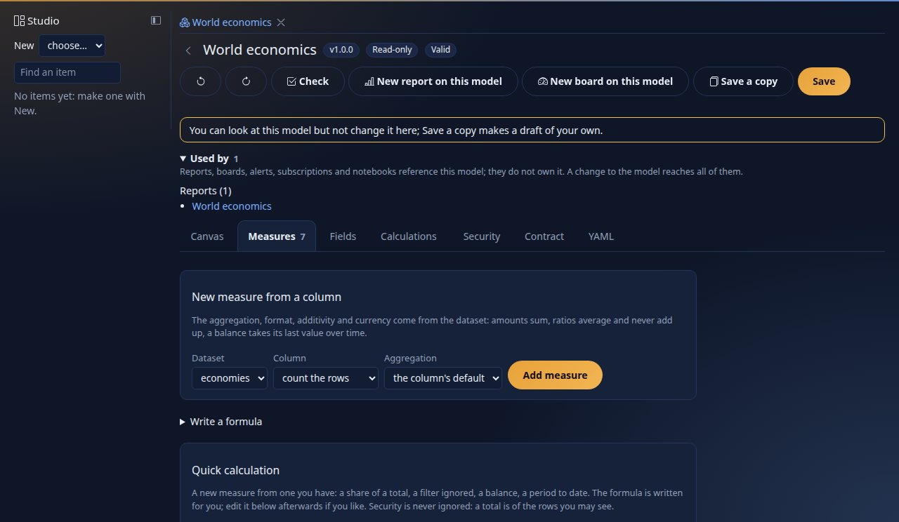

You should see `World economics`, `v1.0.0`, `Read-only` (it ships with Drishti: **Save a copy** makes one of your own) and `Valid`, **Used by** the
report **World economics**, and the seven **measures** (`Economies`, `GDP (USD bn)`, `Population (m)`, `GDP per capita (USD)`, `Average growth`,
`Average inflation`, `Average unemployment`), each a formula the model owns, so every report on it agrees. `GDP per capita (USD)` is
`ratio(sum(economies.GDP_USD_BN), sum(economies.POPULATION_M)) * 1000`: GDP over population, not an average of averages, so a region's figure is right. The
**Canvas** tab shows the one dataset the model reads, under the alias `economies`. Back on **Models**, under *Your datasets*, press **Open** on
**World economics: economies**.

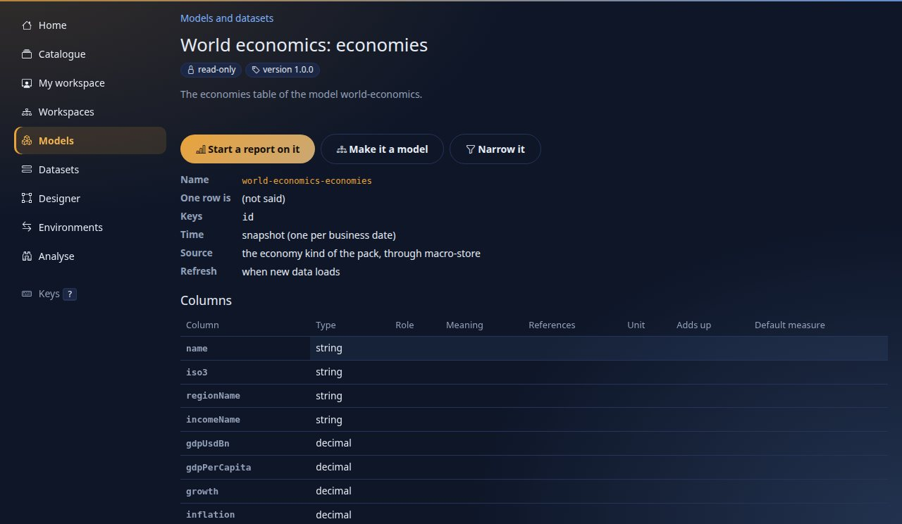

You should see the dataset `world-economics-economies` `1.0.0`: one row per economy (key `id`), time `snapshot (one per business date)`, read from
`the economy kind of the pack, through macro-store`, refreshed `when new data loads`, and its columns: the country's name, its ISO code (`iso3`, which
is what a map needs), World Bank region and income group and a few figures. The data is real and public (the World Bank, CC BY 4.0, through the
`world-economy` pack).

**Ask it a question** before drawing anything. **From the command line** (the token of tutorial 1, Part A), a **model query** groups by the region and asks
three measures, the biggest economies first:

```text
$ python3 tools/drishti.py bi mq --model world-economics@1 --select economies.REGION_NAME \
    --measures "GDP (USD bn),Population (m),GDP per capita (USD)" --sort="-GDP (USD bn)"
economies.REGION_NAME                               GDP (USD bn)  Population (m)  GDP per capita (USD)
-------------------------------------------------  ------------  --------------  --------------------
North America                                      33,098.79     383.50          86,306.87
East Asia & Pacific                                32,710.77     2,340.96        13,973.22
Europe & Central Asia                              32,262.10     932.48          34,598.00
Latin America & Caribbean                          7,327.57      666.55          10,993.23
Middle East, North Africa, Afghanistan & Pakistan  5,136.27      828.03          6,203.03
South Asia                                         4,578.02      1,692.26        2,705.28
Sub-Saharan Africa                                 2,213.29      1,318.05        1,679.22
7 row(s)  as of 2026-10-26  plan p_6020bb1a1c70beae
```

**As YAML**, the same question is a file you can keep and run with `python3 tools/drishti.py bi mq gdp-by-region.yaml`:

```yaml
mq: 1
model: world-economics@1
select: { fields: [economies.REGION_NAME], measures: [GDP (USD bn), Population (m), GDP per capita (USD)] }
sort: [{ by: GDP (USD bn), desc: true }]
```

and **over REST** it is `POST $DRISHTI_SERVER/api/v1/bi/mq` with that body as JSON (`{"mq": 1, "model": "world-economics@1", "select": {...}, "sort": [...]}`),
which answers the `columns`, the `rows` and a `meta` block with the as-of date and the plan. `python3 tools/drishti.py bi model list` lists every model
and dataset you may read (`world-economics@1  model  World economics  1.0.0  published`). Everything a report draws is a question like this, asked **as
you**: your row rules and masks apply, which is why two people can open one report and see different figures. (Your dates differ: the business date is
today's.)

## Step 2 · Start a report

Choose **Designer** in the rail. Choose the dataset **World economics**, give the report the title `My world report` and look at the form before you press the button.

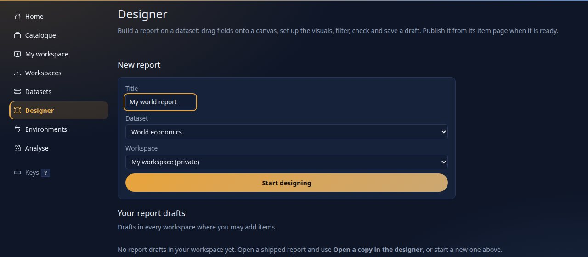

You should see the dataset chooser (every dataset you may open), the title box and the button **Start designing**. Press it.

You land in the designer: a canvas on a 12-column grid, a **Filters** pane, **Visualizations** (every kind of visual) and **Fields** (the dataset's columns and measures). The report is a draft in **My workspace**, which only you see.

The designer sits in **BI Studio**, the shell the report, model and theme designers share: the **Explorer** of your items on the left (with
**New**), the items you opened as **tabs** above the canvas, and under it a **dock** with **Problems** (the server's check of your draft a second after each
change, each problem linked to its visual) and **Query** (the selected visual's model query and its SQL). The steps below work the same in it;
[REPORTS_GUIDE.md section 26](../guides/REPORTS_GUIDE.md#8-bi-studio-and-the-report-designer) is the tour, and
[REPORTS_GUIDE.md › Reports: the YAML, the visuals and how they behave, section 5](../guides/REPORTS_GUIDE.md#101-the-format-pane) the Format pane, conditional formatting and themes.

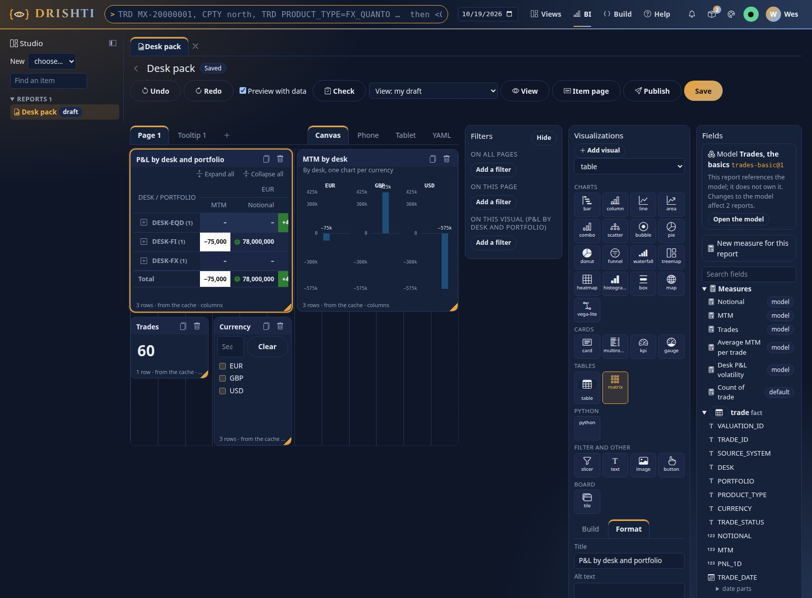

## Step 3 · Two cards

Drag the measure `GDP (USD bn)` from **Fields** onto the canvas, then `Population (m)` beside it. (Dragging with the keyboard also works: focus a field and press Enter.)

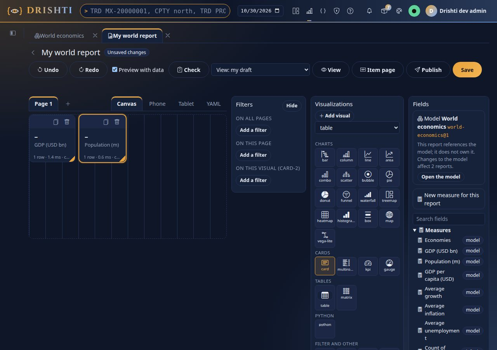

You should see two cards with real figures: `117,327` (billion dollars) and `8,161.83` (million people). A **measure alone becomes a card**; a column alone would become a table; a column with a measure becomes a bar. Under each card is the line the server answered with: rows, time
and the layer.

**From the command line** the two cards are one question with no field (and **in the YAML** each is a visual `{ type: card, wells: { values: [GDP (USD bn)] } }`):

```text
$ python3 tools/drishti.py bi mq --model world-economics@1 --measures "GDP (USD bn),Population (m)"
GDP (USD bn)  Population (m)
------------  --------------
117,326.82    8,161.83
1 row(s)  as of 2026-10-26  plan p_1a5eabbd64657b9f
```

## Step 4 · A map

Click an empty part of the canvas to let go of the selection, then click **map** in **Visualizations**. In **Build**, add `economies.ISO3` to the **location** well and `GDP per capita (USD)` to **values**.

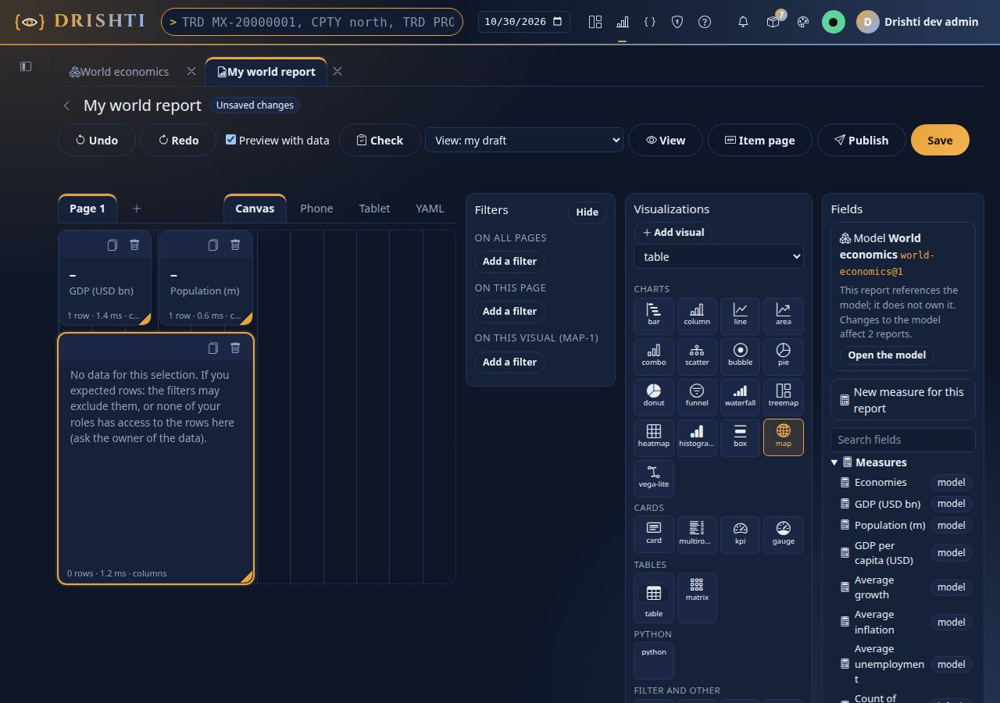

You should see the world shaded from dark to light by GDP per capita (the legend runs from 0 to `90k+`), the title `World` above it, and a note `Not on the map: CHI, XKX` under it: two codes the shapes do not know are **named, never dropped silently**. Small countries (Cayman Islands, Monaco)
are dots so they can be clicked. The shapes are Natural Earth, shipped with the console: nothing is fetched from the internet. The `location` well takes ISO country codes (`AUS`, `AU` or the English name), or ISO 3166-2 region codes (`AU-NSW`) for a map of one country's regions.

## Step 5 · A bar, a slicer, and where everything sits

Add a bar: with nothing selected click **bar**, put `economies.NAME` in **axis** and `GDP (USD bn)` in **values**. Add a slicer: click **slicer**, put `economies.REGION_NAME` in **field**, then open **Format** and set the mode to **dropdown**.
The visuals are stacked wherever there was room, so now place them. **In the UI**, drag a visual by its header and resize it by its corner (the places snap to the 12-column grid), and give the bar its **top 10** in the **Filters** pane: under *On this visual* press **Add a filter**, choose the field `economies.NAME`, the filter type **Top N**, *Keep the top* `10`, *with the* `highest`, *by measure* `GDP (USD bn)`, and press **Add the filter**. **From the YAML** (the exact way, and what both of these write), open the **YAML** tab: the report is text, and each visual has `at: { x, y, w, h }` on the 12-column grid. Give each one a title and a place, and give the bar a **top 10** filter
(a filter on the visual, `op: top`: the ten economies with the largest GDP):

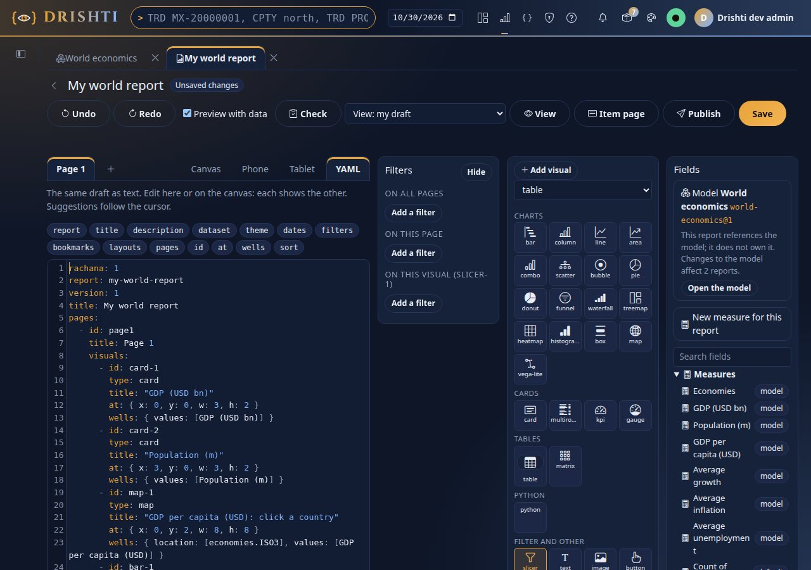

```yaml
- id: card-1
  type: card
  title: "GDP (USD bn)"
  at: { x: 0, y: 0, w: 3, h: 2 }
  wells: { values: [GDP (USD bn)] }
- id: map-1
  type: map
  title: "GDP per capita (USD): click a country"
  at: { x: 0, y: 2, w: 8, h: 8 }
  wells: { location: [economies.ISO3], values: [GDP per capita (USD)] }
- id: bar-1
  type: bar
  title: "Largest economies (GDP, USD bn)"
  at: { x: 8, y: 2, w: 4, h: 8 }
  wells: { axis: [economies.NAME], values: [GDP (USD bn)] }
  filters: [{ field: economies.NAME, op: top, n: 10, by: GDP (USD bn) }]
```

You should see the YAML with `at:` lines and no complaints (a mistake is reported with its code, and `DRS-9030` is a place off the grid). Switch back to **Canvas**. (You can also drag a visual by its header and resize it by its corner; the YAML is simply the exact way.)

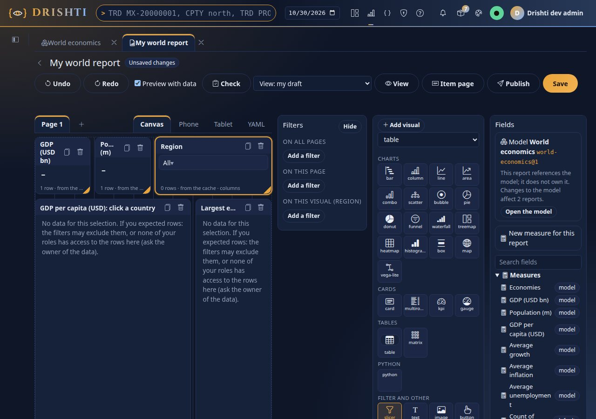

You should see two cards, a `Region` dropdown, the map on the left and ten bars on the right. Press **Save** (or `Ctrl+S`); the status next to the title says `Saved`. Press **Check**: it adds accessibility checks (a visual without a title or alt text is flagged for screen readers).

## Step 6 · View it, click, drill

Press **View**: the report opens as a reader sees it.

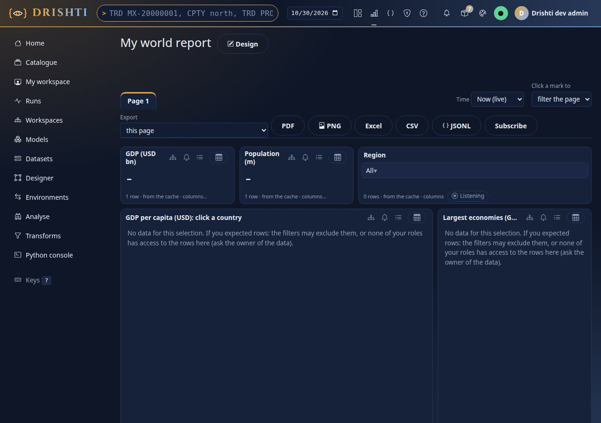

You should see the toolbar (business date, *Click a mark to filter the page / highlight*, **Reset**), the **Export** bar (PDF, PNG, Excel, CSV, Subscribe; Part D), and your visuals drawn with real data. Now **click Australia** on the map.

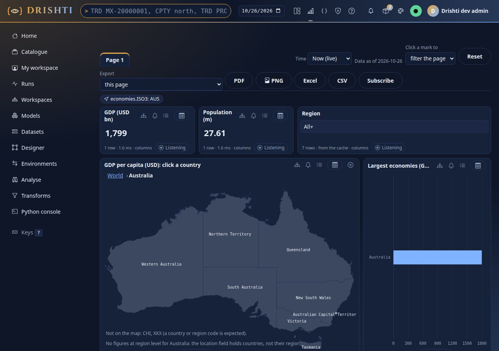

You should see three things at once. A **chip** under the toolbar, `economies.ISO3: AUS`, says what is filtering the page. The cards answer for Australia alone (`1,799` billion dollars of GDP, `27.61` million people): this is the **cross-filter**. And the map **drilled**:
its title bar says **World › Australia**, and the shapes of Australia's states and territories replace the world.

The cross-filter is a filter on the click's field; **from the command line** it is `--where`:

```text
$ python3 tools/drishti.py bi mq --model world-economics@1 --select economies.ISO3,economies.NAME \
    --measures "GDP (USD bn),Population (m)" --where economies.ISO3=AUS
economies.ISO3  economies.NAME  GDP (USD bn)  Population (m)
--------------  --------------  ------------  --------------
AUS             Australia       1,798.52      27.61
1 row(s)  as of 2026-10-26  plan p_097e0dff24160bf0
```

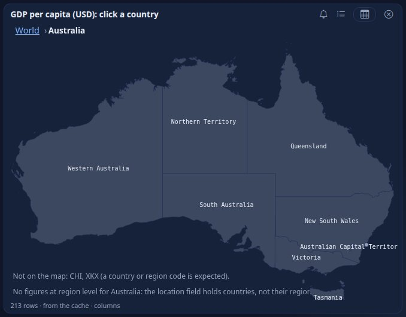

Under the map you read `No figures at region level for Australia: the location field holds countries, not their regions.` That is honest: this dataset has one row per **country**. To shade regions give the map a field of ISO 3166-2 codes (`AU-NSW`, `US-CA`) and the same visual
colours the states by their own figure. Press **World** in the breadcrumb.

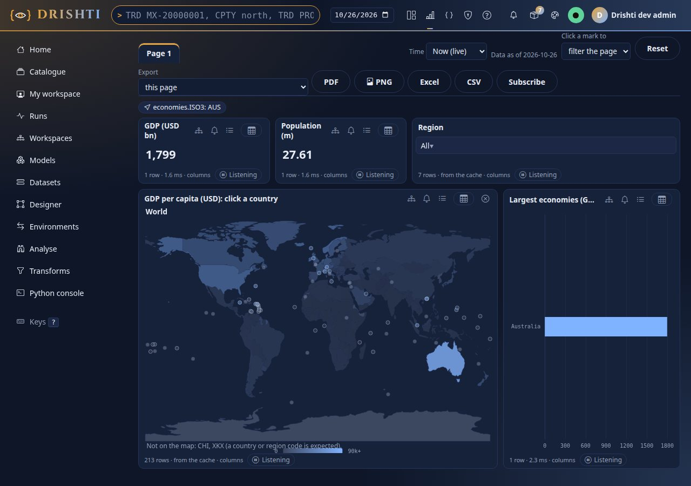

You should see the world again and the chip still in place: the breadcrumb moves the map, the chip (or **Reset**, or `Esc`) clears the filter. Click a second country with `Ctrl` held to add it to the selection.

## Step 7 · Publish

A draft in **My workspace** is private. To publish, move it to a **shared workspace** (that is where people are members and where review can be required). Choose **Workspaces** and fill in **New workspace**.

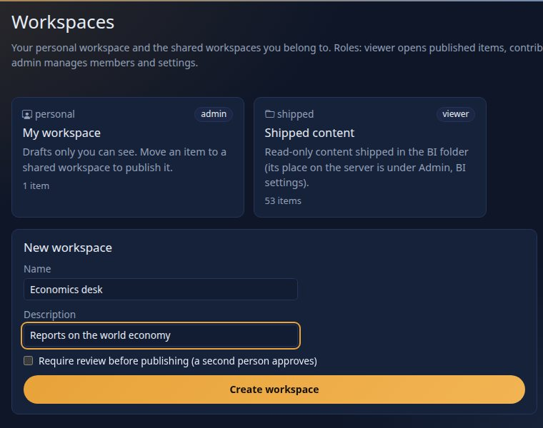

You should see the form; leave *Require review before publishing* unticked for now and press **Create workspace** (a workspace that requires review needs a second person to approve, which is [Part G](#part-g--govern-bi)). Open your report's page (**My workspace**, then the report), press **Move…**, pick `Economics desk` and press **Move**.

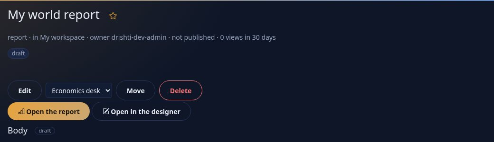

You should see the report listed under the new workspace. Type a note and press **Publish**.

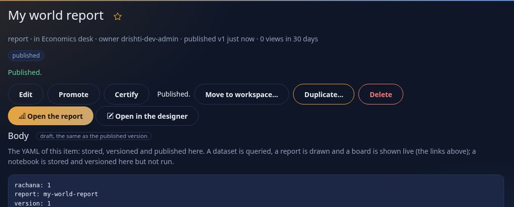

You should see `Published.` and `published v1 just now`. Each publish makes the next numbered version; the draft carries on separately. Open the **Catalogue**, the one place every published item is found, and search `world`.

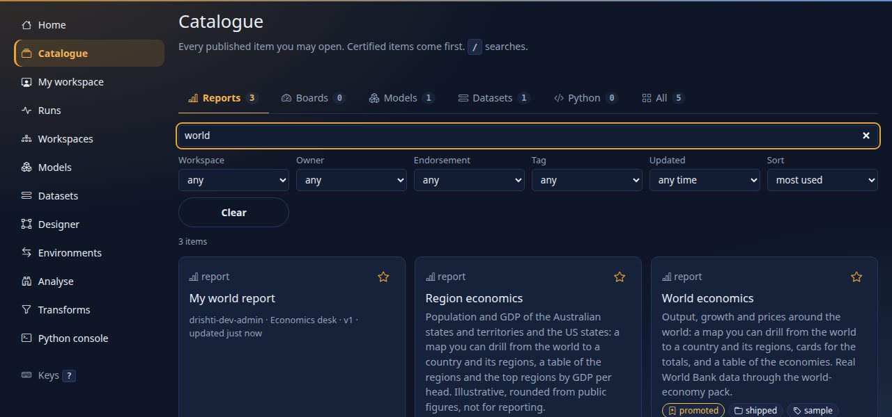

You should see your report beside the shipped one, with its workspace and owner. The same list from the command line:

```text
$ python3 tools/drishti.py bi catalogue list
id                                                 kind     endorsed  status    ver  title
file:report:cashflow-ladder                         report   promoted  published v1   Cashflow ladder  (Shipped content, shipped)
file:model:counterparty-exposure                    model    promoted  published v1   Counterparty exposure  (Shipped content, shipped)
...
bi-7f8269ba14                                       report   none      published v1   My world report  (Economics desk, drishti-dev-admin)
...
file:report:world-economics                         report   promoted  published v1   World economics  (Shipped content, shipped)
file:dataset:world-economics-economies              dataset  promoted  published v1   World economics: economies  (Shipped content, shipped)
54 item(s), showing 50
```

```text
$ python3 tools/drishti.py bi workspace list
id                            role          items  name
u-drishti-dev-admin-eb6f      admin             0  My workspace  [personal]
economics-desk                admin             1  Economics desk
shipped                       viewer           53  Shipped content
```

You should see the report with `published v1` among the 53 shipped items (ten models, their datasets, ten reports, two boards, two themes, a notebook and four Python items), and the workspace with one item. (Ids and dates differ on your machine.)

## Step 8 · Filter like Power BI

The sample **Trades overview** has a second page, **By product**, built to show slicers. Open it from the Catalogue (or type `BI trades overview <GO>`) and choose the tab **By product**.

A **slicer** is a visual that holds choices and filters other visuals. It has a mode and a scope. **In the UI** select the slicer and open **Format**: **Mode** is a choice of *list*, *dropdown*, *range* and *relative date*, and **Filters** is *this page* or *every page*. **In the YAML** the same two settings are:

```yaml
- { id: pick-product, type: slicer, title: Product type, wells: { field: [trade.PRODUCT_TYPE] }, format: { mode: dropdown, scope: page } }
```

| `format.mode` | What it looks like | Use it for |
|---|---|---|
| `list` (the default) | a checkbox list with a search box, always open | a field with a handful of values (desks, currencies) |
| `dropdown` | a closed box that opens a **floating** checkbox list with a search box, **Select all** and **Clear** | a field with many values (product types: 130 across the three source systems) |
| `range` | two boxes, *From* and *To* | a number or a date field (notional, trade date) |

| `format.scope` | A choice filters |
|---|---|
| `page` (the default) | the visuals of this page |
| `report` | every page of the report, so a choice made on one page holds on the next (the Counterparty risk sector slicer) |

All three together on one page (the YAML is [data/slicer-kinds.report.yaml](data/slicer-kinds.report.yaml); paste it into **My workspace → New item** or into the designer's YAML tab to try it):

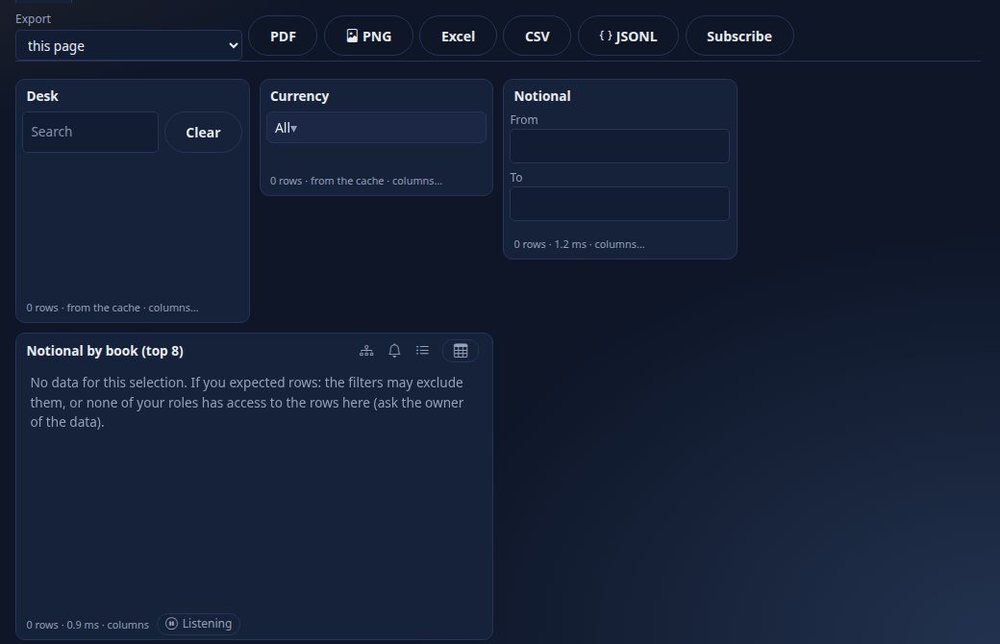

You should see the desks as an open list with its search box and **Clear**, the currency as a closed dropdown, the notional as *From* and *To* boxes, and the donut. **Open the Product type dropdown** on the Trades overview and type `SWAP` in its search box.

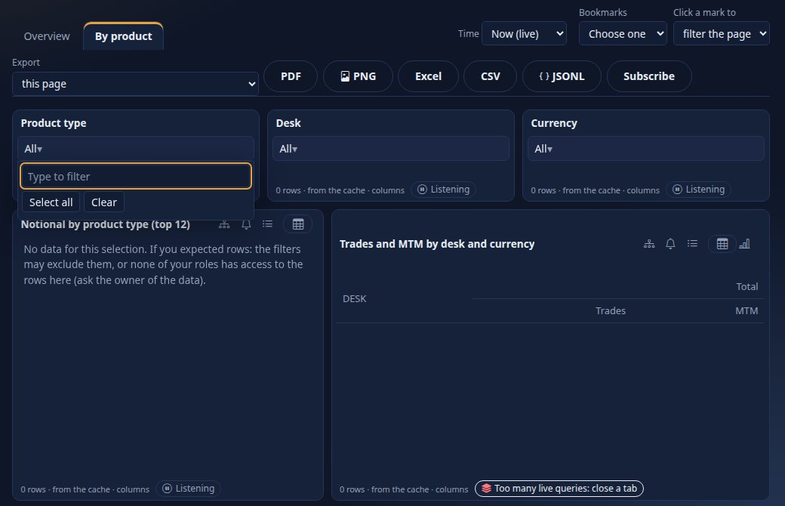

You should see the list **floating over** the visuals below it (it does not push the page down), narrowed to the product types that contain `SWAP`, each with a tick box. **Select all** and **Clear** tick and untick the values in one press. Tick `AMORT_SWAP` and `BASIS_SWAP`, then click outside.

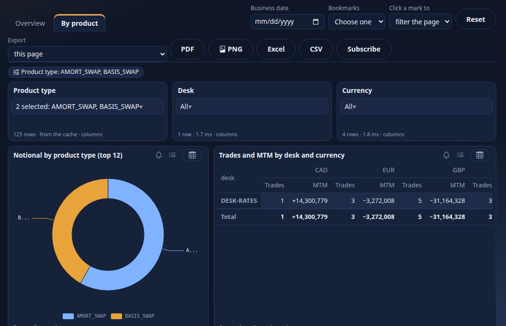

You should see `2 selected: AMORT_SWAP, BASIS_SWAP` in the box, a **chip** `Product type: AMORT_SWAP, BASIS_SWAP` under the toolbar, the Desk and Currency slicers narrowed to values that still exist (a slicer never filters itself; **other** slicers filter it), a donut of two slices (72 trades each) and a matrix of one desk, `DESK-RATES`, in four currencies (CAD, EUR, GBP, USD). **Reset** clears all of it.

**From the command line** the matrix's question with the slicer's choice is a filter (`--where` once per value is an *and*; a list of values is the YAML's `in`):

```text
$ python3 tools/drishti.py bi mq --model trades-basic@1 --select trade.DESK,trade.CURRENCY --measures Trades --where trade.PRODUCT_TYPE=AMORT_SWAP
trade.DESK  trade.CURRENCY  Trades
----------  --------------  ------
DESK-RATES  CAD             12
DESK-RATES  EUR             12
DESK-RATES  GBP             24
DESK-RATES  USD             24
4 row(s)  as of 2026-10-26  plan p_841e66dd1d28602d
```

The slicer's two choices together, as a file (`python3 tools/drishti.py bi mq both-swaps.yaml`):

```yaml
mq: 1
model: trades-basic@1
select: { fields: [trade.DESK, trade.CURRENCY], measures: [Trades] }
where: [{ field: trade.PRODUCT_TYPE, op: in, values: [AMORT_SWAP, BASIS_SWAP] }]
```

```text
trade.DESK  trade.CURRENCY  Trades
----------  --------------  ------
DESK-RATES  CAD             12
DESK-RATES  EUR             36
DESK-RATES  GBP             60
DESK-RATES  USD             36
4 row(s)  as of 2026-10-26  plan p_1b9ffa4705022ec3
```

**Taming a busy donut.** The donut on this page could have about forty product types. It does not draw forty slices: it carries a **top filter**. **In the UI** that is the **Filters** pane: *On this visual*, **Add a filter**, filter type **Top N**, how many, highest or lowest, and the measure to rank by:

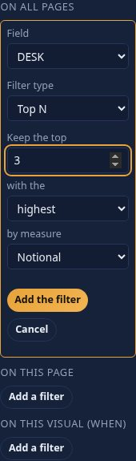

**In the YAML** it is one line (both write the same):

```yaml
- { id: share, type: donut, title: "Notional by product type (top 12)", wells: { axis: [trade.PRODUCT_TYPE], values: [Notional] },
    filters: [{ field: trade.PRODUCT_TYPE, op: top, n: 12, by: Notional }] }
```

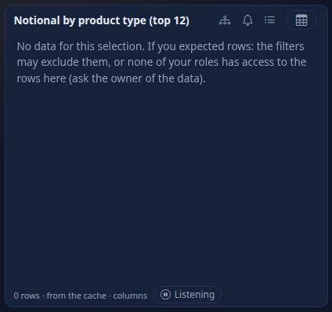

You should see twelve slices and the title `(top 12)`, ENDUR's `ComSwap` the largest (`498,190,803,406` of notional), then `FRA` and `FX_BARRIER`. The server ranks the product types **in the context of the slicers**, so the top twelve of the swaps you chose is a different twelve from the top twelve overall. `n` is how many, `by` the measure to rank by.

**Bookmarks** save a state. **In the UI**, in the designer, select nothing (click the empty canvas) and open **Format**: under **Bookmarks** type a name, set the slicer choices you want kept (a relative-date slicer offers its windows), and press **Save this page as a bookmark**; it keeps the page, the filters of the Filters pane and those slicer choices. Each saved bookmark can be renamed in place, updated from the page's filters again, or removed:

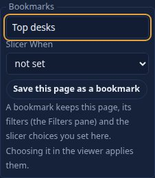

**In the YAML** they are `bookmarks:` (a name, a page, slicer choices and filters). Either way they appear in the **Bookmarks** box of the viewer's toolbar. On the **Overview** page choose the bookmark `FX desk only`.

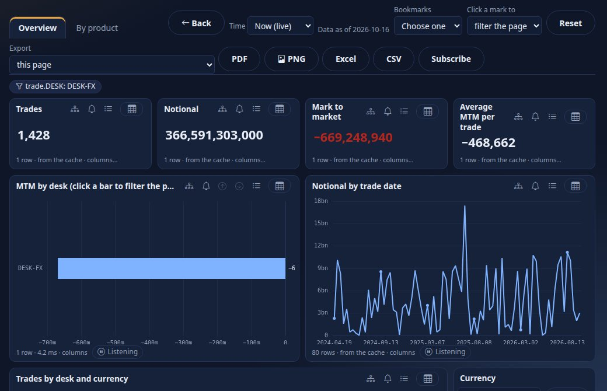

You should see the page filtered to `DESK-FX` (`1,428` trades, notional `372,842,213,118`, MTM `-681,989,222`) with a chip, as if you had made the choice yourself. **From the command line**: `python3 tools/drishti.py bi mq --model trades-basic@1 --select trade.DESK --measures Trades,Notional,MTM --where trade.DESK=DESK-FX` prints the same three numbers. **In the YAML** the bookmark is `- { name: FX desk only, page: overview, slicers: {}, filters: [{ field: trade.DESK, op: in, values: [DESK-FX] }] }` (`config/bi/reports/banking/trades-overview.report.yaml`). A bookmark is written in the designer, not captured from what a reader has chosen on screen in the viewer.

**Slicer or click?** Both filter. A **slicer** is a choice you make on purpose from a list, it stays visible, and it can be page or report wide. A **click on a mark** (a bar, a slice, a country) is exploring: it filters the **other** visuals of the page, it highlights what you picked, and it is gone when you click again.
Click the `DESK-FX` bar on the Overview page:

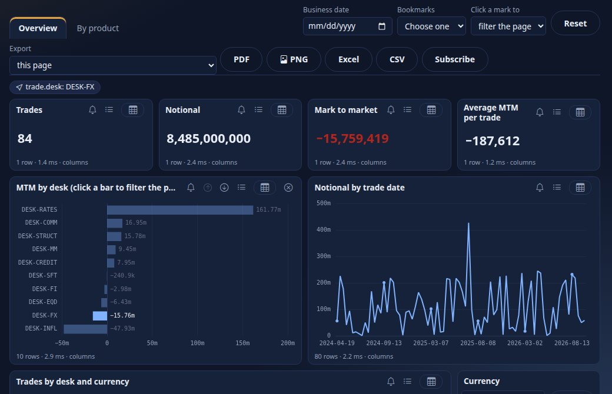

You should see the same figures as the bookmark gave. *Click a mark to* **highlight** (in the toolbar) keeps the whole answer on bar and column charts and draws the chosen share over it instead of filtering.

## Step 9 · Counterparty risk: slicers across packs, and drill-through

Open the shipped report **Counterparty risk**. It reads the model **Trading and counterparty risk** (`trading-risk@1`), which joins three packs (trade valuations from `market-risk`, counterparties, desks and books from `core`, netting sets and their computed exposure from `counterparty-risk`), and its two slicers, Sector and Country, are `scope: report`: they filter every page and reach the trades and the netting sets **through the relationships**.

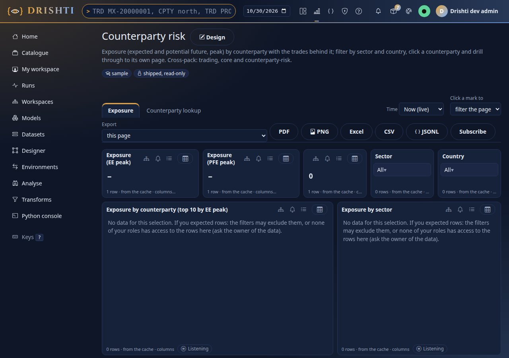

You should see exposure cards (`2,663,018,256` EE peak, `5,217,565,098` PFE peak, `76` netting sets), the two dropdown slicers and a bar of the ten counterparties with the highest expected exposure (a **top 10** filter again), Verdant Agri Holdings first. The exposure is the exposure engine's: its official end-of-day results for the date (a netting set does not store it). EE peak adds up the netting sets' computed peaks; PFE peak is each counterparty's own peak 95% PFE (its sets netted path by path), never a sum of its sets' PFEs. The demo's run covers all 76 netting sets of the 24 counterparties, so every set carries exposure. Click the bar of **Verdant Agri Holdings**.

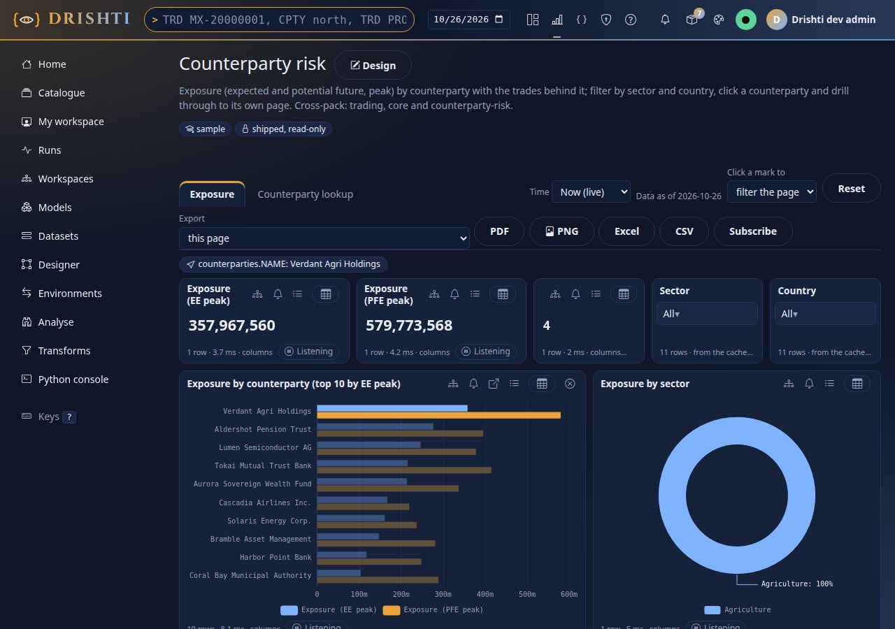

You should see a chip, the cards narrowed to that counterparty (`303,824,105` expected exposure, `498,606,456` PFE, `4` netting sets) and, in the bar's header, a **drill-through** button. Press it.

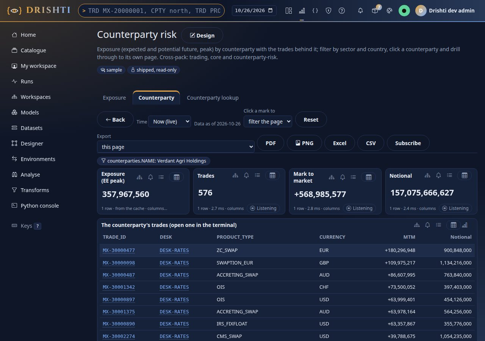

You should see a second page, **Counterparty**, with the name carried in as a chip **and in the address** (so the link can be shared), a **Back** button, four cards (exposure `303,824,105`, `576` trades, MTM `+647,788,759`, notional `157,685,840,489`) and a table of its trades, highest MTM first, whose ids are links: `MX-30000477` (a MUREX zero-coupon swap of DESK-RATES) opens that trade's view in the terminal.

**From the command line**, the bar and the drill-through page are two model queries:

```text
$ python3 tools/drishti.py bi mq --model trading-risk@1 --select counterparties.NAME \
    --measures "Exposure (EE peak),Exposure (PFE peak)" --sort="-Exposure (EE peak)" --limit 3
counterparties.NAME      Exposure (EE peak)  Exposure (PFE peak)
-----------------------  ------------------  -------------------
Verdant Agri Holdings    303,824,105.00      498,606,456.00
Aldershot Pension Trust  278,109,475.00      395,266,101.00
Tokai Mutual Trust Bank  226,721,872.00      382,755,529.00
3 row(s)  as of 2026-10-26
$ python3 tools/drishti.py bi mq --model trading-risk@1 --select trades.TRADE_ID,trades.DESK,trades.PRODUCT_TYPE --measures MTM \
    --where "counterparties.NAME=Verdant Agri Holdings" --sort=-MTM --limit 3
trades.TRADE_ID  trades.DESK  trades.PRODUCT_TYPE  MTM
---------------  -----------  -------------------  --------------
MX-30000477      DESK-RATES   ZC_SWAP              198,326,642.98
MX-30000098      DESK-RATES   SWAPTION_EUR         137,469,021.75
MX-30001342      DESK-RATES   OIS                  91,875,065.38
3 row(s)  as of 2026-10-26
```

**In the YAML** the drill-through is two lines of `config/bi/reports/banking/counterparty-risk.report.yaml`: the bar's `drillthrough: { page: counterparty, field: counterparties.NAME }` and the target page's `drillthrough: { fields: [counterparties.NAME] }`.

## Step 10 · On a phone

Open your report on a phone-width window (390 px).

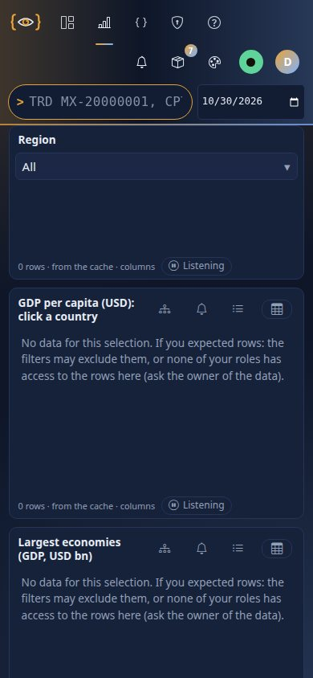

You should see one column in reading order, the map at the full width, targets at least 44 pixels high and no sideways scroll. A report can also have a **phone layout** of its own (which visuals, in what order): [tutorial 20](20-embed-drishti.md) and the designer's **Phone** tab.

## Step 11 · Two fact tables in one model

Everything so far added up **one** table. The question "what is each counterparty's one-day P&L next to its exposure?" needs two: P&L is a
column of the **trades** (one row per trade valuation) and exposure a column of the **netting sets** (one row per netting set). Adding them up in
one table would count a netting set's exposure once for every trade under it. A **model** keeps each as a **fact table** of its own: each is added
up alone at the visual's fields, and the two answers are joined on the dimension both reach, here the counterparty.

**In the UI.** Choose **Models** and open **Trading and counterparty risk** (`trading-risk`, `model 1.0.0 · published`) in the designer, on the
**Canvas** tab.

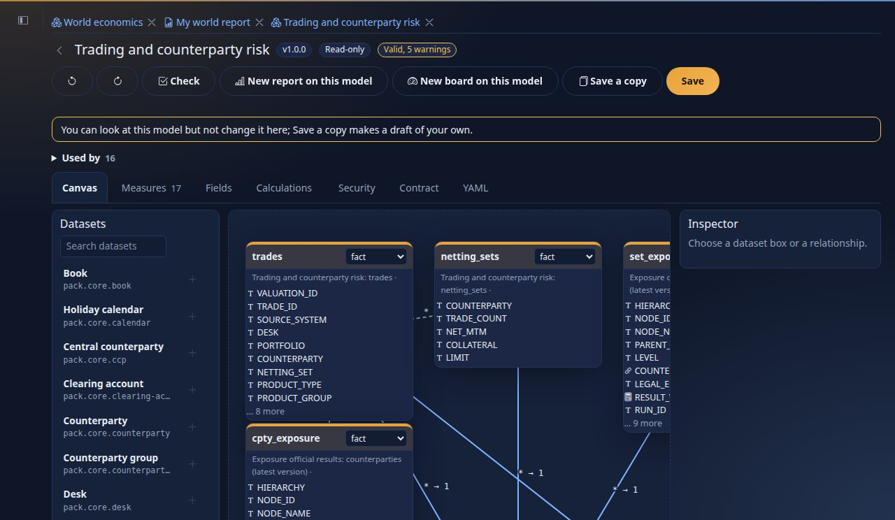

You should see the datasets under their aliases: the **facts** `trades` and `netting_sets`, and the **dimensions** `counterparties`, `desks`
and `books`, with a line for each relationship (from the many side to the one side): `trades.COUNTERPARTY → counterparties.id` and
`netting_sets.COUNTERPARTY → counterparties.id`, the two paths that meet at the counterparty. (`trades.NETTING_SET → netting_sets.id` is an
**inactive** relationship, `active: false`, so the two facts are never joined row to row.) Two more facts sit beside them, `set_exposure`
and `cpty_exposure` (scroll the canvas to see them all): the exposure engine's official end-of-day results for each netting set and each
counterparty (the datasets `counterparty-exposure-official-netting-sets` and `-counterparties`), related to `counterparties.id` the same way;
the netting-set record does not store exposure. Press the **Measures** tab.

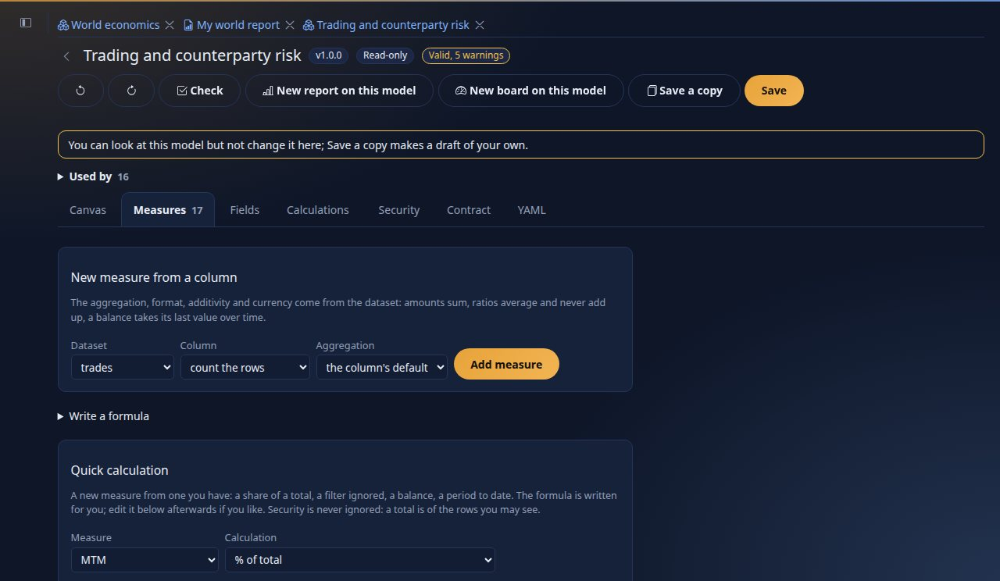

Scroll to the list. You should see `P&L 1d` (`sum(trades.PNL_1D)`), `Exposure (EE peak)` (`sum(set_exposure.PEAK_EE)`: the netting sets'
computed peaks), `Exposure (PFE peak)` (`sum(cpty_exposure.PEAK_PFE_95)`: each counterparty's own) and `P&L per exposure`,
`measure('P&L 1d') / measure('Exposure (EE peak)')`: the ratio of the two sums, whatever the grouping. Now open the report **Desk P&L vs
counterparty exposure** from the catalogue.

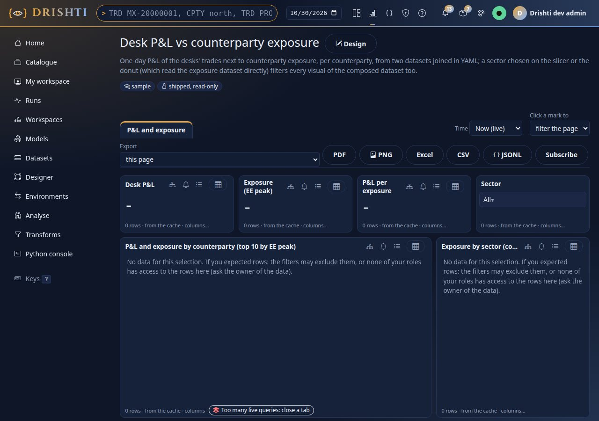

You should see `Desk P&L` `90,804,863`, `Exposure (EE peak)` `2,663,018,256` and the ratio `0.03`, the ten counterparties with the most exposure
as pairs of bars, a donut of exposure by sector and the table of every counterparty. In the Sector slicer choose **Banking**.

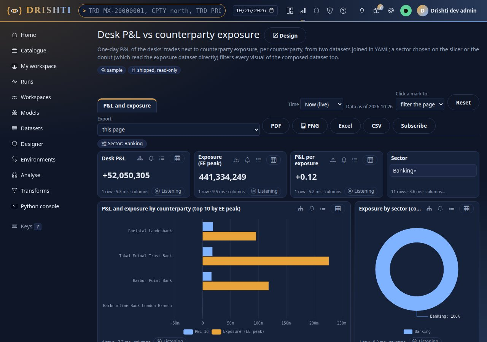

You should see a chip `Sector: Banking`, the cards narrowed to the banks (`Desk P&L` `52,050,305`, exposure `441,334,249`), four banks in the
bar chart (Rheintal Landesbank, Tokai Mutual Trust Bank, Harbor Point Bank, and Harbourline Bank London Branch, whose exposure, `56,174`, is too small
to see as a bar) and the donut a single slice: one
slicer on the dimension filters **both** facts. Click a slice of the donut instead and the same happens. Open the report as a desk head and the P&L
shrinks to the trades of your desks (the exposure does not: the model says `may-see-all` for the netting sets and their exposure); open it as an analyst and the
names read `•••` (the bars are ranked by the counterparty's **id**, which is not masked, so the report still works).

**From the command line** the table of the report is one model query; the server says how it answered (the two facts aggregated alone, then
joined):

```text
$ python3 tools/drishti.py bi mq --model trading-risk@1 --select counterparties.NAME,counterparties.SECTOR \
    --measures "P&L 1d,Exposure (EE peak),P&L per exposure" --sort="-Exposure (EE peak)" --limit 4 --json | jq -c '.rows[], .meta.warnings'
["Verdant Agri Holdings","Agriculture",-1441625.5600000015,303824105.0,-0.004744934770728615]
["Aldershot Pension Trust","Pensions",11885402.729999984,278109475.0,0.04273641784408814]
["Tokai Mutual Trust Bank","Banking",17583780.69000001,226721872.0,0.077556613902694]
["Aurora Sovereign Wealth Fund","Government",-4988548.660000008,202918363.0,-0.024584017859438416]
["2 fact tables, each aggregated alone at the query's fields and then joined: [trades, counterparties, set_exposure]","a measure that combines measures of different grains is worked out over the joined results: P&L per exposure"]
```

**In the YAML** (`config/tables/banking/trading-risk.model.yaml`), the part that makes it work:

```yaml
datasets:
  trades:         { dataset: trading-risk-trades, role: fact }
  netting_sets:   { dataset: trading-risk-netting-sets, role: fact }
  set_exposure:   { dataset: counterparty-exposure-official-netting-sets, role: fact }    # the computed exposure
  cpty_exposure:  { dataset: counterparty-exposure-official-counterparties, role: fact }
  counterparties: { dataset: trading-risk-counterparties, role: dimension }
relationships:                  # from the MANY side to the ONE side
  - { from: trades.COUNTERPARTY, to: counterparties.id }
  - { from: trades.NETTING_SET, to: netting_sets.id, active: false }
  - { from: netting_sets.COUNTERPARTY, to: counterparties.id }
  - { from: set_exposure.COUNTERPARTY, to: counterparties.id }
  - { from: cpty_exposure.COUNTERPARTY, to: counterparties.id }
measures:
  P&L 1d:             { expr: "sum(trades.PNL_1D)", format: signed0 }
  Exposure (EE peak): { expr: "sum(set_exposure.PEAK_EE)", format: amount0 }        # a reporting sum of the sets' computed peaks
  Exposure (PFE peak): { expr: "sum(cpty_exposure.PEAK_PFE_95)", format: amount0 }  # the counterparty's own row, never a sum of its sets' PFEs
  P&L per exposure:   { expr: "measure('P&L 1d') / measure('Exposure (EE peak)')", format: signed2 }
```

and the report (`config/bi/reports/banking/pnl-vs-exposure.report.yaml`) only says `model: trading-risk@1`. When the two numbers live in **two models**
(each with its own row rules), a report can still read both side by side and link their fields: that is [Part B](#part-b--several-datasets-in-one-report).
The same table made by a Python Transform is in [tutorial 9](09-notebook-and-python.md); the reference is
[ARCHITECTURE.md §28](../architecture/ARCHITECTURE.md#281-the-table-layer-and-models-in-rachana) and [REPORTS_GUIDE.md › Reports: the YAML, the visuals and how they behave, section 16](../guides/REPORTS_GUIDE.md#913-reports-over-several-models).

## Step 12 · Relative dates, a tablet, and a view inside a report

Three things a real report needs. Each is a few controls in the designer, and each is also a few lines of YAML (**In the UI**: build it in the designer; **in the YAML**: open **My workspace → New item**, kind *report*, paste, **Save draft**, then **View**; the two write the same text).

**A slicer that says "last 4 weeks".** A slicer on a date column can offer named windows instead of values. The server works them out from the report's date and the business-day calendar, so the same name means the same dates on the screen, in an export and in a subscription.

**In the UI:** drag the date field (`trade.TRADE_DATE`) onto the canvas, choose **slicer**, open **Format** and set **Mode** to *relative date (a date field)*. Two more controls appear: **Starts as** (the window used until a reader chooses; it is the `default`) and **Windows it offers** (a tick for each of the sixteen names; unticking one narrows the list, the `options`).

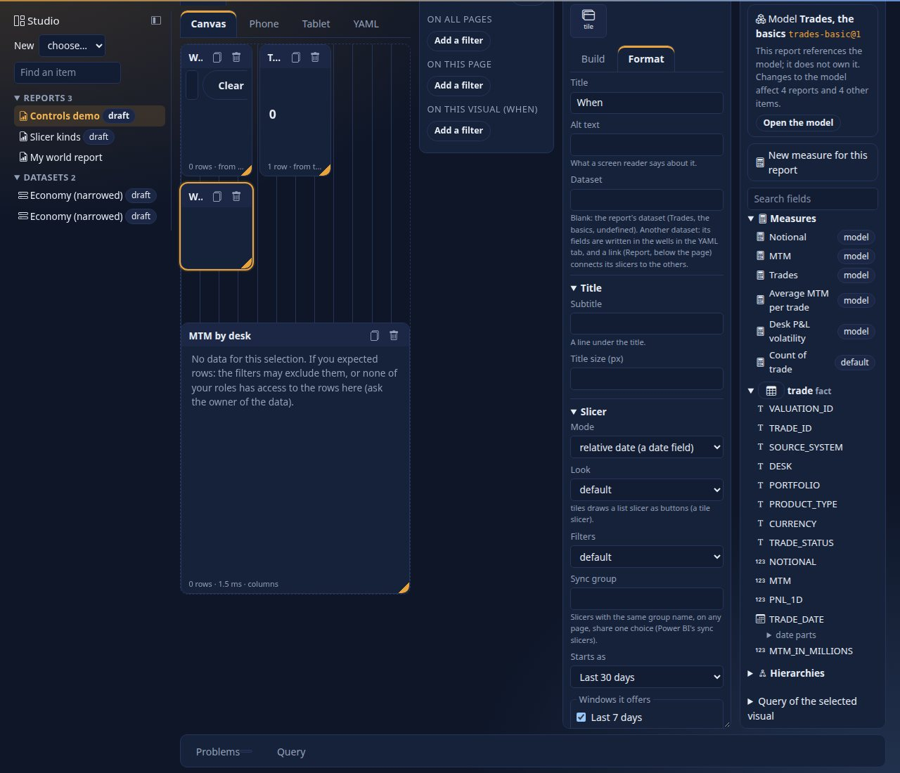

**In the YAML:**

```yaml
rachana: 2
report: relative-dates
title: Relative dates
model: trades-basic@1
pages:
  - id: main
    title: Main
    visuals:
      - { id: when, type: slicer, title: When, at: { x: 0, y: 0, w: 4, h: 3 }, wells: { field: [trade.TRADE_DATE] }, format: { mode: relative-date, default: last-90-days } }
      - { id: count, type: card, title: Trades, at: { x: 4, y: 0, w: 4, h: 3 }, wells: { values: [Trades] } }
      - { id: mtm, type: card, title: Mark to market, at: { x: 8, y: 0, w: 4, h: 3 }, wells: { values: [MTM] } }
      - { id: desk, type: bar, title: MTM by desk, at: { x: 0, y: 3, w: 12, h: 6 }, wells: { axis: [trade.DESK], values: [MTM] } }
```

**From the command line**, check it before saving (`Check`, nothing stored) and ask what the window holds: *last 3 months* runs from the day after the same date
three months earlier to the report's date, 2026-07-27 to 2026-10-26 here, of `TRADE_DATE`:

```text
$ jq -Rs '{yaml: .}' relative-dates.report.yaml | curl -s -X POST -H "Authorization: Bearer $DRISHTI_TOKEN" \
    -H 'Content-Type: application/json' -d @- $DRISHTI_SERVER/api/v1/bi/reports/validate | jq -c '{valid, problems}'
{"valid":true,"problems":[]}
$ python3 tools/drishti.py bi mq relative-window.yaml
Trades  MTM
------  ----------------
2619    1,125,679,037.48
1 row(s)  as of 2026-10-26  plan p_eaea0217f95f331d
```

```yaml
# relative-window.yaml: the window the slicer works out, as an explicit filter
mq: 1
model: trades-basic@1
select: { measures: [Trades, MTM] }
where: [{ field: trade.TRADE_DATE, op: between, values: [2026-07-27, 2026-10-26] }]
```

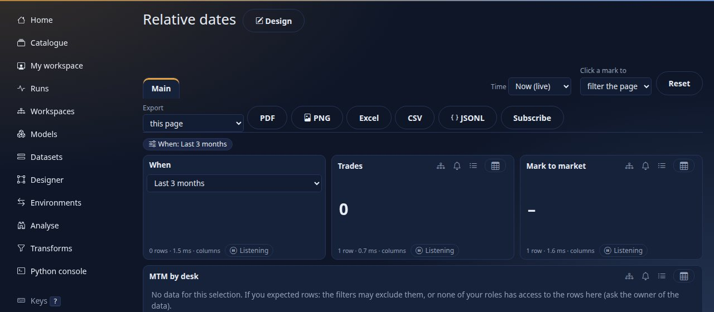

You should see the slicer's dropdown (the report's `default: last-90-days` is chosen until you pick another) and, after choosing **Last 3 months**, a chip `When: Last 3 months` and cards narrowed to the `2,619` trades booked in the three months ending on the report's date (MTM `+1,125,679,037`; the whole book is `15,000` trades). Your count depends on the day you built the lake: the trade dates stay (the newest is 2026-09-25), the business dates move, so a short window such as *Last 4 weeks* can hold no trades at all. The names are `last-N-days`, `last-N-business-days`, `last-N-weeks`, `last-N-months`, `this-week|month|quarter|year` (to date), `previous-...` and `all`: [REPORTS_GUIDE.md › Reports: the YAML, the visuals and how they behave, section 6.1](../guides/REPORTS_GUIDE.md#99-slicers).

**A tablet layout.** A phone gets one column ([step 10](#step-10--on-a-phone)); a tablet (up to 1024 px) can get two, with some visuals across:

```yaml
layouts:
  tablet:
    main:
      order: [desk, count, mtm]                     # first, in this order (the visuals' ids)
      wide: [desk]                                  # the whole width; the others take half
      span: { desk: 5 }                             # heights in grid rows
```

**In the UI** open the draft in the designer and press the **Tablet** tab (the **Phone** tab is the same for a phone). Every key above has a control there: the arrows or a drag set the `order`, **Hide** hides a visual, **Wide** is `wide` (tablet only) and **Rows** is `span`:

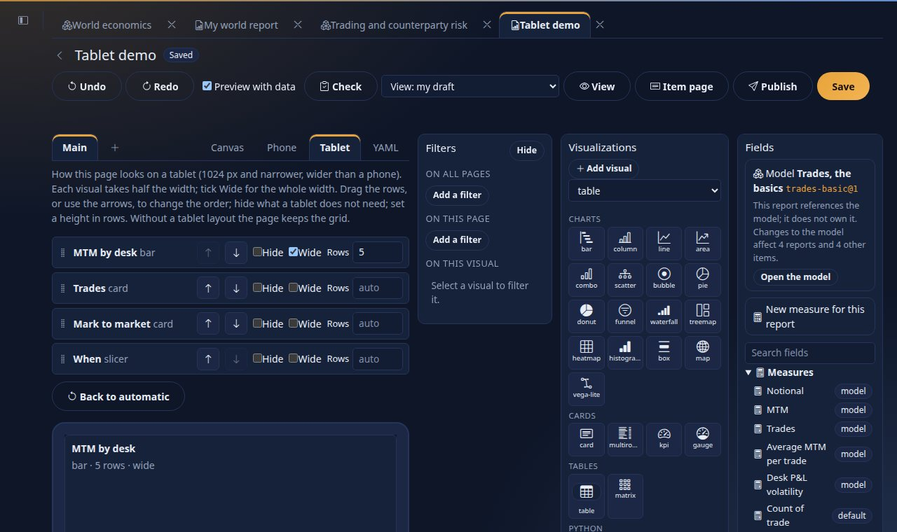

You should see the visuals in tablet order with **Hide**, **Wide** and **Rows**, and a preview below. Then open the report on an 820 px screen:

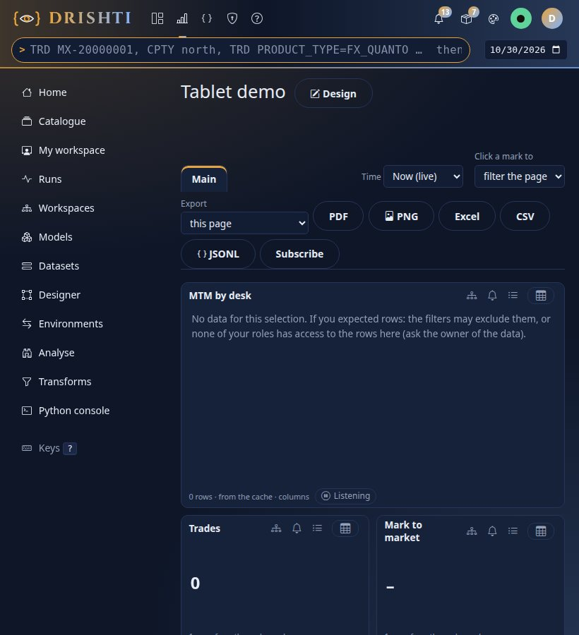

You should see the bar the whole width, then the cards in two columns. A phone, or a desktop, is not affected. **From the command line** there is no layout command: the layout is part of the report's YAML, so `python3 tools/drishti.py bi item new me relative-dates.report.yaml` saves the whole report, `layouts:` included, as a draft in your own workspace (`me`), and `bi item save <id> FILE` saves a changed file over it.

**A counterparty's own view inside the report.** The sample **Counterparty risk** has a page *Counterparty lookup*: a bar of the ten largest counterparties and, beside it, a visual of `type: entity-view` with `wells: { key: [counterparties.id] }`. Open it and click a bar:

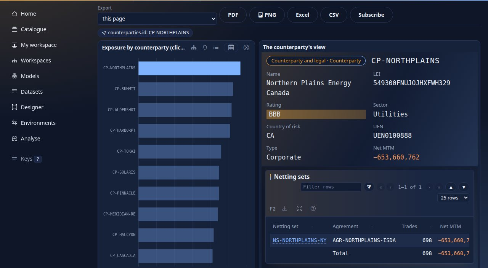

You should see the counterparty's own **Drishti view** (its name, rating, net MTM and netting sets) in the frame beside the bar, with a chip `counterparties.id: CP-VERDANT` (the first bar: the largest computed expected exposure). It is the view page built **for you**: someone who may not see a field does not see it here either. [REPORTS_GUIDE.md › Reports: the YAML, the visuals and how they behave, section 3.4](../guides/REPORTS_GUIDE.md#95-the-entity-view).

## Step 13 · A dataset and a model of your own, in the wizard

Everything so far read models that ship with Drishti. A business user can make a dataset and a model without typing YAML. This step makes
**Large economies** (the economies with a GDP of 100 billion dollars or more, with a GDP per head worked out), publishes it, and makes a model of it.

**In the UI.** Choose **Models**, then **New dataset**. The wizard has eight steps along the top; you can go back at any time, and each step shows the
server's check of what you chose.

**1 · Source.** Where the table comes from: **a pack dataset** (keep some of its columns and rows, add columns, group it), an SQL view over a model, a
query in a SQL connector, a Python Transform, or the answer of a model. Choose **A pack dataset** and `pack.world-economy.economy` (every kind of every pack
is a dataset already, certified and read-only; this one narrows it).

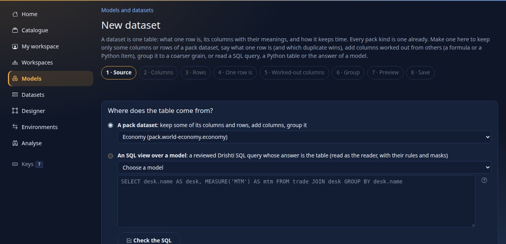

**2 · Columns.** Tick the columns to keep: press **Only the keys**, then tick `NAME`, `ISO3`, `REGION_NAME`, `INCOME_NAME`, `GDP_USD_BN` and `POPULATION_M`
(each shows its type and role; the key `id` always stays, a row must still say what it is).

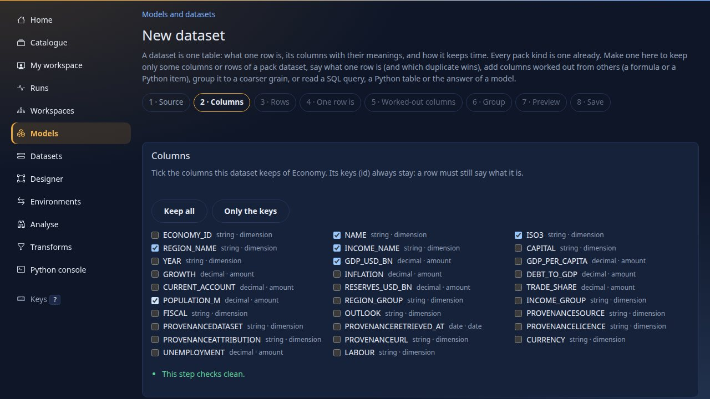

**3 · Rows.** *Keep the rows where* `GDP_USD_BN >= 100` (a filter of the table in DEL, not a security rule: row rules are set on the model). **4 · One row
is**: the pack's grain stays, one row per economy per business date. **5 · Worked-out columns.** Press **A formula column**, name it `GDP_PER_HEAD`, type
`decimal`, formula `GDP_USD_BN / POPULATION_M * 1000`: the server checks it as you type.

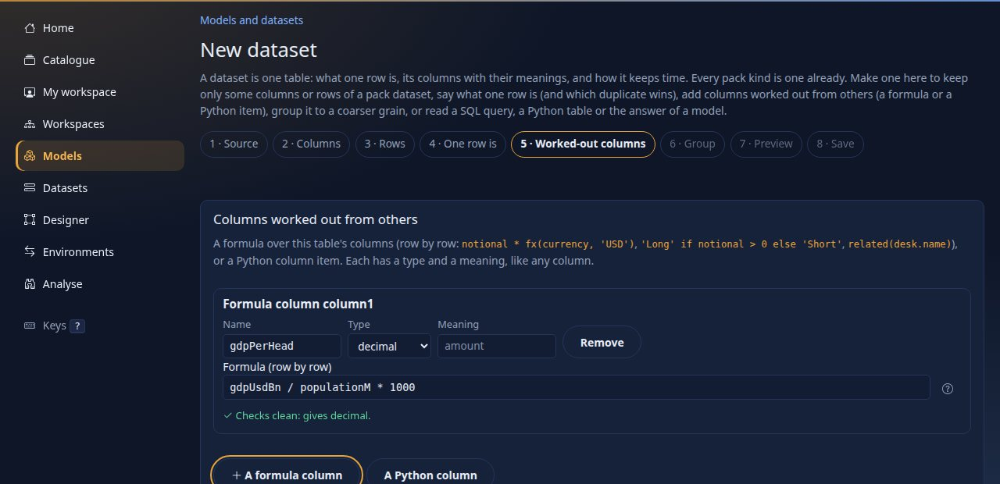

**6 · Group** (optional) makes a coarser grain; leave it. **7 · Preview**: press **Preview**, then **Save the draft and preview** when it asks (the server previews a saved
draft, visible only to you; Save later updates the same draft): it answers the first rows, as you.

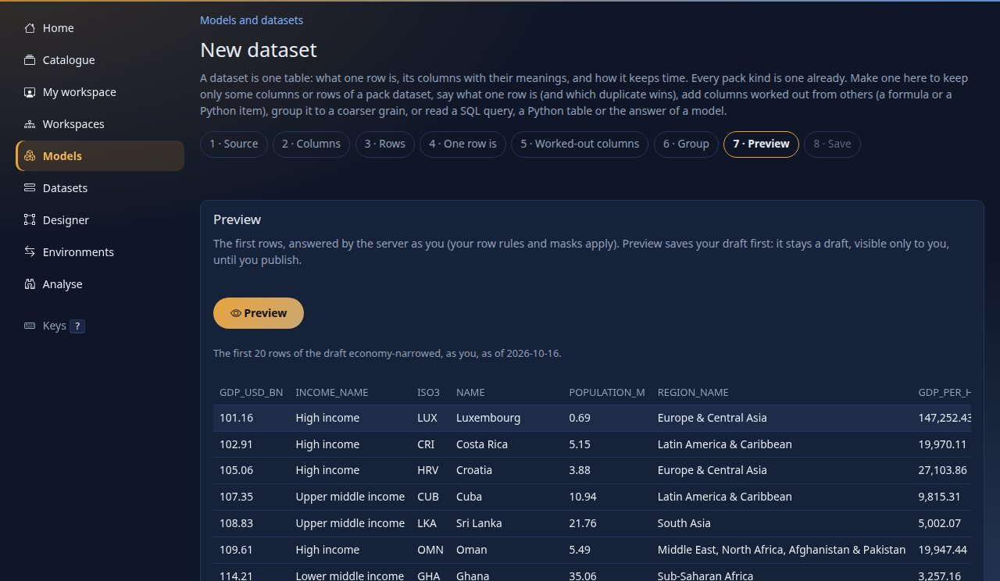

You should see 76 economies in all (GDP of 100 billion dollars or more), Australia with `GDP_USD_BN` `1,798.52` and `GDP_PER_HEAD` `65,129.79`.

**8 · Save.** Title `Large economies` (the name, what models use, follows: `large-economies`), the **workspace** (a shared one, here *Models desk*: a
private draft cannot be published), the columns to mask, and the YAML the wizard wrote, for review.

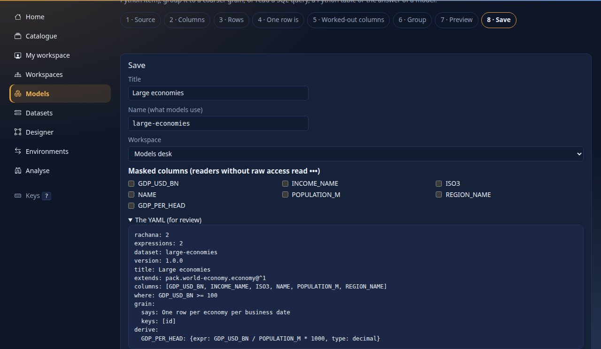

Press **Save and publish**. **You should see** the next steps under the buttons: **Open the dataset**, **Start a report on it** (a report on its implicit model,
`dataset:large-economies`) and **Use it in a new model**. Press **Use it in a new model**, choose *Models desk* and **Make the model**: the model
designer opens on **Large economies model**, the dataset placed as a fact under the alias `large_economies`, with the default measures of its columns
(`Count of large_economies`, `Sum of GDP_USD_BN`, `Sum of POPULATION_M`).

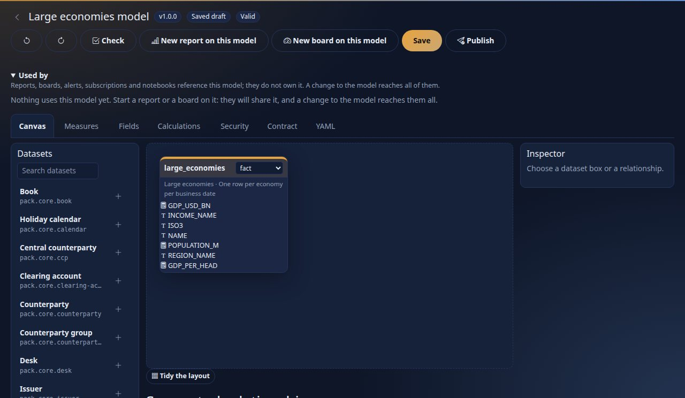

From here it is the model designer of the preview section below: add measures, relationships and row rules, **Save**, **Publish**, then **New report
on this model**. To change the dataset later, open it (Models → *Your datasets* → **Open**) and choose **Narrow it** or edit its YAML; publishing a
change needs a new version (`1.0.1` for words, `1.1.0` for an added column, `2.0.0` for a column taken away; `DRS-9126` says which).

**In YAML.** What the wizard wrote for the dataset (the server added `id` on save) and for the model:

```yaml
rachana: 2
expressions: 2
dataset: large-economies
version: 1.0.0
id: ds_482151d0
title: Large economies
extends: pack.world-economy.economy@^1
columns: [NAME, ISO3, REGION_NAME, INCOME_NAME, GDP_USD_BN, POPULATION_M]
where: GDP_USD_BN >= 100
grain:
  says: One row per economy per business date
  keys: [id]
derive:
  GDP_PER_HEAD: {expr: GDP_USD_BN / POPULATION_M * 1000, type: decimal}
```

```yaml
rachana: 2
expressions: 2
model: large-economies-model
version: 1.0.0
id: md_52756ba0
title: Large economies model
datasets:
  large_economies: {dataset: large-economies@^1, role: fact}
relationships: []
measures: {}          # the defaults of the columns: Count of large_economies, Sum of GDP_USD_BN, Sum of POPULATION_M
```

**From the command line.** The same two files make the same items (a write needs a token with the `bi:write` scope and the `bi-author` power; the
ids differ on your machine). The shared workspace is made once on the **Workspaces** page, or over REST (there is no `bi workspace new`):

```text
$ curl -s -X POST -H "Authorization: Bearer $DRISHTI_TOKEN" -H 'Content-Type: application/json' \
    -d '{"name": "Models desk", "id": "models-desk"}' $DRISHTI_SERVER/api/v1/bi/workspaces | jq -c '{id, name, role}'
{"id":"models-desk","name":"Models desk","role":"admin"}
```

```text
$ python3 tools/drishti.py bi model check large-economies.dataset.yaml          # the server's Check, nothing stored
valid  (dataset large-economies)
$ python3 tools/drishti.py bi item new models-desk large-economies.dataset.yaml
bi-23cecf80ac  dataset  Large economies  draft in Models desk
$ python3 tools/drishti.py bi catalogue publish bi-23cecf80ac
published Large economies as version 1
$ python3 tools/drishti.py bi item new models-desk large-economies-model.model.yaml
bi-f7cc3473c2  model  Large economies model  draft in Models desk
$ python3 tools/drishti.py bi model describe large-economies-model@1
Large economies model  (large-economies-model@1)

large_economies  fact  large-economies 1.0.0
  large_economies.GDP_USD_BN         decimal   amount
  large_economies.INCOME_NAME        string    dimension
  large_economies.ISO3               string    dimension
  large_economies.NAME               string    dimension
  large_economies.POPULATION_M       decimal   amount
  large_economies.REGION_NAME        string    dimension
  large_economies.GDP_PER_HEAD       decimal   amount

measures
  Count of large_economies          count(large_economies)  (default)
  Sum of GDP_USD_BN                 sum(large_economies.GDP_USD_BN)  (default)
  Sum of POPULATION_M               sum(large_economies.POPULATION_M)  (default)
$ python3 tools/drishti.py bi mq --model large-economies-model@1 --select large_economies.REGION_NAME \
    --measures "Count of large_economies" --sort="-Count of large_economies" --limit 3
large_economies.REGION_NAME                        Count of large_economies
-------------------------------------------------  ------------------------
Europe & Central Asia                              29
Middle East, North Africa, Afghanistan & Pakistan  12
Latin America & Caribbean                          12
3 row(s)  as of 2026-10-26  plan p_1a5faeead616790e
```

A draft model answers its owner (and is listed as `draft` by `bi model list`); a report on it is published once the model is. The reference for the
wizard's every step is [REPORTS_GUIDE.md section 23](../guides/REPORTS_GUIDE.md#5-models-and-datasets-what-a-report-reads) and
[REPORTS_GUIDE.md](../guides/REPORTS_GUIDE.md#5-models-and-datasets-what-a-report-reads); the version 1 guided tables builder (*Use the guided tables builder* under the wizard's first step) still makes
`rachana: 1` datasets, which the upgrade converts to models ([tutorial 21](21-run-it-in-production.md)).

### Notes: saving safely, and more than one dataset

- **UI.** *New report* on the designer's start page asks for a **Main dataset** and an optional **Also add** (Ctrl or Shift for several): the designer opens with all of them in the **Fields** pane. A dataset you cannot use yet is greyed with the reason (for example *draft in a private workspace: publish it first*). **+ Add visual** makes an empty visual; the **Publish** button (Propose where review is required) saves first. Open the same draft in two tabs and save in both: the second is refused with **Reload theirs / Save mine as a copy / Overwrite with mine**.
- **CLI.** `drishti.py bi catalogue get <id>` shows the item with its `etag`; a propose, approve or publish of a report that cannot be drawn is refused with `DRS-9030` and the errors (a bi-admin may force it).
- **YAML.** Nothing new to write: the extra datasets are named in each visual's `dataset:` and the report's `links:` (REPORTS_GUIDE.md › Reports: the YAML, the visuals and how they behave, section 16); `?also=a,b` on the designer URL opens extra datasets in the Fields pane.

## Step 14 · Models: from a pack dataset to a report

The **model layer** ([REPORTS_GUIDE.md section 23](../guides/REPORTS_GUIDE.md#5-models-and-datasets-what-a-report-reads)): every
kind of every pack is a dataset already, and a model is a few of them joined. This step goes from the pack's **Trade valuation** (one row per trade
per business date, with its desk, MTM and P&L, in the `market-risk` pack) to a model of trades and desks with a row rule, published, analysed and
watched. The numbers are from the demo lake (15,000 trade valuations over ten desks).

**In the UI.**

1. **BI → Models** in the rail. Under *Datasets from the packs* every kind is already a dataset: find **Trade valuation**
   (`pack.market-risk.trade-valuation`, certified, read-only). Its title opens its page: *One row per trade valuation per business date*, key `id`,
   time *snapshot*, and `DESK` marked `desk →` (it holds desk ids; `COUNTERPARTY`, `PORTFOLIO`, `NETTING_SET` and `TRADER_ID` likewise).
2. Press **Use** on the card and choose your workspace: a report opens in the designer on the **implicit model of Trade valuation**. Fields lists
   `trade_valuation` and, brought along by the pack reference, `desk`; drag **Sum of MTM** onto the canvas, then **desk → NAME** onto the card: a bar of
   MTM by desk name, with nothing modelled by hand. *Query of the selected visual* shows the model query it asked.
3. Back on **Models**, press **New model**, title it *Trades and desks*, tick **Trade valuation** and **Desk**, **Create and open the designer**. Desk is
   placed as a **dimension** (Trade valuation references it). Under the canvas, *Suggested relationships* offers `trade.DESK → desk.id` (*trade.DESK holds
   desk ids (from the pack)*): press **Add**. (The designer names the alias after the dataset; rename it `trade` in the **Fields** tab to match the YAML
   below.)
4. **Measures**: dataset `trade`, column `MTM`, **Add measure**: `Sum of MTM`, `sum(trade.MTM)`, adds up: yes.
5. **Security**: on `trade`, roles `desk-head`, *the column matches the reader*, column `DESK`, *the reader's desks*, **Add the rule**. The tab shows ⚠ 1:
   *The role desk-head is restricted elsewhere in this model, but desk has no rule*, and the header badge agrees (*Valid, 1 to fix before publishing*).
   Press **desk-head may see every row of desk** (desks are not secret); the ⚠ goes. Add a second rule so you see every trade yourself: under **Roles**
   tick your own role (`admin` for the development administrator; the list holds the roles the server knows, any other can be typed under it), *every
   row*. The note under the list says *roles without a rule see no rows*: a reader no rule matches reads nothing of that dataset.
6. **Save** (the badge says *Valid*), then **New report on this model**: the Fields pane's header says *Model Trades and desks*, *this report
   references the model*. A model is shared: **Used by** (above the tabs) lists the reports, boards, alerts, subscriptions and notebooks that read it, and
   **New board on this model** starts a board on it. Deleting a report never deletes its model, and a model that is used cannot be deleted.
7. **Publish.** In your private workspace Publish says to move it to a shared workspace first, with **Move…** beside it: choose a shared workspace (*Models
   desk* of step 13) and Move, then **Publish** (it checks the model and its security safeguard first). A report on the published model publishes the same
   way from its item page.
8. **Open it in the Notebook.** Open the **Notebook** (`/bi/notebook`): the *Model or dataset* picker lists *Models*, *Your datasets* and one group per pack. Choose
   **Trades and desks (model 1.0.0, published)**, tick `trade.DESK`, `trade.MTM` and `desk.NAME`, **Open the extract**: the rows you may see, as one model
   query.
9. **Alert on it.** **Alerts → New**, *Watch: measure of a model*: choose the model, then the measure `Sum of MTM`, a filter (`trade.DESK is one of
   DESK-FX`), *Tell me when* it is above a limit, **Check now** (it reads your own number; a masked one cannot be saved) and **Save alert**.

You should see, in step 2, the bar of MTM by desk name led by `Rates · Swaps and options` (`4,484,481,851.44` over 1,832 valuations), then
`Money markets` and `Structured products`: the same three rows the command line below prints.

**From the command line.** The same through the CLI and the REST API, with your token. The pack datasets (79 of them for the seven packs), then a
question to the implicit model of Trade valuation:

```text
$ curl -s -H "Authorization: Bearer $DRISHTI_TOKEN" $DRISHTI_SERVER/api/v1/bi/pack-datasets | jq -c '.datasets | length, .[0]'
79
{"name":"pack.core.book","id":"ds_pack_core_book","title":"Book","description":"Book: one row per book per business date, from the Core pack.","pack":"core","kind":"book","version":"1.0.0","mode":"snapshot","endorsement":"certified","columns":10,"query":"dataset:pack.core.book"}
$ python3 tools/drishti.py bi mq --model dataset:pack.market-risk.trade-valuation --select desk.NAME \
    --measures "Sum of MTM,Count of trade_valuation" --sort="-Sum of MTM" --limit 3
desk.NAME                  Sum of MTM        Count of trade_valuation
-------------------------  ----------------  ------------------------
Rates · Swaps and options  4,484,481,851.44  1832
Money markets              401,503,094.06    480
Structured products        394,244,806.24    330
3 row(s)  as of 2026-10-26  plan p_b9a516b4619eb2dc
```

Check of the model's YAML without storing it: `python3 tools/drishti.py bi model check trades-and-desks.model.yaml`, or
`POST /api/v1/bi/models/validate` with `{"yaml": "..."}`. Before step 5's **may see every row**, it answers `"valid": true` with the warning
`DRS-9130` and `"exposures": [{"dataset": "desk", "role": "desk-head"}]`, which a publish refuses; after it, only `DRS-9131` remains (the roles
`approver`, `author` and `viewer` have no rule and see no trades: on purpose here).

**In the YAML.** What the designer wrote in steps 3 to 5 (you typed none of it; the server added `id` on save):

```yaml
rachana: 2
expressions: 2
model: trades-and-desks
version: 1.0.0
id: md_...
title: Trades and desks
datasets:
  trade: {dataset: pack.market-risk.trade-valuation@^1, role: fact}
  desk: {dataset: pack.core.desk@^1, role: dimension}
relationships:
  - {from: trade.DESK, to: desk.id, suggested: {from: pack-reference}}
measures:
  Sum of MTM: {expr: sum(trade.MTM)}
security:
  rows:
    trade:
      - {role: desk-head, where: trade.DESK in user.desks}
      - {role: admin, where: 'True'}
  may-see-all:
    desk: [desk-head]
```

and the report of step 6 says `model: trades-and-desks@1`. It publishes like any report once its model is published and passes its safeguard
([REPORTS_GUIDE.md › Reports: the YAML, the visuals and how they behave, section 18](../guides/REPORTS_GUIDE.md#83-a-report-on-a-model-fields-own-measures-mq-or-sql)).

**Steps 7 to 9 from the command line.** Make the item, publish it and ask it (through the console the same calls are `/bi/api/items/<id>/publish`
and **`/bi/api/mq`**):

```text
$ python3 tools/drishti.py bi item new models-desk trades-and-desks.model.yaml
bi-6b99de51c7  model  Trades and desks  draft in Models desk
$ python3 tools/drishti.py bi catalogue publish bi-6b99de51c7
published Trades and desks as version 1
$ python3 tools/drishti.py bi mq --model trades-and-desks@1 --select desk.NAME --measures "Sum of MTM" --sort="-Sum of MTM" --limit 3
desk.NAME                  Sum of MTM
-------------------------  ----------------
Rates · Swaps and options  4,484,481,851.44
Money markets              401,503,094.06
Structured products        394,244,806.24
3 row(s)  as of 2026-10-26  plan p_bd58306ba8d6bb50
warning: connector 'reference-store' cannot scan desk as columns for table desk: reading documents one by one (slow for a large table; promote the columns in the connector's layout, or fewer columns)
```

The alert is made in the console only (`/alerts/rules` is never open to a personal API token); what **Alerts → New** writes, as
`PUT /api/v1/alerts/rules/<name>` with title, severity, trigger and delivery around it:

```yaml
source:
  type: model
  model: trades-and-desks@1
  query: {select: {fields: [], measures: ["Sum of MTM"]}, where: [{field: trade.DESK, op: in, values: [DESK-FX]}]}
  reduce: first
condition: {type: threshold, op: above, value: 1000000}
```

`Sum of MTM` for `DESK-FX` is `-681,989,222` today, so this alert stays quiet; [Part D](#part-d--bi-that-runs-itself) makes one that fires.

### Part B · Several datasets in one report

A report usually starts from one dataset. Real questions do not stop there: *what is each sector's P&L next to its counterparty exposure?* needs the **trades** (where P&L lives) and the **netting sets** (where exposure lives), two things measured at two different grains. The answer is **one model with two facts**: the trades and the netting sets sit in one model with the dimensions they share (the counterparty, the desk), every measure is aggregated **at its own grain first** and the answers are then joined on the fields you asked for, so one visual can show MTM and exposure side by side and the totals stay the true ones. This part builds that model in the **model designer**, puts both measures in one visual, shows why Drishti **never joins the rows** of two facts for you (and what a row join does to your totals), writes a measure that spans both facts, makes a table with a **Python Transform**, and shows two readers getting different, correct answers from one definition. Every step is done in the **UI**, again from the **command line**, and shown as the **YAML** the item keeps, with the real numbers of the demo data.

## Step 15 · The two datasets and their grains

Open **Models** in the BI rail. Every kind of every pack you may open is already a dataset (nobody builds them); search `valuation` and open **Trade
valuation**. (The `trading` pack's **Trade** is the deal itself, from each source system, with its legs and cash flows; its valuation, the MTM and
the one-day P&L of each trade of every source system, with its desk and netting set, is the `market-risk` pack's **Trade valuation**: the dataset P&L
lives in.)

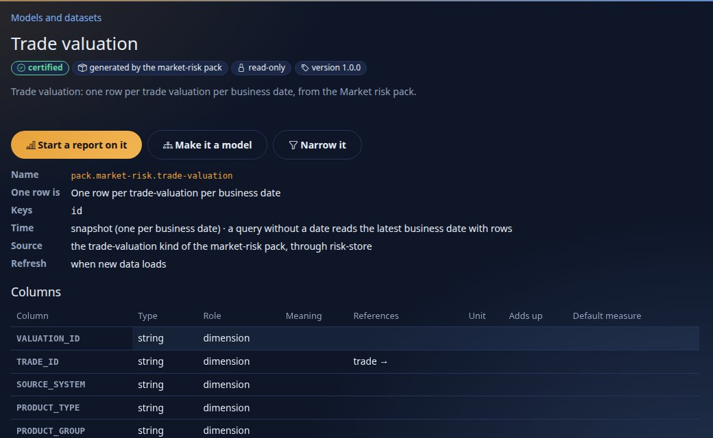

You should see what one row is (*One row per trade valuation per business date*), the key (`id`), the time mode (*snapshot*), the source (*the
trade-valuation kind of the market-risk pack, through risk-store*) and the columns: `COUNTERPARTY` **references** `counterparty`, `DESK` references
`desk`, `NETTING_SET` references [`netting-set`](../contracts/samples/counterparty-risk.md#netting-set) ([contract](../contracts/packs/counterparty-risk.md#nset-netting-set-netting-set)), `PORTFOLIO` references `book`, `TRADER_ID` references `trader`. Now open **Exposure official results: netting sets** (search `exposure official`).

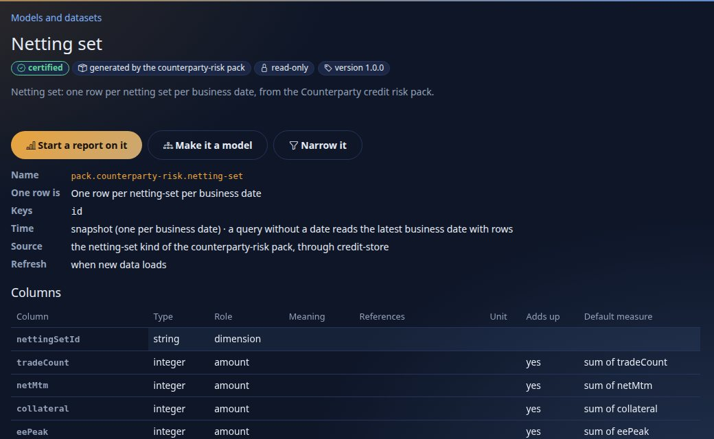

You should see one row per netting set per business date: a different grain. A netting set's record keeps no exposure figure: exposure is computed by the exposure engine, and this dataset is its official end-of-day result for each netting set (the latest result version), with the set's counterparty (`COUNTERPARTY` references it) and the computed peaks (`PEAK_EE`, `PEAK_PFE_95`); it has **no desk**. The demo's exposure run covers all 76 netting sets of the 24 counterparties, so this dataset has 76 rows a day. Both datasets reach the counterparty, which is what lets them meet; only trades reach a desk.

**From the command line** each dataset is asked through its **implicit model** (`dataset:<name>`: the dataset as a fact, its pack dimensions one hop away, a default measure per amount column):

```text
$ python3 tools/drishti.py bi mq --model dataset:pack.market-risk.trade-valuation --measures "Count of trade_valuation,Sum of MTM,Sum of PNL_1D"
Count of trade_valuation  Sum of MTM        Sum of PNL_1D
------------------------  ----------------  -------------
15000                     3,210,381,876.57  90,804,863.45
1 row(s)  as of 2026-10-26

$ python3 tools/drishti.py bi mq --model counterparty-exposure@1 --measures "Exposure (EE peak)"
Exposure (EE peak)
------------------
2,663,018,256.00
1 row(s)  as of 2026-10-26
```

(The official results are a Delta table whose columns the pack's connector `exposure-results` promotes, so they are scanned as columns; the
model `counterparty-exposure` reads the same dataset.)

**The YAML** of a pack dataset is written by Drishti from the pack (read-only; **Narrow it** makes a dataset of your own that `extends` it, [REPORTS_GUIDE.md › Datasets: the YAML, the expression language and the security rules, section 14](../guides/REPORTS_GUIDE.md#510-a-table-of-your-own-step-by-step)). The part that matters here is the grain:

```yaml
rachana: 2
dataset: pack.counterparty-risk.netting-set
version: 1.0.0
title: Netting set
source:
  pack: counterparty-risk
  kind: netting-set
  connector: credit-store
grain:
  says: One row per netting-set per business date
  date: businessDate
  keys:
  - id
time:
  as-of: business-date
  mode: snapshot
```

Keep four numbers: **15,000 trades, MTM 3,210,381,877, P&L 90,804,863** and **76 netting sets with expected exposure 2,663,018,256**. They are the true totals; the rest of the tutorial is about never losing them.

## Step 16 · One model, two facts

Still on **Models**, press **New model**. Title it `CP risk`, choose the workspace **Exposure desk**, and tick **Counterparty**, **Desk**, **Exposure official results: netting sets** and **Trade valuation** (give it the alias `netting_set` in its box, as you do `trade`, so the names below match).

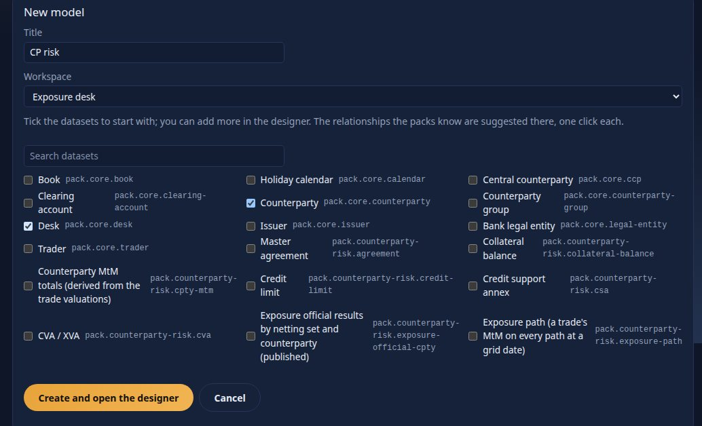

Press **Create and open the designer**. You land on the **canvas** with four boxes (rename the box `trade_valuation` to `trade` with its alias field,
so the names below match). The designer guessed each box's **role**: `trade` is a fact (it has amounts to add up); `counterparty` and `desk` are dimensions (other datasets reference them); and `netting_set` was guessed a dimension too, because trades reference netting sets. **A netting set has amounts to add (its exposure): change its role to `fact`** with the select on its box. Each box still carries a pinned problem (`DRS-9121`: no relationship yet), and under the canvas the **Suggested relationships** come from the packs' references:


You should see the suggestions, each one click: `netting_set.COUNTERPARTY → counterparty.id`, `trade.COUNTERPARTY → counterparty.id` and `trade.DESK → desk.id` with **Add**, and `trade.NETTING_SET → netting_set.id` with **Add as inactive** and the reason *two facts: proposed inactive; relate both to a shared dimension instead*. That reason is the whole idea of this tutorial: two facts meet **through a dimension they share**, never row to row. Press **Add** on the first three and **Dismiss** the fourth (and any other the packs offer, such as `trade.PORTFOLIO → book`, which this model does not need).

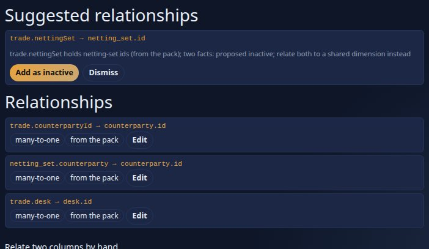

The pinned problems are gone and the lines are drawn (`* → 1`). Open the **Measures** tab. **New measure from a column** gives a measure with the right default: choose the dataset `trade`, the column `MTM`, **Add measure**; it arrives as `Sum of MTM`, `sum(trade.MTM)`, adding up. Rename it `MTM` in its row. Do the same for `trade` `PNL_1D` (`P&L 1d`), `trade` *count the rows* (`Trades`), `netting_set` `PEAK_EE` (`Exposure (EE peak)`) and `netting_set` *count the rows* (`Netting sets`):

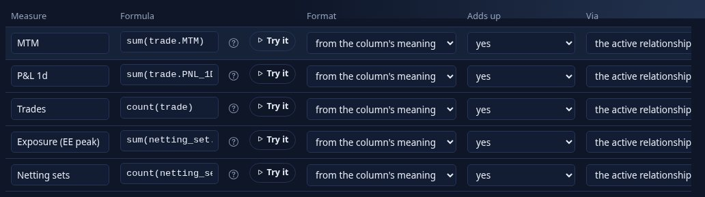

Then **Write a formula**: the name `MTM per exposure`, and in the formula type `MT`; the editor lists the measures that start so (a capital letter lists measures first) and writes `measure('MTM')` when you pick one. Type ` / Exp` and pick **Exposure (EE peak)**:

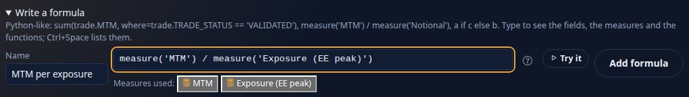

You should see the formula `measure('MTM') / measure('Exposure (EE peak)')`, the two measures it uses as **chips**, and the server's check: *Checks clean as far as the saved draft goes* (the model is not saved yet, so the two measures you just made are not on the server; Save and the check is complete). Press **Add formula**. A ratio of two sums is the right way to divide: it is worked out **after** each sum, so a sector's figure is MTM over exposure, never an average of per-row ratios. Give `MTM`, `P&L 1d` the format *signed amount, no decimals*, `Exposure (EE peak)` *amount, no decimals* and `MTM per exposure` *signed amount, 2 decimals*.

**Security.** Open the **Security** tab and **Add a rule for this model**: on `trade`, the role `desk-head` sees rows where *the column matches the reader*, `trade.DESK` in *the reader's desks*; then `risk` and `admin` see *every row*. The rule restricts `desk-head` on trades and on nothing else, and the **safeguard** says so before you can publish:

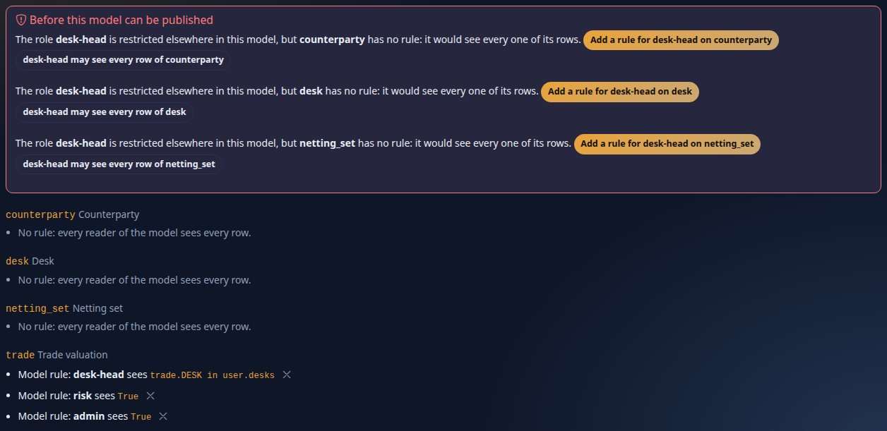

A desk head may see every counterparty, desk and netting set (the exposure of the whole bank is not secret to them; their trades are): press **desk-head may see every row of …** for the three. Each writes an audited note (`may-see-all`), not a rule. Under **Masked columns** mask `counterparty.NAME` (readers without the raw power read `•••`). On the **Contract** tab set the title `Counterparty P&L and exposure`. The **YAML** tab shows what the designer wrote; nobody typed it:


**Save** (`Saved draft`), then **Publish** (`Published`). The designer also saves the draft by itself two seconds after each change (*Draft saved at 14:02:31* beside the state; Ctrl+S saves the field you are still typing in too), and if someone saved the model meanwhile it opens a **merge view** (theirs and yours, part by part) instead of overwriting. If Publish is refused, the reason stays under the toolbar with the tab that fixes it (a contract change needing a new major opens **Contract**, which proposes the version). On the model's item page, give it the **Audience** `risk` and `desk-head` (tick them in the role list under *Roles*), so rita and hana may read it (step 21). The model as stored, with the stable ids the server adds on save (captured):

```yaml
rachana: 2
expressions: 2
model: cp-risk
version: 1.0.0
id: md_fc33f6b2
title: Counterparty P&L and exposure
datasets:
  trade: {dataset: pack.market-risk.trade-valuation@^1, role: fact}     # every trade's valuation (MTM, P&L) from every source system
  netting_set: {dataset: counterparty-exposure-official-netting-sets@^1, role: fact}
  counterparty: {dataset: pack.core.counterparty@^1, role: dimension}
  desk: {dataset: pack.core.desk@^1, role: dimension}
relationships:
  - { id: r_1, from: trade.COUNTERPARTY, to: counterparty.id, suggested: {from: pack-reference}}
  - { id: r_2, from: netting_set.COUNTERPARTY, to: counterparty.id, suggested: {from: pack-reference}}
  - { id: r_3, from: trade.DESK, to: desk.id, suggested: {from: pack-reference}}
measures:
  MTM: { expr: sum(trade.MTM), format: signed0, id: m_mtm }
  P&L 1d: { expr: sum(trade.PNL_1D), format: signed0, id: m_p_l_1d }
  Trades: { expr: count(trade), id: m_trades }
  Exposure (EE peak): { expr: sum(netting_set.PEAK_EE), format: amount0, id: m_exposure_ee_peak }
  Netting sets: { expr: count(netting_set), id: m_netting_sets }
  MTM per exposure: { expr: "measure('MTM') / measure('Exposure (EE peak)')", format: signed2, id: m_mtm_per_exposure }
security:
  rows:
    trade:
      - {role: desk-head, where: trade.DESK in user.desks}
      - {role: risk, where: 'True'}
      - {role: admin, where: 'True'}
  masked: [counterparty.NAME]
  may-see-all:
    netting_set: [desk-head]
    counterparty: [desk-head]
    desk: [desk-head]
```

**From the command line** the same model is the file [cp-risk.model.yaml](data/cp-risk.model.yaml) (the YAML above without the server's ids). Check it, create it as an item in the workspace and publish it (the item calls are the ones every BI item uses; the answers are cut to the keys that matter):

```text
$ python3 tools/drishti.py bi model check docs/tutorials/data/cp-risk.model.yaml
valid  (model cp-risk)
  warning DRS-9131  security.rows.trade: roles without a rule see no rows of 'trade': approver, author, viewer, bi-steward, bi-writer. Add a rule for them (where: "True" lets a role see every row), or leave them out on purpose: they get "you have no access to rows of trade in this model"

$ curl -s -X POST -H "Authorization: Bearer $DRISHTI_TOKEN" -H 'Content-Type: application/json' \
    -d "$(python3 -c 'import json;print(json.dumps({"kind":"model","title":"Counterparty P&L and exposure","audienceRoles":["risk","desk-head"],"body":open("docs/tutorials/data/cp-risk.model.yaml").read()}))')" \
    $DRISHTI_SERVER/api/v1/bi/workspaces/exposure-desk/items
{"id":"bi-e3b4f30732","workspace":"exposure-desk","kind":"model","title":"Counterparty P&L and exposure","status":"draft", ...}
$ curl -s -X POST -H "Authorization: Bearer $DRISHTI_TOKEN" -H 'Content-Type: application/json' -d '{"note":"tutorial 8"}' $DRISHTI_SERVER/api/v1/bi/items/bi-e3b4f30732/publish
{"id":"bi-e3b4f30732","status":"published","publishedVersion":1, ...}

$ python3 tools/drishti.py bi model list --kind model
query                      kind   title                                       version  state
-------------------------  -----  ------------------------------------------  -------  ---------
cp-risk@1                  model  Counterparty P&L and exposure               1.0.0    published
counterparty-exposure@1    model  Counterparty exposure                       1.0.0    published
...
world-economics@1          model  World economics                             1.0.0    published
```

The warning `DRS-9131` is Check naming the readers no rule matches: they get no trades, and their answers say so. It never stops a publish; leaving a role out may be the point. `python3 tools/drishti.py bi model describe cp-risk@1` lists every field of the four datasets and every measure, yours and the defaults (`Sum of MTM`, `Count of netting_set`, ...), as you see them.

## Step 17 · MTM and exposure in one visual

On the model's page press **New report on this model**, or create the report [cp-risk-view.report.yaml](data/cp-risk-view.report.yaml) in the workspace and publish it. Its bar puts `MTM` (a trades measure) and `Exposure (EE peak)` (a netting-set measure) on one axis, `counterparty.SECTOR`:


You should see the true totals of step 15 on the cards (`+3,210,381,877` and `2,663,018,256`, the ratio `+1.21`) and, in **one visual**, both measures for eleven sectors. In the designer, drop `Exposure (EE peak)` on the bar that already shows MTM: it simply joins it, because both are measures of one model. The report reads the model by reference (`model: cp-risk@1`); a visual's wells name the model's fields and measures:

```yaml
rachana: 1
report: cp-risk-view
title: MTM and exposure by sector
model: cp-risk@1
pages:
  - id: view
    title: By sector
    visuals:
      - { id: sector, type: slicer, title: Sector, at: { x: 9, y: 0, w: 3, h: 2 }, wells: { field: [counterparty.SECTOR] }, format: { mode: dropdown } }
      - { id: mtm, type: card, title: MTM, at: { x: 0, y: 0, w: 3, h: 2 }, wells: { values: [MTM] } }
      - { id: ee, type: card, title: Exposure (EE peak), at: { x: 3, y: 0, w: 3, h: 2 }, wells: { values: [Exposure (EE peak)] } }
      - { id: ratio, type: card, title: MTM per exposure, at: { x: 6, y: 0, w: 3, h: 2 }, wells: { values: [MTM per exposure] } }
      - { id: by-sector, type: bar, title: "MTM and exposure by sector (one visual, two facts)", at: { x: 0, y: 2, w: 12, h: 6 },
          wells: { axis: [counterparty.SECTOR], values: [MTM, Exposure (EE peak)] } }
      - { id: table, type: table, title: Counterparties, at: { x: 0, y: 8, w: 12, h: 6 },
          wells: { columns: [counterparty.NAME, counterparty.SECTOR, MTM, Exposure (EE peak), MTM per exposure] },
          sort: { by: Exposure (EE peak), desc: true }, limit: 8 }
```

Choose **Banking** in the **Sector** slicer:


You should see MTM `+97,448,046` beside exposure `441,334,249`: one filter, both facts, because the sector belongs to the counterparty both facts reach. **How it is computed.** Each fact is **aggregated alone** at the question's grain (trades summed by sector, netting sets summed by sector), then the two answers are joined on the sector. The server says so in the answer:

```text
$ python3 tools/drishti.py bi mq --model cp-risk@1 --select counterparty.SECTOR --measures "MTM,Exposure (EE peak),MTM per exposure"
counterparty.SECTOR  MTM             Exposure (EE peak)  MTM per exposure
-------------------  --------------  ------------------  ----------------
Agriculture          647,788,758.90  303,824,105.00      2.13
Airlines             628,172,520.95  153,151,356.00      4.10
Asset management     46,726,246.18   357,112,107.00      0.13
Banking              97,448,046.10   441,334,249.00      0.22
Financial services   96,741,253.28   125,317,776.00      0.77
Government           569,515,006.55  310,533,734.00      1.83
Insurance            93,947,894.23   215,370,310.00      0.44
Pensions             504,346,759.03  278,109,475.00      1.81
Shipping             -53,347,107.41  104,450,300.00      -0.51
Technology           523,053,969.78  123,022,594.00      4.25
Utilities            55,988,528.98   250,792,250.00      0.22
11 row(s)  as of 2026-10-26
warning: 2 fact tables, each aggregated alone at the query's fields and then joined: [trade, counterparty, netting_set]
warning: a measure that combines measures of different grains is worked out over the joined results: MTM per exposure
```

The sector rows add up to the totals of step 15 (`3,210,381,876.57` and `2,663,018,256`), to the cent. The same question in **Drishti SQL** ([API_REFERENCE.md › Drishti SQL](../guides/API_REFERENCE.md#8-drishti-sql-apiv1bisql)): tables are the model's aliases, `JOIN` needs no `ON` (the model's relationships are used), a measure is `MEASURE('name')`:

```text
$ python3 tools/drishti.py bi sql "SELECT counterparty.SECTOR, MEASURE('MTM') AS mtm, MEASURE('Exposure (EE peak)') AS ee
    FROM trade JOIN counterparty JOIN netting_set GROUP BY counterparty.SECTOR ORDER BY ee DESC LIMIT 3" --model cp-risk@1
counterparty.SECTOR  mtm             ee
-------------------  --------------  --------------
Banking              97,448,046.10   441,334,249.00
Asset management     46,726,246.18   357,112,107.00
Government           569,515,006.55  310,533,734.00
3 row(s)  shape mq
warning: 2 fact tables, each aggregated alone at the query's fields and then joined: [trade, counterparty, netting_set]
```

`shape mq`: the statement was one model query, compiled into the same plan a visual asks. In the designer, **Query of the selected visual** shows the bar's question as a model query or as this SQL, with **Run as SQL** ([REPORTS_GUIDE.md › Reports: the YAML, the visuals and how they behave, section 19](../guides/REPORTS_GUIDE.md#83-a-report-on-a-model-fields-own-measures-mq-or-sql)): the visual, the model query and the SQL are one question, so they share one plan and one cached answer per reader.

**What "aggregated alone, then joined" protects you from.** Exposure has no trade in it and P&L has no netting set in it, so a sector's exposure is the sum of that sector's netting sets (76 in all) **once each**, however many trades the sector has; and a sector's MTM is the sum of its trades **once each**, however many netting sets its counterparties have. Add the eleven sector rows of either column and you get step 15's totals, which is the check to run on any model with two facts: the sum of the parts is the whole. A sector whose counterparties have exposure but no trades today keeps its exposure and shows no MTM (empty, not zero), because the join of the two answers keeps both sides.

## Step 18 · Why Drishti does not join rows across facts

If both facts reach the counterparty, why not join each trade to its counterparty's netting sets and add up? Because the honest answer needs care. Open the **Notebook** (`/bi/notebook`) and the notebook [cp-risk-extracts.notebook.yaml](data/cp-risk-extracts.notebook.yaml) (create it as an item in the workspace, then choose it in the **Notebook** box). It holds **two extracts** of the model, each built by the server for you (your row rules, your masks): `df` is the trades (`COUNTERPARTY`, `MTM`, `PNL_1D`), and `extract("exposure")` is the netting sets (`COUNTERPARTY`, `PEAK_EE`):


You should see `10000 rows, 3 columns.` with the note that the extract was cut (an extract holds at most `bi.notebook.max_rows`, 10,000; the lake has
15,000 trade valuations) and, under **More extracts**, `exposure` (all 76 netting sets of the official results). In the **Python** tab, the first cell does what a person who thinks in rows would do: join each trade to the netting sets of its counterparty, and add up. The cells run on the server's compute pool (**Run**); what they give is below.

They give (the `true` figures are the extract's own: the P&L of the 10,000 trades it holds):

```text
trade rows 10000  netting-set rows 76  rows after the row join 32293
P&L 1d   true 95004093   row join 397124778
EE peak  true 2663018256   row join 1165433266636
```

Every trade of a counterparty with four netting sets became four rows, so its P&L was counted four times; every netting set met every trade of its counterparty, so exposure was counted once per trade. The P&L is **4.2 times** too big and the exposure **438 times**; nothing failed, and the table looks like a table. That is the **fan-out** trap. The second cell does what the model does for you: add each side up to the counterparty first, then join the sums, and draw it:

Its exposure is step 15's total again (`2,663,018,256`); its MTM is the extract's (the 10,000 trades it holds), and the model of step 17 gives the full one. **From the command line** the model of step 17 answers the same question without a join of rows: `python3 tools/drishti.py bi mq --model cp-risk@1 --select counterparty.id --measures MTM,"Exposure (EE peak)"`.

**What the model refuses.** A desk is a grain of trades only: a netting set has no desk. Ask the model for exposure by desk and it refuses rather than guess:


```text
$ python3 tools/drishti.py bi mq --model cp-risk@1 --select desk.NAME --measures "Exposure (EE peak)"
drishti: the server said 422 DRS-9156: DRS-9156 the model has no relationship path joining [desk, netting_set] to the measures' table without repeating its rows
(each join must go many-to-one); your row rule reads [netting_set] and is applied to every query you run, so the table the measures aggregate must reach it
many-to-one. Group by a field they all reach (counterparty.COUNTERPARTY_ID, counterparty.NAME, counterparty.LEI, counterparty.RATING) or ask the measures apart.

$ python3 tools/drishti.py bi mq --model cp-risk@1 --select desk.NAME --measures "MTM,Trades"
desk.NAME                    MTM                Trades
---------------------------  -----------------  ------
Bonds and securitised        -30,588,339.35     1248
Commodities                  -395,383,250.53    5990
...
G10 and EM FX                -681,989,221.57    1428
...
Rates · Swaps and options    4,484,481,851.44   1832
10 row(s)  as of 2026-10-26
```

The fix the message offers is the design: group by what both facts reach (the counterparty and its sector, rating, country), or ask exposure alone. **In YAML** there is nothing to write: the refusal comes from the relationships of step 16 (`trade.DESK → desk.id` exists; nothing joins a netting set to a desk).

## Step 19 · A measure over two facts

`MTM per exposure` of step 16 is a measure **over measures of two facts**: `measure('MTM') / measure('Exposure (EE peak)')`. It is worked out **after** each fact's aggregate, over the joined result, so at any grain it is the sum of MTM over the sum of exposure (Technology `523,053,970 / 123,022,594 = 4.25`). The server's warning in step 17 says exactly that (*a measure that combines measures of different grains is worked out over the joined results*).

**In the UI** you wrote it in the expression editor (step 16); its check can be asked at any time from the command line, against the model as you see it:

```text
$ python3 tools/drishti.py bi expr validate "measure('MTM') / measure('Exposure (EE peak)')" --model cp-risk@1
valid  (del2, aggregate scope, type decimal)

$ python3 tools/drishti.py bi expr validate "sum(trade.MTM) / sum(netting_set.PEAK_EE)" --model cp-risk@1
INVALID  (del2, aggregate scope, type decimal)
  error   DRS-9156  at 0-41: a model query would refuse this measure: the measures aggregate [trade, netting_set], which no many-to-one path connects: ask for them in separate queries
      fix: aggregate each fact in a measure of its own, or join the facts through a shared dimension
```

You should see `valid` for the first, typed `decimal`, and the second **refused while you write it**: two aggregates of two facts in one expression
cannot be planned as one aggregate, and the check plans it the way a model query would (`DRS-9156`, with the fix). `measure('…')` reuses the model's own
definitions, each worked out at its own grain first (and follows them if they change): that is the way to combine facts. **In YAML** it is one line of
`measures:` (step 16). A measure that **divides row by row** across facts has no meaning either, because a row of one fact has no row of the other; it
is refused the same way when it is asked:

```text
$ python3 tools/drishti.py bi mq --model cp-risk@1 --define "X=sum(trade.MTM / netting_set.PEAK_EE)" --measures X
drishti: the server said 422 DRS-9156: DRS-9156 the measures aggregate [trade, netting_set], which no many-to-one path connects: ask for them in separate queries.
Group by a field they all reach (counterparty.COUNTERPARTY_ID, counterparty.NAME, counterparty.LEI, counterparty.RATING) or ask the measures apart.
```

(`--define` adds a measure of this query only, as a report's own measure travels.) Inside one aggregate every column belongs to one fact; ratios inside one fact are recipes R35 and R40 of [RACHANA_REFERENCE.md › Rachana-EL expressions](../guides/RACHANA_REFERENCE.md#rachana-el-expressions).

## Step 20 · A dataset made by a Python Transform

When the combination is more than sums and a ratio (a rank, a clean-up, a model), write it in Python. A **Transform** is a Python item with `interface: transform`: a function `run(pnl, exposure, params)` that gets each **input's answer** as a pandas frame, **already masked for the reader**, and returns a table. Create [cp-table.python.yaml](data/cp-table.python.yaml) as a *python* item (**New item**, kind *python*, **What does it make? A table**) and publish it:

```python
def run(pnl, exposure, params):
    """pnl: id, NAME, SECTOR, MTM, Trades (the counterparty's fields, without their alias).  exposure: id, Exposure (EE peak)."""
    short = lambda f: f.rename(columns=lambda c: c.split(".")[-1])          # counterparty.id and id are the same column
    p = short(pnl).rename(columns={"id": "COUNTERPARTY", "Trades": "TRADES"})
    e = short(exposure).rename(columns={"id": "COUNTERPARTY", "Exposure (EE peak)": "EE_PEAK"})
    m = p.merge(e, on="COUNTERPARTY", how="left")
    floor = float(params.get("floor", 1.0))
    m["MTM_PER_EXPOSURE"] = m["MTM"] / m["EE_PEAK"].clip(lower=floor)
    m["EXPOSURE_RANK"] = m["EE_PEAK"].rank(ascending=False, method="min")
    return m[["COUNTERPARTY", "NAME", "SECTOR", "MTM", "TRADES", "EE_PEAK", "MTM_PER_EXPOSURE", "EXPOSURE_RANK"]]
```

The dataset [cp-table.dataset.yaml](data/cp-table.dataset.yaml) names the Transform (by its title or catalogue id), asks **two model queries** of `cp-risk` as its inputs, each **already at the counterparty grain** (so the join in Python is one row to one row), and declares the columns it returns:

```yaml
rachana: 2
expressions: 2
dataset: cp-table
version: 1.0.0
title: Counterparty table (Python)
source:
  python: Counterparty table          # the Python item, by its title (or its catalogue id)
  inputs:
    pnl: {model: cp-risk@1, select: {fields: [counterparty.id, counterparty.NAME, counterparty.SECTOR], measures: [MTM, Trades]}}
    exposure: {model: cp-risk@1, select: {fields: [counterparty.id], measures: [Exposure (EE peak)]}}
  params: {floor: 1.0}
grain: {says: One row per counterparty, keys: [COUNTERPARTY]}
time: {mode: snapshot}
columns:
  COUNTERPARTY: {type: string, role: key, references: counterparty}
  NAME: {type: string, role: attribute}
  SECTOR: {type: string, role: dimension}
  MTM: {type: decimal, role: amount, additive: true, aggregate: sum, format: signed0}
  TRADES: {type: integer, role: quantity, additive: true, aggregate: sum}
  EE_PEAK: {type: decimal, role: amount, additive: true, aggregate: sum, format: amount0}
  MTM_PER_EXPOSURE: {type: decimal, role: ratio, additive: false, format: signed2}
  EXPOSURE_RANK: {type: decimal, role: attribute}
```

Create it in the workspace (**New item**, kind *dataset*, **Paste YAML**, or the dataset wizard's *Python Transform* source, [REPORTS_GUIDE.md › Datasets: the YAML, the expression language and the security rules, section 15](../guides/REPORTS_GUIDE.md#510-a-table-of-your-own-step-by-step)) and publish it. You should see its page say what one row is and where it comes from:


Ask it through its implicit model, like any dataset:

```text
$ python3 tools/drishti.py bi mq --model dataset:cp-table --measures "Sum of MTM,Sum of EE_PEAK"
Sum of MTM        Sum of EE_PEAK
----------------  ----------------
3,210,381,876.57  2,663,018,256.00
1 row(s)  as of 2026-10-26

$ python3 tools/drishti.py bi mq --model dataset:cp-table --select cp_table.NAME,cp_table.SECTOR --measures "Sum of MTM,Sum of EE_PEAK" --limit 3
cp_table.NAME                 cp_table.SECTOR   Sum of MTM      Sum of EE_PEAK
----------------------------  ----------------  --------------  --------------
Aldershot Pension Trust       Pensions          504,346,759.03  278,109,475.00
Aurora Sovereign Wealth Fund  Government        571,227,075.64  202,918,363.00
Bramble Asset Management      Asset management  482,365,089.34  131,153,591.00
3 row(s)  as of 2026-10-26
```

The totals are step 15's, to the cent: the inputs are model queries, so they read all 15,000 trades (no extract is cut here). The Transform's answer is **kept per reader** (until an input changes or `drishti.bi.transform.cache-ttl` passes): a second reader has other rows and masks, so it runs again for them. It runs on the server's compute pool, in its strict sandbox (no network, its own folder, CPU, memory and time limits: [REPORTS_GUIDE.md › Python in BI: measures, visuals and data prep written in Python, section 7](../guides/NOTEBOOK_GUIDE.md#71-what-the-sandbox-enforces)), never in the browser; a failure in the code is `DRS-9071` with Python's message, a missing declared column `DRS-9075`. Because its inputs are model queries, a Python dataset can never read more than its reader may: it receives answers that rules and masks have already shaped. When to choose which: **the model** for sums and ratios at any grain (no code; the default); **a Python dataset** when you need code (a rank, a clean-up, a statistical model) and can accept a table computed per reader at one grain; a report on that dataset then reads it through its implicit model, like any other.

## Step 21 · Two readers: each dataset is filtered as the reader, before anything is joined

Drishti applies each dataset's rules **as the person reading, before any join or aggregate**: nothing a rule hides reaches a sum, a join or a Transform. In `cp-risk`, `desk-head` sees `trade.DESK in user.desks` on trades and every row of the other three (the `may-see-all` notes); `risk` sees everything; the counterparty's name is masked for a reader without the raw power. Sign in as **rita** (role `risk`, raw power) and open the report; then as **hana** (a desk head of `DESK-FX`, no raw power):


You should see two different reports from one definition. Rita's numbers are the totals of step 15. Hana's **MTM is `-681,989,222`**, her desk's trades only (the `G10 and EM FX` row of step 18); her **exposure is `2,663,018,256`**, the whole bank's, because the model lets a desk head see every netting set (step 16's note), and the two facts are aggregated **apart** before they meet, so her trade rule does not shrink the exposure. Her names read `•••`. From the command line, each with their own token (make one on **My account**, tutorial 1, step 9):

```text
rita$ python3 tools/drishti.py bi mq --model cp-risk@1 --measures "Trades,MTM,Exposure (EE peak)"
Trades  MTM               Exposure (EE peak)
------  ----------------  ------------------
15000   3,210,381,876.57  2,663,018,256.00
1 row(s)  as of 2026-10-26

hana$ python3 tools/drishti.py bi mq --model cp-risk@1 --measures "Trades,MTM,Exposure (EE peak)"
Trades  MTM              Exposure (EE peak)
------  ---------------  ------------------
1428    -681,989,221.57  2,663,018,256.00
1 row(s)  as of 2026-10-26

hana$ python3 tools/drishti.py bi mq --model cp-risk@1 --select counterparty.NAME --measures "MTM,Exposure (EE peak)" --limit 3
counterparty.NAME  MTM              Exposure (EE peak)
-----------------  ---------------  ------------------
•••                -681,989,221.57  2,663,018,256.00
1 row(s)  as of 2026-10-26  masked counterparty.NAME
warning: counterparty.NAME is masked
```

A masked column holds one value for hana, so grouping by it gives one row (a masked dimension is not grouped on). Now the **Python table** of step 20, as each of them:

```text
rita$ python3 tools/drishti.py bi mq --model dataset:cp-table --measures "Sum of MTM,Sum of EE_PEAK"
Sum of MTM        Sum of EE_PEAK
----------------  ----------------
3,210,381,876.57  2,663,018,256.00
1 row(s)  as of 2026-10-26

hana$ python3 tools/drishti.py bi mq --model dataset:cp-table --measures "Sum of MTM,Sum of EE_PEAK"
Sum of MTM       Sum of EE_PEAK
---------------  ----------------
-681,989,221.57  2,407,959,011.00
1 row(s)  as of 2026-10-26
```

(The plan is the same for both, `--json` shows its id: a plan is the question; who asks it is the security signature, kept apart, so the answers differ and each is cached for its reader.)

Hana's exposure there is **`2,407,959,011`**, not `2,663,018,256`: the Transform's inputs were asked as hana, her `pnl` input has a row only for the **17 counterparties her desk trades with**, and the Transform's `how="left"` keeps exposure only for those. The other seven (CP-NORTHPLAINS, CP-SUMMIT, CP-VAULTGUARD, CP-HOUSE, CP-PRAIRIEGAS, CP-METROEX and CP-HARBOURLINE-LDN) all have exposure, `255,059,245` together, exactly the difference, and are dropped **by the code**, not by a rule. Both answers are right for what they say: the model answers *the bank's exposure next to my trades*; this Python table answers *the exposure of my counterparties*. Choose the one your question means, and say it in the dataset's description.

**In YAML** the readers' difference is the `security:` block of step 16, nothing else: the rule is on one dataset (`trade`), the notes on the others, the mask on one field. A join or filter on a masked field is refused (`DRS-9161`), which is why the Transform's inputs join on the counterparty's **id**, never its name.

## Step 22 · The same analysis in the Notebook, promoted to a visual

When you do not yet know the question, work it out in the **Notebook** before you build anything (step 18 did the first half). Opening this two-fact model in the Notebook ticks the fields of one fact (trades) and the dimensions; the netting sets' fields are marked *another fact* and stay unticked, because one extract has one grain. Open the notebook of step 18, in the **Python** tab, and press **Promote to a visual** under the second cell (the chart):


You should see `Python visual draft saved in your workspace` **beside the button you pressed** (with an *Open the draft* link; pressing it again offers **Update that draft** or **Save another**), and the notes: the cell's `df` became the function's `table`, a visual returns an ECharts option, SVG or PNG, and nothing is published for you. Be exact about what was kept: a visual reads **one model query** of its report, so the draft keeps `df` (the first extract); a cell that reads `extract("exposure")` as well belongs in a **Transform** (step 20): **Promote to a Transform** writes the function with each `extract("name")` as a parameter of `run(...)`. The path from an idea to a shared number is therefore: explore in Analyse, put the measures in the **model** when sums and ratios do it (most of the time), or **promote to a Transform** and make a Python dataset when they do not, then build the report. **From the command line** a notebook is an item like the others (`python3 tools/drishti.py bi catalogue get <id>` shows its YAML); its SQL cells run Drishti SQL over the model on the server ([USER_GUIDE.md › Analyse: slice, SQL and Python, section 4](../guides/NOTEBOOK_GUIDE.md#23-sql-cells)).

## Step 23 · How this compares with Power BI

The full, checked comparison is [Drishti BI and Power BI compared](../strategy/BI_AND_POWER_BI.md); this step shows the modelling differences you have just used.

You should see a short, honest table, not a scorecard (the claims about Power BI are the ones of [ARCHITECTURE.md §28 section 11](../architecture/ARCHITECTURE.md#28-business-intelligence-on-the-table-layer), whose own knowledge of Power BI may be stale; check before you quote it):

| | Power BI | Drishti |
|---|---|---|
| Several tables of different grains | one model, **relationships** between tables (many-to-one, many-to-many, bidirectional), DAX that follows them | one **model** with several **facts** and shared **dimensions**; each measure is aggregated **at its own fact's grain**, then the answers are joined on the asked fields |
| A slicer on a shared dimension | filters every fact through relationships | the same, one way (the dimension filters the facts); *both ways* is not built yet |
| A field only one fact reaches | blank or repeated values, depending on the relationships | **refused** with the fields that work (`DRS-9156`), never a guessed or repeated number |
| A measure over two facts | DAX over two tables | `measure('MTM') / measure('Exposure (EE peak)')`, worked out over the joined results ([RACHANA_REFERENCE.md › Rachana-EL expressions](../guides/RACHANA_REFERENCE.md#rachana-el-expressions)) |
| Row-level security | a rule per role in the model | a rule **per dataset, applied as the reader before any join**; a model can only tighten; the **safeguard** names a role left open on another dataset |
| Behind the tools | DAX, the Power BI service, capacity licences | one closed, compiled expression language (DEL, Python-like), Drishti SQL over the same plan, one open server, your own infrastructure |

Where Drishti is **behind**: no bidirectional or many-to-many relationships yet, no context transition and no `CALCULATE` (`calc`, `share_of` instead). Where it is deliberately different: it refuses to guess, and nothing joins the rows of two facts.

### Part C · Statements and field parameters

Two things a Power BI or SSRS author expects are built. **Field parameters in a visual's wells**: the reader chooses which field a chart breaks
down by and which measure it shows. **Statements**: a report page laid out on paper, page by page (paper size, margins, a header and footer with page
numbers, page breaks, column titles on every page, groups kept together), made as a PDF or Excel and sent by a subscription to many people, **each made as
that person**. This part builds a model with two field parameters, a report whose chart the reader switches, and a monthly statement that bursts to a
role. Each step shows the UI, the command line and the YAML. The references are [REPORTS_GUIDE.md › Reports: the YAML, the visuals and how they behave, section 21](../guides/REPORTS_GUIDE.md#11-field-parameters)
and [REPORTS_GUIDE.md › Reports: the YAML, the visuals and how they behave, section 24](../guides/REPORTS_GUIDE.md#12-statements-paginated-reports-page-exact-one-per-reader).

## Step 24 · A model with two field parameters

A field parameter is a model's list of fields (or of measures) the reader chooses from.

**In the UI.** Open the model designer on a new model (BI Studio → Explorer → New → Model, the dataset `trades-basic-trade`), add the measures `MTM`
(`sum(trade.MTM)`) and `NOTIONAL` (`sum(trade.NOTIONAL)`), then the **Calculations** tab → *New parameter* `breakdown`, kind **field (switch a
breakdown)**, ticking `trade.DESK` and `trade.PORTFOLIO`; and `metric`, kind **field**, ticking the measures `MTM (measure)` and `NOTIONAL (measure)`
(a field parameter's choices may be measures). Save and publish.

**From the command line**, the same model from its file:

```
$ drishti.py bi item new me docs/tutorials/data/desk-params.model.yaml
```

**The YAML** ([desk-params.model.yaml](data/desk-params.model.yaml)):

```yaml
model: fp-desk
datasets:
  trade: { dataset: trades-basic-trade, role: fact }
measures:
  MTM:      { expr: "sum(trade.MTM)", format: signed0 }
  NOTIONAL: { expr: "sum(trade.NOTIONAL)", format: amount0 }
  Trades:   { expr: "count(trade)" }
parameters:
  breakdown: { kind: field, fields: [trade.DESK, trade.PORTFOLIO], default: trade.DESK, title: Break down by }
  metric:    { kind: field, fields: [MTM, NOTIONAL], default: MTM, title: Show }
```

**You should see:** the model published as `fp-desk@1`, its **Calculations** tab listing the parameters `breakdown` (the fields `trade.DESK` and
`trade.PORTFOLIO`, *Break down by*) and `metric` (the measures `MTM` and `NOTIONAL`, *Show*).

## Step 25 · A chart the reader switches

**In the UI.** New report on the model `fp-desk@1`, add a **column** visual and open **Build**. The *Add a field…* list of the **axis** well ends with
*Field parameters*: choose `param.breakdown`; the **values** well's list offers `param.metric` (a parameter of measures goes in a measure well only). Each
chip says it is a field parameter, and the canvas draws the default: MTM by desk. Save, and open the report: **Parameters** above the page has *Break down
by* and *Show*. Choose *PORTFOLIO* and *NOTIONAL*: the chart is asked again and draws notional by book; each choice is a chip, and **Reset** brings the
defaults back.


**The YAML** of the visual: `wells: { axis: [param.breakdown], values: [param.metric] }`. A parameter that does not fit its well is refused by Check,
`DRS-9037`: put `param.breakdown` in **values** and Problems says, once for the parameter, *the values well takes measures, and the field parameter
'breakdown' can be trade.DESK, trade.PORTFOLIO, fields: put it in a field well*.

**From the command line**, the model query the chart asks with the reader's choice (a field parameter of measures goes among the measures), written as a
file `switch.mq.yaml`:

```yaml
mq: 2
model: fp-desk@1
select: { fields: [param.breakdown], measures: [param.metric] }
params: { breakdown: trade.PORTFOLIO, metric: NOTIONAL }
```

```
$ drishti.py bi mq switch.mq.yaml          # notional by book, as you
```

A reader without raw sees MTM masked whichever way they choose: the choice is only a name; the visual is asked as them.

**You should see:** the column chart drawing MTM by desk by default; with *PORTFOLIO* and *NOTIONAL* chosen, notional by book and the two choices
as chips above the page (**Reset** brings MTM by desk back); `param.breakdown` in the values well refused with `DRS-9037`.

## Step 26 · A statement page

**In the UI.** In the same report, **+** a page, then in **Format** with no visual selected, **Layout → statement**. The **Paper** tab appears beside
Canvas. Add the bands as on any page: a **text** (`Positions of {reader} for {period}`, Format → Size → heading), three **cards** side by side (Notional,
MTM, Trades), a **table** of `param.breakdown`, `trade.TRADE_ID`, `trade.CURRENCY`, `NOTIONAL`, `MTM` sorted by `trade.TRADE_ID`, and a **matrix** of
`trade.PORTFOLIO` by `trade.CURRENCY` with `NOTIONAL`. A table and a matrix run over pages, so each has a row of its own.

**The YAML** ([monthly-statement.report.yaml](data/monthly-statement.report.yaml)), the statement page:

```yaml
  - id: statement
    title: Statement
    layout: statement
    visuals:
      - { id: intro, type: text, at: { x: 0, y: 0, w: 12, h: 1 }, text: "Positions of {reader} for {period}", format: { size: heading } }
      - { id: notional, type: card, title: Notional, at: { x: 0, y: 1, w: 4, h: 2 }, wells: { values: [NOTIONAL] } }
      - { id: mtm, type: card, title: MTM, at: { x: 4, y: 1, w: 4, h: 2 }, wells: { values: [MTM] } }
      - { id: trades, type: card, title: Trades, at: { x: 8, y: 1, w: 4, h: 2 }, wells: { values: [Trades] } }
      - { id: positions, type: table, title: Positions, at: { x: 0, y: 3, w: 12, h: 8 },
          wells: { columns: [param.breakdown, trade.TRADE_ID, trade.CURRENCY, NOTIONAL, MTM] }, sort: { by: trade.TRADE_ID },
          format: { groupBy: param.breakdown } }
      - { id: by-currency, type: matrix, title: Notional by book and currency, at: { x: 0, y: 11, w: 12, h: 4 },
          wells: { rows: [trade.PORTFOLIO], columns: [trade.CURRENCY], values: [NOTIONAL] }, format: { pageBreak: before } }
```

**You should see:** the page's layout *statement*, the **Paper** tab beside Canvas, and the bands one under another: the heading, the three cards
in a row, the *Positions* table and the *Notional by book and currency* matrix, each table on a row of its own.

## Step 27 · The paper, and how the pages break

**In the UI.** The **Paper** tab: *Size* A4, *Orientation* portrait, the margins in millimetres, the **Header** (left `{title}`, centre `{period}`, right
`For {reader}`) and **Footer** (left `Run {run-date} · by {param.breakdown}`, right `Page {page} of {pages}`), *Covers* **the month of its date**. Select
the table, and in **Format → Statement**: **Keep rows together by** `param.breakdown` (each desk's rows on one page when they fit, under a heading),
**Repeat the column titles on every page** (on by default). Select the matrix: **Page break** *before* (it starts a page of its own).

**The YAML** of the paper:

```yaml
statement:
  paper: A4
  orientation: portrait
  margins: { top: 15, right: 12, bottom: 15, left: 12 }
  header: { left: "{title}", center: "{period}", right: "For {reader}" }
  footer: { left: "Run {run-date} · by {param.breakdown}", right: "Page {page} of {pages}" }
  period: month
  fontSize: 9
```

Try a wrong one in the YAML tab (`paper: B5`, a token `{nope}`): Problems lists each with `DRS-9038` and its path.

**You should see:** the Paper tab holding A4 portrait, the margins, the header and footer as typed and *Covers* the month; the table's Format →
Statement keeping rows together by `param.breakdown` with the column titles repeated, the matrix's page break *before*; and for `paper: B5` or
`{nope}`, a `DRS-9038` in Problems naming the key's path.

## Step 28 · Preview page by page

**In the UI.** Paper tab → *Statement date* 2026-10-08 → **Preview pages**. The server lays the statement out for you, with your masks and row rules, and
the preview shows one sheet at a time: **›** for the next (or Page Down), *Page 2 of 3 · A4 portrait · October 2026* beside it. Page 1 holds the heading,
the cards and the first desk's rows; page 2 starts with the column titles again and keeps each desk whole; page 3 is the matrix. Change the orientation to
landscape and preview again: more pages, as fewer rows fit a landscape page. **PDF** and **Excel** download the saved draft.


**From the command line** (the report's id from step 25):

```
$ drishti.py bi statement preview bi-39eb12fe47 --date 2026-10-08
Monthly statement: 3 pages, A4 portrait, October 2026, 66 rows
  page 1: Monthly statement | October 2026 | For wes  ...  Run 2026-10-19 · by DESK | Page 1 of 3  (80 cells)
  page 2: Monthly statement | October 2026 | For wes  ...  Run 2026-10-19 · by DESK | Page 2 of 3  (160 cells)
  page 3: Monthly statement | October 2026 | For wes  ...  Run 2026-10-19 · by DESK | Page 3 of 3  (6 cells)

$ drishti.py bi statement preview bi-39eb12fe47 --date 2026-10-08 --param breakdown=trade.PORTFOLIO
Monthly statement: 3 pages, A4 portrait, October 2026, 66 rows
  page 1: Monthly statement | October 2026 | For wes  ...  Run 2026-10-19 · by PORTFOLIO | Page 1 of 3  (80 cells)
  ...
$ drishti.py bi statement file bi-39eb12fe47 --date 2026-10-08 -o statement.pdf
wrote statement.pdf (5,000 bytes)
$ drishti.py bi statement file bi-39eb12fe47 --date 2026-10-08 --format xlsx -o statement.xlsx
wrote statement.xlsx (7,823 bytes)
```

The workbook's sheets print on the same paper, with the header and footer and the column titles on every printed page.

**You should see:** *Page 1 of 3 · A4 portrait · October 2026* in the preview; page 2 headed *Positions (continued)* with the column titles
`TRADE_ID`, `CURRENCY`, `NOTIONAL`, `MTM` again and each desk (*DESK: DESK-FI*, *DESK: DESK-EQD*) whole under its heading; page 3 the matrix alone;
the footer *Run … · by DESK* and *Page n of 3* on every page. On the command line, `3 pages, A4 portrait, October 2026, 66 rows`, the footer saying
*by PORTFOLIO* with `--param breakdown=trade.PORTFOLIO`, and `statement.pdf` and `statement.xlsx` written.

## Step 29 · One statement per person: a subscription

Move the report to a shared workspace and publish it (Part G). Then on the report's **Statement** page, **Subscribe**: *Send as* **pdf**, *To*
`role:desk-head` (or the people), *When* `monthly 1 07:30 business`, *Data for* `previous` (the business day before the run: the statement covers that
month). **Run now** in the subscription's history: one mail per person, each with their own PDF, *Monthly statement October 2026 hana.pdf*; the history
shows each delivery with `statement: true` and its page count. A desk head's statement holds their desk's trades only; an analyst's has MTM masked;
two people with the same rights get the same pages but their name ([REPORTS_GUIDE.md › Distribution: scheduled reports, export, subscriptions, alerts and embedding, section 2](../guides/REPORTS_GUIDE.md#183-subscriptions)).

**From the command line.** A subscription is yours, so it is saved and run from the console while you are signed in: saving one
(`PUT /api/v1/me/subscriptions/{name}`) or running it (`POST …/{name}/run`) with a personal API token answers `403 DRS-5002 API tokens
may not call this endpoint`, whatever the token's scopes, because every `/me/**` write is never open to a token
([API_REFERENCE.md › Personal API tokens](../guides/API_REFERENCE.md#28-personal-api-tokens)). A token can read it back once the console has saved it,
with its runs and deliveries:

```
$ curl -s -H "Authorization: Bearer $DRISHTI_TOKEN" $DRISHTI_SERVER/api/v1/me/subscriptions \
    | jq '.[] | {name, title, schedule, format, recipients, runs: [.runs[] | {at, status, sent}]}'
```

and make your own statement as a file, which only reads (step 28's `drishti.py bi statement file`, or
`POST /api/v1/bi/reports/statement/file`, [REPORTS_GUIDE.md › Reports: the YAML, the visuals and how they behave, section 24](../guides/REPORTS_GUIDE.md#12-statements-paginated-reports-page-exact-one-per-reader)).

**You should see:** after **Run now**, one mail per person in `role:desk-head`, each with their own PDF (*Monthly statement October 2026
hana.pdf*), and in the subscription's history one delivery per person with `statement: true` and its page count; a desk head's PDF holds
only their desk's trades. On the command line, the subscription with `format: pdf`, `recipients: ["role:desk-head"]` and the run.

#### What you did

- a model's field parameters in a chart's wells, switched by the reader, masks intact (`DRS-9037` for one that does not fit);
- a statement page with its paper, header and footer, page breaks, repeated column titles and groups kept together (`DRS-9038` for a wrong one);
- a page-by-page preview in the Studio, the PDF and Excel from the CLI, and one statement per person from one subscription.

### Part D · BI that runs itself

A report is only useful if it is fresh when people look at it and reaches them when it matters. In this part BI works on its own. A **dataset refreshes
itself** every business morning. A **subscription** sends a report to a colleague, rendered for them. An **alert** watches a number, in a report or as a
measure of a **model**, and tells you when it crosses a limit. You **export** a page as PDF, PNG, Excel and CSV. A report and a model **say the figures they
must give**, and a wrong figure stops a publish. You also see what Drishti does with **no mail server** (the usual state of a fresh install) and how to set
one up.

Every step shows the same thing three ways: **in the UI**, **on the command line** (`python3 tools/drishti.py`, or `curl` where the tool has no command
yet), and **as YAML** (what the UI writes, which you can keep in git).

## Step 30 · A dataset that refreshes itself

A dataset keeps its rows in layers it builds from the source. They are rebuilt when a data load arrives ([tutorial 12](12-a-day-of-bank-data.md)), when someone
asks, and on a **schedule** set on the dataset. A dataset is one table of the **model layer** (`rachana: 2`): it says where the rows come from and
what one row is, and its measures live in a **model** over it ([REPORTS_GUIDE.md section 23](../guides/REPORTS_GUIDE.md#5-models-and-datasets-what-a-report-reads)).

**In the UI** there are two ways to set the schedule, and neither needs the YAML:

- **In the dataset wizard** (**Models → New dataset**, the wizard of [REPORTS_GUIDE.md › Datasets: the YAML, the expression language and the security rules, section 15](../guides/REPORTS_GUIDE.md#510-a-table-of-your-own-step-by-step)):
  on the *Columns* step choose **Refresh** *business days at 06:30* (or *when new data loads*); the YAML of the *Save* step shows the line it writes,
  `refresh: business-days 06:30`.
- **On the dataset's own page**, when it has no schedule: the **Refresh** section says *No refresh schedule* and, for an author who may edit the draft,
  offers **Set a schedule** (a choice and a time). It writes `refresh:` into a new saved state of the draft, keeping every other line and every comment of
  the file; publish the dataset to start the schedule.


You should see the form (*Business days at*, a time, **Set a schedule**) and one row, `dataset`, rebuilt *when data loads*: the only refresh a dataset has
until you give it a schedule.

**The YAML** (what both of them write) is the tutorial's dataset over the trades, [data/trades-daily.dataset.yaml](data/trades-daily.dataset.yaml). The line
that matters is `refresh:`:

```yaml
rachana: 2
expressions: 2
dataset: trades-daily
version: 1.0.0
title: Trades refreshed daily
description: The trades by desk, rebuilt on their own at 06:30 on business days.
source: { connector: risk-store, kind: trade-valuation }
grain: { says: "One row per trade per business date", keys: [TRADE_ID] }
refresh: "business-days 06:30"      # a schedule (daily 06:00, hourly, cron ...) or after-load: when the layers are rebuilt without anyone asking
columns:
  TRADE_ID:  { type: string, role: key }
  DESK:     { type: string }
  CURRENCY: { type: string }
  NOTIONAL: { type: decimal, format: amount0 }
  MTM:      { type: decimal, format: signed0 }
```

The rows are the `market-risk` pack's **trade valuations** (`risk-store` is its Delta connector, the table `risk/trade-valuation` that
`lake demo` built): one row per trade and business date with its desk, currency, notional and MTM, in the names the data has (`TRADE_ID`, `DESK`, ...).
The words are the ones of a scheduled report ([Part E](#part-e--scheduled-searches-and-subscriptions)): `daily 06:00`, `weekdays 07:00`, `business-days 06:30` (skips holidays of the
server's calendar), `hourly`, `cron ...`, or `after-load`. `refresh: { on-load: true }` (what the wizard writes for *when new data loads*) rebuilds only
when data arrives; `{ schedule: "daily 06:00", on-load: true }` does both. The model over it, [data/trades-daily.model.yaml](data/trades-daily.model.yaml),
reads it as its one fact and adds three measures:

```yaml
rachana: 2
expressions: 2
model: trades-daily
version: 1.0.0
title: Trades daily
datasets:
  trade: { dataset: trades-daily, role: fact }
measures:
  Notional: { expr: "sum(trade.NOTIONAL)", format: amount0 }
  MTM:      { expr: "sum(trade.MTM)", format: signed0 }
  Trades:   { expr: "count(trade)" }
security:
  rows:
    trade:
      - { role: [admin, risk, bi-writer], where: "True" }
```

**From the command line** put both files in the workspace, publish them, and ask for the dataset's refresh state (`bi item new` reads the kind from the
file name; the ids differ on your machine):

```text
$ python3 tools/drishti.py bi item new economics-desk docs/tutorials/data/trades-daily.dataset.yaml
bi-c767a5fd15  dataset  Trades refreshed daily  draft in Economics desk

$ python3 tools/drishti.py bi catalogue publish bi-c767a5fd15 --note "refreshes itself on business mornings"
published Trades refreshed daily as version 1

$ python3 tools/drishti.py bi dataset refresh bi-c767a5fd15
scheduled  (America/New_York, calendar USNY)
  dataset   business-days 06:30   waiting for the scheduler

$ python3 tools/drishti.py bi item new economics-desk docs/tutorials/data/trades-daily.model.yaml
bi-a29d960c58  model  Trades daily  draft in Economics desk

$ python3 tools/drishti.py bi catalogue publish bi-a29d960c58 --note "the measures over the dataset"
published Trades daily as version 1
```

**In the UI** the same is **My workspace → New item**, kind *dataset* (and then *model*), **Paste YAML** (the button next to *Open the dataset wizard*),
paste the file, **Create from the YAML**; move it to `Economics desk`; **Publish** ([Part A](#part-a--your-first-bi-report), step 7). Open the dataset from
**Models** (its page is `/bi/ds/<id>`) and scroll to **Refresh**.


You should see one row, `dataset`, with the schedule `business-days 06:30` and the status `waiting for the scheduler` before its first run, and the line
*Last refresh: – · Next: worked out at the next scheduler look*. Do not wait for 06:30. **Refresh now** is the same call a schedule makes (it needs the BI
author power); the command line's `--now` asks for it and waits until it ends:

```text
$ python3 tools/drishti.py bi dataset refresh bi-c767a5fd15 --now
scheduled  (America/New_York, calendar USNY)
  dataset   business-days 06:30   ok  last run 2026-10-17 21:42:16 UTC by manual (drishti-dev-admin): 30000 rows in 41 ms
```

(The count is the rows read for every table built from the dataset: 15,000 for the model's `trade` table and 15,000 for the dataset's own implicit
model, so `30000` for 15,000 trade valuations.)

(Over REST: `POST /api/v1/bi/datasets/<id>/refresh` starts it and `GET` the same path answers the state.)


You should see *Refreshed 30000 rows in ... ms.* beside the button, the status `ok` with a note, the line *Last refresh ... · Next ...*, and **Recent
refreshes**: every run, newest first, with who or what started it (`schedule`, `after-load trade`, `retry`, `manual (drishti-dev-admin)`), the rows, the
time and any note. The history and the state are kept in the BI store, so they are still there after a restart (a run the restart interrupted shows as
`interrupted`). Ask the model for the rows the refresh built:

```text
$ python3 tools/drishti.py bi mq --model trades-daily@1 --select trade.DESK --measures "Trades,Notional,MTM" --limit 4
trade.DESK   Trades  Notional            MTM
-----------  ------  ------------------  ---------------
DESK-COMM    5990    885,017,001,985.25  -395,383,250.53
DESK-CREDIT  1172    348,350,245,514.15  386,059,702.75
DESK-EQD     1452    430,529,717,922.53  -85,763,784.34
DESK-FI      1248    403,150,156,232.97  -30,588,339.35
4 row(s)  as of 2026-10-26  plan p_084c3aa583453ccc
```

The Delta connector scans the promoted columns of the table, so 15,000 rows take a few tens of milliseconds. A refresh that fails is **retried** with the shared retry policy (5 s, doubling, up to 5 minutes; after four tries it is
`failed` until its next time), and the dataset page says so.

## Step 31 · Subscribe a colleague to a report

Open the shipped report **World economics** (a report on the model `world-economics@1`) and press **Subscribe** in the toolbar (beside the export
buttons). Subscribe and the export buttons appear only when they will work for you: when an administrator has switched exports or subscriptions off, or
you already own the most subscriptions allowed, a line beside the bar says so and why (the server's `GET /api/v1/distribution/status` is what the page asks).


You should see the form with the target named at the top (`The BI report "World economics" (file:report:world-economics), page world, with the filters you
have set`): a subscription keeps the page and the slicer choices you had on the screen. **When** is a choice, not a text: *every business day* at `07:30`
is its default, and the line under it says it in words (*Every business day at 07:30*) and which model the figures are asked of (*The figures are asked of
the model world-economics@1, as each recipient*); **Advanced: the schedule as text** takes any schedule word. Name it `Morning economy pack`, **Send as**
*an Excel workbook attached* (the other forms are the email itself with the tables in the body, and a PDF), and **To** `vera`. **To** takes user names and
`role:NAME`, **never an email address**: each person gets the report asked of the data **as that person**, with their own row rules and masks, and an
outside address has no rights to ask as. Press **Subscribe**.


You should see `Morning economy pack` badged `SUBSCRIPTION`, the report, `business-days 07:30`, `vera` with `Excel attached`, and the next run in UTC
(07:30 New York on the next business day: `11:30`).

**From the command line**: none. A subscription is yours (`/api/v1/me/subscriptions/<name>`), and a personal API token never calls your own `/me/...`
addresses (`403 DRS-5002 API tokens may not call this endpoint`); what the console sends on **Subscribe**, as you, is `PUT /api/v1/me/subscriptions/<name>`
with the body below, and `GET` the same path reads it back. **The YAML** of what the form saved (the server keeps it as JSON; these are its keys, captured):

```yaml
name: Morning economy pack
target:
  type: report
  id: file:report:world-economics
  page: world
  visual: ''
  state: { carry: [], slicers: {}, selections: [], drill: [] }
schedule: business-days 07:30
date: today
format: xlsx
recipients: [vera]
narrative: false
sms: false
webhooks: []
enabled: true
nextRun: '2026-10-19T11:30:00Z'          # saved on Saturday 17 October: the next business day is Monday
```

```text
$ curl -s -X PUT -H "Authorization: Bearer $DRISHTI_TOKEN" -H 'Content-Type: application/json' \
    -d '{"target":{"type":"report","id":"file:report:world-economics","page":"world"},"schedule":"business-days 07:30","format":"xlsx","recipients":["vera"]}' \
    "$DRISHTI_SERVER/api/v1/me/subscriptions/Morning%20economy%20pack"
{"title":"forbidden","status":403,"code":"DRS-5002","detail":"API tokens may not call this endpoint"}
```

Press **Run now** (the console's `POST /api/v1/me/subscriptions/Morning%20economy%20pack/run`).

## Step 32 · What "Run now" says without a mail server


You should see `Morning economy pack: 0 sent, 1 to retry` and the last run `retrying`. Open **History**:


You should see `vera@example.com · retry · IllegalStateException: no SMTP host: set spring.mail.host`. That is the honest answer: Drishti built vera's
copy, had nowhere to send it, and will **retry** (4 attempts, then `failed`). Nothing is lost silently, and a recipient without an address on their
account is shown as `skipped · no email address on file`. The run as the API keeps it (`runs` of the subscription, captured):

```text
{"id": "7fc8f059", "at": "2026-10-17T21:43:29.128765703Z", "trigger": "by hand", "status": "retrying", "sent": 0, "failed": 0, "skipped": 0, "retrying": 1,
 "deliveries": [{"to": "vera@example.com", "label": "Vera Lim", "user": "vera", "attempts": 1, "status": "retry",
                 "error": "IllegalStateException: no SMTP host: set spring.mail.host", "nextAttempt": "2026-10-17T21:43:34.227711247Z"}]}
```

**To configure mail** you need four things on the **server** (not the console): an SMTP host, the collaboration email switch, the console's address (for the links in the mail) and a From address. In the environment, before the server starts:

```bash
export SPRING_MAIL_HOST=smtp.example.com SPRING_MAIL_PORT=587          # your mail server
export SPRING_MAIL_USERNAME=drishti SPRING_MAIL_PASSWORD=...          # if it asks for sign-in; keep the password out of files
export SPRING_MAIL_PROPERTIES_MAIL_SMTP_STARTTLS_REQUIRED=true         # for any server reached over a network
export SPRING_MAIL_PROPERTIES_MAIL_SMTP_CONNECTIONTIMEOUT=10000 SPRING_MAIL_PROPERTIES_MAIL_SMTP_TIMEOUT=10000
export DRISHTI_COLLAB_EMAIL_ENABLED=true
export DRISHTI_CONSOLE_URL=https://drishti.example.com                  # where links in the mail point
export DRISHTI_MAIL_FROM=drishti@example.com
```

(The same keys as `spring.mail.host` and so on in the server's `application.yml`; [OPERATIONS_GUIDE.md](../guides/OPERATIONS_GUIDE.md) and [CONFIGURATION.md](../admin/CONFIGURATION.md#email-springmail-and-the-outbox) have all of them.) To try it **without sending anything anywhere**, use the catcher that ships with this
tutorial: a small program that accepts any mail on your machine and writes each message to a file.

```bash
python3 docs/tutorials/data/smtp-catcher.py 1025 caught-mail &
export SPRING_MAIL_HOST=127.0.0.1 SPRING_MAIL_PORT=1025 DRISHTI_COLLAB_EMAIL_ENABLED=true DRISHTI_CONSOLE_URL=http://localhost:17480 DRISHTI_MAIL_FROM=drishti@desk.example
# then start the server as in tutorial 1
```

You should see `catching mail on 127.0.0.1:1025, writing to caught-mail/` from the catcher. (Collaboration email needs sign-in on, which tutorial 1, Part A set.) Restart the server with those variables, open **Reports** and press **Run now** again.

## Step 33 · Run now, with a mail server


You should see `Morning economy pack: 1 sent` and the last run `ok`.


You should see both runs in the history: the new one `ok · 1 sent` (`vera@example.com · sent`) and, beneath it, the earlier one with
`retry (attempt 3) · IllegalStateException: no SMTP host`: the restart came before its fourth try, so it stays as it was (a run that is not restarted ends
`failed (attempt 4)`). Look at what the catcher caught:

```text
$ python3 - <<'PY'
import email; from email import policy
m = email.message_from_bytes(open("caught-mail/001.eml", "rb").read(), policy=policy.default)
print(m["From"], m["To"], m["Subject"], m["Auto-Submitted"], sep="\n")
print(m.get_body(("plain",)).get_content())
print([p.get_filename() for p in m.iter_attachments()])
PY
drishti@desk.example
vera@example.com
Drishti: World economics · 2026-10-13
auto-generated
World economics · 2026-10-13

World economics
Page: World · Data as of 2026-10-13
Filters: none beyond the report's own

The report is attached: World economics.xlsx
- Economies: 1 rows
- GDP (USD bn): 1 rows
- Population (m): 1 rows
- Average growth: 1 rows
- GDP per capita (USD): click a country to filter and to open its regions: 213 rows
- Largest economies (GDP, USD bn): 10 rows
- The economies: 213 rows

Open it in Drishti:
http://localhost:17912/bi/r/file%3Areport%3Aworld-economics/world

You are receiving this because you are a recipient of a subscription in Drishti. The figures are the ones you are entitled to see; they are rendered for you, not copied from the sender.
Ask the owner of the subscription, or an administrator, to change or stop it.

['World economics.xlsx']
```

(This mail was captured on an earlier run of the tutorial, on business date 2026-10-13; the steps and the shape are the same on the demo lake, the date is yours.) You should see a mail from your From address to `vera`'s address, marked `Auto-Submitted: auto-generated`, with each visual and how many rows it holds, a
link that opens the report in Drishti, and the workbook attached (29,589 bytes here). The link is built from `DRISHTI_CONSOLE_URL` (here the tutorial's
scratch console; yours says `localhost:17480`).

## Step 34 · An alert on a number

An alert watches **one number** and tells you when it crosses a limit, changes too much or does not arrive. It watches a **visual of a report** (what is
on the screen, with your filters) or a **measure of a model** (asked directly, with filters of its own). Start with a visual: open the shipped **Trades
overview**. Each card has a **bell** in its corner: *Alert me*.


You should see the card (`Mark to market`, `+3,210,381,877` on the demo lake) and the bell. Press the bell: the form opens already filled in with the report, the page and the visual.


Name it `MTM floor`. **Watch** says what (this visual, with the filters you had set; a card answers one cell, so it is watched as it is). **Tell me
when**: *crosses a limit*, *below* `3500000000` (a limit above today's number so you see it fire; a real floor would be a loss limit), **Hysteresis**
`10000000`: after it fires it stays quiet until the number has come back **inside** the limit by at least this much, so a number that wobbles around the
limit does not ring every minute. **Look**: *after a data load* (the others are *on a schedule* such as `hourly`, and *live*, when the source pushes
changes). Press **Check now** (it says what the alert would do right now) and **Save**.


You should see the alert under **Alerts on numbers** with the state `active` (it fired when saved: a new alert whose condition already holds fires at
once) and the message `MTM floor — now 3,210,381,876.57 (below 3,500,000,000)`. The states: **armed** (watching), **active** (fired, will not fire again until it
re-arms), **paused** (you switched it off). Open **Edit and history**.


You should see one entry per firing, clearing or skipped look with the time, what triggered it, the number and the channel result (`inbox: ok`). The alert
reads the number **as you**: a number masked for you is never judged and never shown. The message also lands in the **inbox**, under **Alerts**:


You should see the row (and one more for every firing); it opens what the alert is about. With the mail server of step 33 and an address on your account,
tick **Email** in the form and the same message arrives as `Drishti alert: MTM floor`. A mail that fails is tried again by the shared retry policy (the
history shows `retrying: attempt 1 of 4 …`, then `sent (attempt 3 of 4)`).

**An alert on a measure of a model** needs no report. **In the UI**: **Alerts → New alert on a number**, **Watch** *A measure of a model*, choose the model
**Trades daily** (step 30) and the measure **MTM**, **Add a filter** `trade.DESK` *is* `DESK-FX`, then *crosses a limit*, *below* `-10000000`, and
**Check now**:


You should see the model and its measures in the two lists (only the models and measures you may read), the filter row, and *The number is the model's
measure read as you, with your row rules and masks*. Press **Save**: the FX desk's MTM is `-681,989,222`, below the limit, so it fires at once.

**From the command line** you can read the number it watches, and list your alerts (a read); saving and **Check now** are the console's calls
(`PUT /api/v1/alerts/rules/<name>` and `POST .../check`), which a personal token may not make (`403 DRS-5002`):

```text
$ python3 tools/drishti.py bi mq --model trades-daily@1 --select trade.DESK --measures "Trades,MTM" --where trade.DESK=DESK-FX
trade.DESK  Trades  MTM
----------  ------  ---------------
DESK-FX     1428    -681,989,221.57
1 row(s)  as of 2026-10-26  plan p_e316a98e618b4b4c
$ curl -s -H "Authorization: Bearer $DRISHTI_TOKEN" "$DRISHTI_SERVER/api/v1/alerts/rules" | jq -c '.[] | {name, describe, label, history: [.history[0] | {action, trigger, message, delivered}]}'
{"name":"FX desk MTM floor","describe":"below -10,000,000","label":"trades-daily@1 · MTM","history":[{"action":"fired","trigger":"saved","message":"FX desk MTM floor — now -681,989,221.57 (below -10,000,000)","delivered":{"inbox":"ok","email":"off","bridge":"off","sms":"off"}}]}
```

**The YAML** of that alert (the body of `fx-floor.json`; the server keeps the query as one model query, `mq: 1`, and fills in what you left out):

```yaml
name: FX desk MTM floor
title: FX desk MTM floor
severity: warn
source:
  type: model
  model: trades-daily@1
  query:
    select: { fields: [], measures: [MTM] }
    where:
      - { field: trade.DESK, op: eq, value: DESK-FX }
condition: { type: threshold, op: below, value: -10000000 }
trigger: { mode: after-load }
delivery: { inbox: true }
```

## Step 35 · Export: PDF, PNG, Excel, CSV

The **Export** bar is under the page tabs of every report: choose *this page* or one visual, then a format.


You should see the bar. Press **PNG**, or fetch a page directly: the console serves exports at `/dist/bi/<report id>.<format>` (a signed-in call), and the
server at `POST /api/v1/export/<format>`, which a personal token may call (an export is a read):


You should see the cards as their figures, the charts as horizontal bars and their data tables, the title and the data date at the top. The same page as
Excel, PDF and PNG, as the person who sees everything (captured from the console's `/dist/bi/file%3Areport%3Atrades-overview.<format>?page=overview`):

```text
$ for f in xlsx pdf png; do curl -s -X POST -H "Authorization: Bearer $DRISHTI_TOKEN" -H 'Content-Type: application/json' \
    -d '{"type":"report","id":"file:report:trades-overview","page":"overview"}' -o "Trades overview.$f" $DRISHTI_SERVER/api/v1/export/$f; done
Trades overview.xlsx   29,481 bytes   sheets:  About | Trades | Notional | Mark to market | Average MTM per trade |
                                                MTM by desk (click a bar to fil | Notional by trade date | Trades by desk and currency   (2 native charts)
Trades overview.pdf    10,274 bytes   4 pages
Trades overview.png   221,770 bytes
```

An Excel file has an `About` sheet (the title, the date, the filters) and **one sheet per visual**, with numbers as numbers; sheet names are cut at Excel's
31 characters. The CSV of one visual (choose it in the bar's first box, or add `&visual=by-desk` to the address):

```text
$ curl -s -X POST -H "Authorization: Bearer $DRISHTI_TOKEN" -H 'Content-Type: application/json' \
    -d '{"type":"report","id":"file:report:trades-overview","page":"overview","visual":"by-desk"}' $DRISHTI_SERVER/api/v1/export/csv
DESK,MTM
DESK-RATES,4.4844818514400015E9
DESK-MM,4.015030940599998E8
DESK-STRUCT,3.9424480623999995E8
DESK-CREDIT,3.860597027500004E8
DESK-SFT,2.6994665810000002E7
DESK-FI,-3.058833934999999E7
DESK-EQD,-8.576378433999994E7
DESK-COMM,-3.953832505300001E8
DESK-FX,-6.819892215699991E8
DESK-INFL,-1.28917764794E9
```

(The console's CSV button asks the same of `GET /dist/bi/file%3Areport%3Atrades-overview.csv?page=overview&visual=by-desk`.) You should see a header row
and one line per desk, the largest MTM first. Large amounts are written in exponent form (`4.4844818514400015E9` is 4,484,481,851.44): spreadsheets read
them as numbers. Every export carries your **business date and slicer choices**, is built as you (masked fields stay
masked), and is audited; limits (rows per sheet, file size, time) are settings of `drishti.distribution.export.*`. There is no YAML: an export is a
request, and a **subscription** (step 31) is the export written down. [REPORTS_GUIDE.md](../guides/REPORTS_GUIDE.md#18-distribution-the-reports-page-export-and-subscriptions) has them.

## Step 36 · Say what a number should be

A report or a model may declare the numbers it must show, as `tests:`. A **report's** tests name a measure (optionally a visual and a row of it) and the
number; a **model's** tests are questions in Drishti SQL and the number each must give. The tutorial's report,
[data/desk-check.report.yaml](data/desk-check.report.yaml), reads the model of step 30 and says four things (the demo lake holds 15,000 trade
valuations, 1,428 of them on the FX desk; the third test is wrong on purpose):

```yaml
rachana: 2
report: desk-check
version: 1
title: Desk check
model: trades-daily@1
pages:
  - id: main
    title: Main
    visuals:
      - { id: trades, type: card, title: Trades, at: { x: 0, y: 0, w: 3, h: 2 }, wells: { values: [Trades] } }
      - { id: by-desk, type: bar, title: Trades by desk, at: { x: 3, y: 0, w: 6, h: 4 }, wells: { axis: [trade.DESK], values: [Trades] } }
tests:
  - { name: The book holds 15000 trades, measure: Trades, expect: 15000 }
  - { name: Trades within a range, measure: Trades, expect: { min: 14900, max: 15100 } }
  - { name: Close to 100 trades, measure: Trades, expect: 100, tolerance: 1% }
  - { name: The FX desk, visual: by-desk, row: { trade.DESK: DESK-FX }, expect: 1428 }
```

**In the UI** there is no form for tests yet: write them in the designer's **YAML** tab (or the item page's **Edit**). Create the report in
`Economics desk`, open it in the designer and press **Check**: the report is checked and its tests run, as you or as a role you hold (*Run the tests as*).


You should see `3 passed, 1 failed.` and the failing test saying what it expected and what it found (`expected 100 ± 1%, got 15000`). Now press **Publish**
on the item's page:


You should see `DRS-9043 'Desk check' cannot be published: 1 of its tests fails (Close to 100 trades: expected 100 ± 1%, got 15000).` Mend the expectation
(or the data) and publish again; a `bi-admin` may publish anyway with `force`, and the audit log says so. **From the command line** the same three moves
(`bi item tests` exits 1 when a test fails, so a CI job can run it):

```text
$ python3 tools/drishti.py bi item new economics-desk docs/tutorials/data/desk-check.report.yaml
bi-ba581ce78b  report  Desk check  draft in Economics desk

$ python3 tools/drishti.py bi item tests bi-ba581ce78b
pass  The book holds 15000 trades: expected 15000, found 15,000
pass  Trades within a range: expected 14900 to 15100, found 15,000
fail  Close to 100 trades: expected 100 ± 1%, found 15,000
pass  The FX desk: expected 1428, found 1,428
3 passed, 1 failed

$ python3 tools/drishti.py bi catalogue publish bi-ba581ce78b --note "first cut"
drishti: the server said 409 DRS-9043: DRS-9043 'Desk check' cannot be published: 1 of its tests fails (Close to 100 trades: expected 100 ± 1%, got 15000). Fix the item or the expected value, or publish anyway with force.
```

**A model's own tests** say what the model must answer, whatever report reads it. Add them to the model's YAML (here with `bi item save`; in the UI, the
model designer's **YAML** tab):

```yaml
tests:
  - { name: The book holds 15000 trades, sql: "SELECT MEASURE('Trades') FROM trade", expect: 15000 }
  - { name: Every desk has trades, sql: "SELECT COUNT(DISTINCT trade.DESK) FROM trade", expect: { min: 1 } }
```

(`trades-daily-tested.model.yaml` below is [data/trades-daily.model.yaml](data/trades-daily.model.yaml) with these `tests:` added at the end.)

**In the UI** open the model (**Models → Trades daily → Open the designer**), the **Contract** tab, **Expected values**, and press **Run the tests**:


You should see each test with its question and what it should give, and, after **Run the tests**, `2 passed, 0 failed.` with the figures found (`15,000`, and
`10` desks). They run on the **saved** model, as you or as a role you hold, and that matters:

```text
$ python3 tools/drishti.py bi item save bi-a29d960c58 trades-daily-tested.model.yaml --message "the figures it must give"
bi-a29d960c58  saved  (draft, published v1)

$ python3 tools/drishti.py bi item tests bi-a29d960c58
pass  The book holds 15000 trades: expected 15000, found 15,000
pass  Every desk has trades: expected 1 or more, found 10
2 passed, 0 failed

$ python3 tools/drishti.py bi item tests bi-a29d960c58 --role viewer
fail  The book holds 15000 trades: expected 15000, found 0
fail  Every desk has trades: expected 1 or more, found 0
0 passed, 2 failed  (as viewer)
```

You should see the same tests fail **as `viewer`**: the model's row rule names `admin`, `risk` and `bi-writer`, and a role no rule names sees no rows
(the model designer's **Security** tab warns about exactly this, `DRS-9131`). A test run as a role is the quickest way to see what a reader gets. The
same words work in a report and in a model; [REPORTS_GUIDE.md › Reports: the YAML, the visuals and how they behave, section 17](../guides/REPORTS_GUIDE.md#912-expected-values-in-a-report) has every form of `expect`.

## Step 37 · Charts in the workbook, a summary in the mail, a webhook and a text

Four small things make what leaves Drishti more useful; none changes how you work.

**Charts in Excel.** Export the *Overview* page as Excel again: a bar, column, line, area, pie or donut visual now has a **native Excel chart** beside its data (open it in Excel or LibreOffice and edit it as any chart). It reads the sheet's own cells, so a column masked for the reader is text and never plotted.


**A written summary.** On the Subscribe form (step 31) tick *Open the email with a short written summary*. It needs the AI layer ([tutorial 10](10-ai-assistant.md)) and **`drishti.bi.ai.values: aggregates`**; each recipient's email then opens with two or three sentences that word *their own* figures, never a masked one. With anything else the mail goes without it and the run's history says why.

**A webhook and a text.** An administrator defines webhooks and one text gateway (`drishti.notify.*`, [CONFIGURATION.md](../admin/CONFIGURATION.md#drishtinotify--webhooks-and-text-messages-for-alerts-and-subscriptions)); the form then offers them by name, plus a field for your own mobile number:

You should see a webhook per defined name and, once a gateway is set up, *Text each recipient who has given a number a link to it* (the picture is in [REPORTS_GUIDE.md › Distribution: scheduled reports, export, subscriptions, alerts and embedding, section 6](../guides/REPORTS_GUIDE.md#184-webhooks-and-text-messages)). A webhook post is signed (`X-Drishti-Signature`) and holds the title and a link, never a figure; so does a text. The alert form has the same two boxes. In the subscription's YAML they are `webhooks: [ops]` and `sms: true`. [REPORTS_GUIDE.md › Distribution: scheduled reports, export, subscriptions, alerts and embedding, section 6](../guides/REPORTS_GUIDE.md#184-webhooks-and-text-messages).

### Part E · Scheduled searches and subscriptions

Two things in Drishti run on a schedule and deliver what you saw: a **scheduled report** (a search, run as you, delivered as a CSV file) and a **subscription** (a view or a BI report, sent by email in
the form you choose, rendered separately for each recipient). In this part you make one of each, run them by hand, read their history, and see how they sit together under **Views → Reports** next to alerts and
BI reports.

## Step 38 · Start from a search

Run a search that finds what you want to see every day: the trades whose valuation lost more than 200 million. Valuations are their own kind, [`trade-valuation`](../contracts/samples/market-risk.md#trade-valuation) ([contract](../contracts/packs/market-risk.md#tval-trade-valuation-trade-valuation))
(mnemonic `TVAL`, one per trade per day, from the market-risk pack); the trade itself carries no MTM. Type:

```text
TVAL where MTM < -200m order by MTM
```


You should see a table (`7 of 15000 trade valuations match`, worst first: `TVAL-MX-30002670` at about −319 million), the **Schedule...** link beside the search box and a **Watch as a monitor** button. (From a search made with a form, **Schedule a report** under the results does the
same, tutorial 1, Part C.) Press **Schedule...**.

## Step 39 · Say when, which day, and where


You should see the **Reports and subscriptions** page with *New report* filled in with your search. Name it `Big losers`. **When** takes these words, in the business-date zone (New York by default):

| When | Runs |
|---|---|
| `business-days 18:30` | at 18:30 on weekdays that are not holidays in the server's calendar |
| `weekdays 07:00` | Monday to Friday at 07:00 |
| `daily 06:00`, `hourly` | every day at 06:00; every hour |
| `weekly mon 07:30` | on that weekday |
| `monthly last 18:00 business` | on the last business day of the month |
| `after-load`, `after-load trade` | shortly after a data load finished `ready` (tutorial 12), for any kind or the one named |
| `cron 0 0 8,12,16 * * MON-FRI` | a cron expression: second, minute, hour, day, month, weekday |

Type `business-days 18:30`. **Data for** chooses the current business day or the one before: pick *the business day before* for a morning report on yesterday's close. **Deliver to** is the server's reports folder or a
webhook your administrator allows. Press **Save report**.


You should see `Saved Big losers`, and a row with the search, the schedule, where it goes and **Next run (UTC)**. The next run skips the weekend and the holidays of the
calendar: saved on Saturday 17 October 2026, it first runs on Monday the 19th (`2026-10-19T22:30:00Z`); had it been saved the weekend before, Monday 12 October (Columbus Day,
a New York holiday) would have been skipped too. The server shows the next three runs of any schedule text; this is the call behind it:

```text
$ for each schedule: curl -s -X POST -H "Authorization: Bearer $DRISHTI_TOKEN" -H 'Content-Type: application/json' -d '{"schedule":"..."}' http://localhost:18480/api/v1/subscriptions/preview
business-days 18:30
{"next": ["2026-10-19T22:30:00Z", "2026-10-20T22:30:00Z", "2026-10-21T22:30:00Z"]}
monthly last 18:00 business
{"next": ["2026-10-30T22:00:00Z", "2026-11-30T23:00:00Z", "2026-12-31T23:00:00Z"]}
after-load trade
{"next": []}
```

You should see three instants for `business-days 18:30` (22:30 UTC is 18:30 New York), the last business day of each coming month for `monthly last 18:00 business`, and none for `after-load`, which has no time, only a trigger.

## Step 40 · Run it now

Press **Run now** on the row.


You should see `Big losers: 7 rows`, the path of the file, and the **Last run** line `ok`, the time and `7 rows`, for the business date `2026-10-15` (*the business day
before* 2026-10-16). The report ran **as you**: it sees what your roles let you see, with the same masked fields, and it stops if your account is disabled or
deleted. The file is a CSV in the reports folder, under the data folder:

```text
$ head -4 data/reports/drishti-dev-admin/Big_losers/Big_losers-2026-10-15-1746.csv
kind,id,title,MTM (USD)
trade-valuation,TVAL-MX-30002670,TVAL-MX-30002670,-319580679.781726
trade-valuation,TVAL-MX-30001782,TVAL-MX-30001782,-283751034.71329
trade-valuation,TVAL-MX-30003114,TVAL-MX-30003114,-282298514.881738
```

You should see the columns of the search (kind, id, title, then the fields the results showed: here the MTM) and one line for each valuation. The file name carries the
business date it was run for and the time.

**From the command line** the run is one call too, `POST /api/v1/me/reports/Big%20losers/run`, from a signed-in session; it answers with the run:

```text
{"at": "2026-10-17T21:46:55.675641667Z", "trigger": "by hand", "businessDate": "2026-10-15", "rows": 7, "bytes": 507,
 "target": "~/drishti/data/reports/drishti-dev-admin/Big_losers/Big_losers-2026-10-15-1746.csv", "status": "ok"}
```

The report as the page saves it (`PUT /api/v1/me/reports/{name}`):

```yaml
name: Big losers
query: TVAL where MTM < -200m order by MTM
schedule: business-days 18:30
deliver: folder
date: previous            # the business day before
enabled: true
```

## Step 41 · A subscription: a view for a colleague

Open `TRD MX-20000001` and press **Subscribe** (next to Export) in the title line.


Fill in: name `Swap for Vera`, **When**: under **Send** choose *on a schedule I write (advanced)*, open **Advanced: the schedule as text** and type `after-load trade` (it runs after the day's data lands, not at a time; the plain choices are every day, every business day, every week, month end and every hour, at a time), **Data for** *the date of the load that triggered it*, **Send as** *a PDF attached*, and **To** `vera`. **Send as** offers the email
itself (the tables in the body), a PDF or an Excel workbook. **To** takes user names and `role:NAME` (everyone who holds the role), separated by commas. Try an email address first:


You should see `DRS-9061 'vera@example.com' is an email address, not a user: a subscription goes to users and roles only, because each person gets the report with their own access (an address outside the system has none)`. That is the rule that keeps masks
safe: Drishti builds each recipient's copy from the data **as that person**, with their roles as they are now, so the sender never sees and the mail never carries a figure the recipient may not see. Someone who may not open the view is skipped, and the history says why. Only
a BI author or an administrator may subscribe other people; anyone may subscribe themselves. Put `vera` back and press **Subscribe**. What the page saves (`PUT /api/v1/me/subscriptions/{name}`):

```yaml
name: Swap for Vera
title: TRD MX-20000001
target: { type: view, id: trade/MX-20000001 }
schedule: after-load trade
format: pdf
date: load                # the date of the load that triggered it
recipients: [vera]
```

## Step 42 · Reports, all in one place

Open **Views** in the top bar and choose **Reports** (it is an entry of Views, with Forms, the terminal and search).


You should see **Reports** under **Look up** with the words "Every report you have". It opens **one page** with the links at its top: **My subscriptions**, **My alerts** ([tutorial 12](12-a-day-of-bank-data.md)), **BI reports and boards** (the published reports of Rūpaka, the catalogue filtered to reports) and, for administrators, **All subscriptions** and **All alerts**; a **Find** box
(*Find a report or subscription: name, what, when, to...*) narrows the list as you type, and the list is one list:


You should see both rows, badged `REPORT` and `SUBSCRIPTION`, each with its schedule, who it goes to (a folder, or `vera` with the format), the next run and the last. A subscription you make on a **BI report** (Subscribe under its page tabs) lands in the same list, with the
report's page or visual as its target. Row actions: **Run now**, **Pause** and **Resume** (subscriptions), **Delete**. **Everyone's subscriptions** (administrators) lists everybody's.

## Step 43 · Run the subscription, read its history

Press **Run now** on `Swap for Vera`.


On a fresh install, with no mail server: You should see `Swap for Vera: 0 sent, 1 to retry` and a last-run line `retrying`. The run, as the server answers it:

```text
{"id": "b0bd2b86", "at": "2026-10-17T21:47:08.870822192Z", "trigger": "by hand",
 "deliveries": [{"to": "vera@example.com", "label": "Vera Lim", "attempts": 1, "user": "vera",
                 "error": "IllegalStateException: no SMTP host: set spring.mail.host", "status": "retry", "nextAttempt": "2026-10-17T21:47:14.698917894Z"}],
 "sent": 0, "failed": 0, "skipped": 0, "retrying": 1, "status": "retrying"}
```

Open **History**:


You should see each run with the time, how it was triggered (`by hand`, a schedule or `after-load`), the counts, and for each recipient a line such as `vera@example.com · retry · IllegalStateException: no SMTP host: set spring.mail.host`. That is the
honest result without a mail server: Drishti built Vera's copy, could not send it, and will **retry** (and keep the history). If Vera had no email address on her account the line says `skipped · no email address on file`. Set the SMTP host and the email channel
(Admin → Collaboration) and the same run sends. Each retry, failure and skip is recorded; nothing is lost silently.

On a phone the page is one column:


## Step 44 · From the command line and the API

Creating and editing reports and subscriptions is done in the console (`drishti.py` has no command for scheduled reports or subscriptions; its `bi` commands, such as `drishti.py bi catalogue list` and `bi runs`, are for BI items: [CLI_REFERENCE.md](../guides/CLI_REFERENCE.md)). Reading them is REST, with the token of tutorial 1, Part A. A
personal token may read but never change your reports: a `PUT` with it is refused, `403 DRS-5002 API tokens may not call this endpoint`.

```text
$ curl -s -H "Authorization: Bearer $DRISHTI_TOKEN" http://localhost:18480/api/v1/me/reports \
    | python3 -c "import json,sys; [print(r['name'], '|', r['query'], '|', r['schedule'], '|', r['deliver'], '|', r['date']) for r in json.load(sys.stdin)]"
Big losers | TVAL where MTM < -200m order by MTM | business-days 18:30 | folder | previous
```

```text
$ curl -s -H "Authorization: Bearer $DRISHTI_TOKEN" http://localhost:18480/api/v1/me/subscriptions \
    | python3 -c "import json,sys; [print(r['name'], '|', r['schedule'], '|', r['format'], '|', ','.join(r['recipients']), '|', r['date']) for r in json.load(sys.stdin)]"
Swap for Vera | after-load trade | pdf | vera | load
```

You should see one line for each, its name, schedule, format or destination, recipients and which day's data. [REPORTS_GUIDE.md](../guides/REPORTS_GUIDE.md#18-distribution-the-reports-page-export-and-subscriptions) lists the whole API (`PUT /api/v1/me/subscriptions/{name}` and friends, for a session, not a token) and the retry rules.

### Part F · Live BI and boards

So far every number was as of the last time a layer was built. This part is about numbers **as they are**. You watch the demo market tick (a curve that moves as a whole, not one cell at a time), look at a **live table**, open a report that redraws itself as the trades
change and **pause** it, then put a **Desk wall** of live tiles on a screen in **kiosk mode**. Every step shows it **in the UI**, **on the command line**
(`python3 tools/drishti.py`, or `curl` where the tool has no command) and **as YAML** (the file the UI reads or writes), or says why one of the three does
not apply.

## Step 45 · Live data moves together

Open a rate curve in the terminal: type `CRV CRV-USD-BASIS <GO>`, or open `/v/ir-curve/CRV-USD-BASIS`.


You should see the key figures at the top (`10Y` and `2s10s`: about `4.13%` and `+18.9 bp` on a freshly started server, wherever the walk has taken them since), the **Zero rates** chart, a **1Y forward** chart and the **Pillars** table (tenor, instrument, quote, zero rate, discount factor), and `updated 1 s ago` at the bottom: the page is live. Wait ten seconds.


You should see other figures for `10Y` and `2s10s` (a few hundredths of a percent and a few tenths of a basis point away), the chart with a new shape and **every row of the table changed**, not just the 10Y cell: the quote, the zero rate and the discount factor of each tenor. A real market does not move one number: when the 10-year rate ticks, the whole curve, its forwards, its
discount factors and its slope tick with it, and the demo does the same (a "coherent walk": one random draw moves a headline and everything that depends on it; [DEMO_CONNECTOR.md](../../plugins/drishti-plugin-demo/README.md) section 7.4). The command line prints the same view as text, as of the moment you ask:

```text
$ python3 tools/drishti.py view get ir-curve/CRV-USD-BASIS
Market data · Interest rate curve  CRV-USD-BASIS   [CRV]

Key figures
  figure    value
  --------  --------------------
  Currency  USD
  Type      Cross-currency basis
  Index     SOFR
  10Y       4.1315%
  2s10s     +18.9 bp
  Points    12
  As of     2026-09-30

Zero rates (%)  (line, curve, F2)
  series          points   first    last     min     max
  --------------  ------  ------  ------  ------  ------
  Zero rates (%)      12  4.0704  4.1443  3.9418  4.1443
  x: 1M .. 30Y

Pillars  (table, points, F3)
  Tenor  Instrument          Quote  Zero      DF
  -----  ----------------  -------  ----  ------
  1M     Deposit / future  4.0461%  4.07  0.9966
  3M     Deposit / future  4.0740%  4.05  0.9899
  6M     Deposit / future  3.9976%  4.00  0.9802
  1Y     Basis swap        3.9077%  4.01  0.9607
  ...
  10Y    Basis swap        3.4804%  4.13  0.6616
  30Y    Basis swap        2.5293%  4.14  0.2884

1Y forward rates (%)  (line, forwards)
  series                points   first    last     min    max
  --------------------  ------  ------  ------  ------  -----
  1Y forward rates (%)       8  3.9801  4.0836  3.9801  4.307
  x: 1Y .. 20Y

How this view was built  (provenance, built)
  field        value
  -----------  -----------------------------
  Layout       Sutra ir-curve v1 + inference
  Fingerprint  d097…63e7
  Source       md-hub, gen 29

Linked entities  (links, refs)
  link          text      status    opens
  ------------  --------  --------  --------------------
  Calendar      CAL-USNY  resolved  calendar/CAL-USNY
  Fixing index  FIX-SOFR  resolved  rate-fixing/FIX-SOFR

source md-hub gen 29  layout Sutra ir-curve v1 + inference  built in 1.74 ms
```

You should see the table form of the same page, asked with the ticker **on**: the source line names `md-hub` (the demo source of the market-data
samples, which answers before the lake) and `gen 29`, the number of times this curve has ticked; `As of` is the sample's own date. Ask again a minute later
with the page still open in the browser and the figures and the generation have moved; ask with no page open and they have not: the demo moves only the
entities someone is watching (a live view, a live BI visual or a board tile subscribes to them; [DEMO_CONNECTOR.md](../../plugins/drishti-plugin-demo/README.md) section 7.1). With the
ticker **off** the same command reads the lake: the source line names `market-store` (the `market-data` pack's Delta connector), the figures are the
lake's close of the last business day, and nothing moves. That is **live data**: a connector that **pushes**
changes instead of waiting to be asked. BI uses it through a live table. **The YAML** of a source that pushes is a connector's file; the demo's ticking needs
none (it is built in), and a real one looks like the Kafka connector the `trading` pack suggests, `trading-stream` (written to
`config/connectors/trading-stream.yaml` at the server's first start; off until you switch it on):

```yaml
plugin: kafka
enabled: ${DRISHTI_STREAM_TRADING:false}
kinds: [trade]
settings:
  bootstrap-servers: ${DRISHTI_KAFKA_BOOTSTRAP:localhost:9092}
  topics: ${DRISHTI_TRADING_TOPIC:drishti.trading.trades}
  kind: trade
  id-field: TRADE_ID                # which field says which trade a message updates
  stale-after: ${DRISHTI_STREAM_STALE_AFTER:15m}
```

## Step 46 · A live table

Open **Datasets** and **Live trading desk** (a version 1 dataset: its page is the 2.1 one, with **Layers**). Its trade table is declared with `mode: live`
over the `market-risk` pack's **trade valuations** (`config/tables/banking/live_trading_trade.table.yaml` and its model `config/tables/banking/live-trading.model.yaml`):

```yaml
tables:
  trade:
    source:
      kind: trade-valuation     # no connector named: whichever running connector serves trade valuations and can push them (the demo ticker here)
    mode: live
    live:
      rows: 5000                # the most rows it keeps
    columns:
      VALUATION_ID:  { type: string, key: true }
      TRADE_ID:      string
      DESK:          string
      ...
      MTM:           { type: decimal, format: signed0 }
```

The engine keeps this table **in memory** and applies each change as the source pushes it. Scroll to **Layers on disk**: a live table has no dates on disk; it says how it is doing.


You should see the table `trade`, the mode `live` and its state, and the dataset's second table, `history` (step 51). Over REST (there is no `drishti.py`
command for layers; captured with the ticker on):

```text
$ curl -s -H "Authorization: Bearer $DRISHTI_TOKEN" $DRISHTI_SERVER/api/v1/bi/datasets/file:dataset:live-trading/layers
{"tables":[{"table":"trade","partitions":[],"mode":"live","live":{"table":"trade","kind":"trade-valuation","state":"live","rows":2000,"entities":2000,
  "subscribed":2000,"pushes":true,"seq":13474,"epoch":0,"generation":27,"lastUpdate":"2026-10-17T23:09:11.409753668Z","lastSeen":"2026-10-17T23:09:14.646008349Z",
  "startedAt":"2026-10-17T23:08:40.963118257Z","applied":13474,"skipped":1,"evicted":0,"deleted":0,
  "error":"following the first 2000 trade-valuation entities of more (drishti.bi.live.follow-max)",
  "aggregates":[{"rollup":"byDeskBook","groups":603,"incremental":24948,"recomputedGroups":8580}]}},
 {"table":"history","partitions":[],"mode":"history","history":{"table":"history","every":"PT10S","keep":360,"samples":2,"lastSample":"2026-10-17T23:09:05.133271549Z","error":null}}]}
```

You should see `state: live`, the rows and the entities followed (`subscribed`), `pushes: true`, and a count of changes applied (13,474 in the
first half-minute here, 1 skipped because the value had not changed). The `error` line is a limit, not a failure: the lake's 15,000 trade valuations (with
the demo's samples among them) are more than a live table follows, so it follows the first 2,000 (`drishti.bi.live.follow-max`) and every query over it says
so in a warning. With the ticker **off** the same call says `"state": "stale"` and the same limit: nothing pushes. A live table starts when it is first used and is closed after ten idle minutes. The
queries are the ones of any dataset: a live table is just another layer that answers them.

**The same table through the model layer.** The model the converter made of this sample, `live-trading@1`, reads the trade table as its one fact (the
dataset `live-trading-trade`, `mode: live`), with the dataset's measures:

```text
$ python3 tools/drishti.py bi model describe live-trading@1
Live trading desk  (live-trading@1)

trade  fact  live-trading-trade 1.0.0
  trade.VALUATION_ID                 string    key
  trade.TRADE_ID                     string    dimension
  trade.SOURCE_SYSTEM                string    dimension
  trade.DESK                         string    dimension
  ...
  trade.NOTIONAL                     decimal   amount        amount0
  trade.MTM                          decimal   amount        signed0
  trade.PNL_1D                       decimal   amount        signed0

measures
  Trades                            count(trade)
  Notional                          sum(trade.NOTIONAL)
  MTM                               sum(trade.MTM)
  PnL 1d                            sum(trade.PNL_1D)
  Losses                            sum(trade.MTM, where=trade.MTM < 0)
  Worst trade                       min(trade.MTM)
  Best trade                        max(trade.MTM)
  MTM history                       sum(history.MTM)
  Losses history                    sum(history.Losses)
  Trades history                    sum(history.Trades)
  Count of trade                    count(trade)  (default)
```

**Kept by group, not recomputed.** The dataset declares a rollup over the live table:

```yaml
rollups:
  - { name: byDeskBook, table: trade, by: [DESK, PORTFOLIO, PRODUCT_TYPE, CURRENCY], measures: [Trades, Notional, MTM, PnL 1d, Worst trade, Best trade] }
```

The engine keeps the sums, counts, minimums and maximums **by group** as each change arrives: a row that changes takes its old values out of its group and
puts the new ones in (a sum moves by the difference; a minimum is read again for that one group only when the row that held it changed). A query the
rollup can answer reads those few rows, not every trade. Ask the desk bar as one model query, with the SQL it ran (`options: { explain: true }`, for BI
authors); the query is the file [data/live-desk.mq.yaml](data/live-desk.mq.yaml):

```yaml
mq: 1
model: live-trading@1
select:
  fields: [trade.DESK]
  measures: [Trades, Notional, MTM, Worst trade]
limit: 3
options: { explain: true }
```

```text
$ python3 tools/drishti.py bi mq docs/tutorials/data/live-desk.mq.yaml
trade.DESK   Trades  Notional            MTM              Worst trade
-----------  ------  ------------------  ---------------  ---------------
DESK-COMM    1340    150,736,891,389.22  -431,690,867.00  -138,590,967.00
DESK-CREDIT  72      8,598,000,000.00    6,793,307.00     -5,788,195.00
DESK-EQD     132     15,806,000,000.00   -6,651,101.00    -5,634,493.00
3 row(s)  as of 2026-10-16  plan p_41d17c8e34c96a52  layer live (rollup byDeskBook)
sql: SELECT "trade"."DESK" AS "trade.DESK", (CAST(coalesce(sum(m0), 0) AS BIGINT)) AS "Trades", (sum(m1)) AS "Notional", (sum(m2)) AS "MTM",
     (min(m4)) AS "Worst trade" FROM (SELECT * FROM live_3_agg0) AS "trade" GROUP BY "trade"."DESK" ORDER BY "trade.DESK" ASC LIMIT 3
warning: live trade: following the first 2000 trade-valuation entities of more (drishti.bi.live.follow-max)
```

(The 2,000 valuations followed are the demo's samples, which tick, and the first of the lake's, which do not: the lake's first ones are `DESK-COMM`'s,
hence its 1,340 trades. With the ticker off the same file answers from the first 2,000 of the lake alone, all of them `DESK-COMM`.)

You should see `layer live (rollup byDeskBook)`, and the FROM reads `live_3_agg0`, the kept groups. The layer line above says how it is going:
`{"rollup": "byDeskBook", "groups": 603, "incremental": 24948, "recomputedGroups": 8580}` after about half a minute of ticks (603 groups; 24,948 rows moved by
difference; 8,580 groups whose minimum or maximum was read again). The reader's row rules and masks still apply on top. A measure that is not a plain
sum, count, minimum or maximum of a column (`Losses` has a condition inside) is computed over the rows; `drishti.bi.live.incremental-aggregates:
false` turns this off. [REPORTS_GUIDE.md › Datasets: the YAML, the expression language and the security rules, section 7.1](../guides/REPORTS_GUIDE.md#57-live-tables).

## Step 47 · A report that follows it

Open the report **Live trading desk** (**Catalogue**, or `BI live trading desk <GO>`).


You should see, above the pages, the **live indicator** `Live · Last update 02:28:35` with a **Pause** button (`Listening` when the ticker is off); five
cards (trades, notional, net MTM, losses, one-day P&L), a bar of MTM by desk, and a **rolling line**. Every frame says `live` in its footer, most
of them `live (byDeskBook)`: the layer that answered is the in-memory table, and its kept groups. Watch for a few seconds:

- the **cards** flash when their number changes and the **bars** change length, but the chart is the same chart drawn over (not rebuilt), and a table keeps its scroll position. At most four redraws a second, however fast the source ticks;
- the **rolling line** adds a point on each update and keeps the latest 120: it shows how the numbers moved since you opened the page (the browser keeps the points; the server keeps no history of an aggregate);
- slicers are not redrawn (they keep their open state), but a choice still filters every update.

Press **Pause**.


You should see `Paused` and a **Resume** button; the pictures hold still while the server keeps ticking. Press **Resume**.


You should see `Live` again and the page **catch up at once** to the table as it is now. If the connection drops (stop the console to see it) the page says so, keeps what it has and redraws everything when the stream is back. The second page, **Every trade**, is a grid of every trade the live table follows:


You should see every trade with its id, desk, portfolio, product type, currency, buy/sell code, trader, notional, MTM and P&L, the rows redrawn as they
tick. It is Drishti's own grid of the rows the server sends: no BI page computes anything in the browser (a 2.1 report's `perspective-grid`,
`perspective-pivot` or `perspective-chart` visual is drawn the same way, and the server does the grouping). Everything is **as you**: sign in as someone
whose role does not hold the raw power and the same page shows `•••` in the `TRADER_ID` column on every tick (the dataset's `masked: [TRADER_ID]`),
because each tick makes your page ask again, as you.

**On the command line** one visual of the report is one call, the one the page makes on every tick (`state` holds the slicers and selections; the answer
says the layer, and `live` how the table is doing):

```text
$ curl -s -X POST -H "Authorization: Bearer $DRISHTI_TOKEN" -H 'Content-Type: application/json' -d '{"page":"desk","visual":"by-desk","state":{}}' \
    $DRISHTI_SERVER/api/v1/bi/reports/file:report:live-trading-desk/query
{"columns":[{"name":"trade.DESK","masked":false,"type":"string"},{"name":"MTM","masked":false,"type":"decimal"}],
 "rows":[["DESK-RATES",1.61345431E8],["DESK-STRUCT",1.5637236E7],["DESK-MM",9417173.0], ... ,["DESK-INFL",-4.7557765E7],["DESK-COMM",-4.31780806E8]],"rowCount":10,
 "meta":{"layer":"live","rollup":"byDeskBook","rows":10,"millis":1.2,"cached":false,...,
         "warnings":["live trade: following the first 2000 trade-valuation entities of more (drishti.bi.live.follow-max)"]},"visual":"by-desk",
 "live":{"generation":36,"state":"live","tables":[{"table":"trade","kind":"trade-valuation","state":"live","rows":2000,"applied":18829,...}]}}
```

**The YAML** of the two live visuals of the page (the report is `config/bi/reports/banking/live-trading-desk.report.yaml`): a bar is any bar, the rolling line is
its own type, and nothing says "live" because the dataset does:

```yaml
      - { id: by-desk, type: bar, title: Net MTM by desk, at: { x: 0, y: 2, w: 6, h: 5 }, wells: { axis: [trade.DESK], values: [MTM] } }
      - id: rolling
        type: live-chart               # a rolling line: each update of the table adds a point; the window keeps the latest 120
        title: Net MTM and losses, rolling
        at: { x: 6, y: 2, w: 6, h: 5 }
        wells: { values: [MTM, Losses] }
        format: { window: 120 }
```

## Step 48 · A wall for the desk: a board

A **board** puts the visuals of several reports on one screen. A board is a **report whose pages have `layout: board`**: its tiles are visuals of other
reports, and it may hold its own visuals too ([REPORTS_GUIDE.md › Reports: the YAML, the visuals and how they behave, section 23](../guides/REPORTS_GUIDE.md#14-boards-report-pages-of-live-tiles)). Open **Catalogue → Desk wall** (`/bi/r/file:report:desk-wall`; the 2.3 address
`/bi/b/file:board:desk-wall` opens it too).


You should see tiles of different sizes: the cards and charts of the Live trading desk, and two tiles outlined in **amber**, *Net MTM* (`-311,235,202` when this was captured; it ticks) and *Losses* (`-1,792,303,610`), whose footers say `warning`. The colour comes from **alert rules of the tiles**, not from the report they show:

```yaml
pages:
  - id: desk
    title: Trading desk
    layout: board
    visuals:
      - id: net-mtm
        type: tile
        title: Net MTM
        from: { report: live-trading-desk, visual: mtm }
        at: { x: 0, y: 0, w: 3, h: 3 }
        alert: { on: MTM, warn: { op: lt, value: 0 }, crit: { op: lt, value: -1000000000 }, hysteresis: 25000000 }
```

A tile is a visual of a report (the report supplies the data, **as the person looking**) placed on a 12-column grid, with an optional `alert`: amber when the `warn` condition holds, red when `crit` does, and the footer says the word as well, so colour is never the only signal. Net MTM below 0 is a warning, below -1 billion critical (Losses: below -1.5 billion, below -2.5 billion);
the live net MTM here (`-310,188,982`) is below 0 but above -1 billion, hence amber, and Losses (`-1,789,927,256`) likewise. A tile that turns red can also **tell people** (`notify:` on its alert; [REPORTS_GUIDE.md › Reports: the YAML, the visuals and how they behave, section 23](../guides/REPORTS_GUIDE.md#14-boards-report-pages-of-live-tiles) section 4). The second page is another report over another live dataset:


You should see the tab **Counterparty exposure** with tiles from the report *Live exposure*: netting sets, net MTM (red: below -300 million), collateral and the trade count, then the most negative netting sets and those with the largest net MTM. (The EE and PFE peaks are not live tiles: exposure is computed once a day by the exposure engine; the report *Counterparty risk* shows it.) Pages are tabs; a board can hold as many as you like.
**On the command line** the board is a report of the catalogue like any other:

```text
$ python3 tools/drishti.py bi catalogue get file:report:desk-wall
file:report:desk-wall report    promoted  published v1   Desk wall  (Shipped content, shipped)
  The trading desk and the counterparty exposure on one live wall. Tiles turn amber and red as the numbers cross their thresholds.
  tags: sample, trading, counterparty-risk, live, streaming, tutorial   views: 0   audience: {'roles': [], 'users': [], 'packs': []}
```

(`--body` prints its YAML: [config/bi/reports/banking/desk-wall.report.yaml](../../config/bi/reports/banking/desk-wall.report.yaml).) A board file of 2.3 (`board:` with `tiles:`) is read as such a report until you convert it:
`python3 tools/drishti.py bi migrate --boards config/bi/boards --write` writes `config/bi/reports/<name>.report.yaml` ([REPORTS_GUIDE.md › Reports: the YAML, the visuals and how they behave, section 12](../guides/REPORTS_GUIDE.md#146-designing-a-board)).

## Step 49 · Kiosk mode

Go back to the first page and press **Kiosk** (or press `k`, or add `?kiosk=1` to the address, which is how a wall display opens it).


You should see the menus gone and the wall filling the screen: the Net MTM and Losses tiles large, the amber outline and the word `warning` under each, the rolling line, the worst trades and the latest changes, `Live · Last update` and **Next page every 20 s**. The pages turn by themselves
(the report's `board: { rotate }`). Keys: `Esc` leaves kiosk, `p` pauses the live updates (and so the turning), the arrow keys change page. A phone or a TV browser showing `?kiosk=1` is a desk display.
**The YAML** is one line at the top of the report, `board: { rotate: 20s }` (3 seconds to an hour; without it the console's `bi.board.rotate_seconds`, 30); in the designer it is Format with no visual selected, *Kiosk: next page every (seconds)*. There is no command line for kiosk mode: it is how a
browser shows a board, and the address `/bi/r/file:report:desk-wall?kiosk=1` is what a wall display is told to open.

## Step 50 · What a wall screen needs

- **A user for the screen.** The wall shows the data of whoever is signed in. Make a user for it (tutorial 21: users and roles) with the roles you want it to see, and sign the screen in once; a masked field stays masked.
- **The server's clock and calendar.** Dates on the wall are business dates of the server's calendar.
- **A board with a mistake** says what and where: the report's Check (the designer's **Check**, the Studio's **Problems**, `POST /api/v1/bi/reports/validate`) answers `DRS-9052` for a tile that names a report or visual that does not exist or an alert that cannot work, `DRS-9030` for a tile off the grid. A 2.3 board file is checked the old way, `POST /api/v1/bi/boards/validate`; one whose one tile is off the grid and names a visual the report does not have (captured):

```text
$ curl -s -X POST -H "Authorization: Bearer $DRISHTI_TOKEN" -H 'Content-Type: application/json' \
    -d '{"yaml":"rachana: 1\nboard: broken\ntitle: Broken\npages:\n  - id: p\n    title: P\n    tiles:\n      - { id: t, report: live-trading-desk, visual: nope, at: { x: 10, y: 0, w: 4, h: 2 } }\n"}' \
    $DRISHTI_SERVER/api/v1/bi/boards/validate
{"valid":false,"problems":[
  {"level":"error","code":"DRS-9052","path":"pages[0].tiles[0].at","message":"x is 0 to 11 and w is 1 to 12, and x + w is at most 12 (the grid has 12 columns); this is x=10, w=4"},
  {"level":"error","code":"DRS-9052","path":"pages[0].tiles[0].visual","message":"report 'Live trading desk' has no visual 'nope'"}], ...}
```

You should see, once the screen is signed in as that user, the wall with the figures of that user's roles, and nothing the roles mask.

## Step 51 · A line that remembers: the history of a live table

A live table holds only **now**. The rolling line of step 47 collects its points in the browser from the moment the page opened, so a refresh empties it. For a line that is there when the page opens, the dataset can **keep a history**: every ten seconds it works out a few measures over the live table and appends them to a bounded table of its own. The sample dataset says so in its `live:` block:

```yaml
    live:
      rows: 5000
      history:
        every: 10s
        keep: 360                 # an hour of samples
        measures: [MTM, Losses, Trades]
```

Open the **Live trading desk** report again, wait a minute, and scroll to the bottom of the **Desk** page.


You should see a line titled *Net MTM and losses, last hour* with a point for every ten seconds the dataset has been open (the sample dataset is sampled only while someone has it open, so on a freshly started server the line begins when you opened the page; reload it and the points are still there). The line is an ordinary `line` visual over the dataset table `history`: its axis is `history.ts` and its values are the generated measures `MTM history` and `Losses history`. [REPORTS_GUIDE.md](../guides/REPORTS_GUIDE.md#57-live-tables) has the rest (grouping by a column, masks, the limits). **On the command line** the points are one visual's answer (twelve samples, the first two minutes; captured):

```text
$ curl -s -X POST -H "Authorization: Bearer $DRISHTI_TOKEN" -H 'Content-Type: application/json' -d '{"page":"desk","visual":"last-hour","state":{}}' \
    $DRISHTI_SERVER/api/v1/bi/reports/file:report:live-trading-desk/query
{"columns":[{"name":"history.ts","masked":false,"type":"string"},{"name":"MTM history","masked":false,"type":"decimal"},
            {"name":"Losses history","masked":false,"type":"decimal"}],
 "rows":[["2026-10-17 23:08:55.0",-3.10700726E8,-1.790428046E9],["2026-10-17 23:09:05.0",-3.09656725E8,-1.791016081E9], ...,
         ["2026-10-17 23:10:50.0",-3.10440227E8,-1.792199831E9]],"rowCount":12,"meta":{"layer":"live","tables":["history"],...}}
```

The history is a table of the version 1 dataset. The model the converter made carries the history measures but not the `history` table, so the
last-hour line reads the dataset.

## Step 52 · Lay out your own board

So far the board was a file. It is designed like any report, in **BI Studio**: in the Explorer, **New: board** (or **Designer → Boards → Start a board**) makes a report with one empty board page and opens it in the report designer. Choose **tile** in Visualizations (*Board*); in **Format → Tile** pick the report *Live trading desk* and its visual *Net MTM*: the canvas draws the tile **with the report's live numbers**, as you. Two more tiles (*Trades*, *By desk*) and the page is the board below.


You should see the canvas with the three tiles, drawn with data, the page tabs above it, and on the right **Format → Tile**: the **report** and **visual** the selected tile shows and its **alert**. Drag a tile by its header to move it, drag its corner to resize it, or focus it and use the arrow keys (with Shift to resize). A page becomes a board page by itself when you add a tile; Format with no visual selected shows *Layout: board* and, under *Report*, *Kiosk: next page every (seconds)* (30 here).

The alert of the selected tile:


*Net MTM* turns amber below 0 and red below -1 billion (the demo lakes' book is billions: a net MTM of a few hundred million either way is ordinary). The **hysteresis** of 25 million means a red tile stays red until the number is 25 million back above -1 billion, so a number hovering at the edge does not flip the colour (and does not send a message each time). Each change is applied as you make it (Undo steps it back).

The **YAML** tab shows the same report as text; edit either and the other follows.


**Save** stores a draft (nothing is published by saving); **View** opens it, Kiosk and all; **Publish** publishes it like any report (Part G); a board whose tile shows a draft report cannot be published until that report is.

| You do | It writes |
|---|---|
| *New: board* | `pages: [{ id: page1, title: Page 1, layout: board, visuals: [] }]` |
| a **tile**, its *Report* and *Visual* | `{ id: net-mtm, type: tile, from: { report: live-trading-desk, visual: mtm }, at: {...} }` |
| *Warning: < 0*, *Critical: < -1000000000*, *Hysteresis: 25000000* | `alert: { on: MTM, warn: { op: lt, value: 0 }, crit: { op: lt, value: -1000000000 }, hysteresis: 25000000 }` |
| *Kiosk: next page every 30* | `board: { rotate: "30s" }` |

**From the command line** the same board is the file [data/night-desk.report.yaml](data/night-desk.report.yaml), the YAML tab's text:

```yaml
rachana: 1
report: night-desk
board: { rotate: "30s" }
title: Night desk
pages:
  - id: desk
    title: Trading desk
    layout: board
    visuals:
      - id: net-mtm
        type: tile
        title: Net MTM
        from: { report: live-trading-desk, visual: mtm }
        at: { x: 0, y: 0, w: 4, h: 3 }
        alert: { on: MTM, warn: { op: lt, value: 0 }, crit: { op: lt, value: -1000000000 }, hysteresis: 25000000 }
      - { id: trades, type: tile, from: { report: live-trading-desk, visual: trades }, at: { x: 4, y: 0, w: 2, h: 3 } }
      - { id: by-desk, type: tile, from: { report: live-trading-desk, visual: by-desk }, at: { x: 0, y: 3, w: 6, h: 5 } }
```

```text
$ python3 tools/drishti.py bi item new me docs/tutorials/data/night-desk.report.yaml
bi-a57e4089af  report  Night desk  draft in My workspace
```

It opens in the report designer at `/bi/design/<id>`; `bi catalogue publish <id>` publishes it once it is in a shared workspace.

## Step 53 · A chart of the desk by currency, and a wall of Python

The **Live trading desk** report has a fourth page, **Chart**: net MTM per desk, one stacked series per currency. The **Pivot** page before it is the same
question as a matrix. Both are worked out by the server (its standing queries) and only drawn by the browser.


You should see one column per desk, each split into its currencies, redrawn as the trades tick. **The YAML** of the two visuals (the report's **Pivot** and
**Chart** pages):

```yaml
      - id: desk-currency
        type: matrix                    # the server groups and totals: desks down, currencies across
        title: Net MTM and notional by desk and currency
        wells: { rows: [trade.DESK], columns: [trade.CURRENCY], values: [MTM, Notional] }
      - id: mtm-chart
        type: column                    # the same question as a chart: a column per desk, one series per currency, stacked
        title: Net MTM by desk and currency
        wells: { axis: [trade.DESK], legend: [trade.CURRENCY], values: [MTM] }
        format: { stacked: true, labels: false }
```

To chart it another way, copy the report to your workspace, open the copy in the designer and change the visual's type (a bar, a line, a heatmap) or its
wells: the server answers the new question. **On the command line** the chart's numbers are one call, the one the page makes:

```text
$ curl -s -H "Authorization: Bearer $DRISHTI_TOKEN" -H 'Content-Type: application/json' \
    $DRISHTI_SERVER/api/v1/bi/reports/file:report:live-trading-desk/query -d '{"page": "chart", "visual": "mtm-chart", "state": {}}'
{"columns": [{"name": "trade.DESK", "masked": false, "type": "string"}, {"name": "trade.CURRENCY", "masked": false, "type": "string"},
             {"name": "MTM", "masked": false, "type": "decimal"}],
 "rows": [["DESK-RATES", "USD", 103250910.0], ["DESK-RATES", "EUR", 85051243.0], ["DESK-RATES", "AUD", 25689818.0], ...],
 "rowCount": 58, "meta": {"layer": "live", "rows": 58, "cached": false, "masked": [], ...}, ...}
```

A board tile can show a **Python visual** too. Open the sample board **Python wall** from the catalogue (`/bi/r/file:report:python-wall`).


You should see three tiles, each with a line under it (`Python · desk-pnl-volatility v1 · server · ... ms · 10000 rows`): they ran for you, on the rows
you may see of the lake's trade valuations (not the live table), cut to the first 10,000 of the 15,000 (the row limit of a Python visual's inputs: the server
answers `X-Bi-Rows: 10000`; a JSON answer refuses more than 5,000 with `DRS-9022`, so the console asks in Arrow). The Python wall's tiles are visuals of the report **Desk P&L risk (Python)**, which reads the model `trades-basic@1`: a Python measure is a
measure of the model (`Desk P&L volatility: { python: desk-pnl-volatility, inputs: [trade.PNL_1D], by: [trade.DESK] }`), so the board needs nothing new. A Python tile has no amber and red of its own; to be told when a Python measure crosses a limit make an **alert** on it ([tutorial 9](09-notebook-and-python.md), step 11).

### Note: boards and saving

- **UI.** The report designer (where boards are designed) saves from the state it opened: when someone else saved the board first you get **Reload theirs / Save mine as a copy / Overwrite with mine**, and a proposed board opens read-only with a banner. **CLI.** `drishti.py bi catalogue get <id>` shows the item's `etag`; `drishti.py bi item save <id> FILE` writes a new saved state. **YAML.** A report with board pages (BOARDS.md).

### Part G · Govern BI

When other people rely on a model or a report, changing it needs care. Drishti keeps **every saved state**, lets you **compare and restore** them, asks a
**second person to review** before something is published, lets a **steward certify** what has been checked, shows **where a model comes from and who
reads it**, tells you **which change needs a new major version and which reports it touches**, refuses a dataset change that would break the models
reading it, and moves content between servers as a **bundle** you can try out with a **dry run** first. This part does all of it with three people,
on a **model** of the model layer and the dataset it reads.

Every step shows it **in the UI**, **on the command line** (`python3 tools/drishti.py`, or `curl` where the tool has no command) and **as YAML**, or says
why one of the three does not apply.

## Step 54 · Powers, roles and two people

Powers are held by **roles**. In the console choose **Admin → Roles** and make two roles (kinds `*`, see every field): `bi-writer` and `bi-steward`. Then **Admin → BI** (BI settings) lists every role with four columns; tick `bi` and `bi-author` for `bi-writer`, `bi` and `bi-steward` for `bi-steward`, and press **Save** on each row.


You should see the table with your two rows at the bottom, ticks as above and a **Save** button on each (built-in roles are read-only; `admin` holds all four). The columns:

| Power | Lets a person |
|---|---|
| `bi` | open BI and the published content they are allowed |
| `bi-author` | make drafts, publish in workspaces (propose, where review is required) |
| `bi-steward` | certify, and decide reviews in any workspace |
| `bi-admin` | manage BI, see every workspace and **force** what a refusal stops |

Then **Admin → Users → New user**: `ann` with role `bi-writer`, `sue` with role `bi-steward`, a password each (`tutorial-pass-2026` is the one the
tutorials use) and *Must change at first sign-in* unticked. Use a second browser or a private window to be two people at once; below, the picture says who
is signed in. **On the command line** the same two calls the page makes (the administrator's token; the BI powers are the `bi` list of a role):

```text
$ curl -s -X PUT -H "Authorization: Bearer $DRISHTI_TOKEN" -H 'Content-Type: application/json' \
    -d '{"kinds":["*"],"raw":true,"bi":["bi","bi-author"]}' $DRISHTI_SERVER/api/v1/admin/role-definitions/bi-writer
{"name":"bi-writer","description":"","kinds":["*"],"raw":true,"author":false,"approve":false,"admin":false,"calc":false,"layout":true,"collaborate":true, ...,"bi":["bi","bi-author"]}
$ curl -s -X POST -H "Authorization: Bearer $DRISHTI_TOKEN" -H 'Content-Type: application/json' \
    -d '{"username":"ann","displayName":"Ann","roles":["bi-writer"],"password":"tutorial-pass-2026","mustChangePassword":false}' \
    $DRISHTI_SERVER/api/v1/admin/users
{"username":"ann","displayName":"Ann","email":"","desk":"","roles":["bi-writer"],"enabled":true,"mustChangePassword":false,"locked":false, ...}
```

There is no YAML for people: roles and users live in the server's user store ([ADMIN_GUIDE.md](../guides/ADMIN_GUIDE.md)).

## Step 55 · A workspace that asks for review

Sign in as **ann**. Choose **Workspaces** and create **Rates desk**, ticking **Require review before publishing (a second person approves)**.


You should see the form with the box ticked. In a workspace that requires review nobody publishes their own work: the author **proposes** and someone else
approves. Add sue as a member of the workspace: after **Create workspace** follow *Next: add the people who share it* (or open the workspace and choose its
**Members** tab), type `sue`, choose the role `member` and press **Add or change** (over the API: `PUT /api/v1/bi/workspaces/rates-desk/members/sue` with
`{"role": "member"}`). Then put the dataset and the model in it, **the dataset first**: a model reads published datasets, so it can only be checked
once its dataset is through review. **In the UI** that is **My workspace → New item** (or the workspace's own **New item**), kind *dataset* then
*model*, **Paste YAML**, in `Rates desk`; **on the command line**, as ann (`bi item new` reads the kind from the file name):

```text
$ python3 tools/drishti.py bi item new rates-desk docs/tutorials/data/rates-trades.dataset.yaml --audience bi-steward,bi-writer,viewer
bi-ba201206d6  dataset  Rates trades  draft in Rates desk
$ python3 tools/drishti.py bi model check docs/tutorials/data/trades-model.model.yaml          # too early: its dataset is not published yet
INVALID  (model trades-model)
  error   DRS-9120  datasets.trade: no dataset 'rates-trades' is published (a pack-generated one, or a rachana: 2 dataset)
  error   DRS-9127  measures.Notional: 'trade.NOTIONAL' is not a table.column of this dataset (tables: )
  ...
```

Ann proposes the dataset and sue approves it (the same moves as step 57, shown there): then the model checks clean and goes in:

```text
$ python3 tools/drishti.py bi model check docs/tutorials/data/trades-model.model.yaml
valid  (model trades-model)
  warning DRS-9131  security.rows.trade: roles without a rule see no rows of 'trade': approver, author. Add a rule for them (where: "True" lets a role see every row), or leave them out on purpose: they get "you have no access to rows of trade in this model"
$ python3 tools/drishti.py bi item new rates-desk docs/tutorials/data/trades-model.model.yaml --audience bi-steward,bi-writer,viewer
bi-614d1ef4d3  model  Trades model  draft in Rates desk
```

**The YAML** of the two (the files above, without their comments): the dataset says what one row is and where it comes from; the model reads it as its
one fact and adds the measures, a hierarchy and who sees which rows:

```yaml
rachana: 2
expressions: 2
dataset: rates-trades
version: 1.0.0
title: Rates trades
source: { connector: risk-store, kind: trade-valuation }
grain: { says: "One row per trade per business date", keys: [TRADE_ID] }
columns:
  TRADE_ID:  { type: string, role: key }
  DESK:     { type: string }
  PORTFOLIO:    { type: string }
  NOTIONAL: { type: decimal, format: amount0 }
  MTM:      { type: decimal, format: signed0 }
---
rachana: 2
expressions: 2
model: trades-model
version: 1.0.0
title: Trades model
datasets:
  trade: { dataset: rates-trades, role: fact }
measures:
  Notional: { expr: "sum(trade.NOTIONAL)", format: amount0 }
  MTM:      { expr: "sum(trade.MTM)", format: signed0 }
  Trades:   { expr: "count(trade)" }
hierarchies:
  Desk and book: [trade.DESK, trade.PORTFOLIO]
security:
  rows:
    trade:
      - { role: [admin, bi-writer, bi-steward, bi-reviewer, bi-reader, viewer], where: "True" }
```

The dataset reads the `market-risk` pack's trade valuations (the book is the `PORTFOLIO` column) through `risk-store`, the Delta table the demo lake built.

## Step 56 · Save twice, compare, restore

Open the **Trades model** item (or its designer: **Models → Trades model**). Press **Edit**, give `trade.PORTFOLIO` a display name (`Book`) and a description (in the
designer that is the **Fields** tab; in the YAML, a `fields:` entry), write `name and describe the book` in *What changed* and press **Save draft**.
Press **Edit** again, rename the measure `Trades` to `Deals`, write `rename the count measure`, **Save draft**. Under **History**:

```text
$ curl -s -H "Authorization: Bearer $ANN_TOKEN" $DRISHTI_SERVER/api/v1/bi/items/bi-614d1ef4d3/history | jq -r '.revisions[] | "#\(.seq)  \(.message)  \(.author)  \(.origin)"'
#3  rename the count measure  ann  save
#2  name and describe the book  ann  save
#1  created  ann  create
```

Choose *saved state 1* against *the draft* and press **Show the differences**.


You should see the three states with who, when and what changed, and a **side-by-side** comparison: two lines added (the `fields:` entry) and the
`Trades` measure line changed to `Deals`. Over the API: `GET /api/v1/bi/items/<id>/diff?from=r1&to=draft` answers `"added": 2, "removed": 0, "changed": 2`
and the lines.
**The YAML** the first save added:

```yaml
fields:
  trade.PORTFOLIO: { display: Book, description: The trading book }
```

Press **Restore as draft** on state 2 (over the API: `POST /api/v1/bi/items/<id>/history/2/restore`). The history now has **four** states:

```text
#4  restored saved state 2  ann  restore
#3  rename the count measure  ann  save
...
```

You should see the restore as a **new** saved state (`origin: restore`), so nothing was lost; a published version, had there been one, would not have been touched.

## Step 57 · Propose, review, approve

Write `ready for a look` in the note box and press **Propose for review**.


You should see the badge `proposed` and `proposed by ann`; the item is frozen (no edits unless withdrawn). **The reviewers are told**: every steward, and every workspace member holding the `approve` power on a role, except the author. Ann cannot approve her own proposal (she has no approve power; even a steward who proposed may not, with four-eyes on, `DRS-9005`):

```text
$ curl -s -X POST -H "Authorization: Bearer $ANN_TOKEN" -H 'Content-Type: application/json' -d '{"note":"me"}' $DRISHTI_SERVER/api/v1/approvals/bi/bi-614d1ef4d3/approve
{"type":"about:blank","title":"bi forbidden","status":403,"detail":"DRS-9002 approving needs the bi-steward power, or a member of the workspace with the approve power on a role","instance":"/api/v1/approvals/bi/bi-614d1ef4d3/approve","code":"DRS-9002"}
```

Sign in as **sue** and open the item.


You should see the **Review** section: who asked and the note, **what changed** against what is published (here all 37 lines are new: nothing is
published yet), `Check passed: nothing to fix` (the server's Check of the model: its datasets, relationships, measures and the security safeguard), and
*Data preview*, which a model leaves to its designer (*there is no data to preview for a model*: the designer's Query panel and the Notebook ask it).
Press **Decide in Approvals**: the item opens in the one Approvals queue. Write `looks right` and press **Approve**. On the command line the
same decision is `curl -X POST .../api/v1/approvals/bi/<id>/approve -d '{"comment":"looks right"}'` with sue's token.


You should see `published v1`. Ann is told:


You should see `sue approved model 'Trades model': looks right` as the newest row. (A **Reject** with a reason is the other decision; the reason goes to
the author.) Now ann makes the report, [trades-report.report.yaml](data/trades-report.report.yaml), in the same workspace, proposes it, and sue approves
it the same way (not shown). It reads the model by reference:

```yaml
rachana: 2
report: trades-report
title: Trades report
model: trades-model@1
pages:
  - id: overview
    title: Overview
    visuals:
      - { id: notional, type: card, title: Notional, at: { x: 0, y: 0, w: 3, h: 2 }, wells: { values: [Notional] } }
      - { id: by-desk, type: bar, title: Notional by desk, at: { x: 3, y: 0, w: 5, h: 4 }, wells: { axis: [trade.DESK], values: [Notional] }, alt: Bars of notional by desk }
      - { id: rows, type: table, title: Desk and book, at: { x: 0, y: 4, w: 8, h: 4 }, wells: { columns: [trade.DESK, trade.PORTFOLIO, MTM] } }
```

## Step 58 · Certify

Published is not the same as checked. **Promoted** is the owner's mark; **certified** can only be set by a steward, and only a steward can remove it. As sue, open the model: the action row offers **Promote** and **Certify**.


You should see the buttons. Press **Certify** on the model and on the report (the API is `POST /api/v1/bi/items/<id>/endorse` with
`{"level": "certified"}`). Then open the **Catalogue**.


You should see the two certified items **first** (certified items come first in the default sort), each with the green `certified` badge. The badge also
shows in search results, on Home and on **Models**, and the **Endorsement** filter finds them. **The YAML** says nothing about it: an endorsement is a
decision about a version, kept by the catalogue (`endorsement: certified` in the item's metadata), never something an author writes; that is why it does not
travel in a bundle (step 61).

## Step 59 · Lineage

As ann, open the **Trades model** and scroll to **Lineage**.


You should see **Comes from** (`trade` · dataset `rates-trades` · kind `trade-valuation` of pack `market-risk` · connector `risk-store`) and **Read by**
(`Trades report`, a report). The same from the command line and the API:

```text
$ curl -s -H "Authorization: Bearer $DRISHTI_TOKEN" $DRISHTI_SERVER/api/v1/bi/lineage/trades-model@1
{"ref":"trades-model@1","path":[{"name":"trades-model","version":"1.0.0","kind":"model"}],
 "datasets":{"trade":[{"name":"rates-trades","kind":"dataset"},{"kind":"pack-kind","name":"trade-valuation","pack":"market-risk","connector":"risk-store"}]},"problems":[]}

$ python3 tools/drishti.py bi model consumers trades-model@1
kind    id             title
------  -------------  -------------
report  bi-9c8d5a624a  Trades report
```

You should see the same two lists as data. (A report you may not open is counted under `hidden`, not named.) **Models → Trades model → Open the
designer** shows the same consumers above its tabs (**Used by**), and the dataset's own page (`/bi/ds/<id>`) shows where its rows come from. There is no
YAML for lineage: it is worked out from the files, never written down.

## Step 60 · What breaks if I remove a field

A model is a **contract**: reports bind to its major version (`trades-model@1`), and a change that takes away something they may use needs a **new major
version** ([REPORTS_GUIDE.md section 23](../guides/REPORTS_GUIDE.md#5-models-and-datasets-what-a-report-reads)). Before changing a published model, ask.
As ann open the model's designer, the **Contract** tab, and set **What consumers may use** to *only what is ticked below*: every field and measure
consumers use today starts ticked. Untick `trade.PORTFOLIO`.


You should see, at the top, **Changes since the published version**: `major` *takes trade.PORTFOLIO out of the contract · used by Trades report*, then
*These changes need a new major version: what reads trades-model@1 has to move to it. The draft says 1.0.0.* and **Use version 2.0.0**, and *1 item
reads trades-model@1: Trades report (report)*. Nothing is saved yet. The impact is the server's answer for that one field:

```text
$ curl -s -H "Authorization: Bearer $DRISHTI_TOKEN" "$DRISHTI_SERVER/api/v1/bi/models/trades-model@1/impact?target=trade.PORTFOLIO"
{"model":"bi-614d1ef4d3","target":"trade.PORTFOLIO",
 "consumers":[{"kind":"report","id":"bi-9c8d5a624a","title":"Trades report","status":"published","owner":"ann","workspace":"rates-desk"}],"unknown":[]}
```

**The YAML** that change writes into the model (`exposes: listed` and the lists; a contract that lists nothing is `exposes: all`, the default):

```yaml
contract:
  exposes: listed
  fields: [trade.TRADE_ID, trade.DESK]          # trade.PORTFOLIO taken out
  measures: [Notional, MTM, Trades]
```

Leave the model as it is (do not save) and try the other way to lose the field: drop the `PORTFOLIO` column from the **dataset**. As ann, edit **Rates
trades**, delete the line `  PORTFOLIO:    { type: string }`, save and propose; as sue, press **Decide in Approvals**, then **Approve**.


You should see `DRS-9126 'Rates trades' cannot be published: a breaking change needs a new major version (not 1.0.0): the column 'PORTFOLIO' is
removed`. The server compares the draft with the published version: removing a column, or changing its type, is breaking; adding one is not. The same
from the command line (sue's token):

```text
$ curl -s -X POST -H "Authorization: Bearer $SUE_TOKEN" -H 'Content-Type: application/json' -d '{"note":"x"}' \
    $DRISHTI_SERVER/api/v1/approvals/bi/bi-ba201206d6/approve
{"type":"about:blank","title":"layer model breaking","status":409,"detail":"DRS-9126 'Rates trades' cannot be published: a breaking change needs a new major version (not 1.0.0): the column 'PORTFOLIO' is removed","instance":"/api/v1/approvals/bi/bi-ba201206d6/approve","code":"DRS-9126"}
```

The right ways out are to keep the column, or to publish the change as `version: 2.0.0` once the reports that read `trade.PORTFOLIO` have been changed
first (the model designer's **Used by** and this tab name them). Ann withdraws the proposal (`POST .../withdraw`) and saves the dataset back as it was.

## Step 61 · Move it to another server: a bundle and a dry run

**Environments** in the rail is how content moves between servers (development, test, production). As ann choose the workspace and press **Download the bundle**.


You should see the export card (a workspace, *include the datasets the reports read*). The file holds the items with their draft bodies, owner, audience
and **every published version**, each with a checksum, and a checksum over the whole (`GET /api/v1/bi/bundle` with `workspace=rates-desk`, or
`items=<id>,<id>`; captured):

```text
$ curl -s -H "Authorization: Bearer $ANN_TOKEN" "$DRISHTI_SERVER/api/v1/bi/bundle?workspace=rates-desk" -o rates-desk.bundle.json
{"format": "drishti-bi-bundle", "formatVersion": 1, "createdAt": "2026-10-13T06:46:50Z", "createdBy": "ann", "checksum": "de0f811f...a20db6"}
[{"title": "Rates trades", "kind": "dataset", "owner": "ann", "status": "draft", "publishedVersion": 1, "versions": [1], "endorsement": "none"},
 {"title": "Trades model", "kind": "model", "owner": "ann", "status": "published", "publishedVersion": 1, "versions": [1], "endorsement": "certified"},
 {"title": "Trades report", "kind": "report", "owner": "ann", "status": "published", "publishedVersion": 1, "versions": [1], "endorsement": "certified"}]
```

**Certification does not travel**: the dry run says so for each certified item (*certification does not travel: it is promoted here; a bi-steward
certifies it after the import*), and a steward of the receiving server certifies after looking. A bundle is a file: copy it to the other server.
Importing needs a **steward** (it is a governance act). Here the "other server" is the same one, and, to make something to see, the report is edited after
the export. As **sue** choose the bundle on *Import a bundle* and press **Dry run**, which changes nothing.


You should see a table: `Rates trades` and `Trades model` **unchanged** (`identical to what is here`) and `Trades report` **conflict** with the reason
`it exists here and differs (the draft differs): import with overwrite to replace it`. (Without that edit the dry run of the same bundle says every item is
`unchanged`, `identical to what is here`, with `"counts": {"create": 0, "update": 0, "unchanged": 3, "conflict": 0, "invalid": 0}, "ok": true`, and the two
certified items warn `certification does not travel`.) The API gives the same plan
(`POST /api/v1/bi/bundle/import` with `{"bundle": ..., "dryRun": true}`): `"counts": {"create": 0, "update": 0, "unchanged": 2, "conflict": 1, "invalid":
0}, "ok": false`. Tick **Overwrite items that exist here and differ** and run the dry run again.


You should see `Trades report` as an **update** and the **Import** button enabled. (Other things a dry run can say: `create`, `invalid`, a workspace that does not exist here, or a change that would break published reports there. *Map owners* and *Map workspaces* rename people and workspaces between environments.)

## Step 62 · On a phone


You should see the same sections stacked in one column, the tables scrolling inside their own frames and every button at least 44 pixels high. The
command line and the YAML are the same on any screen.

## Step 63 · A rename is not a breakage (version 1 datasets)

Step 60 stopped a change that removed a field a report used. But often a field is only **renamed**. A **version 1 dataset** (`rachana: 1`, the 2.1
format the live samples still use) recognises a rename and rewrites its reports in the same step. Say the *Orders desk* dataset reads `book` from the
document path `book.name`, and a report charts `orders.book`. Ann renames the column to `desk_book` (the same `path:`) and the measure `Gross` to
`Notional total` (the same expression), saves and proposes. Sue opens the dataset to review it.


You should see, in the review under *What it does to reports*, **Recognised as renames (same path or expression)**: `orders.book → orders.desk_book; Gross → Notional total`, the report that uses them with `[renamed to ...]` beside each, and the button **Approve and update the reports** (an author who may publish directly sees **Publish and update the reports** under *Impact on reports*). A name is recognised as a rename only when the new one has the **same `path:` or `expr:`** (and type); a column with neither has only its name to go by. Press the button.


You should see, in the *Orders report*'s history, a new published version whose saved state says `renamed [...]` (its origin is `rename`), and a
`rename` line in the review record: the report's wells now name `orders.desk_book` and `Notional total` (titles are never touched), and the dataset's new
version is published in the same step. The report as it was rewritten (`GET /api/v1/bi/items/<report id>`, captured):

```yaml
      - id: gross
        type: card
        title: Gross
        wells: { values: [Notional total] }
      - id: by-book
        type: bar
        title: Orders by book
        wells: { axis: [orders.desk_book], values: [Orders] }
```

On the command line the review answer is `GET /api/v1/bi/items/<dataset id>/impact` (`"renames": [{"from": "orders.book", "to": "orders.desk_book",
"kind": "field"}, {"from": "Gross", "to": "Notional total", "kind": "measure"}], "renamable": true`), and the button is `POST .../approve` with
`{"applyRenames": true}`. In a **model**, measures and relationships carry **stable ids** the server writes on save (`id: m_notional`); today
a model's Contract tab lists a renamed measure as one taken away (major) and one added, with the reports that use the old name, so rename a model's
measure as a new major version, or keep the old name.

## Step 64 · Roll an import back

An import is not final. **Environments** now lists every import under *Imports you can roll back*. Ann retitled a visual of the report after exporting it; Sue imports the older bundle over it (the overwrite of step 61) and looks at the list.


You should see one row for the import (`bundle`, one item, one replaced) and the button **Roll back this import**. Press it. On the command line the list is
`GET /api/v1/bi/imports` (captured: `{"id": "mv6bj6vt-dcb179", "by": "sue", "source": "bundle", "madeBy": "ann", "items": 1, "created": 0, "replaced": 1,
"rolledBack": false}`) and the button is `POST /api/v1/bi/imports/<id>/rollback`.


You should see the row say it was rolled back, and the report's draft is Ann's again (as a new saved state with the origin `rollback`; nothing was lost). Had the report been edited **after** the import, the roll back would have stopped with nothing changed and named it; an administrator can force it. A pack deployed from **Admin, Packs** that carries BI files (`config/bi/` in the archive) is imported the same way, so it appears in this list with the source `pack <name> <version>` and rolls back the same way.

## Step 65 · Where does the data really come from?

Step 59's lineage stopped at the connector's name. A dataset's item page (its **Lineage** section) goes one step further: it shows what the connector's
file says it reads. Ann's *Lake
orders* dataset (a dataset of the model layer, `source: { connector: orders-lake, kind: trade }`) reads through the connector `orders-lake`; the
administrator looks first, then Ann.


You should see, as the administrator, `reads from (file): root /srv/lake/orders`; as Ann, `root •••`. Only an administrator reads where a connector reads
from (a table, a topic, a path, a bucket, a host); everybody else sees that there is a source and what kind of setting names it. Credentials never appear in
either. The API answers the same, masked as you (`GET /api/v1/bi/items/<id>/lineage`, captured as the administrator and as ann):

```text
"source": {"connector": "orders-lake", "plugin": "file", "masked": false, "declared": {"root": "/srv/lake/orders"}}
"source": {"connector": "orders-lake", "plugin": "file", "masked": true,  "declared": {"root": "•••"}}
```

The YAML behind it is the connector's own file (`config/connectors/orders-lake.yaml`: `plugin: file`, `kinds: [trade]`, `settings: { root:
/srv/lake/orders }`), which only an administrator edits (**Admin → Connectors**).

## Step 66 · Break a measure down, and see it live

**UI.** On a report page: *Add a visual → Decomposition*, in Format give the pivot source (`var`), the measure (`var()`) and the splits
(`DESK`, `LEGAL_ENTITY`). Save, then in the viewer pick *Split by* on the root box and open a desk: each split says *Σ standalone −
diversification = parent*, and each box shows component VaR beside standalone.

**CLI.** The same numbers the box shows:

```bash
curl -s -X POST -H "$AUTH" -H 'Content-Type: application/json' \
  -d '{"source":"var","measure":"var()","split":"DESK","options":{"scope":"BANK"}}' \
  http://localhost:17480/api/v1/pivot/decompose | python3 -m json.tool | head -20
```

**YAML.** See [9.7a](../guides/REPORTS_GUIDE.md#97a-the-decomposition-tree): a `decomposition` visual holds the source, the measure and the
splits. To try an element's code, open **Elements → Playground page** (`/elements#mode=docs&c=decomposition&tab=page`): edit the JavaScript,
the visual redraws in a sandboxed frame; a mistake names its line and the last good drawing stays, greyed.

## Next steps

- [REPORTS_GUIDE.md](../guides/REPORTS_GUIDE.md) for every page of the BI area, [REPORTS_GUIDE.md](../guides/REPORTS_GUIDE.md#9-the-report-file-pages-visuals-filters-and-slicers) for every visual and its wells (sections 3 and 6 are the map and the slicers), [REPORTS_GUIDE.md](../guides/REPORTS_GUIDE.md#5-models-and-datasets-what-a-report-reads) for writing a dataset, and [REPORTS_GUIDE.md › Datasets: the YAML, the expression language and the security rules, section 17](../guides/REPORTS_GUIDE.md#59-worked-examples-the-shipped-models-row-rules-and-masks) for
  a stack with four people, row rules and masks at work, and the Model view.
- [REPORTS_GUIDE.md sections 23 and 24](../guides/REPORTS_GUIDE.md#54-measures-the-expression-language) for models and the model designer, [RACHANA_REFERENCE.md › Rachana-EL expressions](../guides/RACHANA_REFERENCE.md#rachana-el-expressions) for measures (fifty-odd recipes), [API_REFERENCE.md › Drishti SQL](../guides/API_REFERENCE.md#8-drishti-sql-apiv1bisql) for Drishti SQL, [REPORTS_GUIDE.md › Python in BI: measures, visuals and data prep written in Python, section 13](../guides/NOTEBOOK_GUIDE.md#4-transforms-a-table-in-a-table-out) for Transforms, [USER_GUIDE.md](../guides/USER_GUIDE.md#the-notebook) for extracts and promotion.
- [REPORTS_GUIDE.md › Reports: the YAML, the visuals and how they behave, section 24](../guides/REPORTS_GUIDE.md#12-statements-paginated-reports-page-exact-one-per-reader): every key of a statement and how the layout decides where a page breaks.
- [REPORTS_GUIDE.md](../guides/REPORTS_GUIDE.md#18-distribution-the-reports-page-export-and-subscriptions): schedules, recipients and retries of a subscription.
- [REPORTS_GUIDE.md › Reports: the YAML, the visuals and how they behave, section 21](../guides/REPORTS_GUIDE.md#11-field-parameters): field parameters in every kind of well.
- [REPORTS_GUIDE.md](../guides/REPORTS_GUIDE.md#18-distribution-the-reports-page-export-and-subscriptions): every schedule word, retries, alerts on models and fields, chat bridges, board notifications.
- [CLI_REFERENCE.md](../guides/CLI_REFERENCE.md): `bi item`, `bi dataset refresh` and `bi mq` with every option.
- [REPORTS_GUIDE.md](../guides/REPORTS_GUIDE.md#18-distribution-the-reports-page-export-and-subscriptions): export formats (PDF, PNG, Excel, CSV), subscriptions in depth, alerts on numbers, boards, embedding a report in another web application.
- [USER_GUIDE.md › Scheduled reports](../guides/REPORTS_GUIDE.md#181-the-reports-page-and-scheduled-searches) is the reference for the CSV reports.
- Tutorial 1, Part C made the search; tutorial 12 told Drishti when the data lands, which is what `after-load` waits for.
- [REPORTS_GUIDE.md › Reports: the YAML, the visuals and how they behave, section 23](../guides/REPORTS_GUIDE.md#14-boards-report-pages-of-live-tiles): every tile option, alerts on tiles and notifications, the API. [REPORTS_GUIDE.md › Datasets: the YAML, the expression language and the security rules, section 7.1](../guides/REPORTS_GUIDE.md#57-live-tables) is the live-table reference.
- [DEMO_CONNECTOR.md](../../plugins/drishti-plugin-demo/README.md) and [../guides/DATA_GUIDE.md section 11](../guides/DATA_GUIDE.md#11-the-demo-data) say exactly what ticks and how.
- [Tutorial 9](09-notebook-and-python.md): Python in a measure, a visual and a notebook.
- [REPORTS_GUIDE.md](../guides/REPORTS_GUIDE.md#17-publishing-and-governance-versions-review-certification-lineage-impact-environments): every rule, setting (`drishti.governance.four-eyes`, `drishti.bi.governance.refuse-breaking`) and error code of this tutorial.
- [REPORTS_GUIDE.md section 23](../guides/REPORTS_GUIDE.md#5-models-and-datasets-what-a-report-reads): models, their contract and their versions.
- [ADMIN_GUIDE.md](../guides/ADMIN_GUIDE.md): roles and users in depth; tutorial 21 summarises them.

## If something goes wrong

| You see | Meaning |
|---|---|
| a visual says `DRS-9031` | a field, measure or page named in the YAML is not in the dataset; the message lists the real names |
| `DRS-9030` on the Check button | a visual's `at` is off the 12-column grid (`x + w` is at most 12) |
| `Not on the map: XXX` | the location field holds a code the shapes do not know; it is named, not dropped |
| `No figures at region level for ...` | the rows name countries, not their regions: add a field of ISO 3166-2 codes |
| Publish is not offered | the report is in **My workspace**: move it to a shared workspace first |
| a visual says `DRS-9020` | a slicer or a selection cannot reach that visual through the dataset's relationships |
| a number is `•••` | the dataset masks it for your role; the report is working as it should |
| `DRS-9190` on a dataset made of others (`from:` or `derived:`) | a composed or derived dataset, which BI does not read: `drishti.py bi migrate --models` converts it to a model ([REPORTS_GUIDE.md › Datasets: the YAML, the expression language and the security rules, section 11](../guides/REPORTS_GUIDE.md#53-relationships-and-how-a-question-joins)) |
| `DRS-9021` "the join key ... is masked for you" | a source masks the column the join is made on; join on an unmasked key such as an id |
| a slicer does not filter a visual of another dataset | no `link` in the report says the two fields are the same ([REPORTS_GUIDE.md › Reports: the YAML, the visuals and how they behave, section 16](../guides/REPORTS_GUIDE.md#913-reports-over-several-models)) |
| a dataset with amounts guessed a *dimension* | another dataset references it: change its role to *fact* with the select on its box (step 16) |
| *Add as inactive* on a suggestion | it joins two facts directly; relate both to a dimension they share instead, and dismiss it |
| `DRS-9156` for a field and a measure | the field's dataset is not reached many-to-one from the measure's fact (a netting set has no desk): group by a field both facts reach, or ask the measure alone |
| a total several times what the source says | rows were joined, not sums (step 18): put the measures in one model, or aggregate each side to the key first |
| `DRS-9130` when publishing | the safeguard: a role restricted on one dataset is open on another; add a rule or press *may see every row* (step 16) |
| `DRS-9151` for a reader | they may not read the model: give the model an **Audience** (its item page), or share the report only |
| `DRS-9070` "no Python item" on a Python dataset | name the Transform by its catalogue id or its title, and publish it first |
| `DRS-9071` from a Transform | the code failed on the frames it got (a column named differently, for example); the message is Python's |
| *Checks clean as far as the saved draft goes* in the formula editor | the formula uses measures you made since the last save: wait for *Draft saved at …* (the autosave, two seconds after a change) or press Save, and the check is complete |
| *Saved elsewhere since you opened it* with a table of parts | someone saved the model while you edited it: the autosave stopped; keep theirs or yours for each part and press **Merge and save** |
| `no SMTP host: set spring.mail.host` | the server has no mail settings; set them as in step 32 and restart **the server** |
| `DRS-9061` on Subscribe | an email address was typed in To; use user names and `role:NAME` |
| `skipped · no email address on file` | the recipient's account has no email; add it in Admin, Users |
| `skipped` for a recipient who may not open the report | give them the role the report's audience asks for; the history names the reason |
| Refresh stays `waiting for the scheduler` | its time has not come, or the scheduler is off on this server (`drishti.bi.refresh.enabled`) |
| **Set a schedule** is not offered | the dataset already has a schedule, or you may not edit its draft (a shipped dataset is read-only) |
| the alert says `masked for you` | the number is masked for your role; an alert never judges what you may not see |
| a test finds `0` as a role | the model's row rules give that role no rows; add a rule for it (Security tab) or leave it out on purpose |
| `DRS-9043` on Publish | a test of the item fails; the message names it, the figure expected and the figure found |
| `DRS-9060` on an export | over an export limit; the message names the setting |
| the schedule is refused | the words are not understood: the page lists the forms; the server preview call above shows what it understood |
| a report says `0 rows` | the search matches nothing for that business day |
| a subscription is skipped | the recipient may not open the view, or has no email address on file; the history says which |
| `retrying` | the mail server is not set up or not reachable; set `spring.mail.host` and check Admin → Collaboration |
| no file appears | the report's *Deliver to* is a webhook, or the run failed: see its last-run line |
| the indicator says `Disconnected` | the page lost its stream (the console or the network stopped); it keeps what it has and recovers by itself |
| `Paused` and nothing moves | you paused it (or the browser tab was hidden); press **Resume** |
| the last-hour line is empty or has one point | the dataset samples only while it is open; keep a report open for a minute |
| a tile stays red after the number looks normal | the tile has a hysteresis: it drops a level only when the number is back inside by that much |
| the live table says `state: error` | its connector is down: see Admin → Connectors; the table recovers when the connector does |
| the wall shows `•••` | the screen's user has a role that masks the field |
| an amber tile you did not expect | the tile's `alert` in the board file; the footer names the condition's word (`warning` or `critical`) |
| no ticks at all | the demo source is switched off (`drishti.sources.plugins.demo`), or a real source pushes nothing |
| `DRS-9002` | the person lacks the power the step needs (`bi-author` to publish or propose, `bi-steward` to approve or certify, `bi-admin` to force) |
| `DRS-9005` | four-eyes: the person who proposed tried to approve or reject; they may only withdraw |
| `DRS-9126` | a breaking change (a column removed or retyped, something consumers use taken away) needs the next major version; change the reports first, or keep what they read |
| `DRS-9131` (a warning on Check) | roles without a row rule see no rows of that dataset in the model; add a rule, or leave them out on purpose |
| `DRS-9040` | (a version 1 dataset) the change would break published reports: fix the reports, keep the old names, **publish and update the reports** when the impact shows every lost name as a rename, or ask a `bi-admin` to force it |
| the roll back says `DRS-9004` | an item was edited or published after the import: nothing was changed; a `bi-admin` may force it, losing that work |
| Propose for review is not offered | the workspace does not require review: publish directly; or you are not a member of it |
| no email about a review | the **inbox** (the bell) is always told; email needs the mail settings of [Part D](#part-d--bi-that-runs-itself) |
| the dry run says `conflict` | the item exists on the target and differs: tick *Overwrite* or rename it; read the reason first |
| the steward cannot certify an item | a steward must be in the item's audience or workspace; add the steward or the role to the audience |
