<!--
  Project Drishti · Any data. Any domain. One grammar.

  Copyright (c) 2026 Ashutosh Sinha <ajsinha@gmail.com>.
  All rights reserved.

  PROPRIETARY AND CONFIDENTIAL.

  This file is the confidential and proprietary property of Ashutosh Sinha.
  Unauthorised copying, use, modification, distribution or disclosure of this
  file, via any medium, is strictly prohibited except with the express prior
  written permission of the copyright holder.

  See the LICENSE file in the root of this repository for the full terms.
-->
# Tutorial 8 · Share and collaborate

Send a colleague exactly what you are looking at, filter and date included, and talk about it where the numbers are. In this tutorial you share a filtered view of a swap with a second person, who
sees it with **her own** access, write in the view's discussion and mention her, and watch her answer arrive in your inbox.

## Time to complete

About 25 minutes.

## Before you start

- [Tutorial 1](01-first-15-minutes.md) done, with sign-in **on**: sharing needs two people.
- Two browsers or two sessions: one for you (the development administrator), one for Vera, a colleague you create in Step 1. (A second private window is the easy way; each sign-in replaces the session of the same window.)
- The sample history built, so the shared view can be pinned to a past date.

## What you will learn

- how to make a second user, and why her view can differ from yours;
- the **Share** dialog: a note, a date, the controls and filters you had set;
- the bell, the inbox and what the recipient opens;
- **Discussion**: threads on a view or a panel, `@mentions`, quoting a number as `{...}`;
- what masking does to a shared number.

## Step 1 · Make a colleague

Open **Admin**, then **Users**, and press **New user**: user name `vera`, display name `Vera Lim`, the role `viewer`, an email address, a password of at least ten characters with letters and digits, and tick *must change password* only if you
want that to be part of your test. (Roles and packs per user are explained in [USER_MANAGEMENT.md](../admin/USER_MANAGEMENT.md).)

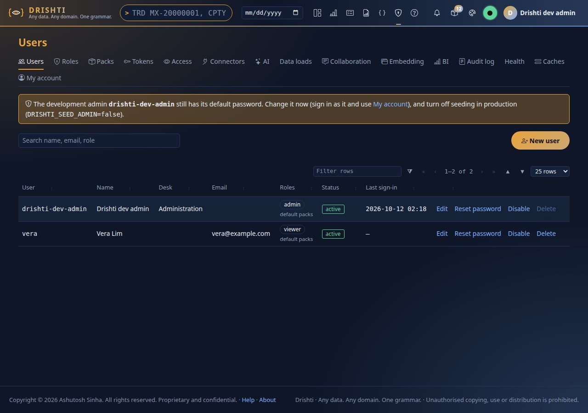

You should see Vera in the list with the role `viewer`. The bundled `viewer` role cannot see the fields the site masks (the trader's name, for instance): that matters in Step 4.

## Step 2 · Filter a view, then share it

Sign in as yourself, pick `2026-09-30` in the date box and open `TRD MX-20000001`. In the **Cashflows** panel set **Paid between** to *Next 90 days* and untick leg 2 in **Legs**.

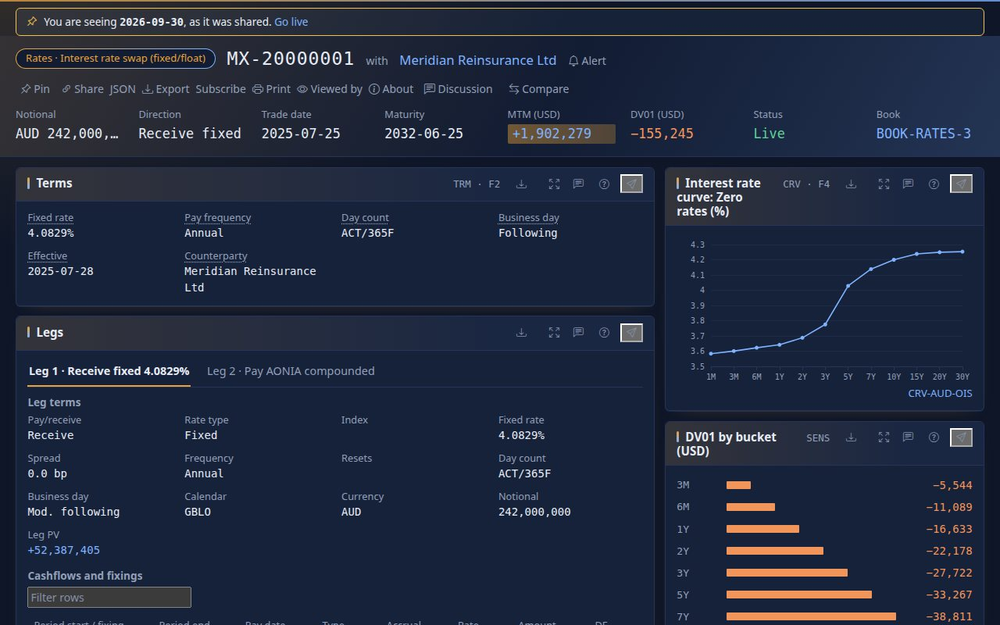

You should see the date box amber, and the cashflows table showing only the fixed leg's coming payments. What you chose is in the page's address, so a link reproduces it. Press `Alt+S` (or **Share** in the title line).

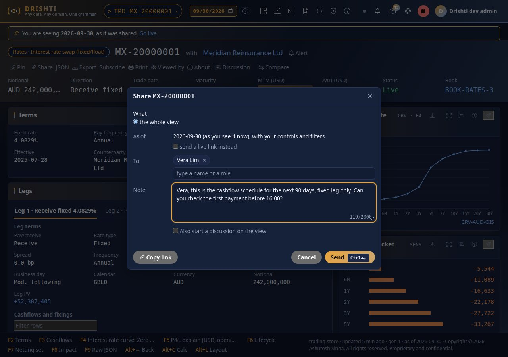

Type `ver` in **To** and press Enter to pick `Vera Lim` (you can also pick a role: everyone who holds it), write a note, and press `Ctrl+Enter` or **Send**. You should see the dialog name what is shared (*the whole view* as of the date, with your controls and
filters), a **Copy link** button, and an option to start a discussion on the view alongside.

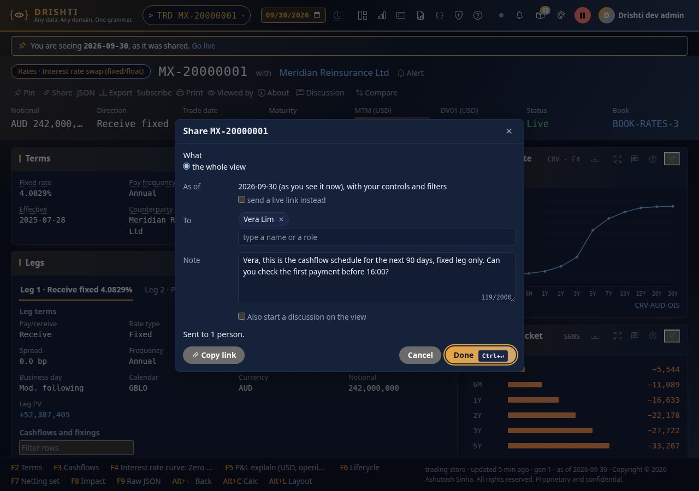

You should see `Sent to 1 person.` Nothing is emailed by default: the share goes to Vera's inbox and bell.

## Step 3 · The recipient opens it

Sign in as `vera` in the other window.

You should see a count on the bell. Click it (or press `Alt+I`).

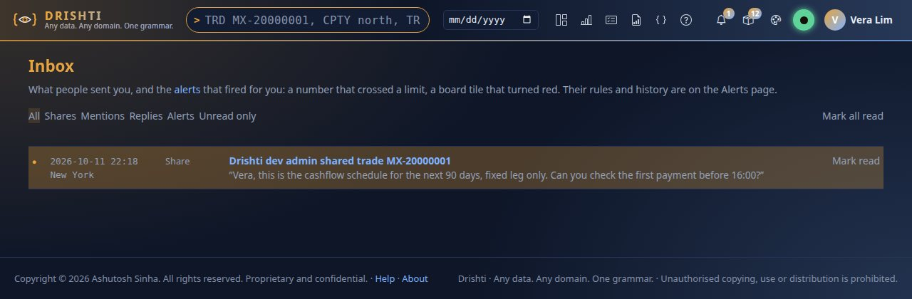

You should see one row: *Shared by Drishti dev admin*, the time, the title of the view and your note. Filter the inbox by *Shares*, *Mentions*, *Replies* or *Alerts*, or mark all as read. Open the row:

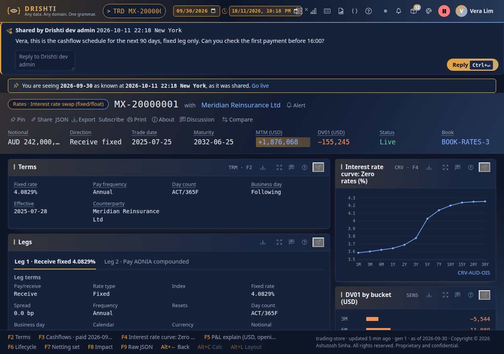

You should see a banner at the top: *Shared by Drishti dev admin*, your note, and a **Reply** box. Below it the banner says *You are seeing 2026-09-30 as known at ... as it was shared*, with **Go live** to
leave the pinned date. The view is drawn **for Vera**: whatever her roles do not allow is masked (`•••`) even though you saw it. A note that quotes a masked number in `{...}` reads `•••` for her too, and the
picture of a shared panel is rendered with the rights of the sender *and* the recipient, whichever is less.

On a phone the same share is one column:

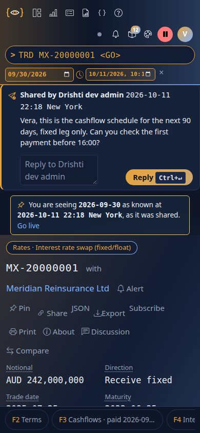

You should see the banner, the date notice and the title above the first panel.

## Step 4 · Discuss it, and mention her

Back as yourself, on the same view, press `Alt+N` (or **Discussion**). In the drawer type `@ver` and press Enter to pick Vera, then ` the first fixed payment is {` and type `mtm` to pick the field to quote, Enter, and finish the sentence.

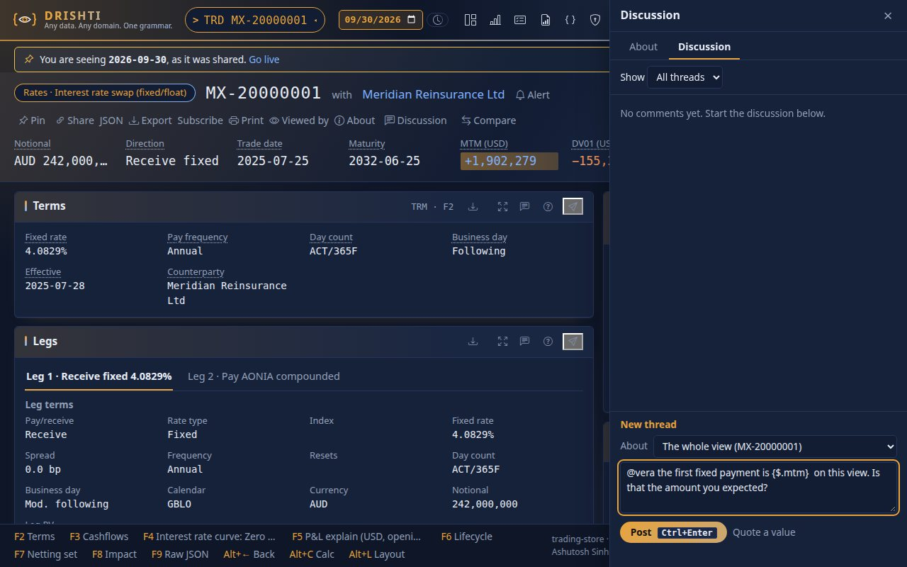

You should see a suggestion list for the mention and another for the `{` quote (fields of the view). A `{...}` in a comment is filled **when the reader opens it**, with the reader's own view of the number: Vera sees `•••` where the field is
masked for her, and the figure itself where she may see it. Press `Ctrl+Enter` to post.

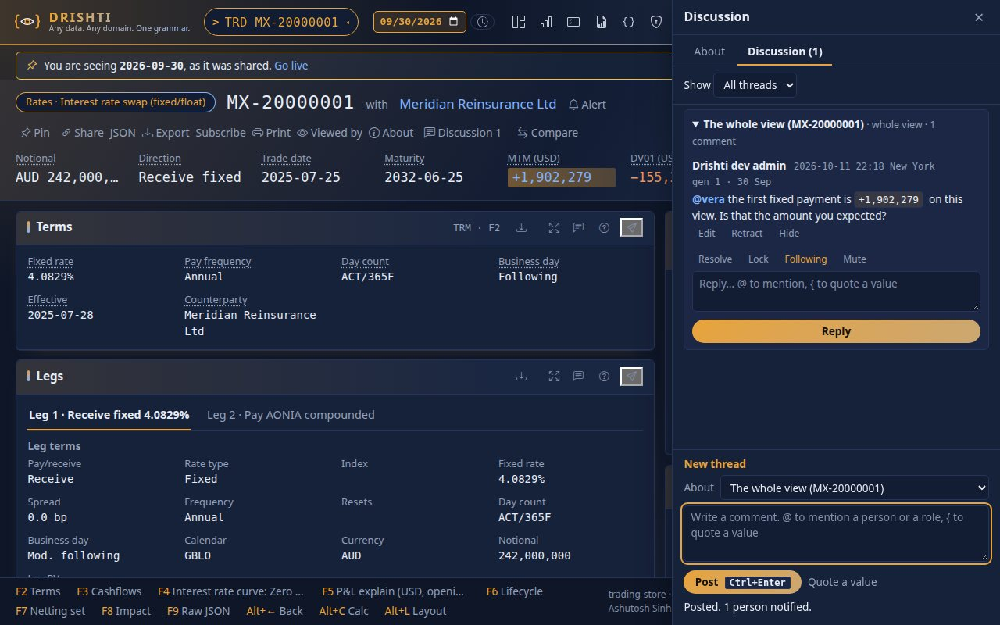

You should see your comment as the first message of a thread on *The whole view* (a thread can also belong to one panel: use the speech-bubble icon in a panel's header), with **Reply**, **Following** and
**Mute** under it. A thread can be edited by its author, resolved, and followed or muted by anyone in it.

## Step 5 · Vera answers

As Vera, open the inbox.

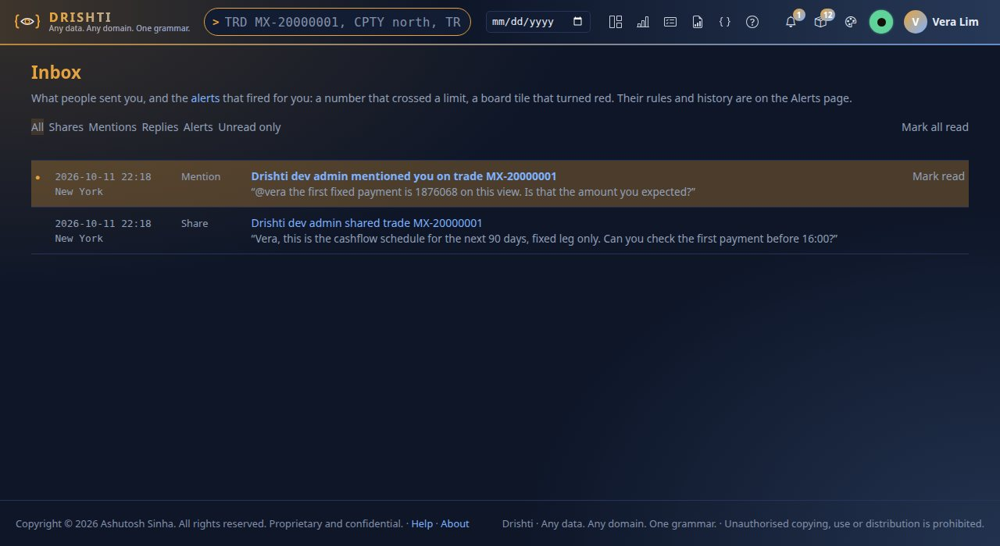

You should see a new row, *Drishti dev admin mentioned you*, with the text. Open the view, press `Alt+N` and answer:

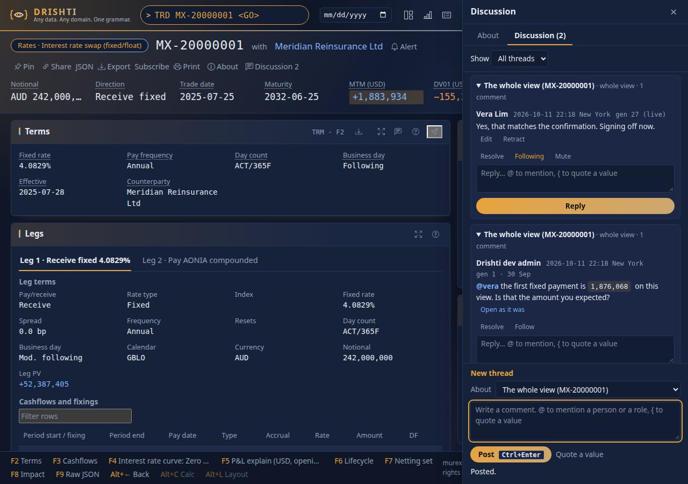

You should see Vera's reply under your comment, her number shown as *she* may see it. Back in your own window the bell now shows a reply; the thread is followed by both of you, and the **Viewed by** list in the title line says who has looked at the view.

## Next steps

- [Tutorial 9 · Reports](09-reports.md) sends a view to people on a schedule.
- [USER_GUIDE.md › Share a view with a note](../guides/USER_GUIDE.md#share-a-view-with-a-note), [Your inbox](../guides/USER_GUIDE.md#your-inbox) and [Discussion](../guides/USER_GUIDE.md#discussion) are the references.
  An administrator sets collaboration limits and the email channel in **Admin → Collaboration** ([OPERATIONS.md](../admin/OPERATIONS.md)).

## If something goes wrong

| You see | Meaning |
|---|---|
| `Sent to 0 people` or the person is not offered | the user does not exist, is disabled, or may not open that kind of entity |
| the recipient sees `•••` | her roles mask that field: by design |
| `Share denied` | the share was to somebody else, or its link has expired |
| the bell stays at 0 | the bell counts unread items every few seconds: reload the page |
