<!--
  Project Drishti · Any data. Any domain. One grammar.

  Copyright (c) 2026 Ashutosh Sinha <ajsinha@gmail.com>.
  All rights reserved.

  PROPRIETARY AND CONFIDENTIAL.

  This file is the confidential and proprietary property of Ashutosh Sinha.
  Unauthorised copying, use, modification, distribution or disclosure of this
  file, via any medium, is strictly prohibited except with the express prior
  written permission of the copyright holder.

  See the LICENSE file in the root of this repository for the full terms.
-->
# Tutorial 9 · Reports

Two things in Drishti run on a schedule and deliver what you saw: a **scheduled report** (a search, run as you, delivered as a CSV file) and a **subscription** (a view or a BI report, sent by email in
the form you choose, rendered separately for each recipient). In this tutorial you make one of each, run them by hand, read their history, and see how they sit together under **Views → Reports** next to alerts and
BI reports.

## Time to complete

About 25 minutes.

## Before you start

- [Tutorial 1](01-first-15-minutes.md) done (signed in as the development administrator, the token for the command line set) and [tutorial 8](08-share-and-collaborate.md) for the user `vera`.
- Email needs an SMTP server, which a fresh install does not have. The tutorial shows what Drishti does without one (it keeps the run and retries); [OPERATIONS.md](../admin/OPERATIONS.md) says how to set `spring.mail.host` and the email channel.

## What you will learn

- how to turn a search into a scheduled report: when it runs (business days, holidays, after a load), which day's data, and where the file goes;
- **Run now**, the last-run line, and the file it wrote;
- a subscription: formats (HTML, PDF, Excel), recipients (**users and roles only**, never an email address) and why each recipient gets their own render;
- where both live: **Views → Reports** in the top bar;
- what the command line and the REST API can do for them.

## Step 1 · Start from a search

Run a search that finds what you want to see every day: the trades whose valuation lost more than 200 million. Valuations are their own kind, `trade-valuation`
(mnemonic `TVAL`, one per trade per day, from the market-risk pack); the trade itself carries no MTM. Type:

```text
TVAL where MTM < -200m order by MTM
```

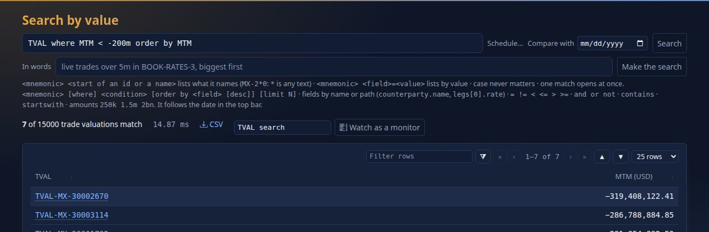

You should see a table (`7 of 15000 trade valuations match`, worst first: `TVAL-MX-30002670` at about −319 million), the **Schedule...** link beside the search box and a **Watch as a monitor** button. (From a search made with a form, **Schedule a report** under the results does the
same, tutorial 3.) Press **Schedule...**.

## Step 2 · Say when, which day, and where

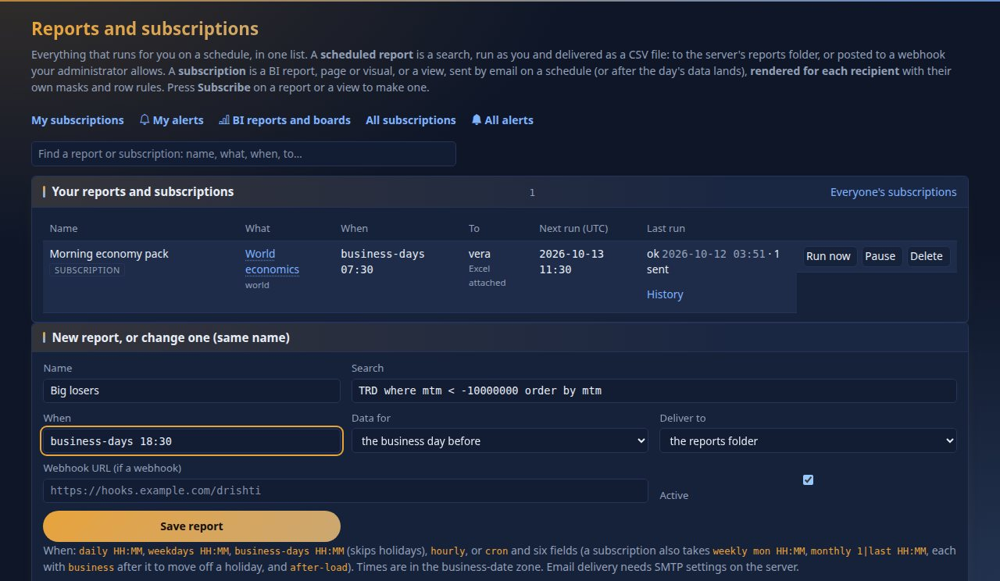

You should see the **Reports and subscriptions** page with *New report* filled in with your search. Name it `Big losers`. **When** takes these words, in the business-date zone (New York by default):

| When | Runs |
|---|---|
| `business-days 18:30` | at 18:30 on weekdays that are not holidays in the server's calendar |
| `weekdays 07:00` | Monday to Friday at 07:00 |
| `daily 06:00`, `hourly` | every day at 06:00; every hour |
| `weekly mon 07:30` | on that weekday |
| `monthly last 18:00 business` | on the last business day of the month |
| `after-load`, `after-load trade` | shortly after a data load finished `ready` (tutorial 7), for any kind or the one named |
| `cron 0 0 8,12,16 * * MON-FRI` | a cron expression: second, minute, hour, day, month, weekday |

Type `business-days 18:30`. **Data for** chooses the current business day or the one before: pick *the business day before* for a morning report on yesterday's close. **Deliver to** is the server's reports folder or a
webhook your administrator allows. Press **Save report**.

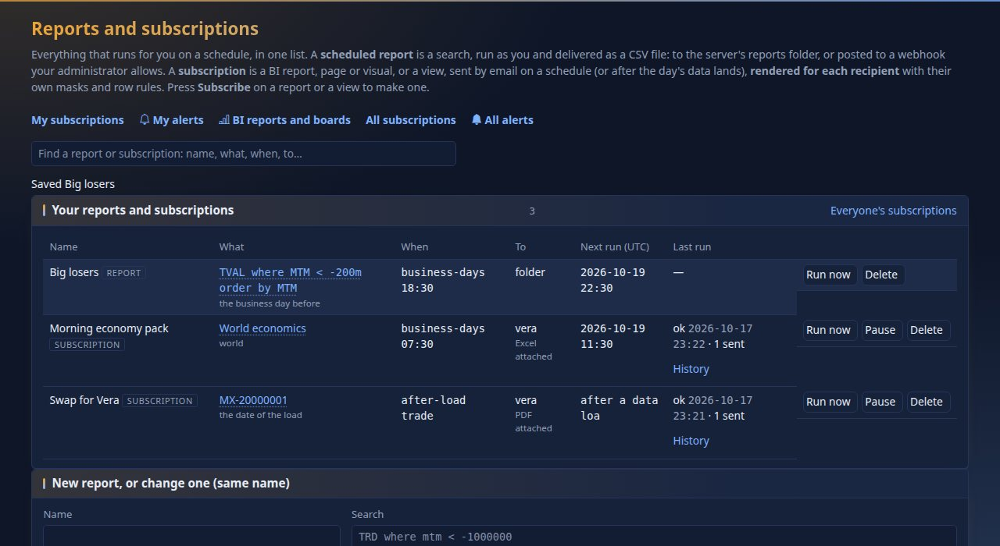

You should see `Saved Big losers`, and a row with the search, the schedule, where it goes and **Next run (UTC)**. The next run skips the weekend and the holidays of the
calendar: saved on Saturday 17 October 2026, it first runs on Monday the 19th (`2026-10-19T22:30:00Z`); had it been saved the weekend before, Monday 12 October (Columbus Day,
a New York holiday) would have been skipped too. The server shows the next three runs of any schedule text; this is the call behind it:

```text
$ for each schedule: curl -s -X POST -H "Authorization: Bearer $DRISHTI_TOKEN" -H 'Content-Type: application/json' -d '{"schedule":"..."}' http://localhost:18480/api/v1/subscriptions/preview
business-days 18:30
{"next": ["2026-10-19T22:30:00Z", "2026-10-20T22:30:00Z", "2026-10-21T22:30:00Z"]}
monthly last 18:00 business
{"next": ["2026-10-30T22:00:00Z", "2026-11-30T23:00:00Z", "2026-12-31T23:00:00Z"]}
after-load trade
{"next": []}
```

You should see three instants for `business-days 18:30` (22:30 UTC is 18:30 New York), the last business day of each coming month for `monthly last 18:00 business`, and none for `after-load`, which has no time, only a trigger.

## Step 3 · Run it now

Press **Run now** on the row.

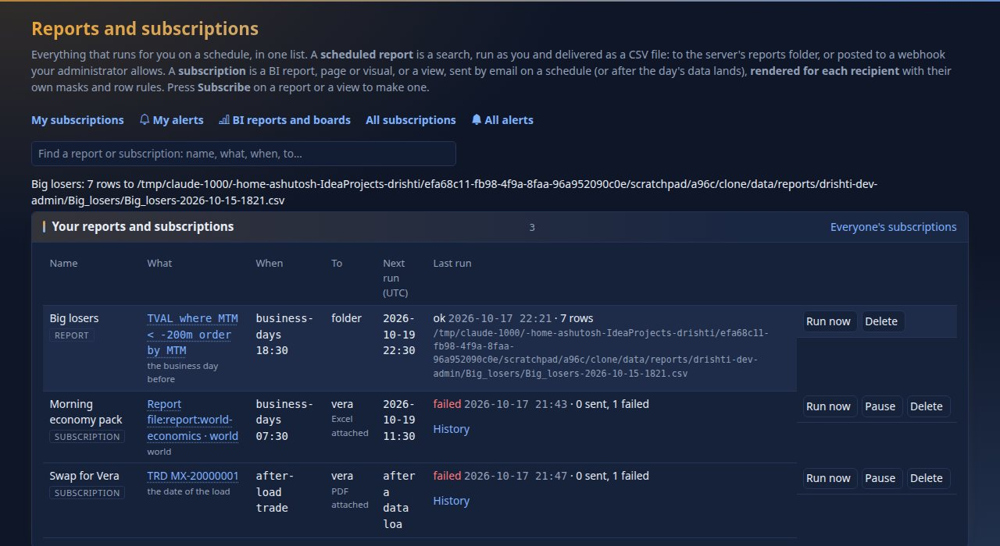

You should see `Big losers: 7 rows`, the path of the file, and the **Last run** line `ok`, the time and `7 rows`, for the business date `2026-10-15` (*the business day
before* 2026-10-16). The report ran **as you**: it sees what your roles let you see, with the same masked fields, and it stops if your account is disabled or
deleted. The file is a CSV in the reports folder, under the data folder:

```text
$ head -4 data/reports/drishti-dev-admin/Big_losers/Big_losers-2026-10-15-1746.csv
kind,id,title,MTM (USD)
trade-valuation,TVAL-MX-30002670,TVAL-MX-30002670,-319580679.781726
trade-valuation,TVAL-MX-30001782,TVAL-MX-30001782,-283751034.71329
trade-valuation,TVAL-MX-30003114,TVAL-MX-30003114,-282298514.881738
```

You should see the columns of the search (kind, id, title, then the fields the results showed: here the MTM) and one line for each valuation. The file name carries the
business date it was run for and the time.

**From the command line** the run is one call too, `POST /api/v1/me/reports/Big%20losers/run`, from a signed-in session; it answers with the run:

```text
{"at": "2026-10-17T21:46:55.675641667Z", "trigger": "by hand", "businessDate": "2026-10-15", "rows": 7, "bytes": 507,
 "target": "~/drishti/data/reports/drishti-dev-admin/Big_losers/Big_losers-2026-10-15-1746.csv", "status": "ok"}
```

The report as the page saves it (`PUT /api/v1/me/reports/{name}`):

```yaml
name: Big losers
query: TVAL where MTM < -200m order by MTM
schedule: business-days 18:30
deliver: folder
date: previous            # the business day before
enabled: true
```

## Step 4 · A subscription: a view for a colleague

Open `TRD MX-20000001` and press **Subscribe** (next to Export) in the title line.

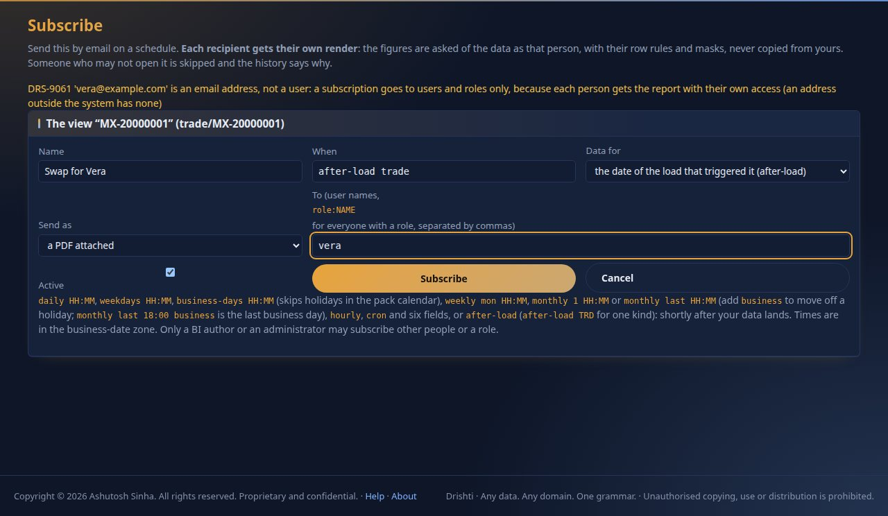

Fill in: name `Swap for Vera`, **When**: under **Send** choose *on a schedule I write (advanced)*, open **Advanced: the schedule as text** and type `after-load trade` (it runs after the day's data lands, not at a time; the plain choices are every day, every business day, every week, month end and every hour, at a time), **Data for** *the date of the load that triggered it*, **Send as** *a PDF attached*, and **To** `vera`. **Send as** offers the email
itself (the tables in the body), a PDF or an Excel workbook. **To** takes user names and `role:NAME` (everyone who holds the role), separated by commas. Try an email address first:

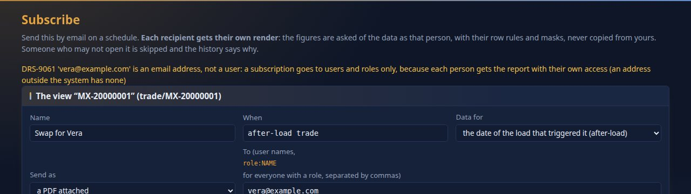

You should see `DRS-9061 'vera@example.com' is an email address, not a user: a subscription goes to users and roles only, because each person gets the report with their own access (an address outside the system has none)`. That is the rule that keeps masks
safe: Drishti builds each recipient's copy from the data **as that person**, with their roles as they are now, so the sender never sees and the mail never carries a figure the recipient may not see. Someone who may not open the view is skipped, and the history says why. Only
a BI author or an administrator may subscribe other people; anyone may subscribe themselves. Put `vera` back and press **Subscribe**. What the page saves (`PUT /api/v1/me/subscriptions/{name}`):

```yaml
name: Swap for Vera
title: TRD MX-20000001
target: { type: view, id: trade/MX-20000001 }
schedule: after-load trade
format: pdf
date: load                # the date of the load that triggered it
recipients: [vera]
```

## Step 5 · Reports, all in one place

Open **Views** in the top bar and choose **Reports** (it is an entry of Views, with Forms, the terminal and search).

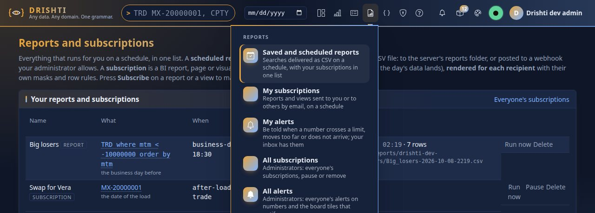

You should see **Reports** under **Look up** with the words "Every report you have". It opens **one page** with the links at its top: **My subscriptions**, **My alerts** ([tutorial 7](07-load-data-daily.md)), **BI reports and boards** (the published reports of Rūpaka, the catalogue filtered to reports) and, for administrators, **All subscriptions** and **All alerts**; a **Find** box
(*Find a report or subscription: name, what, when, to...*) narrows the list as you type, and the list is one list:

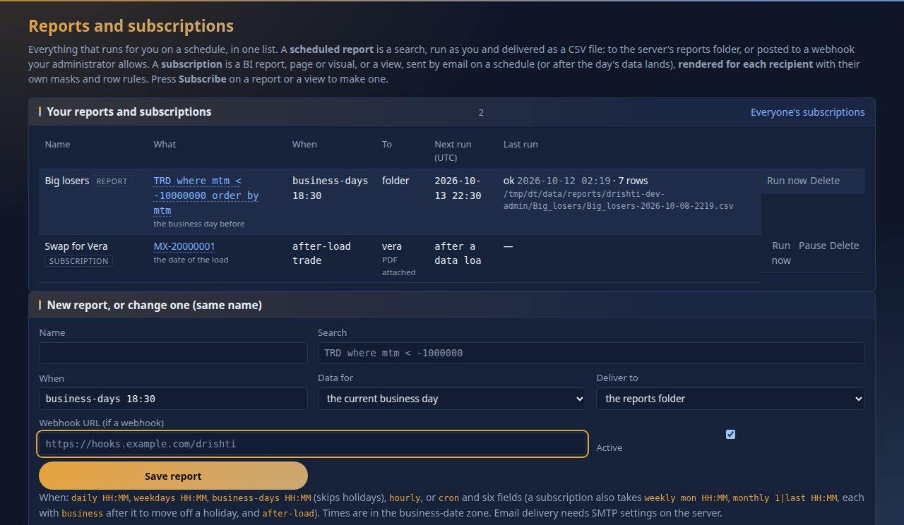

You should see both rows, badged `REPORT` and `SUBSCRIPTION`, each with its schedule, who it goes to (a folder, or `vera` with the format), the next run and the last. A subscription you make on a **BI report** (Subscribe under its page tabs) lands in the same list, with the
report's page or visual as its target. Row actions: **Run now**, **Pause** and **Resume** (subscriptions), **Delete**. **Everyone's subscriptions** (administrators) lists everybody's.

## Step 6 · Run the subscription, read its history

Press **Run now** on `Swap for Vera`.

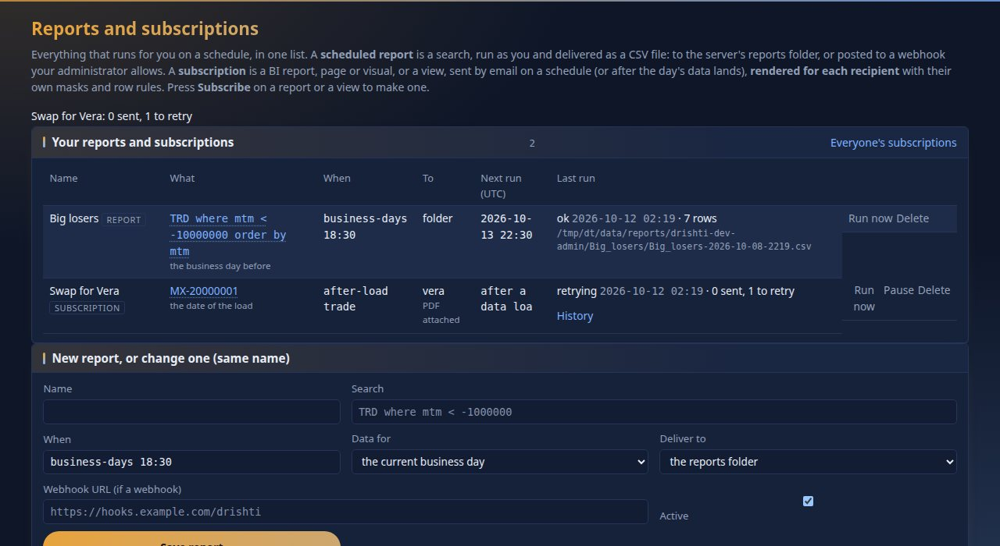

On a fresh install, with no mail server: You should see `Swap for Vera: 0 sent, 1 to retry` and a last-run line `retrying`. The run, as the server answers it:

```text
{"id": "b0bd2b86", "at": "2026-10-17T21:47:08.870822192Z", "trigger": "by hand",
 "deliveries": [{"to": "vera@example.com", "label": "Vera Lim", "attempts": 1, "user": "vera",
                 "error": "IllegalStateException: no SMTP host: set spring.mail.host", "status": "retry", "nextAttempt": "2026-10-17T21:47:14.698917894Z"}],
 "sent": 0, "failed": 0, "skipped": 0, "retrying": 1, "status": "retrying"}
```

Open **History**:

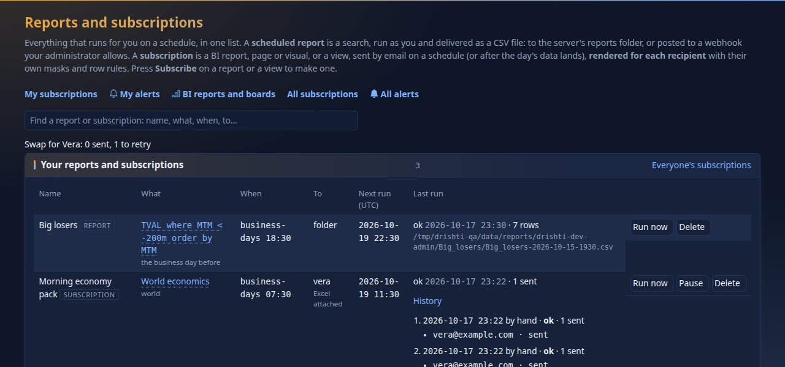

You should see each run with the time, how it was triggered (`by hand`, a schedule or `after-load`), the counts, and for each recipient a line such as `vera@example.com · retry · IllegalStateException: no SMTP host: set spring.mail.host`. That is the
honest result without a mail server: Drishti built Vera's copy, could not send it, and will **retry** (and keep the history). If Vera had no email address on her account the line says `skipped · no email address on file`. Set the SMTP host and the email channel
(Admin → Collaboration) and the same run sends. Each retry, failure and skip is recorded; nothing is lost silently.

On a phone the page is one column:

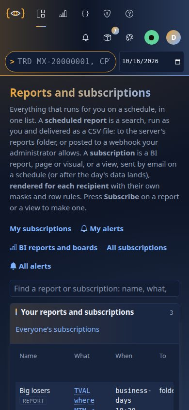

## Step 7 · From the command line and the API

Creating and editing reports and subscriptions is done in the console (`drishti.py` has no command for scheduled reports or subscriptions; its `bi` commands, such as `drishti.py bi catalogue list` and `bi runs`, are for BI items: [CLI_GUIDE.md](../guides/CLI_GUIDE.md)). Reading them is REST, with the token of tutorial 1. A
personal token may read but never change your reports: a `PUT` with it is refused, `403 DRS-5002 API tokens may not call this endpoint`.

```text
$ curl -s -H "Authorization: Bearer $DRISHTI_TOKEN" http://localhost:18480/api/v1/me/reports \
    | python3 -c "import json,sys; [print(r['name'], '|', r['query'], '|', r['schedule'], '|', r['deliver'], '|', r['date']) for r in json.load(sys.stdin)]"
Big losers | TVAL where MTM < -200m order by MTM | business-days 18:30 | folder | previous
```

```text
$ curl -s -H "Authorization: Bearer $DRISHTI_TOKEN" http://localhost:18480/api/v1/me/subscriptions \
    | python3 -c "import json,sys; [print(r['name'], '|', r['schedule'], '|', r['format'], '|', ','.join(r['recipients']), '|', r['date']) for r in json.load(sys.stdin)]"
Swap for Vera | after-load trade | pdf | vera | load
```

You should see one line for each, its name, schedule, format or destination, recipients and which day's data. [DISTRIBUTION.md](../guides/DISTRIBUTION.md) lists the whole API (`PUT /api/v1/me/subscriptions/{name}` and friends, for a session, not a token) and the retry rules.

## Next steps

- [DISTRIBUTION.md](../guides/DISTRIBUTION.md): export formats (PDF, PNG, Excel, CSV), subscriptions in depth, alerts on numbers, boards, embedding a report in another web application.
- [USER_GUIDE.md › Scheduled reports](../guides/SCHEDULED_REPORTS.md#scheduled-reports) is the reference for the CSV reports.
- Tutorial 3 made the search; tutorial 7 told Drishti when the data lands, which is what `after-load` waits for.

## If something goes wrong

| You see | Meaning |
|---|---|
| the schedule is refused | the words are not understood: the page lists the forms; the server preview call above shows what it understood |
| a report says `0 rows` | the search matches nothing for that business day |
| a subscription is skipped | the recipient may not open the view, or has no email address on file; the history says which |
| `retrying` | the mail server is not set up or not reachable; set `spring.mail.host` and check Admin → Collaboration |
| no file appears | the report's *Deliver to* is a webhook, or the run failed: see its last-run line |
