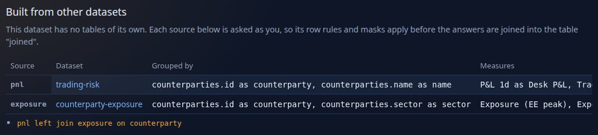
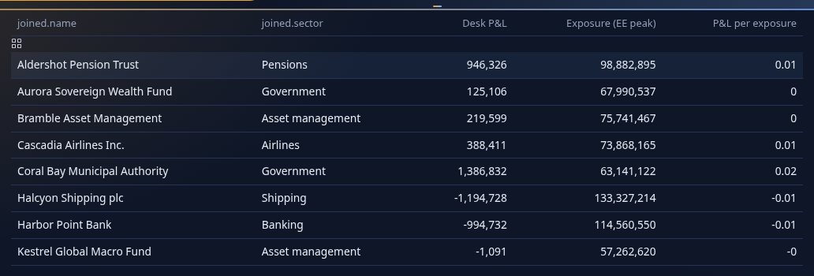
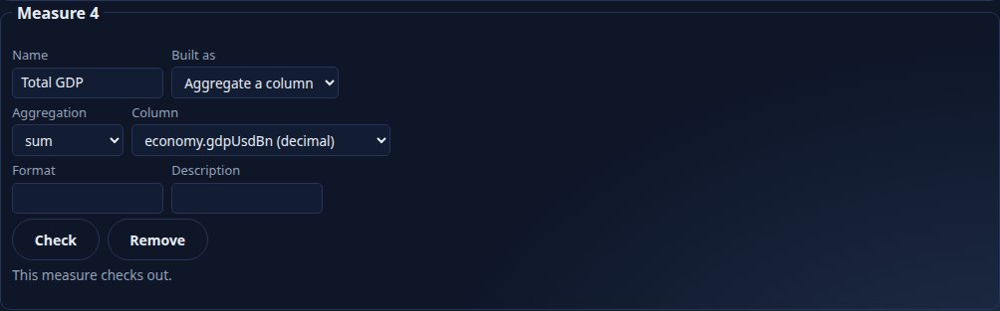
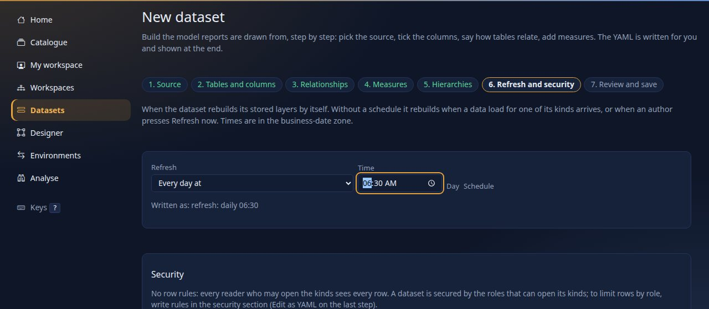
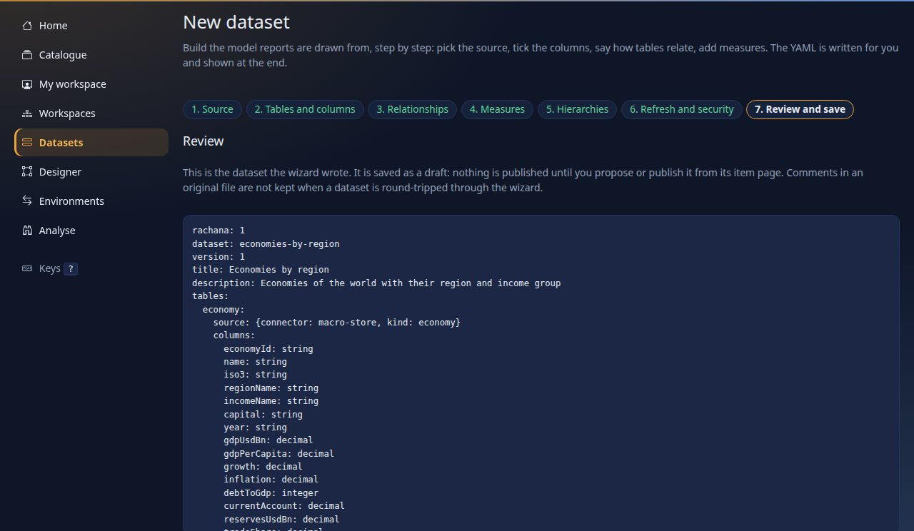

<!--
  Project Drishti · Any data. Any domain. One grammar.

  Copyright (c) 2026 Ashutosh Sinha <ajsinha@gmail.com>.
  All rights reserved.

  PROPRIETARY AND CONFIDENTIAL.

  This file is the confidential and proprietary property of Ashutosh Sinha.
  Unauthorised copying, use, modification, distribution or disclosure of this
  file, via any medium, is strictly prohibited except with the express prior
  written permission of the copyright holder.

  See the LICENSE file in the root of this repository for the full terms.
-->
# Tutorial 10 · Your first BI report

Business intelligence in Drishti (it is called **Rūpaka**; type `BI <GO>` or choose the bar-chart icon in the top bar) is built from three things: a **dataset** (tables, how they join, and named **measures** such as "GDP per capita"), a **report**
(pages of **visuals** that ask the dataset questions), and the **catalogue** where published reports are found. In this tutorial you build a report of your own on the **World economics** sample: two cards, a **map** you can drill from the world to a country
and its regions, a bar, and a slicer. You look at it, cross-filter it, publish it, learn the slicers in detail on the **Trades overview** sample, and meet the cross-filter and drill-through of **Counterparty risk**.

### In the designer

You can build the same report yourself with two datasets (pictures to follow). Open **Designer**, start a report on `trading-risk`, and in the Fields pane press **Add dataset** and choose `counterparty-exposure`: a second tree appears, labelled. Drag `counterparties.sector` of the *second* tree onto the canvas: the new visual reads that dataset and carries a small tag with its name. Drag a field of the second tree onto a visual of the first and you are told *this visual reads ...; put ... fields in another visual, or make a composed dataset*. Under the tree the **Links between datasets** panel offers fields that mean the same; tick one and the report's `links:` has it, so a slicer on one dataset filters the other. **Make a composed dataset from these** shows the `from:` / `join:` draft for you to read before anything is saved.

## Time to complete

About 60 minutes.

## Before you start

- [Tutorial 1](01-first-15-minutes.md) done: server and console running with sign-in on, you are signed in as the development administrator, and the token for the command line is set (`DRISHTI_TOKEN`).
- Nothing else to install. The sample datasets and reports are files in `config/bi/` that every server reads. The data of **World economics** is real and public: about 200 economies from the World Bank (CC BY 4.0), through the `economics` pack. The dataset uses only the World Bank
  fields on purpose; the pack's IMF fields stay out of it ([REAL_DATA.md](../guides/REAL_DATA.md)).

## What you will learn

- the parts of a dataset: a table, columns, measures; and how to ask it a question before drawing anything;
- how to make a report in the designer: cards, a **map**, a bar with a **top 10** filter, a slicer; where each visual sits on the 12-column grid;
- (at the end) a **relative-date slicer**, a **tablet layout** and an **entity view**: *last 4 weeks*, two columns on an 820 px screen, and a counterparty's own view beside a bar;
- how the map drills **world, country, region** with a breadcrumb, and how a click on a map or a bar **cross-filters** the rest of the page;
- how to publish: your own workspace, a shared workspace, the catalogue;
- **filter like Power BI**: list, dropdown and range slicers, page and report scope, a top-N filter that tames a busy donut, bookmarks, and when to use a slicer instead of a click;
- the **Counterparty risk** sample: slicers that reach across packs, a selected bar, and drill-through;
- **two datasets in one report**: a dataset composed of two others, joined in YAML, and a slicer of one dataset that filters the visuals of the other;
- (step 13) **a dataset of your own, built in the wizard**: pick a connector, tick columns, add a measure, set a refresh, save a draft, publish it and start a report on it, with no YAML typed.
- (preview, 2.2.0) **models**: a pack dataset with nothing to build, a report on it at once, then a model of trades and desks with a suggested relationship, a measure, a row rule and the security safeguard, published, opened in Analyse and watched by an alert, in the UI, over the API and as YAML.

## Step 1 · Look at the dataset

Choose **Datasets** in the left rail and open **World economics**.


You should see the title, `dataset world-economics · version 1 · engine duckdb · 1 tables · 7 measures`, a badge `valid`, and below it **Preview a query**. The model sits further down: one table, `economies`, whose columns are the country's name, its ISO code
(`iso3`, which is what a map needs), World Bank region and income group and a few figures; and the seven **measures** (`Economies`, `GDP (USD bn)`, `Population (m)`, `GDP per capita (USD)`, `Average growth`, `Average inflation`, `Average unemployment`). A measure is a
formula the dataset owns, so every report that uses it agrees. `GDP per capita (USD)` is worked out as GDP over population, not as an average of averages, so a region's figure is right.

Preview a query: under **Group by** choose `economies.regionName`, under **Measures** hold Ctrl and choose `GDP (USD bn)`, `Population (m)` and `GDP per capita (USD)`, and press **Run the query**.


You should see `7 rows`, the layer that answered (`columns`), the business date of the data, and a table with a row per World Bank region: East Asia and Pacific `32,710.77` billion dollars of GDP, North America `86,306.87` dollars per head. Over REST the same question
is one call (with the token of tutorial 1; here the server is on port 18943, yours is on 18480):

```text
$ curl -s -X POST -H "Authorization: Bearer $DRISHTI_TOKEN" -H 'Content-Type: application/json' \
    -d '{"fields":["economies.regionName"],"measures":["GDP (USD bn)","Population (m)","GDP per capita (USD)"]}' \
    http://localhost:18480/api/v1/bi/datasets/file:dataset:world-economics/query
{"columns":[{"type":"string","masked":false,"name":"economies.regionName"},{"type":"decimal","masked":false,"name":"GDP (USD bn)"}, ...],
 "rows":[["East Asia & Pacific",32710.7673284,2340.961666,13973.217846105472],["Europe & Central Asia",32262.103690000018,932.4846759999997,34597.99878791792],
         ["Latin America & Caribbean",7327.566034999997,666.552477,10993.232022750399], ... ["North America",33098.7945,383.501255,86306.8740153145], ...],
 "rowCount":7,"meta":{"layer":"columns","millis":1.93,"cached":false,"dates":["2026-10-09"],"masked":[],"warnings":[]}}
```

You should see one row per region and a `meta` block that says which layer answered and how long it took. Everything a report draws is a question like this, asked **as you**: your row rules and masks apply, which is why two people can open one report and see different figures.

**In the UI.** The page above has no YAML on it, and neither does making a dataset of your own: **Datasets → New dataset (guided)** opens the dataset wizard (step 13 builds one end to end). **Edit in the wizard** on a dataset's page opens an existing draft in it, and a dataset with no schedule has **Set a schedule** ([tutorial 11](11-bi-that-runs-itself.md)).

## Step 2 · Start a report

Choose **Designer** in the rail. Choose the dataset **World economics**, give the report the title `My world report` and look at the form before you press the button.


You should see the dataset chooser (every dataset you may open), the title box and the button **Start designing**. Press it.

You land in the designer: a canvas on a 12-column grid, a **Filters** pane, **Visualizations** (every kind of visual) and **Fields** (the dataset's columns and measures). The report is a draft in **My workspace**, which only you see.

## Step 3 · Two cards

Drag the measure `GDP (USD bn)` from **Fields** onto the canvas, then `Population (m)` beside it. (Dragging with the keyboard also works: focus a field and press Enter.)


You should see two cards with real figures: `117,327` (billion dollars) and `8,161.83` (million people). A **measure alone becomes a card**; a column alone would become a table; a column with a measure becomes a bar. Under each card is the line the server answered with: rows, time
and the layer.

## Step 4 · A map

Click an empty part of the canvas to let go of the selection, then click **map** in **Visualizations**. In **Build**, add `economies.iso3` to the **location** well and `GDP per capita (USD)` to **values**.


You should see the world shaded from dark to light by GDP per capita (the legend runs from 0 to `90k+`), the title `World` above it, and a note `Not on the map: CHI, XKX` under it: two codes the shapes do not know are **named, never dropped silently**. Small countries (Cayman Islands, Monaco)
are dots so they can be clicked. The shapes are Natural Earth, shipped with the console: nothing is fetched from the internet. The `location` well takes ISO country codes (`AUS`, `AU` or the English name), or ISO 3166-2 region codes (`AU-NSW`) for a map of one country's regions.

## Step 5 · A bar, a slicer, and where everything sits

Add a bar: with nothing selected click **bar**, put `economies.name` in **axis** and `GDP (USD bn)` in **values**. Add a slicer: click **slicer**, put `economies.regionName` in **field**, then open **Format** and set the mode to **dropdown**.
The visuals are stacked wherever there was room, so now place them. **In the UI**, drag a visual by its header and resize it by its corner (the places snap to the 12-column grid), and give the bar its **top 10** in the **Filters** pane: under *On this visual* press **Add a filter**, choose the field `economies.name`, the filter type **Top N**, *Keep the top* `10`, *with the* `highest`, *by measure* `GDP (USD bn)`, and press **Add the filter**. **From the YAML** (the exact way, and what both of these write), open the **YAML** tab: the report is text, and each visual has `at: { x, y, w, h }` on the 12-column grid. Give each one a title and a place, and give the bar a **top 10** filter
(a filter on the visual, `op: top`: the ten economies with the largest GDP):


```yaml
- id: card-1
  type: card
  title: "GDP (USD bn)"
  at: { x: 0, y: 0, w: 3, h: 2 }
  wells: { values: [GDP (USD bn)] }
- id: map-1
  type: map
  title: "GDP per capita (USD): click a country"
  at: { x: 0, y: 2, w: 8, h: 8 }
  wells: { location: [economies.iso3], values: [GDP per capita (USD)] }
- id: bar-1
  type: bar
  title: "Largest economies (GDP, USD bn)"
  at: { x: 8, y: 2, w: 4, h: 8 }
  wells: { axis: [economies.name], values: [GDP (USD bn)] }
  filters: [{ field: economies.name, op: top, n: 10, by: GDP (USD bn) }]
```

You should see the YAML with `at:` lines and no complaints (a mistake is reported with its code, and `DRS-9030` is a place off the grid). Switch back to **Canvas**. (You can also drag a visual by its header and resize it by its corner; the YAML is simply the exact way.)


You should see two cards, a `Region` dropdown, the map on the left and ten bars on the right. Press **Save** (or `Ctrl+S`); the status next to the title says `Saved`. Press **Check**: it adds accessibility checks (a visual without a title or alt text is flagged for screen readers).

## Step 6 · View it, click, drill

Press **View**: the report opens as a reader sees it.


You should see the toolbar (business date, *Click a mark to filter the page / highlight*, **Reset**), the **Export** bar (PDF, PNG, Excel, CSV, Subscribe; tutorial 11), and your visuals drawn with real data. Now **click Australia** on the map.


You should see three things at once. A **chip** under the toolbar, `economies.iso3: AUS`, says what is filtering the page. The cards answer for Australia alone (`1,799` billion dollars of GDP, `27.61` million people): this is the **cross-filter**. And the map **drilled**:
its title bar says **World › Australia**, and the shapes of Australia's states and territories replace the world.


Under the map you read `No figures at region level for Australia: the location field holds countries, not their regions.` That is honest: this dataset has one row per **country**. To shade regions give the map a field of ISO 3166-2 codes (`AU-NSW`, `US-CA`) and the same visual
colours the states by their own figure. Press **World** in the breadcrumb.


You should see the world again and the chip still in place: the breadcrumb moves the map, the chip (or **Reset**, or `Esc`) clears the filter. Click a second country with `Ctrl` held to add it to the selection.

## Step 7 · Publish

A draft in **My workspace** is private. To publish, move it to a **shared workspace** (that is where people are members and where review can be required). Choose **Workspaces** and fill in **New workspace**.


You should see the form; leave *Require review before publishing* unticked for now and press **Create workspace** (a workspace that requires review needs a second person to approve, which is [tutorial 13](13-govern-bi.md)). Open your report's page (**My workspace**, then the report), choose **Move to workspace…**, pick `Economics desk` and press **Move**.


You should see the report listed under the new workspace. Type a note and press **Publish**.


You should see `Published.` and `published v1 just now`. Each publish makes the next numbered version; the draft carries on separately. Open the **Catalogue**, the one place every published item is found, and search `world`.


You should see your report beside the shipped one, with its workspace and owner. The same list from the command line:

```text
$ python3 tools/drishti.py bi catalogue list
id                               kind     endorsed  status    ver  title
file:report:trades-overview      report   promoted  published v2   Trades overview  (Shipped content, shipped)
file:report:world-economics      report   promoted  published v1   World economics  (Shipped content, shipped)
file:report:counterparty-risk    report   promoted  published v1   Counterparty risk  (Shipped content, shipped)
bi-7f8269ba14                    report   none      published v1   My world report  (Economics desk, drishti-dev-admin)
...
17 item(s)
```

```text
$ python3 tools/drishti.py bi workspace list
id                            role          items  name
u-drishti-dev-admin-eb6f      admin             1  My workspace  [personal]
economics-desk                admin             1  Economics desk
shipped                       viewer           16  Shipped content
```

You should see the report with `published v1` and the workspace with one item. (Ids, counts and dates differ on your machine.)

## Step 8 · Filter like Power BI

The sample **Trades overview** has a second page, **By product**, built to show slicers. Open it from the Catalogue (or type `BI trades overview <GO>`) and choose the tab **By product**.

A **slicer** is a visual that holds choices and filters other visuals. It has a mode and a scope. **In the UI** select the slicer and open **Format**: **Mode** is a choice of *list*, *dropdown*, *range* and *relative date*, and **Filters** is *this page* or *every page*. **In the YAML** the same two settings are:

```yaml
- { id: pick-product, type: slicer, title: Product type, wells: { field: [trade.productType] }, format: { mode: dropdown, scope: page } }
```

| `format.mode` | What it looks like | Use it for |
|---|---|---|
| `list` (the default) | a checkbox list with a search box, always open | a field with a handful of values (desks, currencies) |
| `dropdown` | a closed box that opens a **floating** checkbox list with a search box, **Select all** and **Clear** | a field with many values (product types: about forty) |
| `range` | two boxes, *From* and *To* | a number or a date field (notional, trade date) |

| `format.scope` | A choice filters |
|---|---|
| `page` (the default) | the visuals of this page |
| `report` | every page of the report, so a choice made on one page holds on the next (the Counterparty risk sector slicer) |

All three together on one page (the YAML is [data/slicer-kinds.report.yaml](data/slicer-kinds.report.yaml); paste it into **My workspace → New item** or into the designer's YAML tab to try it):


You should see the desks as an open list with its search box and **Clear**, the currency as a closed dropdown, the notional as *From* and *To* boxes, and the donut. **Open the Product type dropdown** on the Trades overview and type `SWAP` in its search box.


You should see the list **floating over** the visuals below it (it does not push the page down), narrowed to the product types that contain `SWAP`, each with a tick box. **Select all** and **Clear** tick and untick the values in one press. Tick `AMORT_SWAP` and `BASIS_SWAP`, then click outside.


You should see `2 selected: AMORT_SWAP, BASIS_SWAP` in the box, a **chip** `Product type: AMORT_SWAP, BASIS_SWAP` under the toolbar, the Desk and Currency slicers narrowed to values that still exist (a slicer never filters itself; **other** slicers filter it), a donut of two rings and a matrix of one desk. **Reset** clears all of it.

**Taming a busy donut.** The donut on this page could have about forty product types. It does not draw forty slices: it carries a **top filter**. **In the UI** that is the **Filters** pane: *On this visual*, **Add a filter**, filter type **Top N**, how many, highest or lowest, and the measure to rank by:


**In the YAML** it is one line (both write the same):

```yaml
- { id: share, type: donut, title: "Notional by product type (top 12)", wells: { axis: [trade.productType], values: [Notional] },
    filters: [{ field: trade.productType, op: top, n: 12, by: Notional }] }
```


You should see twelve slices and the title `(top 12)`. The server ranks the product types **in the context of the slicers**, so the top twelve of the swaps you chose is a different twelve from the top twelve overall. `n` is how many, `by` the measure to rank by.

**Bookmarks** save a state. **In the UI**, in the designer, select nothing (click the empty canvas) and open **Format**: under **Bookmarks** type a name, set the slicer choices you want kept (a relative-date slicer offers its windows), and press **Save this page as a bookmark**; it keeps the page, the filters of the Filters pane and those slicer choices. Each saved bookmark can be renamed in place, updated from the page's filters again, or removed:


**In the YAML** they are `bookmarks:` (a name, a page, slicer choices and filters). Either way they appear in the **Bookmarks** box of the viewer's toolbar. On the **Overview** page choose the bookmark `FX desk only`.


You should see the page filtered to `DESK-FX` (84 trades, notional `8,485,000,000`) with a chip, as if you had made the choice yourself. A bookmark is written in the designer, not captured from what a reader has chosen on screen in the viewer.

**Slicer or click?** Both filter. A **slicer** is a choice you make on purpose from a list, it stays visible, and it can be page or report wide. A **click on a mark** (a bar, a slice, a country) is exploring: it filters the **other** visuals of the page, it highlights what you picked, and it is gone when you click again.
Click the `DESK-FX` bar on the Overview page:


You should see the same figures as the bookmark gave. *Click a mark to* **highlight** (in the toolbar) keeps the whole answer on bar and column charts and draws the chosen share over it instead of filtering.

## Step 9 · Counterparty risk: slicers across packs, and drill-through

Open the shipped report **Counterparty risk**. Its dataset joins three packs (trades from `trading`, counterparties from `banking-core`, netting sets from `counterparty-risk`) and its two slicers, Sector and Country, are `scope: report`: they filter every page and reach the trades and the netting sets **through the relationships**.


You should see exposure cards, the two dropdown slicers and a bar of the ten counterparties with the highest expected exposure (a **top 10** filter again). Click the bar of **Halcyon Shipping plc**.


You should see a chip, the cards narrowed to that counterparty (`133,327,214` expected exposure) and, in the bar's header, a **drill-through** button. Press it.


You should see a second page, **Counterparty**, with the name carried in as a chip **and in the address** (so the link can be shared), a **Back** button, four cards (`40` trades, notional `5,035,000,000`) and a table of its trades whose ids are links: `MX-20000043` opens that trade's view in the terminal.

## Step 10 · On a phone

Open your report on a phone-width window (390 px).


You should see one column in reading order, the map at the full width, targets at least 44 pixels high and no sideways scroll. A report can also have a **phone layout** of its own (which visuals, in what order): [tutorial 16](16-embed-drishti.md) and the designer's **Phone** tab.

## Step 11 · Two datasets in one report

Everything so far read **one** dataset. The question "what is each counterparty's P&L next to its exposure?" needs two: P&L is in `trading-risk` (trades) and exposure is in `counterparty-exposure` (netting sets). In `trading-risk` alone a desk head's row rule on trades makes exposure by counterparty unanswerable for them (`DRS-9020`, step 9); here each dataset keeps its **own** rules and a third dataset **joins** what each lets you see.

Open **Datasets** and **Desk P&L vs counterparty exposure**.



You should see a section **Built from other datasets**: this dataset has no tables of its own. The source `pnl` asks `trading-risk` for the one-day P&L by counterparty, the source `exposure` asks `counterparty-exposure` for the expected and potential future exposure by counterparty, and one join line says `pnl left join exposure on counterparty`. Each source is asked **as you**, with that dataset's row rules and masks, and only then are the answers joined. Run a preview as in step 1: group by `joined.name` and `joined.sector`, and choose the measures `Desk P&L`, `Exposure (EE peak)` and `P&L per exposure`.



You should see a row per counterparty (Aldershot Pension Trust, Pensions: P&L `946,326`, exposure `98,882,895`) and `answered from the composed layer`. `P&L per exposure` is a measure of the composed dataset itself, `measure('Desk P&L') / measure('Exposure (EE peak)')`: the ratio of the two sums, whatever the grouping. As an author press **Model view** to see how it is put together.


You should see the two sources as boxes (their grouping columns and measures, the join key marked), the join between the `counterparty` columns and the table `joined` that they make. Now open the report **Desk P&L vs counterparty exposure** from the catalogue.


You should see `Desk P&L` `2,671,113`, `Exposure (EE peak)` `1,447,544,943` and the ratio. Two visuals of this report read a **different dataset** from the rest: the **Sector** slicer and the donut read `counterparty-exposure` directly, while the cards, the bars and the table read the composed one. The report's `links:` say that the exposure dataset's `counterparties.sector` and the composed dataset's `joined.sector` are the same thing. In the Sector slicer choose **Banking**.


You should see a chip `Sector: Banking`, the cards narrowed to the banks (`Desk P&L` `-1,456,152`, exposure `240,271,956`), three banks in the bar chart and the donut a single slice: the slicer's choice reached the visuals of the *other* dataset through the link. Click a slice of the donut instead and the same happens. Open the report as a desk head and the numbers shrink to the counterparties your desk trades with; open it as an analyst and the names read `•••` (the join is on the counterparty's **id**, which is not masked, so the report still works). The same table made by a Python Transform is in [tutorial 14](14-python-and-analyse.md); the reference is [DATASETS.md section 11](../guides/DATASETS.md#11-composed-and-derived-datasets) and [REPORTS.md section 16](../guides/REPORTS.md#16-reports-over-several-datasets).

## Step 12 · Relative dates, a tablet, and a view inside a report

Three things a real report needs. Each is a few controls in the designer, and each is also a few lines of YAML (**In the UI**: build it in the designer; **in the YAML**: open **My workspace → New item**, kind *report*, paste, **Save draft**, then **View**; the two write the same text).

**A slicer that says "last 4 weeks".** A slicer on a date column can offer named windows instead of values. The server works them out from the report's date and the business-day calendar, so the same name means the same dates on the screen, in an export and in a subscription.

**In the UI:** drag the date field (`trade.tradeDate`) onto the canvas, choose **slicer**, open **Format** and set **Mode** to *relative date (a date field)*. Two more controls appear: **Starts as** (the window used until a reader chooses; it is the `default`) and **Windows it offers** (a tick for each of the sixteen names; unticking one narrows the list, the `options`).


**In the YAML:**

```yaml
rachana: 1
report: relative-dates
dates: { from: 2026-10-07, to: 2026-10-08 }
title: Relative dates
dataset: trades-basic
pages:
  - id: main
    title: Main
    visuals:
      - { id: when, type: slicer, title: When, at: { x: 0, y: 0, w: 4, h: 3 }, wells: { field: [trade.tradeDate] }, format: { mode: relative-date, default: last-30-days } }
      - { id: count, type: card, title: Trades, at: { x: 4, y: 0, w: 4, h: 3 }, wells: { values: [Trades] } }
      - { id: mtm, type: card, title: Mark to market, at: { x: 8, y: 0, w: 4, h: 3 }, wells: { values: [MTM] } }
      - { id: desk, type: bar, title: MTM by desk, at: { x: 0, y: 3, w: 12, h: 6 }, wells: { axis: [trade.desk], values: [MTM] } }
```


You should see the slicer's dropdown (the report's `default: last-30-days` is chosen until you pick another) and, after choosing **Last 4 weeks**, a chip `When: Last 4 weeks` and cards narrowed to the 74 trades of the four weeks ending on the report's date (the whole book is 750). The names are `last-N-days`, `last-N-business-days`, `last-N-weeks`, `last-N-months`, `this-week|month|quarter|year` (to date), `previous-...` and `all`: [REPORTS.md section 6.1](../guides/REPORTS.md#61-the-relative-date-slicer).

**A tablet layout.** A phone gets one column ([step 10](#step-10--on-a-phone)); a tablet (up to 1024 px) can get two, with some visuals across:

```yaml
layouts:
  tablet:
    main:
      order: [desk, trades, mtm, notional, rows]    # first, in this order
      wide: [desk, rows]                            # the whole width; the others take half
      span: { desk: 5, rows: 4 }                    # heights in grid rows
```

**In the UI** open the draft in the designer and press the **Tablet** tab (the **Phone** tab is the same for a phone). Every key above has a control there: the arrows or a drag set the `order`, **Hide** hides a visual, **Wide** is `wide` (tablet only) and **Rows** is `span`:


You should see the visuals in tablet order with **Hide**, **Wide** and **Rows**, and a preview below. Then open the report on an 820 px screen:


You should see the bar the whole width, then the cards in two columns. A phone, or a desktop, is not affected.

**A counterparty's own view inside the report.** The sample **Counterparty risk** has a page *Counterparty lookup*: a bar of the ten largest counterparties and, beside it, a visual of `type: entity-view` with `wells: { key: [counterparties.id] }`. Open it and click a bar:


You should see the counterparty's own **Drishti view** (its name, rating, net MTM and netting sets) in the frame beside the bar, with a chip `counterparties.id: CP-HALCYON`. It is the view page built **for you**: someone who may not see a field does not see it here either. [REPORTS.md section 3.4](../guides/REPORTS.md#34-the-entity-view).

## Step 13 · A dataset of your own, in the wizard

Everything so far read datasets that ship with Drishti. A business user can make one without typing YAML. This step builds **Economies by region** from the **macro-store** connector, then publishes it and starts a report on it.

**In the UI.** Choose **Datasets**, then **New dataset (guided)** (it is also behind **My workspace → New item → dataset** and the designer's *build a dataset in the wizard* link when no dataset exists). The wizard has seven steps along the top; you can go back at any time.

**1 · Source.** Choose where the data comes from: *the packs' kinds*, *a connector* (choose it, then its kinds), *combine datasets* (a composed dataset) or *a Python Transform* (a derived dataset; [tutorial 14](14-python-and-analyse.md)). Choose **A connector**, `macro-store`, tick the kind `economy`, and give the dataset a name, a title and a description.


**2 · Tables and columns.** Every column the kind offers is a row: tick the ones to keep, rename what reports and formulas will call it (the *Name*; the *Source* column is where it comes from), check the type, mark a key, and add a description so others know what it means.


**3 · Relationships.** With one table there is nothing to join. With several, the wizard lists what the packs declare, relationships the values suggest (with how well they match) and columns with the same name and type, each with **Add**; every relationship is editable (the *many* side is "from", the *one* side "to").

**4 · Measures.** A measure is a number computed over rows. Add one by choosing an aggregation (`sum`, `avg`, `min`, `max`, `count`, `distinct`) and a column, or switch **Built as** to *Formula* and type one: as you type a table or column name a list of fields appears to pick from. **Check** asks the server whether the whole draft is valid and shows the problems that belong to that measure.



**5 · Hierarchies** (optional): an ordered list of fields, coarse to fine, that a visual can drill down. **6 · Refresh and security.** Choose when the layers rebuild on their own (every day at, weekdays, business days, weekly, hourly, after a data load, or a schedule you write); row rules the dataset already has are shown here, read-only.



**7 · Review and save.** The wizard shows the YAML it wrote, with the server's check of it. **Edit as YAML** turns the text into a box for an expert; **Save as a draft** stores it in the workspace you choose.



After saving you can open the **Model view**, open the dataset's page, or (when you may publish) **Publish it, then start a report**: a report reads a *published* dataset, and a draft in your private workspace cannot be published, so choose a shared workspace in the last step (step 7 above) or use **Move to workspace** later. **New report on this dataset** opens the designer's start with the dataset already chosen. To change it later, open the dataset and choose **Edit in the wizard**: it opens the saved text in the same steps, and a key the wizard has no control for (a `security:` block, `tests:`, a `layout:`) is kept as it was. Comments in the original file are not kept.

**From the command line.** The wizard writes with the same REST calls anyone can make. There is no `tools/drishti.py` command for datasets (the `bi` group lists workspaces and the catalogue and publishes), so these are the calls it makes; the token is the one of tutorial 1. First the draft of a dataset from a kind (this is what step 1 does when you press **Next**):

```text
$ curl -s -X POST -H "Authorization: Bearer $DRISHTI_TOKEN" -H 'Content-Type: application/json' \
    -d '{"kinds":["trade"],"name":"wiz-trades"}' http://localhost:18480/api/v1/bi/model/start
{"yaml":"rachana: 1\ndataset: wiz-trades\nversion: 1\ntitle: New model from trade\n...","tables":[...],"relationships":[],"proposals":[],"warnings":[]}
```

The YAML in that answer, which is also what steps 1 to 4 build up and step 7 shows (the tutorial's `trade` kind from the `trading-store` connector; the macro-store version has the economy columns):

```yaml
rachana: 1
dataset: wiz-trades
version: 1
title: New model from trade
description: "Started from the packs' kinds. Edit the columns, relationships and measures; nothing here changes a pack."
tables:
  trade:
    source: { connector: trading-store, kind: trade }
    columns:
      book: string
      currency: string
      desk: string
      mtm: decimal
      notional: decimal
      pnl1d: decimal
      productType: string
      status: string
      tradeDate: date
      tradeId: string
measures:
  Count of trade: { expr: "count(trade)" }
  Total trade mtm: { expr: "sum(trade.mtm)" }
  Total trade notional: { expr: "sum(trade.notional)" }
refresh: daily 06:30
```

Check it, store it as a draft in a shared workspace, publish it (the same calls as the wizard's **Check**, **Save as a draft** and **Publish it**):

```text
$ curl -s -X POST ... -d '{"yaml":"...the text above..."}' http://localhost:18480/api/v1/bi/datasets/validate
{"valid":true,"problems":[], ...}
$ curl -s -X POST ... -d '{"kind":"dataset","title":"Wizard trades","body":"...the text above..."}' http://localhost:18480/api/v1/bi/workspaces/<workspace>/items
{"id":"bi-f67d899fb7","status":"draft", ...}
$ curl -s -X POST ... -d '{"note":"from the wizard"}' http://localhost:18480/api/v1/bi/items/bi-f67d899fb7/publish
{"status":"published","publishedVersion":1, ...}
```

You should see `"valid": true` and, after the publish, `published` at version 1. (Ids differ on your machine.) A report on it is then `dataset: bi-f67d899fb7` in its YAML, which the designer writes when you start one on the dataset.

### Notes: saving safely, and more than one dataset (2.1.0)

- **UI.** *New report* on the designer's start page asks for a **Main dataset** and an optional **Also add** (Ctrl or Shift for several): the designer opens with all of them in the **Fields** pane. A dataset you cannot use yet is greyed with the reason (for example *draft in a private workspace: publish it first*). **+ Add visual** makes an empty visual; the **Publish** button (Propose where review is required) saves first. Open the same draft in two tabs and save in both: the second is refused with **Reload theirs / Save mine as a copy / Overwrite with mine**.
- **CLI.** `drishti.py bi catalogue get <id>` shows the item with its `etag`; a propose, approve or publish of a report that cannot be drawn is refused with `DRS-9030` and the errors (a bi-admin may force it).
- **YAML.** Nothing new to write: the extra datasets are named in each visual's `dataset:` and the report's `links:` (REPORTS.md section 16); `?also=a,b` on the designer URL opens extra datasets in the Fields pane.

## Preview · Models: from a pack dataset to a report (wave W1)

Release 2.2.0 brings the **model layer** ([BI_GUIDE.md section 23](../guides/BI_GUIDE.md#23-models-and-pack-datasets-the-model-layer-wave-w1)). The steps
above stay valid; this is a short look at the new way, which the migration wave (W4) turns into the main walk-through. The numbers below are from the
browser test's small lake (two days of 60 trades over three desks); yours differ.

**UI.**

1. **BI → Models** in the rail. Under *Datasets from the packs* every kind is already a dataset: find **Trade** (`pack.trading.trade`, certified,
   read-only). Its title opens its page: *One row per trade per business date*, keys `id`, time *snapshot*, and `desk` marked `desk →` (it holds desk ids).
2. Press **Use** on the Trade card and choose your workspace: a report opens in the designer on the **implicit model of Trade**. Fields lists `trade`
   and, brought along by the pack reference, `desk`; drag **Sum of mtm** onto the canvas, then **desk → name** onto the card: a bar of MTM by desk name,
   with nothing modelled by hand. *Query of the selected visual* shows the model query it asked.
3. Back on **Models**, press **New model**, title it *Trades and desks*, tick **Trade** and **Desk**, **Create and open the designer**. Desk is placed as
   a **dimension** (Trade references it). Under the canvas, *Suggested relationships* offers `trade.desk → desk.id` (*trade.desk holds desk ids (from the
   pack)*): press **Add**.
4. **Measures**: dataset `trade`, column `mtm`, **Add measure**: `Sum of mtm`, `sum(trade.mtm)`, adds up: yes.
5. **Security**: on `trade`, roles `desk-head`, *the column matches the reader*, column `desk`, *the reader's desks*, **Add the rule**. The tab shows ⚠ 1:
   *The role desk-head is restricted elsewhere in this model, but desk has no rule*, and the header badge agrees (*Valid, 1 to fix before publishing*).
   Press **desk-head may see every row of desk** (desks are not secret); the ⚠ goes. Add a second rule so you see every trade yourself: under **Roles**
   tick your own role (the list holds the roles the server knows; any other can be typed under it), *every row*. The note under the list says *roles
   without a rule see no rows*: a reader no rule matches reads nothing of that dataset.
6. **Save** (the badge says *Valid*), then **New report on this model**: the Fields pane's header says *Model Trades and desks*, *this report
   references the model*. A model is shared: **Used by** (above the tabs) lists the reports, boards, alerts, subscriptions and notebooks that read it, and
   **New board on this model** starts a board on it. Deleting a report never deletes its model, and a model that is used cannot be deleted.
7. **Publish.** In your private workspace Publish is disabled with the reason and **Move to a workspace** beside it: choose a shared workspace and Move, then
   **Publish** (it checks the model and its security safeguard first). A report on the published model publishes the same way from its item page.
8. **Analyse it.** Open **Analyse** (`/bi/explore`): the *Model or dataset* picker lists *Models*, *Your datasets* and one group per pack. Choose
   **Trades and desks (model 1.0.0, published)**, tick `trade.desk`, `trade.mtm` and `desk.name`, **Open the extract**: the rows you may see, as one model query.
9. **Alert on it.** **Alerts → New**, *Watch: measure of a model*: choose the model, then the measure `Sum of mtm`, a filter (`trade.desk is one of DESK-FX`),
   *Tell me when* it is above a limit, **Check now** (it reads your own number; a masked one cannot be saved) and **Save alert**.

**CLI.** The same through the REST API, with the token of tutorial 1. The pack datasets, then a question to the implicit model of Trade:

```
$ curl -s -H "Authorization: Bearer $DRISHTI_TOKEN" http://localhost:18480/api/v1/bi/pack-datasets
{"datasets":[{"name":"pack.banking-core.agreement","id":"ds_pack_banking_core_agreement","title":"Master agreement","pack":"banking-core","kind":"agreement",
 "version":"1.0.0","mode":"snapshot","endorsement":"certified","columns":14,"query":"dataset:pack.banking-core.agreement"}, ...]}
$ curl -s -X POST -H "Authorization: Bearer $DRISHTI_TOKEN" -H 'Content-Type: application/json' \
    -d '{"mq":1,"model":"dataset:pack.trading.trade","select":{"fields":["desk.name"],"measures":["Sum of mtm","Count of trade"]}}' \
    http://localhost:18480/api/v1/bi/mq
{"mq":1,"model":{"id":"implicit:ds_pack_trading_trade@1","name":"pack.trading.trade","version":"1.0.0","implicit":true,"compat":false},
 "columns":[{"name":"desk.name","kind":"field","type":"string",...},{"name":"Sum of mtm","kind":"measure","type":"decimal","additive":true,...},
            {"name":"Count of trade","kind":"measure","type":"integer",...}],
 "rows":[["Bonds and securitised",-75000.0,20],["Equity derivatives",425000.0,20],["G10 and EM FX",-575000.0,20]],"rowCount":3,
 "meta":{"asOf":"2026-10-09","dates":["2026-10-08","2026-10-09"],"layer":"columns","tables":["trade","desk"],...}}
```

and Check of a model's YAML without storing it (`POST /api/v1/bi/models/validate` with `{"yaml": "..."}`): before step 5's **may see every row**, it
answers `"valid": true` with the warning `DRS-9130` and `"exposures": [{"dataset": "desk", "role": "desk-head"}]`, which a publish refuses.

**YAML.** What the designer wrote in steps 3 to 5 (you typed none of it; the server added `id` on save):

```yaml
rachana: 2
expressions: 2
model: trades-and-desks
version: 1.0.0
id: md_84db68c3
title: Trades and desks
datasets:
  trade: {dataset: pack.trading.trade@^1, role: fact}
  desk: {dataset: pack.banking-core.desk@^1, role: dimension}
relationships:
  - {from: trade.desk, to: desk.id, suggested: {from: pack-reference}}
measures:
  Sum of mtm: {expr: sum(trade.mtm)}
security:
  rows:
    trade:
      - {role: desk-head, where: trade.desk in user.desks}
      - {role: bi-writer, where: 'True'}
  may-see-all:
    desk: [desk-head]
```

and the report of step 6 says `model: trades-and-desks@1` where the reports above say `dataset:`. It publishes like any report once its model is published and
passes its safeguard ([REPORTS.md section 18](../guides/REPORTS.md#18-a-report-on-a-model-wave-w1)).

**CLI and YAML for steps 7 to 9.** Publish the model and ask it (through the console the same two calls are `/bi/api/items/<id>/publish` and
**`/bi/api/mq`**; the console's own `/bi/model-api/...` routes are the designer's helpers and have no `mq`), and the alert the form writes:

```
$ curl -s -X POST -H "Authorization: Bearer $DRISHTI_TOKEN" -H 'Content-Type: application/json' -d '{"note":"from the tutorial"}' \
    http://localhost:18480/api/v1/bi/items/<model item id>/publish
$ curl -s -X POST -H "Authorization: Bearer $DRISHTI_TOKEN" -H 'Content-Type: application/json' \
    -d '{"mq":1,"model":"trades-and-desks@1","select":{"fields":["desk.name"],"measures":["Sum of mtm"]},"shape":"rows"}' \
    http://localhost:18480/api/v1/bi/mq
```

```yaml
# an alert on a measure of the model (what Alerts -> New writes as PUT /api/v1/me/measure-alerts/<name>, with title, severity, trigger and delivery around it)
source:
  type: model
  model: trades-and-desks@1
  query: {select: {fields: [], measures: ["Sum of mtm"]}, where: [{field: trade.desk, op: in, values: [DESK-FX]}]}
  reduce: first
condition: {type: threshold, op: above, value: 1000000}
```

## Next steps

- [Tutorial 11](11-bi-that-runs-itself.md): refresh, subscribe people to this report, alert on a number, export to PDF, PNG, Excel and CSV.
- [BI_GUIDE.md](../guides/BI_GUIDE.md) for every page of the BI area, [REPORTS.md](../guides/REPORTS.md) for every visual and its wells (sections 3 and 6 are the map and the slicers), [DATASETS.md](../guides/DATASETS.md) for writing a dataset, and [BI_RECIPES.md](../guides/BI_RECIPES.md) for
  a stack with four people, row rules and masks at work, and the Model view.

## If something goes wrong

| You see | Meaning |
|---|---|
| a visual says `DRS-9031` | a field, measure or page named in the YAML is not in the dataset; the message lists the real names |
| `DRS-9030` on the Check button | a visual's `at` is off the 12-column grid (`x + w` is at most 12) |
| `Not on the map: XXX` | the location field holds a code the shapes do not know; it is named, not dropped |
| `No figures at region level for ...` | the rows name countries, not their regions: add a field of ISO 3166-2 codes |
| Publish is not offered | the report is in **My workspace**: move it to a shared workspace first |
| a visual says `DRS-9020` | a slicer or a selection cannot reach that visual through the dataset's relationships |
| a number is `•••` | the dataset masks it for your role; the report is working as it should |
| `DRS-9014` or `DRS-9016` on a dataset made of others | a source, column, measure or join key does not exist, key types differ, or the dataset reads itself ([DATASETS.md section 11](../guides/DATASETS.md#11-composed-and-derived-datasets)) |
| `DRS-9021` "the join key ... is masked for you" | a source masks the column the join is made on; join on an unmasked key such as an id |
| a slicer does not filter a visual of another dataset | no `link` in the report says the two fields are the same ([REPORTS.md section 16](../guides/REPORTS.md#16-reports-over-several-datasets)) |
