<!--
  Project Drishti · Any data. Any domain. One grammar.

  Copyright (c) 2026 Ashutosh Sinha <ajsinha@gmail.com>.
  All rights reserved.

  PROPRIETARY AND CONFIDENTIAL.

  This file is the confidential and proprietary property of Ashutosh Sinha.
  Unauthorised copying, use, modification, distribution or disclosure of this
  file, via any medium, is strictly prohibited except with the express prior
  written permission of the copyright holder.

  See the LICENSE file in the root of this repository for the full terms.
-->
# Tutorial 10 · Your first BI report

Business intelligence in Drishti (it is called **Rūpaka**; type `BI <GO>` or choose the bar-chart icon in the top bar) is built from three things: a **dataset** (tables, how they join, and named **measures** such as "GDP per capita"), a **report**
(pages of **visuals** that ask the dataset questions), and the **catalogue** where published reports are found. In this tutorial you build a report of your own on the **World economics** sample: two cards, a **map** you can drill from the world to a country
and its regions, a bar, and a slicer. You look at it, cross-filter it, publish it, learn the slicers in detail on the **Trades overview** sample, and meet the cross-filter and drill-through of **Counterparty risk**.

## Time to complete

About 60 minutes.

## Before you start

- **The quick-start environment** ([data/testdata/README.md](../../data/testdata/README.md)): the demo lakes built (`drishti-console/.venv/bin/python tools/drishti.py lake demo`, or the run configuration **Build demo lakes**), the server started on them (run configuration **Drishti server (demo lakes)**: sign-in on, the seven packs, the samples off) and the console (**Drishti console**). The figures below are from the lake `lake demo` built on 17 October 2026, the seven-day lakes of 2.5.0 ending **2026-10-16**, 5,000 trades in each of ENDUR, CALYPSO and MUREX. Since 2.6.5 the lakes hold sixty business days, so a figure may differ on yours; `lake demo` moves the days to end on *your* business date, so your dates differ. The exposure figures (step 9 and the two facts of step 11) are from the 2.9.0 lake built on 26 October 2026, ending 2026-10-26, with the exposure run `lake demo` generates (73 of the 76 netting sets): exposure is computed by the exposure engine, and the server publishes its official end-of-day results when it starts.
- Signed in as the development administrator (`drishti-dev-admin`, password `drishti-dev-admin123`, the run configuration's seed), and, for the command line, a **personal API token** in `DRISHTI_TOKEN` (click your name → **My account** → **API tokens**, tick `bi:write` among the scopes, **Create token**; [tutorial 1, step 9](01-first-15-minutes.md#step-9--make-a-token-for-the-command-line)). Every command line below is run from the repository folder with the console's Python, `drishti-console/.venv/bin/python tools/drishti.py ...` (written `python3 tools/drishti.py` for short), against `DRISHTI_SERVER` (default `http://localhost:18480`).
- Nothing else to install. The sample models, datasets and reports are files in `config/bi/` that every server reads. The data of **World economics** is real and public: about 200 economies from the World Bank (CC BY 4.0), through the `world-economy` pack. The dataset uses only the World Bank
  fields on purpose; the pack's IMF fields stay out of it ([REAL_DATA.md](../guides/REAL_DATA.md)). Every column of every shipped model is in **UPPER_SNAKE** (`REGION_NAME`, `GDP_USD_BN`, `TRADE_DATE`), the names the data has in production.

**Where this data comes from.** The *World economics* model reads the `world-economy` pack: World Bank figures (CC BY 4.0), fetched by `tools/publicdata/world_economy.py`; its IMF fields (internal only) stay out of the model. Each source, its licence and how to refresh it: [External data](../guides/PUBLIC_DATA.md).

## What you will learn

- the parts of a **model**: the datasets it reads (one table each, with its columns), the measures it owns; and how to ask it a question before drawing anything;
- how to make a report in the designer: cards, a **map**, a bar with a **top 10** filter, a slicer; where each visual sits on the 12-column grid;
- (at the end) a **relative-date slicer**, a **tablet layout** and an **entity view**: *last 4 weeks*, two columns on an 820 px screen, and a counterparty's own view beside a bar;
- how the map drills **world, country, region** with a breadcrumb, and how a click on a map or a bar **cross-filters** the rest of the page;
- how to publish: your own workspace, a shared workspace, the catalogue;
- **filter like Power BI**: list, dropdown and range slicers, page and report scope, a top-N filter that tames a busy donut, bookmarks, and when to use a slicer instead of a click;
- the **Counterparty risk** sample: slicers that reach across packs, a selected bar, and drill-through;
- **two fact tables in one model**: trades and netting sets, each added up on its own and joined through the counterparty, so one-day P&L and exposure stand side by side and one slicer filters both;
- (step 13) **a dataset and a model of your own, in the wizard**: narrow a pack dataset (some columns, some rows, a worked-out column), preview it, publish it and make a model of it in one click, with no YAML typed.
- (step 14) **models**: a pack dataset with nothing to build, a report on it at once, then a model of trades and desks with a suggested relationship, a measure, a row rule and the security safeguard, published, opened in Analyse and watched by an alert, in the UI, over the API and as YAML.

## Step 1 · Look at the model

A report reads a **model**: a small star of **datasets** (each one table with its columns, the time it keeps and its row rules), the relationships
between them and the **measures** the model owns. Choose **Models** in the left rail. Under *Your models* find **World economics**
(`world-economics`, `model 1.0.0 · published`) and press **Open the designer**, then the **Measures** tab.

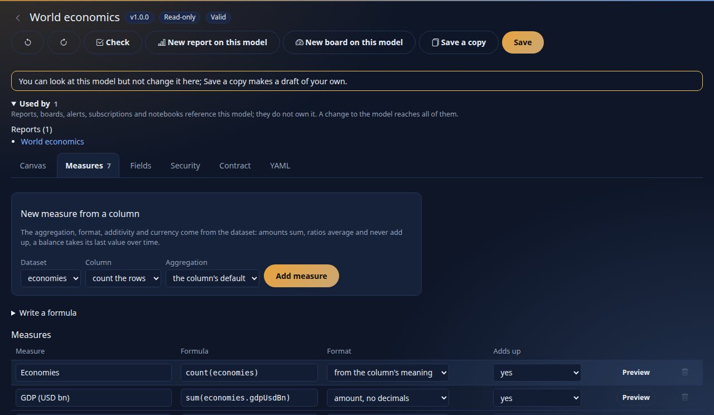

You should see `World economics`, `v1.0.0`, `Read-only` (it ships with Drishti: **Save a copy** makes one of your own) and `Valid`, **Used by** the
report **World economics**, and the seven **measures** (`Economies`, `GDP (USD bn)`, `Population (m)`, `GDP per capita (USD)`, `Average growth`,
`Average inflation`, `Average unemployment`), each a formula the model owns, so every report on it agrees. `GDP per capita (USD)` is
`ratio(sum(economies.GDP_USD_BN), sum(economies.POPULATION_M)) * 1000`: GDP over population, not an average of averages, so a region's figure is right. The
**Canvas** tab shows the one dataset the model reads, under the alias `economies`. Back on **Models**, under *Your datasets*, press **Open** on
**World economics: economies**.

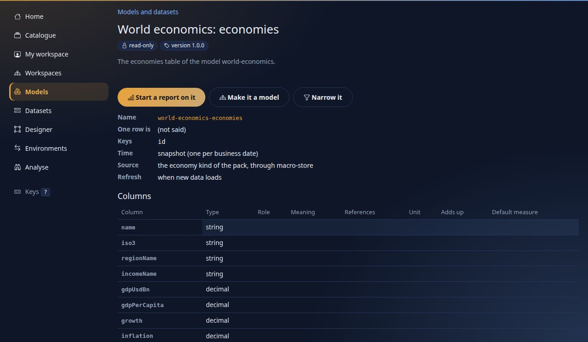

You should see the dataset `world-economics-economies` `1.0.0`: one row per economy (key `id`), time `snapshot (one per business date)`, read from
`the economy kind of the pack, through macro-store`, refreshed `when new data loads`, and its columns: the country's name, its ISO code (`iso3`, which
is what a map needs), World Bank region and income group and a few figures. The data is real and public (the World Bank, CC BY 4.0, through the
`world-economy` pack).

**Ask it a question** before drawing anything. **From the command line** (the token of tutorial 1), a **model query** groups by the region and asks
three measures, the biggest economies first:

```text
$ python3 tools/drishti.py bi mq --model world-economics@1 --select economies.REGION_NAME \
    --measures "GDP (USD bn),Population (m),GDP per capita (USD)" --sort="-GDP (USD bn)"
economies.REGION_NAME                               GDP (USD bn)  Population (m)  GDP per capita (USD)
-------------------------------------------------  ------------  --------------  --------------------
North America                                      33,098.79     383.50          86,306.87
East Asia & Pacific                                32,710.77     2,340.96        13,973.22
Europe & Central Asia                              32,262.10     932.48          34,598.00
Latin America & Caribbean                          7,327.57      666.55          10,993.23
Middle East, North Africa, Afghanistan & Pakistan  5,136.27      828.03          6,203.03
South Asia                                         4,578.02      1,692.26        2,705.28
Sub-Saharan Africa                                 2,213.29      1,318.05        1,679.22
7 row(s)  as of 2026-10-16  plan p_1050f114e2f1aee5
```

**As YAML**, the same question is a file you can keep and run with `python3 tools/drishti.py bi mq gdp-by-region.yaml`:

```yaml
mq: 1
model: world-economics@1
select: { fields: [economies.REGION_NAME], measures: [GDP (USD bn), Population (m), GDP per capita (USD)] }
sort: [{ by: GDP (USD bn), desc: true }]
```

and **over REST** it is `POST $DRISHTI_SERVER/api/v1/bi/mq` with that body as JSON (`{"mq": 1, "model": "world-economics@1", "select": {...}, "sort": [...]}`),
which answers the `columns`, the `rows` and a `meta` block with the as-of date and the plan. `python3 tools/drishti.py bi model list` lists every model
and dataset you may read (`world-economics@1  model  World economics  1.0.0  published`). Everything a report draws is a question like this, asked **as
you**: your row rules and masks apply, which is why two people can open one report and see different figures. (Your dates differ: the business date is
today's.)

## Step 2 · Start a report

Choose **Designer** in the rail. Choose the dataset **World economics**, give the report the title `My world report` and look at the form before you press the button.

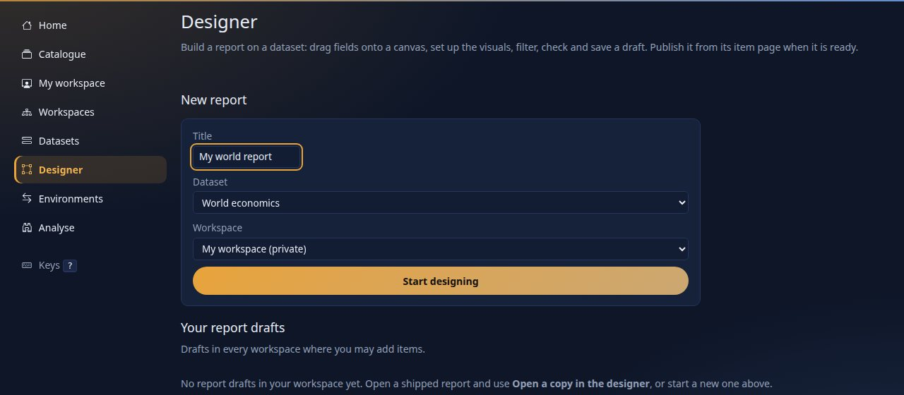

You should see the dataset chooser (every dataset you may open), the title box and the button **Start designing**. Press it.

You land in the designer: a canvas on a 12-column grid, a **Filters** pane, **Visualizations** (every kind of visual) and **Fields** (the dataset's columns and measures). The report is a draft in **My workspace**, which only you see.

Since 2.4.0 the designer sits in **BI Studio**, the shell the report, model and theme designers share: the **Explorer** of your items on the left (with
**New**), the items you opened as **tabs** above the canvas, and under it a **dock** with **Problems** (the server's check of your draft a second after each
change, each problem linked to its visual) and **Query** (the selected visual's model query and its SQL). The steps below work the same in it;
[BI_GUIDE.md section 26](../guides/BI_GUIDE.md#26-bi-studio-authoring-as-one-product-wave-c-240) is the tour, and
[REPORTS.md section 5](../guides/REPORTS.md#5-format) the Format pane, conditional formatting and themes.


## Step 3 · Two cards

Drag the measure `GDP (USD bn)` from **Fields** onto the canvas, then `Population (m)` beside it. (Dragging with the keyboard also works: focus a field and press Enter.)

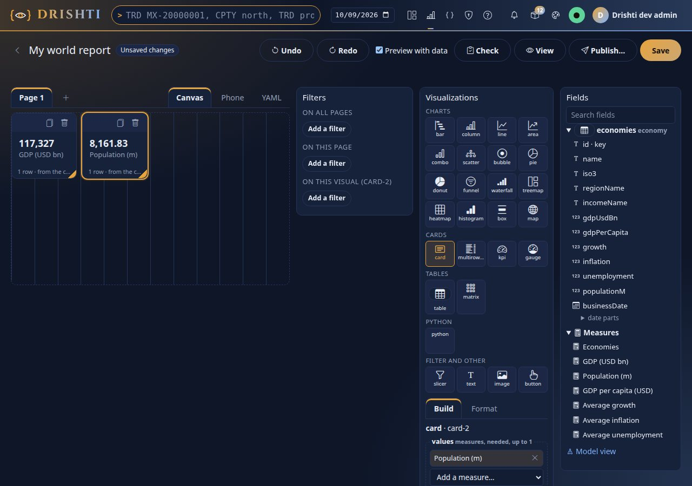

You should see two cards with real figures: `117,327` (billion dollars) and `8,161.83` (million people). A **measure alone becomes a card**; a column alone would become a table; a column with a measure becomes a bar. Under each card is the line the server answered with: rows, time
and the layer.

**From the command line** the two cards are one question with no field (and **in the YAML** each is a visual `{ type: card, wells: { values: [GDP (USD bn)] } }`):

```text
$ python3 tools/drishti.py bi mq --model world-economics@1 --measures "GDP (USD bn),Population (m)"
GDP (USD bn)  Population (m)
------------  --------------
117,326.82    8,161.83
1 row(s)  as of 2026-10-16  plan p_bb1fc09a9657bad8
```

## Step 4 · A map

Click an empty part of the canvas to let go of the selection, then click **map** in **Visualizations**. In **Build**, add `economies.ISO3` to the **location** well and `GDP per capita (USD)` to **values**.

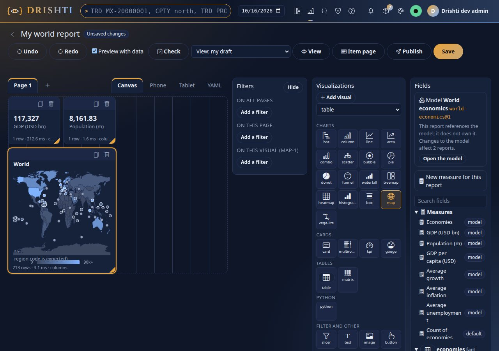

You should see the world shaded from dark to light by GDP per capita (the legend runs from 0 to `90k+`), the title `World` above it, and a note `Not on the map: CHI, XKX` under it: two codes the shapes do not know are **named, never dropped silently**. Small countries (Cayman Islands, Monaco)
are dots so they can be clicked. The shapes are Natural Earth, shipped with the console: nothing is fetched from the internet. The `location` well takes ISO country codes (`AUS`, `AU` or the English name), or ISO 3166-2 region codes (`AU-NSW`) for a map of one country's regions.

## Step 5 · A bar, a slicer, and where everything sits

Add a bar: with nothing selected click **bar**, put `economies.NAME` in **axis** and `GDP (USD bn)` in **values**. Add a slicer: click **slicer**, put `economies.REGION_NAME` in **field**, then open **Format** and set the mode to **dropdown**.
The visuals are stacked wherever there was room, so now place them. **In the UI**, drag a visual by its header and resize it by its corner (the places snap to the 12-column grid), and give the bar its **top 10** in the **Filters** pane: under *On this visual* press **Add a filter**, choose the field `economies.NAME`, the filter type **Top N**, *Keep the top* `10`, *with the* `highest`, *by measure* `GDP (USD bn)`, and press **Add the filter**. **From the YAML** (the exact way, and what both of these write), open the **YAML** tab: the report is text, and each visual has `at: { x, y, w, h }` on the 12-column grid. Give each one a title and a place, and give the bar a **top 10** filter
(a filter on the visual, `op: top`: the ten economies with the largest GDP):

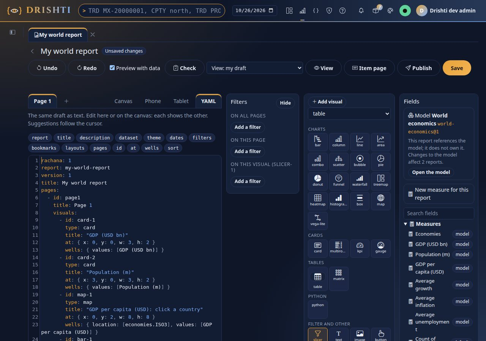

```yaml
- id: card-1
  type: card
  title: "GDP (USD bn)"
  at: { x: 0, y: 0, w: 3, h: 2 }
  wells: { values: [GDP (USD bn)] }
- id: map-1
  type: map
  title: "GDP per capita (USD): click a country"
  at: { x: 0, y: 2, w: 8, h: 8 }
  wells: { location: [economies.ISO3], values: [GDP per capita (USD)] }
- id: bar-1
  type: bar
  title: "Largest economies (GDP, USD bn)"
  at: { x: 8, y: 2, w: 4, h: 8 }
  wells: { axis: [economies.NAME], values: [GDP (USD bn)] }
  filters: [{ field: economies.NAME, op: top, n: 10, by: GDP (USD bn) }]
```

You should see the YAML with `at:` lines and no complaints (a mistake is reported with its code, and `DRS-9030` is a place off the grid). Switch back to **Canvas**. (You can also drag a visual by its header and resize it by its corner; the YAML is simply the exact way.)

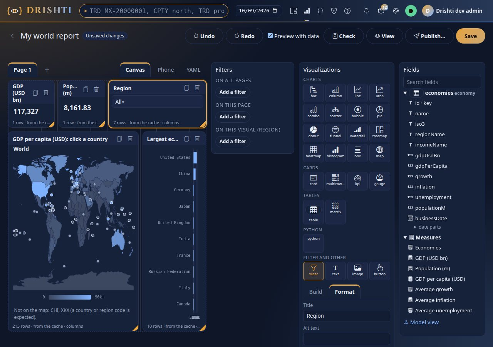

You should see two cards, a `Region` dropdown, the map on the left and ten bars on the right. Press **Save** (or `Ctrl+S`); the status next to the title says `Saved`. Press **Check**: it adds accessibility checks (a visual without a title or alt text is flagged for screen readers).

## Step 6 · View it, click, drill

Press **View**: the report opens as a reader sees it.

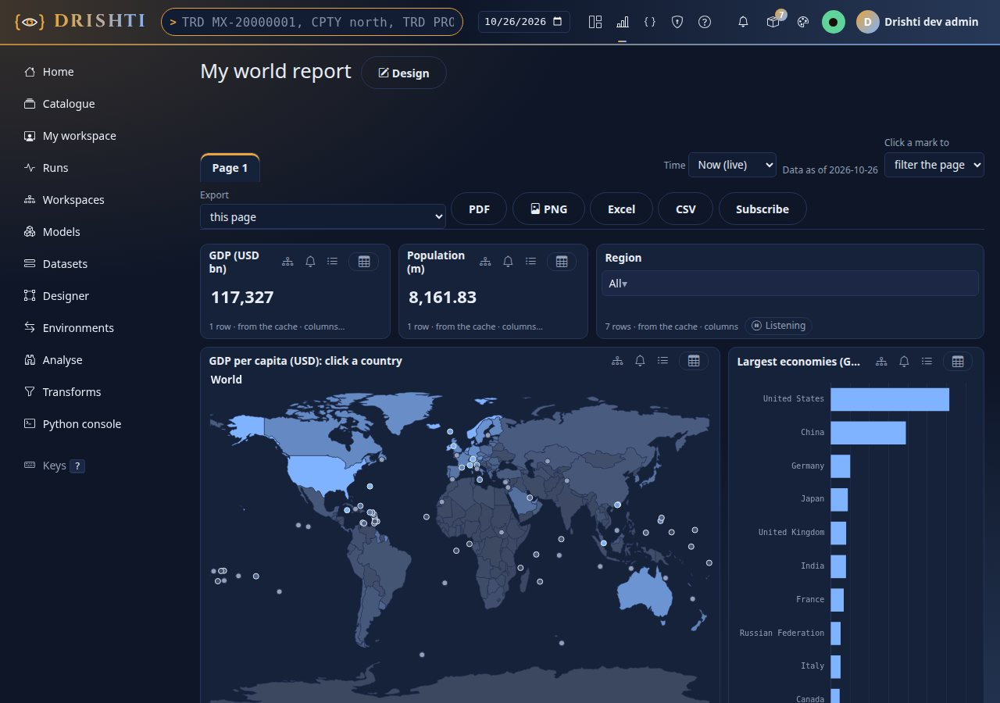

You should see the toolbar (business date, *Click a mark to filter the page / highlight*, **Reset**), the **Export** bar (PDF, PNG, Excel, CSV, Subscribe; tutorial 11), and your visuals drawn with real data. Now **click Australia** on the map.

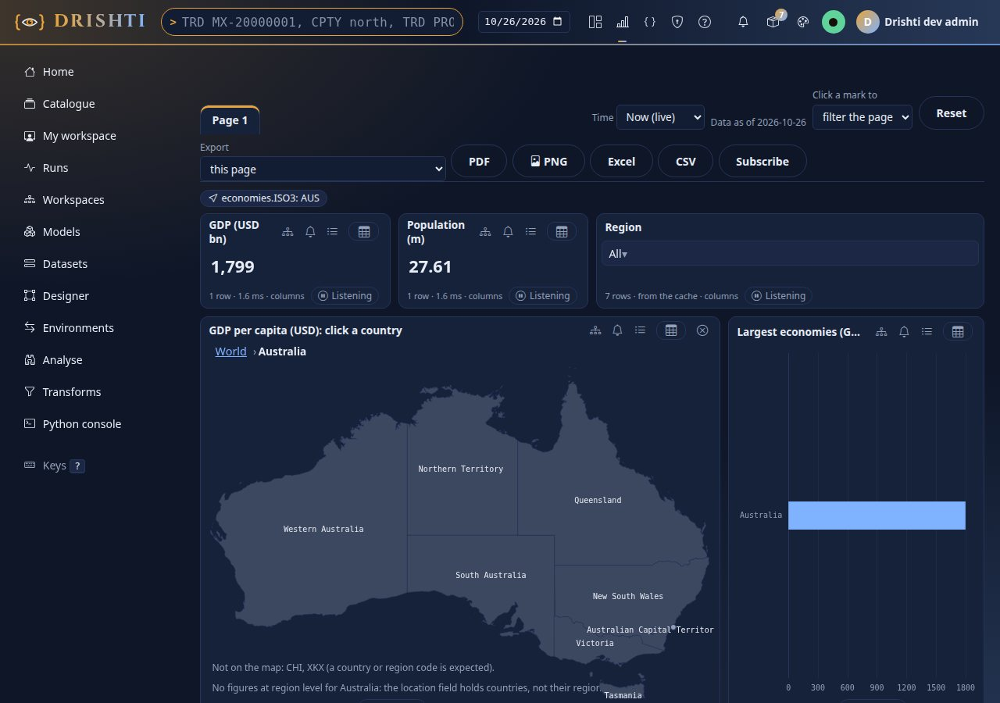

You should see three things at once. A **chip** under the toolbar, `economies.ISO3: AUS`, says what is filtering the page. The cards answer for Australia alone (`1,799` billion dollars of GDP, `27.61` million people): this is the **cross-filter**. And the map **drilled**:
its title bar says **World › Australia**, and the shapes of Australia's states and territories replace the world.

The cross-filter is a filter on the click's field; **from the command line** it is `--where`:

```text
$ python3 tools/drishti.py bi mq --model world-economics@1 --select economies.ISO3,economies.NAME \
    --measures "GDP (USD bn),Population (m)" --where economies.ISO3=AUS
economies.ISO3  economies.NAME  GDP (USD bn)  Population (m)
--------------  --------------  ------------  --------------
AUS             Australia       1,798.52      27.61
1 row(s)  as of 2026-10-16  plan p_8ed71c662895f1ed
```

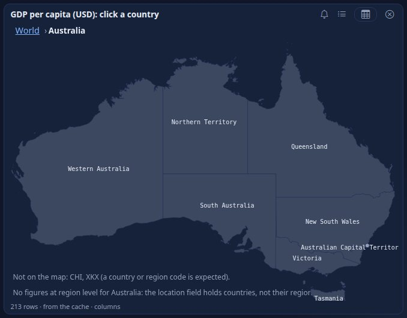

Under the map you read `No figures at region level for Australia: the location field holds countries, not their regions.` That is honest: this dataset has one row per **country**. To shade regions give the map a field of ISO 3166-2 codes (`AU-NSW`, `US-CA`) and the same visual
colours the states by their own figure. Press **World** in the breadcrumb.

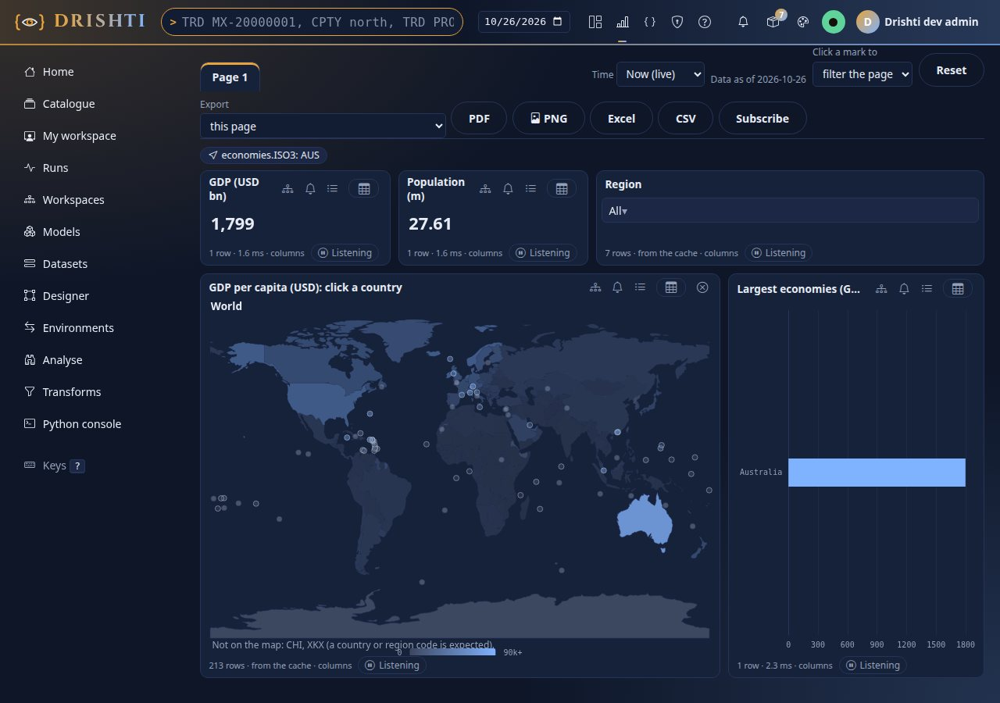

You should see the world again and the chip still in place: the breadcrumb moves the map, the chip (or **Reset**, or `Esc`) clears the filter. Click a second country with `Ctrl` held to add it to the selection.

## Step 7 · Publish

A draft in **My workspace** is private. To publish, move it to a **shared workspace** (that is where people are members and where review can be required). Choose **Workspaces** and fill in **New workspace**.

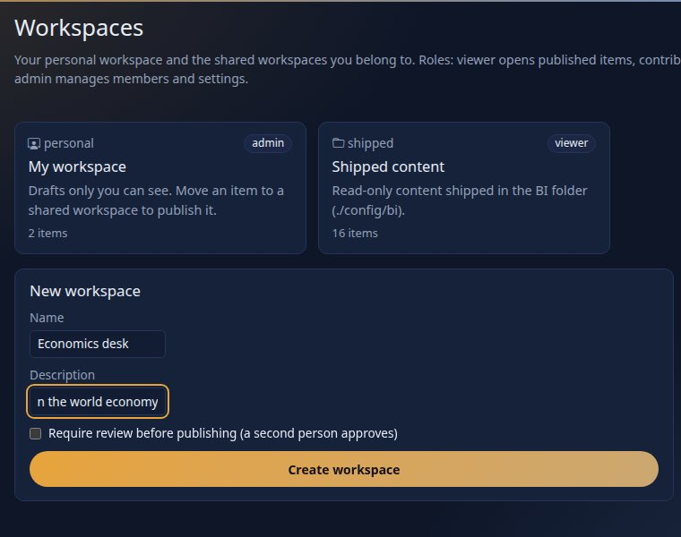

You should see the form; leave *Require review before publishing* unticked for now and press **Create workspace** (a workspace that requires review needs a second person to approve, which is [tutorial 13](13-govern-bi.md)). Open your report's page (**My workspace**, then the report), press **Move…**, pick `Economics desk` and press **Move**.

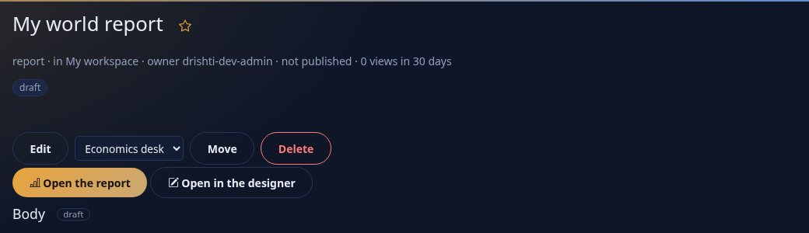

You should see the report listed under the new workspace. Type a note and press **Publish**.

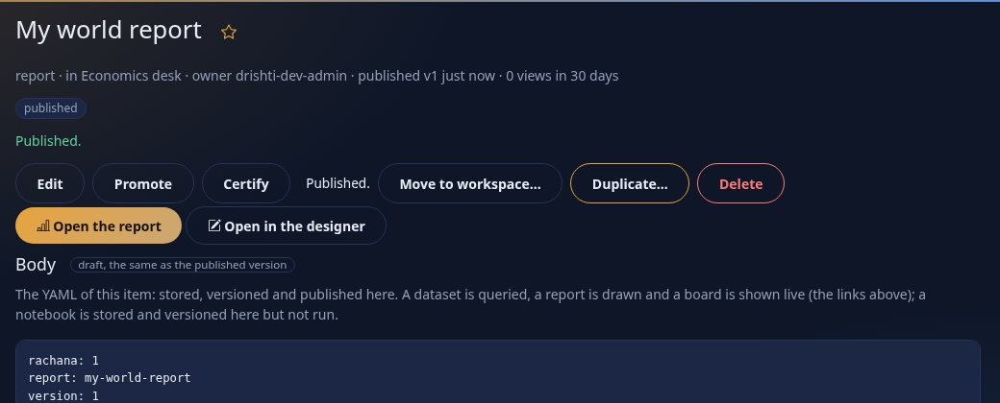

You should see `Published.` and `published v1 just now`. Each publish makes the next numbered version; the draft carries on separately. Open the **Catalogue**, the one place every published item is found, and search `world`.

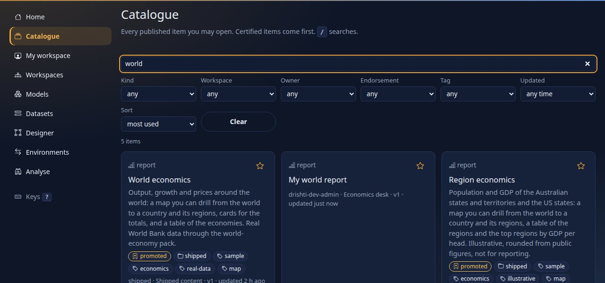

You should see your report beside the shipped one, with its workspace and owner. The same list from the command line:

```text
$ python3 tools/drishti.py bi catalogue list
id                                                 kind     endorsed  status    ver  title
file:report:cashflow-ladder                         report   promoted  published v1   Cashflow ladder  (Shipped content, shipped)
file:model:counterparty-exposure                    model    promoted  published v1   Counterparty exposure  (Shipped content, shipped)
...
bi-7f8269ba14                                       report   none      published v1   My world report  (Economics desk, drishti-dev-admin)
...
file:report:world-economics                         report   promoted  published v1   World economics  (Shipped content, shipped)
file:dataset:world-economics-economies              dataset  promoted  published v1   World economics: economies  (Shipped content, shipped)
45 item(s)
```

```text
$ python3 tools/drishti.py bi workspace list
id                            role          items  name
u-drishti-dev-admin-eb6f      admin             0  My workspace  [personal]
economics-desk                admin             1  Economics desk
shipped                       viewer           44  Shipped content
```

You should see the report with `published v1` among the 44 shipped items (nine models, their datasets, nine reports, two boards, a notebook and four Python items), and the workspace with one item. (Ids and dates differ on your machine.)

## Step 8 · Filter like Power BI

The sample **Trades overview** has a second page, **By product**, built to show slicers. Open it from the Catalogue (or type `BI trades overview <GO>`) and choose the tab **By product**.

A **slicer** is a visual that holds choices and filters other visuals. It has a mode and a scope. **In the UI** select the slicer and open **Format**: **Mode** is a choice of *list*, *dropdown*, *range* and *relative date*, and **Filters** is *this page* or *every page*. **In the YAML** the same two settings are:

```yaml
- { id: pick-product, type: slicer, title: Product type, wells: { field: [trade.PRODUCT_TYPE] }, format: { mode: dropdown, scope: page } }
```

| `format.mode` | What it looks like | Use it for |
|---|---|---|
| `list` (the default) | a checkbox list with a search box, always open | a field with a handful of values (desks, currencies) |
| `dropdown` | a closed box that opens a **floating** checkbox list with a search box, **Select all** and **Clear** | a field with many values (product types: 130 across the three source systems) |
| `range` | two boxes, *From* and *To* | a number or a date field (notional, trade date) |

| `format.scope` | A choice filters |
|---|---|
| `page` (the default) | the visuals of this page |
| `report` | every page of the report, so a choice made on one page holds on the next (the Counterparty risk sector slicer) |

All three together on one page (the YAML is [data/slicer-kinds.report.yaml](data/slicer-kinds.report.yaml); paste it into **My workspace → New item** or into the designer's YAML tab to try it):

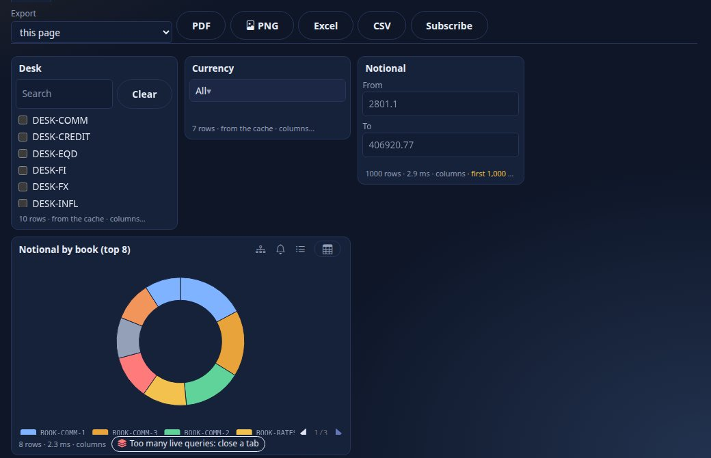

You should see the desks as an open list with its search box and **Clear**, the currency as a closed dropdown, the notional as *From* and *To* boxes, and the donut. **Open the Product type dropdown** on the Trades overview and type `SWAP` in its search box.

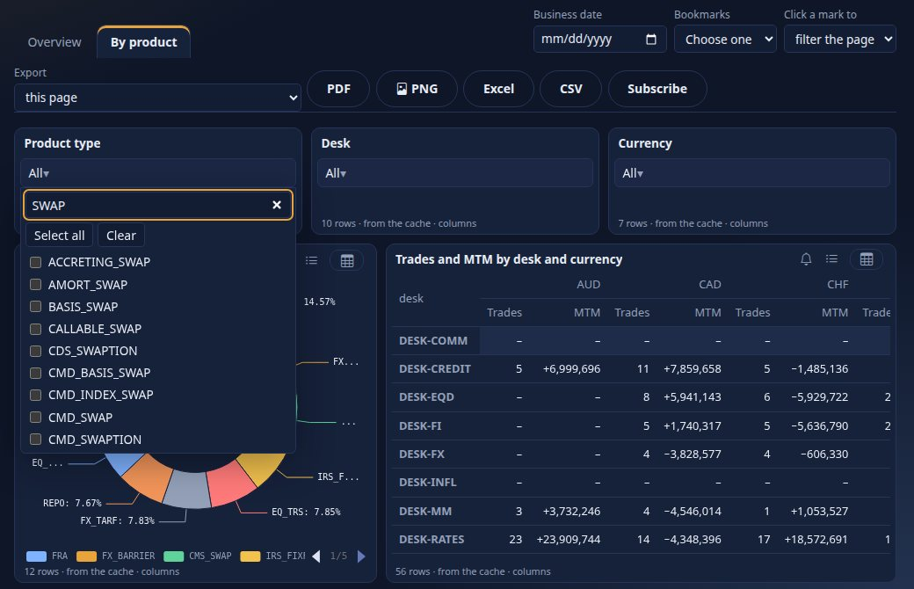

You should see the list **floating over** the visuals below it (it does not push the page down), narrowed to the product types that contain `SWAP`, each with a tick box. **Select all** and **Clear** tick and untick the values in one press. Tick `AMORT_SWAP` and `BASIS_SWAP`, then click outside.

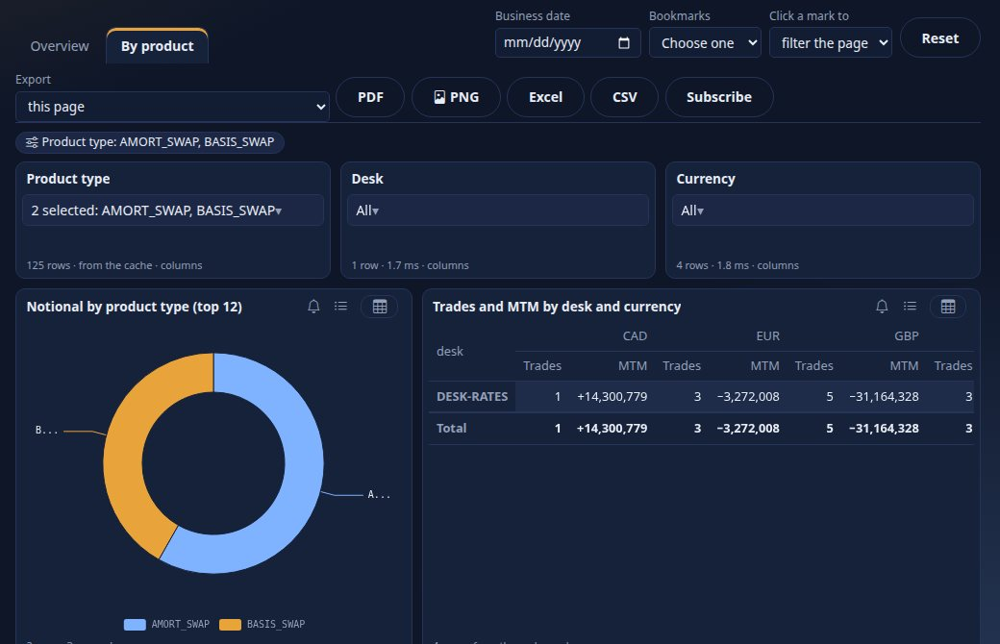

You should see `2 selected: AMORT_SWAP, BASIS_SWAP` in the box, a **chip** `Product type: AMORT_SWAP, BASIS_SWAP` under the toolbar, the Desk and Currency slicers narrowed to values that still exist (a slicer never filters itself; **other** slicers filter it), a donut of two slices (72 trades each) and a matrix of one desk, `DESK-RATES`, in four currencies (CAD, EUR, GBP, USD). **Reset** clears all of it.

**From the command line** the matrix's question with the slicer's choice is a filter (`--where` once per value is an *and*; a list of values is the YAML's `in`):

```text
$ python3 tools/drishti.py bi mq --model trades-basic@1 --select trade.DESK,trade.CURRENCY --measures Trades --where trade.PRODUCT_TYPE=AMORT_SWAP
trade.DESK  trade.CURRENCY  Trades
----------  --------------  ------
DESK-RATES  CAD             12
DESK-RATES  EUR             12
DESK-RATES  GBP             24
DESK-RATES  USD             24
4 row(s)  as of 2026-10-16  plan p_d924968cb041d34d
```

The slicer's two choices together, as a file (`python3 tools/drishti.py bi mq both-swaps.yaml`):

```yaml
mq: 1
model: trades-basic@1
select: { fields: [trade.DESK, trade.CURRENCY], measures: [Trades] }
where: [{ field: trade.PRODUCT_TYPE, op: in, values: [AMORT_SWAP, BASIS_SWAP] }]
```

```text
trade.DESK  trade.CURRENCY  Trades
----------  --------------  ------
DESK-RATES  CAD             12
DESK-RATES  EUR             36
DESK-RATES  GBP             60
DESK-RATES  USD             36
4 row(s)  as of 2026-10-16  plan p_a58f9885efd49c3b
```

**Taming a busy donut.** The donut on this page could have about forty product types. It does not draw forty slices: it carries a **top filter**. **In the UI** that is the **Filters** pane: *On this visual*, **Add a filter**, filter type **Top N**, how many, highest or lowest, and the measure to rank by:

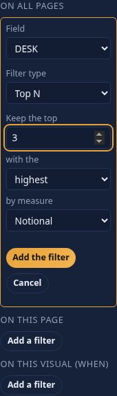

**In the YAML** it is one line (both write the same):

```yaml
- { id: share, type: donut, title: "Notional by product type (top 12)", wells: { axis: [trade.PRODUCT_TYPE], values: [Notional] },
    filters: [{ field: trade.PRODUCT_TYPE, op: top, n: 12, by: Notional }] }
```

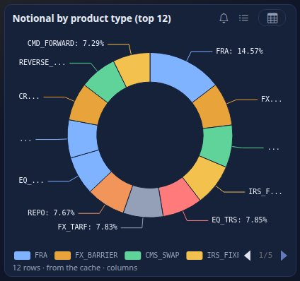

You should see twelve slices and the title `(top 12)`, ENDUR's `ComSwap` the largest (`500,779,109,245` of notional), then `FRA` and `Commodity`. The server ranks the product types **in the context of the slicers**, so the top twelve of the swaps you chose is a different twelve from the top twelve overall. `n` is how many, `by` the measure to rank by.

**Bookmarks** save a state. **In the UI**, in the designer, select nothing (click the empty canvas) and open **Format**: under **Bookmarks** type a name, set the slicer choices you want kept (a relative-date slicer offers its windows), and press **Save this page as a bookmark**; it keeps the page, the filters of the Filters pane and those slicer choices. Each saved bookmark can be renamed in place, updated from the page's filters again, or removed:

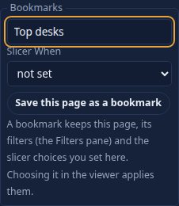

**In the YAML** they are `bookmarks:` (a name, a page, slicer choices and filters). Either way they appear in the **Bookmarks** box of the viewer's toolbar. On the **Overview** page choose the bookmark `FX desk only`.

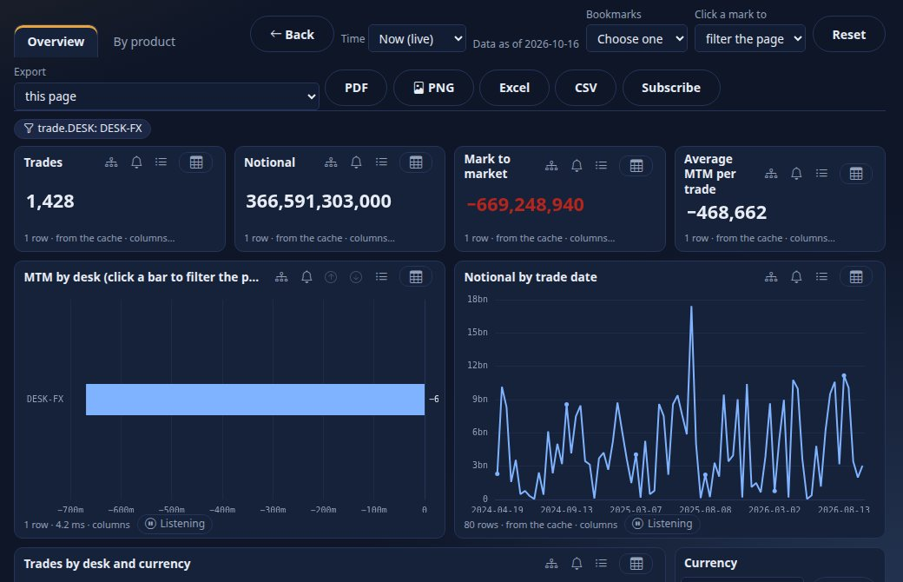

You should see the page filtered to `DESK-FX` (`1,428` trades, notional `366,591,303,000`, MTM `-669,248,940`) with a chip, as if you had made the choice yourself. **From the command line**: `python3 tools/drishti.py bi mq --model trades-basic@1 --select trade.DESK --measures Trades,Notional,MTM --where trade.DESK=DESK-FX` prints the same three numbers. **In the YAML** the bookmark is `- { name: FX desk only, page: overview, slicers: {}, filters: [{ field: trade.DESK, op: in, values: [DESK-FX] }] }` (`config/bi/reports/trades-overview.report.yaml`). A bookmark is written in the designer, not captured from what a reader has chosen on screen in the viewer.

**Slicer or click?** Both filter. A **slicer** is a choice you make on purpose from a list, it stays visible, and it can be page or report wide. A **click on a mark** (a bar, a slice, a country) is exploring: it filters the **other** visuals of the page, it highlights what you picked, and it is gone when you click again.
Click the `DESK-FX` bar on the Overview page:

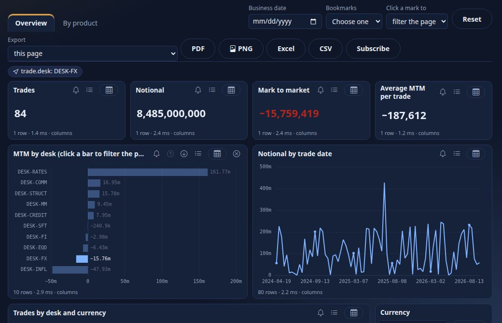

You should see the same figures as the bookmark gave. *Click a mark to* **highlight** (in the toolbar) keeps the whole answer on bar and column charts and draws the chosen share over it instead of filtering.

## Step 9 · Counterparty risk: slicers across packs, and drill-through

Open the shipped report **Counterparty risk**. It reads the model **Trading and counterparty risk** (`trading-risk@1`), which joins three packs (trade valuations from `market-risk`, counterparties, desks and books from `core`, netting sets and their computed exposure from `counterparty-risk`), and its two slicers, Sector and Country, are `scope: report`: they filter every page and reach the trades and the netting sets **through the relationships**.

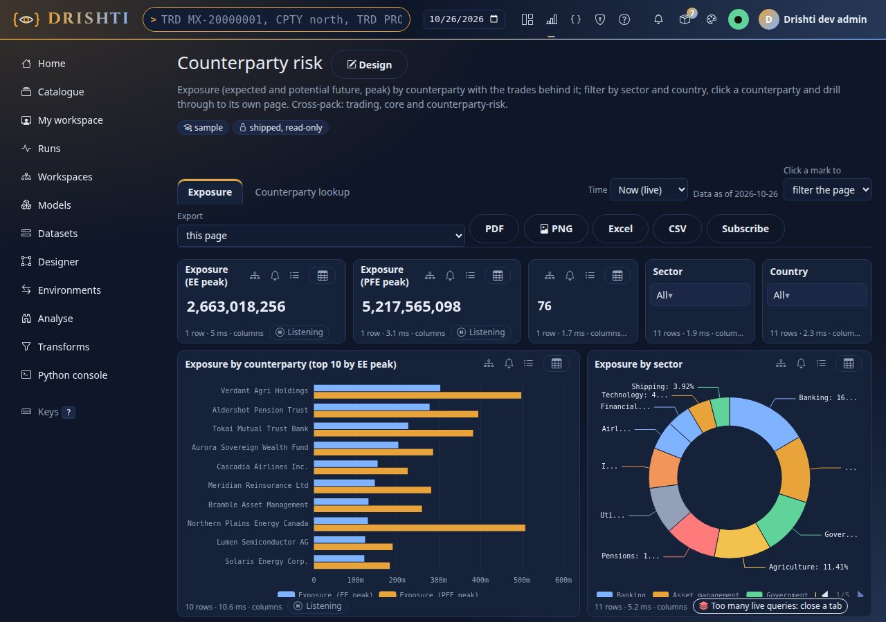

You should see exposure cards (`2,613,297,860` EE peak, `4,823,023,222` PFE peak, `76` netting sets), the two dropdown slicers and a bar of the ten counterparties with the highest expected exposure (a **top 10** filter again), Verdant Agri Holdings first. The exposure is the exposure engine's: its official end-of-day results for the date (since 2.9.0 a netting set no longer stores it). EE peak adds up the netting sets' computed peaks; PFE peak is each counterparty's own peak 95% PFE (its sets netted path by path), never a sum of its sets' PFEs. The demo's run covers 73 of the 76 netting sets (22 of the 24 counterparties), so three sets count as netting sets but carry no exposure. Click the bar of **Verdant Agri Holdings**.

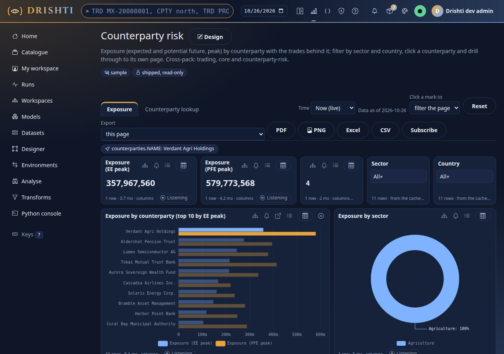

You should see a chip, the cards narrowed to that counterparty (`357,967,560` expected exposure, `579,773,568` PFE, `4` netting sets) and, in the bar's header, a **drill-through** button. Press it.

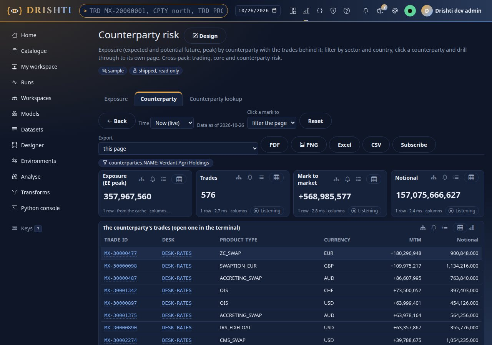

You should see a second page, **Counterparty**, with the name carried in as a chip **and in the address** (so the link can be shared), a **Back** button, four cards (`576` trades, notional `157,075,666,627`) and a table of its trades, highest MTM first, whose ids are links: `MX-30000477` (a MUREX zero-coupon swap of DESK-RATES) opens that trade's view in the terminal.

**From the command line**, the bar and the drill-through page are two model queries:

```text
$ python3 tools/drishti.py bi mq --model trading-risk@1 --select counterparties.NAME \
    --measures "Exposure (EE peak),Exposure (PFE peak)" --sort="-Exposure (EE peak)" --limit 3
counterparties.NAME            Exposure (EE peak)  Exposure (PFE peak)
-----------------------------  ------------------  -------------------
Verdant Agri Holdings          357,967,560.00      579,773,568.00
Aldershot Pension Trust        276,416,536.00      395,309,044.00
Lumen Semiconductor AG         246,199,964.00      378,348,501.00
3 row(s)  as of 2026-10-26
$ python3 tools/drishti.py bi mq --model trading-risk@1 --select trades.TRADE_ID,trades.DESK,trades.PRODUCT_TYPE --measures MTM \
    --where "counterparties.NAME=Verdant Agri Holdings" --sort=-MTM --limit 3
trades.TRADE_ID  trades.DESK  trades.PRODUCT_TYPE  MTM
---------------  -----------  -------------------  --------------
MX-30000477      DESK-RATES   ZC_SWAP              180,296,948.16
MX-30000098      DESK-RATES   SWAPTION_EUR         109,975,217.40
MX-30000487      DESK-RATES   ACCRETING_SWAP       86,607,994.99
3 row(s)  as of 2026-10-26
```

**In the YAML** the drill-through is two lines of `config/bi/reports/counterparty-risk.report.yaml`: the bar's `drillthrough: { page: counterparty, field: counterparties.NAME }` and the target page's `drillthrough: { fields: [counterparties.NAME] }`.

## Step 10 · On a phone

Open your report on a phone-width window (390 px).

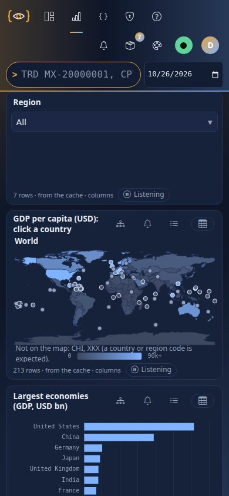

You should see one column in reading order, the map at the full width, targets at least 44 pixels high and no sideways scroll. A report can also have a **phone layout** of its own (which visuals, in what order): [tutorial 16](16-embed-drishti.md) and the designer's **Phone** tab.

## Step 11 · Two fact tables in one model

Everything so far added up **one** table. The question "what is each counterparty's one-day P&L next to its exposure?" needs two: P&L is a
column of the **trades** (one row per trade valuation) and exposure a column of the **netting sets** (one row per netting set). Adding them up in
one table would count a netting set's exposure once for every trade under it. A **model** keeps each as a **fact table** of its own: each is added
up alone at the visual's fields, and the two answers are joined on the dimension both reach, here the counterparty.

**In the UI.** Choose **Models** and open **Trading and counterparty risk** (`trading-risk`, `model 1.0.0 · published`) in the designer, on the
**Canvas** tab.

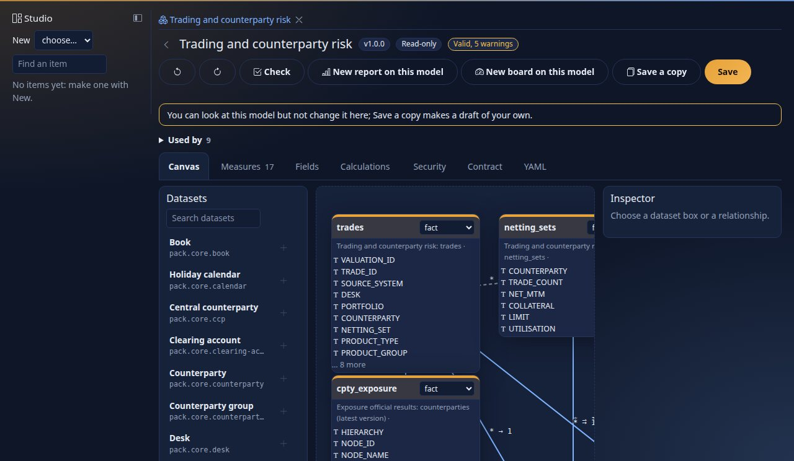

You should see the datasets under their aliases: the **facts** `trades` and `netting_sets`, and the **dimensions** `counterparties`, `desks`
and `books`, with a line for each relationship (from the many side to the one side): `trades.COUNTERPARTY → counterparties.id` and
`netting_sets.COUNTERPARTY → counterparties.id`, the two paths that meet at the counterparty. (`trades.NETTING_SET → netting_sets.id` is an
**inactive** relationship, `active: false`, so the two facts are never joined row to row.) Two more facts sit beside them, `set_exposure`
and `cpty_exposure` (scroll the canvas to see them all): the exposure engine's official end-of-day results for each netting set and each
counterparty (the datasets `counterparty-exposure-official-netting-sets` and `-counterparties`), related to `counterparties.id` the same way;
since 2.9.0 the netting-set record no longer stores exposure. Press the **Measures** tab.

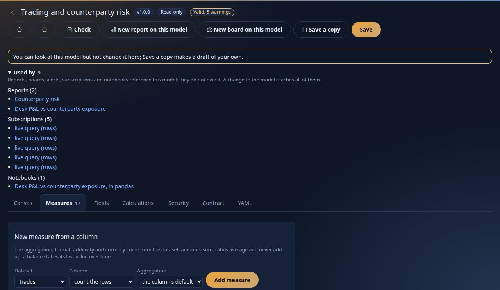

Scroll to the list. You should see `P&L 1d` (`sum(trades.PNL_1D)`), `Exposure (EE peak)` (`sum(set_exposure.PEAK_EE)`: the netting sets'
computed peaks), `Exposure (PFE peak)` (`sum(cpty_exposure.PEAK_PFE_95)`: each counterparty's own) and `P&L per exposure`,
`measure('P&L 1d') / measure('Exposure (EE peak)')`: the ratio of the two sums, whatever the grouping. Now open the report **Desk P&L vs
counterparty exposure** from the catalogue.

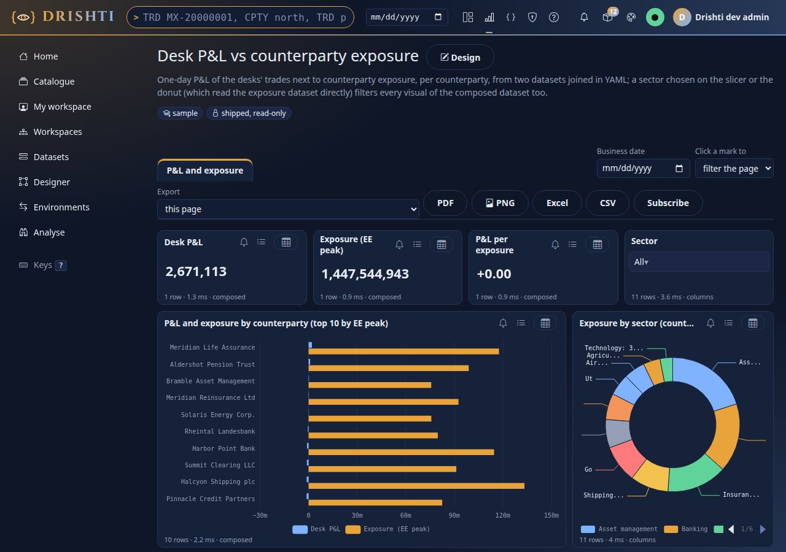

You should see `Desk P&L` `91,932,705`, `Exposure (EE peak)` `2,613,297,860` and the ratio `0.04`, the ten counterparties with the most exposure
as pairs of bars, a donut of exposure by sector and the table of every counterparty. In the Sector slicer choose **Banking**.

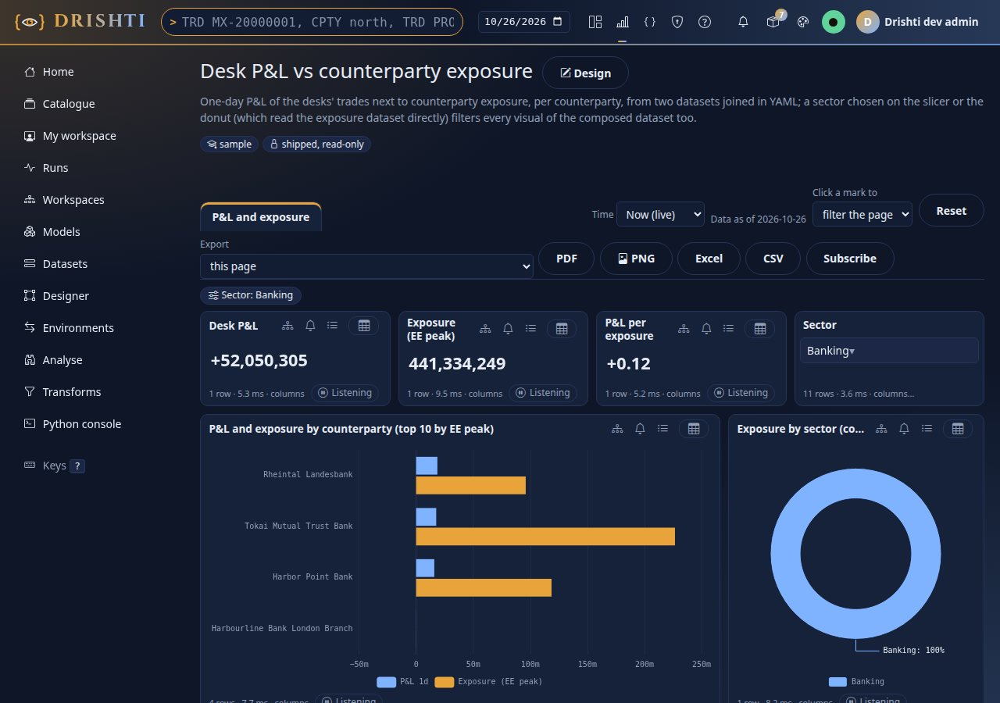

You should see a chip `Sector: Banking`, the cards narrowed to the banks (`Desk P&L` `51,389,455`, exposure `430,980,479`), four banks in the
bar chart (Rheintal Landesbank, Tokai Mutual Trust Bank, Harbor Point Bank, and Harbourline Bank London Branch, whose exposure, `67,280`, is too small
to see as a bar) and the donut a single slice: one
slicer on the dimension filters **both** facts. Click a slice of the donut instead and the same happens. Open the report as a desk head and the P&L
shrinks to the trades of your desks (the exposure does not: the model says `may-see-all` for the netting sets and their exposure); open it as an analyst and the
names read `•••` (the bars are ranked by the counterparty's **id**, which is not masked, so the report still works).

**From the command line** the table of the report is one model query; the server says how it answered (the two facts aggregated alone, then
joined):

```text
$ python3 tools/drishti.py bi mq --model trading-risk@1 --select counterparties.NAME,counterparties.SECTOR \
    --measures "P&L 1d,Exposure (EE peak),P&L per exposure" --sort="-Exposure (EE peak)" --limit 4 --json | jq -c '.rows[], .meta.warnings'
["Verdant Agri Holdings","Agriculture",-1922002.510000001,357967560.0,-0.005369208623261843]
["Aldershot Pension Trust","Pensions",9940482.839999989,276416536.0,0.03596196878756917]
["Lumen Semiconductor AG","Technology",4904332.2199999895,246199964.0,0.019920117535029327]
["Tokai Mutual Trust Bank","Banking",17466808.070000015,215361523.0,0.08110459021038784]
["2 fact tables, each aggregated alone at the query's fields and then joined: [trades, counterparties, set_exposure]","a measure that combines measures of different grains is worked out over the joined results: P&L per exposure"]
```

**In the YAML** (`config/bi/models/trading-risk.model.yaml`), the part that makes it work:

```yaml
datasets:
  trades:         { dataset: trading-risk-trades, role: fact }
  netting_sets:   { dataset: trading-risk-netting-sets, role: fact }
  set_exposure:   { dataset: counterparty-exposure-official-netting-sets, role: fact }    # the computed exposure (2.9.0)
  cpty_exposure:  { dataset: counterparty-exposure-official-counterparties, role: fact }
  counterparties: { dataset: trading-risk-counterparties, role: dimension }
relationships:                  # from the MANY side to the ONE side
  - { from: trades.COUNTERPARTY, to: counterparties.id }
  - { from: trades.NETTING_SET, to: netting_sets.id, active: false }
  - { from: netting_sets.COUNTERPARTY, to: counterparties.id }
  - { from: set_exposure.COUNTERPARTY, to: counterparties.id }
  - { from: cpty_exposure.COUNTERPARTY, to: counterparties.id }
measures:
  P&L 1d:             { expr: "sum(trades.PNL_1D)", format: signed0 }
  Exposure (EE peak): { expr: "sum(set_exposure.PEAK_EE)", format: amount0 }        # a reporting sum of the sets' computed peaks
  Exposure (PFE peak): { expr: "sum(cpty_exposure.PEAK_PFE_95)", format: amount0 }  # the counterparty's own row, never a sum of its sets' PFEs
  P&L per exposure:   { expr: "measure('P&L 1d') / measure('Exposure (EE peak)')", format: signed2 }
```

and the report (`config/bi/reports/pnl-vs-exposure.report.yaml`) only says `model: trading-risk@1`. When the two numbers live in **two models**
(each with its own row rules), a report can still read both side by side and link their fields: that is [tutorial 18](18-several-datasets-in-one-report.md).
The same table made by a Python Transform is in [tutorial 14](14-python-and-analyse.md); the reference is
[BI_MODEL_SPEC.md](../architecture/BI_MODEL_SPEC.md) and [REPORTS.md section 16](../guides/REPORTS.md#16-reports-over-several-datasets).

## Step 12 · Relative dates, a tablet, and a view inside a report

Three things a real report needs. Each is a few controls in the designer, and each is also a few lines of YAML (**In the UI**: build it in the designer; **in the YAML**: open **My workspace → New item**, kind *report*, paste, **Save draft**, then **View**; the two write the same text).

**A slicer that says "last 4 weeks".** A slicer on a date column can offer named windows instead of values. The server works them out from the report's date and the business-day calendar, so the same name means the same dates on the screen, in an export and in a subscription.

**In the UI:** drag the date field (`trade.TRADE_DATE`) onto the canvas, choose **slicer**, open **Format** and set **Mode** to *relative date (a date field)*. Two more controls appear: **Starts as** (the window used until a reader chooses; it is the `default`) and **Windows it offers** (a tick for each of the sixteen names; unticking one narrows the list, the `options`).

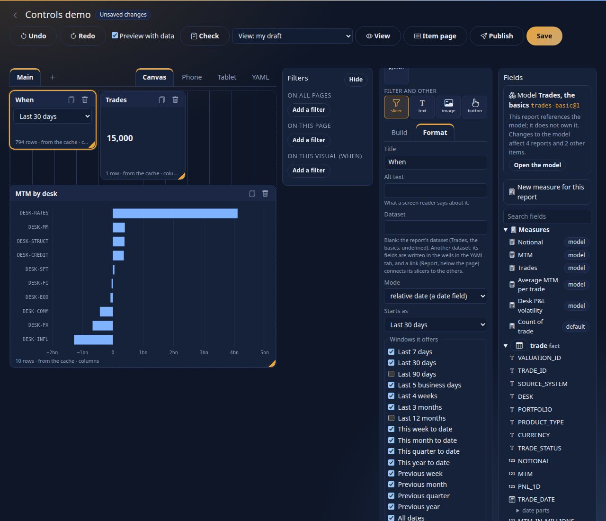

**In the YAML:**

```yaml
rachana: 2
report: relative-dates
title: Relative dates
model: trades-basic@1
pages:
  - id: main
    title: Main
    visuals:
      - { id: when, type: slicer, title: When, at: { x: 0, y: 0, w: 4, h: 3 }, wells: { field: [trade.TRADE_DATE] }, format: { mode: relative-date, default: last-30-days } }
      - { id: count, type: card, title: Trades, at: { x: 4, y: 0, w: 4, h: 3 }, wells: { values: [Trades] } }
      - { id: mtm, type: card, title: Mark to market, at: { x: 8, y: 0, w: 4, h: 3 }, wells: { values: [MTM] } }
      - { id: desk, type: bar, title: MTM by desk, at: { x: 0, y: 3, w: 12, h: 6 }, wells: { axis: [trade.DESK], values: [MTM] } }
```

**From the command line**, check it before saving (`Check`, nothing stored) and ask what the window holds: *last 4 weeks* is the 28 days
ending on the report's date, 2026-09-19 to 2026-10-16 here, of `TRADE_DATE`:

```text
$ jq -Rs '{yaml: .}' relative-dates.report.yaml | curl -s -X POST -H "Authorization: Bearer $DRISHTI_TOKEN" \
    -H 'Content-Type: application/json' -d @- $DRISHTI_SERVER/api/v1/bi/reports/validate | jq -c '{valid, problems}'
{"valid":true,"problems":[]}
$ python3 tools/drishti.py bi mq relative-window.yaml
Trades  MTM
------  -------------
227     73,422,045.85
1 row(s)  as of 2026-10-16  plan p_d7fa7cdebfaae903
```

```yaml
# relative-window.yaml: the window the slicer works out, as an explicit filter
mq: 1
model: trades-basic@1
select: { measures: [Trades, MTM] }
where: [{ field: trade.TRADE_DATE, op: between, values: [2026-09-19, 2026-10-16] }]
```

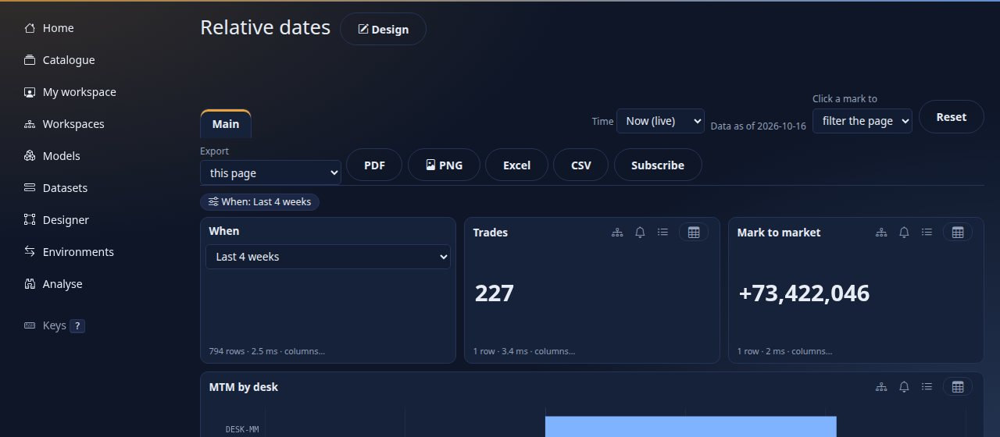

You should see the slicer's dropdown (the report's `default: last-30-days` is chosen until you pick another) and, after choosing **Last 4 weeks**, a chip `When: Last 4 weeks` and cards narrowed to the `227` trades booked in the four weeks ending on the report's date (MTM `+73,422,046`; the whole book is `15,000` trades). Your count depends on the day you built the lake: the trade dates stay, the business dates move. The names are `last-N-days`, `last-N-business-days`, `last-N-weeks`, `last-N-months`, `this-week|month|quarter|year` (to date), `previous-...` and `all`: [REPORTS.md section 6.1](../guides/REPORTS.md#61-the-relative-date-slicer).

**A tablet layout.** A phone gets one column ([step 10](#step-10--on-a-phone)); a tablet (up to 1024 px) can get two, with some visuals across:

```yaml
layouts:
  tablet:
    main:
      order: [desk, count, mtm]                     # first, in this order (the visuals' ids)
      wide: [desk]                                  # the whole width; the others take half
      span: { desk: 5 }                             # heights in grid rows
```

**In the UI** open the draft in the designer and press the **Tablet** tab (the **Phone** tab is the same for a phone). Every key above has a control there: the arrows or a drag set the `order`, **Hide** hides a visual, **Wide** is `wide` (tablet only) and **Rows** is `span`:

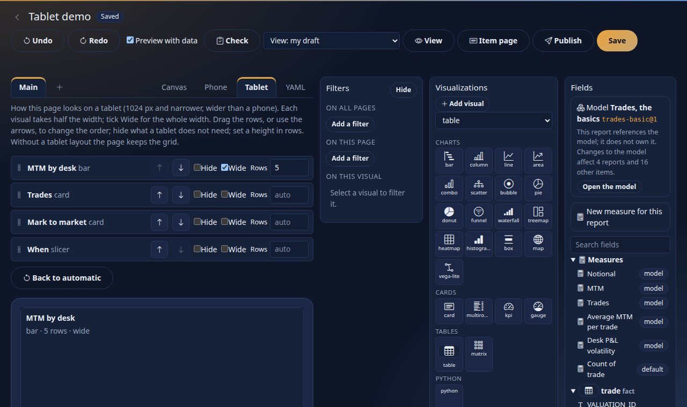

You should see the visuals in tablet order with **Hide**, **Wide** and **Rows**, and a preview below. Then open the report on an 820 px screen:

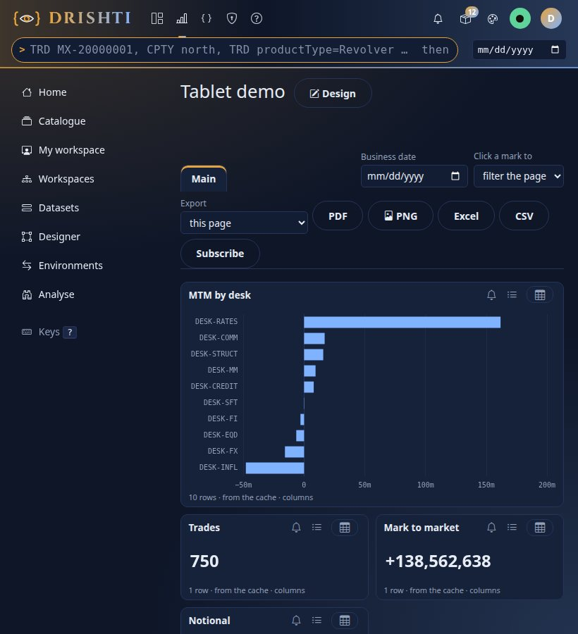

You should see the bar the whole width, then the cards in two columns. A phone, or a desktop, is not affected. **From the command line** there is no layout command: the layout is part of the report's YAML, so `python3 tools/drishti.py bi item new me relative-dates.report.yaml` saves the whole report, `layouts:` included, as a draft in your own workspace (`me`), and `bi item save <id> FILE` saves a changed file over it.

**A counterparty's own view inside the report.** The sample **Counterparty risk** has a page *Counterparty lookup*: a bar of the ten largest counterparties and, beside it, a visual of `type: entity-view` with `wells: { key: [counterparties.id] }`. Open it and click a bar:

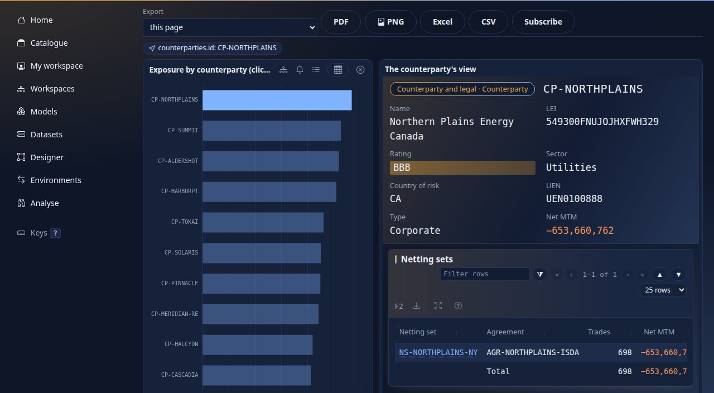

You should see the counterparty's own **Drishti view** (its name, rating, net MTM and netting sets) in the frame beside the bar, with a chip `counterparties.id: CP-VERDANT` (the first bar: the largest computed expected exposure). It is the view page built **for you**: someone who may not see a field does not see it here either. [REPORTS.md section 3.4](../guides/REPORTS.md#34-the-entity-view).

## Step 13 · A dataset and a model of your own, in the wizard

Everything so far read models that ship with Drishti. A business user can make a dataset and a model without typing YAML. This step makes
**Large economies** (the economies with a GDP of 100 billion dollars or more, with a GDP per head worked out), publishes it, and makes a model of it.

**In the UI.** Choose **Models**, then **New dataset**. The wizard has eight steps along the top; you can go back at any time, and each step shows the
server's check of what you chose.

**1 · Source.** Where the table comes from: **a pack dataset** (keep some of its columns and rows, add columns, group it), an SQL view over a model, a
query in a SQL connector, a Python Transform, or the answer of a model. Choose **A pack dataset** and `pack.world-economy.economy` (every kind of every pack
is a dataset already, certified and read-only; this one narrows it).

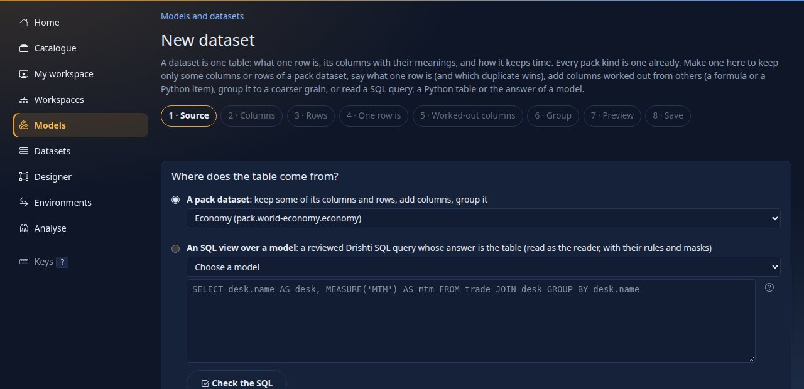

**2 · Columns.** Tick the columns to keep: press **Only the keys**, then tick `NAME`, `ISO3`, `REGION_NAME`, `INCOME_NAME`, `GDP_USD_BN` and `POPULATION_M`
(each shows its type and role; the key `id` always stays, a row must still say what it is).

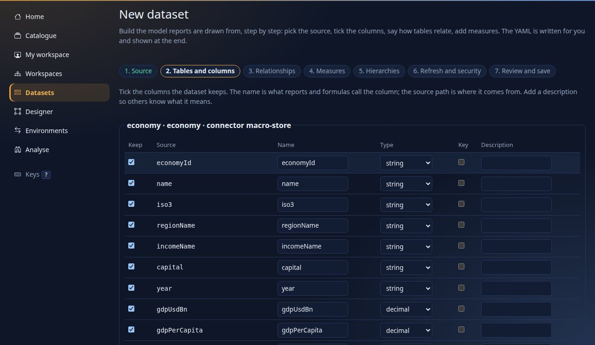

**3 · Rows.** *Keep the rows where* `GDP_USD_BN >= 100` (a filter of the table in DEL, not a security rule: row rules are set on the model). **4 · One row
is**: the pack's grain stays, one row per economy per business date. **5 · Worked-out columns.** Press **A formula column**, name it `GDP_PER_HEAD`, type
`decimal`, formula `GDP_USD_BN / POPULATION_M * 1000`: the server checks it as you type.

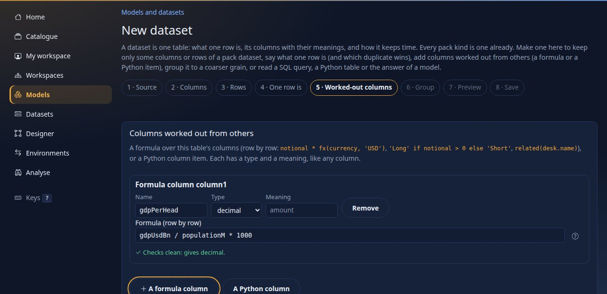

**6 · Group** (optional) makes a coarser grain; leave it. **7 · Preview**: press **Preview**, then **Save the draft and preview** when it asks (the server previews a saved
draft, visible only to you; Save later updates the same draft): it answers the first rows, as you.

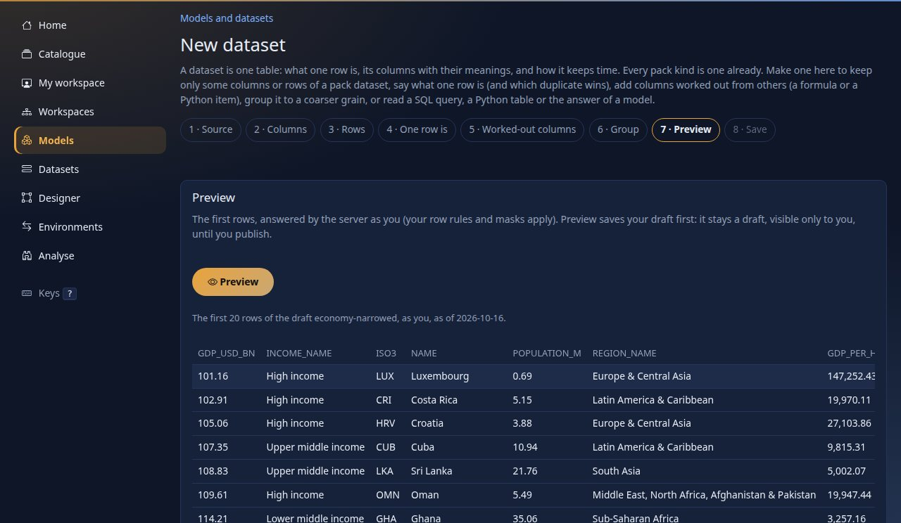

You should see 76 economies in all (GDP of 100 billion dollars or more), Australia with `GDP_USD_BN` `1,798.52` and `GDP_PER_HEAD` `65,129.79`.

**8 · Save.** Title `Large economies` (the name, what models use, follows: `large-economies`), the **workspace** (a shared one, here *Models desk*: a
private draft cannot be published), the columns to mask, and the YAML the wizard wrote, for review.

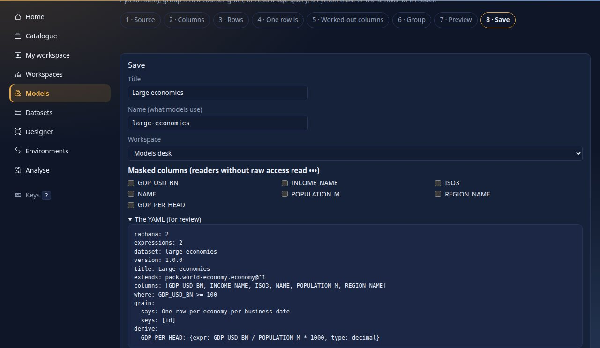

Press **Save and publish**. **You should see** the next steps under the buttons: **Open the dataset**, **Start a report on it** (a report on its implicit model,
`dataset:large-economies`) and **Use it in a new model**. Press **Use it in a new model**, choose *Models desk* and **Make the model**: the model
designer opens on **Large economies model**, the dataset placed as a fact under the alias `large_economies`, with the default measures of its columns
(`Count of large_economies`, `Sum of GDP_USD_BN`, `Sum of POPULATION_M`).

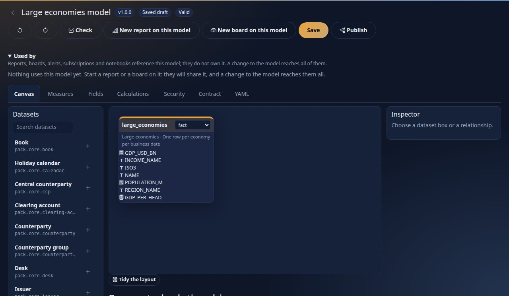

From here it is the model designer of the preview section below: add measures, relationships and row rules, **Save**, **Publish**, then **New report
on this model**. To change the dataset later, open it (Models → *Your datasets* → **Open**) and choose **Narrow it** or edit its YAML; publishing a
change needs a new version (`1.0.1` for words, `1.1.0` for an added column, `2.0.0` for a column taken away; `DRS-9126` says which).

**In YAML.** What the wizard wrote for the dataset (the server added `id` on save) and for the model:

```yaml
rachana: 2
expressions: 2
dataset: large-economies
version: 1.0.0
id: ds_482151d0
title: Large economies
extends: pack.world-economy.economy@^1
columns: [NAME, ISO3, REGION_NAME, INCOME_NAME, GDP_USD_BN, POPULATION_M]
where: GDP_USD_BN >= 100
grain:
  says: One row per economy per business date
  keys: [id]
derive:
  GDP_PER_HEAD: {expr: GDP_USD_BN / POPULATION_M * 1000, type: decimal}
```

```yaml
rachana: 2
expressions: 2
model: large-economies-model
version: 1.0.0
id: md_52756ba0
title: Large economies model
datasets:
  large_economies: {dataset: large-economies@^1, role: fact}
relationships: []
measures: {}          # the defaults of the columns: Count of large_economies, Sum of GDP_USD_BN, Sum of POPULATION_M
```

**From the command line.** The same two files make the same items (a write needs a token with the `bi:write` scope and the `bi-author` power; the
ids differ on your machine). The shared workspace is made once on the **Workspaces** page, or over REST (there is no `bi workspace new`):

```text
$ curl -s -X POST -H "Authorization: Bearer $DRISHTI_TOKEN" -H 'Content-Type: application/json' \
    -d '{"name": "Models desk", "id": "models-desk"}' $DRISHTI_SERVER/api/v1/bi/workspaces | jq -c '{id, name, role}'
{"id":"models-desk","name":"Models desk","role":"admin"}
```

```text
$ python3 tools/drishti.py bi model check large-economies.dataset.yaml          # the server's Check, nothing stored
valid  (dataset large-economies)
$ python3 tools/drishti.py bi item new models-desk large-economies.dataset.yaml
bi-23cecf80ac  dataset  Large economies  draft in Models desk
$ python3 tools/drishti.py bi catalogue publish bi-23cecf80ac
published Large economies as version 1
$ python3 tools/drishti.py bi item new models-desk large-economies-model.model.yaml
bi-f7cc3473c2  model  Large economies model  draft in Models desk
$ python3 tools/drishti.py bi model describe large-economies-model@1
Large economies model  (large-economies-model@1)

large_economies  fact  large-economies 1.0.0
  large_economies.GDP_USD_BN         decimal   amount
  large_economies.INCOME_NAME        string    dimension
  large_economies.ISO3               string    dimension
  large_economies.NAME               string    dimension
  large_economies.POPULATION_M       decimal   amount
  large_economies.REGION_NAME        string    dimension
  large_economies.GDP_PER_HEAD       decimal   amount

measures
  Count of large_economies          count(large_economies)  (default)
  Sum of GDP_USD_BN                 sum(large_economies.GDP_USD_BN)  (default)
  Sum of POPULATION_M               sum(large_economies.POPULATION_M)  (default)
$ python3 tools/drishti.py bi mq --model large-economies-model@1 --select large_economies.REGION_NAME \
    --measures "Count of large_economies" --sort="-Count of large_economies" --limit 3
large_economies.REGION_NAME                        Count of large_economies
-------------------------------------------------  ------------------------
Europe & Central Asia                              29
Middle East, North Africa, Afghanistan & Pakistan  12
Latin America & Caribbean                          12
3 row(s)  as of 2026-10-16  plan p_45f9cfca00d22d04
```

A draft model answers its owner (and is listed as `draft` by `bi model list`); a report on it is published once the model is. The reference for the
wizard's every step is [BI_GUIDE.md section 23](../guides/BI_GUIDE.md#23-models-and-pack-datasets-the-model-layer-wave-w1) and
[DATASETS.md](../guides/DATASETS.md); the version 1 guided tables builder (*Use the guided tables builder* under the wizard's first step) still makes
`rachana: 1` datasets, which the upgrade converts to models ([tutorial 17](17-run-it-in-production.md)).

### Notes: saving safely, and more than one dataset (2.1.0)

- **UI.** *New report* on the designer's start page asks for a **Main dataset** and an optional **Also add** (Ctrl or Shift for several): the designer opens with all of them in the **Fields** pane. A dataset you cannot use yet is greyed with the reason (for example *draft in a private workspace: publish it first*). **+ Add visual** makes an empty visual; the **Publish** button (Propose where review is required) saves first. Open the same draft in two tabs and save in both: the second is refused with **Reload theirs / Save mine as a copy / Overwrite with mine**.
- **CLI.** `drishti.py bi catalogue get <id>` shows the item with its `etag`; a propose, approve or publish of a report that cannot be drawn is refused with `DRS-9030` and the errors (a bi-admin may force it).
- **YAML.** Nothing new to write: the extra datasets are named in each visual's `dataset:` and the report's `links:` (REPORTS.md section 16); `?also=a,b` on the designer URL opens extra datasets in the Fields pane.

## Step 14 · Models: from a pack dataset to a report

Release 2.2.0 brought the **model layer** ([BI_GUIDE.md section 23](../guides/BI_GUIDE.md#23-models-and-pack-datasets-the-model-layer-wave-w1)): every
kind of every pack is a dataset already, and a model is a few of them joined. This step goes from the pack's **Trade valuation** (one row per trade
per business date, with its desk, MTM and P&L, in the `market-risk` pack) to a model of trades and desks with a row rule, published, analysed and
watched. The numbers are from the demo lake (15,000 trade valuations over ten desks).

**In the UI.**

1. **BI → Models** in the rail. Under *Datasets from the packs* every kind is already a dataset: find **Trade valuation**
   (`pack.market-risk.trade-valuation`, certified, read-only). Its title opens its page: *One row per trade valuation per business date*, key `id`,
   time *snapshot*, and `DESK` marked `desk →` (it holds desk ids; `COUNTERPARTY`, `PORTFOLIO`, `NETTING_SET` and `TRADER_ID` likewise).
2. Press **Use** on the card and choose your workspace: a report opens in the designer on the **implicit model of Trade valuation**. Fields lists
   `trade_valuation` and, brought along by the pack reference, `desk`; drag **Sum of MTM** onto the canvas, then **desk → NAME** onto the card: a bar of
   MTM by desk name, with nothing modelled by hand. *Query of the selected visual* shows the model query it asked.
3. Back on **Models**, press **New model**, title it *Trades and desks*, tick **Trade valuation** and **Desk**, **Create and open the designer**. Desk is
   placed as a **dimension** (Trade valuation references it). Under the canvas, *Suggested relationships* offers `trade.DESK → desk.id` (*trade.DESK holds
   desk ids (from the pack)*): press **Add**. (The designer names the alias after the dataset; rename it `trade` in the **Fields** tab to match the YAML
   below.)
4. **Measures**: dataset `trade`, column `MTM`, **Add measure**: `Sum of MTM`, `sum(trade.MTM)`, adds up: yes.
5. **Security**: on `trade`, roles `desk-head`, *the column matches the reader*, column `DESK`, *the reader's desks*, **Add the rule**. The tab shows ⚠ 1:
   *The role desk-head is restricted elsewhere in this model, but desk has no rule*, and the header badge agrees (*Valid, 1 to fix before publishing*).
   Press **desk-head may see every row of desk** (desks are not secret); the ⚠ goes. Add a second rule so you see every trade yourself: under **Roles**
   tick your own role (`admin` for the development administrator; the list holds the roles the server knows, any other can be typed under it), *every
   row*. The note under the list says *roles without a rule see no rows*: a reader no rule matches reads nothing of that dataset.
6. **Save** (the badge says *Valid*), then **New report on this model**: the Fields pane's header says *Model Trades and desks*, *this report
   references the model*. A model is shared: **Used by** (above the tabs) lists the reports, boards, alerts, subscriptions and notebooks that read it, and
   **New board on this model** starts a board on it. Deleting a report never deletes its model, and a model that is used cannot be deleted.
7. **Publish.** In your private workspace Publish says to move it to a shared workspace first, with **Move…** beside it: choose a shared workspace (*Models
   desk* of step 13) and Move, then **Publish** (it checks the model and its security safeguard first). A report on the published model publishes the same
   way from its item page.
8. **Analyse it.** Open **Analyse** (`/bi/explore`): the *Model or dataset* picker lists *Models*, *Your datasets* and one group per pack. Choose
   **Trades and desks (model 1.0.0, published)**, tick `trade.DESK`, `trade.MTM` and `desk.NAME`, **Open the extract**: the rows you may see, as one model
   query.
9. **Alert on it.** **Alerts → New**, *Watch: measure of a model*: choose the model, then the measure `Sum of MTM`, a filter (`trade.DESK is one of
   DESK-FX`), *Tell me when* it is above a limit, **Check now** (it reads your own number; a masked one cannot be saved) and **Save alert**.

You should see, in step 2, the bar of MTM by desk name led by `Rates · Swaps and options` (`4,108,728,089.50` over 1,832 valuations), then
`Money markets` and `Structured products`: the same three rows the command line below prints.

**From the command line.** The same through the CLI and the REST API, with your token. The pack datasets (66 of them for the seven packs), then a
question to the implicit model of Trade valuation:

```text
$ curl -s -H "Authorization: Bearer $DRISHTI_TOKEN" $DRISHTI_SERVER/api/v1/bi/pack-datasets | jq -c '.datasets | length, .[0]'
66
{"name":"pack.core.book","id":"ds_pack_core_book","title":"Book","description":"Book: one row per book per business date, from the Core pack.","pack":"core","kind":"book","version":"1.0.0","mode":"snapshot","endorsement":"certified","columns":10,"query":"dataset:pack.core.book"}
$ python3 tools/drishti.py bi mq --model dataset:pack.market-risk.trade-valuation --select desk.NAME \
    --measures "Sum of MTM,Count of trade_valuation" --sort="-Sum of MTM" --limit 3
desk.NAME                  Sum of MTM        Count of trade_valuation
-------------------------  ----------------  ------------------------
Rates · Swaps and options  4,108,728,089.50  1832
Money markets              393,805,216.87    480
Structured products        382,608,464.96    330
3 row(s)  as of 2026-10-16  plan p_e12a982e03ccdf81
```

Check of the model's YAML without storing it: `python3 tools/drishti.py bi model check trades-and-desks.model.yaml`, or
`POST /api/v1/bi/models/validate` with `{"yaml": "..."}`. Before step 5's **may see every row**, it answers `"valid": true` with the warning
`DRS-9130` and `"exposures": [{"dataset": "desk", "role": "desk-head"}]`, which a publish refuses; after it, only `DRS-9131` remains (the roles
`approver`, `author` and `viewer` have no rule and see no trades: on purpose here).

**In the YAML.** What the designer wrote in steps 3 to 5 (you typed none of it; the server added `id` on save):

```yaml
rachana: 2
expressions: 2
model: trades-and-desks
version: 1.0.0
id: md_...
title: Trades and desks
datasets:
  trade: {dataset: pack.market-risk.trade-valuation@^1, role: fact}
  desk: {dataset: pack.core.desk@^1, role: dimension}
relationships:
  - {from: trade.DESK, to: desk.id, suggested: {from: pack-reference}}
measures:
  Sum of MTM: {expr: sum(trade.MTM)}
security:
  rows:
    trade:
      - {role: desk-head, where: trade.DESK in user.desks}
      - {role: admin, where: 'True'}
  may-see-all:
    desk: [desk-head]
```

and the report of step 6 says `model: trades-and-desks@1`. It publishes like any report once its model is published and passes its safeguard
([REPORTS.md section 18](../guides/REPORTS.md#18-a-report-on-a-model-wave-w1)).

**Steps 7 to 9 from the command line.** Make the item, publish it and ask it (through the console the same calls are `/bi/api/items/<id>/publish`
and **`/bi/api/mq`**):

```text
$ python3 tools/drishti.py bi item new models-desk trades-and-desks.model.yaml
bi-6b99de51c7  model  Trades and desks  draft in Models desk
$ python3 tools/drishti.py bi catalogue publish bi-6b99de51c7
published Trades and desks as version 1
$ python3 tools/drishti.py bi mq --model trades-and-desks@1 --select desk.NAME --measures "Sum of MTM" --sort="-Sum of MTM" --limit 3
desk.NAME                  Sum of MTM
-------------------------  ----------------
Rates · Swaps and options  4,108,728,089.50
Money markets              393,805,216.87
Structured products        382,608,464.96
3 row(s)  as of 2026-10-16  plan p_0bc0e41f625fe579
warning: connector 'reference-store' cannot scan desk as columns for table desk: reading documents one by one (slow for a large table; promote the columns in the connector's layout, or fewer columns)
```

The alert is made in the console only (`/me/measure-alerts` is never open to a personal API token); what **Alerts → New** writes, as
`PUT /api/v1/me/measure-alerts/<name>` with title, severity, trigger and delivery around it:

```yaml
source:
  type: model
  model: trades-and-desks@1
  query: {select: {fields: [], measures: ["Sum of MTM"]}, where: [{field: trade.DESK, op: in, values: [DESK-FX]}]}
  reduce: first
condition: {type: threshold, op: above, value: 1000000}
```

`Sum of MTM` for `DESK-FX` is `-669,248,940` today, so this alert stays quiet; [tutorial 11](11-bi-that-runs-itself.md) makes one that fires.

## Next steps

- [Tutorial 11](11-bi-that-runs-itself.md): refresh, subscribe people to this report, alert on a number, export to PDF, PNG, Excel and CSV.
- [BI_GUIDE.md](../guides/BI_GUIDE.md) for every page of the BI area, [REPORTS.md](../guides/REPORTS.md) for every visual and its wells (sections 3 and 6 are the map and the slicers), [DATASETS.md](../guides/DATASETS.md) for writing a dataset, and [BI_RECIPES.md](../guides/BI_RECIPES.md) for
  a stack with four people, row rules and masks at work, and the Model view.

## If something goes wrong

| You see | Meaning |
|---|---|
| a visual says `DRS-9031` | a field, measure or page named in the YAML is not in the dataset; the message lists the real names |
| `DRS-9030` on the Check button | a visual's `at` is off the 12-column grid (`x + w` is at most 12) |
| `Not on the map: XXX` | the location field holds a code the shapes do not know; it is named, not dropped |
| `No figures at region level for ...` | the rows name countries, not their regions: add a field of ISO 3166-2 codes |
| Publish is not offered | the report is in **My workspace**: move it to a shared workspace first |
| a visual says `DRS-9020` | a slicer or a selection cannot reach that visual through the dataset's relationships |
| a number is `•••` | the dataset masks it for your role; the report is working as it should |
| `DRS-9190` on a dataset made of others (`from:` or `derived:`) | a 2.1 composed or derived dataset: removed in 2.2; `drishti.py bi migrate --models` converts it ([DATASETS.md section 11](../guides/DATASETS.md#11-composed-and-derived-datasets)) |
| `DRS-9021` "the join key ... is masked for you" | a source masks the column the join is made on; join on an unmasked key such as an id |
| a slicer does not filter a visual of another dataset | no `link` in the report says the two fields are the same ([REPORTS.md section 16](../guides/REPORTS.md#16-reports-over-several-datasets)) |
