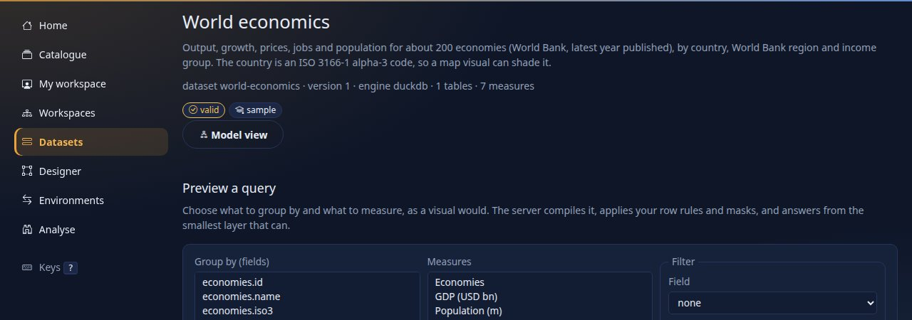
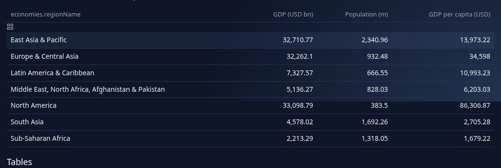

<!--
  Project Drishti · Any data. Any domain. One grammar.

  Copyright (c) 2026 Ashutosh Sinha <ajsinha@gmail.com>.
  All rights reserved.

  PROPRIETARY AND CONFIDENTIAL.

  This file is the confidential and proprietary property of Ashutosh Sinha.
  Unauthorised copying, use, modification, distribution or disclosure of this
  file, via any medium, is strictly prohibited except with the express prior
  written permission of the copyright holder.

  See the LICENSE file in the root of this repository for the full terms.
-->
# Tutorial 10 · Your first BI report

Business intelligence in Drishti (it is called **Rūpaka**; type `BI <GO>` or choose the bar-chart icon in the top bar) is built from three things: a **dataset** (tables, how they join, and named **measures** such as "GDP per capita"), a **report**
(pages of **visuals** that ask the dataset questions), and the **catalogue** where published reports are found. In this tutorial you build a report of your own on the **World economics** sample: two cards, a **map** you can drill from the world to a country
and its regions, a bar, and a slicer. You look at it, cross-filter it, publish it, learn the slicers in detail on the **Trades overview** sample, and meet the cross-filter and drill-through of **Counterparty risk**.

## Time to complete

About 45 minutes.

## Before you start

- [Tutorial 1](01-first-15-minutes.md) done: server and console running with sign-in on, you are signed in as the development administrator, and the token for the command line is set (`DRISHTI_TOKEN`).
- Nothing else to install. The sample datasets and reports are files in `config/bi/` that every server reads. The data of **World economics** is real and public: about 200 economies from the World Bank (CC BY 4.0), through the `economics` pack. The dataset uses only the World Bank
  fields on purpose; the pack's IMF fields stay out of it ([REAL_DATA.md](../guides/REAL_DATA.md)).

## What you will learn

- the parts of a dataset: a table, columns, measures; and how to ask it a question before drawing anything;
- how to make a report in the designer: cards, a **map**, a bar with a **top 10** filter, a slicer; where each visual sits on the 12-column grid;
- how the map drills **world, country, region** with a breadcrumb, and how a click on a map or a bar **cross-filters** the rest of the page;
- how to publish: your own workspace, a shared workspace, the catalogue;
- **filter like Power BI**: list, dropdown and range slicers, page and report scope, a top-N filter that tames a busy donut, bookmarks, and when to use a slicer instead of a click;
- the **Counterparty risk** sample: slicers that reach across packs, a selected bar, and drill-through.

## Step 1 · Look at the dataset

Choose **Datasets** in the left rail and open **World economics**.



You should see the title, `dataset world-economics · version 1 · engine duckdb · 1 tables · 7 measures`, a badge `valid`, and below it **Preview a query**. The model sits further down: one table, `economies`, whose columns are the country's name, its ISO code
(`iso3`, which is what a map needs), World Bank region and income group and a few figures; and the seven **measures** (`Economies`, `GDP (USD bn)`, `Population (m)`, `GDP per capita (USD)`, `Average growth`, `Average inflation`, `Average unemployment`). A measure is a
formula the dataset owns, so every report that uses it agrees. `GDP per capita (USD)` is worked out as GDP over population, not as an average of averages, so a region's figure is right.

Preview a query: under **Group by** choose `economies.regionName`, under **Measures** hold Ctrl and choose `GDP (USD bn)`, `Population (m)` and `GDP per capita (USD)`, and press **Run the query**.



You should see `7 rows`, the layer that answered (`columns`), the business date of the data, and a table with a row per World Bank region: East Asia and Pacific `32,710.77` billion dollars of GDP, North America `86,306.87` dollars per head. Over REST the same question
is one call (with the token of tutorial 1; here the server is on port 18943, yours is on 18480):

```text
$ curl -s -X POST -H "Authorization: Bearer $DRISHTI_TOKEN" -H 'Content-Type: application/json' \
    -d '{"fields":["economies.regionName"],"measures":["GDP (USD bn)","Population (m)","GDP per capita (USD)"]}' \
    http://localhost:18480/api/v1/bi/datasets/file:dataset:world-economics/query
{"columns":[{"type":"string","masked":false,"name":"economies.regionName"},{"type":"decimal","masked":false,"name":"GDP (USD bn)"}, ...],
 "rows":[["East Asia & Pacific",32710.7673284,2340.961666,13973.217846105472],["Europe & Central Asia",32262.103690000018,932.4846759999997,34597.99878791792],
         ["Latin America & Caribbean",7327.566034999997,666.552477,10993.232022750399], ... ["North America",33098.7945,383.501255,86306.8740153145], ...],
 "rowCount":7,"meta":{"layer":"columns","millis":1.93,"cached":false,"dates":["2026-10-09"],"masked":[],"warnings":[]}}
```

You should see one row per region and a `meta` block that says which layer answered and how long it took. Everything a report draws is a question like this, asked **as you**: your row rules and masks apply, which is why two people can open one report and see different figures.

## Step 2 · Start a report

Choose **Designer** in the rail. Choose the dataset **World economics**, give the report the title `My world report` and look at the form before you press the button.


You should see the dataset chooser (every dataset you may open), the title box and the button **Start designing**. Press it.

You land in the designer: a canvas on a 12-column grid, a **Filters** pane, **Visualizations** (every kind of visual) and **Fields** (the dataset's columns and measures). The report is a draft in **My workspace**, which only you see.

## Step 3 · Two cards

Drag the measure `GDP (USD bn)` from **Fields** onto the canvas, then `Population (m)` beside it. (Dragging with the keyboard also works: focus a field and press Enter.)


You should see two cards with real figures: `117,327` (billion dollars) and `8,161.83` (million people). A **measure alone becomes a card**; a column alone would become a table; a column with a measure becomes a bar. Under each card is the line the server answered with: rows, time
and the layer.

## Step 4 · A map

Click an empty part of the canvas to let go of the selection, then click **map** in **Visualizations**. In **Build**, add `economies.iso3` to the **location** well and `GDP per capita (USD)` to **values**.


You should see the world shaded from dark to light by GDP per capita (the legend runs from 0 to `90k+`), the title `World` above it, and a note `Not on the map: CHI, XKX` under it: two codes the shapes do not know are **named, never dropped silently**. Small countries (Cayman Islands, Monaco)
are dots so they can be clicked. The shapes are Natural Earth, shipped with the console: nothing is fetched from the internet. The `location` well takes ISO country codes (`AUS`, `AU` or the English name), or ISO 3166-2 region codes (`AU-NSW`) for a map of one country's regions.

## Step 5 · A bar, a slicer, and where everything sits

Add a bar: with nothing selected click **bar**, put `economies.name` in **axis** and `GDP (USD bn)` in **values**. Add a slicer: click **slicer**, put `economies.regionName` in **field**, then open **Format** and set the mode to **dropdown**.
The visuals are stacked wherever there was room, so now place them. Open the **YAML** tab: the report is text, and each visual has `at: { x, y, w, h }` on the 12-column grid. Give each one a title and a place, and give the bar a **top 10** filter
(a filter on the visual, `op: top`: the ten economies with the largest GDP):


```yaml
- id: card-1
  type: card
  title: "GDP (USD bn)"
  at: { x: 0, y: 0, w: 3, h: 2 }
  wells: { values: [GDP (USD bn)] }
- id: map-1
  type: map
  title: "GDP per capita (USD): click a country"
  at: { x: 0, y: 2, w: 8, h: 8 }
  wells: { location: [economies.iso3], values: [GDP per capita (USD)] }
- id: bar-1
  type: bar
  title: "Largest economies (GDP, USD bn)"
  at: { x: 8, y: 2, w: 4, h: 8 }
  wells: { axis: [economies.name], values: [GDP (USD bn)] }
  filters: [{ field: economies.name, op: top, n: 10, by: GDP (USD bn) }]
```

You should see the YAML with `at:` lines and no complaints (a mistake is reported with its code, and `DRS-9030` is a place off the grid). Switch back to **Canvas**. (You can also drag a visual by its header and resize it by its corner; the YAML is simply the exact way.)


You should see two cards, a `Region` dropdown, the map on the left and ten bars on the right. Press **Save** (or `Ctrl+S`); the status next to the title says `Saved`. Press **Check**: it adds accessibility checks (a visual without a title or alt text is flagged for screen readers).

## Step 6 · View it, click, drill

Press **View**: the report opens as a reader sees it.


You should see the toolbar (business date, *Click a mark to filter the page / highlight*, **Reset**), the **Export** bar (PDF, PNG, Excel, CSV, Subscribe; tutorial 11), and your visuals drawn with real data. Now **click Australia** on the map.


You should see three things at once. A **chip** under the toolbar, `economies.iso3: AUS`, says what is filtering the page. The cards answer for Australia alone (`1,799` billion dollars of GDP, `27.61` million people): this is the **cross-filter**. And the map **drilled**:
its title bar says **World › Australia**, and the shapes of Australia's states and territories replace the world.


Under the map you read `No figures at region level for Australia: the location field holds countries, not their regions.` That is honest: this dataset has one row per **country**. To shade regions give the map a field of ISO 3166-2 codes (`AU-NSW`, `US-CA`) and the same visual
colours the states by their own figure. Press **World** in the breadcrumb.


You should see the world again and the chip still in place: the breadcrumb moves the map, the chip (or **Reset**, or `Esc`) clears the filter. Click a second country with `Ctrl` held to add it to the selection.

## Step 7 · Publish

A draft in **My workspace** is private. To publish, move it to a **shared workspace** (that is where people are members and where review can be required). Choose **Workspaces** and fill in **New workspace**.


You should see the form; leave *Require review before publishing* unticked for now and press **Create workspace** (a workspace that requires review needs a second person to approve, which is [tutorial 13](13-govern-bi.md)). Open your report's page (**My workspace**, then the report), choose **Move to workspace…**, pick `Economics desk` and press **Move**.


You should see the report listed under the new workspace. Type a note and press **Publish**.


You should see `Published.` and `published v1 just now`. Each publish makes the next numbered version; the draft carries on separately. Open the **Catalogue**, the one place every published item is found, and search `world`.


You should see your report beside the shipped one, with its workspace and owner. The same list from the command line:

```text
$ python3 tools/drishti.py bi catalogue list
id                               kind     endorsed  status    ver  title
file:report:trades-overview      report   promoted  published v2   Trades overview  (Shipped content, shipped)
file:report:world-economics      report   promoted  published v1   World economics  (Shipped content, shipped)
file:report:counterparty-risk    report   promoted  published v1   Counterparty risk  (Shipped content, shipped)
bi-7f8269ba14                    report   none      published v1   My world report  (Economics desk, drishti-dev-admin)
...
17 item(s)
```

```text
$ python3 tools/drishti.py bi workspace list
id                            role          items  name
u-drishti-dev-admin-eb6f      admin             1  My workspace  [personal]
economics-desk                admin             1  Economics desk
shipped                       viewer           16  Shipped content
```

You should see the report with `published v1` and the workspace with one item. (Ids, counts and dates differ on your machine.)

## Step 8 · Filter like Power BI

The sample **Trades overview** has a second page, **By product**, built to show slicers. Open it from the Catalogue (or type `BI trades overview <GO>`) and choose the tab **By product**.

A **slicer** is a visual that holds choices and filters other visuals. It has a mode and a scope, set in the report:

```yaml
- { id: pick-product, type: slicer, title: Product type, wells: { field: [trade.productType] }, format: { mode: dropdown, scope: page } }
```

| `format.mode` | What it looks like | Use it for |
|---|---|---|
| `list` (the default) | a checkbox list with a search box, always open | a field with a handful of values (desks, currencies) |
| `dropdown` | a closed box that opens a **floating** checkbox list with a search box, **Select all** and **Clear** | a field with many values (product types: about forty) |
| `range` | two boxes, *From* and *To* | a number or a date field (notional, trade date) |

| `format.scope` | A choice filters |
|---|---|
| `page` (the default) | the visuals of this page |
| `report` | every page of the report, so a choice made on one page holds on the next (the Counterparty risk sector slicer) |

All three together on one page (the YAML is [data/slicer-kinds.report.yaml](data/slicer-kinds.report.yaml); paste it into **My workspace → New item** or into the designer's YAML tab to try it):


You should see the desks as an open list with its search box and **Clear**, the currency as a closed dropdown, the notional as *From* and *To* boxes, and the donut. **Open the Product type dropdown** on the Trades overview and type `SWAP` in its search box.


You should see the list **floating over** the visuals below it (it does not push the page down), narrowed to the product types that contain `SWAP`, each with a tick box. **Select all** and **Clear** tick and untick the values in one press. Tick `AMORT_SWAP` and `BASIS_SWAP`, then click outside.


You should see `2 selected: AMORT_SWAP, BASIS_SWAP` in the box, a **chip** `Product type: AMORT_SWAP, BASIS_SWAP` under the toolbar, the Desk and Currency slicers narrowed to values that still exist (a slicer never filters itself; **other** slicers filter it), a donut of two rings and a matrix of one desk. **Reset** clears all of it.

**Taming a busy donut.** The donut on this page could have about forty product types. It does not draw forty slices: it carries a **top filter**.

```yaml
- { id: share, type: donut, title: "Notional by product type (top 12)", wells: { axis: [trade.productType], values: [Notional] },
    filters: [{ field: trade.productType, op: top, n: 12, by: Notional }] }
```


You should see twelve slices and the title `(top 12)`. The server ranks the product types **in the context of the slicers**, so the top twelve of the swaps you chose is a different twelve from the top twelve overall. `n` is how many, `by` the measure to rank by.

**Bookmarks** save a state. They are in the report's YAML (`bookmarks:`, with a name, a page, slicer choices and filters) and appear in the **Bookmarks** box of the toolbar. On the **Overview** page choose the bookmark `FX desk only`.


You should see the page filtered to `DESK-FX` (84 trades, notional `8,485,000,000`) with a chip, as if you had made the choice yourself. A bookmark does not capture what you have chosen on screen (that is not built; the YAML carries it).

**Slicer or click?** Both filter. A **slicer** is a choice you make on purpose from a list, it stays visible, and it can be page or report wide. A **click on a mark** (a bar, a slice, a country) is exploring: it filters the **other** visuals of the page, it highlights what you picked, and it is gone when you click again.
Click the `DESK-FX` bar on the Overview page:


You should see the same figures as the bookmark gave. *Click a mark to* **highlight** (in the toolbar) keeps the whole answer on bar and column charts and draws the chosen share over it instead of filtering.

## Step 9 · Counterparty risk: slicers across packs, and drill-through

Open the shipped report **Counterparty risk**. Its dataset joins three packs (trades from `trading`, counterparties from `banking-core`, netting sets from `counterparty-risk`) and its two slicers, Sector and Country, are `scope: report`: they filter every page and reach the trades and the netting sets **through the relationships**.


You should see exposure cards, the two dropdown slicers and a bar of the ten counterparties with the highest expected exposure (a **top 10** filter again). Click the bar of **Halcyon Shipping plc**.


You should see a chip, the cards narrowed to that counterparty (`133,327,214` expected exposure) and, in the bar's header, a **drill-through** button. Press it.


You should see a second page, **Counterparty**, with the name carried in as a chip **and in the address** (so the link can be shared), a **Back** button, four cards (`40` trades, notional `5,035,000,000`) and a table of its trades whose ids are links: `MX-20000043` opens that trade's view in the terminal.

## Step 10 · On a phone

Open your report on a phone-width window (390 px).


You should see one column in reading order, the map at the full width, targets at least 44 pixels high and no sideways scroll. A report can also have a **phone layout** of its own (which visuals, in what order): [tutorial 16](16-embed-drishti.md) and the designer's **Phone** tab.

## Next steps

- [Tutorial 11](11-bi-that-runs-itself.md): refresh, subscribe people to this report, alert on a number, export to PDF, PNG, Excel and CSV.
- [BI_GUIDE.md](../guides/BI_GUIDE.md) for every page of the BI area, [REPORTS.md](../guides/REPORTS.md) for every visual and its wells (sections 3 and 6 are the map and the slicers), [DATASETS.md](../guides/DATASETS.md) for writing a dataset, and the longer
  chapter-by-chapter [BI_TUTORIAL.md](../guides/BI_TUTORIAL.md).

## If something goes wrong

| You see | Meaning |
|---|---|
| a visual says `DRS-9031` | a field, measure or page named in the YAML is not in the dataset; the message lists the real names |
| `DRS-9030` on the Check button | a visual's `at` is off the 12-column grid (`x + w` is at most 12) |
| `Not on the map: XXX` | the location field holds a code the shapes do not know; it is named, not dropped |
| `No figures at region level for ...` | the rows name countries, not their regions: add a field of ISO 3166-2 codes |
| Publish is not offered | the report is in **My workspace**: move it to a shared workspace first |
| a visual says `DRS-9020` | a slicer or a selection cannot reach that visual through the dataset's relationships |
| a number is `•••` | the dataset masks it for your role; the report is working as it should |
