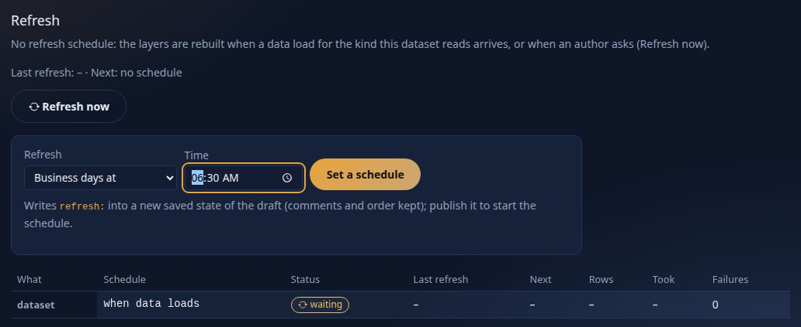
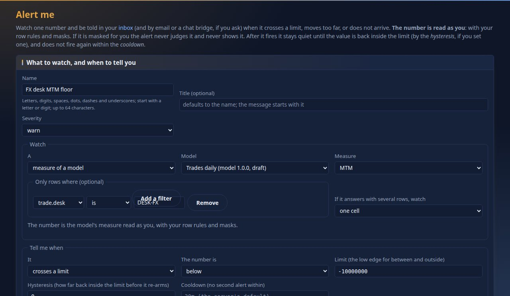
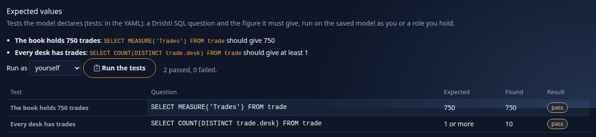
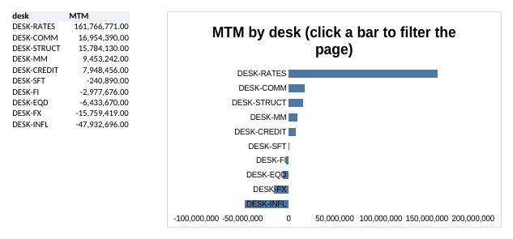

<!--
  Project Drishti · Any data. Any domain. One grammar.

  Copyright (c) 2026 Ashutosh Sinha <ajsinha@gmail.com>.
  All rights reserved.

  PROPRIETARY AND CONFIDENTIAL.

  This file is the confidential and proprietary property of Ashutosh Sinha.
  Unauthorised copying, use, modification, distribution or disclosure of this
  file, via any medium, is strictly prohibited except with the express prior
  written permission of the copyright holder.

  See the LICENSE file in the root of this repository for the full terms.
-->
# Tutorial 11 · BI that runs itself

A report is only useful if it is fresh when people look at it and reaches them when it matters. In this tutorial BI works on its own. A **dataset refreshes
itself** every business morning. A **subscription** sends a report to a colleague, rendered for them. An **alert** watches a number, in a report or as a
measure of a **model**, and tells you when it crosses a limit. You **export** a page as PDF, PNG, Excel and CSV. A report and a model **say the figures they
must give**, and a wrong figure stops a publish. You also see what Drishti does with **no mail server** (the usual state of a fresh install) and how to set
one up.

Every step shows the same thing three ways: **in the UI**, **on the command line** (`python3 tools/drishti.py`, or `curl` where the tool has no command
yet), and **as YAML** (what the UI writes, which you can keep in git).

## Time to complete

About 45 minutes.

## Before you start

- [Tutorial 10](10-first-bi-report.md) done (it made the workspace `Economics desk`), and [tutorial 8](08-share-and-collaborate.md) for the colleague `vera`; [tutorial 9](09-reports.md) for how the **Reports** page lists subscriptions.
- The command line token of tutorial 1 (`DRISHTI_TOKEN`, and `DRISHTI_SERVER` when your server is not on `localhost:18480`).
- Three small files in [data/](data/): [trades-daily.dataset.yaml](data/trades-daily.dataset.yaml) (a dataset that refreshes itself),
  [trades-daily.model.yaml](data/trades-daily.model.yaml) (the model over it) and [desk-check.report.yaml](data/desk-check.report.yaml) (a report that
  says what its numbers must be).
- Mail is **optional**. Steps 2 and 3 run without it and show what happens; step 4 shows it working with a catcher on your own machine (a small script that ships with this tutorial).

## What you will learn

- how a dataset of the model layer is told to refresh itself (`refresh:` in its YAML, or **Set a schedule** on its page) and how to see it ran;
- how to subscribe a person to a whole report, a page or one visual, in HTML, PDF or Excel, and why each recipient gets their own copy;
- what **Run now** says with no SMTP host (`no SMTP host: set spring.mail.host`) and how to configure mail so it sends;
- how to put an **alert** on a number of a report or on a **measure of a model**, the difference between *armed* and *active*, and where the firing lands (inbox, email);
- how to export a report to **PDF, PNG, Excel and CSV**, a whole page or one visual;
- how to say what a number should be (`tests:`) in a report and in a model, run the tests as a role, and why a failing test stops a publish.

## Step 1 · A dataset that refreshes itself

A dataset keeps its rows in layers it builds from the source. They are rebuilt when a data load arrives ([tutorial 7](07-load-data-daily.md)), when someone
asks, and on a **schedule** set on the dataset. Since 2.2 a dataset is one table of the **model layer** (`rachana: 2`): it says where the rows come from and
what one row is, and its measures live in a **model** over it ([BI_GUIDE.md section 23](../guides/BI_GUIDE.md#23-models-and-pack-datasets-the-model-layer-wave-w1)).

**In the UI** there are two ways to set the schedule, and neither needs the YAML:

- **In the dataset wizard** (**Models → New dataset**, the wizard of [DATASETS.md section 15](../guides/DATASETS.md#15-the-dataset-wizard-version-2-wave-a)):
  on the *Columns* step choose **Refresh** *business days at 06:30* (or *when new data loads*); the YAML of the *Save* step shows the line it writes,
  `refresh: business-days 06:30`.
- **On the dataset's own page**, when it has no schedule: the **Refresh** section says *No refresh schedule* and, for an author who may edit the draft,
  offers **Set a schedule** (a choice and a time). It writes `refresh:` into a new saved state of the draft, keeping every other line and every comment of
  the file; publish the dataset to start the schedule.



You should see the form (*Business days at*, a time, **Set a schedule**) and one row, `dataset`, rebuilt *when data loads*: the only refresh a dataset has
until you give it a schedule.

**The YAML** (what both of them write) is the tutorial's dataset over the trades, [data/trades-daily.dataset.yaml](data/trades-daily.dataset.yaml). The line
that matters is `refresh:`:

```yaml
rachana: 2
expressions: 2
dataset: trades-daily
version: 1.0.0
title: Trades refreshed daily
description: The trades by desk, rebuilt on their own at 06:30 on business days.
source: { connector: trading-store, kind: trade }
grain: { says: "One row per trade per business date", keys: [tradeId] }
refresh: "business-days 06:30"      # a schedule (daily 06:00, hourly, cron ...) or after-load: when the layers are rebuilt without anyone asking
columns:
  tradeId:  { type: string, role: key }
  desk:     { type: string }
  currency: { type: string }
  notional: { type: decimal, format: amount0 }
  mtm:      { type: decimal, format: signed0 }
```

The words are the ones of a scheduled report ([tutorial 9](09-reports.md)): `daily 06:00`, `weekdays 07:00`, `business-days 06:30` (skips holidays of the
server's calendar), `hourly`, `cron ...`, or `after-load`. `refresh: { on-load: true }` (what the wizard writes for *when new data loads*) rebuilds only
when data arrives; `{ schedule: "daily 06:00", on-load: true }` does both. The model over it, [data/trades-daily.model.yaml](data/trades-daily.model.yaml),
reads it as its one fact and adds three measures:

```yaml
rachana: 2
expressions: 2
model: trades-daily
version: 1.0.0
title: Trades daily
datasets:
  trade: { dataset: trades-daily, role: fact }
measures:
  Notional: { expr: "sum(trade.notional)", format: amount0 }
  MTM:      { expr: "sum(trade.mtm)", format: signed0 }
  Trades:   { expr: "count(trade)" }
security:
  rows:
    trade:
      - { role: [admin, risk, bi-writer], where: "True" }
```

**From the command line** put both files in the workspace, publish them, and ask for the dataset's refresh state (`bi item new` reads the kind from the
file name; the ids differ on your machine):

```text
$ python3 tools/drishti.py bi item new economics-desk docs/tutorials/data/trades-daily.dataset.yaml
bi-03f88abb6f  dataset  Trades refreshed daily  draft in Economics desk

$ python3 tools/drishti.py bi catalogue publish bi-03f88abb6f --note "refreshes itself on business mornings"
published Trades refreshed daily as version 1

$ python3 tools/drishti.py bi dataset refresh bi-03f88abb6f
scheduled  (America/New_York, calendar USNY)
  dataset   business-days 06:30   waiting for the scheduler

$ python3 tools/drishti.py bi item new economics-desk docs/tutorials/data/trades-daily.model.yaml
bi-0cb43111e3  model  Trades daily  draft in Economics desk

$ python3 tools/drishti.py bi catalogue publish bi-0cb43111e3 --note "the measures over the dataset"
published Trades daily as version 1
```

**In the UI** the same is **My workspace → New item**, kind *dataset* (and then *model*), **Paste YAML** (the button next to *Open the dataset wizard*),
paste the file, **Create from the YAML**; move it to `Economics desk`; **Publish** ([tutorial 10](10-first-bi-report.md), step 7). Open the dataset from
**Models** (its page is `/bi/ds/<id>`) and scroll to **Refresh**.


You should see one row, `dataset`, with the schedule `business-days 06:30` and the status `waiting for the scheduler` before its first run, and the line
*Last refresh: – · Next: worked out at the next scheduler look*. Do not wait for 06:30. **Refresh now** is the same call a schedule makes (it needs the BI
author power); the command line's `--now` asks for it and waits until it ends:

```text
$ python3 tools/drishti.py bi dataset refresh bi-03f88abb6f --now
scheduled  (America/New_York, calendar USNY)
  dataset   business-days 06:30   ok  last run 2026-10-13 06:23:07 UTC by manual (drishti-dev-admin): 750 rows in 13 ms
```

(Over REST: `POST /api/v1/bi/datasets/<id>/refresh` starts it and `GET` the same path answers the state.)


You should see *Refreshed 750 rows in 16 ms.* beside the button, the status `ok` with a note, the line *Last refresh ... · Next ...*, and **Recent
refreshes**: every run, newest first, with who or what started it (`schedule`, `after-load trade`, `retry`, `manual (drishti-dev-admin)`), the rows, the
time and any note. The history and the state are kept in the BI store, so they are still there after a restart (a run the restart interrupted shows as
`interrupted`). Ask the model for the rows the refresh built:

```text
$ python3 tools/drishti.py bi mq --model trades-daily@1 --select trade.desk --measures "Trades,Notional,MTM" --limit 4
trade.desk   Trades  Notional           MTM
-----------  ------  -----------------  -------------
DESK-COMM    90      11,359,000,000.00  16,954,390.00
DESK-CREDIT  72      8,598,000,000.00   7,948,456.00
DESK-EQD     132     15,806,000,000.00  -6,433,670.00
DESK-FI      78      10,346,000,000.00  -2,977,676.00
4 row(s)  as of 2026-10-13  plan p_347854bf75d4d394
```

The note on the status says the demo connector reads the trade documents one by one instead of scanning columns, which is slower on a big table and fine
on the demo; the refresh worked. A refresh that fails is **retried** with the shared retry policy (5 s, doubling, up to 5 minutes; after four tries it is
`failed` until its next time), and the dataset page says so.

## Step 2 · Subscribe a colleague to a report

Open the shipped report **World economics** (a report on the model `world-economics@1`) and press **Subscribe** in the toolbar (beside the export
buttons). Subscribe and the export buttons appear only when they will work for you: when an administrator has switched exports or subscriptions off, or
you already own the most subscriptions allowed, a line beside the bar says so and why (the server's `GET /api/v1/distribution/status` is what the page asks).


You should see the form with the target named at the top (`The BI report "World economics" (file:report:world-economics), page world, with the filters you
have set`): a subscription keeps the page and the slicer choices you had on the screen. **When** is a choice, not a text: *every business day* at `07:30`
is its default, and the line under it says it in words (*Every business day at 07:30*) and which model the figures are asked of (*The figures are asked of
the model world-economics@1, as each recipient*); **Advanced: the schedule as text** takes any schedule word. Name it `Morning economy pack`, **Send as**
*an Excel workbook attached* (the other forms are the email itself with the tables in the body, and a PDF), and **To** `vera`. **To** takes user names and
`role:NAME`, **never an email address**: each person gets the report asked of the data **as that person**, with their own row rules and masks, and an
outside address has no rights to ask as. Press **Subscribe**.


You should see `Morning economy pack` badged `SUBSCRIPTION`, the report, `business-days 07:30`, `vera` with `Excel attached`, and the next run in UTC
(07:30 New York on the next business day: `11:30`).

**From the command line** a subscription is one REST call (there is no `drishti.py` command for subscriptions yet): `PUT /api/v1/me/subscriptions/<name>`
with the body below, and `GET` the same path reads it back. **The YAML** of what the form saved (the server keeps it as JSON; these are its keys, captured):

```yaml
name: Morning economy pack
target:
  type: report
  id: file:report:world-economics
  page: world
  visual: ''
  state: { carry: [], slicers: {}, selections: [], drill: [] }
schedule: business-days 07:30
date: today
format: xlsx
recipients: [vera]
enabled: true
nextRun: '2026-10-13T11:30:00Z'
```

```text
$ curl -s -X PUT -H "Authorization: Bearer $DRISHTI_TOKEN" -H 'Content-Type: application/json' \
    -d '{"target":{"type":"report","id":"file:report:world-economics","page":"world"},"schedule":"business-days 07:30","format":"xlsx","recipients":["vera"]}' \
    "$DRISHTI_SERVER/api/v1/me/subscriptions/Morning%20economy%20pack"
```

Press **Run now** (or `POST /api/v1/me/subscriptions/Morning%20economy%20pack/run`).

## Step 3 · What "Run now" says without a mail server


You should see `Morning economy pack: 0 sent, 1 to retry` and the last run `retrying`. Open **History**:


You should see `vera@example.com · retry · IllegalStateException: no SMTP host: set spring.mail.host`. That is the honest answer: Drishti built vera's
copy, had nowhere to send it, and will **retry** (4 attempts, then `failed`). Nothing is lost silently, and a recipient without an address on their
account is shown as `skipped · no email address on file`. The run as the API keeps it (`runs` of the subscription, captured):

```text
{"id": "34aeeb3f", "trigger": "by hand", "status": "retrying", "sent": 0, "failed": 0, "skipped": 0, "retrying": 1,
 "deliveries": [{"to": "vera@example.com", "label": "Vera Lim", "user": "vera", "attempts": 2, "status": "retry",
                 "error": "IllegalStateException: no SMTP host: set spring.mail.host", "nextAttempt": "2026-10-13T06:19:51Z"}]}
```

**To configure mail** you need four things on the **server** (not the console): an SMTP host, the collaboration email switch, the console's address (for the links in the mail) and a From address. In the environment, before the server starts:

```bash
export SPRING_MAIL_HOST=smtp.example.com SPRING_MAIL_PORT=587          # your mail server
export SPRING_MAIL_USERNAME=drishti SPRING_MAIL_PASSWORD=...          # if it asks for sign-in; keep the password out of files
export SPRING_MAIL_PROPERTIES_MAIL_SMTP_STARTTLS_REQUIRED=true         # for any server reached over a network
export SPRING_MAIL_PROPERTIES_MAIL_SMTP_CONNECTIONTIMEOUT=10000 SPRING_MAIL_PROPERTIES_MAIL_SMTP_TIMEOUT=10000
export DRISHTI_COLLAB_EMAIL_ENABLED=true
export DRISHTI_CONSOLE_URL=https://drishti.example.com                  # where links in the mail point
export DRISHTI_MAIL_FROM=drishti@example.com
```

(The same keys as `spring.mail.host` and so on in the server's `application.yml`; [OPERATIONS.md](../admin/OPERATIONS.md) and [CONFIGURATION.md](../admin/CONFIGURATION.md#email-springmail-and-the-outbox) have all of them.) To try it **without sending anything anywhere**, use the catcher that ships with this
tutorial: a small program that accepts any mail on your machine and writes each message to a file.

```bash
python3 docs/tutorials/data/smtp-catcher.py 1025 caught-mail &
export SPRING_MAIL_HOST=127.0.0.1 SPRING_MAIL_PORT=1025 DRISHTI_COLLAB_EMAIL_ENABLED=true DRISHTI_CONSOLE_URL=http://localhost:17480 DRISHTI_MAIL_FROM=drishti@desk.example
# then start the server as in tutorial 1
```

You should see `catching mail on 127.0.0.1:1025, writing to caught-mail/` from the catcher. (Collaboration email needs sign-in on, which tutorial 1 set.) Restart the server with those variables, open **Reports** and press **Run now** again.

## Step 4 · Run now, with a mail server


You should see `Morning economy pack: 1 sent` and the last run `ok`.


You should see both runs in the history: the new one `ok · 1 sent` (`vera@example.com · sent`) and, beneath it, the earlier one with
`retry (attempt 3) · IllegalStateException: no SMTP host`: the restart came before its fourth try, so it stays as it was (a run that is not restarted ends
`failed (attempt 4)`). Look at what the catcher caught:

```text
$ python3 - <<'PY'
import email; from email import policy
m = email.message_from_bytes(open("caught-mail/001.eml", "rb").read(), policy=policy.default)
print(m["From"], m["To"], m["Subject"], m["Auto-Submitted"], sep="\n")
print(m.get_body(("plain",)).get_content())
print([p.get_filename() for p in m.iter_attachments()])
PY
drishti@desk.example
vera@example.com
Drishti: World economics · 2026-10-13
auto-generated
World economics · 2026-10-13

World economics
Page: World · Data as of 2026-10-13
Filters: none beyond the report's own

The report is attached: World economics.xlsx
- Economies: 1 rows
- GDP (USD bn): 1 rows
- Population (m): 1 rows
- Average growth: 1 rows
- GDP per capita (USD): click a country to filter and to open its regions: 213 rows
- Largest economies (GDP, USD bn): 10 rows
- The economies: 213 rows

Open it in Drishti:
http://localhost:17912/bi/r/file%3Areport%3Aworld-economics/world

You are receiving this because you are a recipient of a subscription in Drishti. The figures are the ones you are entitled to see; they are rendered for you, not copied from the sender.
Ask the owner of the subscription, or an administrator, to change or stop it.

['World economics.xlsx']
```

You should see a mail from your From address to `vera`'s address, marked `Auto-Submitted: auto-generated`, with each visual and how many rows it holds, a
link that opens the report in Drishti, and the workbook attached (29,589 bytes here). The link is built from `DRISHTI_CONSOLE_URL` (here the tutorial's
scratch console; yours says `localhost:17480`).

## Step 5 · An alert on a number

An alert watches **one number** and tells you when it crosses a limit, changes too much or does not arrive. It watches a **visual of a report** (what is
on the screen, with your filters) or a **measure of a model** (asked directly, with filters of its own). Start with a visual: open the shipped **Trades
overview**. Each card has a **bell** in its corner: *Alert me*.


You should see the card (`Mark to market`, `+138,562,638` in this data) and the bell. Press the bell: the form opens already filled in with the report, the page and the visual.


Name it `MTM floor`. **Watch** says what (this visual, with the filters you had set; a card answers one cell, so it is watched as it is). **Tell me
when**: *crosses a limit*, *below* `200000000` (a limit above today's number so you see it fire; a real floor would be a loss limit), **Hysteresis**
`10000000`: after it fires it stays quiet until the number has come back **inside** the limit by at least this much, so a number that wobbles around the
limit does not ring every minute. **Look**: *after a data load* (the others are *on a schedule* such as `hourly`, and *live*, when the source pushes
changes). Press **Check now** (it says what the alert would do right now) and **Save**.


You should see the alert under **Alerts on numbers** with the state `active` (it fired when saved: a new alert whose condition already holds fires at
once) and the message `MTM floor — now 138,562,638 (below 200,000,000)`. The states: **armed** (watching), **active** (fired, will not fire again until it
re-arms), **paused** (you switched it off). Open **Edit and history**.


You should see one entry per firing, clearing or skipped look with the time, what triggered it, the number and the channel result (`inbox: ok`). The alert
reads the number **as you**: a number masked for you is never judged and never shown. The message also lands in the **inbox**, under **Alerts**:


You should see the row (and one more for every firing); it opens what the alert is about. With the mail server of step 4 and an address on your account,
tick **Email** in the form and the same message arrives as `Drishti alert: MTM floor`. A mail that fails is tried again by the shared retry policy (the
history shows `retrying: attempt 1 of 4 …`, then `sent (attempt 3 of 4)`).

**An alert on a measure of a model** needs no report. **In the UI**: **Alerts → New alert on a number**, **Watch** *A measure of a model*, choose the model
**Trades daily** (step 1) and the measure **MTM**, **Add a filter** `trade.desk` *is* `DESK-FX`, then *crosses a limit*, *below* `-10000000`, and
**Check now**:



You should see the model and its measures in the two lists (only the models and measures you may read), the filter row, and *The number is the model's
measure read as you, with your row rules and masks*. **On the command line** it is `PUT /api/v1/me/measure-alerts/<name>`; **Check now** is
`POST .../check` (captured; the FX desk's MTM is `-15,759,419`, below the limit, so it fires):

```text
$ curl -s -X PUT -H "Authorization: Bearer $DRISHTI_TOKEN" -H 'Content-Type: application/json' -d @fx-floor.json \
    "$DRISHTI_SERVER/api/v1/me/measure-alerts/FX%20desk%20MTM%20floor"
{"name": "FX desk MTM floor", "describe": "below -10,000,000", "label": "trades-daily@1 · MTM", ...}
$ curl -s -X POST -H "Authorization: Bearer $DRISHTI_TOKEN" "$DRISHTI_SERVER/api/v1/me/measure-alerts/FX%20desk%20MTM%20floor/check"
{"name": "FX desk MTM floor", "state": {"drishti-dev-admin": {"active": true, "lastValue": -15759419.0, ...}},
 "history": [{"action": "fired", "trigger": "by hand", "value": -15759419.0, "message": "FX desk MTM floor — now -15,759,419 (below -10,000,000)",
              "delivered": {"inbox": "ok", "email": "off", "bridge": "off", "sms": "off"}}]}
```

**The YAML** of that alert (the body of `fx-floor.json`; the server keeps the query as one model query, `mq: 1`, and fills in what you left out):

```yaml
name: FX desk MTM floor
title: FX desk MTM floor
severity: warn
source:
  type: model
  model: trades-daily@1
  query:
    select: { fields: [], measures: [MTM] }
    where:
      - { field: trade.desk, op: eq, value: DESK-FX }
condition: { type: threshold, op: below, value: -10000000 }
trigger: { mode: after-load }
delivery: { inbox: true }
```

## Step 6 · Export: PDF, PNG, Excel, CSV

The **Export** bar is under the page tabs of every report: choose *this page* or one visual, then a format.


You should see the bar. Press **PNG**, or fetch a page directly (the console serves exports at `/dist/bi/<report id>.<format>`; it is a signed-in call, shown here with the file written):


You should see the cards as their figures, the charts as horizontal bars and their data tables, the title and the data date at the top. The same page as
Excel, PDF and PNG, as the person who sees everything (captured from the console's `/dist/bi/file%3Areport%3Atrades-overview.<format>?page=overview`):

```text
Trades overview.xlsx   18,129 bytes   sheets:  About | Trades | Notional | Mark to market | Average MTM per trade |
                                                MTM by desk (click a bar to fil | Notional by trade date | Trades by desk and currency   (2 native charts)
Trades overview.pdf     9,313 bytes   4 pages
Trades overview.png   192,388 bytes
```

An Excel file has an `About` sheet (the title, the date, the filters) and **one sheet per visual**, with numbers as numbers; sheet names are cut at Excel's
31 characters. The CSV of one visual (choose it in the bar's first box, or add `&visual=by-desk` to the address):

```text
GET http://localhost:17480/dist/bi/file%3Areport%3Atrades-overview.csv?page=overview&visual=by-desk      (what the CSV button asks for)
desk,MTM
DESK-RATES,161766771
DESK-COMM,16954390
DESK-STRUCT,15784130
DESK-MM,9453242
DESK-CREDIT,7948456
DESK-SFT,-240890
DESK-FI,-2977676
DESK-EQD,-6433670
DESK-FX,-15759419
DESK-INFL,-47932696
```

You should see a header row and one line per desk. Every export carries your **business date and slicer choices**, is built as you (masked fields stay
masked), and is audited; limits (rows per sheet, file size, time) are settings of `drishti.distribution.export.*`. There is no YAML: an export is a
request, and a **subscription** (step 2) is the export written down. [DISTRIBUTION.md](../guides/DISTRIBUTION.md) has them.

## Step 7 · Say what a number should be

A report or a model may declare the numbers it must show, as `tests:`. A **report's** tests name a measure (optionally a visual and a row of it) and the
number; a **model's** tests are questions in Drishti SQL and the number each must give. The tutorial's report,
[data/desk-check.report.yaml](data/desk-check.report.yaml), reads the model of step 1 and says four things (the demo book holds 750 trades, 84 of them on
the FX desk; the third test is wrong on purpose):

```yaml
rachana: 2
report: desk-check
version: 1
title: Desk check
model: trades-daily@1
pages:
  - id: main
    title: Main
    visuals:
      - { id: trades, type: card, title: Trades, at: { x: 0, y: 0, w: 3, h: 2 }, wells: { values: [Trades] } }
      - { id: by-desk, type: bar, title: Trades by desk, at: { x: 3, y: 0, w: 6, h: 4 }, wells: { axis: [trade.desk], values: [Trades] } }
tests:
  - { name: The book holds 750 trades, measure: Trades, expect: 750 }
  - { name: Trades within a range, measure: Trades, expect: { min: 745, max: 755 } }
  - { name: Close to 100 trades, measure: Trades, expect: 100, tolerance: 1% }
  - { name: The FX desk, visual: by-desk, row: { trade.desk: DESK-FX }, expect: 84 }
```

**In the UI** there is no form for tests yet: write them in the designer's **YAML** tab (or the item page's **Edit**). Create the report in
`Economics desk`, open it in the designer and press **Check**: the report is checked and its tests run, as you or as a role you hold (*Run the tests as*).


You should see `3 passed, 1 failed.` and the failing test saying what it expected and what it found (`expected 100 ± 1%, got 750`). Now press **Publish**
on the item's page:


You should see `DRS-9043 'Desk check' cannot be published: 1 of its tests fails (Close to 100 trades: expected 100 ± 1%, got 750).` Mend the expectation
(or the data) and publish again; a `bi-admin` may publish anyway with `force`, and the audit log says so. **From the command line** the same three moves
(`bi item tests` exits 1 when a test fails, so a CI job can run it):

```text
$ python3 tools/drishti.py bi item new economics-desk docs/tutorials/data/desk-check.report.yaml
bi-6027da28fe  report  Desk check  draft in Economics desk

$ python3 tools/drishti.py bi item tests bi-6027da28fe
pass  The book holds 750 trades: expected 750, found 750
pass  Trades within a range: expected 745 to 755, found 750
fail  Close to 100 trades: expected 100 ± 1%, found 750
pass  The FX desk: expected 84, found 84
3 passed, 1 failed

$ python3 tools/drishti.py bi catalogue publish bi-6027da28fe --note "first cut"
drishti: the server said 409 DRS-9043: DRS-9043 'Desk check' cannot be published: 1 of its tests fails (Close to 100 trades: expected 100 ± 1%, got 750). Fix the item or the expected value, or publish anyway with force.
```

**A model's own tests** say what the model must answer, whatever report reads it. Add them to the model's YAML (here with `bi item save`; in the UI, the
model designer's **YAML** tab):

```yaml
tests:
  - { name: The book holds 750 trades, sql: "SELECT MEASURE('Trades') FROM trade", expect: 750 }
  - { name: Every desk has trades, sql: "SELECT COUNT(DISTINCT trade.desk) FROM trade", expect: { min: 1 } }
```

**In the UI** open the model (**Models → Trades daily → Open the designer**), the **Contract** tab, **Expected values**, and press **Run the tests**:



You should see each test with its question and what it should give, and, after **Run the tests**, `2 passed, 0 failed.` with the figures found (`750`, and
`10` desks). They run on the **saved** model, as you or as a role you hold, and that matters:

```text
$ python3 tools/drishti.py bi item save bi-0cb43111e3 trades-daily-tested.model.yaml --message "the figures it must give"
bi-0cb43111e3  saved  (draft, published v1)

$ python3 tools/drishti.py bi item tests bi-0cb43111e3
pass  The book holds 750 trades: expected 750, found 750
pass  Every desk has trades: expected 1 or more, found 10
2 passed, 0 failed

$ python3 tools/drishti.py bi item tests bi-0cb43111e3 --role viewer
fail  The book holds 750 trades: expected 750, found 0
fail  Every desk has trades: expected 1 or more, found 0
0 passed, 2 failed  (as viewer)
```

You should see the same tests fail **as `viewer`**: the model's row rule names `admin`, `risk` and `bi-writer`, and a role no rule names sees no rows
(the model designer's **Security** tab warns about exactly this, `DRS-9131`). A test run as a role is the quickest way to see what a reader gets. The
same words work in a report and in a model; [REPORTS.md section 17](../guides/REPORTS.md#17-expected-values-tests) has every form of `expect`.

## Step 8 · Charts in the workbook, a summary in the mail, a webhook and a text

Four small things make what leaves Drishti more useful; none changes how you work.

**Charts in Excel.** Export the *Overview* page as Excel again: a bar, column, line, area, pie or donut visual now has a **native Excel chart** beside its data (open it in Excel or LibreOffice and edit it as any chart). It reads the sheet's own cells, so a column masked for the reader is text and never plotted.



**A written summary.** On the Subscribe form (step 2) tick *Open the email with a short written summary*. It needs the AI layer ([tutorial 15](15-ai-in-drishti.md)) and **`drishti.bi.ai.values: aggregates`**; each recipient's email then opens with two or three sentences that word *their own* figures, never a masked one. With anything else the mail goes without it and the run's history says why.

**A webhook and a text.** An administrator defines webhooks and one text gateway (`drishti.notify.*`, [CONFIGURATION.md](../admin/CONFIGURATION.md#drishtinotify--webhooks-and-text-messages-for-alerts-and-subscriptions)); the form then offers them by name, plus a field for your own mobile number:

You should see a webhook per defined name and, once a gateway is set up, *Text each recipient who has given a number a link to it* (the picture is in [DISTRIBUTION.md section 6](../guides/DISTRIBUTION.md#6-webhooks-and-text-messages)). A webhook post is signed (`X-Drishti-Signature`) and holds the title and a link, never a figure; so does a text. The alert form has the same two boxes. In the subscription's YAML they are `webhooks: [ops]` and `sms: true`. [DISTRIBUTION.md section 6](../guides/DISTRIBUTION.md#6-webhooks-and-text-messages).

## Next steps

- [Tutorial 12](12-live-bi-and-boards.md): data that moves, and a wall of tiles that turn red.
- [DISTRIBUTION.md](../guides/DISTRIBUTION.md): every schedule word, retries, alerts on models and fields, chat bridges, board notifications.
- [CLI_GUIDE.md](../guides/CLI_GUIDE.md): `bi item`, `bi dataset refresh` and `bi mq` with every option.
- [Tutorial 9](09-reports.md) for scheduled searches and the Reports page.

## If something goes wrong

| You see | Meaning |
|---|---|
| `no SMTP host: set spring.mail.host` | the server has no mail settings; set them as in step 3 and restart **the server** |
| `DRS-9061` on Subscribe | an email address was typed in To; use user names and `role:NAME` |
| `skipped · no email address on file` | the recipient's account has no email; add it in Admin, Users |
| `skipped` for a recipient who may not open the report | give them the role the report's audience asks for; the history names the reason |
| Refresh stays `waiting for the scheduler` | its time has not come, or the scheduler is off on this server (`drishti.bi.refresh.enabled`) |
| **Set a schedule** is not offered | the dataset already has a schedule, or you may not edit its draft (a shipped dataset is read-only) |
| the alert says `masked for you` | the number is masked for your role; an alert never judges what you may not see |
| a test finds `0` as a role | the model's row rules give that role no rows; add a rule for it (Security tab) or leave it out on purpose |
| `DRS-9043` on Publish | a test of the item fails; the message names it, the figure expected and the figure found |
| `DRS-9060` on an export | over an export limit; the message names the setting |
