<!--
  Project Drishti · Any data. Any domain. One grammar.

  Copyright (c) 2026 Ashutosh Sinha <ajsinha@gmail.com>.
  All rights reserved.

  PROPRIETARY AND CONFIDENTIAL.

  This file is the confidential and proprietary property of Ashutosh Sinha.
  Unauthorised copying, use, modification, distribution or disclosure of this
  file, via any medium, is strictly prohibited except with the express prior
  written permission of the copyright holder.

  See the LICENSE file in the root of this repository for the full terms.
-->
# Tutorial 11 · BI that runs itself

A report is only useful if it is fresh when people look and reaches them when it matters. In this tutorial BI works on its own: a **dataset refreshes itself** every business morning, a **subscription** sends a report to a colleague, rendered for them, an **alert** watches a number and tells you
when it crosses a limit, and you **export** a page as PDF, PNG, Excel and CSV. You also see what Drishti does with **no mail server** (the usual state of a fresh install) and how to set one up.

## Time to complete

About 40 minutes.

## Before you start

- [Tutorial 10](10-first-bi-report.md) done (it made the workspace `Economics desk`), and [tutorial 8](08-share-and-collaborate.md) for the colleague `vera`; [tutorial 9](09-reports.md) for how the **Reports** page lists subscriptions.
- The command line token of tutorial 1 for the two `curl` calls.
- Mail is **optional**. Steps 2 and 3 run without it and show what happens; step 4 shows it working with a catcher on your own machine (a small script that ships with this tutorial).

## What you will learn

- how a dataset is told to refresh itself (`refresh:` in its YAML) and how to see it ran;
- how to subscribe a person to a whole report, a page or one visual, in HTML, PDF or Excel, and why each recipient gets their own copy;
- what **Run now** says with no SMTP host (`no SMTP host: set spring.mail.host`) and how to configure mail so it sends;
- how to put an **alert** on a number, the difference between *armed* and *active*, and where the firing lands (inbox, email);
- how to export a report to **PDF, PNG, Excel and CSV**, a whole page or one visual;
- how to say what a number should be (`tests:`), run it as a role, and why a failing test stops a publish.

## Step 1 · A dataset that refreshes itself

A dataset keeps its numbers in layers it builds from the source. They are rebuilt when a data load arrives ([tutorial 7](07-load-data-daily.md)), when someone asks, and on a **schedule you write in the dataset**. The tutorial's dataset is a small one over the trades:
[data/trades-daily.dataset.yaml](data/trades-daily.dataset.yaml). The line that matters is the fourth:

```yaml
dataset: trades-daily
title: Trades refreshed daily
refresh: "business-days 06:30"      # a schedule (daily 06:00, hourly, cron ...) or after-load: when the layers are rebuilt without anyone asking
```

The words are the ones of a scheduled report ([tutorial 9](09-reports.md)): `daily 06:00`, `weekdays 07:00`, `business-days 06:30` (skips holidays of the server's calendar), `hourly`, `cron ...`, or `after-load`. A table can have its own: `tables.trade.refresh: { schedule: "0 */15 * * *" }`.
Put the file in a workspace (**My workspace → New item**, kind *dataset*, paste it, **Save draft**; move it to `Economics desk`; **Publish**: [tutorial 10](10-first-bi-report.md) step 7). Open the dataset and scroll to **Refresh**.

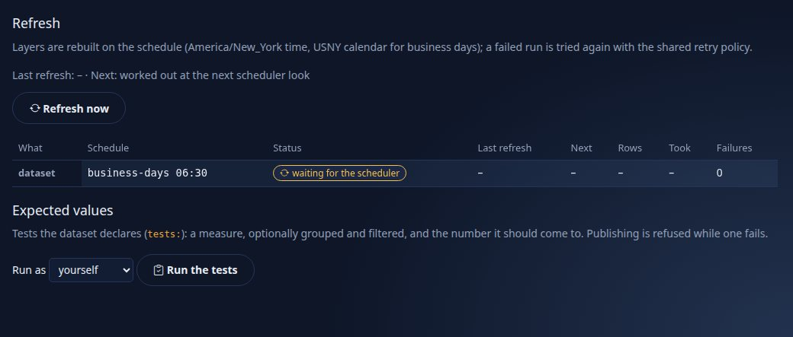

You should see one row: `dataset`, the schedule `business-days 06:30` and the status `waiting for the scheduler` before its first run. The same state over REST:

```text
$ curl -s -H "Authorization: Bearer $DRISHTI_TOKEN" http://localhost:18480/api/v1/bi/datasets/<the dataset's id>/refresh
{"enabled":true,"scheduled":true,"zone":"America/New_York","calendar":"USNY","dataset":{"status":"waiting for the scheduler","schedule":"business-days 06:30"},"tables":[]}
```

Do not wait for 06:30. **Refresh now** is the same call a schedule makes (it needs the BI author power):

```text
$ curl -s -X POST -H "Authorization: Bearer $DRISHTI_TOKEN" -H 'Content-Type: application/json' -d '{}' http://localhost:18480/api/v1/bi/datasets/<id>/refresh
```

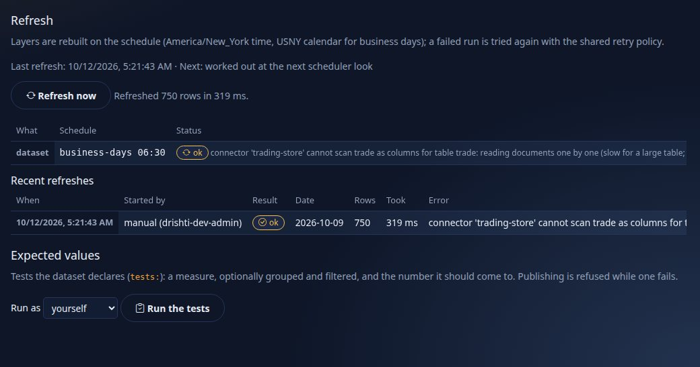

You should see the status `ok`, the time of the last run and a note, and above the table the line *Last refresh ... · Next ...*, the **Refresh now** button (for people with the BI author power: it asks for the refresh, then for its state until it is done, and says *Refreshed 750 rows in 319 ms*) and **Recent refreshes**: every run, newest first, with who or what started it (`schedule`, `after-load trade`, `retry`, `manual (drishti-dev-admin)`), the rows, the time and any error. The history and the state are kept in the BI store, so they are still there after a restart (a run the restart interrupted shows as `interrupted`).

The status also carries a note. (This one says the demo connector reads the trade documents one by one instead of scanning columns, which is slower on a big table and fine on the demo; the refresh worked.) A refresh that fails is
**retried** with the shared retry policy (5 s, doubling, up to 5 minutes; after four tries it is `failed` until its next time), and the dataset page says so.

## Step 2 · Subscribe a colleague to a report

Open the shipped report **World economics** and press **Subscribe** in the toolbar (beside the export buttons).

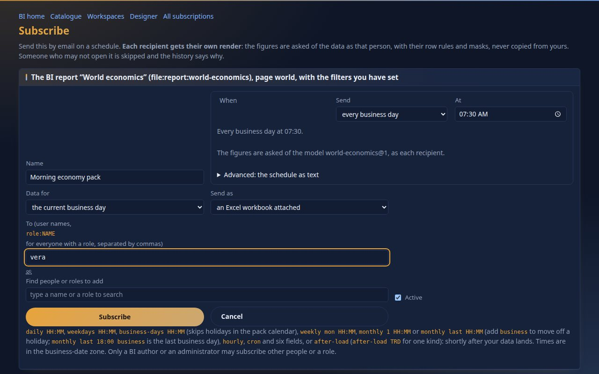

You should see the form with the target named at the top (`The BI report "World economics", page world, with the filters you have set`): a subscription keeps the page and the slicer choices you had on the screen. Name it `Morning economy pack`, set **When** `business-days 07:30`,
**Send as** *an Excel workbook attached* (the other forms are the email itself with the tables in the body, and a PDF), and **To** `vera`. **To** takes user names and `role:NAME`, **never an email address**: each person gets the report asked of the data **as that person**, with their own row rules and masks, and an outside address has no rights to ask as.
Press **Subscribe**.

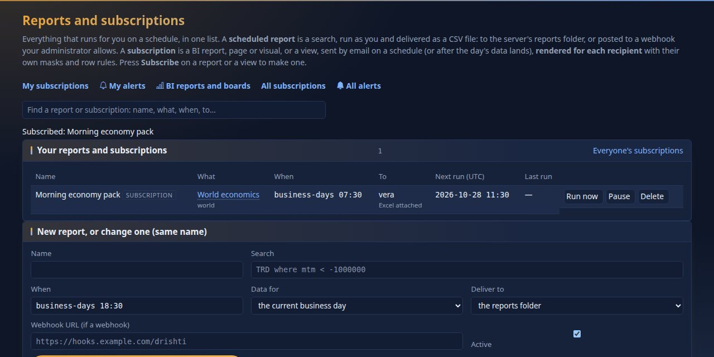

You should see `Morning economy pack` badged `SUBSCRIPTION`, the report, `business-days 07:30`, `vera` with `Excel attached`, and the next run in UTC (07:30 New York on the next business day: `11:30`). Press **Run now**.

## Step 3 · What "Run now" says without a mail server

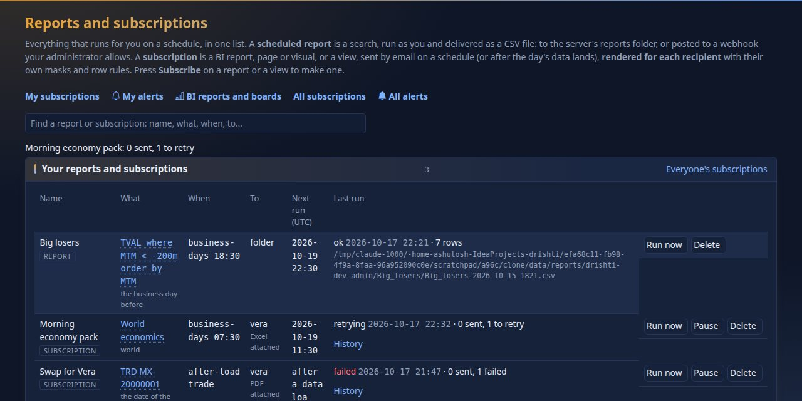

You should see `Morning economy pack: 0 sent, 1 to retry` and the last run `retrying`. Open **History**:

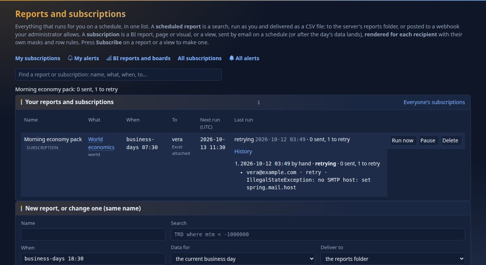

You should see `vera@example.com · retry · IllegalStateException: no SMTP host: set spring.mail.host`. That is the honest answer: Drishti built vera's copy, had nowhere to send it, and will **retry** (4 attempts, then `failed`, as in the picture of the next step). Nothing is lost silently, and
a recipient without an address on their account is shown as `skipped · no email address on file`.

**To configure mail** you need four things on the **server** (not the console): an SMTP host, the collaboration email switch, the console's address (for the links in the mail) and a From address. In the environment, before the server starts:

```bash
export SPRING_MAIL_HOST=smtp.example.com SPRING_MAIL_PORT=587          # your mail server
export SPRING_MAIL_USERNAME=drishti SPRING_MAIL_PASSWORD=...          # if it asks for sign-in; keep the password out of files
export SPRING_MAIL_PROPERTIES_MAIL_SMTP_STARTTLS_REQUIRED=true         # for any server reached over a network
export SPRING_MAIL_PROPERTIES_MAIL_SMTP_CONNECTIONTIMEOUT=10000 SPRING_MAIL_PROPERTIES_MAIL_SMTP_TIMEOUT=10000
export DRISHTI_COLLAB_EMAIL_ENABLED=true
export DRISHTI_CONSOLE_URL=https://drishti.example.com                  # where links in the mail point
export DRISHTI_MAIL_FROM=drishti@example.com
```

(The same keys as `spring.mail.host` and so on in the server's `application.yml`; [OPERATIONS.md](../admin/OPERATIONS.md) and [CONFIGURATION.md](../admin/CONFIGURATION.md#email-springmail-and-the-outbox) have all of them.) To try it **without sending anything anywhere**, use the catcher that ships with this
tutorial: a small program that accepts any mail on your machine and writes each message to a file.

```bash
python3 docs/tutorials/data/smtp-catcher.py 1025 caught-mail &
export SPRING_MAIL_HOST=127.0.0.1 SPRING_MAIL_PORT=1025 DRISHTI_COLLAB_EMAIL_ENABLED=true DRISHTI_CONSOLE_URL=http://localhost:17480 DRISHTI_MAIL_FROM=drishti@desk.example
# then start the server as in tutorial 1
```

You should see `catching mail on 127.0.0.1:1025, writing to caught-mail/` from the catcher. (Collaboration email needs sign-in on, which tutorial 1 set.) Restart the server with those variables, open **Reports** and press **Run now** again.

## Step 4 · Run now, with a mail server

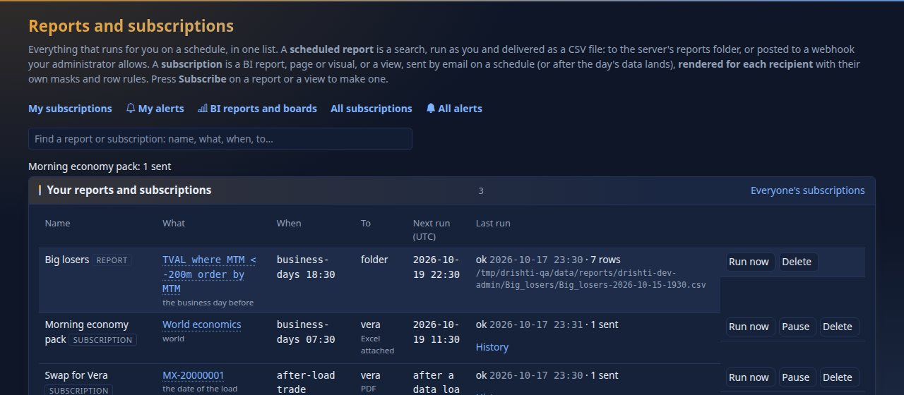

You should see `Morning economy pack: 1 sent` and the last run `ok`.

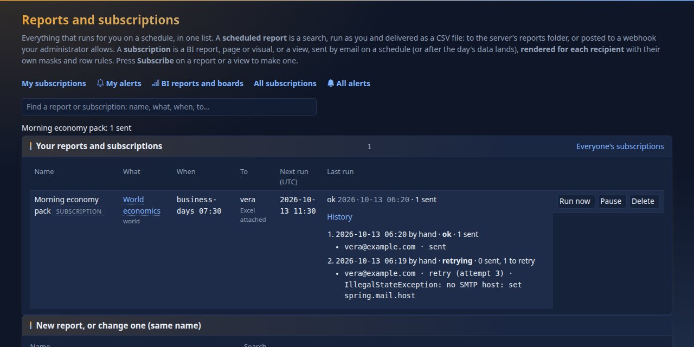

You should see both runs in the history: the new one `ok · 1 sent` and, beneath it, the earlier one `failed · 0 sent, 1 failed` with `failed (attempt 4) · no SMTP host`. Look at what the catcher caught:

```text
$ python3 - <<'PY'
import email; from email import policy
m = email.message_from_bytes(open("caught-mail/001.eml", "rb").read(), policy=policy.default)
print(m["From"], m["To"], m["Subject"], m["Auto-Submitted"], sep="\n")
print(m.get_body(("plain",)).get_content())
print([p.get_filename() for p in m.iter_attachments()])
PY
drishti@desk.example
vera@example.com
Drishti: World economics · 2026-10-09
auto-generated
World economics · 2026-10-09

World economics
Page: World · Data as of 2026-10-09
Filters: none beyond the report's own

The report is attached: World economics.xlsx
- Economies: 1 rows
- GDP (USD bn): 1 rows
- Population (m): 1 rows
- Average growth: 1 rows
- GDP per capita (USD): click a country to filter and to open its regions: 213 rows
- Largest economies (GDP, USD bn): 10 rows
- The economies: 213 rows

Open it in Drishti:
http://localhost:17943/bi/r/file%3Areport%3Aworld-economics/world

You are receiving this because you are a recipient of a subscription in Drishti. The figures are the ones you are entitled to see; they are rendered for you, not copied from the sender.
Ask the owner of the subscription, or an administrator, to change or stop it.

['World economics.xlsx']
```

You should see a mail from your From address to `vera`'s address, marked `Auto-Submitted: auto-generated`, with each visual and how many rows it holds, a link that opens the report in Drishti, and the workbook attached (25,193 bytes here). The link is built from `DRISHTI_CONSOLE_URL`.

## Step 5 · An alert on a number

An alert watches **one number** and tells you when it crosses a limit, changes too much or does not arrive. Open the shipped **Trades overview**. Each card has a **bell** in its corner: *Alert me*.

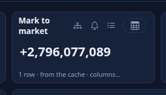

You should see the card (`Mark to market`, `+138,562,638` in this data) and the bell. Press the bell: the form opens already filled in with the report, the page and the visual.

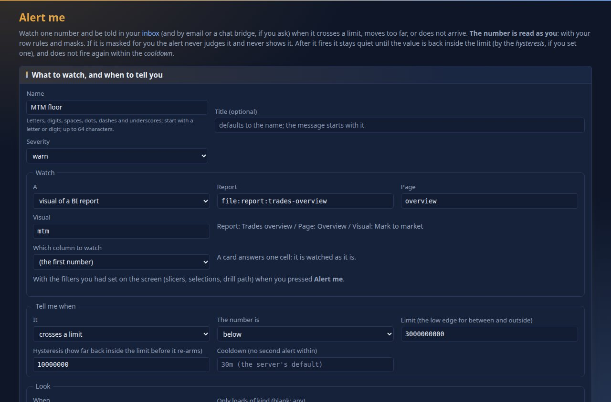

Name it `MTM floor`. **Watch** says what (this visual, with the filters you had set). **Tell me when**: *crosses a limit*, *below* `200000000` (a limit above today's number so you see it fire; a real floor would be a loss limit), **Hysteresis** `10000000`: after it fires it stays quiet until the number has come back **inside** the limit by at least this much, so a number
that wobbles around the limit does not ring every minute. **Look**: *after a data load* (the others are *on a schedule* such as `hourly`, and *live*, when the source pushes changes). Press **Check now** (it says what the alert would do right now) and **Save**.

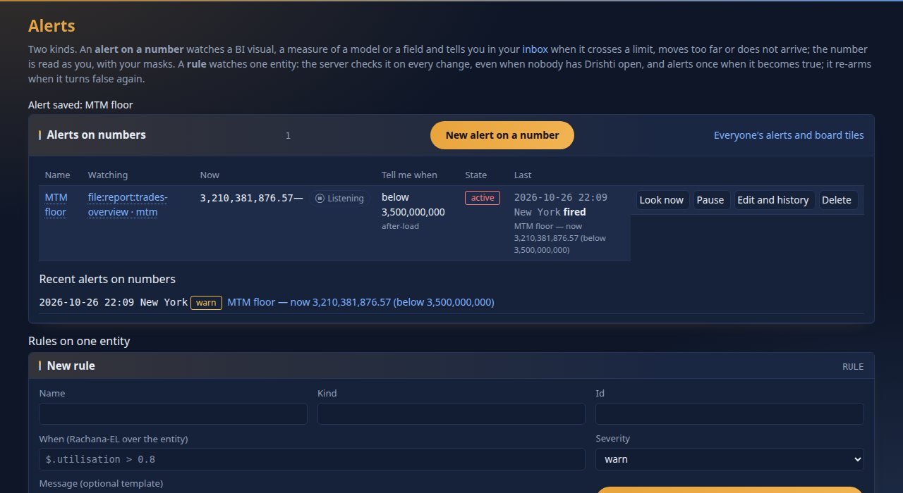

You should see the alert under **Alerts on numbers** with the state `active` (it fired when saved: a new alert whose condition already holds fires at once) and the message `MTM floor - now 138,562,638 (below 200,000,000)`. The states: **armed** (watching), **active** (fired, will not fire again until it re-arms),
**paused** (you switched it off). Open **Edit and history**.

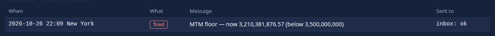

You should see one entry per firing, clearing or skipped look with the time, what triggered it, the number and the channel result (`inbox: ok`). The alert reads the number **as you**: a number masked for you is never judged and never shown. The message also lands in the **inbox**, under **Alerts**:

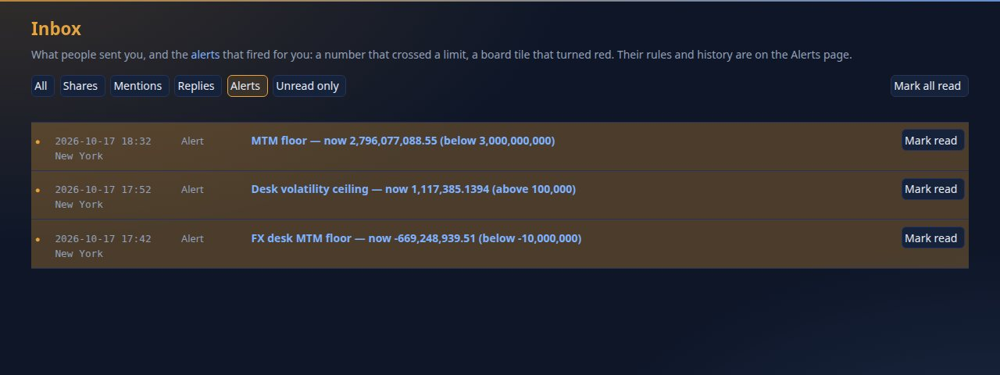

You should see the row (and one more for every firing); it opens what the alert is about. With the mail server of step 4 and an address on your account, tick **Email** in the form and the same message arrives as `Drishti alert: MTM floor`. Alerts do not retry mail: the next firing is a new mail.

## Step 6 · Export: PDF, PNG, Excel, CSV

The **Export** bar is under the page tabs of every report: choose *this page* or one visual, then a format.

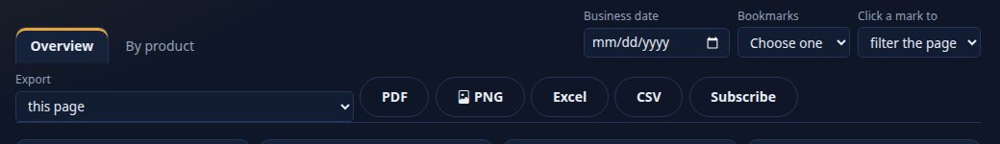

You should see the bar. Press **PNG**, or fetch a page directly (the console serves exports at `/dist/bi/<report id>.<format>`; it is a signed-in call, shown here with the file written):

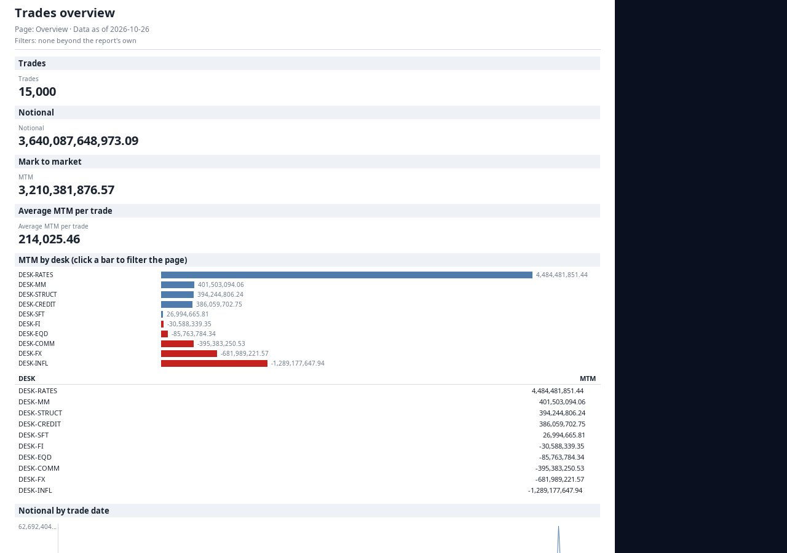

You should see the cards as their figures, the charts as horizontal bars and their data tables, the title and the data date at the top. The same page as Excel and CSV, as the person who sees everything:

```text
Trades overview.xlsx   13,760 bytes   sheets:  About | Trades | Notional | Mark to market | Average MTM per trade |
                                                MTM by desk (click a bar to fil | Notional by trade date | Trades by desk and currency
Trades overview.pdf    20,402 bytes   15 pages (a page of the report has many rows; a table keeps its header on each page)
Trades overview.png    526,446 bytes
```

An Excel file has an `About` sheet (the title, the date, the filters) and **one sheet per visual**, with numbers as numbers; sheet names are cut at Excel's 31 characters. The CSV of one visual (choose it in the bar's first box, or add `&visual=by-desk` to the address):

```text
GET http://localhost:17480/dist/bi/file%3Areport%3Atrades-overview.csv?page=overview&visual=by-desk      (what the CSV button asks for)
desk,MTM
DESK-RATES,161766771
DESK-COMM,16954390
DESK-STRUCT,15784130
DESK-MM,9453242
DESK-CREDIT,7948456
DESK-SFT,-240890
DESK-FI,-2977676
DESK-EQD,-6433670
DESK-FX,-15759419
DESK-INFL,-47932696
```

You should see a header row and one line per desk. Every export carries your **business date and slicer choices**, is built as you (masked fields stay masked), and is audited; limits (rows per sheet, file size, time) are settings of `drishti.distribution.export.*`. [DISTRIBUTION.md](../guides/DISTRIBUTION.md) has them.

## Step 7 · Say what a number should be

A report or a dataset may declare the numbers it must show, as `tests:`. Add this to a copy of the dataset (the tutorial's file, [data/trades-daily.dataset.yaml](data/trades-daily.dataset.yaml), is enough; the demo book holds 750 trades):

```yaml
tests:
  - { name: The book holds 750 trades, measure: Trades, expect: 750 }
  - { name: Trades within a range, measure: Trades, expect: { min: 745, max: 755 } }
  - { name: Close to 100 trades, measure: Trades, expect: 100, tolerance: 1% }
```

Save it, open the dataset and scroll to **Expected values**: choose who to **Run as** (yourself, or a role you hold) and press **Run the tests**:

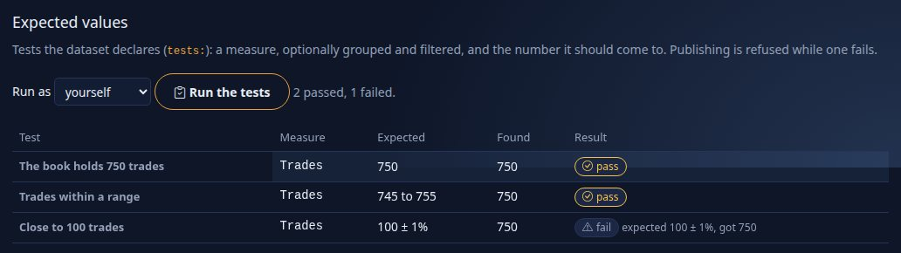

You should see two `pass` and one `fail` that says what it expected and what it found. The designer's **Check** shows the same list for a report's tests. Now press **Publish** on the item's page:

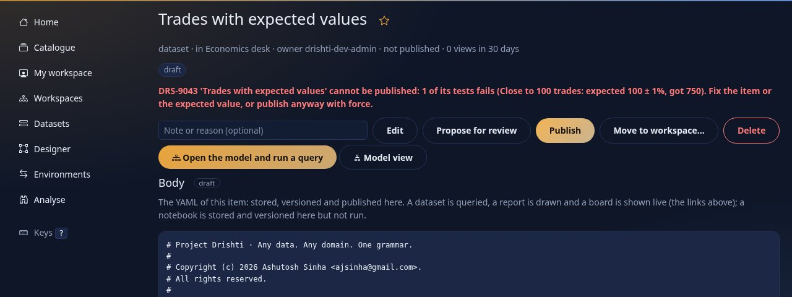

You should see `DRS-9043 'Trades with expected values' cannot be published: 1 of its tests fails (Close to 100 trades: expected 100 +- 1%, got 750).` Mend the expectation (or the data) and publish again; a `bi-admin` may publish anyway with `force`, and the audit log says so. The same words work in a report, where a test can also name a visual (`visual: trades`). [REPORTS.md section 17](../guides/REPORTS.md#17-expected-values-tests).

## Next steps

- [Tutorial 12](12-live-bi-and-boards.md): data that moves, and a wall of tiles that turn red.
- [DISTRIBUTION.md](../guides/DISTRIBUTION.md): every schedule word, retries, alerts on datasets and fields, chat bridges, board notifications.
- [Tutorial 9](09-reports.md) for scheduled searches and the Reports page.

## If something goes wrong

| You see | Meaning |
|---|---|
| `no SMTP host: set spring.mail.host` | the server has no mail settings; set them as in step 3 and restart **the server** |
| `DRS-9061` on Subscribe | an email address was typed in To; use user names and `role:NAME` |
| `skipped · no email address on file` | the recipient's account has no email; add it in Admin, Users |
| `skipped` for a recipient who may not open the report | give them the role the report's audience asks for; the history names the reason |
| Refresh stays `waiting for the scheduler` | its time has not come, or the scheduler is off on this server (`drishti.bi.refresh.enabled`) |
| the alert says `masked for you` | the number is masked for your role; an alert never judges what you may not see |
| `DRS-9060` on an export | over an export limit; the message names the setting |
