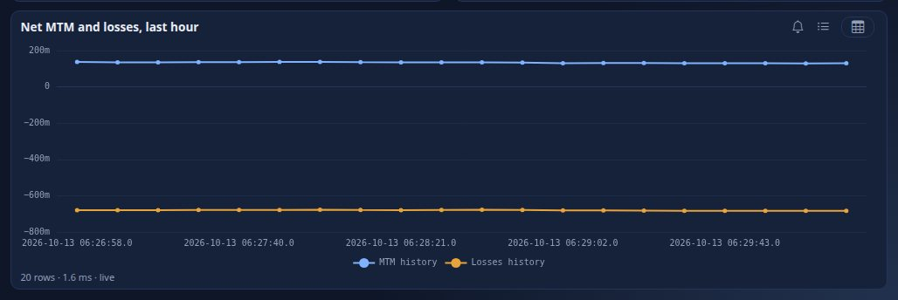
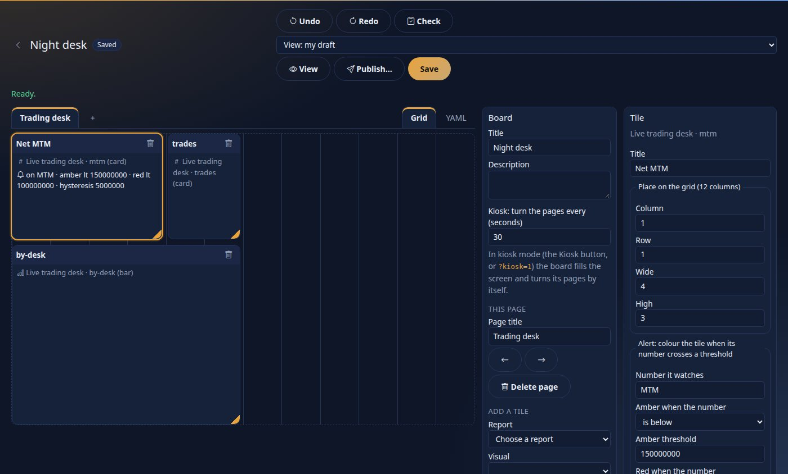
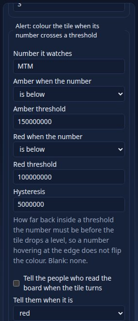
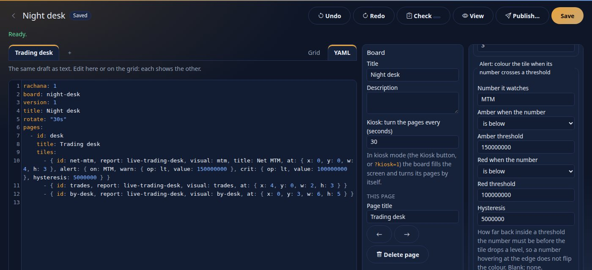

<!--
  Project Drishti · Any data. Any domain. One grammar.

  Copyright (c) 2026 Ashutosh Sinha <ajsinha@gmail.com>.
  All rights reserved.

  PROPRIETARY AND CONFIDENTIAL.

  This file is the confidential and proprietary property of Ashutosh Sinha.
  Unauthorised copying, use, modification, distribution or disclosure of this
  file, via any medium, is strictly prohibited except with the express prior
  written permission of the copyright holder.

  See the LICENSE file in the root of this repository for the full terms.
-->
# Tutorial 12 · Live BI and boards

So far every number was as of the last time a layer was built. This tutorial is about numbers **as they are**. You watch the demo market tick (a curve that moves as a whole, not one cell at a time), look at a **live table**, open a report that redraws itself as the trades
change and **pause** it, then put a **Desk wall** of live tiles on a screen in **kiosk mode**. Every step shows it **in the UI**, **on the command line**
(`python3 tools/drishti.py`, or `curl` where the tool has no command) and **as YAML** (the file the UI reads or writes), or says why one of the three does
not apply.

## Time to complete

About 30 minutes.

## Before you start

- [Tutorial 10](10-first-bi-report.md) done (you know the report viewer). The shipped samples used here, the dataset **Live trading desk**, the reports **Live trading desk** and **Live exposure** and the boards **Desk wall** and **Python wall**, are in every server's `config/bi/`.
- **Live and the model layer (2.2).** The two live samples are still **version 1 datasets** (`rachana: 1`): they move to the model layer in wave W3, and
  their reports keep reading them meanwhile. The converter has already made a **model** of each (`live-trading@1`, `live-exposure@1`) over the same live
  table, so a model query, Analyse and an alert on a measure of a model read the live rows too (step 2).
- The personal API token of [tutorial 1, step 9](01-first-15-minutes.md#step-9--make-a-token-for-the-command-line) in `DRISHTI_TOKEN`, and
  `DRISHTI_SERVER` (default `http://localhost:18480`).
- **A source that ticks.** The demo lakes are daily snapshots: they do not move, so on the quick-start server (**Drishti server (demo lakes)**, which sets
  `DRISHTI_DEMO_ENABLED=false`) a live visual's chip says **Listening** (following, nothing has changed) rather than **Live**, and a live table follows
  the first 2,000 trade valuations of the lake (`drishti.bi.live.follow-max`) and says so. For this tutorial **turn the demo ticker on**: edit the run
  configuration **Drishti server (demo lakes)** and set `DRISHTI_DEMO_ENABLED` to `true`, or start the server with it
  ([data/testdata/README.md](../../data/testdata/README.md), "The demo ticker"). The demo source then changes the live trade valuations about twice a
  second and the market data every few seconds; a sample answers before the lake for an id both hold, and the lakes still answer every other id. With a
  real source the same pages follow your own live connector ([DEMO_CONNECTOR.md](../connectors/DEMO_CONNECTOR.md), [DATA_LOADS.md](../guides/DATA_LOADS.md)).

## What you will learn

- what "live" means for data (a source that **pushes**) and why the demo's live data is **coherent**: related numbers move together;
- the `mode: live` table of a dataset and how to see how it is doing;
- the live indicator of a report, **Pause** and **Resume**, and what redraws;
- a **board**: tiles from several reports, amber and red tiles from their alert rules, pages that turn on their own, and **kiosk mode**;
- the **history** of a live table (a line that is there when the page opens) and the **board designer**, with a tile alert that does not flicker (hysteresis);
- a **chart of the desk by currency** (the server groups, the browser draws) and a **wall of Python** tiles.

## Step 1 · Live data moves together

Open a rate curve in the terminal: type `CRV CRV-USD-BASIS <GO>`, or open `/v/ir-curve/CRV-USD-BASIS`.


You should see the key figures at the top (`10Y 3.7656%`, `2s10s +21.2 bp`), the **Zero rates** chart, a **1Y forward** chart and the **Pillars** table (tenor, instrument, quote, zero rate, discount factor), and `updated 1 s ago` at the bottom: the page is live. Wait ten seconds.


You should see `10Y` at `3.7990%` and `2s10s` at `+21.5 bp`, the chart with a new shape and **every row of the table changed**, not just the 10Y cell: the quote, the zero rate and the discount factor of each tenor. A real market does not move one number: when the 10-year rate ticks, the whole curve, its forwards, its
discount factors and its slope tick with it, and the demo does the same (a "coherent walk": one random draw moves a headline and everything that depends on it; [DEMO_CONNECTOR.md](../connectors/DEMO_CONNECTOR.md) section 7.4). The command line prints the same view as text, as of the moment you ask:

```text
$ python3 tools/drishti.py view get ir-curve/CRV-USD-BASIS
Market data · Interest rate curve  CRV-USD-BASIS   [CRV]

Key figures
  figure    value
  --------  --------------------
  Currency  USD
  Type      Cross-currency basis
  Index     SOFR
  10Y       3.8200%
  2s10s     +22.6 bp
  Points    12
  As of     2026-10-16

Zero rates (%)  (line, curve, F2)
  series          points   first    last     min     max
  --------------  ------  ------  ------  ------  ------
  Zero rates (%)      12  3.6824  3.8289  3.5938  3.8289
  x: 1M .. 30Y

Pillars  (table, points, F3)
  Tenor  Instrument          Quote  Zero      DF
  -----  ----------------  -------  ----  ------
  1M     Deposit / future  3.6768%  3.68  0.9969
  3M     Deposit / future  3.6609%  3.68  0.9908
  6M     Deposit / future  3.6352%  3.67  0.9818
  1Y     Basis swap        3.5760%  3.64  0.9642
  ...
Linked entities  (links, refs)
  link          text      status    opens
  ------------  --------  --------  --------------------
  Calendar      CAL-USNY  resolved  calendar/CAL-USNY
  Fixing index  FIX-SOFR  resolved  rate-fixing/FIX-SOFR

source market-store gen 6  layout Sutra ir-curve v1 + inference  built in 8.58 ms
```

You should see the table form of the same page. This one was asked of the quick-start server with the ticker **off**, so the source line names
`market-store` (the `market-data` pack's Delta connector) and the figures are the lake's close of 2026-10-16; with the ticker on, the demo source answers
first, the source line names it and every call gives other figures (they are ticking). That is **live data**: a connector that **pushes**
changes instead of waiting to be asked. BI uses it through a live table. **The YAML** of a source that pushes is a connector's file; the demo's ticking needs
none (it is built in), and a real one looks like the Kafka connector the `trading` pack suggests, `trading-stream` (written to
`config/connectors/trading-stream.yaml` at the server's first start; off until you switch it on):

```yaml
plugin: kafka
enabled: ${DRISHTI_STREAM_TRADING:false}
kinds: [trade]
settings:
  bootstrap-servers: ${DRISHTI_KAFKA_BOOTSTRAP:localhost:9092}
  topics: ${DRISHTI_TRADING_TOPIC:drishti.trading.trades}
  kind: trade
  id-field: TRADE_ID                # which field says which trade a message updates
  stale-after: ${DRISHTI_STREAM_STALE_AFTER:15m}
```

## Step 2 · A live table

Open **Datasets** and **Live trading desk** (a version 1 dataset: its page is the 2.1 one, with **Layers**). Its trade table is declared with `mode: live`
over the `market-risk` pack's **trade valuations** (`config/bi/datasets/live-trading.dataset.yaml`):

```yaml
tables:
  trade:
    source:
      kind: trade-valuation     # no connector named: whichever running connector serves trade valuations and can push them (the demo ticker here)
    mode: live
    live:
      rows: 5000                # the most rows it keeps
    columns:
      VALUATION_ID:  { type: string, key: true }
      TRADE_ID:      string
      DESK:          string
      ...
      MTM:           { type: decimal, format: signed0 }
```

The engine keeps this table **in memory** and applies each change as the source pushes it. Scroll to **Layers on disk**: a live table has no dates on disk; it says how it is doing.


You should see the table `trade`, the mode `live` and its state, and the dataset's second table, `history` (step 7). Over REST (there is no `drishti.py`
command for layers; captured with the ticker on):

```text
$ curl -s -H "Authorization: Bearer $DRISHTI_TOKEN" $DRISHTI_SERVER/api/v1/bi/datasets/file:dataset:live-trading/layers
{"tables":[{"mode":"live","partitions":[],"table":"trade","live":{"table":"trade","kind":"trade","state":"live","rows":750,"entities":750,"subscribed":750,
  "pushes":true,"seq":23065,"epoch":0,"generation":71,"lastUpdate":"2026-10-13T06:27:39.43Z","startedAt":"2026-10-13T06:26:46.90Z","applied":23065,"skipped":5,
  "evicted":0,"deleted":0,"error":null,"aggregates":[{"rollup":"byDeskBook","groups":572,"incremental":45380,"recomputedGroups":16180}]}},
 {"mode":"history","partitions":[],"table":"history","history":{"table":"history","every":"PT10S","keep":360,"samples":5,"lastSample":"2026-10-13T06:27:40.03Z","error":null}}]}
```

You should see `state: live`, the rows and the entities followed (`subscribed`), `pushes: true`, and a count of changes applied (23,065 in the
first minute here, 5 skipped because the value had not changed). With the ticker **off** the same call says `"state": "stale"`, `"rows": 2000` and
`"error": "following the first 2000 trade-valuation entities of more (drishti.bi.live.follow-max)"`: the lake's 15,000 trade valuations are more than a
live table follows, and nothing pushes. A live table starts when it is first used and is closed after ten idle minutes. The
queries are the ones of any dataset: a live table is just another layer that answers them.

**The same table through the model layer.** The model the converter made of this sample, `live-trading@1`, reads the trade table as its one fact (the
dataset `live-trading-trade`, `mode: live`), with the dataset's measures:

```text
$ python3 tools/drishti.py bi model describe live-trading@1
Live trading desk  (live-trading@1)

trade  fact  live-trading-trade 1.0.0
  trade.VALUATION_ID                 string    key
  trade.TRADE_ID                     string    dimension
  trade.SOURCE_SYSTEM                string    dimension
  trade.DESK                         string    dimension
  ...
  trade.NOTIONAL                     decimal   amount        amount0
  trade.MTM                          decimal   amount        signed0
  trade.PNL_1D                       decimal   amount        signed0

measures
  Trades                            count(trade)
  Notional                          sum(trade.NOTIONAL)
  MTM                               sum(trade.MTM)
  PnL 1d                            sum(trade.PNL_1D)
  Losses                            sum(trade.MTM, where=trade.MTM < 0)
  Worst trade                       min(trade.MTM)
  Best trade                        max(trade.MTM)
  MTM history                       sum(history.MTM)
  Losses history                    sum(history.Losses)
  Trades history                    sum(history.Trades)
  Count of trade                    count(trade)  (default)
```

**Kept by group, not recomputed.** The dataset declares a rollup over the live table:

```yaml
rollups:
  - { name: byDeskBook, table: trade, by: [DESK, PORTFOLIO, PRODUCT_TYPE, CURRENCY], measures: [Trades, Notional, MTM, PnL 1d, Worst trade, Best trade] }
```

The engine keeps the sums, counts, minimums and maximums **by group** as each change arrives: a row that changes takes its old values out of its group and
puts the new ones in (a sum moves by the difference; a minimum is read again for that one group only when the row that held it changed). A query the
rollup can answer reads those few rows, not every trade. Ask the desk bar as one model query, with the SQL it ran (`options: { explain: true }`, for BI
authors); the query is the file [data/live-desk.mq.yaml](data/live-desk.mq.yaml):

```yaml
mq: 1
model: live-trading@1
select:
  fields: [trade.DESK]
  measures: [Trades, Notional, MTM, Worst trade]
limit: 3
options: { explain: true }
```

```text
$ python3 tools/drishti.py bi mq docs/tutorials/data/live-desk.mq.yaml
trade.DESK   Trades  Notional           MTM            Worst trade
-----------  ------  -----------------  -------------  -------------
DESK-COMM    90      11,359,000,000.00  16,439,974.00  -3,381,167.00
DESK-CREDIT  72      8,598,000,000.00   7,967,236.00   -5,843,533.00
DESK-EQD     132     15,806,000,000.00  -6,446,732.00  -5,477,087.00
3 row(s)  as of 2026-10-13  plan p_a1be77c2c7dc5d14  layer live (rollup byDeskBook)
sql: SELECT "trade"."DESK" AS "trade.DESK", (CAST(coalesce(sum(m0), 0) AS BIGINT)) AS "Trades", (sum(m1)) AS "Notional", (sum(m2)) AS "MTM",
     (min(m4)) AS "Worst trade" FROM (SELECT * FROM live_1_agg0) AS "trade" GROUP BY "trade"."DESK" ORDER BY "trade.DESK" ASC LIMIT 3
```

(With the ticker off the same file answers from the first 2,000 trade valuations it follows, all of them `DESK-COMM` on the demo lake, and says
`warning: live trade: following the first 2000 trade-valuation entities of more (drishti.bi.live.follow-max)`.)

You should see `layer live (rollup byDeskBook)`, and the FROM reads `live_1_agg0`, the kept groups. The layer line above says how it is going:
`{"rollup": "byDeskBook", "groups": 572, "incremental": 45380, "recomputedGroups": 16180}` after about a minute of ticks (572 groups; 45,380 rows moved by
difference; 16,180 groups whose minimum or maximum was read again). The reader's row rules and masks still apply on top. A measure that is not a plain
sum, count, minimum or maximum of a column (`Losses` has a condition inside) is computed over the rows as before; `drishti.bi.live.incremental-aggregates:
false` turns this off. [DATASETS.md section 7.1](../guides/DATASETS.md#71-live-tables-phase-5).

## Step 3 · A report that follows it

Open the report **Live trading desk** (**Catalogue**, or `BI live trading desk <GO>`).


You should see, above the pages, the **live indicator** `Live · Last update 02:28:35` with a **Pause** button (`Listening` when the ticker is off); five
cards (trades, notional, net MTM, losses, one-day P&L), a bar of MTM by desk, and a **rolling line**. Every frame says `live` in its footer, most
of them `live (byDeskBook)`: the layer that answered is the in-memory table, and its kept groups. Watch for a few seconds:

- the **cards** flash when their number changes and the **bars** change length, but the chart is the same chart drawn over (not rebuilt), and a table keeps its scroll position. At most four redraws a second, however fast the source ticks;
- the **rolling line** adds a point on each update and keeps the latest 120: it shows how the numbers moved since you opened the page (the browser keeps the points; the server keeps no history of an aggregate);
- slicers are not redrawn (they keep their open state), but a choice still filters every update.

Press **Pause**.


You should see `Paused` and a **Resume** button; the pictures hold still while the server keeps ticking. Press **Resume**.


You should see `Live` again and the page **catch up at once** to the table as it is now. If the connection drops (stop the console to see it) the page says so, keeps what it has and redraws everything when the stream is back. The second page, **Every trade**, is a grid of every trade the live table follows:


You should see every trade with its id, desk, portfolio, product type, currency, buy/sell code, trader, notional, MTM and P&L, the rows redrawn as they
tick. It is Drishti's own grid of the rows the server sends: no BI page computes anything in the browser (a 2.1 report's `perspective-grid`,
`perspective-pivot` or `perspective-chart` visual is drawn the same way, and the server does the grouping). Everything is **as you**: sign in as someone
whose role does not hold the raw power and the same page shows `•••` in the `TRADER_ID` column on every tick (the dataset's `masked: [TRADER_ID]`),
because each tick makes your page ask again, as you.

**On the command line** one visual of the report is one call, the one the page makes on every tick (`state` holds the slicers and selections; the answer
says the layer, and `live` how the table is doing):

```text
$ curl -s -X POST -H "Authorization: Bearer $DRISHTI_TOKEN" -H 'Content-Type: application/json' -d '{"page":"desk","visual":"by-desk","state":{}}' \
    $DRISHTI_SERVER/api/v1/bi/reports/file:report:live-trading-desk/query
{"columns":[{"name":"trade.DESK","type":"string"},{"name":"MTM","type":"decimal"}],
 "rows":[["DESK-RATES",1.59591729E8],["DESK-COMM",1.6439974E7],["DESK-STRUCT",1.578413E7], ...],"rowCount":10,
 "meta":{"layer":"live","rollup":"byDeskBook","rows":10,"millis":1.34,...},"visual":"by-desk",
 "live":{"generation":71,"state":"live","tables":[{"table":"trade",...}]}}
```

**The YAML** of the two live visuals of the page (the report is `config/bi/reports/live-trading-desk.report.yaml`): a bar is any bar, the rolling line is
its own type, and nothing says "live" because the dataset does:

```yaml
      - { id: by-desk, type: bar, title: Net MTM by desk, at: { x: 0, y: 2, w: 6, h: 5 }, wells: { axis: [trade.DESK], values: [MTM] } }
      - id: rolling
        type: live-chart               # a rolling line: each update of the table adds a point; the window keeps the latest 120
        title: Net MTM and losses, rolling
        at: { x: 6, y: 2, w: 6, h: 5 }
        wells: { values: [MTM, Losses] }
        format: { window: 120 }
```

## Step 4 · A wall for the desk: a board

A **board** puts the visuals of several reports on one screen. Open **Catalogue → Desk wall** (`/bi/b/file:board:desk-wall`).


You should see tiles of different sizes: the cards and charts of the Live trading desk, and two tiles outlined in **amber**, *Net MTM* (`+133,848,805`) and *Losses*, whose footers say `warning`. The colour comes from **alert rules in the board's file**, not from the report:

```yaml
pages:
  - id: desk
    title: Trading desk
    tiles:
      - { id: net-mtm, report: live-trading-desk, visual: mtm, title: Net MTM, at: { x: 0, y: 0, w: 3, h: 3 },
          alert: { on: MTM, warn: { op: lt, value: 150000000 }, crit: { op: lt, value: 100000000 }, hysteresis: 5000000 } }
```

A tile is a visual of a report (the report supplies the data, **as the person looking**) placed on a 12-column grid, with an optional `alert`: amber when the `warn` condition holds, red when `crit` does, and the footer says the word as well, so colour is never the only signal. Net MTM below 150 million is a warning, below 100 million critical;
the live net MTM here (`+133,848,805`) is under 150 million, hence amber. A tile that turns red can also **tell people** (`notify:`, in the board's YAML; [BOARDS.md](../guides/BOARDS.md) section 4). The second page is another report over another live dataset:


You should see the tab **Counterparty exposure** with exposure tiles from the report *Live exposure*. Pages are tabs; a board can hold as many as you like.
**On the command line** the board is an item of the catalogue like any other:

```text
$ python3 tools/drishti.py bi catalogue get file:board:desk-wall
file:board:desk-wall board    promoted  published v1   Desk wall  (Shipped content, shipped)
  The trading desk and the counterparty exposure on one live wall. Tiles turn amber and red as the numbers cross their thresholds.
  tags: sample, trading, counterparty-risk, live, streaming, tutorial   views: 0   audience: {'roles': [], 'users': [], 'packs': []}
```

(`--body` prints its YAML.)

## Step 5 · Kiosk mode

Go back to the first page and press **Kiosk** (or press `k`, or add `?kiosk=1` to the address, which is how a wall display opens it).


You should see the menus gone and the wall filling the screen: the Net MTM and Losses tiles large, the amber outline and the word `warning` under each, the rolling line, the worst trades and the latest changes, `Live · Last update` and **Next page every 20 s**. The pages turn by themselves
(the board's `rotate:` setting). Keys: `Esc` leaves kiosk, `p` pauses the turning, the arrow keys change page. A phone or a TV browser showing `?kiosk=1` is a desk display.
**The YAML** is one line at the top of the board, `rotate: 20s` (3 seconds to an hour; without it the console's `bi.board.rotate_seconds`, 30). There is no command line for kiosk mode: it is how a
browser shows a board, and the address `/bi/b/file:board:desk-wall?kiosk=1` is what a wall display is told to open.

## Step 6 · What a wall screen needs

- **A user for the screen.** The wall shows the data of whoever is signed in. Make a user for it (tutorial 17: users and roles) with the roles you want it to see, and sign the screen in once; a masked field stays masked.
- **The server's clock and calendar.** Dates on the wall are business dates of the server's calendar.
- **A board with a mistake** says what and where: `POST /api/v1/bi/boards/validate` answers `DRS-9052` (a tile that does not fit the grid, or names a report or visual that does not exist) and `DRS-9053` (a setting that is reserved). A board whose one tile is off the grid and names a visual the report does not have (captured):

```text
$ curl -s -X POST -H "Authorization: Bearer $DRISHTI_TOKEN" -H 'Content-Type: application/json' \
    -d '{"yaml":"rachana: 1\nboard: broken\ntitle: Broken\npages:\n  - id: p\n    title: P\n    tiles:\n      - { id: t, report: live-trading-desk, visual: nope, at: { x: 10, y: 0, w: 4, h: 2 } }\n"}' \
    $DRISHTI_SERVER/api/v1/bi/boards/validate
{"valid":false,"problems":[
  {"level":"error","code":"DRS-9052","path":"pages[0].tiles[0].at","message":"x is 0 to 11 and w is 1 to 12, and x + w is at most 12 (the grid has 12 columns); this is x=10, w=4"},
  {"level":"error","code":"DRS-9052","path":"pages[0].tiles[0].visual","message":"report 'Live trading desk' has no visual 'nope'"}], ...}
```

You should see, once the screen is signed in as that user, the wall with the figures of that user's roles, and nothing the roles mask.

## Step 7 · A line that remembers: the history of a live table

A live table holds only **now**. The rolling line of step 3 collects its points in the browser from the moment the page opened, so a refresh empties it. For a line that is there when the page opens, the dataset can **keep a history**: every ten seconds it works out a few measures over the live table and appends them to a bounded table of its own. The sample dataset says so in its `live:` block:

```yaml
    live:
      rows: 5000
      history:
        every: 10s
        keep: 360                 # an hour of samples
        measures: [MTM, Losses, Trades]
```

Open the **Live trading desk** report again, wait a minute, and scroll to the bottom of the **Desk** page.



You should see a line titled *Net MTM and losses, last hour* with a point for every ten seconds the dataset has been open (the sample dataset is sampled only while someone has it open, so on a freshly started server the line begins when you opened the page; reload it and the points are still there). The line is an ordinary `line` visual over the dataset table `history`: its axis is `history.ts` and its values are the generated measures `MTM history` and `Losses history`. [DATASETS.md](../guides/DATASETS.md#71-live-tables-phase-5) has the rest (grouping by a column, masks, the limits). **On the command line** the points are one visual's answer (five samples, the first minute; captured):

```text
$ curl -s -X POST -H "Authorization: Bearer $DRISHTI_TOKEN" -H 'Content-Type: application/json' -d '{"page":"desk","visual":"last-hour","state":{}}' \
    $DRISHTI_SERVER/api/v1/bi/reports/file:report:live-trading-desk/query
{"columns":[{"name":"history.ts","type":"string"},{"name":"MTM history","type":"decimal"},{"name":"Losses history","type":"decimal"}],
 "rows":[["2026-10-13 06:26:58.0",1.37081394E8,-6.79514802E8],["2026-10-13 06:27:08.0",1.35609682E8,-6.79996387E8], ...,
         ["2026-10-13 06:27:40.0",1.36071107E8,-6.7900859E8]],"rowCount":5,"meta":{"layer":"live","tables":["history"],...}}
```

The history is a table of the version 1 dataset. The model the converter made carries the history measures but not the `history` table yet, so the
last-hour line stays on the dataset until wave W3 moves the live samples.

## Step 8 · Lay out your own board

So far the board was a file. **Designer** in the BI rail starts one too: type a title under **Boards** and press **Start a board**, then pick a report and one of its visuals and press **Add tile**. Here is a board of three tiles from the live desk, with the *Net MTM* tile selected.



You should see the grid with the three tiles (each says which report and visual it shows), the tabs of the pages above it, **Board** settings on the right (title, the seconds between page turns in kiosk mode) and the **Tile** pane. Drag a tile by its header to move it, drag its corner to resize it, or focus it and use the arrow keys (with Shift to resize).

The selected tile's pane holds its alert:



*Net MTM* turns amber below 150 million and red below 100 million. The **hysteresis** of 5 million means a red tile stays red until the number is 5 million back above 100 million, so a number hovering at the edge does not flip the colour (and does not send a message each time). Press **Apply to the tile**.

The **YAML** tab shows the same board as text; edit either and the other follows.



**Save** stores a draft (nothing is published by saving); **View** opens it as a wall; **Publish...** goes to the board's page, where publishing is reviewed like any other item (tutorial 13).
**From the command line** the same board is the file [data/night-desk.board.yaml](data/night-desk.board.yaml), the YAML tab's text:

```yaml
rachana: 1
board: night-desk
title: Night desk
rotate: 30s
pages:
  - id: desk
    title: Trading desk
    tiles:
      - { id: net-mtm, report: live-trading-desk, visual: mtm, title: Net MTM, at: { x: 0, y: 0, w: 4, h: 3 },
          alert: { on: MTM, warn: { op: lt, value: 150000000 }, crit: { op: lt, value: 100000000 }, hysteresis: 5000000 } }
      - { id: trades, report: live-trading-desk, visual: trades, at: { x: 4, y: 0, w: 2, h: 3 } }
      - { id: by-desk, report: live-trading-desk, visual: by-desk, at: { x: 0, y: 3, w: 6, h: 5 } }
```

```text
$ python3 tools/drishti.py bi item new me docs/tutorials/data/night-desk.board.yaml
bi-a57e4089af  board  Night desk  draft in My workspace
```

It opens in the board designer at `/bi/design/board/<id>`; `bi catalogue publish <id>` publishes it once it is in a shared workspace.

## Step 9 · A chart of the desk by currency, and a wall of Python

The **Live trading desk** report has a fourth page, **Chart**: net MTM per desk, one stacked series per currency. The **Pivot** page before it is the same
question as a matrix. Both are worked out by the server (its standing queries since 2.3.0) and only drawn by the browser.


You should see one column per desk, each split into its currencies, redrawn as the trades tick. **The YAML** of the two visuals (the report's **Pivot** and
**Chart** pages):

```yaml
      - id: desk-currency
        type: matrix                    # the server groups and totals: desks down, currencies across
        title: Net MTM and notional by desk and currency
        wells: { rows: [trade.DESK], columns: [trade.CURRENCY], values: [MTM, Notional] }
      - id: mtm-chart
        type: column                    # the same question as a chart: a column per desk, one series per currency, stacked
        title: Net MTM by desk and currency
        wells: { axis: [trade.DESK], legend: [trade.CURRENCY], values: [MTM] }
        format: { stacked: true, labels: false }
```

To chart it another way, copy the report to your workspace, open the copy in the designer and change the visual's type (a bar, a line, a heatmap) or its
wells: the server answers the new question. **On the command line** the chart's numbers are one call, the one the page makes:

```
$ curl -s -H "Authorization: Bearer $DRISHTI_TOKEN" -H 'Content-Type: application/json' \
    $DRISHTI_SERVER/api/v1/bi/reports/file:report:live-trading-desk/query -d '{"page": "chart", "visual": "mtm-chart", "state": {}}'
{"columns": [{"name": "trade.DESK", "masked": false, "type": "string"}, {"name": "trade.CURRENCY", "masked": false, "type": "string"},
             {"name": "MTM", "masked": false, "type": "decimal"}],
 "rows": [["DESK-RATES", "USD", 102925894.0], ["DESK-RATES", "EUR", 86189988.0], ["DESK-RATES", "AUD", 23604613.0], ...],
 "rowCount": 56, "meta": {"layer": "live", "rows": 56, "cached": false, "masked": [], ...}, ...}
```

A board tile can be a **Python visual** too. Open the sample board **Python wall** from the catalogue.


You should see three tiles, each with a line under it (`Python · desk-pnl-volatility v1 · server · ... ms · 15000 rows`): they ran for you, on the rows
you may see (the 15,000 trade valuations of the lake, not the live table). The Python wall's tiles are visuals of the report **Desk P&L risk (Python)**, which reads the model `trades-basic@1` (2.2): a Python measure is a
measure of the model (`Desk P&L volatility: { python: desk-pnl-volatility, inputs: [trade.PNL_1D], by: [trade.DESK] }`), so the board needs nothing new. A Python tile has no amber and red of its own; to be told when a Python measure crosses a limit make an **alert** on it ([tutorial 14](14-python-and-analyse.md), step 11).

### Note: boards and saving (2.1.0)

- **UI.** The board designer saves from the state it opened: when someone else saved the board first you get **Reload theirs / Save mine as a copy / Overwrite with mine**, and a proposed board opens read-only with a banner. **CLI.** `drishti.py bi catalogue get <id>` shows the board's `etag`; `drishti.py bi item save <id> FILE` writes a new saved state. **YAML.** Unchanged (BOARDS.md).

## Next steps

- [Tutorial 13](13-govern-bi.md): publish with a review, certify, and see what a change would break.
- [BOARDS.md](../guides/BOARDS.md): every tile option, alerts on tiles and notifications, the API. [DATASETS.md section 7.1](../guides/DATASETS.md#71-live-tables-phase-5) is the live-table reference.
- [DEMO_CONNECTOR.md](../connectors/DEMO_CONNECTOR.md) and [DEMO_DATA.md](../connectors/DEMO_DATA.md) say exactly what ticks and how.

## If something goes wrong

| You see | Meaning |
|---|---|
| the indicator says `Disconnected` | the page lost its stream (the console or the network stopped); it keeps what it has and recovers by itself |
| `Paused` and nothing moves | you paused it (or the browser tab was hidden); press **Resume** |
| the last-hour line is empty or has one point | the dataset samples only while it is open; keep a report open for a minute |
| a tile stays red after the number looks normal | the tile has a hysteresis: it drops a level only when the number is back inside by that much |
| the live table says `state: error` | its connector is down: see Admin → Connectors; the table recovers when the connector does |
| the wall shows `•••` | the screen's user has a role that masks the field |
| an amber tile you did not expect | the tile's `alert` in the board file; the footer names the condition's word (`warning` or `critical`) |
| no ticks at all | the demo source is switched off (`drishti.sources.plugins.demo`), or a real source pushes nothing |
