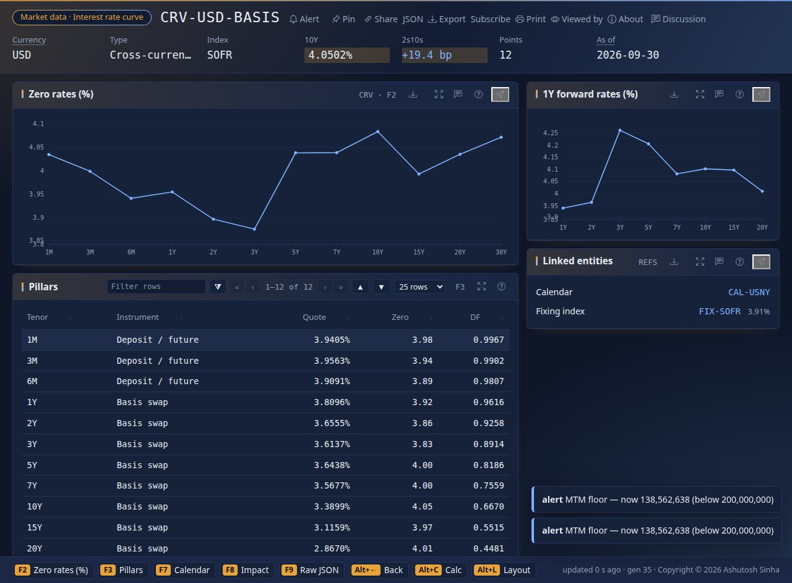
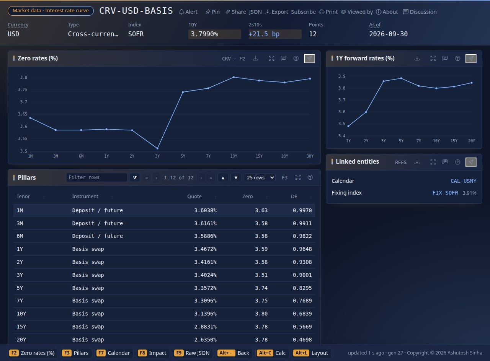
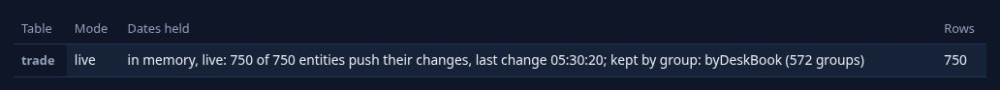
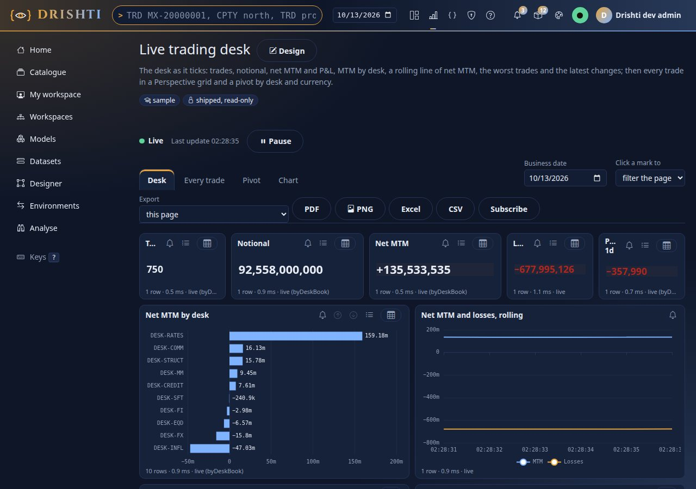
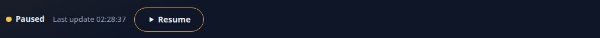
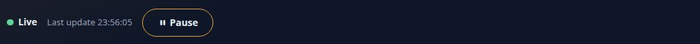
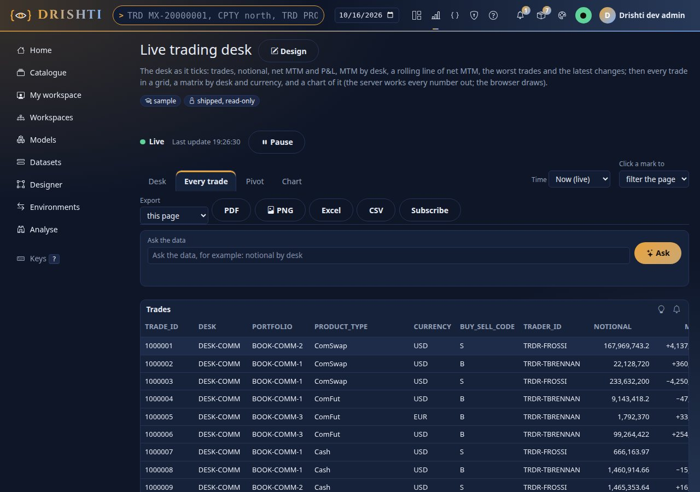
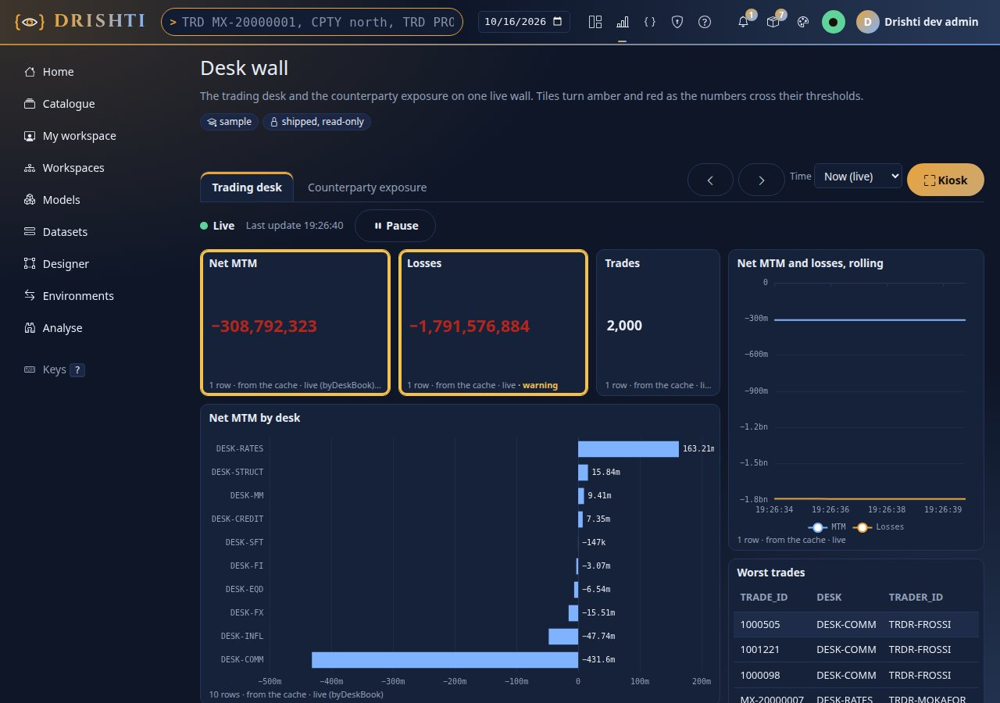
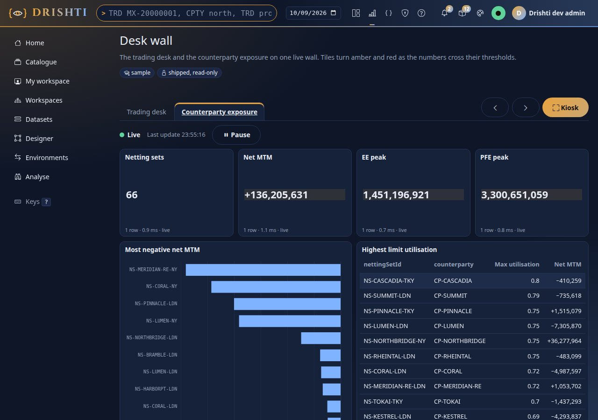
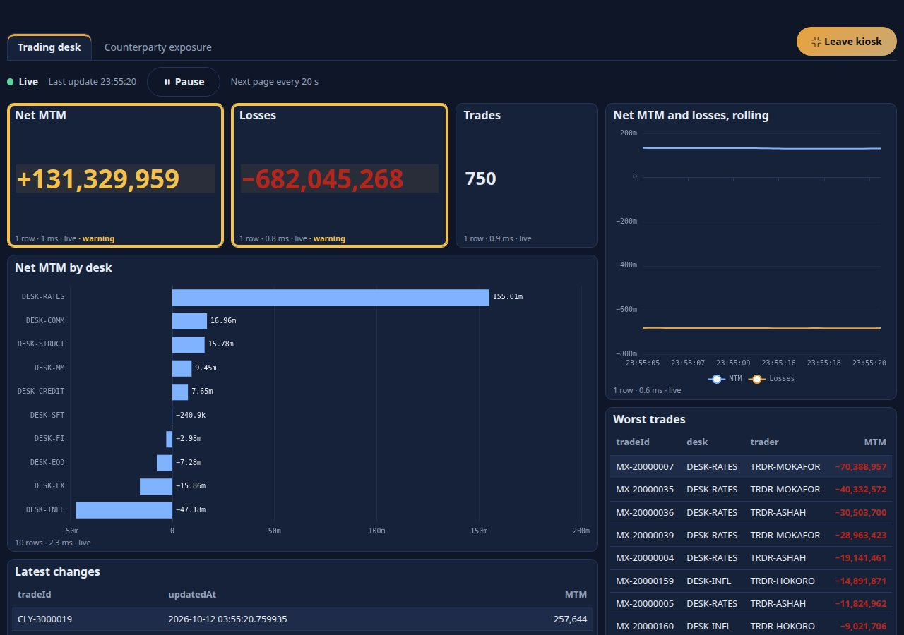

<!--
  Project Drishti · Any data. Any domain. One grammar.

  Copyright (c) 2026 Ashutosh Sinha <ajsinha@gmail.com>.
  All rights reserved.

  PROPRIETARY AND CONFIDENTIAL.

  This file is the confidential and proprietary property of Ashutosh Sinha.
  Unauthorised copying, use, modification, distribution or disclosure of this
  file, via any medium, is strictly prohibited except with the express prior
  written permission of the copyright holder.

  See the LICENSE file in the root of this repository for the full terms.
-->
# Tutorial 12 · Live BI and boards

So far every number was as of the last time a layer was built. This tutorial is about numbers **as they are**. You watch the demo market tick (a curve that moves as a whole, not one cell at a time), look at a **live table**, open a report that redraws itself as the trades
change and **pause** it, then put a **Desk wall** of live tiles on a screen in **kiosk mode**.

## Time to complete

About 30 minutes.

## Before you start

- [Tutorial 10](10-first-bi-report.md) done (you know the report viewer). The shipped samples used here, the dataset **Live trading desk**, the reports **Live trading desk** and **Live exposure** and the board **Desk wall**, are in every server's `config/bi/`.
- The demo data of the banking packs. It **ticks by itself** (the demo source changes the live trades about twice a second and the market data every few seconds); nothing to start. With a real source the same pages follow your own live connector ([DEMO_CONNECTOR.md](../connectors/DEMO_CONNECTOR.md), [DATA_LOADS.md](../guides/DATA_LOADS.md)).

## What you will learn

- what "live" means for data (a source that **pushes**) and why the demo's live data is **coherent**: related numbers move together;
- the `mode: live` table of a dataset and how to see how it is doing;
- the live indicator of a report, **Pause** and **Resume**, and what redraws;
- a **board**: tiles from several reports, amber and red tiles from their alert rules, pages that turn on their own, and **kiosk mode**.

## Step 1 · Live data moves together

Open a rate curve in the terminal: type `CRV CRV-USD-BASIS <GO>`, or open `/v/ir-curve/CRV-USD-BASIS`.



You should see the key figures at the top (`10Y 4.0123%`, `2s10s +24.7 bp`), the **Zero rates** chart, a **1Y forward** chart and the **Pillars** table (tenor, instrument, quote, zero rate, discount factor), and `updated 0 s ago` at the bottom: the page is live. Wait ten seconds.



You should see `10Y` at `4.1132%` and `2s10s` at `+19.6 bp`, the chart with a new shape and **every row of the table changed**, not just the 10Y cell: the quote, the zero rate and the discount factor of each tenor. A real market does not move one number: when the 10-year rate ticks, the whole curve, its forwards, its
discount factors and its slope tick with it, and the demo does the same (a "coherent walk": one random draw moves a headline and everything that depends on it; [DEMO_CONNECTOR.md](../connectors/DEMO_CONNECTOR.md) section 7.4). The command line prints the same view as text, as of the moment you ask:

```text
$ python3 tools/drishti.py view get ir-curve/CRV-USD-BASIS
Market data · Interest rate curve  CRV-USD-BASIS   [CRV]

Key figures
  figure    value
  --------  --------------------
  Currency  USD
  Type      Cross-currency basis
  Index     SOFR
  10Y       4.1315%
  2s10s     +18.9 bp
  Points    12
  As of     2026-09-30

Pillars  (table, points, F3)
  Tenor  Instrument          Quote  Zero      DF
  -----  ----------------  -------  ----  ------
  1M     Deposit / future  4.0461%  4.07  0.9966
  1Y     Basis swap        3.9077%  4.01  0.9607
  10Y    Basis swap        3.4804%  4.13  0.6616
  30Y    Basis swap        2.5293%  4.14  0.2884
  ...
```

You should see the table form of the same page (the numbers differ from the pictures: they are ticking). That is **live data**: a connector that **pushes** changes instead of waiting to be asked. BI uses it through a live table.

## Step 2 · A live table

Open **Datasets** and **Live trading desk**. Its one table is declared with `mode: live`:

```yaml
tables:
  trade:
    source:
      kind: trade               # whichever running connector serves trades and can push them (here the demo ticker)
    mode: live
    live:
      rows: 5000                # the most rows it keeps
```

The engine keeps this table **in memory** and applies each change as the source pushes it. Scroll to **Layers on disk**: a live table has no dates on disk; it says how it is doing.



You should see the table `trade`, the mode `live` and its state. Over REST:

```text
$ curl -s -H "Authorization: Bearer $DRISHTI_TOKEN" http://localhost:18480/api/v1/bi/datasets/file:dataset:live-trading/layers
{"tables":[{"mode":"live","partitions":[],"table":"trade","live":{"table":"trade","kind":"trade","state":"live","rows":750,"entities":750,"subscribed":750,"pushes":true,"seq":99736,"epoch":0,"generation":279,"lastUpdate":"2026-10-12T03:56:46.623580788Z","lastSeen":"2026-10-12T03:56:47.238071651Z","startedAt":"2026-10-12T03:53:57.978717074Z","applied":99736,"skipped":14,"evicted":0,"deleted":0,"error":null}}]}
```

You should see `state: live`, **750 rows** from **750 entities** followed (`subscribed`), `pushes: true`, and a count of changes applied (99,736 here, 14 skipped because the value had not changed). A live table starts when it is first used and is closed after ten idle minutes. The queries are the ones of any dataset: a live table is just another
layer that answers them.

**Kept by group, not recomputed.** The dataset declares a rollup over the live table:

```yaml
rollups:
  - { name: byDeskBook, table: trade, by: [desk, book, productType, currency], measures: [Trades, Notional, MTM, PnL 1d, Worst trade, Best trade] }
```

The engine keeps the sums, counts, minimums and maximums **by group** as each change arrives: a row that changes takes its old values out of its group and puts the new ones in (a sum moves by the difference; a minimum is read again for that one group only when the row that held it changed). A query the rollup can answer reads those few rows, not every trade. Ask the bar of a desk (`fields: [trade.desk]`, `measures: [Trades, Notional, MTM, Worst trade]`, with `?explain=true`):

```text
SELECT "trade"."desk" AS "trade.desk", (CAST(coalesce(sum(m0), 0) AS BIGINT)) AS "Trades", (sum(m1)) AS "Notional", (sum(m2)) AS "MTM", (min(m4)) AS "Worst trade"
FROM (SELECT * FROM live_1_agg0) AS "trade" GROUP BY "trade"."desk" ORDER BY "trade.desk" ASC LIMIT 3
DESK-COMM   90   11359000000.0   16954390.0   -3307013.0         layer: live   rollup: byDeskBook
```

You should see `layer: live` and `rollup: byDeskBook` in the answer's `meta`, and the FROM reads `live_1_agg0`, the kept groups. The dataset's layer line says how it is going: `{"rollup": "byDeskBook", "groups": 572, "incremental": 5788, "recomputedGroups": 1826}` after about a minute of ticks (572 groups; 5,788 rows moved by difference; 1,826 groups whose minimum or maximum was read again). The reader's row rules and masks still apply on top. A measure that is not a plain sum, count, minimum or maximum of a column (`Losses` has a condition inside) is computed over the rows as before; `drishti.bi.live.incremental-aggregates: false` turns this off. [DATASETS.md section 7.1](../guides/DATASETS.md#71-live-tables-phase-5).

## Step 3 · A report that follows it

Open the report **Live trading desk** (**Catalogue**, or `BI live trading desk <GO>`).



You should see, above the pages, the **live indicator** `Live · Last update 23:55:59` with a **Pause** button; five cards (`750` trades, notional, net MTM, losses, one-day P&L), a bar of MTM by desk, and a **rolling line**. Every frame says `live` in its footer: the layer that answered is the in-memory table. Watch for a few seconds:

- the **cards** flash when their number changes and the **bars** change length, but the chart is the same chart drawn over (not rebuilt), and a table keeps its scroll position. At most four redraws a second, however fast the source ticks;
- the **rolling line** adds a point on each update and keeps the latest 120: it shows how the numbers moved since you opened the page (the browser keeps the points; the server keeps no history of an aggregate);
- slicers are not redrawn (they keep their open state), but a choice still filters every update.

Press **Pause**.



You should see `Paused` and a **Resume** button; the pictures hold still while the server keeps ticking. Press **Resume**.



You should see `Live` again and the page **catch up at once** to the table as it is now. If the connection drops (stop the console to see it) the page says so, keeps what it has and redraws everything when the stream is back. The second page, **Every trade**, is a Perspective grid of all 750 trades, updated by key:



You should see a spreadsheet-like grid you can sort, filter and re-pivot in the browser, with the rows ticking in place. Everything is **as you**: sign in as someone whose role masks `trader` and the same page shows `•••` in that column on every tick, because each tick makes your page ask again, as you.

## Step 4 · A wall for the desk: a board

A **board** puts the visuals of several reports on one screen. Open **Catalogue → Desk wall** (`/bi/b/file:board:desk-wall`).



You should see tiles of different sizes: the cards and charts of the Live trading desk, and two tiles outlined in **amber**, *Net MTM* and *Losses*, whose footers say `warning`. The colour comes from **alert rules in the board's file**, not from the report:

```yaml
pages:
  - id: desk
    title: Trading desk
    tiles:
      - { id: net-mtm, report: live-trading-desk, visual: mtm, title: Net MTM, at: { x: 0, y: 0, w: 3, h: 3 },
          alert: { on: MTM, warn: { op: lt, value: 150000000 }, crit: { op: lt, value: 100000000 } } }
```

A tile is a visual of a report (the report supplies the data, **as the person looking**) placed on a 12-column grid, with an optional `alert`: amber when the `warn` condition holds, red when `crit` does, and the footer says the word as well, so colour is never the only signal. Net MTM below 150 million is a warning, below 100 million critical;
the live net MTM here (`+131,329,959`) is under 150 million, hence amber. A tile that turns red can also **tell people** (`notify:`, in the board's YAML; [BOARDS.md](../guides/BOARDS.md) section 4). The second page is another report over another live dataset:



You should see the tab **Counterparty exposure** with exposure tiles from the report *Live exposure*. Pages are tabs; a board can hold as many as you like.

## Step 5 · Kiosk mode

Go back to the first page and press **Kiosk** (or press `k`, or add `?kiosk=1` to the address, which is how a wall display opens it).



You should see the menus gone and the wall filling the screen: the Net MTM and Losses tiles large, the amber outline and the word `warning` under each, the rolling line, the worst trades and the latest changes, `Live · Last update` and **Next page every 20 s**. The pages turn by themselves
(the board's `rotate:` setting). Keys: `Esc` leaves kiosk, `p` pauses the turning, the arrow keys change page. A phone or a TV browser showing `?kiosk=1` is a desk display.

## Step 6 · What a wall screen needs

- **A user for the screen.** The wall shows the data of whoever is signed in. Make a user for it (tutorial 17: users and roles) with the roles you want it to see, and sign the screen in once; a masked field stays masked.
- **The server's clock and calendar.** Dates on the wall are business dates of the server's calendar.
- **A board with a mistake** says what and where: `POST /api/v1/bi/boards/validate` answers `DRS-9052` (a tile that does not fit the grid, or names a report or visual that does not exist) and `DRS-9053` (a setting that is reserved).

You should see, once the screen is signed in as that user, the wall with the figures of that user's roles, and nothing the roles mask.

## Next steps

- [Tutorial 13](13-govern-bi.md): publish with a review, certify, and see what a change would break.
- [BOARDS.md](../guides/BOARDS.md): every tile option, alerts on tiles and notifications, the API. [tutorial 10](10-first-bi-report.md) chapters 18 and 19 go deeper on live tables and Perspective.
- [DEMO_CONNECTOR.md](../connectors/DEMO_CONNECTOR.md) and [DEMO_DATA.md](../connectors/DEMO_DATA.md) say exactly what ticks and how.

## If something goes wrong

| You see | Meaning |
|---|---|
| the indicator says `Disconnected` | the page lost its stream (the console or the network stopped); it keeps what it has and recovers by itself |
| `Paused` and nothing moves | you paused it (or the browser tab was hidden); press **Resume** |
| the live table says `state: error` | its connector is down: see Admin → Connectors; the table recovers when the connector does |
| the wall shows `•••` | the screen's user has a role that masks the field |
| an amber tile you did not expect | the tile's `alert` in the board file; the footer names the condition's word (`warning` or `critical`) |
| no ticks at all | the demo source is switched off (`drishti.sources.plugins.demo`), or a real source pushes nothing |
