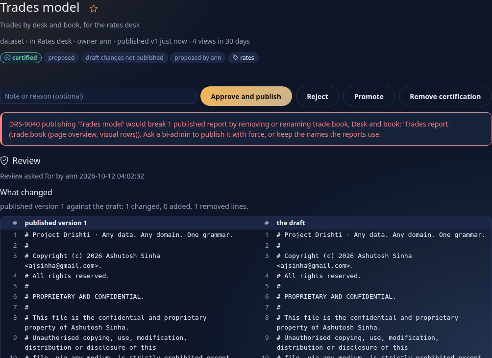
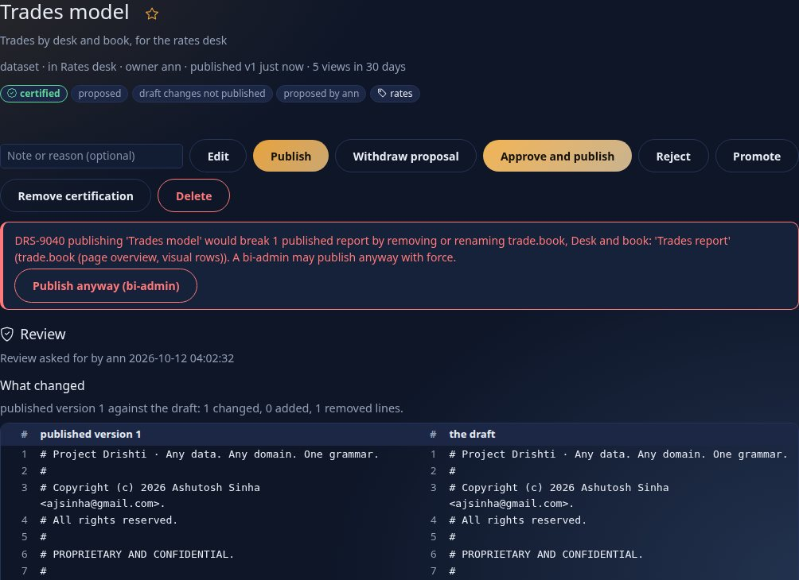
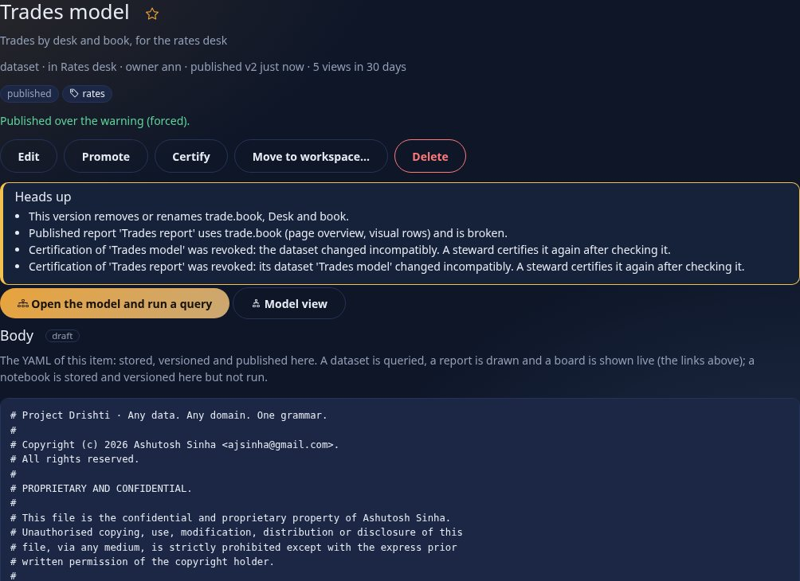

<!--
  Project Drishti · Any data. Any domain. One grammar.

  Copyright (c) 2026 Ashutosh Sinha <ajsinha@gmail.com>.
  All rights reserved.

  PROPRIETARY AND CONFIDENTIAL.

  This file is the confidential and proprietary property of Ashutosh Sinha.
  Unauthorised copying, use, modification, distribution or disclosure of this
  file, via any medium, is strictly prohibited except with the express prior
  written permission of the copyright holder.

  See the LICENSE file in the root of this repository for the full terms.
-->
# Tutorial 13 · Govern BI

When other people rely on a model or a report, changing it needs care. Drishti keeps **every saved state**, lets you **compare and restore** them, asks a **second person to review** before something is published, lets a **steward certify** what has been checked, shows **where a dataset comes from and who reads it**, **refuses a change
that would break a published report**, and moves content between servers as a **bundle** you can try out with a **dry run** first. This tutorial does all of it with three people.

## Time to complete

About 45 minutes.

## Before you start

- [Tutorial 10](10-first-bi-report.md) done (you know workspaces and publishing), signed in as the development administrator; the same server and console as before.
- Three people, because governance is people checking each other: **ann** writes (powers `bi` and `bi-author`), **sue** is a steward (`bi` and `bi-steward`), and the **administrator**, who holds every power and is the only one who can force a publish. Step 1 makes ann and sue.
- Two small files in [data/](data/): [trades-model.dataset.yaml](data/trades-model.dataset.yaml) (a dataset of trades by desk and book) and [trades-report.report.yaml](data/trades-report.report.yaml) (a report that uses it).

## What you will learn

- the four BI **powers** (`bi`, `bi-author`, `bi-steward`, `bi-admin`) and how a role gets them;
- **history**: every save is a saved state; compare two; restore one (a new state, nothing lost);
- **review**: propose, who is told, what the reviewer sees, **four-eyes**, approve and publish;
- **certified** and **promoted**, and where they show;
- **lineage**: where a dataset comes from and which reports read it;
- **impact**: what breaks if a field goes, the refusal `DRS-9040`, and the administrator's override, which revokes certification;
- **environments**: a bundle, a dry run, a conflict, an overwrite;
- **renames** that rewrite the reports, an import you can **roll back**, and lineage that reaches the connector's source.

## Step 1 · Powers, roles and two people

Powers are held by **roles**. In the console choose **Admin → Roles** and make two roles (kinds `*`, see every field): `bi-writer` and `bi-steward`. Then **Admin → BI** (BI settings) lists every role with four columns; tick `bi` and `bi-author` for `bi-writer`, `bi` and `bi-steward` for `bi-steward`, and press **Save** on each row.


You should see the table with your two rows at the bottom, ticks as above and a **Save** button on each (built-in roles are read-only; `admin` holds all four). The columns:

| Power | Lets a person |
|---|---|
| `bi` | open BI and the published content they are allowed |
| `bi-author` | make drafts, publish in workspaces (propose, where review is required) |
| `bi-steward` | certify, and decide reviews in any workspace |
| `bi-admin` | manage BI, see every workspace and **force** what a refusal stops |

Then **Admin → Users → New user**: `ann` with role `bi-writer`, `sue` with role `bi-steward`, a password each (`tutorial-pass-2026` is the one the tutorials use) and *Must change at first sign-in* unticked. Use a second browser or a private window to be two people at once; below, the picture says who is signed in.

## Step 2 · A workspace that asks for review

Sign in as **ann**. Choose **Workspaces** and create **Rates desk**, ticking **Require review before publishing (a second person approves)**.


You should see the form with the box ticked. In a workspace that requires review nobody publishes their own work: the author **proposes** and someone else approves. Add sue as a member of the workspace (its page lists members; over the API: `PUT /api/v1/bi/workspaces/rates-desk/members/sue` with `{"role": "member"}`). Then create the dataset: in **My workspace → New item**
or over the API, kind *dataset*, the body of `trades-model.dataset.yaml`, in `Rates desk`. (The pictures use the API for the file and the console for everything else.)

## Step 3 · Save twice, compare, restore

Open the **Trades model** item. Press **Edit**, add a `currency: string` line under the columns, write `add the currency column` in *What changed* and press **Save draft**. Press **Edit** again, rename the measure `Trades` to `Deals`, write `rename the count measure`, **Save draft**. Under **History**:

```text
$ curl -s -H "Authorization: Bearer $DRISHTI_TOKEN" http://localhost:18480/api/v1/bi/items/<id>/history     (revisions, newest first)
  #3  rename the count measure   ann  save
  #2  add the currency column    ann  save
  #1  first cut                  ann  create
```

Choose *saved state 1* against *the draft* and press **Show the differences**.


You should see the three states with who, when and what changed, and a **side-by-side** comparison: one line added (`currency: string`) and one changed (`Trades` became `Deals`). Over the API: `GET /api/v1/bi/items/<id>/diff?from=r1&to=draft` answers `"added": 1, "removed": 0, "changed": 1` and the lines.
Press **Restore as draft** on state 2. The history now has **four** states:

```text
  #4  restored saved state 2    ann  restore
  #3  rename the count measure  ann  save
  ...
```

You should see the restore as a **new** saved state (`origin: restore`), so nothing was lost; a published version, had there been one, would not have been touched.

## Step 4 · Propose, review, approve

Write `ready for a look` in the note box and press **Propose for review**.


You should see the badge `proposed` and `proposed by ann`; the item is frozen (no edits unless withdrawn). **The reviewers are told**: every steward, and every workspace member holding the `approve` power on a role, except the author. Ann cannot approve her own proposal (she has no approve power; even a steward who proposed may not, with four-eyes on, `DRS-9005`):

```text
$ curl -s -X POST -H "Authorization: Bearer $ANN_TOKEN" .../api/v1/bi/items/<id>/approve -d '{"note":"me"}'
{"code": "DRS-9002", "detail": "approving needs the bi-steward power, or a member of the workspace with the approve power on a role"}
```

Sign in as **sue** and open the item.


You should see the **Review** section: who asked and the note, **what changed** against what is published (here all 41 lines are new: nothing is published yet), `Check passed: nothing to fix`, what it does to reports (nothing: no report reads it) and a **data preview**: the first rows read through the file connector **as sue**, with her row rules and masks.
Write `looks right` and press **Approve and publish**.


You should see `published v1`. Ann is told:


You should see `sue approved dataset 'Trades model': looks right` as the newest row. (A **Reject** with a reason is the other decision; the reason goes to the author.) Now ann makes the report: `trades-report.report.yaml` in the same workspace, proposes it, and sue approves it the same way (not shown).

## Step 5 · Certify

Published is not the same as checked. **Promoted** is the owner's mark; **certified** can only be set by a steward, and only a steward can remove it. As sue, open the dataset: the action row offers **Promote** and **Certify**.


You should see the buttons. Press **Certify** on the dataset and on the report. Then open the **Catalogue**.


You should see the two certified items **first** (certified items come first in the default sort), each with the green `certified` badge. The badge also shows in search results and on Home, and the **Endorsement** filter finds them.

## Step 6 · Lineage

As ann, open the **Trades model** and scroll to **Lineage**.


You should see **Comes from** (`trade`, kind `trade` of pack `trading`, connector `trading-store`, cached) and **Read by** (`Trades report`, certified, published, uses `trade.book, trade.desk, MTM, Notional`). The same from the API:

```text
$ curl -s -H "Authorization: Bearer $DRISHTI_TOKEN" http://localhost:18480/api/v1/bi/items/<dataset id>/lineage
{"item": {"title": "Trades model", "kind": "dataset", "status": "published", "endorsement": "certified", "publishedVersion": 1},
 "upstream": [{"table": "trade", "kind": "trade", "packs": ["trading"], "connector": "trading-store", "mode": "cached"}],
 "downstream": [{"title": "Trades report", "kind": "report", "status": "published", "endorsement": "certified",
                 "uses": {"fields": ["trade.book", "trade.desk"], "measures": ["MTM", "Notional"], "hierarchies": []}}], "hidden": 0}
```

You should see the same two lists as data. (A report you may not open is counted under `hidden`, not named.)

## Step 7 · What breaks if I remove a field

Before changing a published dataset, ask. In the **Impact on reports** box on the dataset's page type `trade.book` and press **Check**, or ask the API:

```text
$ curl -s -H "Authorization: Bearer $DRISHTI_TOKEN" "http://localhost:18480/api/v1/bi/items/<dataset id>/impact?remove=trade.book"
{"change": {"breaking": true, "removedFields": ["trade.book"], "removedMeasures": [], "removedHierarchies": [], ...},
 "breaksPublished": true,
 "published": [{"title": "Trades report", "workspace": "rates-desk", "endorsement": "certified", "uses": ["trade.book (page overview, visual rows)"]}],
 "refused": true, "canForce": false, "wouldRevokeCertification": ["Trades model", "Trades report"], ...}
```

You should see `breaksPublished: true`, the report and the visual that reads the field, `refused: true` (the server will say no), and `wouldRevokeCertification` naming both items. Ann goes ahead anyway: she removes the `book` column and the hierarchy that uses it, saves, and proposes the change. As **sue**, open the item and press **Approve and publish**.



You should see the red banner `DRS-9040 publishing 'Trades model' would break 1 published report by removing or renaming trade.book, Desk and book: 'Trades report' (trade.book (page overview, visual rows)). Ask a bi-admin to publish it with force, or keep the names the reports use.`
Sue is a steward, not a `bi-admin`: `force` from her answers `DRS-9002 sue does not hold the bi-admin power`. The right ways out are to fix the report first, to publish the dataset with the old names kept beside the new ones, or to ask the administrator. Sign in as the **administrator** and open the item.



You should see the same refusal and a new button, **Publish anyway (bi-admin)**. Press it.



You should see `Published over the warning (forced).` and a **Heads up** box: the version removes `trade.book`, the published report `Trades report` **is broken**, and **the certification of both items was revoked**, because nobody has checked the new shape. The steward is told (the **Bi-certification** rows of the inbox: `Certification of dataset 'Trades model' was revoked: the dataset changed incompatibly`),
and the review record of the dataset says it plainly:

```text
 sue certify   ->   ann request   ->   dev-admin revoke "the dataset changed incompatibly"   ->   dev-admin approve
```

A forced publish is audited as such. Fixing the report and having sue certify again puts things right.

## Step 8 · Move it to another server: a bundle and a dry run

**Environments** in the rail is how content moves between servers (development, test, production). As ann choose the workspace and press **Download the bundle**.


You should see the export card (a workspace, *include the datasets the reports read*). The file holds the two items with their draft bodies, owner, audience and **every published version**, each with a checksum, and a checksum over the whole:

```text
{"format": "drishti-bi-bundle", "formatVersion": 1, "createdAt": "2026-10-12T04:00:20Z", "createdBy": "ann", "checksum": "b6882d96...a4144bf"}
[{"title": "Trades model", "kind": "dataset", "owner": "ann", "status": "published", "publishedVersion": 2, "versions": [1, 2], "endorsement": "none"},
 {"title": "Trades report", "kind": "report", "owner": "ann", "status": "published", "publishedVersion": 1, "versions": [1], "endorsement": "none"}]
```

(`endorsement: none`: **certification does not travel**. A steward of the receiving server certifies after looking.) A bundle is a file: copy it to the other server. Importing needs a **steward** (it is a governance act). Here the "other server" is the same one, and, to make something to see, the report is edited after the export. As **sue** choose the bundle on *Import a bundle* and press **Dry run**, which changes nothing.


You should see a table: `Trades model` **unchanged** (`identical to what is here`) and `Trades report` **conflict** with the reason `it exists here and differs (the draft differs): import with overwrite to replace it`. The API gives the same plan: `"counts": {"create": 0, "update": 0, "unchanged": 1, "conflict": 1, "invalid": 0}, "ok": false`. Tick **Overwrite items that exist here and differ** and run the dry run again.


You should see `Trades report` as an **update** and the **Import** button enabled. (Other things a dry run can say: `create`, `invalid`, a workspace that does not exist here, or a change that would break published reports there. *Map owners* and *Map workspaces* rename people and workspaces between environments.)

## Step 9 · On a phone


You should see the same sections stacked in one column, the tables scrolling inside their own frames and every button at least 44 pixels high.

## Step 10 · A rename is not a breakage

Step 7 refused a publish that removed a field a report used. But often a field is only **renamed**. Say the *Orders desk* dataset reads `book` from the document path `book.name`, and a report charts `orders.book`. Ann renames the column to `desk_book` (the same `path:`) and the measure `Gross` to `Notional total` (the same expression), saves and proposes. Sue opens the dataset to review it.


You should see, in the review under *What it does to reports*, **Recognised as renames (same path or expression)**: `orders.book → orders.desk_book; Gross → Notional total`, the report that uses them with `[renamed to ...]` beside each, and the button **Approve and update the reports** (an author who may publish directly sees **Publish and update the reports** under *Impact on reports*). A name is recognised as a rename only when the new one has the **same `path:` or `expr:`** (and type); a column with neither has only its name to go by. Press the button.


You should see, in the *Orders report*'s history, a new published version (`published v2`) whose saved state says `renamed [...]` (its origin is `rename`), and a `rename` line in the review record: the report's wells now name `orders.desk_book` and `Notional total` (titles are never touched), and the dataset's new version is published in the same step. If the same change had also **changed a type or an expression** (a column from `decimal` to `integer`, a measure from `count(orders)` to `count(orders) * 2`), the impact would list it under *Changed type or meaning* with the reports that use it; that is shown, not refused.

## Step 11 · Roll an import back

An import is not final. **Environments** now lists every import under *Imports you can roll back*. Ann retitled a visual of the report after exporting it; Sue imports the older bundle over it (the overwrite of step 8) and looks at the list.


You should see one row for the import (`bundle`, one item, one replaced) and the button **Roll back this import**. Press it.


You should see the row say it was rolled back, and the report's draft is Ann's again (as a new saved state with the origin `rollback`; nothing was lost). Had the report been edited **after** the import, the roll back would have stopped with nothing changed and named it; an administrator can force it. A pack deployed from **Admin, Packs** that carries BI files (`config/bi/` in the archive) is imported the same way, so it appears in this list with the source `pack <name> <version>` and rolls back the same way.

## Step 12 · Where does the data really come from?

Step 6's lineage stopped at the connector's name. Now it goes one step further: it shows what the connector's file says it reads. Ann's *Lake orders* dataset reads through the connector `orders-lake`; the administrator looks first, then Ann.


You should see, as the administrator, `reads from (file): root /srv/lake/orders`; as Ann, `root •••`. Only an administrator reads where a connector reads from (a table, a topic, a path, a bucket, a host); everybody else sees that there is a source and what kind of setting names it. Credentials never appear in either.

## Next steps

- [Tutorial 14](14-python-and-analyse.md): Python in a measure, a visual and a notebook.
- [BI_GOVERNANCE.md](../guides/BI_GOVERNANCE.md): every rule, setting (`drishti.governance.four-eyes`, `drishti.bi.governance.refuse-breaking`) and error code of this tutorial. [tutorial 10](10-first-bi-report.md) chapter 17 is the longer version.
- [USER_MANAGEMENT.md](../admin/USER_MANAGEMENT.md): roles and users in depth; tutorial 17 summarises them.

## If something goes wrong

| You see | Meaning |
|---|---|
| `DRS-9002` | the person lacks the power the step needs (`bi-author` to publish or propose, `bi-steward` to approve or certify, `bi-admin` to force) |
| `DRS-9005` | four-eyes: the person who proposed tried to approve or reject; they may only withdraw |
| `DRS-9040` | the change would break published reports: fix the reports, keep the old names, **publish and update the reports** when the impact shows every lost name as a rename, or ask a `bi-admin` to force it |
| the roll back says `DRS-9004` | an item was edited or published after the import: nothing was changed; a `bi-admin` may force it, losing that work |
| Propose for review is not offered | the workspace does not require review: publish directly; or you are not a member of it |
| no email about a review | the **inbox** (the bell) is always told; email needs the mail settings of [tutorial 11](11-bi-that-runs-itself.md) |
| the dry run says `conflict` | the item exists on the target and differs: tick *Overwrite* or rename it; read the reason first |
| the steward cannot certify an item | a steward must be in the item's audience or workspace; add the steward or the role to the audience |
