<!--
  Project Drishti · Any data. Any domain. One grammar.

  Copyright (c) 2026 Ashutosh Sinha <ajsinha@gmail.com>.
  All rights reserved.

  PROPRIETARY AND CONFIDENTIAL.

  This file is the confidential and proprietary property of Ashutosh Sinha.
  Unauthorised copying, use, modification, distribution or disclosure of this
  file, via any medium, is strictly prohibited except with the express prior
  written permission of the copyright holder.

  See the LICENSE file in the root of this repository for the full terms.
-->
# Tutorial 13 · Govern BI

When other people rely on a model or a report, changing it needs care. Drishti keeps **every saved state**, lets you **compare and restore** them, asks a
**second person to review** before something is published, lets a **steward certify** what has been checked, shows **where a model comes from and who
reads it**, tells you **which change needs a new major version and which reports it touches**, refuses a dataset change that would break the models
reading it, and moves content between servers as a **bundle** you can try out with a **dry run** first. This tutorial does all of it with three people,
on a **model** of the model layer (2.2) and the dataset it reads.

Every step shows it **in the UI**, **on the command line** (`python3 tools/drishti.py`, or `curl` where the tool has no command) and **as YAML**, or says
why one of the three does not apply.

## Time to complete

About 50 minutes.

## Before you start

- The quick-start environment of [tutorial 10](10-first-bi-report.md#before-you-start) (the demo lakes, **Drishti server (demo lakes)** with sign-in on),
  and tutorial 10 done (you know workspaces and publishing), signed in as the development administrator.
- Three people, because governance is people checking each other: **ann** writes (powers `bi` and `bi-author`), **sue** is a steward (`bi` and `bi-steward`), and the **administrator**, who holds every power. Step 1 makes ann and sue.
- Three small files in [data/](data/): [rates-trades.dataset.yaml](data/rates-trades.dataset.yaml) (the rates desk's trades, a dataset of the model
  layer), [trades-model.model.yaml](data/trades-model.model.yaml) (the model over it) and [trades-report.report.yaml](data/trades-report.report.yaml)
  (a report on the model).
- A personal API token for each person you act as on the command line (each signs in once and makes one on **My account → API tokens**, as in
  [tutorial 1, step 9](01-first-15-minutes.md#step-9--make-a-token-for-the-command-line); `DRISHTI_TOKEN` holds the one in use, `$ANN_TOKEN` and
  `$SUE_TOKEN` below are theirs). The administrator's token needs the `bi:write` scope; sue's needs `bi:approve` to approve and certify.

## What you will learn

- the four BI **powers** (`bi`, `bi-author`, `bi-steward`, `bi-admin`) and how a role gets them;
- **history**: every save is a saved state; compare two; restore one (a new state, nothing lost);
- **review**: propose, who is told, what the reviewer sees, **four-eyes**, approve and publish;
- **certified** and **promoted**, and where they show;
- **lineage**: what a model reads (datasets, pack kinds, connectors) and what reads it;
- **the contract**: which change needs a **new major version**, and which reports use what it takes away; the refusal `DRS-9126`;
- **environments**: a bundle, a dry run, a conflict, an overwrite;
- **renames** that rewrite the reports (version 1 datasets), an import you can **roll back**, and lineage that reaches the connector's source.

## Step 1 · Powers, roles and two people

Powers are held by **roles**. In the console choose **Admin → Roles** and make two roles (kinds `*`, see every field): `bi-writer` and `bi-steward`. Then **Admin → BI** (BI settings) lists every role with four columns; tick `bi` and `bi-author` for `bi-writer`, `bi` and `bi-steward` for `bi-steward`, and press **Save** on each row.

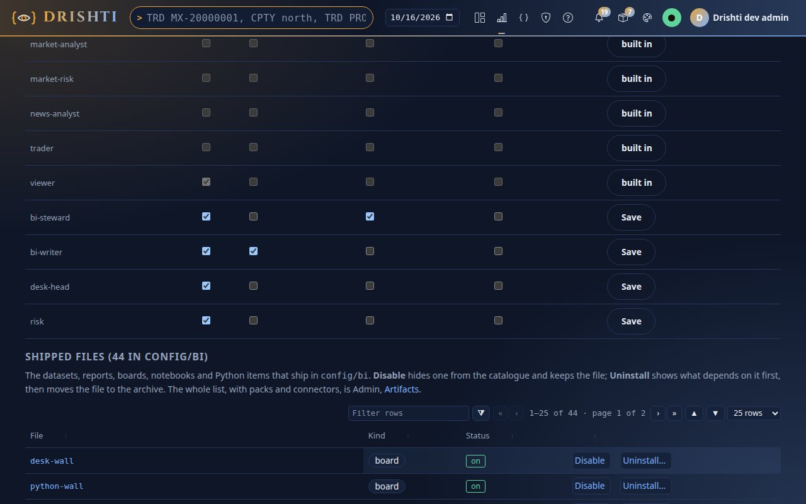

You should see the table with your two rows at the bottom, ticks as above and a **Save** button on each (built-in roles are read-only; `admin` holds all four). The columns:

| Power | Lets a person |
|---|---|
| `bi` | open BI and the published content they are allowed |
| `bi-author` | make drafts, publish in workspaces (propose, where review is required) |
| `bi-steward` | certify, and decide reviews in any workspace |
| `bi-admin` | manage BI, see every workspace and **force** what a refusal stops |

Then **Admin → Users → New user**: `ann` with role `bi-writer`, `sue` with role `bi-steward`, a password each (`tutorial-pass-2026` is the one the
tutorials use) and *Must change at first sign-in* unticked. Use a second browser or a private window to be two people at once; below, the picture says who
is signed in. **On the command line** the same two calls the page makes (the administrator's token; the BI powers are the `bi` list of a role):

```text
$ curl -s -X PUT -H "Authorization: Bearer $DRISHTI_TOKEN" -H 'Content-Type: application/json' \
    -d '{"kinds":["*"],"raw":true,"bi":["bi","bi-author"]}' $DRISHTI_SERVER/api/v1/admin/role-definitions/bi-writer
{"name":"bi-writer","description":"","kinds":["*"],"raw":true,"author":false,"approve":false,"admin":false,"calc":false,"layout":true,"collaborate":true, ...,"bi":["bi","bi-author"]}
$ curl -s -X POST -H "Authorization: Bearer $DRISHTI_TOKEN" -H 'Content-Type: application/json' \
    -d '{"username":"ann","displayName":"Ann","roles":["bi-writer"],"password":"tutorial-pass-2026","mustChangePassword":false}' \
    $DRISHTI_SERVER/api/v1/admin/users
{"username":"ann","displayName":"Ann","email":"","desk":"","roles":["bi-writer"],"enabled":true,"mustChangePassword":false,"locked":false, ...}
```

There is no YAML for people: roles and users live in the server's user store ([USER_MANAGEMENT.md](../admin/USER_MANAGEMENT.md)).

## Step 2 · A workspace that asks for review

Sign in as **ann**. Choose **Workspaces** and create **Rates desk**, ticking **Require review before publishing (a second person approves)**.

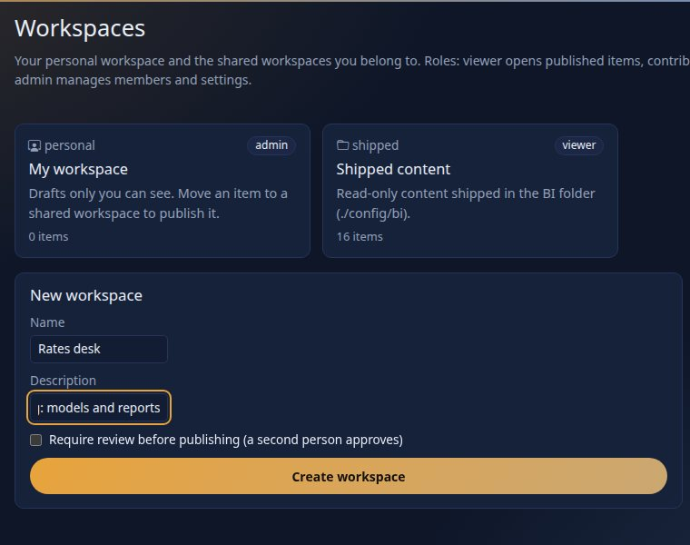

You should see the form with the box ticked. In a workspace that requires review nobody publishes their own work: the author **proposes** and someone else
approves. Add sue as a member of the workspace: after **Create workspace** follow *Next: add the people who share it* (or open the workspace and choose its
**Members** tab), type `sue`, choose the role `member` and press **Add or change** (over the API: `PUT /api/v1/bi/workspaces/rates-desk/members/sue` with
`{"role": "member"}`). Then put the dataset and the model in it, **the dataset first**: a model reads published datasets, so it can only be checked
once its dataset is through review. **In the UI** that is **My workspace → New item** (or the workspace's own **New item**), kind *dataset* then
*model*, **Paste YAML**, in `Rates desk`; **on the command line**, as ann (`bi item new` reads the kind from the file name):

```text
$ python3 tools/drishti.py bi item new rates-desk docs/tutorials/data/rates-trades.dataset.yaml --audience bi-steward,bi-writer,viewer
bi-ba201206d6  dataset  Rates trades  draft in Rates desk
$ python3 tools/drishti.py bi model check docs/tutorials/data/trades-model.model.yaml          # too early: its dataset is not published yet
INVALID  (model trades-model)
  error   DRS-9120  datasets.trade: no dataset 'rates-trades' is published (a pack-generated one, or a rachana: 2 dataset)
  error   DRS-9127  measures.Notional: 'trade.NOTIONAL' is not a table.column of this dataset (tables: )
  ...
```

Ann proposes the dataset and sue approves it (the same moves as step 4, shown there): then the model checks clean and goes in:

```text
$ python3 tools/drishti.py bi model check docs/tutorials/data/trades-model.model.yaml
valid  (model trades-model)
  warning DRS-9131  security.rows.trade: roles without a rule see no rows of 'trade': approver, author. Add a rule for them (where: "True" lets a role see every row), or leave them out on purpose: they get "you have no access to rows of trade in this model"
$ python3 tools/drishti.py bi item new rates-desk docs/tutorials/data/trades-model.model.yaml --audience bi-steward,bi-writer,viewer
bi-614d1ef4d3  model  Trades model  draft in Rates desk
```

**The YAML** of the two (the files above, without their comments): the dataset says what one row is and where it comes from; the model reads it as its
one fact and adds the measures, a hierarchy and who sees which rows:

```yaml
rachana: 2
expressions: 2
dataset: rates-trades
version: 1.0.0
title: Rates trades
source: { connector: risk-store, kind: trade-valuation }
grain: { says: "One row per trade per business date", keys: [TRADE_ID] }
columns:
  TRADE_ID:  { type: string, role: key }
  DESK:     { type: string }
  PORTFOLIO:    { type: string }
  NOTIONAL: { type: decimal, format: amount0 }
  MTM:      { type: decimal, format: signed0 }
---
rachana: 2
expressions: 2
model: trades-model
version: 1.0.0
title: Trades model
datasets:
  trade: { dataset: rates-trades, role: fact }
measures:
  Notional: { expr: "sum(trade.NOTIONAL)", format: amount0 }
  MTM:      { expr: "sum(trade.MTM)", format: signed0 }
  Trades:   { expr: "count(trade)" }
hierarchies:
  Desk and book: [trade.DESK, trade.PORTFOLIO]
security:
  rows:
    trade:
      - { role: [admin, bi-writer, bi-steward, bi-reviewer, bi-reader, viewer], where: "True" }
```

The dataset reads the `market-risk` pack's trade valuations (the book is the `PORTFOLIO` column) through `risk-store`, the Delta table the demo lake built.

## Step 3 · Save twice, compare, restore

Open the **Trades model** item (or its designer: **Models → Trades model**). Press **Edit**, give `trade.PORTFOLIO` a display name (`Book`) and a description (in the
designer that is the **Fields** tab; in the YAML, a `fields:` entry), write `name and describe the book` in *What changed* and press **Save draft**.
Press **Edit** again, rename the measure `Trades` to `Deals`, write `rename the count measure`, **Save draft**. Under **History**:

```text
$ curl -s -H "Authorization: Bearer $ANN_TOKEN" $DRISHTI_SERVER/api/v1/bi/items/bi-614d1ef4d3/history | jq -r '.revisions[] | "#\(.seq)  \(.message)  \(.author)  \(.origin)"'
#3  rename the count measure  ann  save
#2  name and describe the book  ann  save
#1  created  ann  create
```

Choose *saved state 1* against *the draft* and press **Show the differences**.

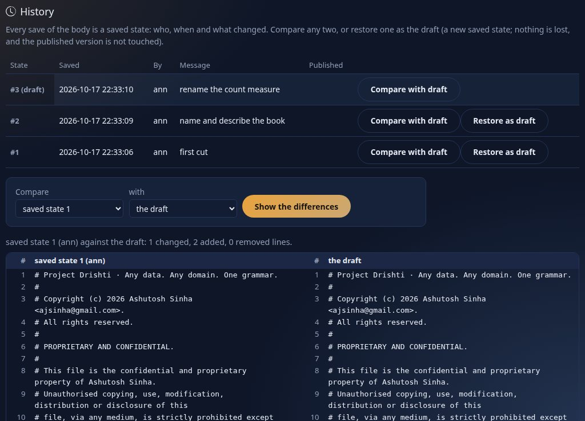

You should see the three states with who, when and what changed, and a **side-by-side** comparison: two lines added (the `fields:` entry) and the
`Trades` measure line changed to `Deals`. Over the API: `GET /api/v1/bi/items/<id>/diff?from=r1&to=draft` answers `"added": 2, "removed": 0, "changed": 2`
and the lines.
**The YAML** the first save added:

```yaml
fields:
  trade.PORTFOLIO: { display: Book, description: The trading book }
```

Press **Restore as draft** on state 2 (over the API: `POST /api/v1/bi/items/<id>/history/2/restore`). The history now has **four** states:

```text
#4  restored saved state 2  ann  restore
#3  rename the count measure  ann  save
...
```

You should see the restore as a **new** saved state (`origin: restore`), so nothing was lost; a published version, had there been one, would not have been touched.

## Step 4 · Propose, review, approve

Write `ready for a look` in the note box and press **Propose for review**.

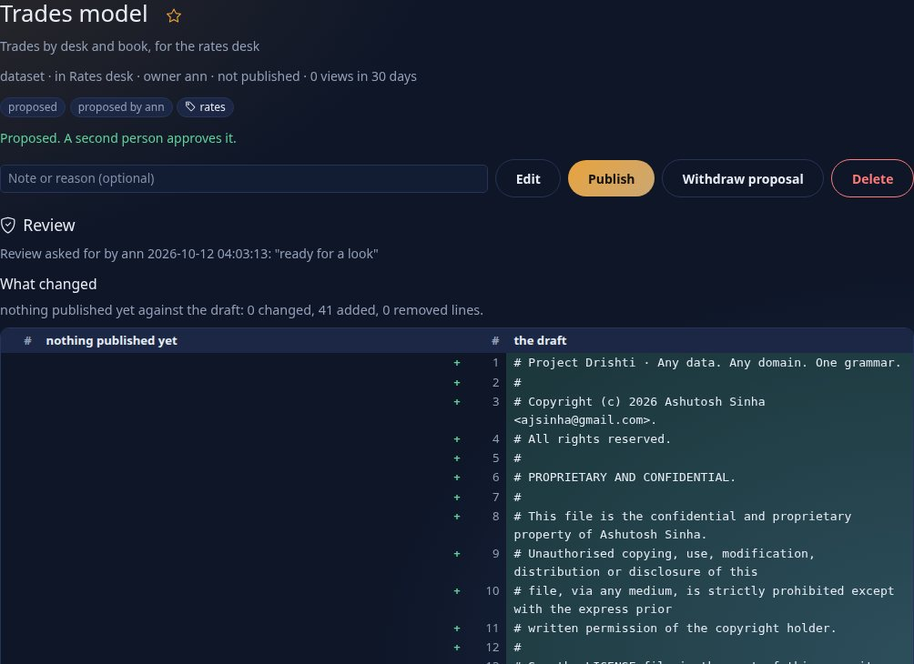

You should see the badge `proposed` and `proposed by ann`; the item is frozen (no edits unless withdrawn). **The reviewers are told**: every steward, and every workspace member holding the `approve` power on a role, except the author. Ann cannot approve her own proposal (she has no approve power; even a steward who proposed may not, with four-eyes on, `DRS-9005`):

```text
$ curl -s -X POST -H "Authorization: Bearer $ANN_TOKEN" -H 'Content-Type: application/json' -d '{"note":"me"}' $DRISHTI_SERVER/api/v1/bi/items/bi-614d1ef4d3/approve
{"type":"about:blank","title":"bi forbidden","status":403,"detail":"DRS-9002 approving needs the bi-steward power, or a member of the workspace with the approve power on a role","instance":"/api/v1/bi/items/bi-614d1ef4d3/approve","code":"DRS-9002"}
```

Sign in as **sue** and open the item.

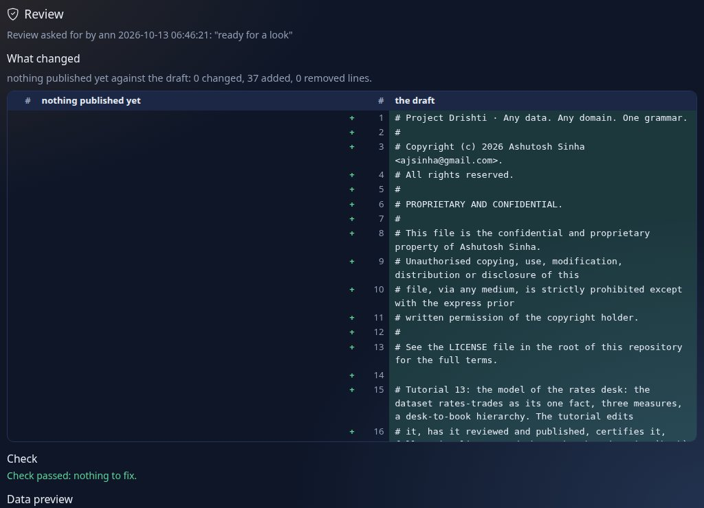

You should see the **Review** section: who asked and the note, **what changed** against what is published (here all 37 lines are new: nothing is
published yet), `Check passed: nothing to fix` (the server's Check of the model: its datasets, relationships, measures and the security safeguard), and
*Data preview*, which a model leaves to its designer (*there is no data to preview for a model*: the designer's Query panel and Analyse ask it).
Write `looks right` and press **Approve and publish**. On the command line the same decision is
`curl -X POST .../api/v1/bi/items/<id>/approve -d '{"note":"looks right"}'` with sue's token.

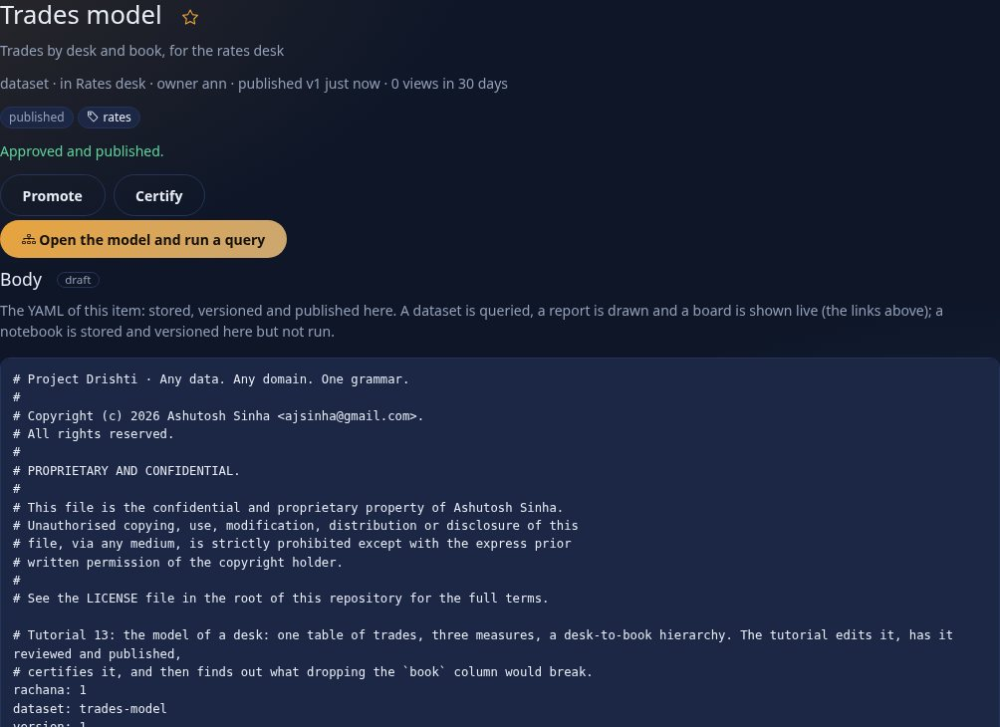

You should see `published v1`. Ann is told:

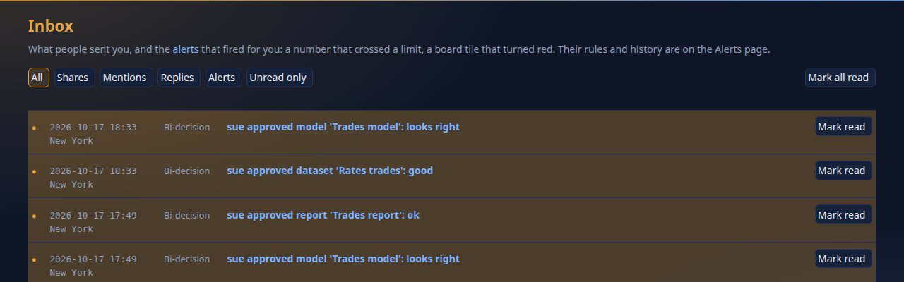

You should see `sue approved model 'Trades model': looks right` as the newest row. (A **Reject** with a reason is the other decision; the reason goes to
the author.) Now ann makes the report, [trades-report.report.yaml](data/trades-report.report.yaml), in the same workspace, proposes it, and sue approves
it the same way (not shown). It reads the model by reference:

```yaml
rachana: 2
report: trades-report
title: Trades report
model: trades-model@1
pages:
  - id: overview
    title: Overview
    visuals:
      - { id: notional, type: card, title: Notional, at: { x: 0, y: 0, w: 3, h: 2 }, wells: { values: [Notional] } }
      - { id: by-desk, type: bar, title: Notional by desk, at: { x: 3, y: 0, w: 5, h: 4 }, wells: { axis: [trade.DESK], values: [Notional] }, alt: Bars of notional by desk }
      - { id: rows, type: table, title: Desk and book, at: { x: 0, y: 4, w: 8, h: 4 }, wells: { columns: [trade.DESK, trade.PORTFOLIO, MTM] } }
```

## Step 5 · Certify

Published is not the same as checked. **Promoted** is the owner's mark; **certified** can only be set by a steward, and only a steward can remove it. As sue, open the model: the action row offers **Promote** and **Certify**.


You should see the buttons. Press **Certify** on the model and on the report (the API is `POST /api/v1/bi/items/<id>/endorse` with
`{"level": "certified"}`). Then open the **Catalogue**.

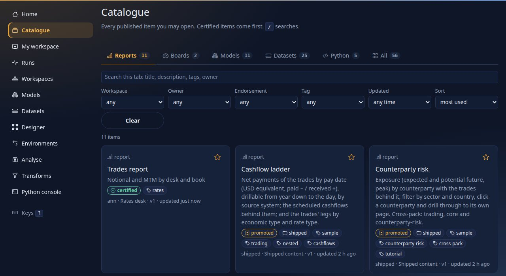

You should see the two certified items **first** (certified items come first in the default sort), each with the green `certified` badge. The badge also
shows in search results, on Home and on **Models**, and the **Endorsement** filter finds them. **The YAML** says nothing about it: an endorsement is a
decision about a version, kept by the catalogue (`endorsement: certified` in the item's metadata), never something an author writes; that is why it does not
travel in a bundle (step 8).

## Step 6 · Lineage

As ann, open the **Trades model** and scroll to **Lineage**.

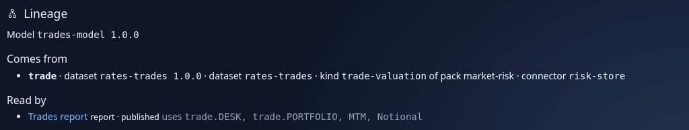

You should see **Comes from** (`trade` · dataset `rates-trades` · kind `trade-valuation` of pack `market-risk` · connector `risk-store`) and **Read by**
(`Trades report`, a report). The same from the command line and the API:

```text
$ curl -s -H "Authorization: Bearer $DRISHTI_TOKEN" $DRISHTI_SERVER/api/v1/bi/lineage/trades-model@1
{"ref":"trades-model@1","path":[{"name":"trades-model","version":"1.0.0","kind":"model"}],
 "datasets":{"trade":[{"name":"rates-trades","kind":"dataset"},{"kind":"pack-kind","name":"trade-valuation","pack":"market-risk","connector":"risk-store"}]},"problems":[]}

$ python3 tools/drishti.py bi model consumers trades-model@1
kind    id             title
------  -------------  -------------
report  bi-9c8d5a624a  Trades report
```

You should see the same two lists as data. (A report you may not open is counted under `hidden`, not named.) **Models → Trades model → Open the
designer** shows the same consumers above its tabs (**Used by**), and the dataset's own page (`/bi/ds/<id>`) shows where its rows come from. There is no
YAML for lineage: it is worked out from the files, never written down.

## Step 7 · What breaks if I remove a field

A model is a **contract**: reports bind to its major version (`trades-model@1`), and a change that takes away something they may use needs a **new major
version** ([BI_GUIDE.md section 23](../guides/BI_GUIDE.md#23-models-and-pack-datasets-the-model-layer-wave-w1)). Before changing a published model, ask.
As ann open the model's designer, the **Contract** tab, and set **What consumers may use** to *only what is ticked below*: every field and measure
consumers use today starts ticked. Untick `trade.PORTFOLIO`.

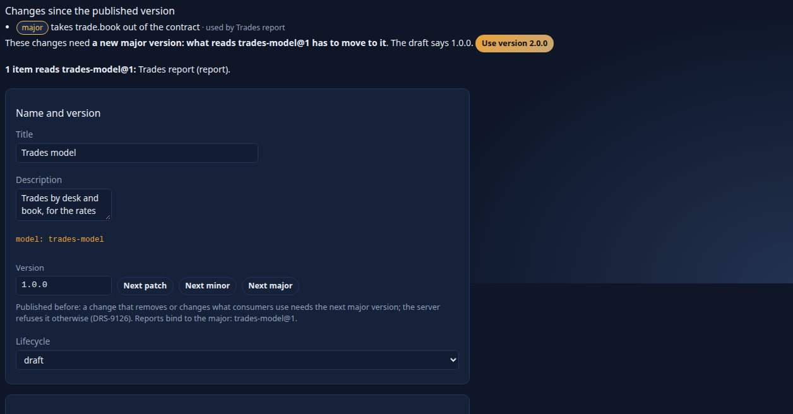

You should see, at the top, **Changes since the published version**: `major` *takes trade.PORTFOLIO out of the contract · used by Trades report*, then
*These changes need a new major version: what reads trades-model@1 has to move to it. The draft says 1.0.0.* and **Use version 2.0.0**, and *1 item
reads trades-model@1: Trades report (report)*. Nothing is saved yet. The impact is the server's answer for that one field:

```text
$ curl -s -H "Authorization: Bearer $DRISHTI_TOKEN" "$DRISHTI_SERVER/api/v1/bi/models/trades-model@1/impact?target=trade.PORTFOLIO"
{"model":"bi-614d1ef4d3","target":"trade.PORTFOLIO",
 "consumers":[{"kind":"report","id":"bi-9c8d5a624a","title":"Trades report","status":"published","owner":"ann","workspace":"rates-desk"}],"unknown":[]}
```

**The YAML** that change writes into the model (`exposes: listed` and the lists; a contract that lists nothing is `exposes: all`, the default):

```yaml
contract:
  exposes: listed
  fields: [trade.TRADE_ID, trade.DESK]          # trade.PORTFOLIO taken out
  measures: [Notional, MTM, Trades]
```

Leave the model as it is (do not save) and try the other way to lose the field: drop the `PORTFOLIO` column from the **dataset**. As ann, edit **Rates
trades**, delete the line `  PORTFOLIO:    { type: string }`, save and propose; as sue, press **Approve and publish**.

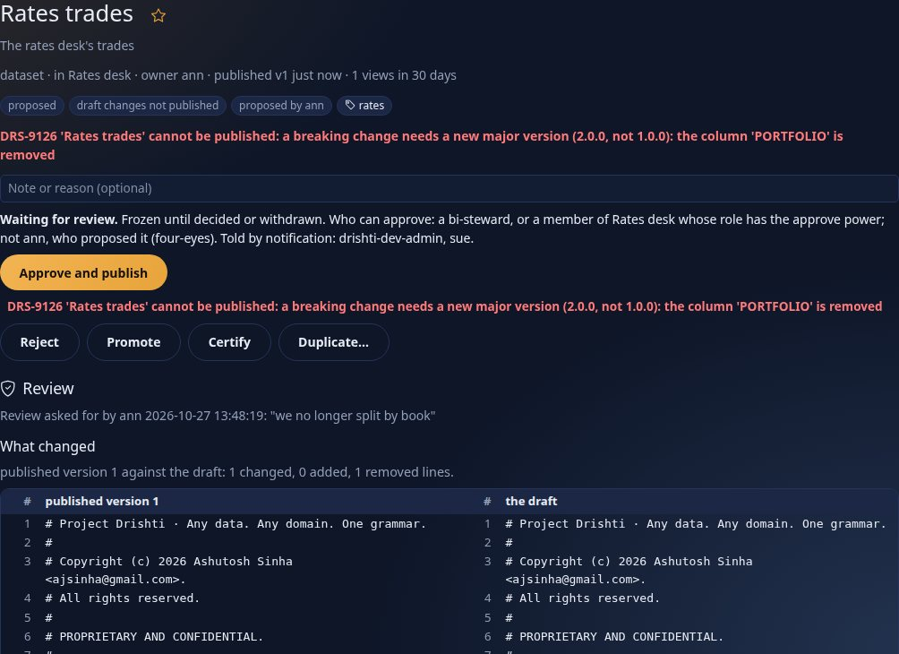

You should see `DRS-9126 'Rates trades' cannot be published: a breaking change needs a new major version (2.0.0, not 1.0.0): the column 'PORTFOLIO' is
removed`. The server compares the draft with the published version: removing a column, or changing its type, is breaking; adding one is not. The same
from the command line (sue's token):

```text
$ curl -s -X POST -H "Authorization: Bearer $SUE_TOKEN" -H 'Content-Type: application/json' -d '{"note":"x"}' \
    $DRISHTI_SERVER/api/v1/bi/items/bi-ba201206d6/approve
{"type":"about:blank","title":"layer model breaking","status":409,"detail":"DRS-9126 'Rates trades' cannot be published: a breaking change needs a new major version (2.0.0, not 1.0.0): the column 'PORTFOLIO' is removed","instance":"/api/v1/bi/items/bi-ba201206d6/approve","code":"DRS-9126"}
```

The right ways out are to keep the column, or to publish the change as `version: 2.0.0` once the reports that read `trade.PORTFOLIO` have been changed
first (the model designer's **Used by** and this tab name them). Ann withdraws the proposal (`POST .../withdraw`) and saves the dataset back as it was.

## Step 8 · Move it to another server: a bundle and a dry run

**Environments** in the rail is how content moves between servers (development, test, production). As ann choose the workspace and press **Download the bundle**.

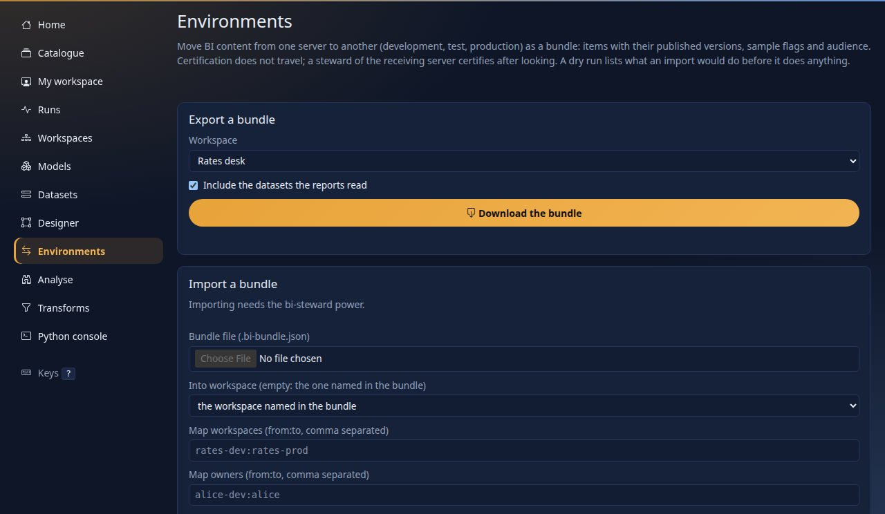

You should see the export card (a workspace, *include the datasets the reports read*). The file holds the items with their draft bodies, owner, audience
and **every published version**, each with a checksum, and a checksum over the whole (`GET /api/v1/bi/bundle` with `workspace=rates-desk`, or
`items=<id>,<id>`; captured):

```text
$ curl -s -H "Authorization: Bearer $ANN_TOKEN" "$DRISHTI_SERVER/api/v1/bi/bundle?workspace=rates-desk" -o rates-desk.bundle.json
{"format": "drishti-bi-bundle", "formatVersion": 1, "createdAt": "2026-10-13T06:46:50Z", "createdBy": "ann", "checksum": "de0f811f...a20db6"}
[{"title": "Rates trades", "kind": "dataset", "owner": "ann", "status": "draft", "publishedVersion": 1, "versions": [1], "endorsement": "none"},
 {"title": "Trades model", "kind": "model", "owner": "ann", "status": "published", "publishedVersion": 1, "versions": [1], "endorsement": "certified"},
 {"title": "Trades report", "kind": "report", "owner": "ann", "status": "published", "publishedVersion": 1, "versions": [1], "endorsement": "certified"}]
```

**Certification does not travel**: the dry run says so for each certified item (*certification does not travel: it is promoted here; a bi-steward
certifies it after the import*), and a steward of the receiving server certifies after looking. A bundle is a file: copy it to the other server.
Importing needs a **steward** (it is a governance act). Here the "other server" is the same one, and, to make something to see, the report is edited after
the export. As **sue** choose the bundle on *Import a bundle* and press **Dry run**, which changes nothing.

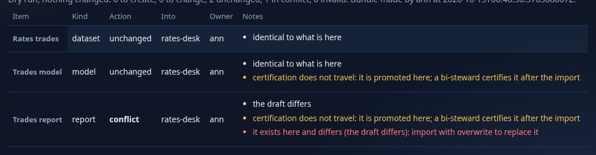

You should see a table: `Rates trades` and `Trades model` **unchanged** (`identical to what is here`) and `Trades report` **conflict** with the reason
`it exists here and differs (the draft differs): import with overwrite to replace it`. (Without that edit the dry run of the same bundle says every item is
`unchanged`, `identical to what is here`, with `"counts": {"create": 0, "update": 0, "unchanged": 3, "conflict": 0, "invalid": 0}, "ok": true`, and the two
certified items warn `certification does not travel`.) The API gives the same plan
(`POST /api/v1/bi/bundle/import` with `{"bundle": ..., "dryRun": true}`): `"counts": {"create": 0, "update": 0, "unchanged": 2, "conflict": 1, "invalid":
0}, "ok": false`. Tick **Overwrite items that exist here and differ** and run the dry run again.

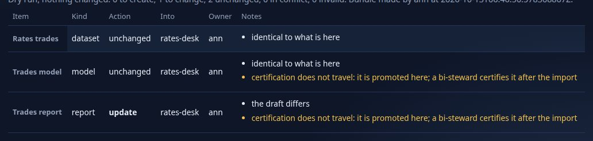

You should see `Trades report` as an **update** and the **Import** button enabled. (Other things a dry run can say: `create`, `invalid`, a workspace that does not exist here, or a change that would break published reports there. *Map owners* and *Map workspaces* rename people and workspaces between environments.)

## Step 9 · On a phone

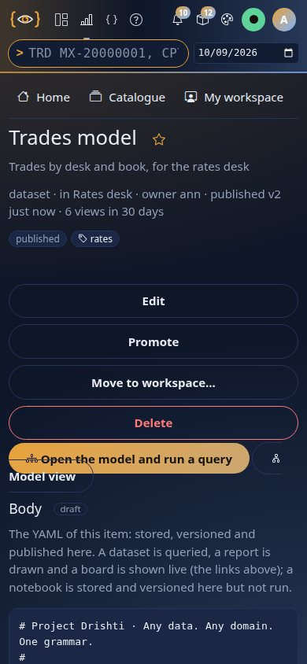

You should see the same sections stacked in one column, the tables scrolling inside their own frames and every button at least 44 pixels high. The
command line and the YAML are the same on any screen.

## Step 10 · A rename is not a breakage (version 1 datasets)

Step 7 stopped a change that removed a field a report used. But often a field is only **renamed**. A **version 1 dataset** (`rachana: 1`, the 2.1
format the live samples still use) recognises a rename and rewrites its reports in the same step. Say the *Orders desk* dataset reads `book` from the
document path `book.name`, and a report charts `orders.book`. Ann renames the column to `desk_book` (the same `path:`) and the measure `Gross` to
`Notional total` (the same expression), saves and proposes. Sue opens the dataset to review it.

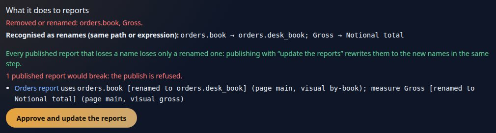

You should see, in the review under *What it does to reports*, **Recognised as renames (same path or expression)**: `orders.book → orders.desk_book; Gross → Notional total`, the report that uses them with `[renamed to ...]` beside each, and the button **Approve and update the reports** (an author who may publish directly sees **Publish and update the reports** under *Impact on reports*). A name is recognised as a rename only when the new one has the **same `path:` or `expr:`** (and type); a column with neither has only its name to go by. Press the button.

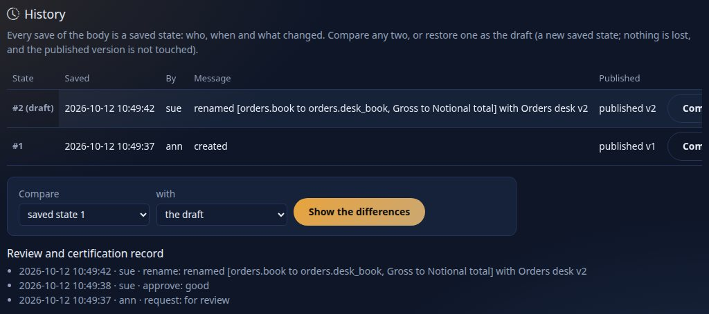

You should see, in the *Orders report*'s history, a new published version whose saved state says `renamed [...]` (its origin is `rename`), and a
`rename` line in the review record: the report's wells now name `orders.desk_book` and `Notional total` (titles are never touched), and the dataset's new
version is published in the same step. The report as it was rewritten (`GET /api/v1/bi/items/<report id>`, captured):

```yaml
      - id: gross
        type: card
        title: Gross
        wells: { values: [Notional total] }
      - id: by-book
        type: bar
        title: Orders by book
        wells: { axis: [orders.desk_book], values: [Orders] }
```

On the command line the review answer is `GET /api/v1/bi/items/<dataset id>/impact` (`"renames": [{"from": "orders.book", "to": "orders.desk_book",
"kind": "field"}, {"from": "Gross", "to": "Notional total", "kind": "measure"}], "renamable": true`), and the button is `POST .../approve` with
`{"applyRenames": true}`. In a **model**, measures and relationships carry **stable ids** the server writes on save (`id: m_notional`); today
a model's Contract tab lists a renamed measure as one taken away (major) and one added, with the reports that use the old name, so rename a model's
measure as a new major version, or keep the old name.

## Step 11 · Roll an import back

An import is not final. **Environments** now lists every import under *Imports you can roll back*. Ann retitled a visual of the report after exporting it; Sue imports the older bundle over it (the overwrite of step 8) and looks at the list.

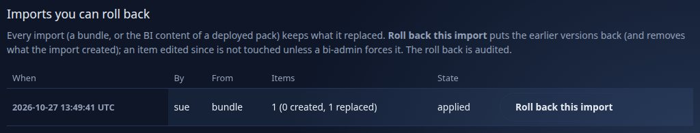

You should see one row for the import (`bundle`, one item, one replaced) and the button **Roll back this import**. Press it. On the command line the list is
`GET /api/v1/bi/imports` (captured: `{"id": "mv6bj6vt-dcb179", "by": "sue", "source": "bundle", "madeBy": "ann", "items": 1, "created": 0, "replaced": 1,
"rolledBack": false}`) and the button is `POST /api/v1/bi/imports/<id>/rollback`.

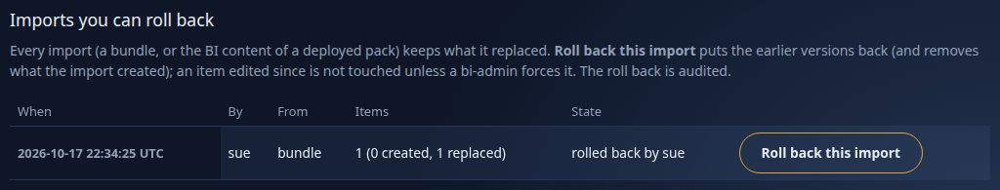

You should see the row say it was rolled back, and the report's draft is Ann's again (as a new saved state with the origin `rollback`; nothing was lost). Had the report been edited **after** the import, the roll back would have stopped with nothing changed and named it; an administrator can force it. A pack deployed from **Admin, Packs** that carries BI files (`config/bi/` in the archive) is imported the same way, so it appears in this list with the source `pack <name> <version>` and rolls back the same way.

## Step 12 · Where does the data really come from?

Step 6's lineage stopped at the connector's name. A dataset's item page (its **Lineage** section) goes one step further: it shows what the connector's
file says it reads. Ann's *Lake
orders* dataset (a dataset of the model layer, `source: { connector: orders-lake, kind: trade }`) reads through the connector `orders-lake`; the
administrator looks first, then Ann.

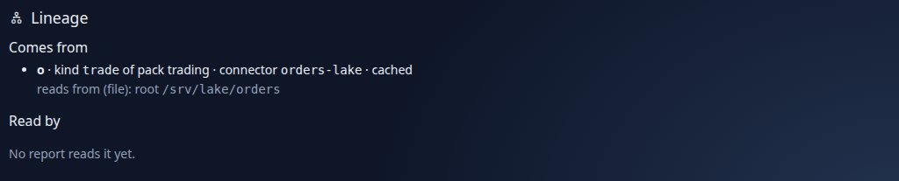

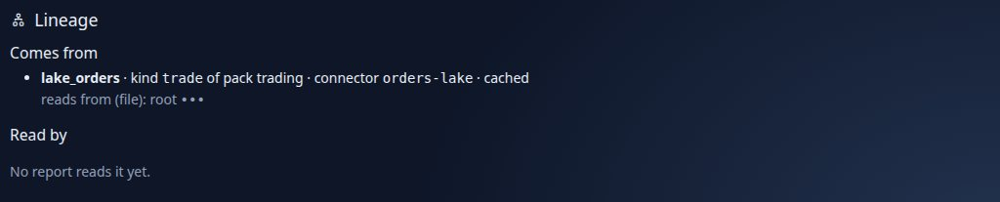

You should see, as the administrator, `reads from (file): root /srv/lake/orders`; as Ann, `root •••`. Only an administrator reads where a connector reads
from (a table, a topic, a path, a bucket, a host); everybody else sees that there is a source and what kind of setting names it. Credentials never appear in
either. The API answers the same, masked as you (`GET /api/v1/bi/items/<id>/lineage`, captured as the administrator and as ann):

```text
"source": {"connector": "orders-lake", "plugin": "file", "masked": false, "declared": {"root": "/srv/lake/orders"}}
"source": {"connector": "orders-lake", "plugin": "file", "masked": true,  "declared": {"root": "•••"}}
```

The YAML behind it is the connector's own file (`config/connectors/orders-lake.yaml`: `plugin: file`, `kinds: [trade]`, `settings: { root:
/srv/lake/orders }`), which only an administrator edits (**Admin → Connectors**).

## Next steps

- [Tutorial 14](14-python-and-analyse.md): Python in a measure, a visual and a notebook.
- [BI_GOVERNANCE.md](../guides/BI_GOVERNANCE.md): every rule, setting (`drishti.governance.four-eyes`, `drishti.bi.governance.refuse-breaking`) and error code of this tutorial.
- [BI_GUIDE.md section 23](../guides/BI_GUIDE.md#23-models-and-pack-datasets-the-model-layer-wave-w1): models, their contract and their versions.
- [USER_MANAGEMENT.md](../admin/USER_MANAGEMENT.md): roles and users in depth; tutorial 17 summarises them.

## If something goes wrong

| You see | Meaning |
|---|---|
| `DRS-9002` | the person lacks the power the step needs (`bi-author` to publish or propose, `bi-steward` to approve or certify, `bi-admin` to force) |
| `DRS-9005` | four-eyes: the person who proposed tried to approve or reject; they may only withdraw |
| `DRS-9126` | a breaking change (a column removed or retyped, something consumers use taken away) needs the next major version; change the reports first, or keep what they read |
| `DRS-9131` (a warning on Check) | roles without a row rule see no rows of that dataset in the model; add a rule, or leave them out on purpose |
| `DRS-9040` | (a version 1 dataset) the change would break published reports: fix the reports, keep the old names, **publish and update the reports** when the impact shows every lost name as a rename, or ask a `bi-admin` to force it |
| the roll back says `DRS-9004` | an item was edited or published after the import: nothing was changed; a `bi-admin` may force it, losing that work |
| Propose for review is not offered | the workspace does not require review: publish directly; or you are not a member of it |
| no email about a review | the **inbox** (the bell) is always told; email needs the mail settings of [tutorial 11](11-bi-that-runs-itself.md) |
| the dry run says `conflict` | the item exists on the target and differs: tick *Overwrite* or rename it; read the reason first |
| the steward cannot certify an item | a steward must be in the item's audience or workspace; add the steward or the role to the audience |
