<!--
  Project Drishti · Any data. Any domain. One grammar.

  Copyright (c) 2026 Ashutosh Sinha <ajsinha@gmail.com>.
  All rights reserved.

  PROPRIETARY AND CONFIDENTIAL.

  This file is the confidential and proprietary property of Ashutosh Sinha.
  Unauthorised copying, use, modification, distribution or disclosure of this
  file, via any medium, is strictly prohibited except with the express prior
  written permission of the copyright holder.

  See the LICENSE file in the root of this repository for the full terms.
-->
# Tutorial 13 · World data: economies, companies, funds, entities and news

The world's public data on one screen, the way the bank's own data is: economies, companies, funds and ETFs, legal entities and
the news. Part A goes from a counterparty to its economy, its outlook, its peers and its government. Part B reads a US company and its five
identifiers. Part C reads a fund's fact sheet, looks through its holdings, sets it against its index and finds who holds a company. Part D
follows who owns whom from GLEIF's records. Part E opens a listed company with its quote and headlines. Every step shows the UI, the command
line and the YAML behind it.

## Time to complete

About 1 h 10 min in all; each part can be done on its own day.

- Part A · Economies: About 15 minutes.
- Part B · Companies: About 10 minutes.
- Part C · Funds and ETFs: About 25 minutes.
- Part D · Legal entities and who owns whom: About 10 minutes.
- Part E · News and markets: About 10 minutes.

## Before you start

- [Tutorial 1, Part A](01-first-15-minutes.md#part-a--install-start-and-look-around) done: a server and console you can build, start and stop.
- The demo lake built with the public-data packs: `python3 tools/drishti.py lake demo`, and the packs loaded:
  `DRISHTI_PACKS=core,market-data,trading,counterparty-risk,market-risk,world-economy,news-and-markets,us-equities,gleif,funds`.
- For the command-line steps: `DRISHTI_SERVER=http://localhost:18480` and `DRISHTI_TOKEN=...` (My account → API tokens), or `--user`
  with sign-in off.

**Where this data comes from.** External, public data: the World Bank (CC BY 4.0), UNDP (CC BY 3.0 IGO) and the CIA World Factbook (public
domain), fetched by `drishti.py feed run world-development` and `drishti.py feed run world-economy`; the IMF forecasts are **internal only**
(`drishti.py feed run world-economy -- --no-imf` leaves them out). The us-equities and gleif packs are the SEC's and GLEIF's public data
(public domain, CC0); the news-and-markets pack is a captured snapshot of Yahoo Finance and Google News, **internal only**. Each source, its
licence and how to refresh it: [External data](../guides/EXTERNAL_DATA.md).

**Part B · Companies.**

- The packs loaded as in Part A (`us-equities` among them).

**Part C · Funds and ETFs.**

- [Tutorial 1, Part A](01-first-15-minutes.md#part-a--install-start-and-look-around) done: a server and console you can build, start and stop.
- The packs loaded as in Part A, `us-equities` with `funds`. To build only this pack's tables: `python3 tools/build_demo_lakes.py --only funds`.

**Where this data comes from.** External, public data: the SEC's Form N-PORT, Form N-CEN and prospectus risk/return summary data sets
and its ticker files (U.S. public domain), the Nasdaq Trader symbol directory (a public file) and GLEIF's relationship records (CC0),
fetched by `drishti.py feed run funds` and committed as a 5.6 MB gzipped snapshot under `data/testdata/funds`. Nothing is internal-only
and no prices are used. Each source, its licence and how to refresh it: [External data](../guides/EXTERNAL_DATA.md#funds) and
[the guide's Part III](../guides/FUNDS_GUIDE.md#12-the-sources-and-their-licences).

**Part D · Legal entities and who owns whom.**

- The packs loaded as in Part A (`gleif` among them).

**Part E · News and markets.**

- The packs loaded as in Part A (`news-and-markets` is one of the quick-start packs).

## What you will learn

**Part A · Economies**

- how a counterparty links to the economy of its country of risk, and what an economy's page holds;
- the IMF's outlook beside the outturns, and a country group computed from its members when opened;
- who governs a country, from the jurisdiction page.

**Part B · Companies**

- how one company carries five identifiers (ticker, CIK, SIC, LEI and its indexes) and links to the other packs by them;
- where its industry, its filings and its financial facts open.

**Part C · Funds and ETFs**

- what the pack holds and how its three commands, `FUND`, `HELD` and `TRACK`, fit together;
- how to read a fund's fact sheet: size, cost, concentration, returns, flows and service providers;
- how to look through a fund to every holding, its derivatives and their counterparties;
- what active share against an index means here, and why the index weights are computed from SEC data;
- how to find a fund by any share class ticker, by index or by any field;
- how to see every fund that holds a company, from the company's own page too;
- how the data is refreshed, on Linux and on Windows.

**Part D · Legal entities and who owns whom**

- how to read an LEI record: its direct and ultimate parents and whether its LEI is kept up to date;
- that a parent relationship is a record of its own, and an ownership group and a country are computed when opened.

**Part E · News and markets**

- how a listed company, its quote and its headlines link;
- that the snapshot answers when the live connectors are off, and how to tell.

### Part A · Economies

Start from a counterparty of the bank and reach the economy it depends on, its outlook, its peers and the people who govern it. The
`world-economy` pack holds the World Bank's development indicators, the IMF's World Economic Outlook and the CIA World Factbook; these records
are not dated by business date, so every date reads the same snapshot. The figures below are the committed snapshot's (World Bank WDI updated
2026-10-08, IMF World Economic Outlook April 2026, CIA World Factbook; retrieved 2026-10-10), as the
[Economies primer](../knowledge/world.md#economies-a-worked-example-on-the-demo-data) gives them.

## Step 1 · From a counterparty to its economy

**In the UI.** Type `CPTY CP-ALDERSHOT` and press Enter: Aldershot Pension Trust, a UK pension fund rated AA-, country of risk GB. Click its
**Economy** link, or type `ECON ECON-GBR`.

*(screenshot filled in the heavy run: ECON ECON-GBR, the United Kingdom's economy page with GDP, growth, inflation, unemployment, debt and its two country groups)*

**From the command line.**

```bash
python3 tools/drishti.py view get counterparty/CP-ALDERSHOT
python3 tools/drishti.py view get economy/ECON-GBR
```

**In YAML.** The pack's commands, `config/packs/economy/world-economy/pack.yaml` (the start of the list):

```yaml
mnemonics:
  ECON:
    kind: economy
    label: Economy
  MACRO:
    kind: macro-indicator
    label: Macro indicator
  FCST:
    kind: economic-forecast
    label: Economic forecast
```

A counterparty's `ECONOMY` is a link column of its data contract ([`config/packs/core/core/contracts/counterparty.contract.yaml`](../contracts/packs/core.md#cpty-counterparty-counterparty) ([example](../contracts/samples/core.md#counterparty)),
`ECONOMY → economy`): the link follows the country of risk, which may differ from where the counterparty is registered.

**You should see** the UK's figures:

| `ECON ECON-GBR` | Value |
|---|---|
| GDP (2025) | 4,002.6 bn USD, the 5th largest of 213 economies |
| GDP per capita | 57,602 USD, 69.5 million people |
| Real growth | 1.39% |
| Inflation | 3.88% |
| Unemployment | 4.75% |
| Government debt | 102.3% of GDP (2025, the same figure as `FISC FISC-GBR`) |
| Current account | −3.13% of GDP |
| Region and income group | `ECG-ECS` (Europe and Central Asia), `ECG-HIC` (high income) |

The economy record takes the IMF series' latest *actual* year for debt, never a projection.

Further: the [Economies primer](../knowledge/world.md#2-economies) and the pack's guide,
[world-economy.md](../../config/packs/economy/world-economy/guides/world-economy.md).

## Step 2 · Its outlook, its peers and who governs it

**In the UI.** Type `FCST FCST-GBR-WEO`, then `ECG ECG-HIC` and `ECG ECG-WLD`, then `JUR JUR-GBR`.

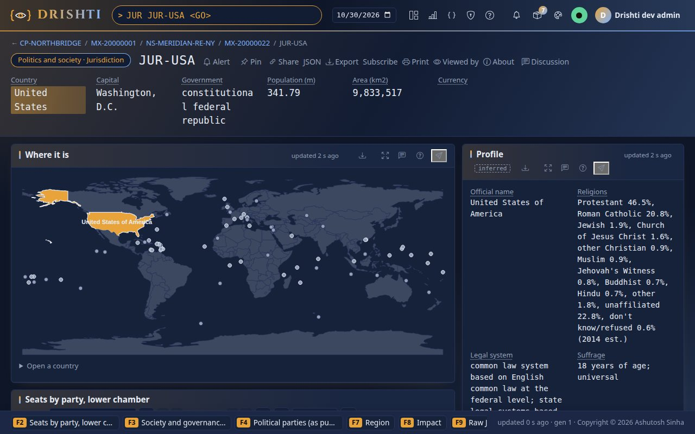

**From the command line.**

```bash
python3 tools/drishti.py view get economic-forecast/FCST-GBR-WEO
python3 tools/drishti.py view get country-group/ECG-HIC
python3 tools/drishti.py view get jurisdiction/JUR-GBR
```

**In YAML.** A country group is computed from its member economies when opened; the computation, its YAML and a region worked through
(`ECG ECG-SAS`) are in [the groupings tutorial, step 6](../guides/BI_GUIDE.md#step-6--a-world-bank-region-from-its-economies).

**You should see**

- `FCST FCST-GBR-WEO` (IMF World Economic Outlook, April 2026): growth 0.8% in 2026 and 1.3% in 2027, inflation 2.4% in 2027, government
  debt 102.9% of GDP in 2030; the outturns of 2015 to 2025 (−10.0% growth in 2020, 9.1% inflation in 2022) beside the projections, each row
  saying which.
- `ECG ECG-HIC`, computed from its 84 member economies: GDP 75,910 bn USD, growth 1.88% (weighted by GDP), median inflation 2.34%. The UK
  grows more slowly and its prices rise faster than the high-income median. `ECG ECG-WLD`: 213 economies, 117,327 bn USD, growth 2.80%.
- `JUR JUR-GBR`: the government, the office holders, the legislature and the elections, each linked to its own page (`OFFC`, `PARTY`, `ELEC`).

Further: [BI_GUIDE.md section G5](../guides/BI_GUIDE.md#part-5--groupings-and-analytics) (ECG with worked numbers).

### Part B · Companies

The `us-equities` pack holds every company of the S&P 500, the Nasdaq-100 and the Dow from the SEC's EDGAR: its identifiers, its industry,
its index memberships, its filings and ten years of annual financials. The committed snapshot was retrieved on 2026-10-24: 586 companies,
194 SIC codes in 9 divisions, 531 with an LEI ([Companies, funds and ETFs primer](../knowledge/world.md#companies-funds-and-etfs-a-worked-example-on-the-demo-data)).

## Step 3 · One company, five identifiers

**In the UI.** Type `USEQ AAPL` and press Enter. Click its LEI to open the GLEIF record, and its SIC code to open the industry.

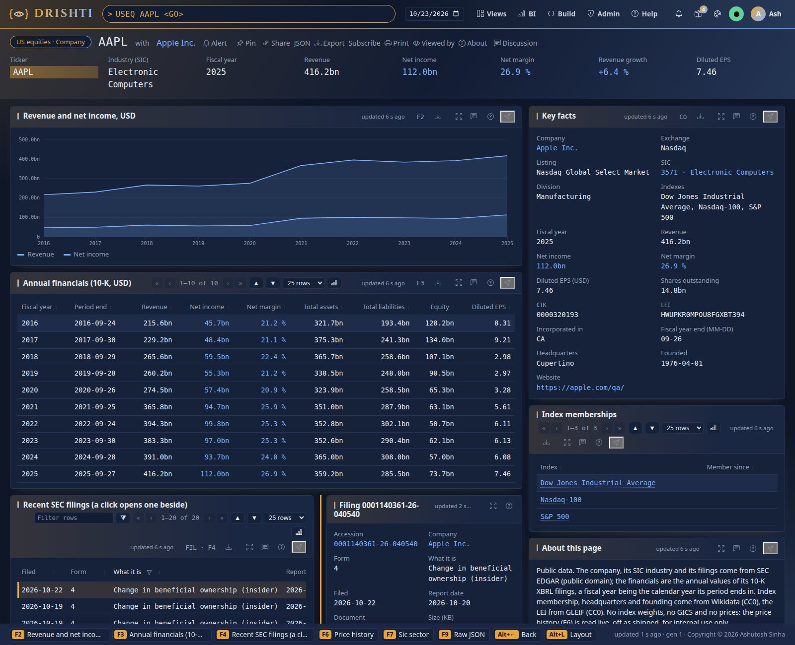

**From the command line.**

```bash
python3 tools/drishti.py view get us-company/AAPL
python3 tools/drishti.py view get sic-sector/3674
```

**In YAML.** The pack's commands, `config/packs/capitalmarkets/us-equities/pack.yaml`:

```yaml
mnemonics:
  USEQ:   { kind: us-company, label: US company }
  IDX:    { kind: index-membership, label: Index members }
  SIC:    { kind: sic-sector, label: SIC sector }
  EDGAR:  { kind: filing-feed, label: EDGAR filings browser }
  FILING: { kind: filing, label: SEC filing }
  FACT:   { kind: financial-fact, label: Financial fact }
  PXH:    { kind: price-history, label: "Price history (live, internal use only)" }
```

**You should see** *Apple Inc.*: ticker AAPL, CIK `0000320193`, SIC 3571 (Electronic Computers), division D (Manufacturing), LEI
`HWUPKR0MPOU8FGXBT394`, member of the Dow, the Nasdaq-100 and the S&P 500, 14,776,353,000 shares outstanding, revenue 416.2bn USD in fiscal
2025. Its LEI opens the GLEIF record and its ownership group (`LEIG HWUPKR0MPOU8FGXBT394`, 21 entities, Part D). `SIC 3674` has the 20
semiconductor companies, NVIDIA first by revenue (215.9bn), then Micron (133.2bn) and Broadcom (63.9bn). A company with several share
classes is keyed by one ticker: `USEQ GOOGL` is *Alphabet Inc.*, CIK `0001652044`, with the other tickers GOOG, GOOGM and GOOGN.

The ratios worked out on the page (net margin, revenue growth) and a sector's totals with the currency rule are
[the groupings tutorial, steps 4 and 5](../guides/BI_GUIDE.md#step-4--a-sector-and-the-currency-rule).

Further: the pack's guide, [us-equities.md](../../config/packs/capitalmarkets/us-equities/guides/us-equities.md).

### Part C · Funds and ETFs

What does the largest Nasdaq ETF hold, who are its derivative counterparties, how far is it from its index, and which funds own
Apple? The `funds` pack answers from SEC public data for the 200 largest US mutual funds and ETFs. In this part you turn the pack
on, read a fund's fact sheet, look through its holdings, set it against its index, find funds by share class and by index, see who
holds a company, and refresh the data. Each step shows the UI, the command line and the YAML behind it; the outputs were captured with
sign-in off, on a lake built on 2026-10-27. Every column, source and option is in the one reference,
[FUNDS_GUIDE.md](../guides/FUNDS_GUIDE.md); each step ends with its sections.

## Step 4 · Turn the pack on and see what it holds

**In the UI.** With the server started as in *Before you start*, type `FUNDS` and press Enter.

**From the command line.**

```bash
python3 tools/drishti.py feed status funds
```

```text
$ python3 tools/drishti.py feed status funds
committed pack: 200 funds in 5 parts, data retrieved 2026-10-26
SOURCE   LICENCE                                           USE          LAST REFRESHED       CACHED
tickers  Public domain (U.S. Government work); SEC fair a  committable  2026-10-26T19:37:15  1.7 MB
nasdaq   Public symbol directory files (Nasdaq Trader)     committable  2026-10-26T19:37:15  871.4 KB
nport    Public domain (U.S. Government work); SEC fair a  committable  2026-10-26T19:12:40  441.0 MB
ncen     Public domain (U.S. Government work); SEC fair a  committable  2026-10-26T19:37:15  36.4 MB
rr       Public domain (U.S. Government work); SEC fair a  committable  2026-10-26T19:37:15  187.4 MB
gleif    CC0 1.0                                           committable  2026-10-26T19:37:15  23.4 MB
```

(On a fresh clone the LAST REFRESHED and CACHED columns say `never` and `-`: the committed snapshot needs no download.)

**In YAML.** The pack's commands and its Delta connector, `config/packs/capitalmarkets/funds/pack.yaml`:

```yaml
mnemonics:
  FUND:  { kind: fund, label: Fund or ETF }
  HELD:  { kind: fund-holder, label: Funds holding a company }
  TRACK: { kind: index-funds, label: Funds tracking an index }
connectors:
  funds-store:
    plugin: delta
    kinds: [fund, fund-holder, index-funds]
    settings:
      domain: funds
      layout:
        fund:
          type-ahead: [NAME, TICKERS]     # a fund is found by its name and by every share class ticker
```

You should see the pack's overview: **FUND** 200 funds, **HELD** 586 companies, **TRACK** 3 indexes, each with an example and its key
fields, and what the pack holds.

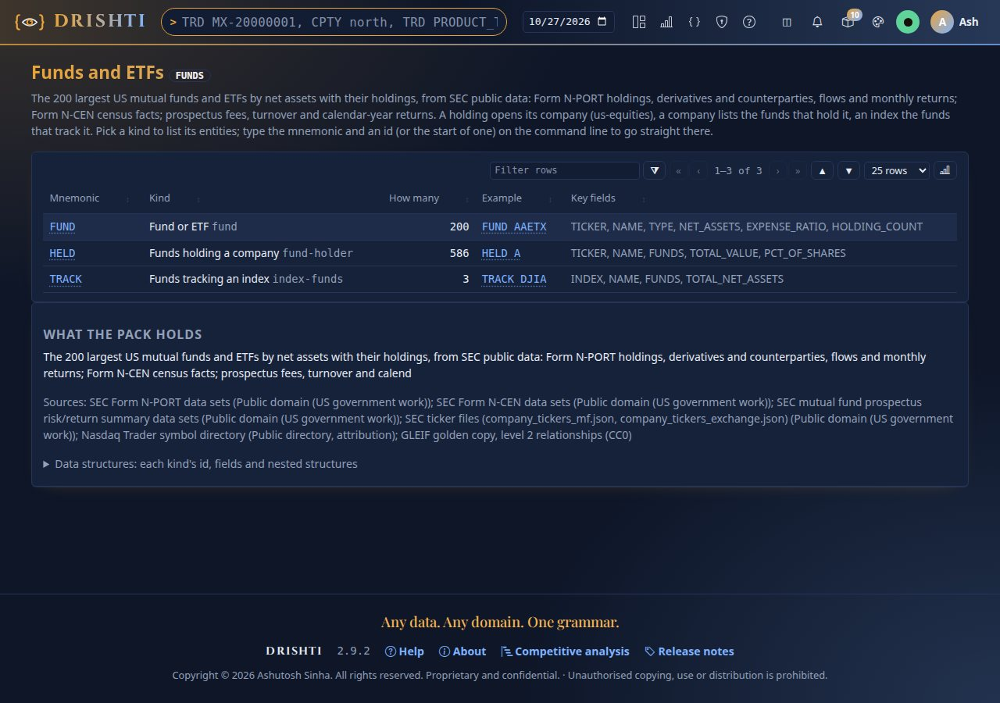

Further in the guide: [section 1](../guides/FUNDS_GUIDE.md#1-turning-the-pack-on).

## Step 5 · Read a fund's fact sheet

**In the UI.** Type `FUND QQQ` and press Enter: Invesco QQQ.

**From the command line.**

```bash
python3 tools/drishti.py view get fund/QQQ
```

```text
$ drishti.py view get fund/QQQ
Funds · Fund or ETF  QQQ  with Invesco QQQ Trust, Series 1   [FUND]

Key figures
  figure         value
  -------------  ----------
  Ticker         QQQ
  Type           ETF
  Tracks         Nasdaq-100
  N-PORT report  2026-06-30
  SEC series     S000101292
  CIK            0001067839

Net assets  (metric, net-assets)
  {"value": {"text": "490.1bn", ...}, "unit": "USD", "caption": "2026-06-30"}
...
Top 10 holdings of 105 (a company opens its page)  (table, top-holdings, F2)
  Holding                       Ticker  SIC division   Weight   Value
  ----------------------------  ------  -------------  ------  ------
  NVIDIA Corp.                  NVDA    Manufacturing  7.60 %  37.2bn
  Apple Inc.                    AAPL    Manufacturing  6.67 %  32.7bn
  Micron Technology, Inc.       MU      Manufacturing  5.64 %  27.6bn
  ...
```

**In YAML.** The fact sheet's layout, `config/packs/capitalmarkets/funds/sutras/fund.v1.sutra.yaml` (shortened): tiles on top, the holdings and the
fund's facts side by side, the tabs at the bottom:

```yaml
layout:
  areas:
    - "tiles tiles"
    - "main side"
    - "low low"
    - "views views"
  columns: [7, 5]
panels:
  - { id: net-assets, kind: metric, area: tiles, span: 2, value: $.NET_ASSETS, title: Net assets, fmt: compact, unit: USD }
  - id: top-holdings
    kind: table
    area: main
    rows: $.HOLDINGS
    limit: 10
    columns:
      - { label: Holding, bind: "nonblank(@.COMPANY) ? link(@.COMPANY, 'us-company', @.NAME) : @.NAME" }
      - { label: Weight, bind: "@.PCT", fmt: weight2 }
```

You should see the tiles **Net assets 490.1bn USD**, **Expense ratio 0.18 %**, **Holdings 105**, **Top 10 45.00 %**, **Last calendar
year +25.58 %** (2024) and **Turnover 7.98 %**; the ten largest holdings from NVIDIA (7.60%) down, each a link to its company; the fund
(index Nasdaq-100, exchange Nasdaq, rank 7 by net assets) and its holdings by SIC division (Manufacturing 62.74%); its calendar-year
returns from 2015 (2022 −32.51%, 2023 +54.73%); three months of flows (net +10.4bn, +7.2bn, −6.8bn); the tabs at the bottom. Click
**NVIDIA Corp.**: `USEQ NVDA` opens.

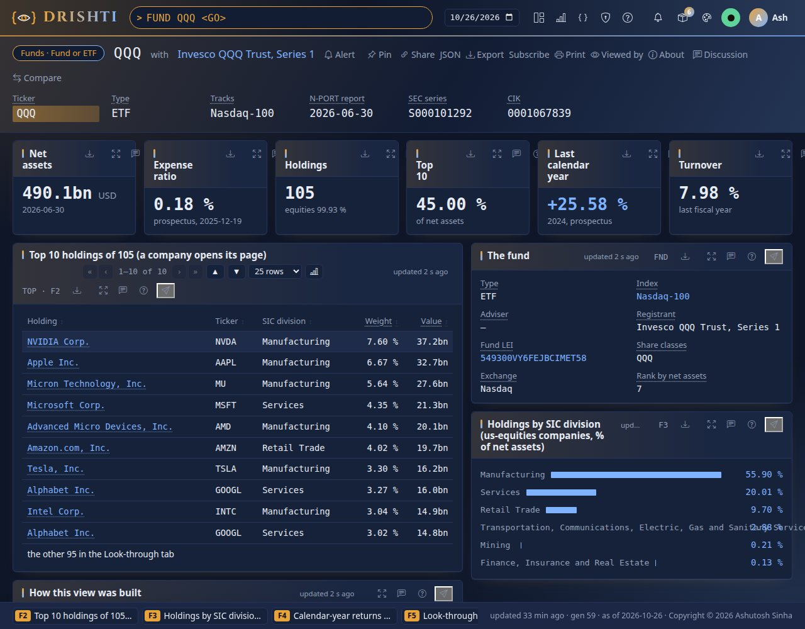

Further in the guide: [section 2](../guides/FUNDS_GUIDE.md#2-the-fund-page-the-fact-sheet) and [section 8](../guides/FUNDS_GUIDE.md#8-fund).

## Step 6 · Look through the fund

**In the UI.** On `FUND QQQ`, press F5 (or scroll down) to the tabs; **Look-through holdings** is open.

**From the command line.** The document behind the tab, its holdings and derivatives:

```bash
python3 tools/drishti.py view get fund/QQQ --json | python3 -c "import json,sys; d=json.load(sys.stdin); print([p['id'] for p in d['panels'] if p['id']=='views'])"
curl -s http://localhost:18480/api/v1/entities/fund/QQQ/raw | python3 -m json.tool | grep -A12 '"DERIVATIVES"'
```

```text
    "DERIVATIVES": [
        {
            "NAME": "CME E-Mini NASDAQ 100 Index Future",
            "DERIVATIVE": "FUT",
            "CPTY": "Chicago Mercantile Exchange Inc.",
            "CPTY_LEI": "SNZ2OJLFK8MNNCLQOF39",
            "NOTIONAL": 327348710.7,
            "EXPIRY": "2026-09-18",
            "REFERENCE": "NASDAQ 100 Stock Index",
            "TYPE": "Future",
            ...
```

**In YAML.** The tabs are one `tabs` panel over the document's `VIEWS`; each panel inside shows on its own tab (`when:`):

```yaml
  - id: views
    kind: tabs
    each: $.VIEWS                       # [{VIEW: LOOK_THROUGH, TITLE: ...}, {VIEW: VS_INDEX, TITLE: vs Nasdaq-100}]
    tabTitle: "@.TITLE"
    panels:
      - id: holdings
        kind: table
        when: "@.VIEW == 'LOOK_THROUGH'"
        rows: $.HOLDINGS
        columns:
          - { label: Issuer, bind: "nonblank(@.COMPANY) ? link(@.COMPANY, 'us-company', @.NAME) : @.NAME" }
          - { label: Also in, bind: "nonblank(@.COMPANY) ? link(@.COMPANY, 'fund-holder', fmt(@.ALSO_IN, 'amount0') + ' funds') : ''" }
```

You should see **Concentration** (top 10 45.00%, top 50 87.45%, Herfindahl 0.029, 101 of 105 holdings with an LEI), common equity
99.93% of net assets, the one derivative (the CME E-mini Nasdaq-100 future, 327.3m notional, counterparty Chicago Mercantile Exchange,
an LEI link), all 105 holdings with ticker, ISIN, CUSIP and **Also in** (NVIDIA: 86 other funds), and **Who else holds Nvidia**: the
Vanguard Total Stock Market and 500 Index funds, iShares Core S&P 500 and the others by value.

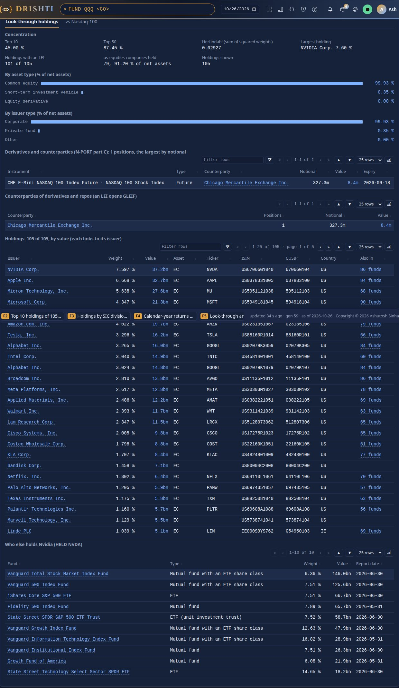

Further in the guide: [section 3](../guides/FUNDS_GUIDE.md#3-the-look-through-holdings-tab).

## Step 7 · Set the fund against its index

**In the UI.** Click the tab **vs Nasdaq-100**. Then try `FUND VOO` and its tab **vs S&P 500**, and `FUND AGTHX` (an active fund,
compared with the S&P 500 for reference).

**From the command line.**

```bash
python3 tools/drishti.py view get fund/VOO
```

```text
$ drishti.py view get fund/VOO
Funds · Fund or ETF  VOO  with Vanguard 500 Index Fund   [FUND]
...
The fund  (kv, the-fund)
  Type                     Mutual fund with an ETF share class
  Index                    S&P 500
  Adviser                  The Vanguard Group, Inc.
  Share classes            VOO VFINX VFIAX VFFSX
  Exchange                 NYSE Arca
  Creation unit (shares)   25,000
  Authorised participants  34
```

**In YAML.** The comparison is built with the document (`tools/packgen/funds/fundsbuild.py`, `_vs_index`) and drawn by the tab's panels:

```yaml
      - id: coverage
        kind: kv
        when: "@.VIEW == 'VS_INDEX'"
        columns:
          - { label: Active share, bind: $.VS_INDEX.ACTIVE_SHARE, fmt: weight2 }
          - { label: Index weights, bind: "$.VS_INDEX.WEIGHTING + ' (' + fmt($.VS_INDEX.MEMBERS_WEIGHTED, 'amount0') + ' members)'" }
```

You should see, for QQQ, **Members held** 98 of 99 listed members, **Active share** 11.21%, the index weights *market capitalisation
computed from SEC data, capped as the Nasdaq-100 methodology caps it (84 members)* and the members not weighted (their filed share
count cannot be compared: ABNB, APP, BKNG ...); the 25 largest weights side by side (Apple 7.9% in the fund against 9.6% in the
computed index) and the tilt by SIC division. For VOO the active share is 5.29% over 493 of 495 members; for AGTHX 44.41%; for DIA,
weighted by share price as the Dow is, 1.8%. The note at the bottom says why the index weights are computed: providers' weights are
proprietary. The members are what each index's tracking ETF (SPY, QQQ, DIA) reported holding.

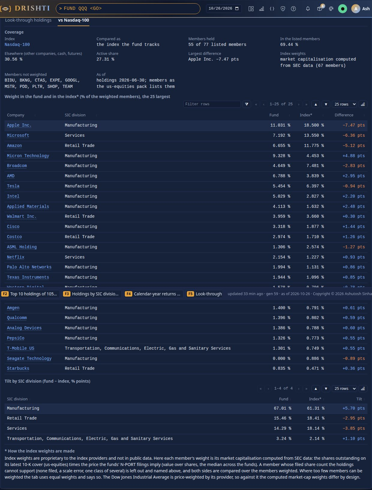

Further in the guide: [section 4](../guides/FUNDS_GUIDE.md#4-the-fund-against-its-index).

## Step 8 · Find funds: by share class, by index, by any field

**In the UI.** Type `FUND VTSAX` without pressing Enter: the suggestion is **VTI**, Vanguard Total Stock Market (VTSAX is one of its
share classes). Press Enter: VTI opens. Then type `FUND INDEX_ID=SP500` and press Enter.

**From the command line.**

```bash
curl -s "http://localhost:18480/api/v1/command/suggest?q=FUND%20VTSAX"
curl -s "http://localhost:18480/api/v1/search?q=FUND%20INDEX_ID%3DSP500" | python3 -c "import json,sys; print([r['ref']['id'] for r in json.load(sys.stdin)['rows']])"
```

```text
[{"type":"entity","mnemonic":"FUND","kind":"fund","id":"VTI","title":"VTI","subtitle":"Vanguard Total Stock Market Index Fund · VTI VTSMX VTSAX VITSX VSMPX VSTSX · fund · funds-store","complete":"FUND VTI"}]
['FXAIX', 'IVV', 'SPY', 'SPYM', 'SWPPX', 'VINIX', 'VOO', 'WFSPX']
```

**In YAML.** The search form of the kind (`FORM funds`), `config/packs/capitalmarkets/funds/pack.yaml`:

```yaml
form:
  fund:
    - { path: TICKER, type: id, group: Identity }
    - { path: TICKERS, label: Share class tickers, type: text, group: Identity }
    - { path: INDEX_ID, label: Tracked index, type: enum, group: Fund }
    - { path: EXPENSE_RATIO, label: "Expense ratio (%)", type: number, group: Size and cost }
```

You should see **8 of 200 funds match**: FXAIX, IVV, SPY, SPYM, SWPPX, VINIX, VOO and WFSPX (a feeder of an iShares master fund,
whose one holding is that fund, so it has no index tab), each with its type and net assets.

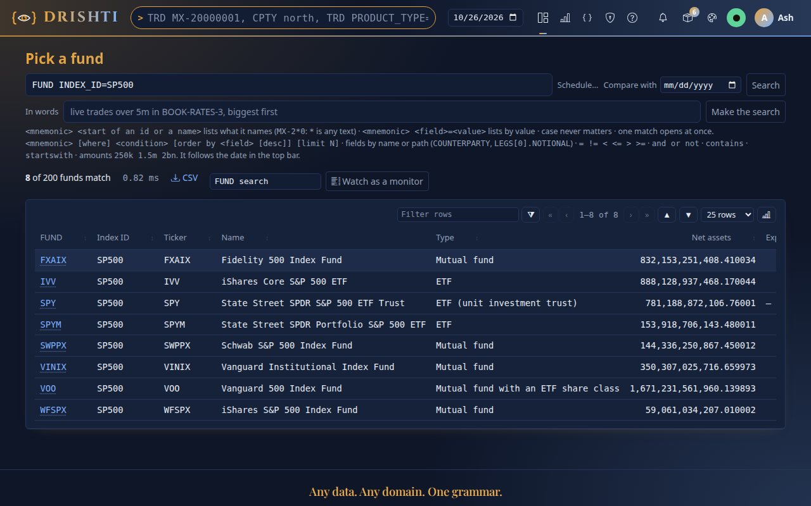

Further in the guide: [section 7](../guides/FUNDS_GUIDE.md#7-commands-search-command-line-and-api).

## Step 9 · See every fund that holds a company

**In the UI.** Type `HELD AAPL`. Then open `USEQ AAPL` and click the tab **Held by funds** under its filings.

**From the command line.**

```bash
python3 tools/drishti.py view get fund-holder/AAPL
```

```text
$ drishti.py view get fund-holder/AAPL
Funds · Held by funds  AAPL  with Apple Inc.   [HELD]

Key figures
  figure               value
  -------------------  ----------
  Company              Apple Inc.
  Funds                85
  of which ETFs        26
  Value held           831.0bn
  Share of its shares  19.02 %
  Average weight       5.425 %
  Largest weight       14.57 %

Funds holding Apple Inc., by value (a fund opens its page)  (table, holders, F2)
  Fund                                    Ticker  Type                                 Weight in the fund    Value  Shares
  Vanguard Total Stock Market Index Fund  VTI     Mutual fund with an ETF share class             5.872 %  134.9bn  466.3m
  Vanguard 500 Index Fund                 VOO     Mutual fund with an ETF share class             6.590 %  110.1bn  380.6m
  ...
```

**In YAML.** The company page reads the funds pack's record as a source, `config/packs/capitalmarkets/us-equities/sutras/us-company.v1.sutra.yaml`:

```yaml
layout:
  areas: ["main right", "funds right"]
  tabs: [funds]                         # the panels of this area are tabs
panels:
  - id: held-by-funds
    kind: table
    area: funds
    source: { pack: funds, kind: fund-holder, id: $.TICKER }
    rows: $src.HOLDERS
```

You should see **85 funds** (26 ETFs) holding **831.0bn** of Apple, **19.02% of its shares**, at weights from under 1% to 14.57%; on
USEQ AAPL the tabs **Held by funds** (the same funds) and **Fund ownership**.

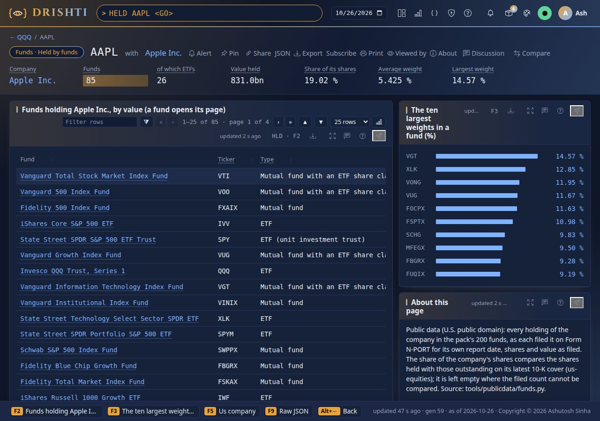

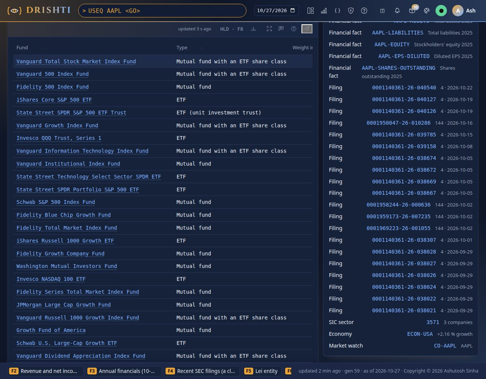

Further in the guide: [section 5](../guides/FUNDS_GUIDE.md#5-held-by-funds-held-and-the-company-page) and [section 9](../guides/FUNDS_GUIDE.md#9-fund-holder).

## Step 10 · See the funds that track an index

**In the UI.** Type `TRACK SP500`. Then open `IDX SP500`: the list **ETFs and funds tracking it** is on the right.

**From the command line.**

```bash
python3 tools/drishti.py view get index-funds/SP500
```

```text
$ drishti.py view get index-funds/SP500
Funds · Funds tracking an index  SP500  with S&P 500   [TRACK]
  Funds                7
  of which ETFs        4
  Net assets together  4,821.3bn
  Largest              VOO

  Fund                                     Ticker  Type                                 Net assets  Expense ratio  Members held  Active share*
  Vanguard 500 Index Fund                  VOO     Mutual fund with an ETF share class   1,671.2bn         0.03 %           493         5.29 %
  iShares Core S&P 500 ETF                 IVV     ETF                                     888.1bn         0.03 %           493         5.29 %
  Fidelity 500 Index Fund                  FXAIX   Mutual fund                             832.2bn         0.01 %           487         5.41 %
  State Street SPDR S&P 500 ETF Trust      SPY     ETF (unit investment trust)             781.2bn                          493         5.29 %
  ...
```

**In YAML.** On the index page, `config/packs/capitalmarkets/us-equities/sutras/index-membership.v1.sutra.yaml`:

```yaml
  - id: tracked-by
    kind: table
    title: "ETFs and funds tracking it (the funds pack; a fund opens its page)"
    when: "$.INDEX != 'BANKS-US' && $.INDEX != 'BANKS-CA' && $.INDEX != 'BANKS-UK'"
    source: { pack: funds, kind: index-funds, id: $.INDEX }
    rows: $src.ROWS
```

You should see **7 funds** (4 ETFs) with **4,821.3bn** together, VOO the largest; every one at an expense ratio of 0.03% or less (SPY,
a trust, files no prospectus summary) and an active share between 5.29% and 5.77% against the computed weights.

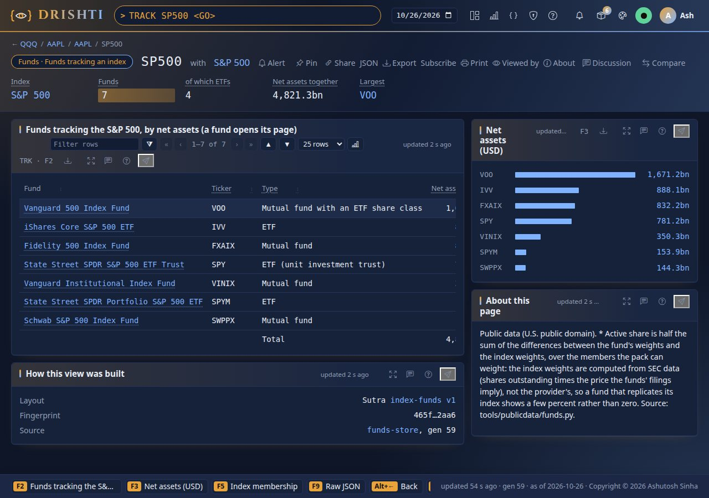

Further in the guide: [section 6](../guides/FUNDS_GUIDE.md#6-funds-tracking-an-index-track-and-the-index-page) and [section 10](../guides/FUNDS_GUIDE.md#10-index-funds).

## Step 11 · On a phone, and from the API

**In the UI.** Open `FUND VTI` on a phone (or narrow the window to 390 px): the tiles, then the holdings, the fund and the tabs stack.

**From the command line.** The page as data:

```bash
curl -s http://localhost:18480/api/v1/views/fund/VTI | python3 -c "import json,sys; v=json.load(sys.stdin); print([p['id'] for p in v['panels']][:8])"
```

```text
['net-assets', 'expense-ratio', 'holding-count', 'top-ten', 'last-year', 'turnover', 'top-holdings', 'the-fund']
```

**In YAML.** The phone order of the layout:

```yaml
layout:
  phone: [tiles, main, side, low, views]
```

You should see VTI's tiles one under the other (2,297.8bn of net assets, 3,546 holdings), then the top ten, the fund and the tabs, with
no sideways scrolling.

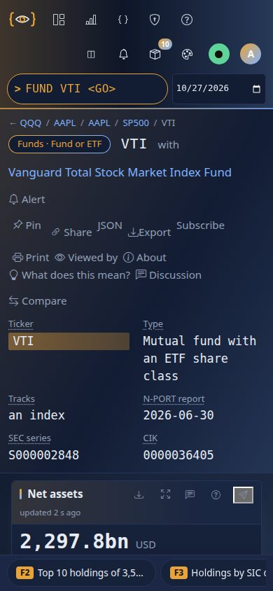

Further in the guide: [section 7](../guides/FUNDS_GUIDE.md#7-commands-search-command-line-and-api).

## Step 12 · Refresh the data

**In the UI.** Nothing to click: the data is refreshed by a script, then the lake is rebuilt and the server reads it.

**From the command line.** On Linux and macOS (on Windows, `.\tools\windows\publicdata-funds.ps1` takes the same arguments):

```bash
tools/feeds/feed.sh run funds --dry-run      # what would be fetched; changes nothing
tools/feeds/feed.sh run funds --snapshot                # about 700 MB of downloads the first time, kept in the data folder; then make.py --check
python3 tools/drishti.py lake demo               # rebuild the lake
```

```text
$ tools/feeds/feed.sh run funds --dry-run
dry run: funds, sources tickers, nasdaq, nport, ncen, rr, gleif
  tickers (Public domain (U.S. Government work); SEC fair access policy; committable): 2 request(s), cache <data>/datafeeds/sources/cache/funds
    https://www.sec.gov/files/company_tickers_mf.json
    https://www.sec.gov/files/company_tickers_exchange.json
  ...
  then: tools/packgen/funds/make.py -> config/packs/capitalmarkets/funds and data/testdata; then make.py --check
```

**In YAML.** The snapshot the refresh writes, listed in `data/testdata/testdata.yaml` (the fund kind in parts, one tar):

```yaml
- folder: funds/fund
  pack: funds
  kind: fund
  connector: funds-store
  key: TICKER
  snapshot: true
  captured: '2026-10-26'
  files:
  - fund.tar                # fund/2026-10-26/snapshot.part-01.jsonl.gz ... part-05: a tar of date folders (the load rules)
```

You should see the dry run name every file it would fetch and write nothing; a refresh prints each download, then *wrote
config/packs/capitalmarkets/funds ... 7 snapshot files, 5.6 MB* and *funds pack matches its generator*. Without the downloads, `python3
tools/packgen/funds/make.py --check` still checks the committed snapshot.

Further in the guide: [sections 15](../guides/FUNDS_GUIDE.md#15-the-refresh-script) and [16](../guides/FUNDS_GUIDE.md#16-the-gzipped-snapshot-and-offline-use).

### Part D · Legal entities and who owns whom

The `gleif` pack holds GLEIF's legal entity identifiers (LEIs), their reference data and who owns whom (GLEIF's level 2 data). The committed
snapshot was retrieved on 2026-10-25: 9,937 legal entities in 590 ownership groups across 133 countries
([Entities and ownership primer](../knowledge/data.md#entities-and-ownership-a-worked-example-on-the-demo-data)).

## Step 13 · Who owns this company, all the way up

**In the UI.** Type `LEI 010PWNH4K3BLIC3I7R03` and press Enter: *Gestion Placements Desjardins Inc.*, Montreal. Then
`LEIR LEIREL-010PWNH4K3BLIC3I7R03-DIRECT`, `LEIG 549300B2Q47IR0CR5B54` and `LEIC GB`.

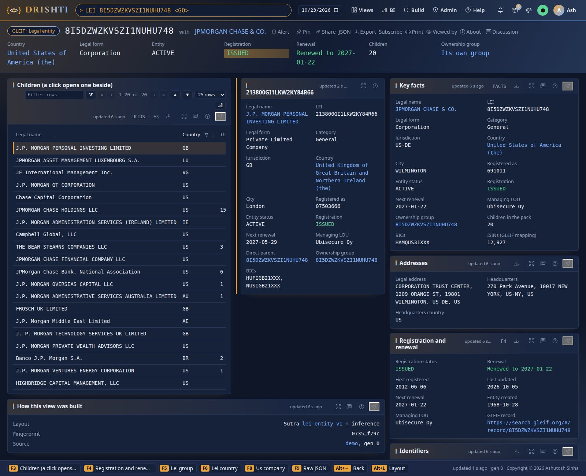

**From the command line.**

```bash
python3 tools/drishti.py view get lei-entity/010PWNH4K3BLIC3I7R03
python3 tools/drishti.py view get lei-group/549300B2Q47IR0CR5B54
python3 tools/drishti.py view get lei-country/GB
```

**In YAML.** The pack's commands and the id rule that makes a bare LEI open the entity, `config/packs/core/gleif/pack.yaml`:

```yaml
mnemonics:
  LEI:  { kind: lei-entity, label: LEI legal entity }
  LEIG: { kind: lei-group, label: LEI ownership group }
  LEIR: { kind: lei-relationship, label: LEI parent relationship }
  LEIC: { kind: lei-country, label: LEI country }
  LEIM: { kind: lei-mapping, label: ISIN or BIC to LEI }
graph:
  id-patterns:
    - { pattern: "^[0-9A-Z]{18}[0-9]{2}$", kind: lei-entity }       # an LEI (ISO 17442): 18 characters and two check digits
    - { pattern: "^LEIREL-", kind: lei-relationship }
```

**You should see** the record's parents:

```text
FÉDÉRATION DES CAISSES DESJARDINS DU QUÉBEC   549300B2Q47IR0CR5B54   ultimate parent (level 2), LEI issued, renews 2027-11-10
  └─ Desjardins Holding financier inc.        549300COKYB5EGSU1838   direct parent (level 1), LEI issued
       └─ Gestion Placements Desjardins Inc.  010PWNH4K3BLIC3I7R03   LEI LAPSED: renewal was due 2024-10-07
```

The group `LEIG 549300B2Q47IR0CR5B54`, computed when opened, has 26 members (all of GLEIF's 26) in 2 countries, and **7 of them have let
their LEI lapse**: a credit officer onboarding any of them would want to know. `LEIC GB`: 1,274 entities registered in the United Kingdom,
225 of them lapsed. `LEIG HWUPKR0MPOU8FGXBT394` (Apple Inc.): the whole group, 21 of 21, in 15 countries, none late; its record links to the
us-equities company `AAPL` (Part B) and to 949 ISINs.

How a group is computed from its entities, every group and the type-ahead, and a country's entities are
[the groupings tutorial, steps 1 to 3](../guides/BI_GUIDE.md#step-1--an-ownership-group-from-its-entities).

Further: the pack's guide, [gleif.md](../../config/packs/core/gleif/guides/gleif.md).

### Part E · News and markets

The `news-and-markets` pack holds twenty well-known listed companies, each with a quote, a price chart and its headlines, and fifteen news
topics. As shipped it reads a real snapshot committed with Drishti (a year of daily bars for every company and the companies' and topics'
headlines, captured from Yahoo Finance and Google News): the pages work with no internet. The data belongs to Yahoo Finance, Google News and
the publishers and is shown for **internal demonstration only**.

## Step 14 · A company, its quote and its headlines

**In the UI.** Type `CO AAPL`, then `NEWS Apple` and `QUOTE AAPL`. `CO google` gives a pick list by name or alias: *Google* finds Alphabet.

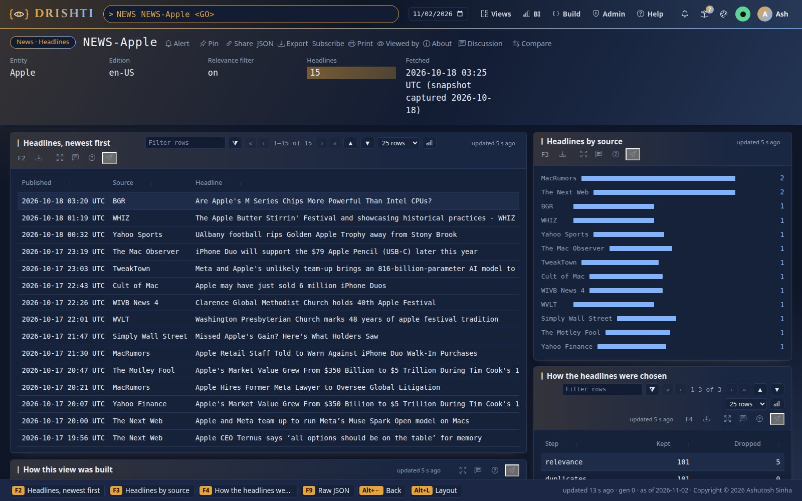

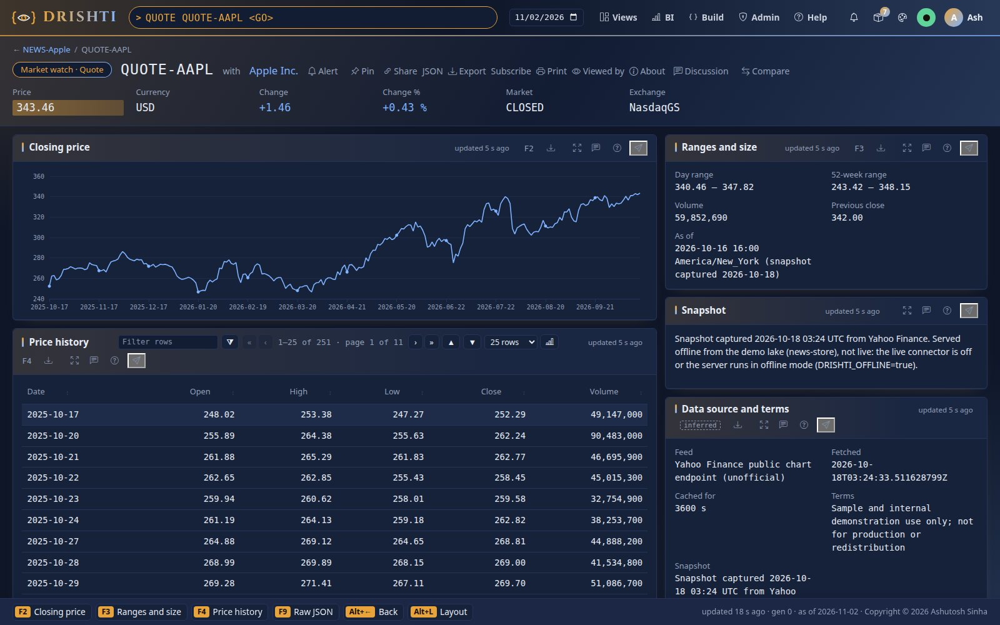

**From the command line.**

```bash
python3 tools/drishti.py view get listed-company/CO-AAPL
```

**In YAML.** The pack's commands and the id rules, `config/packs/economy/news-and-markets/pack.yaml`:

```yaml
mnemonics:
  TOPIC: { kind: news-topic, label: News topic }
  NEWS:  { kind: news, label: Headlines }
  CO:    { kind: listed-company, label: Listed company }
  QUOTE: { kind: quote, label: Quote and price history }
graph:
  id-patterns:
    - { pattern: "^TOPIC-", kind: news-topic }
    - { pattern: "^NEWS-", kind: news }
    - { pattern: "^CO-", kind: listed-company }
    - { pattern: "^QUOTE-", kind: quote }
```

**You should see** Apple's page with its quote, chart and headlines; on the snapshot the quote's *As of* and the headlines' *Fetched* end
in *(snapshot captured <date>)* and the quote and headline pages show a **Snapshot** note. Admin → Connectors shows `news` and `yfinance`
*off (served from the snapshot)*, or *off (offline mode)* on the quick-start server. Turning them on (`DRISHTI_NEWS_ENABLED=true`,
`DRISHTI_YFINANCE_ENABLED=true`) sends each name and ticker you open to Google and Yahoo.

Further: the pack's guide, [news-and-markets.md](../../config/packs/economy/news-and-markets/guides/news-and-markets.md);
holding the news in memory only is [tutorial 16, Part D](16-load-your-own-data-into-a-new-lake.md#part-d--news-held-in-memory-only).

## Next steps

- [Tutorial 14](14-public-sector-data.md): the World Bank's development indicators, central banks, national statistics and official news, refreshed daily.
- [The groupings tutorial](../guides/BI_GUIDE.md#tutorial-groupings-and-analytics-computed): a SIC sector's totals, a company's margin and growth, an equity's beta.
- [The funds guide](../guides/FUNDS_GUIDE.md): each kind's contract and example (Part II) and every source (Part III).
- [External data](../guides/EXTERNAL_DATA.md): every public-data pack and its refresh script.
- [The exposure tutorial](../guides/EXPOSURE_GUIDE.md#part-iv--tutorial-exposure-from-the-bank-to-a-trade): a counterparty group's exposure, from the bank's side.

## If something goes wrong

| You see | Do this |
|---|---|
| `ECON` is an unknown mnemonic | the world-economy pack is not loaded: add it to `DRISHTI_PACKS` and restart the server |
| the forecast page is empty | the lake was built without the IMF data (`-- --no-imf`): IMF figures are internal only, so this is expected outside the bank |
