<!--
  Project Drishti · Any data. Any domain. One grammar.

  Copyright (c) 2026 Ashutosh Sinha <ajsinha@gmail.com>.
  All rights reserved.

  PROPRIETARY AND CONFIDENTIAL.

  This file is the confidential and proprietary property of Ashutosh Sinha.
  Unauthorised copying, use, modification, distribution or disclosure of this
  file, via any medium, is strictly prohibited except with the express prior
  written permission of the copyright holder.

  See the LICENSE file in the root of this repository for the full terms.
-->
# Tutorial 14 · Python and Analyse

SQL measures cover most questions. When a figure needs a real function (a standard deviation of P&L per desk, a histogram, a model) you write it in **Python**, and Drishti runs it **sandboxed, on the rows the person looking may see**. And when you do not yet know the question, **Analyse** gives you
an extract of a model to **slice**, query with **SQL**, work on in **Python**, keep as a **notebook**, and **promote** to a measure, a visual or a report draft. This tutorial does both on the demo trades, through the
model `trades-basic@1` (2.2: every sample is a model over datasets). Every step shows it **in the UI**, **on the command line** (`python3 tools/drishti.py`, or `curl`) and **as YAML**, or says why one of the three does not apply.

## Time to complete

About 70 minutes (steps 12 and 13: 15 minutes).

## Before you start

- The quick-start environment of [tutorial 10](10-first-bi-report.md#before-you-start) (the demo lakes: 15,000 trade valuations over ten desks,
  business date 2026-10-16) and tutorial 10 done (reports, workspaces, `Economics desk`). You sign in as the development administrator, who holds the `bi-author` power that Python needs (reading with **Slice** and **SQL** needs only `bi`).
- The console's Python environment from [tutorial 1](01-first-15-minutes.md) (`drishti-console/.venv`): it carries `pandas`, `numpy` and `pyarrow`, which Python items may import. Nothing else to install for BI: since 2.3.0 every Python item and Analyse cell runs on the console, in its sandbox (a fork-server forks one child per call), never in
  the browser. **Calc** (the step that asks a BI model from a view, Alt+C) is the one exception: it is Python on the screen you are on, in your browser, so its
  runtime must be installed once on the console with `tools/fetch-pyodide.sh` ([GETTING_STARTED.md](../guides/GETTING_STARTED.md)); without it Calc says
  *Python runtime not installed* and Run stays disabled.
- Two small files in [data/](data/): [notional-by-desk.python.yaml](data/notional-by-desk.python.yaml) (a Python visual) and [desk-python.report.yaml](data/desk-python.report.yaml) (a report on the model `trades-basic@1` that uses it).
- The personal API token of [tutorial 1, step 9](01-first-15-minutes.md#step-9--make-a-token-for-the-command-line) in `DRISHTI_TOKEN` (with `bi:write`),
  and `DRISHTI_SERVER`. The Analyse and Calc calls quoted below are the console's, made with your session: a personal token does not reach them.

## What you will learn

- the two kinds of Python item: a **measure** (`compute(table, params)`, one number per group) and a **visual** (`render(table, params)`, a chart);
- how a report uses them, where they run, and what the sandbox forbids;
- **Analyse**: the extract of a model, **Slice**, **SQL** (Drishti SQL on the server over the model, or one read-only SELECT over the extract until wave B), a **Python** cell that draws a chart, saving a **notebook**, and **promoting** work into BI items.
- **Python across models**: a **Transform** that turns the answers of two model queries into a table (a **Python dataset**, 2.2), and an Analyse notebook that joins two extracts in pandas and promotes the join to a Transform;
- **Vega-Lite** charts (written in a report, or returned by Python), the **tests** a Python item carries, the **engines** of a SQL cell and promoting into an **existing** report, **Calc's BI client** with Graphic Walker (steps 9 to 11).
- **Data prep** (2.4.0): a Transform built step by step in the **Transform editor** from raw trades read straight through a connector, with a preview
  and a profile after every step and no YAML to type (step 12), and the **browser Python console** on a masked extract, with a result promoted to the
  console backend (step 13).

## Step 1 · Python in a report: the shipped sample

Open **Catalogue → Desk P&L risk (Python)**.

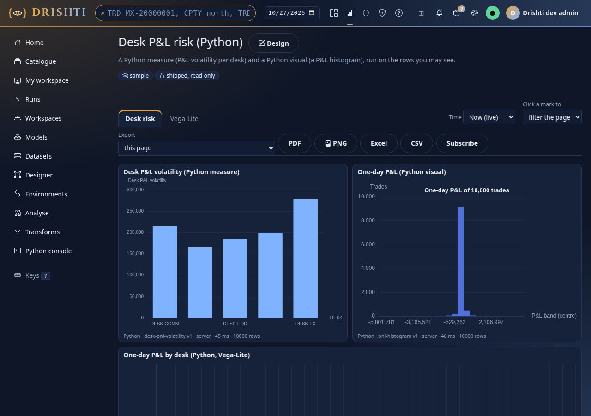

You should see two charts. Under each is a line such as `Python · desk-pnl-volatility v1 · server · 278 ms · 10000 rows`: the **item** that drew it, its version, **where it ran** (the console's sandboxed worker, `server`) and how many rows it was handed. The left chart is a **Python measure** (the volatility of one-day P&L of each desk); the right one is a **Python visual** (a histogram drawn with numpy).
Both worked on the trades **as you may see them**: masks and row rules were applied before Python saw a row. A Python visual is handed at most 10,000
rows, so on the demo lake's 15,000 trade valuations it works on the first 10,000 (the server says so: `DRS-9022` is what a plain JSON answer of more rows
is told); a Python measure for a figure over every row belongs in a model query, or in a Transform over grouped answers (step 8).

The measure's source is a short YAML item, `config/bi/python/desk-pnl-volatility.python.yaml`:

```yaml
python: desk-pnl-volatility
title: Desk P&L volatility
interface: measure
inputs: [PNL_1D]                 # the columns the function reads, as the table names them
packages: [pandas]               # what the source imports (must be on the allow-list)
target: server                   # the console runs it (2.3.0: there is no browser target)
timeout: 10                      # seconds
memory: 256                      # megabytes
params: { min_trades: 2 }
source: |
  def compute(table, params):
      """One number for the rows of one group."""
      pnl = table["PNL_1D"].dropna()
      if len(pnl) < int(params.get("min_trades", 2)):
          return 0.0
      return float(pnl.std(ddof=1))
```

The **model** (`config/bi/models/trades-basic.model.yaml`) says which groups it is called for (one number per desk) in a measure that is a Python item,
not an expression:

```yaml
measures:
  Desk P&L volatility:
    python: desk-pnl-volatility      # the item
    inputs: [trade.PNL_1D]           # columns of ONE dataset of the model
    by: [trade.DESK]                 # one number per desk
```

**On the command line** the model lists it with its item, beside the measures that are expressions:

```text
$ python3 tools/drishti.py bi model describe trades-basic@1
Trades, the basics  (trades-basic@1)

trade  fact  trades-basic-trade 1.0.0
  trade.VALUATION_ID                 string    key
  trade.TRADE_ID                     string    dimension
  trade.SOURCE_SYSTEM                string    dimension
  trade.DESK                         string    dimension
  trade.PORTFOLIO                    string    dimension
  trade.PRODUCT_TYPE                 string    dimension
  trade.CURRENCY                     string    dimension
  trade.TRADE_STATUS                 string    dimension
  trade.NOTIONAL                     decimal   amount        amount0
  trade.MTM                          decimal   amount        signed0
  trade.PNL_1D                       decimal   amount        signed0
  trade.TRADE_DATE                   date      date
  trade.MTM_IN_MILLIONS              decimal   amount

measures
  Notional                          sum(trade.NOTIONAL)
  MTM                               sum(trade.MTM)
  Trades                            count(trade)
  Average MTM per trade             measure('MTM') / measure('Trades')
  Desk P&L volatility               python: desk-pnl-volatility
  Count of trade                    count(trade)  (default)
```

A model query computes it like any measure, on the server's rows (every row, not the visual's 10,000), one call of the item per group:

```text
$ python3 tools/drishti.py bi mq --model trades-basic@1 --select trade.DESK --measures "Desk P&L volatility" --limit 3
trade.DESK   Desk P&L volatility
-----------  -------------------
DESK-COMM    217,782.36
DESK-CREDIT  159,732.60
DESK-EQD     183,546.29
3 row(s)  as of 2026-10-16  plan p_8978bc854cd42c41
```

The report's python visual draws it from the rows it is handed.

## Step 2 · A Python visual of your own

A visual is a function `render(table, params)` that gets the rows of the visual's `columns` well and returns a chart **as data** (an ECharts option, SVG text or PNG bytes; never HTML or script). Here is the tutorial's, which draws the largest desks by notional:

```yaml
rachana: 1
python: notional-by-desk
title: Notional by desk chart
interface: visual
output: echarts
inputs: [DESK, NOTIONAL]
packages: [pandas]
target: server
params: { top: 8 }
source: |
  def render(table, params):
      top = int(params.get("top", 8))
      g = table.groupby("DESK", as_index=False)["NOTIONAL"].sum().sort_values("NOTIONAL", ascending=False).head(top)
      return {
          "title": {"text": f"Notional of the {len(g)} largest desks", "left": "center"},
          "xAxis": {"type": "value", "name": "Notional"},
          "yAxis": {"type": "category", "data": list(g["DESK"])[::-1]},
          "series": [{"type": "bar", "data": [float(v) for v in g["NOTIONAL"]][::-1]}],
      }
```

A Python item is a BI item like a dataset or a report: stored, versioned, reviewed and published. Create it in your workspace. **In the UI** that is a form, and you do not start from a blank page: **My workspace → New item**, kind *python*, and **What does it make?** asks for *a measure* (one number per group), *a visual* (a chart drawn by Python) or *a table* (a Transform, which joins datasets), and for the columns it reads (or, for a table, the datasets it reads). **Create and open the editor** makes the item with a valid, commented starter body (the manifest the server checks, a function of the right shape, and for a measure a test) and opens it with its editor ready, so you change the code and press **Check the Python**.

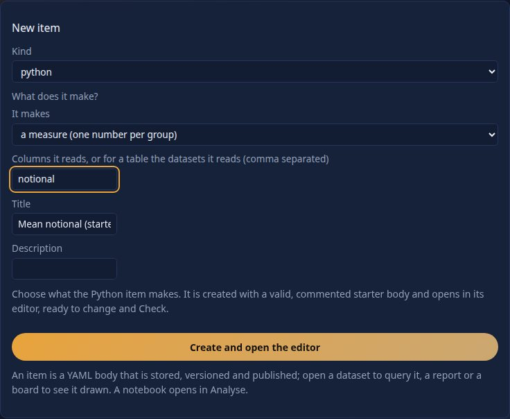

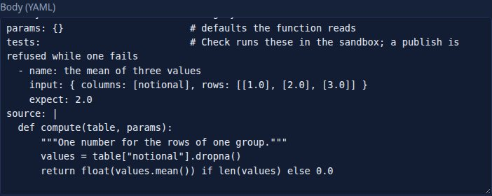

For this step choose *a visual* and replace the body with the tutorial's, or, **from the file**, paste the YAML from `data/notional-by-desk.python.yaml` into the same form's item page (**Edit**), the way it was done before the starter existed: kind *python*, title `Notional by desk chart`, **Create item**. (The picture below moved it into `Economics desk`.)

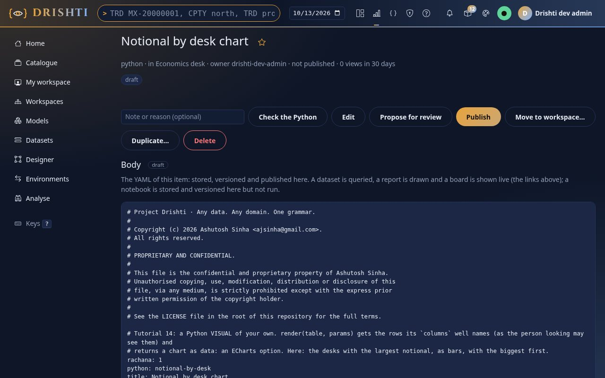

You should see the item as a draft with its actions. Press **Check the Python**: the console checks what only it can, that the source parses, defines its entry (`render`) and imports only what the manifest lists or the safe standard library.

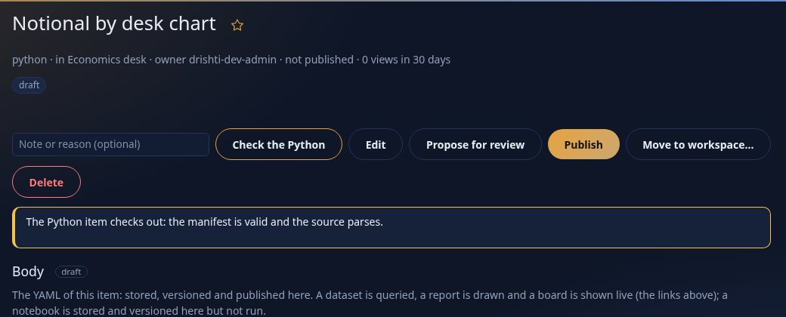

You should see `The Python item checks out: the manifest is valid and the source parses.` A mistake is reported with its code. A package that is not allowed, for example `packages: [requests]`, is refused (`DRS-9070`) with the allow-list:

```text
$ POST /bi/python/check   (packages: [requests])
{"valid": false, "problems": [
  {"level": "error", "code": "DRS-9070", "path": "packages", "message": "'requests' is not an allowed package (allowed: pandas, numpy, pyarrow, scipy, statsmodels)"},
  {"level": "error", "code": "DRS-9070", "path": "packages", "message": "'requests' is not on the console's allow-list (bi.python.packages: pandas, numpy, pyarrow, scipy, statsmodels)"}, ...
```

Press **Publish** (a Python item must be published for a report to use it). **From the command line** the same two moves (`bi item new` reads the
kind from the file name; the ids differ on your machine):

```text
$ python3 tools/drishti.py bi item new economics-desk docs/tutorials/data/notional-by-desk.python.yaml
bi-9f1278b922  python  Notional by desk chart  draft in Economics desk
$ python3 tools/drishti.py bi catalogue publish bi-9f1278b922 --note "my first Python visual"
published Notional by desk chart as version 1
```

Now the report, [data/desk-python.report.yaml](data/desk-python.report.yaml): it reads the model (`model: trades-basic@1`), a slicer, a `python` visual
that names your item, and one that uses the shipped measure.

```yaml
- id: notional-chart
  type: python
  title: "Notional by desk (my Python visual)"
  at: { x: 0, y: 2, w: 6, h: 6 }
  wells: { columns: [trade.DESK, trade.NOTIONAL] }       # the rows handed to Python
  format: { python: Notional by desk chart, params: { top: 8 }, run: auto }
- id: volatility
  type: python
  wells: { values: [Desk P&L volatility] }                # a Python measure of the model
  format: { run: auto }
```

Create it (New item, kind *report*, or `python3 tools/drishti.py bi item new economics-desk docs/tutorials/data/desk-python.report.yaml`) and press **Open the report**.

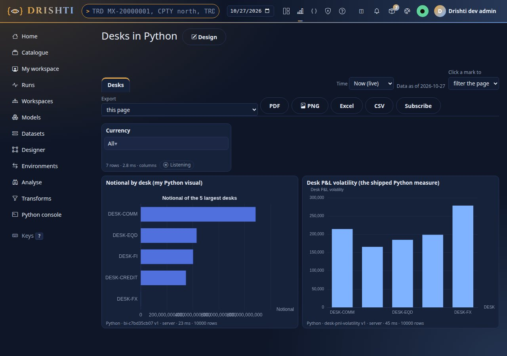

You should see your chart, `Notional of the 8 largest desks`, drawn by your function, beside the shipped one; the footer of yours reads `Python · bi-... v1 · server · 320 ms · 10000 rows`. Choose a currency in the slicer: the chart is asked again and Python gets only those rows (the rows are the table's own, under the page's slicers, filters and business date, at most 10,000). `format.run` is `auto` (the server first, the browser if the server cannot), `server` or `browser`.

**The sandbox.** The server target runs a short-lived worker process per call: **no network**, a scratch folder only, limits on CPU, memory, time and output, and **nothing kept between calls**, so nothing leaks between people. `import` works for the allow-listed packages. Python never reaches the server's data directly; it receives the Arrow rows the server built for the person.

## Step 3 · Analyse: an extract to explore

Choose **Analyse** in the BI rail. In **Model or dataset** choose **Trades, the basics (model 1.0.0, published)** (the list holds the models first, then your
datasets and the packs' datasets, one group per pack), tick the fields you want and press **Open the extract**.

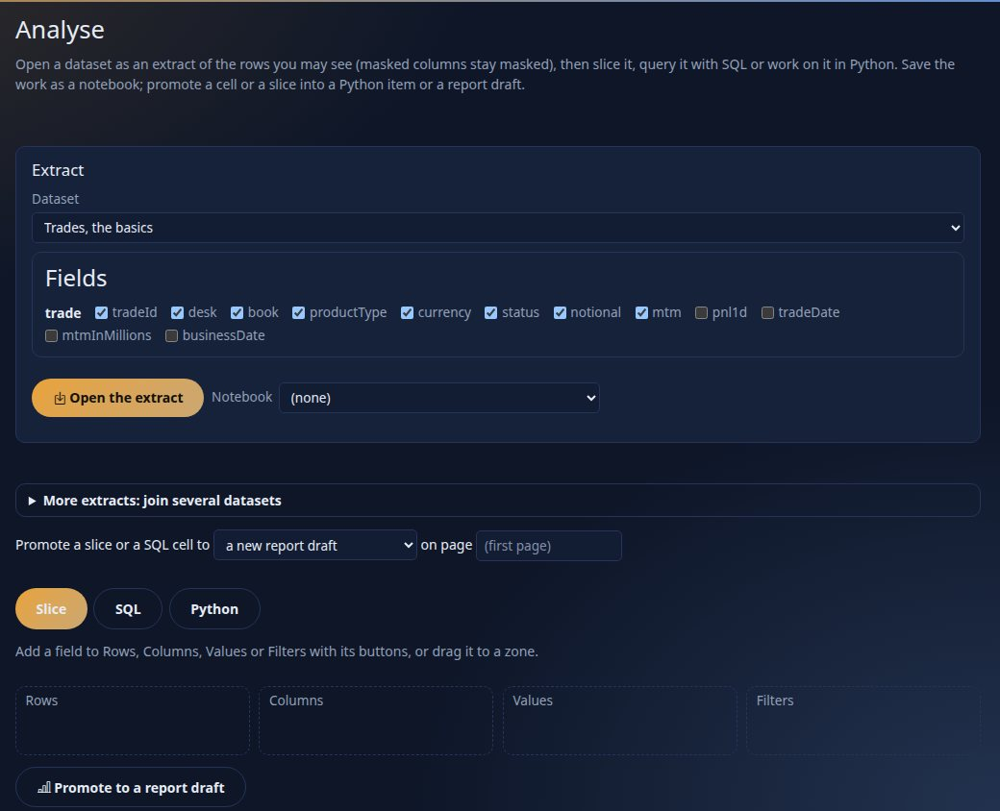

You should see the fields grouped by the model's alias (`trade`) and, after **Open the extract**, the line `10000 rows, 10 columns.` with a note that the
extract was cut (the lake holds 15,000). The extract is **one
model query** (its rows, `shape: rows`) asked as **you** (masked columns arrive empty, and the line says `Masked for you: ...`), cut to
`bi.explore.max_rows` (10,000; a cut says so). It is rebuilt on every run and never kept, so a mask or row rule changed on the server applies the next
time. Because it can be cut, Slice gives the **extract's** totals; for true totals use a SQL cell on the server (step 5) or a report. **On the command
line** the same rows are a model query, and **the YAML** of it is what Analyse sends:

```yaml
mq: 1
model: trades-basic@1
select: { fields: [trade.TRADE_ID, trade.DESK, trade.PORTFOLIO, trade.CURRENCY, trade.NOTIONAL, trade.MTM], measures: [] }
shape: rows                 # the rows themselves, not grouped
limit: 10000
```

(`python3 tools/drishti.py bi mq that.yaml` prints them.)

## Step 4 · Slice

On the **Slice** tab each field is a chip with four small buttons: `R` rows, `C` columns, `V` values, `F` filters. Press `R` on `DESK`, `C` on `CURRENCY` and `V` on `NOTIONAL`.

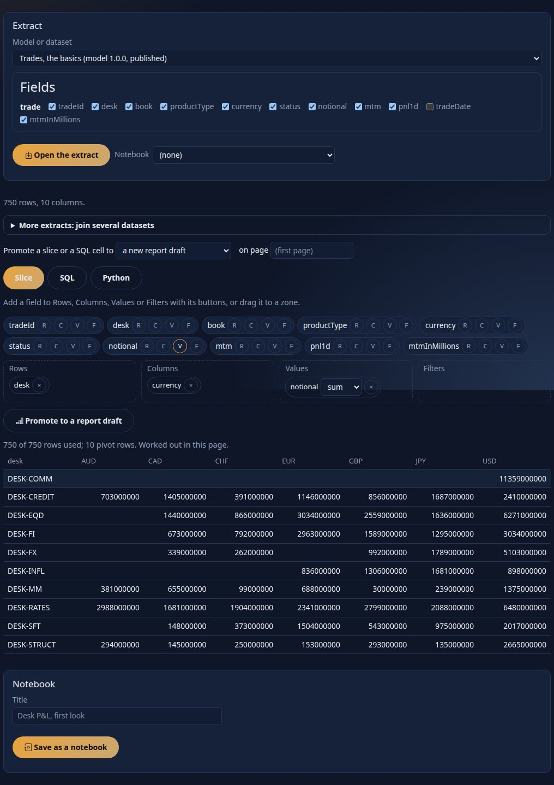

You should see the pivot redraw: the desks down, the currencies across, notional summed in the cells (`10000 of 10000 rows used`). A value takes `sum`,
`avg`, `count`, `min` or `max`; a filter keeps rows equal to chosen values. Since 2.3.0 the console works the pivot out (the line under it says *Worked out
by the console*); nothing is computed in the browser.

## Step 5 · SQL

Open the **SQL** tab. A SQL cell is **one read-only SELECT**. Its engine (the select beside **Run**) is **Server: Drishti SQL over the model** by default:
the cell is asked of the **server**, over the model the extract reads, so its answers are true totals, not the extract's. Its tables are the model's
aliases and a measure is `MEASURE('name')` ([SQL.md](../guides/SQL.md)):

```sql
SELECT trade.DESK, MEASURE('Trades') AS trades, MEASURE('Notional') AS notional
FROM trade
GROUP BY trade.DESK
ORDER BY notional DESC
```

Press **Run**.

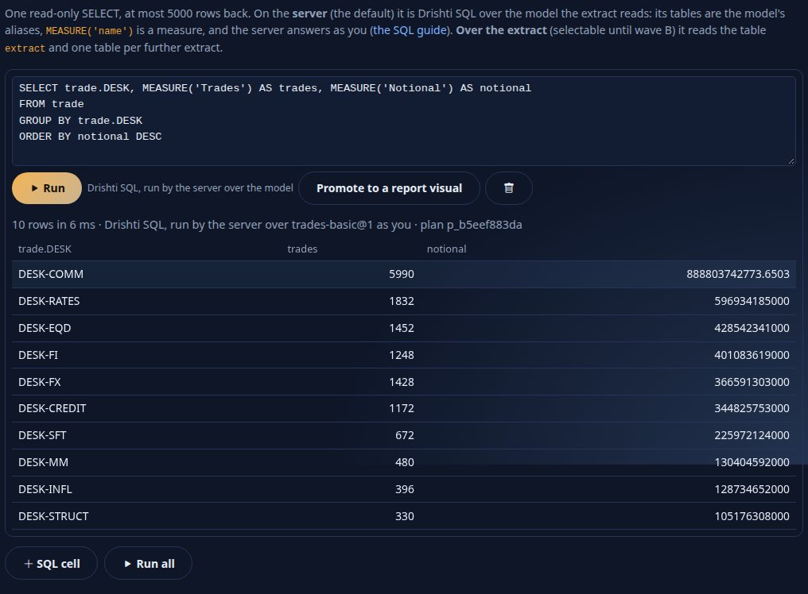

You should see a table, the largest desk first (`DESK-COMM`, `5,990` trades, `888,803,742,774` of notional: true totals over all 15,000 rows, not the extract's), and the line *10 rows in 7 ms · Drishti SQL,
run by the server over trades-basic@1 as you · plan p_...*: the same plan a visual of the same question would run. **From the command line** the same
statement (and what a write is told):

```text
$ python3 tools/drishti.py bi sql "SELECT trade.DESK, MEASURE('Trades') AS trades, MEASURE('Notional') AS notional FROM trade GROUP BY trade.DESK ORDER BY notional DESC LIMIT 3" --model trades-basic@1
trade.DESK  trades  notional
----------  ------  ------------------
DESK-COMM   5990    888,803,742,773.65
DESK-RATES  1832    596,934,185,000.00
DESK-EQD    1452    428,542,341,000.00
3 row(s)  shape mq  plan p_3773eb23294dfb01

$ python3 tools/drishti.py bi sql "DROP TABLE trade" --model trades-basic@1
drishti: the server said 422 DRS-9170: DRS-9170 Drishti SQL is read-only: DROP is refused; a statement is one SELECT (or WITH ... SELECT)
```

The other engine, **Over the extract** (selectable until wave B), reads the table `extract` (the rows the page holds) in an in-memory SQLite on the
console, **read-only by construction**; a statement that reads `extract` (an older notebook's) runs there whatever the choice. Asked of the extract, the
same refusals are codes, not damage:

```text
POST /bi/explore/sql   {"sql": "DROP TABLE extract"}
403 {"code":"DRS-9073","detail":"only a single SELECT over the table extract is allowed"}
POST /bi/explore/sql   {"sql": "SELECT 1; SELECT 2"}
422 {"code":"DRS-9070","detail":"only one statement is allowed"}
```

(Text over 20,000 characters or a query over 5 seconds is `DRS-9072`; at most 5,000 rows come back.) There is no YAML for a cell on its own: it is kept
in a notebook (step 7).

## Step 6 · A Python cell

Open the **Python** tab. A cell sees three names: `df` (the extract as a pandas table), `params` and `quant` (a pricing helper). What it prints comes back as text; what it puts in `result` is **drawn**: a table as a table, a dict as an ECharts option, SVG or PNG as an image.

```python
g = df.groupby('DESK', as_index=False)['NOTIONAL'].sum()
result = {'title': {'text': 'Notional by desk'}, 'xAxis': {'type': 'category', 'data': list(g['DESK'])}, 'yAxis': {'type': 'value'},
          'series': [{'type': 'bar', 'data': [float(v) for v in g['NOTIONAL']]}]}
```

Press **Run** (the line beside it says *Runs on the console (sandbox)*: since 2.3.0 there is no browser target).

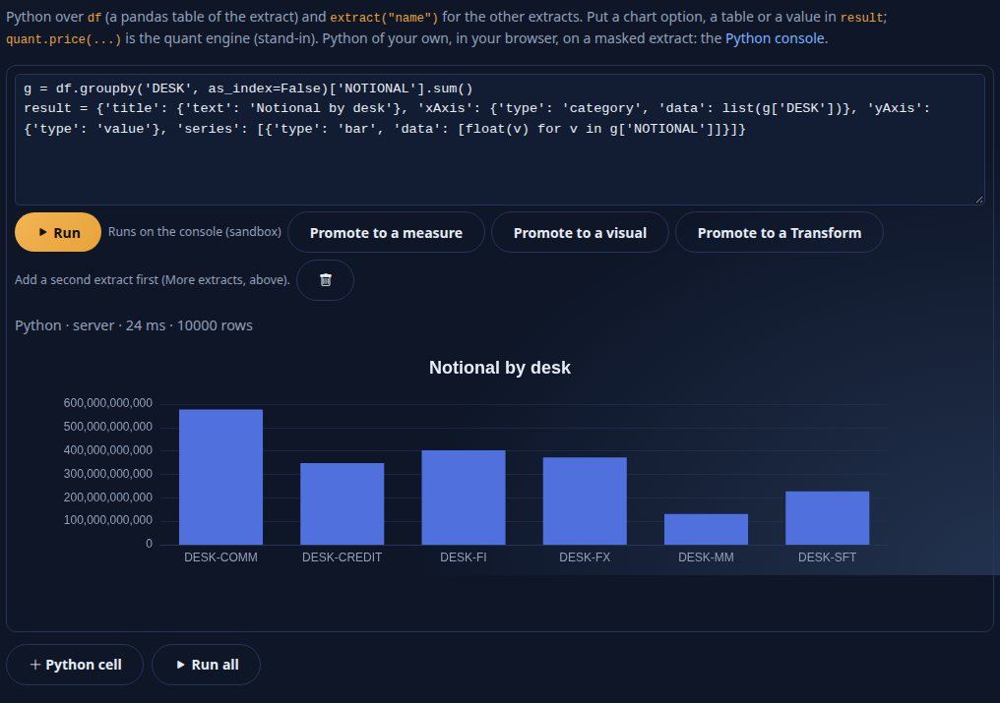

You should see `Python · server · ... ms · 10000 rows` and the chart. The same worker as a Python visual runs it, with the same sandbox. A cell that only prints and returns a table, run on the same extract:

```text
POST /bi/explore/python   {"source": "print(len(df))\nresult = df.groupby('DESK')['NOTIONAL'].sum().head(3)", "target": "server"}
200 {"kind":"cell","stdout":"10000\n","table":{"columns":["NOTIONAL"],"rows":[...],"rowCount":3},"ms":...,"inputRows":10000,"masked":[],"target":"server",...}
```

You should see `10000` printed (the extract, cut) and a three-row table. Running Python needs `bi-author`; a person with only `bi` sees the Slice and SQL tabs work and the Python tab explain why it will not run. (Python cells have no command of their own: the call above is the console's, with your session.)

## Step 7 · Keep it as a notebook, promote it

Under **Notebook** give it a title (`Desk notional, first look`) and press **Save as a notebook**. (**My workspace → New item → notebook** only points you here: a notebook is made from the work you did, not from a form.)

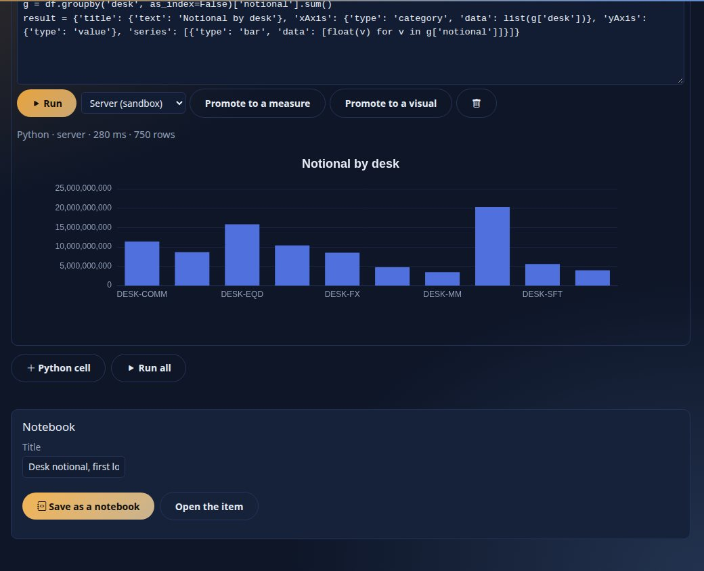

You should see a link, **Open the item**: the extract's definition, the slice and every cell are now a BI item of kind **notebook** in your workspace, with versions, diffs, review and publishing like any other. Opening it again rebuilds the extract **for whoever opens it**: a notebook shared with a colleague shows *their* rows. Outputs are not stored, only the code. **The YAML** of the notebook (the item page shows it; `bi catalogue get <id> --body` prints it):

```yaml
rachana: 1
notebook: desk-notional-first-look
title: Desk notional, first look
dataset: mq:trades-basic@1            # the model the extract reads
fields: [trade.TRADE_ID, trade.DESK, trade.PORTFOLIO, trade.PRODUCT_TYPE, trade.CURRENCY, trade.TRADE_STATUS, trade.NOTIONAL, trade.MTM, trade.PNL_1D, trade.MTM_IN_MILLIONS]
cells:
- type: slice
  slice:
    rows: [DESK]
    columns: [CURRENCY]
    values:
    - {field: NOTIONAL, agg: sum}
    filters: []
- type: sql
  source: |
    SELECT trade.DESK, MEASURE('Trades') AS trades, MEASURE('Notional') AS notional
    FROM trade
    GROUP BY trade.DESK
    ORDER BY notional DESC
- type: python
  source: |
    g = df.groupby('DESK', as_index=False)['NOTIONAL'].sum()
    result = {'title': {'text': 'Notional by desk'}, ...}
  target: server
```

(The SQL cell keeps no engine: a cell over a model runs on the server, and one that reads the table `extract` runs over the extract.)

To turn a cell into a reusable item press **Promote to a visual** (or **to a measure**) under the cell.

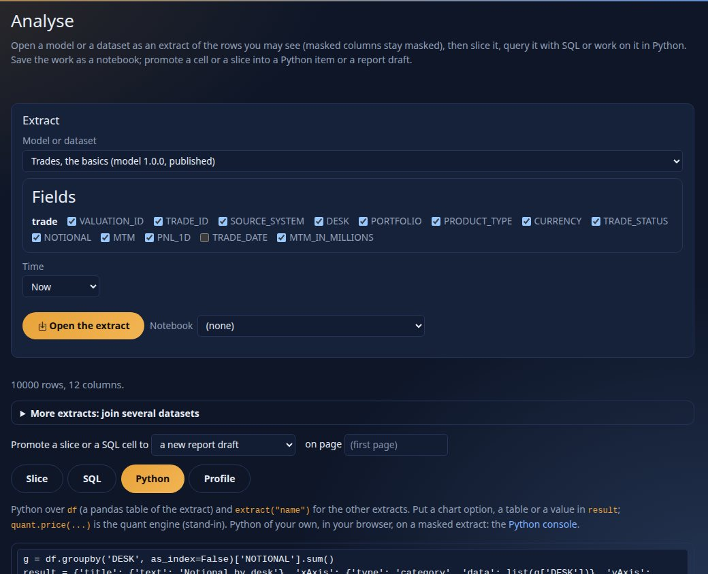

You should see `Python visual draft saved in your workspace: Analyse cell (visual).` and the reminder: the cell's `df` became the function's `table`, `result` is returned, a measure must return one number and a visual an ECharts option, SVG or PNG; check it with **Check the Python** on the item page, then publish. Nothing is published for you. And to turn a **slice** into a report press **Promote to a report draft**.

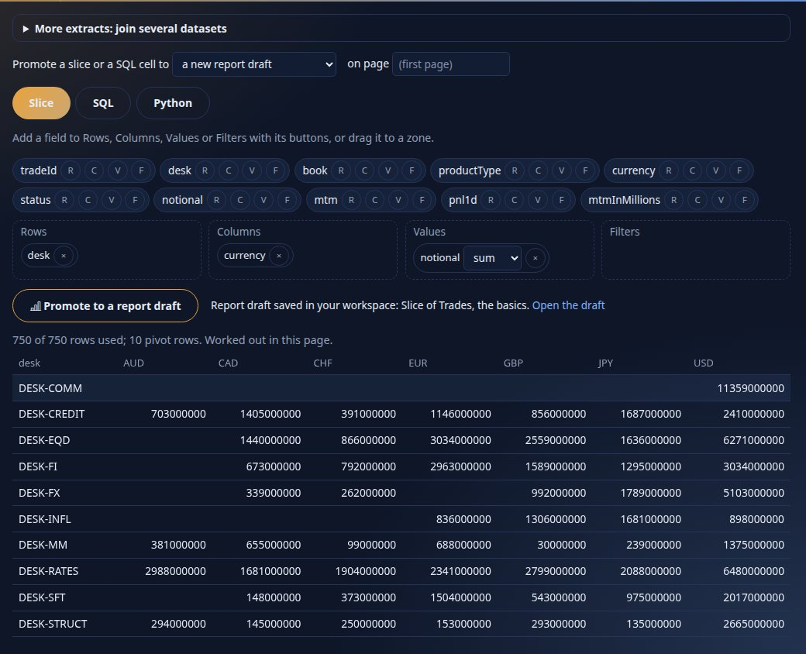

You should see, beside the button, `Report draft saved in your workspace: Slice of Trades, the basics.` and **Open the draft**. The draft is a one-page
report on the same model (`model: trades-basic@1`) with a **matrix** (rows, the column field, and the model's measure that is exactly the slice's
aggregate: `sum(NOTIONAL)` is `Notional`), which you open in the designer to finish ([tutorial 10](10-first-bi-report.md)).

## Step 8 · Two models: a Python Transform and a join in Analyse

Steps 1 to 7 used Python on one model. Python can also **join answers**. The sample **Desk P&L vs counterparty exposure (Python)** makes one table, P&L
next to exposure per counterparty, with a **Python Transform**: a Python item with `interface: transform` whose function `run(pnl, exposure, params)`
receives two answers as pandas frames, **asked as you**, and returns a table. Since 2.2 that table is a **Python dataset** (`source.python`), and each
input is a **model query**. Open **Models**, find **Desk P&L vs counterparty exposure (Python): the Transform's table** under the datasets.


You should see *Source: the Python Transform pnl-vs-exposure*, the key `counterparty` and the nine columns the Transform returns (a contract: a column it
does not return is `DRS-9075`). There is nothing to refresh: the Transform runs **when the dataset is asked**, for the person asking, and its frame is kept
for them until an input changes. **The YAML** says what it reads (`config/bi/datasets/desk-pnl-vs-exposure-py-result.dataset.yaml`):

```yaml
rachana: 2
expressions: 2
dataset: desk-pnl-vs-exposure-py-result
version: 1.0.0
source:
  python: pnl-vs-exposure
  inputs:                       # each a model query, asked as the reader (their row rules and masks)
    pnl: { model: trading-risk@1, select: { fields: [counterparties.id, counterparties.NAME], measures: [P&L 1d, Trades] } }
    exposure: { model: counterparty-exposure@1, select: { fields: [counterparties.id, counterparties.SECTOR], measures: [Exposure (EE peak), Exposure (PFE peak)] } }
  params: { floor: 1.0 }
grain: { keys: [counterparty] }
columns:
  counterparty: { type: string }
  ...
```

and the model `desk-pnl-vs-exposure-py@1` reads it as its one fact, with measures over it. **On the command line** ask it like any model (the
Transform runs for you on the first question):

```text
$ python3 tools/drishti.py bi mq --model desk-pnl-vs-exposure-py@1 --select result.counterparty,result.name,result.sector --measures "Desk P&L,Exposure (EE peak),P&L per exposure" --limit 3
result.counterparty  result.name                   result.sector     Desk P&L       Exposure (EE peak)  P&L per exposure
-------------------  ----------------------------  ----------------  -------------  ------------------  ----------------
CP-ALDERSHOT         Aldershot Pension Trust       Pensions          9,940,482.84   2,599,390,291.00    0.00
CP-AURORA            Aurora Sovereign Wealth Fund  Government        -5,475,341.95  1,991,425,202.00    -0.00
CP-BRAMBLE           Bramble Asset Management      Asset management  6,448,473.64   1,999,491,936.00    0.00
3 row(s)  as of 2026-10-16  plan p_1f01f95e79f2ef30
```

The item is `config/bi/python/pnl-vs-exposure.python.yaml` (the model queries hand their columns over as the models name them, `NAME` and `SECTOR`;
the Transform renames them to the table's own `name` and `sector`); the reference is [PYTHON_BI.md section 13](../guides/PYTHON_BI.md#13-transforms-a-table-in-a-table-out).

How would you write such a Transform? In **Analyse**, with **two extracts**. Open the notebook **Desk P&L vs counterparty exposure, in pandas** (the Notebook box in the Extract card).

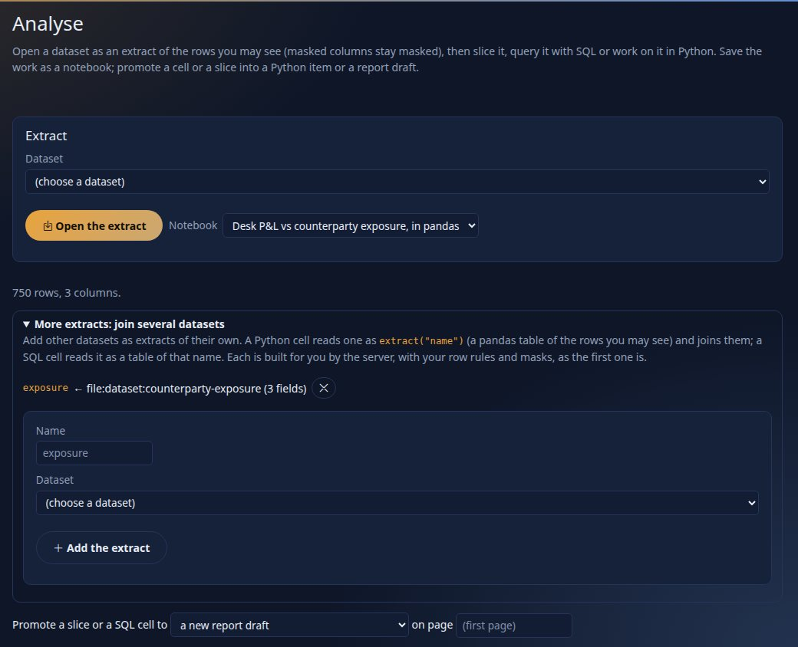

You should see `10000 rows, 3 columns.` for the first extract (cut: the lake holds 15,000 trade valuations) (the trades of the model **Trading and counterparty risk**) and, in **More extracts: join
several datasets**, a second one called `exposure` (`mq:trading-risk@1`, 3 fields: the netting sets of the same model). Each is built for you by the
server, with your row rules and masks. Open the **Python** tab and **Run** its cell.

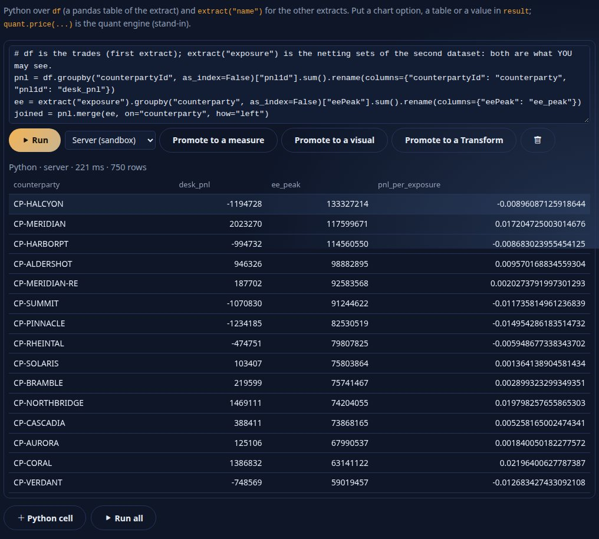

You should see the cell (`df` is the trades; `extract("exposure")` is the netting sets) and a table of counterparties, the largest exposure first:
`CP-NORTHPLAINS` with exposure `2846661899` (the 76 netting sets are all in the second extract), then `CP-SUMMIT` and the rest. The P&L column adds up the
trades **of the extract**, cut at 10,000 rows, so it is not the counterparty's full P&L: the server's figure is the Transform's, or Drishti SQL's below. The same join works in a SQL cell over the extract: the second extract is a table called
`exposure` (`SELECT ... FROM extract JOIN exposure ON ...`); on the server, one model already joins its facts through the counterparty (Drishti SQL
`FROM trades JOIN counterparties JOIN netting_sets`). When the pandas join is what you want to keep, press **Promote to a Transform**.

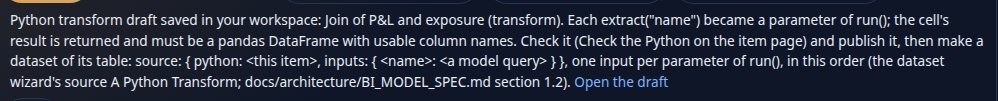

You should see, beside the button, that a Python Transform draft was saved in your workspace: each `extract("name")` became a parameter of `run(...)`, the
cell's `result` is returned, and the next step is *a dataset of its table: source: { python: <this item>, inputs: { <name>: <a model query> } }, one
input per parameter of run(), in this order*. Open the draft, **Check the Python**, publish it, and make that dataset. Nothing is published by promoting.

**In the UI** the Python dataset is the dataset wizard's source **A Python Transform** ([DATASETS.md section 15](../guides/DATASETS.md#15-the-dataset-wizard-version-2-wave-a)):
**Models → New dataset**, choose the Transform by its title, give each input of `run()` its model query (a model, the fields and the measures to hand
over), and list the columns the Transform returns with their types; **Preview** runs it for you before you save. **From the YAML** it is the
`source: { python: ..., inputs: { ... } }` above; **Make it a model** on its page puts a model over it, where its measures go.

## Step 9 · Vega-Lite, and tests that ship with the item

A chart does not have to be an ECharts option. A **Vega-Lite** specification can be written in the report itself (a `vega-lite` visual: its data is the rows of its wells) or returned by a Python visual (`output: vega-lite`). Open the sample report **Desk P&L risk (Python)**, its **Vega-Lite** tab.

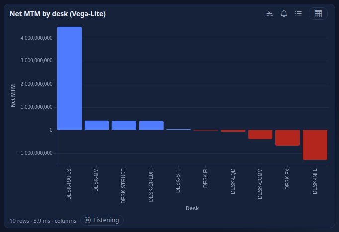

You should see bars for the desks, red for the negative ones: the colour is the specification's `condition: { test: "datum.MTM < 0" }`, evaluated by the page **without `eval`**, so the page keeps its strict content security policy. On the first tab, the bottom visual is a Python visual that returns a specification: a dot for each trade's one-day P&L by desk, a tick for each median.


A Python item can also carry **tests**. Open the item **Desk P&L volatility** (the Python measure), and press **Check the Python**.


You should see `Tests: 3 of 3 passed.` and a line for each (`passed · the standard deviation of one desk · 1.2909944487358056`). The sample is shipped (read-only); in a copy of it in your own workspace, change a number in an `expect:` and check again: that test says `FAILED` with what it expected and got, and **publishing** through the console is refused (`DRS-9076`) until it passes. [PYTHON_BI.md](../guides/PYTHON_BI.md) sections 14 and 15 have the rules.

## Step 10 · Where a SQL cell runs, and promote into a report you already have

A SQL cell is **Drishti SQL over the model**, run by the server as you (the answer is the model's, with true totals, and the cell is the same plan a
report visual runs); the line beside **Run** says so. A cell over the table `extract` (a notebook of 2.2) still runs, over the rows of the extract, on the
console. Since 2.3.0 nothing runs in the browser: the **Slice** too is worked out by the console (the line under it says *Worked out by the console*). Above the tabs, **Promote a slice or a SQL cell to** a *new report draft* or to one of your report
drafts. Choose one, write a SQL cell and **Run** it:

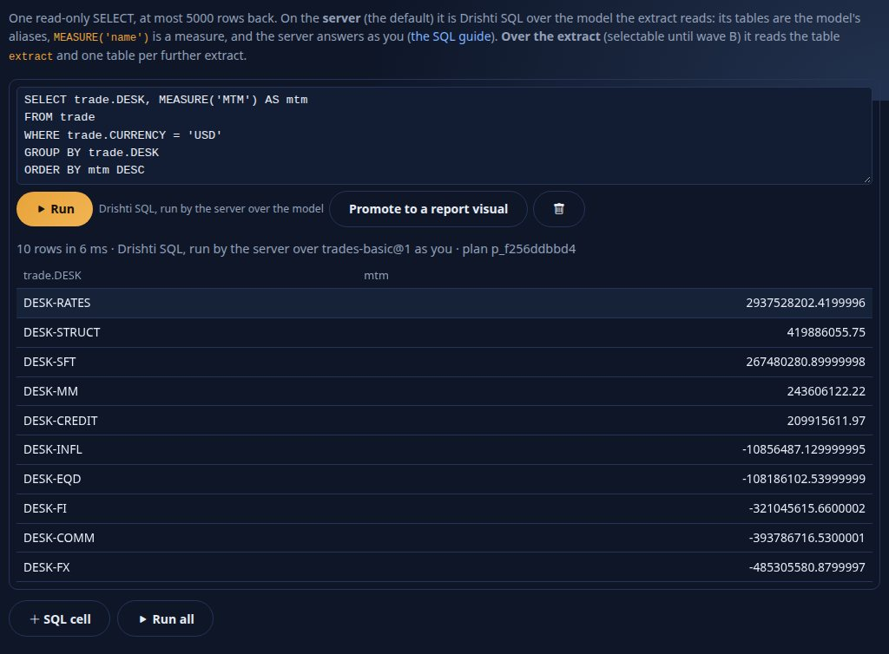

You should see the engine *Server: Drishti SQL over the model*, ten desks (`DESK-RATES` `2,863,034,263` first, for the USD trades) and the line naming
`trades-basic@1`. **From the command line**:

```text
$ python3 tools/drishti.py bi sql "SELECT trade.DESK, MEASURE('MTM') AS mtm FROM trade WHERE trade.CURRENCY = 'USD' GROUP BY trade.DESK ORDER BY mtm DESC LIMIT 3" --model trades-basic@1
trade.DESK   mtm
-----------  ----------------
DESK-RATES   2,863,034,262.92
DESK-STRUCT  409,340,516.24
DESK-SFT     264,809,126.60
3 row(s)  shape mq  plan p_3fefc5a51db918b6
``` Press **Promote to a report visual**:

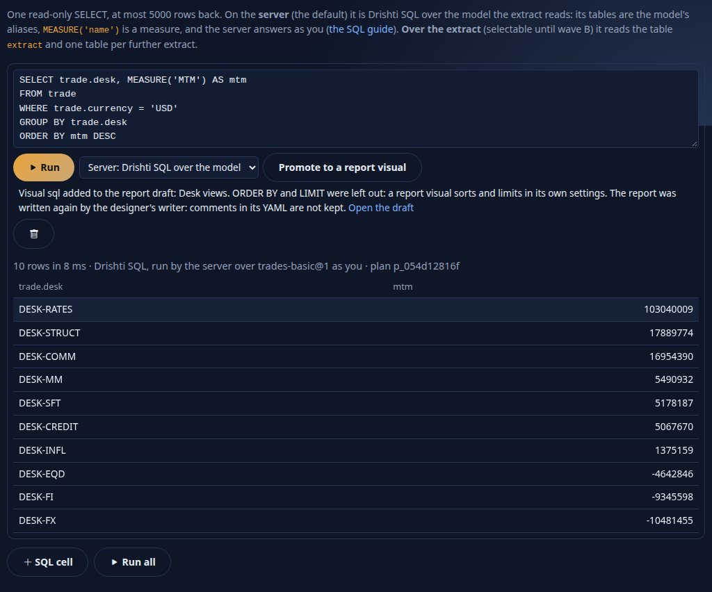

You should see, beside the button, `Visual sql added to the report draft: Desk views.` and notes: the `ORDER BY` was left out (a visual sorts in its own
settings) and the report was written again by the designer's writer. Open the draft in the designer: a new `matrix` (rows `trade.DESK`, values `MTM`, the
filter `trade.CURRENCY eq USD`) below what was there. The reader understands Drishti SQL (aliases and `MEASURE('...')`) and SQL over the extract
(columns and plain aggregates, matched to the model's measures). **The YAML** of the visual it added:

```yaml
      - id: sql
        type: matrix
        title: Desk views
        at: { x: 0, y: 8, w: 12, h: 6 }
        wells: { rows: [trade.DESK], values: [MTM] }
        filters: [{ field: trade.CURRENCY, op: eq, values: [USD] }]
```

A slice or SQL cell of **another** model is not added to an existing report (a report reads one model: `DRS-9070` names both); promote it to a new draft.
[ANALYSE.md](../guides/ANALYSE.md) sections 13 and 14 have the details.

## Step 11 · Calc: the BI engine as a DataFrame, and Graphic Walker; a Python measure in an alert

In **Calc** (`Alt+C` on any view) the module `drishti_bi` asks the BI engine, **as you**: `query` sends one model query (a model's `name@major`; a 2.1
dataset's name reads the model the converter made of it, `trades-basic` is `trades-basic@1`):

```python
import drishti_bi
df = await drishti_bi.query_async('trades-basic@1', measures=['MTM', 'Trades'], by=['trade.DESK'])
show(df, 'MTM by desk')
```

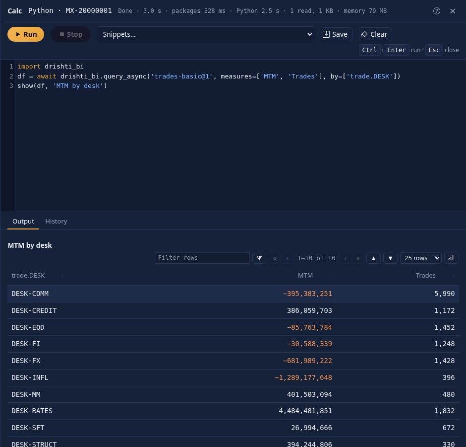

You should see ten desks with their MTM and trade counts: the same numbers a report shows, with the same masks. The command line prints the same:

```text
$ python3 tools/drishti.py bi mq --model trades-basic@1 --select trade.DESK --measures MTM,Trades --limit 3
trade.DESK   MTM              Trades
-----------  ---------------  ------
DESK-COMM    -429,967,635.39  5990
DESK-CREDIT  360,552,941.89   1172
DESK-EQD     -79,395,510.75   1452
3 row(s)  as of 2026-10-16  plan p_5d2cad2dda86953b
``` `drishti_bi.walk(df)` explores a frame with **Graphic Walker** (PygWalker's
front end, vendored):

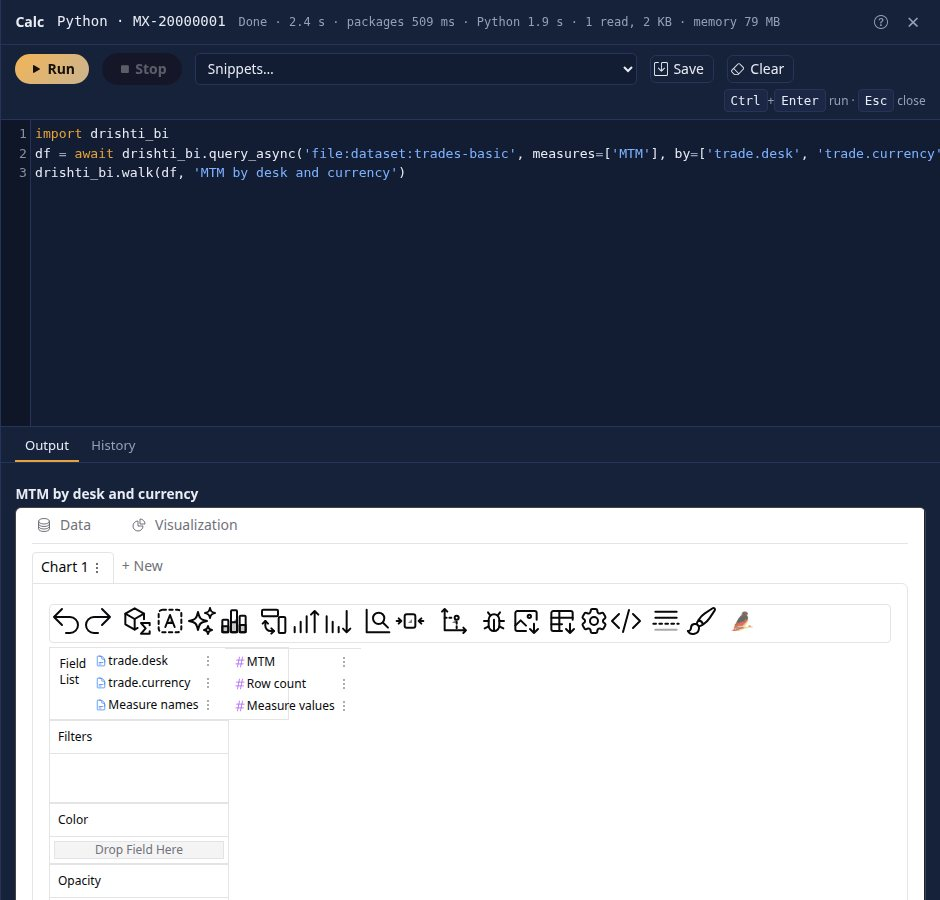

Drag `trade.DESK` to the X axis and `MTM` to the Y axis. The chart is drawn in a **sandboxed frame** that cannot reach the network or the console: the rows went in by message and nothing goes out ([PYTHON_CALC.md](../guides/PYTHON_CALC.md#19-the-bi-client-and-graphic-walker)).

Last, a **Python measure in an alert**. An alert on a measure of a model asks a model query, and a model query runs Python measures (step 1), so
**Alerts → New → Watch a measure of a model** on **Desk P&L volatility** works like any other: choose the model `trades-basic@1`, the measure, *crosses a
limit*, *above* `100000`, **Save**. What the form sends, with your session (a personal API token may not call `/me/...`), and the alert at once firing
(the largest desk volatility, `1,117,385`, is above the limit), captured:

```text
PUT /api/v1/me/measure-alerts/Desk%20volatility%20ceiling
    {"source":{"type":"model","model":"trades-basic@1","query":{"select":{"fields":["trade.DESK"],"measures":["Desk P&L volatility"]}},"reduce":"max"},
     "condition":{"type":"threshold","op":"above","value":100000},"trigger":{"mode":"after-load"}}
200 {"name":"Desk volatility ceiling", ..., "source":{"type":"model","model":"trades-basic@1","measure":"Desk P&L volatility","reduce":"max", ...},
     "describe":"above 100,000","label":"trades-basic@1 · Desk P&L volatility","link":"/bi/i/trades-basic%401"}
POST /api/v1/me/measure-alerts/Desk%20volatility%20ceiling/check
200 {... "history":[{"action":"fired","trigger":"saved","value":1117385.1394432886,"asOf":"2026-10-16",
     "message":"Desk volatility ceiling — now 1,117,385.1394 (above 100,000)","delivered":{"inbox":"ok","email":"off","bridge":"off","sms":"off"}}]}
```

`reduce: max` watches the largest of the desks' figures; `first` or a filter on one desk watches one.

## Step 12 · Prepare raw trades step by step: the Transform editor (2.4.0)

Step 8 made a Transform from two **models**. Before a model exists you often want to clean the **raw rows** first: drop matured trades, fix a type,
bucket a tenor, total. The **Transform editor** does that step by step, with the rows and a profile after every step, and you never type YAML.

**In the UI.** Open **BI → Transforms** (the rail). Type the title `ENDUR trades, cleaned`. Under **1. Inputs**, name the input `trades`, keep *A pack
kind, straight through its connector*, choose the kind **Trade (trading.trade)**, type the connector `trade-endur` (the ENDUR trades of the demo lake),
tick `TRADE_ID`, `TRADE_STATUS`, `PORTFOLIO`, `CURRENCY`, `NOTIONAL`, `TRADE_DATE` and `MATURITY_DATE`, and press **Add the input**.

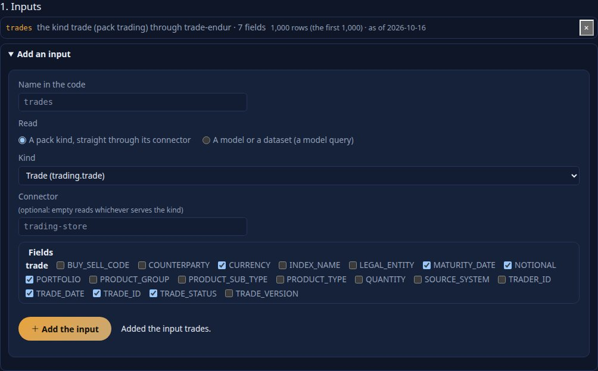

You should see the line `trades the kind trade (pack trading) through trade-endur · 7 fields 1,000 rows (the first 1,000) · as of 2026-10-16` and a first
step, **Start from trades**, with `1,000 rows · 7 cols`. The editor previews the first `bi.transform.preview_rows` rows (1,000) **as you**: your row
rules and masks apply, as when the dataset is read.

Now **Add a step from the snippets**: choose **Filter rows by values**, the column `TRADE_STATUS`, the value `MATURED`, untick *Keep them* (drop them), and
**Add the step**. Step 2 says `510 rows · 7 cols`. Press **Profile**:

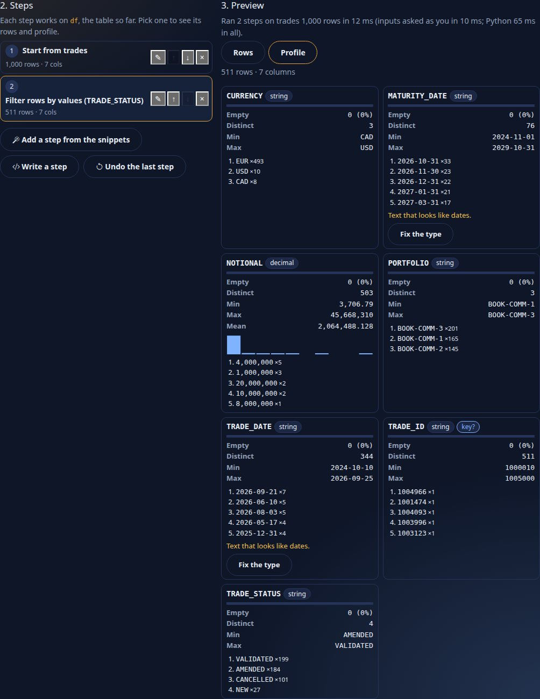

You should see `TRADE_STATUS` with four values left (`VALIDATED ×336`, `AMENDED ×64`, `NEW ×62`, `CANCELLED ×48`), `TRADE_ID` marked **key?** (every row
its own value), and *Text that looks like dates* under `TRADE_DATE` and `MATURITY_DATE`. Press **Fix the type** under `TRADE_DATE`: a step
**Type fix: text to date (TRADE_DATE)** is added. Then two more snippets: **Tenor bucket** (maturity `MATURITY_DATE`, from `TRADE_DATE`) and **Group and
total** (group by `PORTFOLIO` and `tenor_bucket`, the column `NOTIONAL`, `sum`). Press **Rows**:

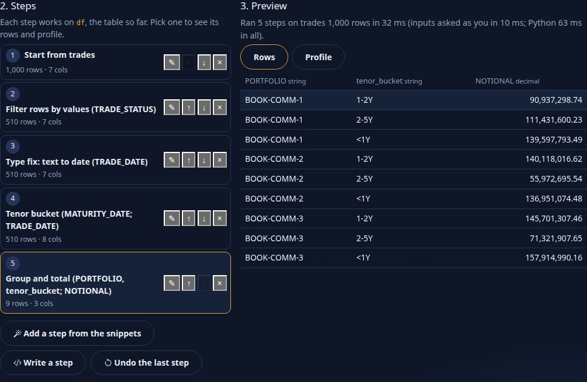

You should see `Ran 5 steps on trades 1,000 rows` and nine rows, `BOOK-COMM-1 1-2Y 90,937,298.74` first. Pick any step to see its own rows again; ✎ edits
a step, ↑ ↓ move it, × removes it. Under **4. Save**, tick `PORTFOLIO` and `tenor_bucket` (*Each row is one*) and **Save as drafts**: you should see
*Saved as two drafts in your workspace: the Python item and the dataset*. Check and publish the Python item, then the dataset ([PYTHON_BI.md
section 13](../guides/PYTHON_BI.md#13-transforms-a-table-in-a-table-out)).

**The YAML** was written for you; open *YAML: what is saved* to read it (and edit it, then **Read the YAML back**, if you like). The Python item
([data/endur-trades-cleaned.python.yaml](data/endur-trades-cleaned.python.yaml)) holds the steps after their `# step:` comments:

```python
def run(trades, params):
    # step: Start from trades
    df = trades.copy()
    # step: Filter rows by values (TRADE_STATUS)
    df = df[df['TRADE_STATUS'].isin(['MATURED']) == False].reset_index(drop=True)
    # step: Type fix: text to date (TRADE_DATE)
    df['TRADE_DATE'] = pd.to_datetime(df['TRADE_DATE'], format='%Y-%m-%d', errors="coerce").dt.date
    # step: Tenor bucket (MATURITY_DATE; TRADE_DATE)
    ...
    # step: Group and total (PORTFOLIO, tenor_bucket; NOTIONAL)
    df = df.groupby(['PORTFOLIO', 'tenor_bucket'], as_index=False, dropna=False)[['NOTIONAL']].agg('sum')
    return df
```

and the Python dataset ([data/endur-trades-cleaned.dataset.yaml](data/endur-trades-cleaned.dataset.yaml)) reads the kind straight through the connector:

```yaml
source:
  python: endur-trades-cleaned
  inputs:
    trades:
      kind: trade
      pack: trading
      fields: [CURRENCY, MATURITY_DATE, NOTIONAL, PORTFOLIO, TRADE_DATE, TRADE_ID, TRADE_STATUS]
      connector: trade-endur
grain:
  keys: [PORTFOLIO, tenor_bucket]
```

**On the command line** the input is asked as you and profiled, the snippets are listed and written, and the drafts are saved from the files:

```text
$ python3 tools/drishti.py bi transform input docs/tutorials/data/endur-trades-cleaned.dataset.yaml --rows 2
trades: 1,000 rows of dataset:pack.trading.trade as of 2026-10-16
  CURRENCY                     text      empty     0  distinct      3  CAD .. USD
  MATURITY_DATE                text      empty     0  distinct     81  2024-11-01 .. 2029-10-31
  NOTIONAL                     float64   empty     0  distinct    971  2,855.8 .. 2.46923e+08
  PORTFOLIO                    text      empty     0  distinct      3  BOOK-COMM-1 .. BOOK-COMM-3
  TRADE_DATE                   text      empty     0  distinct    529  2024-10-10 .. 2026-09-25
  TRADE_ID                     text      empty     0  distinct   1000  1000005 .. 1005000
  TRADE_STATUS                 text      empty     0  distinct      5  AMENDED .. VALIDATED
    CAD | 2025-04-30 | 1000000.0 | BOOK-COMM-3 | 2025-03-01 | 1002153 | MATURED
    CAD | 2026-04-30 | 20000000.0 | BOOK-COMM-1 | 2025-02-06 | 1003026 | MATURED
$ python3 tools/drishti.py bi transform snippet filter-values column=TRADE_STATUS values=MATURED keep=false
# step: Filter rows by values (TRADE_STATUS)
df = df[df['TRADE_STATUS'].isin(['MATURED']) == False].reset_index(drop=True)
$ python3 tools/drishti.py bi item new me docs/tutorials/data/endur-trades-cleaned.python.yaml
bi-90b5ada37c  python  ENDUR trades, cleaned  draft in My workspace
$ python3 tools/drishti.py bi item new me docs/tutorials/data/endur-trades-cleaned.dataset.yaml
bi-04b126d3c4  dataset  ENDUR trades, cleaned  draft in My workspace
```

The steps run where every Python item runs, in the console's sandbox; the snippets write each value as a literal, never as code. The reference is
[PYTHON_BI.md section 17](../guides/PYTHON_BI.md#17-data-prep-the-transform-editor-240).

## Step 13 · Your own Python in the browser: the Python console (2.4.0)

Analyse runs everything on the console. When you want to poke at the data **yourself, in your browser**, open **BI → Python console** (`/pyconsole`).
It runs Calc's Python (Pyodide) on a **masked extract** of a model: the rows you may see, with masked columns masked. Nothing you do there is kept or
shared until you **promote** it.

**In the UI.** Choose the dataset **Trade** (`dataset:pack.trading.trade`, the trading pack's), tick `TRADE_ID`, `TRADE_STATUS`, `PORTFOLIO`, `CURRENCY`
and `NOTIONAL`, and **Open the extract**: you should see `15,000 rows, 5 columns, in your browser.` (an extract is at most `bi.pyconsole.max_rows`,
20,000). Python starts in the page (`Python ready · Pyodide ...`). Type, and **Run in the browser** (Ctrl+Enter):

```python
live = df[df["TRADE_STATUS"] != "MATURED"]
by_book = live.groupby("PORTFOLIO", as_index=False)["NOTIONAL"].sum().nlargest(8, "NOTIONAL").reset_index(drop=True)
print(len(live), "live trades of", len(df))
show(by_book, "Live notional by book, top 8")
chart(by_book, kind="bar", x="PORTFOLIO", y="NOTIONAL")
```

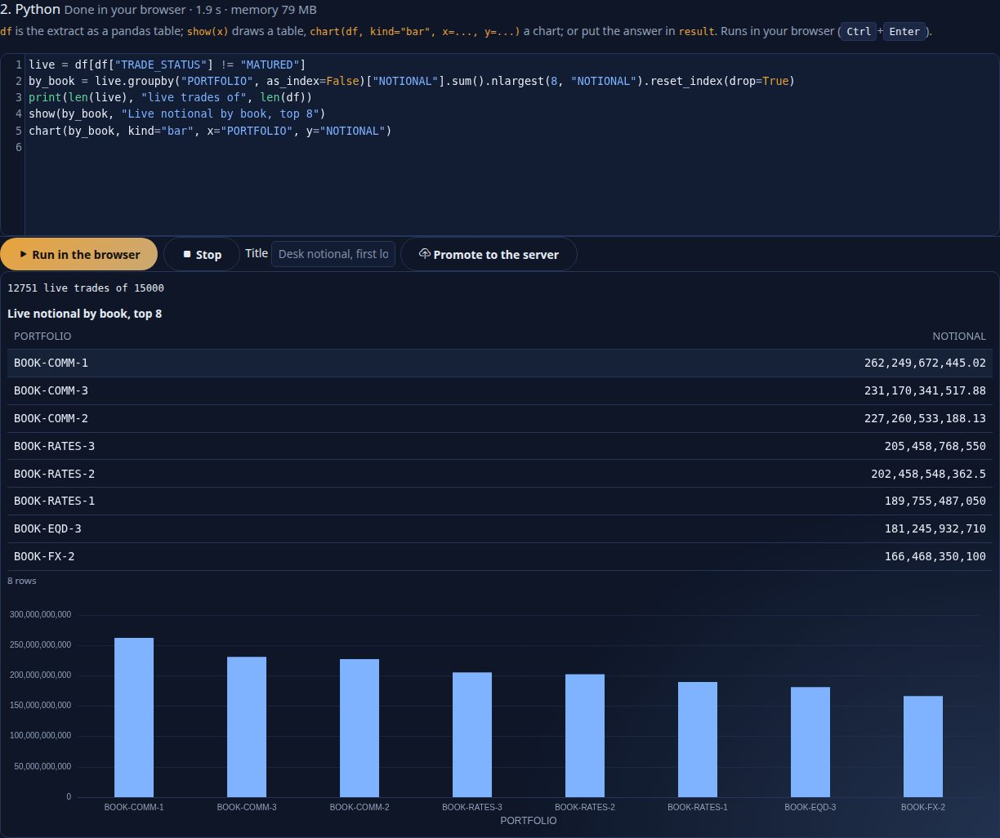

You should see `12751 live trades of 15000`, then eight books, `BOOK-COMM-1 262,249,672,445.02` first, and the bars. The status says `Done in your browser`.
Now give it the title `Live notional by book` and press **Promote to the server**:

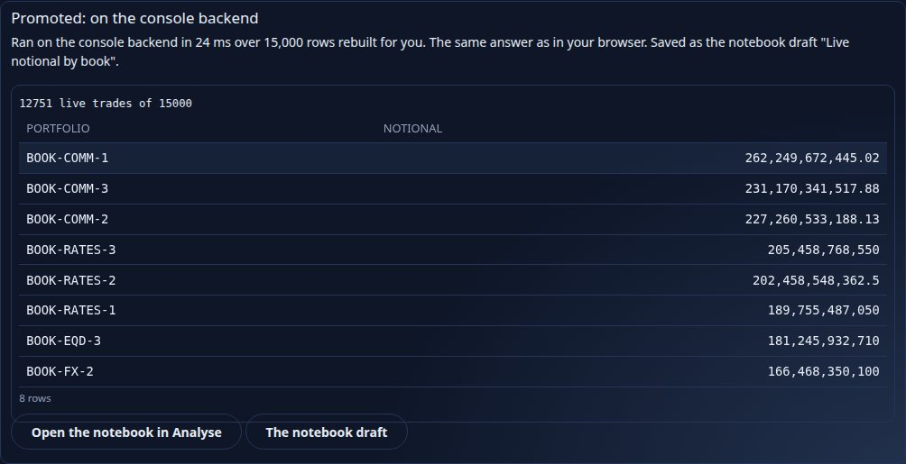

You should see *Ran on the console backend in 45 ms over 15,000 rows rebuilt for you. The same answer as in your browser. Saved as the notebook draft "Live
notional by book".* **Open the notebook in Analyse** runs it there, on the console, for whoever opens it (each with their own rows). Promoting needs
`bi-author`.

**On the command line** there is no browser to run Python in; the promoted notebook is an item like any other, and
`python3 tools/drishti.py bi catalogue get <its id> --body` prints it. **As YAML**, the notebook draft is:

```yaml
rachana: 1
notebook: live-notional-by-book
title: Live notional by book
dataset: dataset:pack.trading.trade
fields: [trade.CURRENCY, trade.NOTIONAL, trade.PORTFOLIO, trade.TRADE_ID, trade.TRADE_STATUS]
cells:
- type: python
  source: |
    live = df[df["TRADE_STATUS"] != "MATURED"]
    by_book = live.groupby("PORTFOLIO", as_index=False)["NOTIONAL"].sum().nlargest(8, "NOTIONAL").reset_index(drop=True)
    print(len(live), "live trades of", len(df))
    show(by_book, "Live notional by book, top 8")
    chart(by_book, kind="bar", x="PORTFOLIO", y="NOTIONAL")
  target: server
```

The console is not a BI page: Analyse and the reports still compute nothing in the browser. The reference is
[ANALYSE.md section 16](../guides/ANALYSE.md#16-the-browser-python-console).

## Next steps

- [Tutorial 15](15-ai-in-drishti.md): ask the data in words.
- [PYTHON_BI.md](../guides/PYTHON_BI.md): the manifest, where Python runs, the sandbox in full, `DRS-9070` to `9075`, section 13 for the Transform and
  section 17 for the Transform editor and the snippets. [ANALYSE.md](../guides/ANALYSE.md): the page, limits and notebooks. [PYTHON_CALC.md](../guides/PYTHON_CALC.md) is Calc, the Python panel inside a screen.

## If something goes wrong

| You see | Meaning |
|---|---|
| `DRS-9001 no item 'xyz'` in a Python visual | the item is not published, or the name does not match its id, file name or title |
| `DRS-9070` | the manifest or a cell is wrong; the message names the key (a package not on the allow-list, a second SQL statement, a source that does not parse) |
| `DRS-9072` | the SQL ran too long or was too long (`bi.explore.sql_max_seconds`, `sql_max_chars`) |
| `DRS-9073` | the SQL over the extract tried to do more than read the table `extract` |
| `DRS-9170` | Drishti SQL on the server was asked to do more than one SELECT (a write, a second statement) |
| `DRS-9074` | the runner is busy or not installed (`bi.python.workers`, the pandas environment) |
| the Python tab will not run | you lack the `bi-author` power |
| a column is empty in the extract | it is masked for your role; the line under the form names it |
| the Transform editor's steps do not run | running them needs `bi-author`; the page still writes the YAML |
| `DRS-9108 the kind 'trade' has no column [X]` | a field the kind does not have; the message lists the kind's columns |
| `DRS-9026 connector 'x' is not running` | the input names a connector that is off; leave it empty to read whichever serves the kind |
| the Python console says *Python runtime not installed* | Calc's runtime is not on the console: `tools/fetch-pyodide.sh` |
