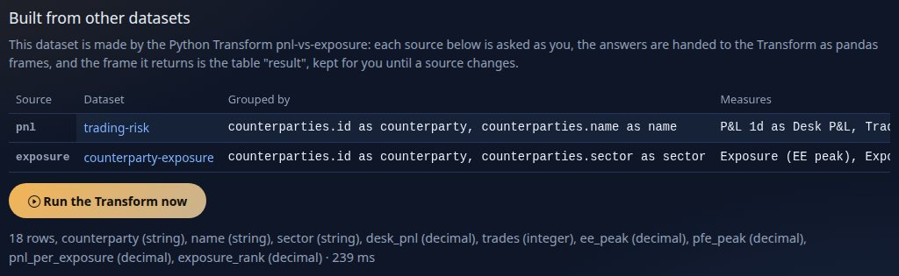

<!--
  Project Drishti · Any data. Any domain. One grammar.

  Copyright (c) 2026 Ashutosh Sinha <ajsinha@gmail.com>.
  All rights reserved.

  PROPRIETARY AND CONFIDENTIAL.

  This file is the confidential and proprietary property of Ashutosh Sinha.
  Unauthorised copying, use, modification, distribution or disclosure of this
  file, via any medium, is strictly prohibited except with the express prior
  written permission of the copyright holder.

  See the LICENSE file in the root of this repository for the full terms.
-->
# Tutorial 14 · Python and Analyse

SQL measures cover most questions. When a figure needs a real function (a standard deviation of P&L per desk, a histogram, a model) you write it in **Python**, and Drishti runs it **sandboxed, on the rows the person looking may see**. And when you do not yet know the question, **Analyse** gives you
an extract of a dataset to **slice**, query with **SQL**, work on in **Python**, keep as a **notebook**, and **promote** to a measure, a visual or a report draft. This tutorial does both on the demo trades.

## Time to complete

About 55 minutes.

## Before you start

- [Tutorial 10](10-first-bi-report.md) done (reports, workspaces, `Economics desk`). You sign in as the development administrator, who holds the `bi-author` power that Python needs (reading with **Slice** and **SQL** needs only `bi`).
- The console's Python environment from [tutorial 1](01-first-15-minutes.md) (`drishti-console/.venv`): it carries `pandas`, `numpy` and `pyarrow`, which Python items may import. Nothing else to install for the **server** target. (The **browser** target runs the same code in Pyodide, a download of
  about 340 MB made once with `tools/fetch-pyodide.sh`; this tutorial uses the server.)
- Two small files in [data/](data/): [notional-by-desk.python.yaml](data/notional-by-desk.python.yaml) (a Python visual) and [desk-python.report.yaml](data/desk-python.report.yaml) (a report that uses it).

## What you will learn

- the two kinds of Python item: a **measure** (`compute(table, params)`, one number per group) and a **visual** (`render(table, params)`, a chart);
- how a report uses them, where they run, and what the sandbox forbids;
- **Analyse**: the extract, **Slice**, **SQL** (one read-only SELECT), a **Python** cell that draws a chart, saving a **notebook**, and **promoting** work into BI items.
- **Python across datasets**: a **Transform** that turns the masked answers of two datasets into a table (a derived dataset), and an Analyse notebook that joins two extracts in pandas and promotes the join to a Transform.

## Step 1 · Python in a report: the shipped sample

Open **Catalogue → Desk P&L risk (Python)**.


You should see two charts. Under each is a line such as `Python · desk-pnl-volatility v1 · server · 278 ms · 750 rows`: the **item** that drew it, its version, **where it ran** (the console's sandboxed worker, `server`) and how many rows it was handed. The left chart is a **Python measure** (the volatility of one-day P&L of each desk); the right one is a **Python visual** (a histogram drawn with numpy).
Both worked on the 750 trades **as you may see them**: masks and row rules were applied before Python saw a row.

The measure's source is a short YAML item, `config/bi/python/desk-pnl-volatility.python.yaml`:

```yaml
python: desk-pnl-volatility
title: Desk P&L volatility
interface: measure
inputs: [pnl1d]                  # the columns the function reads
packages: [pandas]               # what the source imports (must be on the allow-list)
target: both                     # server, browser or both
timeout: 10                      # seconds
memory: 256                      # megabytes
params: { min_trades: 2 }
source: |
  def compute(table, params):
      """One number for the rows of one group."""
      pnl = table["pnl1d"].dropna()
      if len(pnl) < int(params.get("min_trades", 2)):
          return 0.0
      return float(pnl.std(ddof=1))
```

The **dataset** says which groups it is called for (one number per desk) in a measure that is a Python item, not an expression:

```yaml
measures:
  Desk P&L volatility:
    python: desk-pnl-volatility      # the item
    inputs: [trade.pnl1d]            # columns of ONE table
    by: [trade.desk]                 # one number per desk
```

## Step 2 · A Python visual of your own

A visual is a function `render(table, params)` that gets the rows of the visual's `columns` well and returns a chart **as data** (an ECharts option, SVG text or PNG bytes; never HTML or script). Here is the tutorial's, which draws the largest desks by notional:

```yaml
rachana: 1
python: notional-by-desk
title: Notional by desk chart
interface: visual
output: echarts
inputs: [desk, notional]
packages: [pandas]
target: both
params: { top: 8 }
source: |
  def render(table, params):
      top = int(params.get("top", 8))
      g = table.groupby("desk", as_index=False)["notional"].sum().sort_values("notional", ascending=False).head(top)
      return {
          "title": {"text": f"Notional of the {len(g)} largest desks", "left": "center"},
          "xAxis": {"type": "value", "name": "Notional"},
          "yAxis": {"type": "category", "data": list(g["desk"])[::-1]},
          "series": [{"type": "bar", "data": [float(v) for v in g["notional"]][::-1]}],
      }
```

A Python item is a BI item like a dataset or a report: stored, versioned, reviewed and published. Create it in your workspace: **My workspace → New item**, kind *python*, title `Notional by desk chart`, paste the YAML from `data/notional-by-desk.python.yaml`, **Create item**. (The picture below moved it into `Economics desk`.)


You should see the item as a draft with its actions. Press **Check the Python**: the console checks what only it can, that the source parses, defines its entry (`render`) and imports only what the manifest lists or the safe standard library.


You should see `The Python item checks out: the manifest is valid and the source parses.` A mistake is reported with its code. A package that is not allowed, for example `packages: [requests]`, is refused (`DRS-9070`) with the allow-list:

```text
$ POST /bi/python/check   (packages: [requests])
{"valid": false, "problems": [
  {"level": "error", "code": "DRS-9070", "path": "packages", "message": "'requests' is not an allowed package (allowed: pandas, numpy, pyarrow, scipy, statsmodels)"},
  {"level": "error", "code": "DRS-9070", "path": "packages", "message": "'requests' is not on the console's allow-list (bi.python.packages: pandas, numpy, pyarrow, scipy, statsmodels)"}, ...
```

Press **Publish** (a Python item must be published for a report to use it). Now the report, [data/desk-python.report.yaml](data/desk-python.report.yaml): a slicer, a `python` visual that names your item, and one that uses the shipped measure.

```yaml
- id: notional-chart
  type: python
  title: "Notional by desk (my Python visual)"
  at: { x: 0, y: 2, w: 6, h: 6 }
  wells: { columns: [trade.desk, trade.notional] }       # the rows handed to Python
  format: { python: Notional by desk chart, params: { top: 8 }, run: auto }
- id: volatility
  type: python
  wells: { values: [Desk P&L volatility] }                # a Python measure of the dataset
  format: { run: auto }
```

Create it (New item, kind *report*) and press **Open the report**.


You should see your chart, `Notional of the 8 largest desks`, drawn by your function, beside the shipped one; the footer of yours reads `Python · bi-... v1 · server · 320 ms · 750 rows`. Choose a currency in the slicer: the chart is asked again and Python gets only those rows (the rows are the table's own, under the page's slicers, filters and business date, at most 10,000). `format.run` is `auto` (the server first, the browser if the server cannot), `server` or `browser`.

**The sandbox.** The server target runs a short-lived worker process per call: **no network**, a scratch folder only, limits on CPU, memory, time and output, and **nothing kept between calls**, so nothing leaks between people. `import` works for the allow-listed packages. Python never reaches the server's data directly; it receives the Arrow rows the server built for the person.

## Step 3 · Analyse: an extract to explore

Choose **Analyse** in the BI rail. Choose the dataset **Trades, the basics**, tick the fields you want (`tradeId`, `desk`, `book`, `productType`, `currency`, `status`, `notional`, `mtm`) and press **Open the extract**.


You should see the line `750 rows, 8 columns.` The extract is the table's own rows for **you** (masked columns arrive empty, and the line says `Masked for you: ...`), cut to `bi.explore.max_rows` (10,000; a cut says so). It is rebuilt on every run and never kept, so a mask or row rule changed on the server applies the next time. Because it can be cut, Slice and SQL give the **extract's** totals; for true
totals use a report.

## Step 4 · Slice

On the **Slice** tab each field is a chip with four small buttons: `R` rows, `C` columns, `V` values, `F` filters. Press `R` on `desk`, `C` on `currency` and `V` on `notional`.


You should see the pivot redraw at once: ten desks down, seven currencies across, notional summed in the cells (`750 of 750 rows used; 10 pivot rows`). A value takes `sum`, `avg`, `count`, `min` or `max`; a filter keeps rows equal to chosen values. It is plain JavaScript over the extract the page holds.

## Step 5 · SQL

Open the **SQL** tab. A SQL cell is **one SELECT** over the table `extract`:

```sql
SELECT desk, COUNT(*) AS trades, SUM(notional) AS notional
FROM extract
GROUP BY desk
ORDER BY notional DESC
```

Press **Run**.


You should see a table, the largest desk first (`DESK-RATES`, 20,281,000,000 of notional). It runs on the console in an in-memory SQLite, **read-only by construction**. Ask for something else and the answer is a code, not damage:

```text
POST /bi/explore/sql   {"sql": "DROP TABLE extract"}
403 {"code":"DRS-9073","detail":"only a single SELECT over the table extract is allowed"}
POST /bi/explore/sql   {"sql": "SELECT 1; SELECT 2"}
422 {"code":"DRS-9070","detail":"only one statement is allowed"}
POST /bi/explore/sql   {"sql": "SELECT desk, SUM(notional) AS notional FROM extract GROUP BY desk ORDER BY notional DESC LIMIT 3"}
200 {"columns":["desk","notional"],"rows":[["DESK-RATES",20281000000.0],["DESK-EQD",15806000000.0],["DESK-COMM",11359000000.0]],"rowCount":3,"truncated":false,"ms":1,"inputRows":750,"masked":[],"truncatedInput":false}
```

You should see the three answers: refused with `DRS-9073`, refused with `DRS-9070` and three rows. (Text over 20,000 characters or a query over 5 seconds is `DRS-9072`; at most 5,000 rows come back.)

## Step 6 · A Python cell

Open the **Python** tab. A cell sees three names: `df` (the extract as a pandas table), `params` and `quant` (a pricing helper). What it prints comes back as text; what it puts in `result` is **drawn**: a table as a table, a dict as an ECharts option, SVG or PNG as an image.

```python
g = df.groupby('desk', as_index=False)['notional'].sum()
result = {'title': {'text': 'Notional by desk'}, 'xAxis': {'type': 'category', 'data': list(g['desk'])}, 'yAxis': {'type': 'value'},
          'series': [{'type': 'bar', 'data': [float(v) for v in g['notional']]}]}
```

Press **Run** (the selector beside it chooses *Server (sandbox)* or *Browser (Pyodide)*).


You should see `Python · server · 262 ms · 750 rows` and the chart. The same worker as a Python visual runs it, with the same sandbox. A cell that only prints and returns a table, run on the same extract:

```text
POST /bi/explore/python   {"source": "print(len(df))\nresult = df.groupby('desk')['notional'].sum().head(3)", "target": "server"}
200 {"kind":"cell","stdout":"750\n","table":{"columns":["notional"],"rows":[[11359000000.0],[8598000000.0],[15806000000.0]],"rowCount":3},"ms":257,"inputRows":750,"masked":[],"target":"server","truncatedInput":false}
```

You should see `750` printed and a three-row table. Running Python needs `bi-author`; a person with only `bi` sees the Slice and SQL tabs work and the Python tab explain why it will not run.

## Step 7 · Keep it as a notebook, promote it

Under **Notebook** give it a title (`Desk notional, first look`) and press **Save as a notebook**.


You should see a link, **Open the item**: the extract's definition, the slice and every cell are now a BI item of kind **notebook** in your workspace, with versions, diffs, review and publishing like any other. Opening it again rebuilds the extract **for whoever opens it**: a notebook shared with a colleague shows *their* rows. Outputs are not stored, only the code.

To turn a cell into a reusable item press **Promote to a visual** (or **to a measure**) under the cell.


You should see `Python visual draft saved in your workspace: Analyse cell (visual).` and the reminder: the cell's `df` became the function's `table`, `result` is returned, a measure must return one number and a visual an ECharts option, SVG or PNG; check it with **Check the Python** on the item page, then publish. Nothing is published for you. And to turn a **slice** into a report press **Promote to a report draft**.


You should see `Report draft saved in your workspace: Slice of file:dataset:trades-basic.` The draft is a one-page report on the same dataset with a **matrix** (rows, the column field, the values), which you open in the designer to finish ([tutorial 10](10-first-bi-report.md)).

## Step 8 · Two datasets: a Python Transform and a join in Analyse

Steps 1 to 7 used Python on one dataset. Python can also **join datasets**. The sample **Desk P&L vs counterparty exposure** ([tutorial 10](10-first-bi-report.md), step 11) joins the one-day P&L of `trading-risk` and the exposure of `counterparty-exposure` in YAML; the same table is also made by a **Python Transform**: a Python item with `interface: transform` whose function `run(pnl, exposure, params)` receives the two answers as pandas frames, **masked for you**, and returns a table. Open **Datasets** and **Desk P&L vs counterparty exposure (Python)**, and as an author press **Run the Transform now**.



You should see the two sources and, after a moment, `18 rows, counterparty (string), name (string), sector (string), desk_pnl (decimal), trades (integer), ee_peak (decimal), pfe_peak (decimal), pnl_per_exposure (decimal), exposure_rank (decimal)` and the time the run took. The server asked both datasets as you, started the console's sandboxed Python runner (no network, a scratch folder, limits), and kept the frame **for you** until a source changes: press the button again and it says it was already kept. A report can use `result.counterparty`, `Desk P&L` and `P&L per exposure` of this dataset as of any other; a colleague with other rows and masks gets a frame of their own. The item is `config/bi/python/pnl-vs-exposure.python.yaml`; the reference is [PYTHON_BI.md section 13](../guides/PYTHON_BI.md#13-transforms-a-table-in-a-table-out).

How would you write such a Transform? In **Analyse**, with **two extracts**. Open the notebook **Desk P&L vs counterparty exposure, in pandas** (the Notebook box in the Extract card).


You should see `750 rows, 3 columns.` for the first extract and, in **More extracts: join several datasets**, a second one called `exposure` (3 fields) of the other dataset. Each is built for you by the server, with your row rules and masks. Open the **Python** tab and **Run** its cell.


You should see the cell (`df` is the trades; `extract("exposure")` is the netting sets) and a table of counterparties: `CP-HALCYON` with P&L `-1194728` and exposure `133327214`, then `CP-MERIDIAN` and the rest. The same join works in SQL: the second extract is a table called `exposure` (`SELECT ... FROM extract JOIN exposure ON ...`). When the pandas join is what you want to keep, press **Promote to a Transform**.


You should see the message that a Python Transform draft was saved in your workspace: each `extract("name")` became a parameter of `run(...)`, the cell's `result` is returned, and its inputs are the two datasets, in order. Open the draft, **Check the Python**, publish it, and write the derived dataset that names it (`derived: { transform: ..., inputs: { ... } }`), as the sample does. Nothing is published by promoting.

## Next steps

- [Tutorial 15](15-ai-in-drishti.md): ask the data in words.
- [PYTHON_BI.md](../guides/PYTHON_BI.md): the manifest, where Python runs, the sandbox in full, `DRS-9070` to `9075`, and section 13 for the Transform. [ANALYSE.md](../guides/ANALYSE.md): the page, limits and notebooks. [PYTHON_CALC.md](../guides/PYTHON_CALC.md) is Calc, the Python panel inside a screen.

## If something goes wrong

| You see | Meaning |
|---|---|
| `DRS-9001 no item 'xyz'` in a Python visual | the item is not published, or the name does not match its id, file name or title |
| `DRS-9070` | the manifest or a cell is wrong; the message names the key (a package not on the allow-list, a second SQL statement, a source that does not parse) |
| `DRS-9072` | the SQL ran too long or was too long (`bi.explore.sql_max_seconds`, `sql_max_chars`) |
| `DRS-9073` | the SQL tried to do more than read the table `extract` |
| `DRS-9074` | the runner is busy or not installed (`bi.python.workers`, the pandas environment), or a browser run needs Pyodide (`tools/fetch-pyodide.sh`) |
| the Python tab will not run | you lack the `bi-author` power |
| a column is empty in the extract | it is masked for your role; the line under the form names it |
