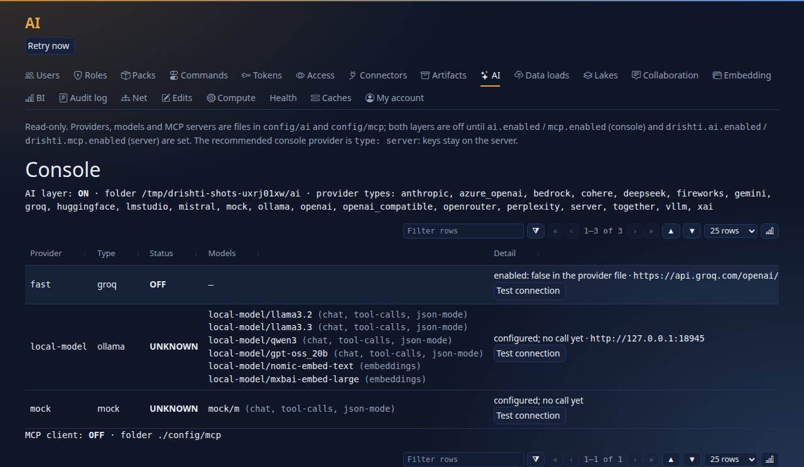
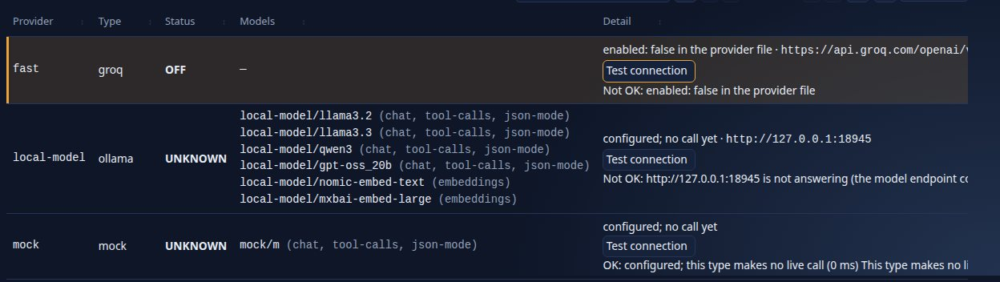
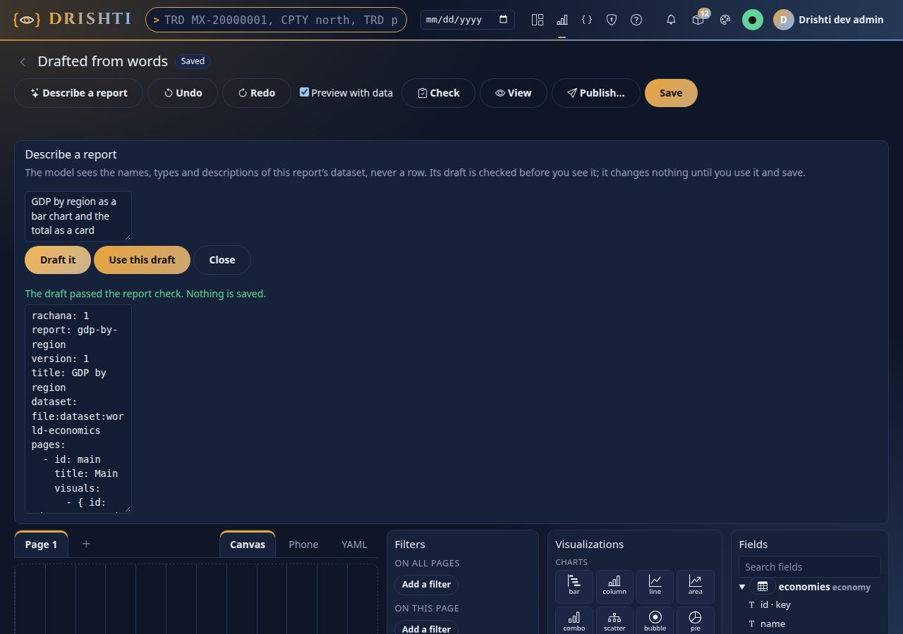
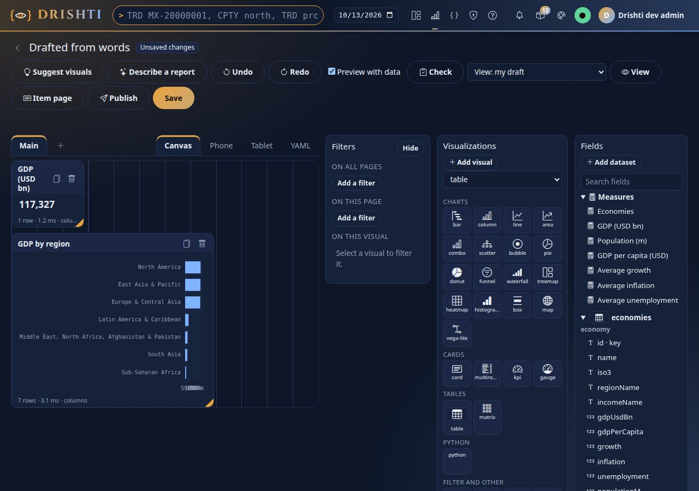
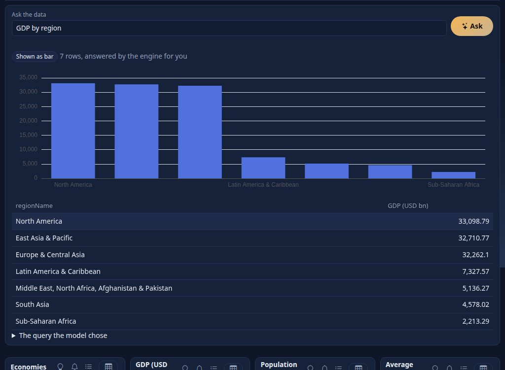
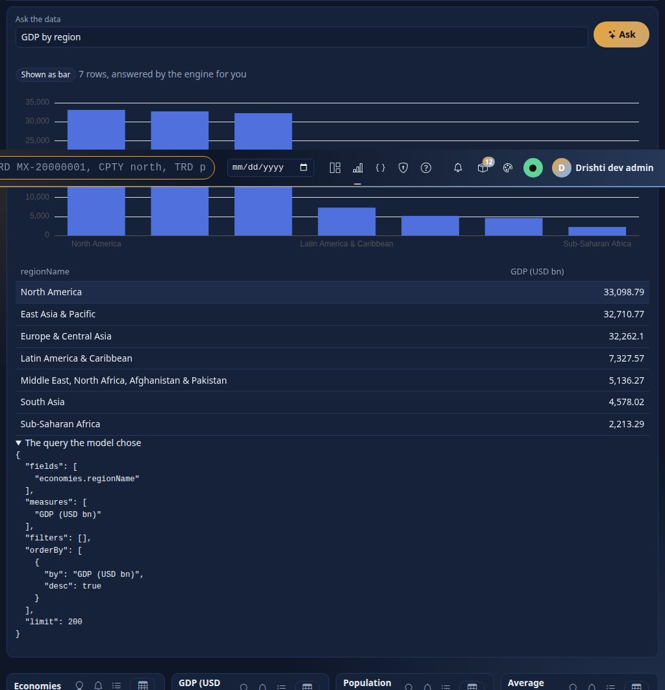
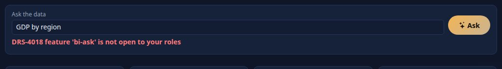
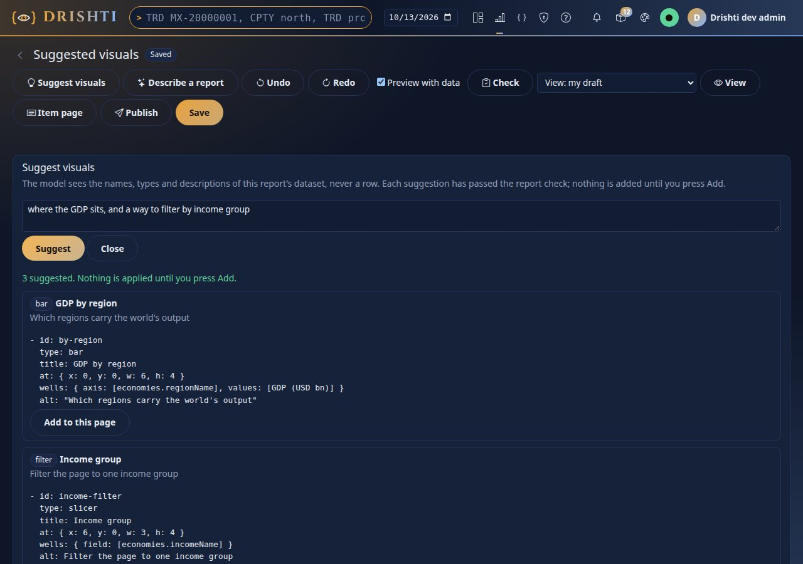
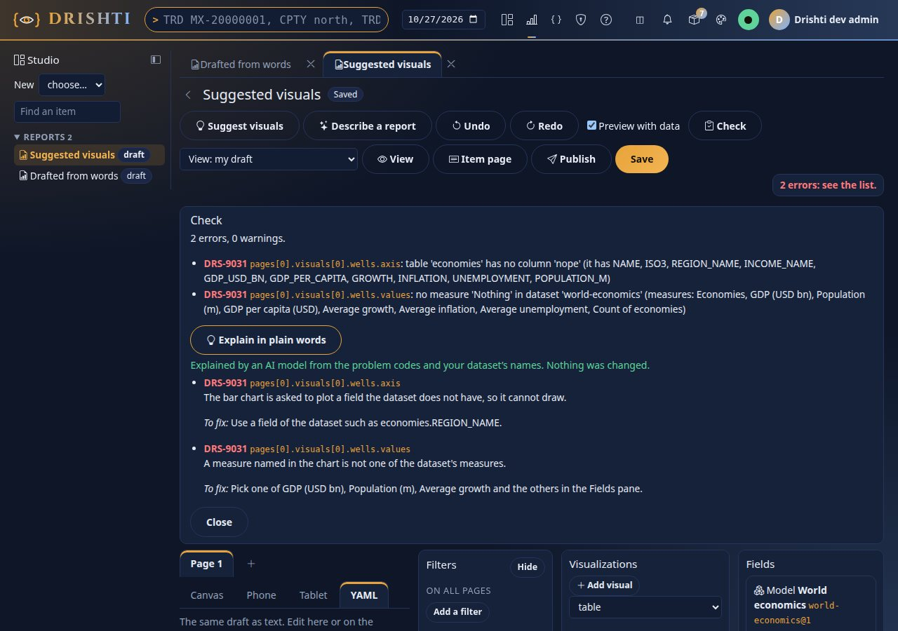
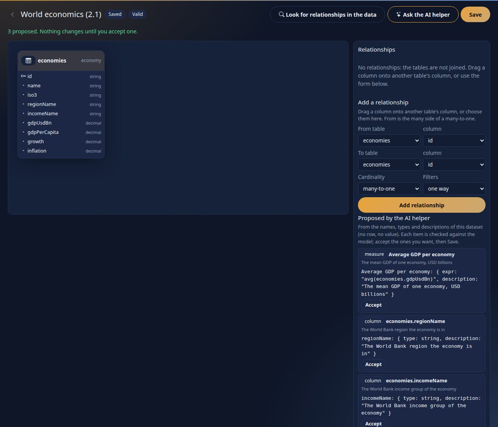

<!--
  Project Drishti · Any data. Any domain. One grammar.

  Copyright (c) 2026 Ashutosh Sinha <ajsinha@gmail.com>.
  All rights reserved.

  PROPRIETARY AND CONFIDENTIAL.

  This file is the confidential and proprietary property of Ashutosh Sinha.
  Unauthorised copying, use, modification, distribution or disclosure of this
  file, via any medium, is strictly prohibited except with the express prior
  written permission of the copyright holder.

  See the LICENSE file in the root of this repository for the full terms.
-->
# Tutorial 15 · AI in Drishti

Drishti can put a language model beside BI in three places and no more: **describe a report** in words, **ask the data** a question, **explain this number**. It is **off by default**, it can only do what a person could do by hand (**it writes a draft or a query; Drishti checks it, runs it as the reader and shows it**),
and by default the model is never sent a row of data, only names. In this tutorial you turn it on with the **mock provider**, a deterministic stand-in with no network and no key, so you can see everything it does and everything it is stopped from doing, then you meet the AI **policy**, **Test connection** and the real providers.

## Time to complete

About 30 minutes.

## Before you start

- The quick-start environment of [tutorial 10](10-first-bi-report.md#before-you-start) (the demo lakes and **Drishti server (demo lakes)**, sign-in on),
  [tutorial 10](10-first-bi-report.md) done (the World economics report, which reads the model `world-economics@1`), [tutorial 13](13-govern-bi.md) for
  the people `ann` (a writer) and `sue` (a steward).
- The AI layer is a **restart** of the server and the console with two more variables (step 1): in the IDE, edit the run configurations **Drishti server
  (demo lakes)** and **Drishti console** and add them under *Environment variables*.
- Nothing to buy and no key: the mock provider is part of Drishti. The files used are in [data/ai/](data/ai/) (`mock.yaml` and `local-model.yaml`).
- The personal API token of [tutorial 1, step 9](01-first-15-minutes.md#step-9--make-a-token-for-the-command-line) in `DRISHTI_TOKEN`, and
  `DRISHTI_SERVER` (and `DRISHTI_CONSOLE`, the console's address, `http://localhost:17480`, for the administrator's calls of step 2); the AI features have no `drishti.py` command, so the command line here is `curl` on the API (the `bi/ai` calls are reads a personal
  token may make; **Test connection** is the console's, for administrators).

**Where this data comes from.** The `world-economics` dataset reads the `world-economy` pack: World Bank figures (CC BY 4.0), fetched by `tools/publicdata/world_economy.py`; the trading data is synthetic. Each source, its licence and how to refresh it: [External data](../guides/DATA_GUIDE.md#4-external-data-where-it-comes-from-and-how-to-refresh-it).

## What you will learn

- how to switch the AI layer on **safely**: one folder of provider files, one setting, the mock provider;
- what the model is sent (names, never values) and who may use each feature (the BI power, then the **AI policy**);
- **Describe a report**, **Ask the data**, **Explain this number**, each with the thing the model cannot do;
- **Test connection** for a provider, and what the audit trail records;
- the provider types Drishti has, and where real keys go.

## Step 1 · Turn it on, with the mock provider

Providers are files in one folder, `config/ai/`, one YAML per provider; the AI layer is off until a setting turns it on. Copy the tutorial's mock provider into the folder:

```bash
cp docs/tutorials/data/ai/mock.yaml config/ai/mock.yaml
```

```yaml
# config/ai/mock.yaml (shortened)
type: mock
default-model: m
models:
  - name: m
mock:
  rules:
    - match: "TASK: draft-report"          # "Describe a report": answer with this YAML
      reply: |
        ```yaml
        rachana: 1
        report: gdp-by-region
        ...
    - match: "(?i)QUESTION: [^\\n]*per capita"     # "Ask the data": answer with a query (names only)
      reply: '{"fields":["economies.REGION_NAME"],"measures":["GDP per capita (USD)"],...}'
```

The mock answers from the **first rule whose regular expression is found in the last message**; with no rule it echoes. That makes the features repeatable, and it is exactly what you want to see before a real model is behind them. Now switch the layer on, on the **server** (it runs the BI hooks) and on the **console** (it shows Admin → AI and
serves other features); both read the same folder:

```bash
# before starting the server, and before starting the console
export DRISHTI_AI_ENABLED=true DRISHTI_AI_DEFAULT_MODEL=mock/m
```

Restart both. (`DRISHTI_AI_DIR` moves the folder; the default is `./config/ai`. Without `DRISHTI_AI_ENABLED` nothing is read and every AI call answers `404 DRS-4015`.) Then open **Admin → AI**.



You should see `AI layer: ON`, the folder (`./ai` here; `./config/ai` for you), and **the provider types this build knows** (listed below), then one row per provider file: `mock` with its model `mock/m` and the status `UNKNOWN` (`configured; no call yet`: **health never calls the network**), `local-model` (a provider you will test in step 2) and `fast`, a vendor provider
**switched off** (`enabled: false`). Every provider is off until its file says `enabled: true`.

## Step 2 · Test connection

`UNKNOWN` is honest: nothing has called the provider. **Test connection** makes **one cheap live call** (a model list, or Ollama's tag list) to the provider you choose, and shows the answer **inline**. Press it for each row.



You should see three different, plain answers:

| Provider | Answer | Why |
|---|---|---|
| `fast` (Groq, switched off) | `Not OK: enabled: false in the provider file` | nothing was called: it is off |
| `local-model` (an Ollama address where nothing runs: [data/ai/local-model.yaml](data/ai/local-model.yaml)) | `Not OK: http://127.0.0.1:18945 is not answering (the model endpoint could not be reached or answered something unreadable)` | the endpoint was **really asked** and did not answer |
| `mock` | `OK: configured; this type makes no live call (0 ms)` | the mock needs no network |

For a real provider that works you would read `OK: the model list answered` (a type with a listing also shows the models the endpoint serves now). The button is **governed**: administrators only, one test per provider every few seconds, 15 seconds at most per test, and the answer never carries a key. And **audited**: every test is a line
in the console's log (and the layer's own recent list), who, which provider, the outcome, how long, never a key or a prompt:

```text
2026-10-17 19:17:59,295 INFO drishti.ai.audit: ai-audit {"detail": "enabled: false", "feature": "test-connection", "outcome": "not-usable", "provider": "fast", "user": "drishti-dev-admin"}
2026-10-17 19:17:59,306 INFO drishti.ai.audit: ai-audit {"detail": "http://127.0.0.1:18945 is not answering (the model endpoint could not be reached or answered something unreadable)", "feature": "test-connection", "millis": 3, "outcome": "failed", "provider": "local-model", "user": "drishti-dev-admin"}
2026-10-17 19:17:59,315 INFO drishti.ai.audit: ai-audit {"detail": "configured; this type makes no live call", "feature": "test-connection", "millis": 0, "outcome": "ok", "provider": "mock", "user": "drishti-dev-admin"}
```

**From the command line** there is no `drishti.py` command and a personal token does not reach it: the button is the console's own call,
`POST /admin/ai/api/test/{name}`, made from an administrator's signed-in session (here with `curl` and the session cookie of a sign-in at `/login`), and
`GET /admin/ai/api/overview` is the page's data:

```text
$ curl -s -b cookies -X POST $DRISHTI_CONSOLE/admin/ai/api/test/fast
{"name":"fast","ok":false,"network":false,"detail":"enabled: false in the provider file","models":[]}
$ curl -s -b cookies -X POST $DRISHTI_CONSOLE/admin/ai/api/test/local-model
{"name":"local-model","ok":false,"network":true,"detail":"http://127.0.0.1:18945 is not answering (the model endpoint could not be reached or answered something unreadable)","models":[],"millis":3}
$ curl -s -b cookies -X POST $DRISHTI_CONSOLE/admin/ai/api/test/mock
{"name":"mock","ok":true,"network":false,"detail":"configured; this type makes no live call","models":[],"millis":0}
```

`network` says whether a call left the console; `fast` was not even tried.

You should see one line for each press. (The same page shows the **server's** layer below the console's; the server has its own list. Keys live there: the recommended console provider is `type: server`, which hands the call to the server so the key stays in one place.)

## Step 3 · What the model is sent, and who may ask

Before using a feature, know the two gates and the contents. **Gate one**: the BI power (`bi-author` to describe a report, `bi` to ask or explain). **Gate two**: the **AI policy**, per feature and role. And the prompt carries **the names of what the report reads (its model, here `world-economics@1`) and the person's own words, nothing else**:

```text
TASK: ask-query
DATASET world-economics: Output, growth, prices, jobs and population for about 200 economies (World Bank, latest year published), by country, World Bank region and income group. The country is an ISO 3166-1 alpha-3 code, so a map visual can shade it.
FIELDS (write them as table.column):
  table economies: the dataset world-economics-economies 1.0.0, a fact
    economies.NAME string
    economies.ISO3 string
    economies.REGION_NAME string
    economies.INCOME_NAME string
    economies.GDP_USD_BN decimal
    economies.GDP_PER_CAPITA decimal
    economies.GROWTH decimal
    economies.INFLATION decimal
    economies.UNEMPLOYMENT decimal
    economies.POPULATION_M decimal
MEASURES (write them by name):
  Economies - How many economies.
  GDP (USD bn) - Gross domestic product at current prices, USD billions.
  Population (m) - Population, millions.
  GDP per capita (USD) - GDP over population: for a region, its total GDP over its total population.
  Average growth - The simple average of the economies' real GDP growth, % a year.
  Average inflation - The simple average of consumer-price inflation, % a year.
  Average unemployment - The simple average of the unemployment rate, % of the labour force.
  Count of economies
QUESTION: GDP by region
```

(The whole message of an *Ask* on the World economics report, rendered from the model as the server reads it for the administrator; the system message
before it holds the query grammar and no data.)

Not in it, in either mode: a row, a value of a field, a measure's definition, a connector or a path, and any field **masked for the reader** (it is left out, so the model cannot be told it exists). The setting `drishti.bi.ai.values` is `labels-only` by default; `aggregates` additionally lets the model word the reader's own masked
aggregate result, and is an administrator's decision, not a button.

The policy decides who may use each feature, how often and how much. This stack was started with the policy for **ask** open to `admin` and `bi-writer` only, and 30 calls a minute per user:

```yaml
drishti:
  ai:
    policy:
      per-user-per-minute: 30                       # DRS-4017 when exceeded
      features:
        "[bi-ask]": { roles: [admin, bi-writer] }   # bi-draft and bi-explain are named the same way; a feature with no entry is open to anyone who passes gate one
```

You should see it work in step 6: a person the policy does not list is refused before any model is called.

## Step 4 · Report from words

**Describe a report**, **Suggest visuals** and the **AI helper** (step 8) are the **authoring** hooks. They read the **model** you design on: its
`describe` as you may read it (a field masked for you is left out of the prompt, a field hidden for your role does not exist), never a row. Open
**Designer**, choose **World economics** under *Models* in **Model or dataset** (`world-economics@1`), give a title (`Drafted from words`) and press
**Start designing**, then **Describe a report**.



Type `GDP by region as a bar chart and the total as a card` and press **Draft it**. You should see `The draft passed the report check. Nothing is saved.` and the **YAML of the draft**: `rachana: 2` and `model: world-economics@1`, a report on the model, as every report in 2.2 is. What happened: the model (the mock here) was told the report grammar and the names of `world-economics@1` (each table is an alias of the model, `economies`, with its dataset `world-economics-economies 1.0.0`) and answered with YAML; Drishti **stripped a code fence, pinned the report to the model (`model:` in place of whatever `dataset:` it wrote), and ran
the report checker** on it, the same one **Check** and **Save** use. A draft that fails is repaired once (the model is told the problems, names only) and, if it still fails, refused as `DRS-4020` and **not shown**. Press **Use this draft**.



You should see the draft in the designer as a card (`117,327`) and a bar of GDP by region, with real data. It is a draft in your editor like text you typed: **nothing was saved or published**, undo, Check and Save are unchanged, and publishing needs a person and the usual review ([tutorial 13](13-govern-bi.md)).
The API behind the button:

```text
$ curl -s -X POST -H "Authorization: Bearer $DRISHTI_TOKEN" -H 'Content-Type: application/json' \
    -d '{"dataset": "world-economics@1", "request": "GDP by region"}' "$DRISHTI_SERVER/api/v1/bi/ai/draft"
200 {"yaml":"rachana: 2\nreport: gdp-by-region\nversion: 1\ntitle: GDP by region\nmodel: world-economics@1\npages:\n  - id: main\n    title: Main\n ...",
     "valid": true, "problems": [], "dataset": "world-economics@1", "model": "world-economics@1", "saved": false}
$ curl ... -d '{"dataset": "nope@1", "request": "GDP by region"}' "$DRISHTI_SERVER/api/v1/bi/ai/draft"
404 {"code":"DRS-9151","detail":"DRS-9151 no model 'nope' that you may read", ...}
```

`dataset` names what the draft is grounded in: a model (`world-economics@1`, or its item id `file:model:world-economics`), a dataset of the model
layer (`dataset:world-economics-economies`, its implicit model), or a version 1 dataset by id. A draft you use is an ordinary report draft: Check, Save
and publishing are unchanged.

## Step 5 · Ask the data, and explain this number

Open the **World economics** report (it reads the model `world-economics@1`). Under the toolbar is the question box. Type `GDP by region` and press **Ask**.



You should see the answer as a **table** and **the visual that suits it** (Drishti chooses it from the shape of the query, not the model: a card for one number, a line over dates, a bar for a few categories), a line `7 rows, answered by the engine for you` and **The query the model chose**. Open that disclosure.



You should see the query: `fields`, `measures`, `filters`, `orderBy`, `limit`. The model chose **names** (of the report's model); the **engine** validated every name, bound every value and ran it as a **model query** of `world-economics@1` **as you**: your row rules and your masks applied, so two people asking the same question get the answers they may each see. A query the model got wrong is refused by the engine with its code (`DRS-9020`) and shown as "the query the model chose was refused"; a question the model cannot turn into a query is `DRS-4020`, not a guess.

```text
$ curl -s -X POST -H "Authorization: Bearer $DRISHTI_TOKEN" -H 'Content-Type: application/json' \
    -d '{"report": "file:report:world-economics", "question": "GDP per capita by region"}' "$DRISHTI_SERVER/api/v1/bi/ai/ask"
200 {"columns": [{"name": "economies.REGION_NAME", ...}, {"name": "GDP per capita (USD)", ...}],
     "rows": [["North America", 86306.87], ["Europe & Central Asia", 34597.99], ["East Asia & Pacific", 13973.21], ...], "rowCount": 7,
     "meta": {"layer": "columns", "rows": 7, "tables": ["economies"], "masked": [], ...},
     "query": {"fields": ["economies.REGION_NAME"], "measures": ["GDP per capita (USD)"], "filters": [], "orderBy": [{"desc": true, "by": "GDP per capita (USD)"}], "limit": 200},
     "visual": "bar", "values": "labels-only", "summary": null}
$ curl ... -d '{"report": "file:report:world-economics", "question": "something odd"}' "$DRISHTI_SERVER/api/v1/bi/ai/ask"
422 {"code": "DRS-4020", "detail": "DRS-4020 the model did not answer with a query"}
```

You should see the answer, the query and `"summary": null` (in `labels-only` the model never saw the answer, so it wrote nothing about it). The query
is an ordinary model query: the same question **without** AI, on the command line, gives the same numbers:

```text
$ python3 tools/drishti.py bi mq --model world-economics@1 --select economies.REGION_NAME --measures "GDP per capita (USD)" --limit 3
economies.REGION_NAME       GDP per capita (USD)
-------------------------  --------------------
East Asia & Pacific        13,973.22
Europe & Central Asia      34,598.00
Latin America & Caribbean  10,993.23
3 row(s)  as of 2026-10-16  plan p_344b7fa781a125c9
```

and **as YAML** (`bi mq that.yaml`):

```yaml
mq: 1
model: world-economics@1
select: { fields: [economies.REGION_NAME], measures: [GDP per capita (USD)] }
sort: [{ by: GDP per capita (USD), desc: true }]
limit: 200
```

Now **Explain this number**: press the light bulb in the header of the **GDP (USD bn)** card.


You should see the **lineage** (what the report reads: the model at the version that answered, the measure's definition in the model, the columns it reads, the sources: each table's dataset by its current name and version, the pack kind and connector) and the **breakdown** the engine computed for you: the total, then its main dimensions with their top members and **share** (United States 30,769.7, 26.2%; China 19,498.0, 16.6%). In `labels-only` mode no model is called at all for Explain: it is lineage and arithmetic. Explain says **what a number is made of**, not why it moved over time. The API behind the light bulb, captured:

```text
$ curl ... -d '{"report": "file:report:world-economics", "page": "world", "visual": "gdp", "measure": "GDP (USD bn)", "state": {}}' "$DRISHTI_SERVER/api/v1/bi/ai/explain"
200 {"measure": "GDP (USD bn)",
     "lineage": {"dataset": {"name": "world-economics", "title": "World economics", "version": "1.0.0"}, "model": {"name": "world-economics", "version": "1.0.0"},
                 "measure": {"name": "GDP (USD bn)", "expr": "sum(economies.GDP_USD_BN)", "description": "Gross domestic product at current prices, USD billions."},
                 "columns": [{"name": "economies.GDP_USD_BN", "type": "decimal", "calculated": false, "expr": null}],
                 "sources": [{"table": "economies", "dataset": "world-economics-economies", "version": "1.0.0", "kind": "economy", "connector": "macro-store", "mode": "cached"}]},
     "value": 117326.8175073999,
     "breakdown": [{"dimension": "economies.NAME", "members": [{"member": "United States", "value": 30769.7, "share": 26.2}, ...]}, ...]}
```

(A page that is not the report's is `DRS-9035 the report has no page 'main'`; the World economics report's page is `world`.)

## Step 6 · The policy says no

Sign in as **sue** (a steward: she holds `bi`, but the policy opens `bi-ask` only to `admin` and `bi-writer`) and ask the same question.



You should see `DRS-4018 feature 'bi-ask' is not open to your roles`: the model was never called. Every call that is made, or refused, is audited twice (the policy's access-log row: who, feature, model, sizes, tokens, outcome; and a BI audit row such as `bi-ai-ask`), and **neither holds a prompt or an answer**. The codes you can meet:

| Code | Meaning |
|---|---|
| `DRS-4015` | the AI layer is off |
| `DRS-4016` | the provider failed or did not answer in time |
| `DRS-4017` | over a per-user, per-feature or cost limit |
| `DRS-4018` | the policy does not open this feature to your role |
| `DRS-4020` | the model's answer could not be used: nothing was changed |
| `DRS-9002` | no BI power for the feature |

## Step 7 · The providers, and real keys

Drishti has **21 provider types**: the four basics and **seventeen vendor types**. Each is a file in `config/ai/`; every one ships as `config/ai/<type>.yaml.example`, switched off. To use one: copy it to `config/ai/<name>.yaml`, set `enabled: true`, and put the key in the **environment**, never in the file (a literal key in a file is refused at load, naming the setting).

| `type:` | What it is | Key or credential |
|---|---|---|
| `mock` | the deterministic stand-in of this tutorial | none |
| `openai` | OpenAI, or any server speaking its API | `OPENAI_API_KEY` |
| `anthropic` | Anthropic's Messages API | `ANTHROPIC_API_KEY` |
| `server` | the console's provider that **delegates to the server**, so keys stay there | none (the server's) |
| `groq`, `together`, `fireworks`, `deepseek`, `xai`, `openrouter`, `perplexity`, `huggingface`, `mistral` | hosted, OpenAI-compatible, each with a preset address | `GROQ_API_KEY`, `TOGETHER_API_KEY`, `FIREWORKS_API_KEY`, `DEEPSEEK_API_KEY`, `XAI_API_KEY`, `OPENROUTER_API_KEY`, `PERPLEXITY_API_KEY`, `HF_TOKEN`, `MISTRAL_API_KEY` |
| `vllm`, `lmstudio`, `openai_compatible` | your own server speaking the OpenAI API (give `base-url`) | optional |
| `azure_openai` | Azure OpenAI | `AZURE_OPENAI_API_KEY`, a bearer token, or Microsoft Entra ID |
| `gemini` | Google Gemini (AI Studio) | `GEMINI_API_KEY` or `GOOGLE_API_KEY` |
| `cohere` | Cohere | `COHERE_API_KEY` |
| `ollama` | a local Ollama, no key | none (`base-url`, default `http://localhost:11434`) |
| `bedrock` | Amazon Bedrock | the AWS credential chain, a region |

A real provider file is short:

```yaml
# config/ai/fast.yaml
type: groq
enabled: true
api-key: ${GROQ_API_KEY}              # an ${ENV_NAME} placeholder; export GROQ_API_KEY before starting
default-model: llama-3.3-70b-versatile
```

Everything about each type (settings, model catalogue, proxy, TLS, retries, errors that never carry a response body) is in [AI.md](../admin/AI.md#1-model-providers) section 11; the BI side (what the hooks send, `aggregates` mode, limits) is [BI_GUIDE.md section 29](../guides/BI_GUIDE.md#29-ai-in-bi-report-from-words-ask-the-data-explain-this-number). Then use **Test connection** on the new row: the first honest answer tells you whether the key, the address and the network are right,
before anyone asks the data a question. You should see `OK` or the reason on the new row.

## Step 8 · Suggestions, plain-words checks and the dataset helper

Three more hooks help an **author** (they need `bi-author`, and the policy features `bi-suggest`, `bi-explain-checks` and `bi-helper`). In the designer, on **World economics** (`world-economics@1`, as in step 4; a new draft titled `Suggested visuals`), **Suggest visuals** takes a goal in your words and proposes visuals, wells and filters from the report's model. Each has passed the report checker and shows the YAML it would add; nothing is applied until you press **Add to this page** (one undoable edit):



You should see a bar, a slicer marked *filter* and a card, each with a sentence on why. Press **Add to this page** on one and it appears at the bottom of the canvas, selected; **Undo** takes it back. In the **Check** panel, **Explain in plain words** answers each problem with what it means and what to change. It works on any report, a report on a
model too: the picture checks this draft on `world-economics@1`, with a column and a measure the model does not have:

```yaml
rachana: 2
report: broken
version: 1
title: Broken
model: world-economics@1
pages:
  - id: p
    title: P
    visuals:
      - { id: v, type: bar, title: V, at: { x: 0, y: 0, w: 4, h: 3 }, wells: { axis: [economies.NOPE], values: [Nothing] } }
```



You should see the two `DRS-9031` problems the checker found and, under **Explain in plain words**, a sentence and a fix for each. The API behind
the button, with that YAML as the body's `yaml` (captured):

```text
$ curl ... -d '{"yaml": "rachana: 2\nreport: broken\n..."}' "$DRISHTI_SERVER/api/v1/bi/ai/explain-checks"
200 {"valid": false, "explained": 2,
     "problems": [{"level": "error", "code": "DRS-9031", "path": "pages[0].visuals[0].wells.axis",
                   "message": "table 'economies' has no column 'NOPE' (it has NAME, ISO3, REGION_NAME, INCOME_NAME, GDP_USD_BN, GDP_PER_CAPITA, GROWTH, INFLATION, UNEMPLOYMENT, POPULATION_M)",
                   "explain": "The bar chart is asked to plot a field the dataset does not have, so it cannot draw.",
                   "fix": "Use a field of the dataset such as economies.REGION_NAME."},
                  {"level": "error", "code": "DRS-9031", "path": "pages[0].visuals[0].wells.values",
                   "message": "no measure 'Nothing' in dataset 'world-economics' (measures: Economies, GDP (USD bn), Population (m), GDP per capita (USD), ...)",
                   "explain": "A measure named in the chart is not one of the dataset's measures.",
                   "fix": "Pick one of GDP (USD bn), Population (m), Average growth and the others in the Fields pane."}]}
```

The suggestions of the picture above are `POST /api/v1/bi/ai/suggest` with the model and your goal (captured, the YAML of each shortened):

```text
$ curl ... -d '{"dataset": "world-economics@1", "goal": "compare GDP across regions"}' "$DRISHTI_SERVER/api/v1/bi/ai/suggest"
200 {"dataset": "world-economics@1", "model": "world-economics@1",
     "suggestions": [{"id": "by-region", "kind": "visual", "type": "bar", "title": "GDP by region", "why": "Which regions carry the world's output",
                      "yaml": "- id: by-region\n  type: bar\n  ...\n  wells: { axis: [economies.REGION_NAME], values: [GDP (USD bn)] }\n ..."},
                     {"id": "income-filter", "kind": "filter", "type": "slicer", "title": "Income group", "why": "Filter the page to one income group", ...},
                     {"id": "growth", "kind": "visual", "type": "card", "title": "Average growth", "why": "The average growth at a glance", ...}],
     "applied": false}
```

In the **model designer** (Models → a model of your own → *Open*), **Ask the AI helper** proposes relationships, measures (with descriptions) and field descriptions from the saved model's names, types and descriptions, never a value. The shipped World economics model is read-only, so make one of your own over the same datasets first: **New item**, kind *model*, paste [config/bi/models/world-economics.model.yaml](../../config/bi/models/world-economics.model.yaml) with `model: my-world-economics` and the title `My world economics`, **Create**, then open it. Each item is checked against the model before you see it (a name the model lacks is never offered), and **Accept** makes it one undoable edit of the draft: a relationship goes under `relationships:`, a measure under `measures:`, a field's description under `fields:`. **Save** keeps them:



You should see `3 proposed. Nothing changes until you accept one.`, the measure `Average GDP per economy` (`avg(economies.GDP_USD_BN)`) and the two field descriptions
(`economies.REGION_NAME`, `economies.INCOME_NAME`), each with the YAML it adds: only items that fit the model (the mock also proposed a measure over a
column that does not exist and a description for an unknown field; both were dropped). The API behind the button, on the model:

```text
$ curl ... -d '{"dataset": "<the id of My world economics>"}' "$DRISHTI_SERVER/api/v1/bi/ai/dataset-helper"
200 {"dataset": "bi-...", "model": "my-world-economics@1",
     "items": [{"id": "measure:Average GDP per economy", "kind": "measure", "label": "Average GDP per economy", "why": "The mean GDP of one economy, USD billions",
                "yaml": "Average GDP per economy: { expr: \"avg(economies.GDP_USD_BN)\", description: \"The mean GDP of one economy, USD billions\" }", ...},
               {"id": "field:economies.REGION_NAME", "kind": "field", "yaml": "economies.REGION_NAME: { description: \"The World Bank region the economy is in\" }", ...},
               {"id": "field:economies.INCOME_NAME", "kind": "field", ...}],
     "applied": false}
```

and in YAML, after the three Accepts and Save, the model has:

```yaml
measures:
  # ... the seven of world-economics
  Average GDP per economy: { expr: "avg(economies.GDP_USD_BN)", description: "The mean GDP of one economy, USD billions" }
fields:
  economies.REGION_NAME: { description: "The World Bank region the economy is in" }
  economies.INCOME_NAME: { description: "The World Bank income group of the economy" }
```

(Asked of the shipped model itself, `{"dataset": "file:model:world-economics"}`, it proposes the same three items, but **Accept** needs a model you may
edit. Asked of a version 1 dataset by its id, the helper still answers in that dataset's own YAML: `book: { type: string, description: ... }`.) The same layer writes the **summary at the top of a subscription's email** ([tutorial 11](11-bi-that-runs-itself.md), step 8). [BI_GUIDE.md sections 9 to 11](../guides/BI_GUIDE.md#299-a-written-summary-at-the-top-of-a-subscriptions-email).

## Next steps

- [Tutorial 16](16-embed-drishti.md): put a view or a report on another web page.
- [BI_GUIDE.md section 29](../guides/BI_GUIDE.md#29-ai-in-bi-report-from-words-ask-the-data-explain-this-number), [AI.md](../admin/AI.md#1-model-providers) and the policy settings in [CONFIGURATION.md](../admin/CONFIGURATION.md#ai-and-mcp-policy-settings).

## If something goes wrong

| You see | Meaning |
|---|---|
| no light bulb, no question box, no Describe button | the AI layer is off (`DRISHTI_AI_ENABLED`) or no model is configured; the buttons are hidden and the API says `DRS-4015` |
| `DRS-4019` | the configured model is not found: check `drishti.ai.default-model` against the provider file |
| Admin → AI shows `ERROR` for a provider | its file could not be set up (a literal key, a missing variable, an unknown type); the detail says which, and it is retried |
| Test connection says `Not OK: ... is not answering` | the address, the port or the network is wrong, or the server is down |
| Test connection says `(authentication failed ...)` | the key is wrong or missing; the message names the variable to set |
| `DRS-4020` on Describe | the draft did not pass the report check even after one repair; nothing was changed |
| `DRS-9151` on Describe, Suggest or the helper | the model is not one you may read (a draft of someone else's, a name with a typo, a major that does not exist); the designer names the model it reads |
| a question is answered with a different column than you expect | read **The query the model chose**: the model maps words to names, and you can see which |
