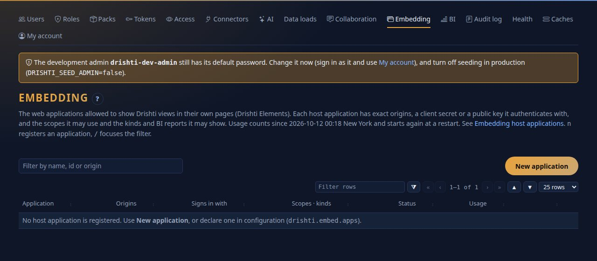
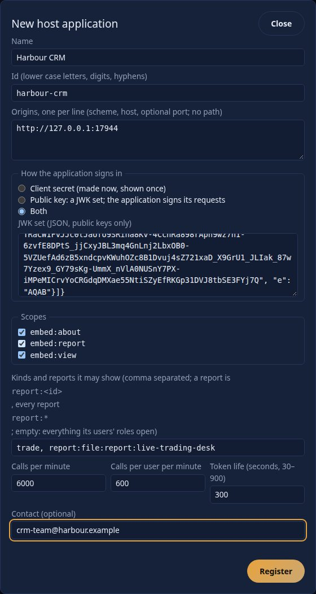
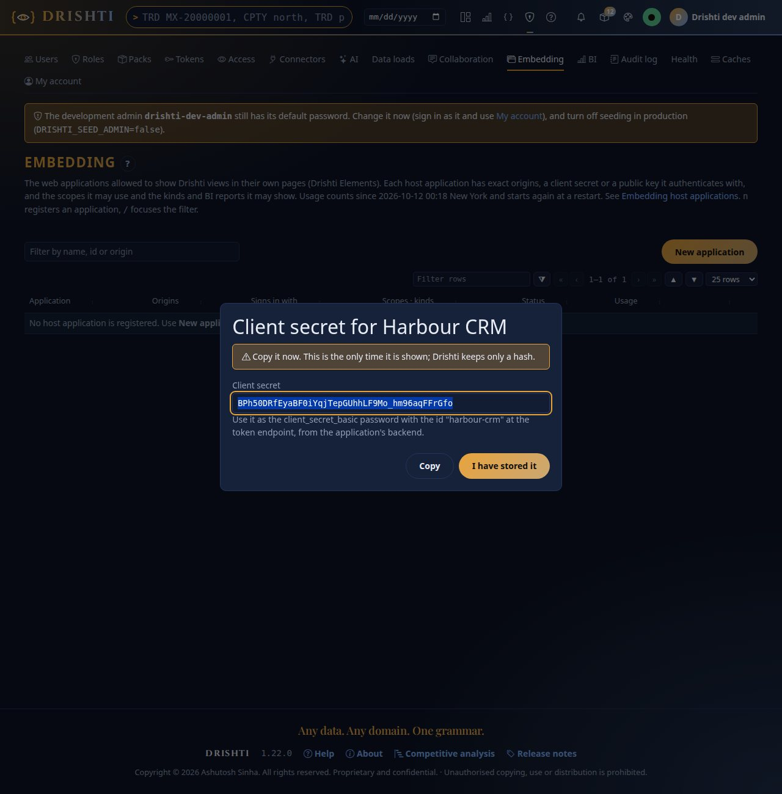
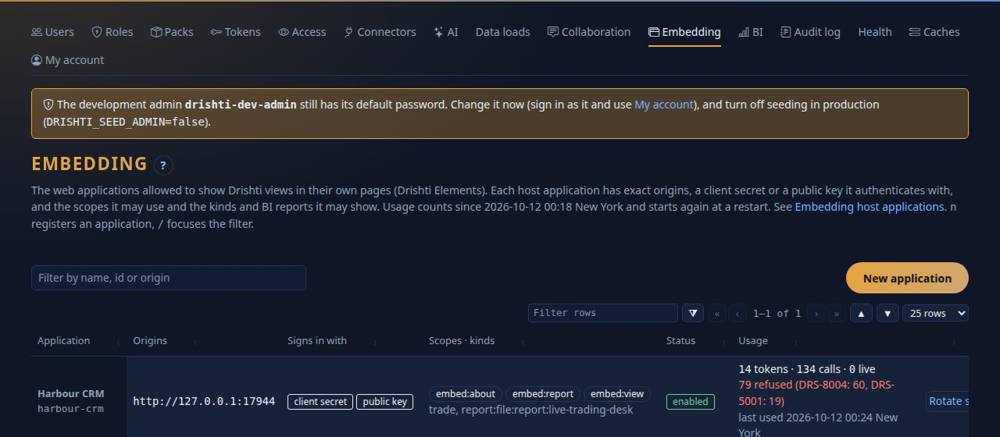
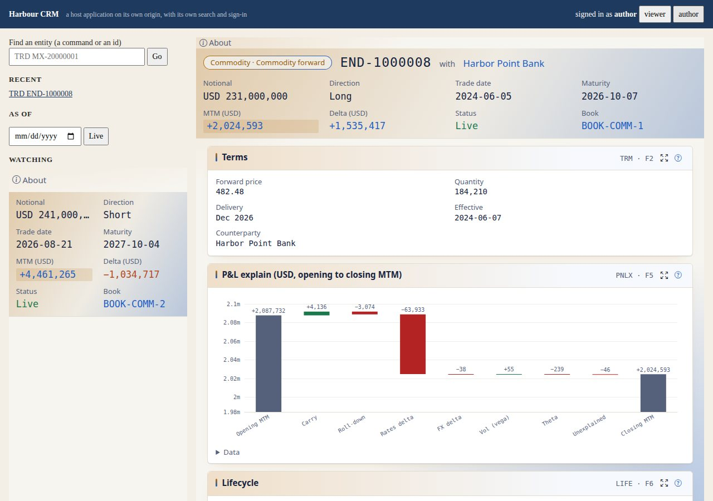
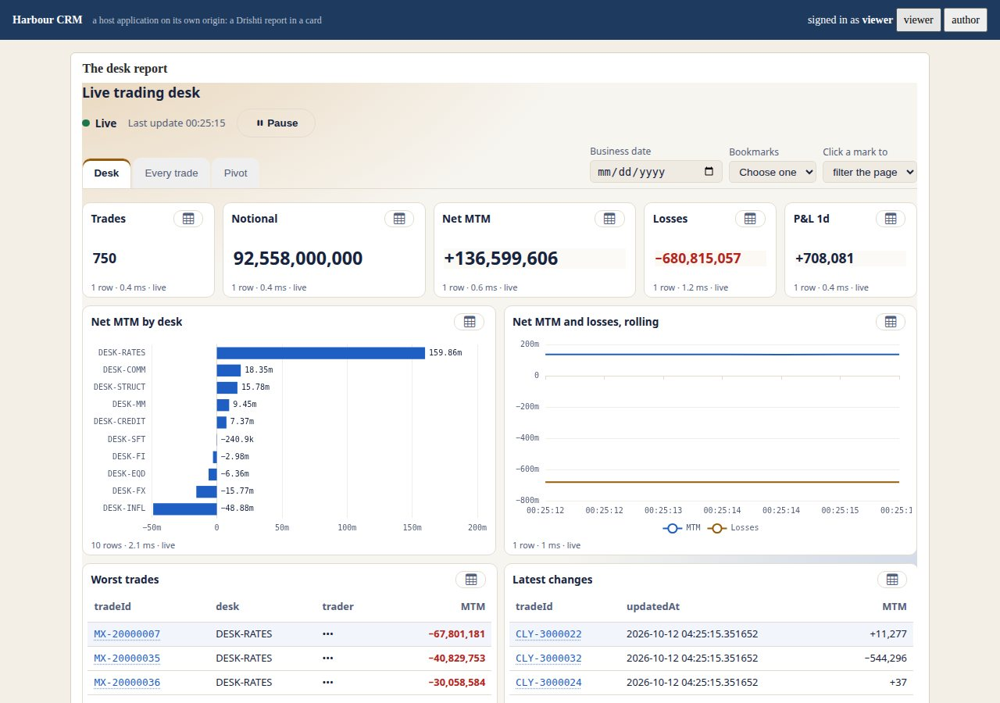
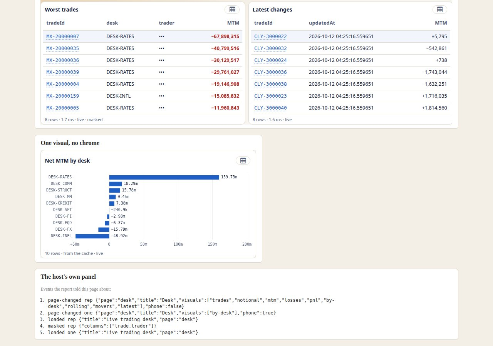
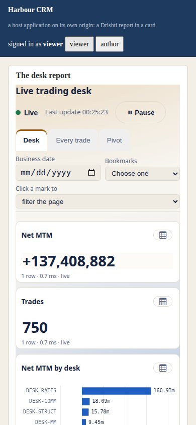
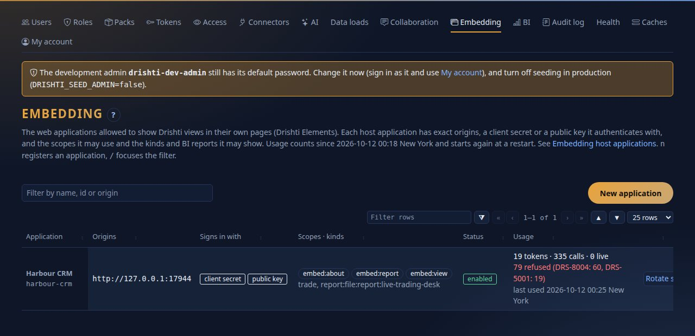
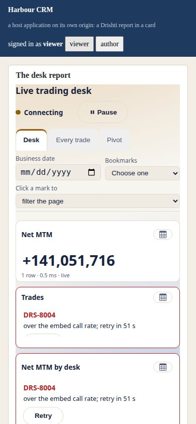

<!--
  Project Drishti · Any data. Any domain. One grammar.

  Copyright (c) 2026 Ashutosh Sinha <ajsinha@gmail.com>.
  All rights reserved.

  PROPRIETARY AND CONFIDENTIAL.

  This file is the confidential and proprietary property of Ashutosh Sinha.
  Unauthorised copying, use, modification, distribution or disclosure of this
  file, via any medium, is strictly prohibited except with the express prior
  written permission of the copyright holder.

  See the LICENSE file in the root of this repository for the full terms.
-->
# Tutorial 16 · Embed Drishti

Your own web application can show a live Drishti view or a published BI report **inside its own page**, with no iframe: `<drishti-view>` and `<drishti-report>` (Drishti Elements). The user is **your** user, signed in to **your** application; Drishti never sees their password, and your page
never sees Drishti's secrets. In this tutorial you register a host application in **Admin → Embedding**, run the sample host that ships with Drishti on its own origin under a **strict content-security policy**, watch a view and a report appear in it, and see how **tokens** and **limits** work.

## Time to complete

About 40 minutes.

## Before you start

- [Tutorial 1](01-first-15-minutes.md) done (server and console with sign-in on), and [tutorial 12](12-live-bi-and-boards.md) for the live report the host shows.
- Embedding is **off by default**. This tutorial turns it on (step 1). It needs a third port for the host application (the sample host uses 17968 by default; the pictures use 17944), and the two demo users `viewer` and `author` in Drishti (step 2).
- The sample host is [tools/elements-demo](../../tools/elements-demo/README.md): a small Python program with its own sign-in and its own backend. It signs its requests with a **demo key** that ships in the repository: never use it for anything real.

## What you will learn

- the pieces: the **host application**, its **backend** (which holds a secret), the **console** (which serves the library and the views), and the **server** (which issues tokens);
- how to **register** a host: exact origins, how it signs in, scopes, and which kinds and which reports it may show;
- what the **embed token** is, how short its life is, and why it is read-only and always masked;
- what the host page needs: the one script line, a token provider, and a CSP that names the console and nothing else;
- the **limits** (calls per minute, per user) and the codes you will meet.

## Step 1 · Switch embedding on

On the server and on the console, before they start (the same two addresses in both):

```bash
export DRISHTI_EMBED_ENABLED=true
export DRISHTI_PUBLIC_URL=http://127.0.0.1:18480        # the server's address as the host's backend reaches it
export DRISHTI_CONSOLE_URL=http://127.0.0.1:17480       # the console's address as the browser reaches it (the token's audience)
```

(Sign-in must already be on: embedding needs `DRISHTI_SECURITY_ENABLED=true` on the server, which tutorial 1 set. The pictures were made on ports 18943 and 17943; yours are 18480 and 17480.) Restart both. Without the setting the embed calls are refused. You should see **Admin → Embedding** open once both are back (step 3).

## Step 2 · Two users the host will sign in

The sample host has two demo users, `viewer` and `author`. A host application tells Drishti **who** its user is; Drishti refuses a stranger, so both must exist in Drishti too. As the administrator make them under **Admin → Users → New user**: `viewer` with the role `viewer` and `author` with the role `author`, any password (the host never asks for it; Drishti never sees it), *Must change at first sign-in* unticked. You should see both in the **Users** list.

## Step 3 · Register the host application

Open **Admin → Embedding**.



You should see the empty list and **New application**. Press it.



Fill it in:

| Field | Value | Why |
|---|---|---|
| Name, Id | `Harbour CRM`, `harbour-crm` | the id is what the host's backend names itself with |
| Origins | `http://127.0.0.1:17944` | the **exact** origin of the host's pages (scheme, host, port, no path). A page on any other origin is refused (`DRS-8002`); `null` and wildcards are refused |
| How it signs in | **Both** | a **client secret** (shown once) and a **public key** (a JWK set): the host's backend authenticates with the secret and signs a short assertion about its user with its private key. For the sample host paste the JWK set made from `tools/elements-demo/demo-host-key.json` (its public half: `n`, `e`, `kid`) |
| Scopes | `embed:view`, `embed:about`, `embed:report` | what the host may ask a token for: views, the About text, BI reports |
| Kinds and reports | `trade, report:file:report:live-trading-desk` | an allow-list: **the kind `trade`** and **one report**. Every report is `report:*`; empty means everything the user's roles open |
| Calls per minute, per user per minute | `6000`, `600` | the defaults (600 and 60) are for a quiet page; a live report asks again at every tick |
| Token life | `300` seconds | the lifetime of a token; never more than the server's `drishti.embed.token-max-seconds` |

Press **Register**.



You should see the client secret, shown **once** (Drishti keeps only a hash of it). Copy it; you give it to the host application's backend (an environment variable or a secret store, never a web page). Press **I have stored it**.



You should see the application: its origin, the two ways it signs in, the scopes and kinds, `enabled`, and a usage column (`0 tokens · 0 calls`). Over the API the same registration is `POST /api/v1/admin/embed/apps`; a **rotate** (new secret, with a grace period during which the old one still works), **disable** and **delete** are buttons on the row.

## Step 4 · The host application

The host is a few files: a page, a script, and a **backend** that asks Drishti for a token for the signed-in user. Start it with the secret you copied:

```bash
python3 tools/elements-demo/server.py --port 17944 --app harbour-crm \
    --console http://127.0.0.1:17480 --server http://127.0.0.1:18480 --secret "<the secret>"
```

You should see `host app on http://127.0.0.1:17944  (Drishti console http://127.0.0.1:17480)`. Its page has **one Drishti line**, an element, and a token provider:

```html
<script type="module" src="http://127.0.0.1:17480/embed/v1/drishti-elements.js" crossorigin="anonymous"></script>
...
<drishti-view id="main" kind="trade" entity="END-1000008" theme="light"></drishti-view>
```

```javascript
DrishtiElements.configure({
  tokenProvider: async () => {                     // YOUR backend, not Drishti: it holds the client secret
    const r = await fetch('/api/drishti-token', { cache: 'no-store' });
    const b = await r.json();
    return { token: b.token, expiresAt: Date.now() + b.expiresIn * 1000 };
  }
});
```

The backend's route does the **token exchange** (RFC 8693) with Drishti, server to server: it signs an assertion about its user with its private key and sends it with the client secret.

```text
POST /api/v1/embed/token            (from the host's backend to the Drishti server)
Authorization: Basic base64("harbour-crm:<the secret>")
grant_type=urn:ietf:params:oauth:grant-type:token-exchange
subject_token=<a JWT the host signs: iss harbour-crm, sub author, aud <the token endpoint>, exp in 60 s>
subject_token_type=urn:ietf:params:oauth:token-type:jwt
audience=http://127.0.0.1:17480            (the console)
scope=embed:view embed:about
-> {"access_token": "<JWT>", "token_type": "Bearer", "expires_in": 300, "scope": "embed:view embed:about"}
```

The token the page receives is a short **ES256** JWT; its header and claims are plain to read (here decoded from a real one):

```text
header   {"alg": "ES256", "typ": "drishti-embed+jwt", "kid": "emb-84a7753c6409"}
claims   {"iss": "http://127.0.0.1:18943", "aud": "http://127.0.0.1:17943", "sub": "author", "azp": "harbour-crm",
          "scope": "embed:view", "origins": ["http://127.0.0.1:17944"], "iat": 1791778958, "exp": 1791779258, "jti": "emb_1G8z4U70Mns0OeiT", ...}
```

What to notice: **five minutes** (`exp - iat = 300`), the application (`azp`), the **origin** it is good for and its **scope**. On **every call** the server checks the signature, the audience, the expiry, the application, the user (their roles **as they are now**), the origin, the scope and the kind or report, and the rates, then acts **as that user, read-only, with every field mask applied whatever their roles say**. The library asks the provider for a new token a minute before the old one ends, so nothing redraws.

## Step 5 · A live view in someone else's page

Open `http://127.0.0.1:17944/` and press **author**.



You should see **the host's** page chrome (a blue bar, its own search box *Find an entity*, **Recent**, an **As of** date) around **Drishti's** view: the trade `END-1000008` with its title, key figures and panels, and a second, smaller `<drishti-view>` in the side column (`header="strip" panels="none"`) that **shares the first one's connection**. Both are live: the MTM ticks. Type `TRD MX-20000001` in the host's search box: the page changes the element's `entity` attribute and the view switches in place. Click the counterparty (*Harbor Point Bank*): the element raises `drishti:navigate`, and the host decides what to do (the sample puts it in its own search box).

Embedded views **always mask**: the `author` role holds the `raw` power in the console, but through an embed token every masked field reads `•••`. Open the same trade in the console beside it to compare.

## Step 6 · A report in a card

Open `http://127.0.0.1:17944/report` (signed in as `viewer`).



You should see the **Live trading desk** report from tutorial 12 in a card of the host's page: the live indicator and **Pause**, the page tabs *Desk*, *Every trade*, *Pivot*, the cards, the bars, the rolling line and the tables; the `trader` column reads `•••` (masked). It is one element:

```html
<drishti-report id="rep" report="file:report:live-trading-desk" theme="light"></drishti-report>
<drishti-report id="one" report="file:report:live-trading-desk" visual="by-desk" chrome="bare" theme="light"></drishti-report>
```

The second element shows **one visual** of the same report with no chrome. Click a bar, pick a tab, set a slicer:



You should see the host's own panel at the bottom, **the events the report told the page about**: `page-changed`, `loaded` (twice: one for each element), `masked rep {"columns":["trade.trader"]}`, (click a bar and a `filter-changed` event with the selection joins them). A host page can react to all of them (`drishti:filter-changed`, `drishti:page-changed`, `drishti:error`, `drishti:masked`, `drishti:token-needed`). The library is also available as an npm package, `@drishti/elements`, with TypeScript declarations.

On a phone the report is drawn with the report's **own phone layout** (the designer's *Phone* tab: which visuals, in what order):



## Step 7 · The strict policy the page keeps

The host page is served with the policy a careful host would have: no inline script or style, no frames, and **only the Drishti console beyond itself**. These are the page's real response headers and the host's own report collector, after all of the above:

```text
$ curl -sI http://127.0.0.1:17944/ | grep -i content-security
Content-Security-Policy: default-src 'self'; script-src 'self' http://127.0.0.1:17943; style-src 'self'; font-src http://127.0.0.1:17943; connect-src 'self' http://127.0.0.1:17943; img-src 'self' data:; object-src 'none'; base-uri 'none'; form-action 'self'; report-uri /api/csp-report

$ curl -s http://127.0.0.1:17944/api/csp-reports
[]
```

You should see the console's address in exactly three directives (`script-src`, `font-src`, `connect-src`) and **an empty list of violations**: the elements adopt their style sheets, add the icon font through the `FontFace` API, draw charts on a canvas and build a report's DOM with `textContent`, so a page that blocks inline code still works. A host that enforces **Trusted Types** adds `require-trusted-types-for 'script'; trusted-types drishti-elements` and nothing else (try `http://127.0.0.1:17944/?tt=1`).

## Step 8 · Usage, limits and what to do when it says no

Back in **Admin → Embedding**:



You should see the usage of the application: **tokens** issued, **calls** made, how many are **live** (open streams), and **refused** calls counted by code. (Each number counts since the console started.) The limits are the application's: `callsPerMinute` for the whole application and `userCallsPerMinute` for each user. A live report asks again at every tick, so a low limit shows quickly. Here the application was registered again with 5 calls a minute per user:



You should see `DRS-8004 over the embed call rate; retry in 51 s` in the visuals that were refused, and a **Retry** button: the element retries by itself when the time is up, and tells the host with a `drishti:error` event (`fatal: false`). The ones you will meet:

| Code | Meaning | What to do |
|---|---|---|
| `DRS-8001` (401) | the token is missing, forged, expired or for another audience | check your provider returns a fresh token and that `audience` is the console's public address |
| `DRS-8002` (403) | this origin is not one of the application's | register the **exact** origin in Admin → Embedding |
| `DRS-8003` (403) | the application is unknown or disabled | it was disabled or deleted |
| `DRS-8004` (429) | over the call rate, or too many open streams | raise the application's rates, or `embed.max_streams` |
| `DRS-8005` | the application may not show this kind or this report | add the kind or `report:<id>` to its list; publish the report |
| `DRS-8006` (410) | a library version this console no longer serves | pin the version the answer names |
| `DRS-5002` (403) | a path or scope the embed token does not open (an embed token never writes) | give the application the scope it needs |

If an element stays in `loading` with no event at all, the token provider never answered: open the browser's network tab; the first request is to **your** backend.

## Step 9 · Pin the version, and stay safe

The console serves the library at an **exact semantic version**, immutably, with the SHA-384 of every file at `/embed/v1/elements/<version>/integrity.json`. A production page pins the version and puts the `integrity` on the script line, so the bytes it runs are the bytes it reviewed; `/embed/v1/drishti-elements.js` follows the console and is for development. Keep the client secret in the backend's environment, rotate it
from the row's **Rotate** button (with a grace period so a rolling restart does not fail), and make the application's origins, scopes and kinds as narrow as the page needs: **a registered application can show exactly the kinds and reports it lists and nothing else**, whatever the user's roles allow. You should see the file list and its hashes by opening `/embed/v1/elements/<version>/integrity.json` on the console (the version is in the address of the script line).

## Next steps

- [Tutorial 17](17-run-it-in-production.md): the production checklist (security on, users, tokens, backups).
- [ELEMENTS.md](../guides/ELEMENTS.md): every attribute, property, method and event of the elements, the npm package, the CSP, the cookbook. [DISTRIBUTION.md](../guides/DISTRIBUTION.md) section 5 and [REPORTS.md](../guides/REPORTS.md) cover embedding a report; [tools/elements-demo](../../tools/elements-demo/README.md) is the host you ran.

## If something goes wrong

| You see | Meaning |
|---|---|
| the element says `DRS-8002` | the page's origin is not registered **exactly** (scheme, host and port): `http://localhost:17944` and `http://127.0.0.1:17944` are different origins |
| `Drishti refused the token request` from the host | the backend's secret is wrong, the user does not exist in Drishti, or the scope asked for is not one the application was given (the sample host asks for `embed:view embed:about` for a view page and `embed:report` for a report page) |
| the page is blank and the browser console shows a CSP violation | the host's policy does not name the console in `script-src`, `font-src` and `connect-src` |
| the view or report shows `•••` where the console shows figures | by design: an embed token always masks |
| the user is signed in to Drishti but the host says "not signed in" | the host and Drishti sign users in separately; the host's own sign-in decides who its user is |
