<!--
  Project Drishti · Any data. Any domain. One grammar.

  Copyright (c) 2026 Ashutosh Sinha <ajsinha@gmail.com>.
  All rights reserved.

  PROPRIETARY AND CONFIDENTIAL.

  This file is the confidential and proprietary property of Ashutosh Sinha.
  Unauthorised copying, use, modification, distribution or disclosure of this
  file, via any medium, is strictly prohibited except with the express prior
  written permission of the copyright holder.

  See the LICENSE file in the root of this repository for the full terms.
-->
# Tutorial 16 · Load your own data into a new lake

> Commands: Linux and macOS `python3 tools/drishti.py X`; Windows `py -3.13 tools\drishti.py X` (same arguments).

Write a lake of your own, load a day of your own data into it, and then load the next day, every day. Part A writes a new lake, routes and loads a day of your own data into it and points the connectors at it. Part B plays your nightly job: it tells Drishti each day's data has landed, and watches what Drishti does when a day is late or fails. Every step shows the UI, the command line and the YAML. The one-file-per-lake rules, the data inbox, news held in memory and Iceberg are the next tutorials: [13](13-one-file-per-lake.md), [14](14-load-files-with-the-data-inbox.md), [18](18-news-held-in-memory.md) and [23](23-the-risk-lake-on-iceberg.md).

## Time to complete

About 40 minutes in all; each part can be done on its own day.

- Part A · A new lake of your own: About 30 minutes.
- Part B · Load it every day: About 10 minutes.

## Before you start

- The server built (`./mvnw clean package -DskipTests`) and the demo lake in place (`drishti.py lake demo`, [tutorial 1, Part A](01-first-15-minutes.md#part-a--install-start-and-look-around)). The demo lake sits in its own folder, `data/delta/demo/` ([the guide, section 7](../guides/DATA_LAKE_GUIDE.md#7-the-demo-lakes-folder)).
- Signed in as an administrator, with a personal token in `DRISHTI_TOKEN` and the scope `loads:write` ([tutorial 1, step 9](01-first-15-minutes.md#step-9--make-a-token-for-the-command-line); Admin → Engines, Admin → Data loads → Inbox and the `dataload` commands are for administrators).
- Run the commands from the server's working folder (the repository): the lake files are in `config/lakes/`, the inbox in `data/dataload/`.
- The data inbox on ([tutorial 14, step 1](14-load-files-with-the-data-inbox.md#step-1--turn-the-inbox-on)): Admin → Engines → **Data inbox** → On, or `python3 tools/drishti.py server engines on dataload --reason "tutorial 16"`.

## What you will learn

**Part A · A new lake of your own**

- what a lake file is and how to write one for your own tables, with partitions kept few and the layout set by rules of thumb;
- how a routing rule and a `.ready` file send a file to a table of that lake, and every key of the `.ready` file;
- how a load is seen from the Inbox screen, the command line and the files it leaves behind;
- how the connectors are pointed at a lake, why demo and real data never mix, and how to go back;
- how a load is checked and undone.

The reference for every step is the [data lake and data load guide](../guides/DATA_LAKE_GUIDE.md).

**Part B · Load it every day**

- an **expectation** (`trade by 18:00 New York time`) the pack's people are told about when it is missed;
- the **data-load signal** from the command line, and why announcing the same batch twice is harmless;
- the history of loads, the states of an expectation and where late data shows;
- an **alert** that fires when a day's trades are not there.

The failed batch, the REST call, the states in full, the alert's YAML and the export of a day are in the [guide, section 18](../guides/DATA_LAKE_GUIDE.md#18-announcing-a-load-expectations-late-data-and-alerts).

### Part A · A new lake of your own

You have your own trades, positions with their scenario PVs, and the VaR limits of your hierarchy, and you want Drishti to read them instead of the demo.
In this tutorial you create a lake of your own, `risklake`, in its own folder beside the demo lake; route files to it; drop one business
day of trades, scenario PVs and VaR limits with full `.ready` files; watch them load; point the connectors at the new lake; check and undo
a load; and go back to the demo. Each step shows the UI, the command line and the YAML.

The data is synthetic and Endur-style (`TRADE_ID`, `PRODUCT_TYPE`, `DESK`, `BOOK`, `COUNTERPARTY_ID`), written by a small script that
ships with the tutorials; your own files take its place once you have seen the way through.

## Step 1 · Describe the new lake

A lake is one file. Create `config/lakes/risklake.yaml`:

**The YAML.**

```yaml
lake: risklake                    # the file's name; its folder is data/delta/risklake (no root: needed)
format: delta
defaults:
  load-mode: replace              # a load replaces each business date it holds
  compression: zstd
tables:
  trading.trade_endur:
    kind: trade
    partition-by: [PRODUCT_TYPE]  # after business_date; for a million trades a day, use none (guide, section 9)
    promote: [TRADE_ID, TRADE_VERSION, SOURCE_SYSTEM, TRADE_STATUS, PRODUCT_TYPE, PRODUCT_GROUP, DESK, BOOK, PORTFOLIO, COUNTERPARTY_ID,
      LEGAL_ENTITY, TRADER_ID, BUY_SELL_CODE, CURRENCY, QUANTITY, NOTIONAL, TRADE_DATE, MATURITY_DATE]
    id: TRADE_ID
    latest-by: UPDATED_AT
    sort-by: [DESK, BOOK, id]
    file-rows: 250000
    row-group-rows: 1000
  risk.scenario-pv:
    promote: [VALUE_TYPE, GRAIN, TRADE_ID, POSITION_ID, CURRENCY, SOURCE_SYSTEM, SECURITY_ID, LEGAL_ENTITY, DIVISION, DESK, TT_BOOK,
      LIMIT_LETTER, PORTFOLIO, PRODUCT_GROUP, PRODUCT_TYPE, DIRECTION, QUANTITY, BASE_PV, VALUATION_DATE, SCENARIO_SET_ID, BATCH_ID, RUN_KIND,
      COMPUTED_AT, STATUS]
    vectors: [SCENARIO_PV]
    id: SCENARIO_PV_ID
    date: BUSINESS_DATE
    latest-by: COMPUTED_AT
    sort-by: [DESK, TT_BOOK, id]
    file-size-mb: 256
    row-group-mb: 64
  risk.var-limit:
    promote: [LIMIT_ID, HIERARCHY, NODE_ID, LIMIT_VAR, CURRENCY]
    id: LIMIT_ID
    date: BUSINESS_DATE
```

Why each key is there, and the arithmetic behind keeping `partition-by` short, is the guide's
[section 2](../guides/DATA_LAKE_GUIDE.md#2-the-lake-file-every-key). A partition column needs a plain name (letters, digits, `_`, `-`);
its values may hold anything (`Fixed income`, `100%`, `x/y`): the folders are named as Spark names them, so Databricks and the other Delta readers
read the lake as it is (the loader's rules and guards are Drishti Lake's: [LOADER.md](https://github.com/drishti-platform/drishti-lake/blob/main/docs/guides/LOADER.md)) ([section 14](../guides/DATA_LAKE_GUIDE.md#14-delta-protocol-compliance)).

**The command line.**

Run these from the Drishti folder (the repository root, or the install folder of a release).

```bash
python3 tools/drishti.py lake show
```

```text
  risklake: delta at data/delta/risklake, 3 tables
    trading.trade_endur                      trading/trade_endur                      partitioned by business_date, PRODUCT_TYPE; 18 promoted
    risk.scenario-pv                         risk/scenario-pv                         partitioned by business_date; 24 promoted, vectors SCENARIO_PV
    risk.var-limit                           risk/var-limit                           partitioned by business_date; 5 promoted
```

(The other lakes, `demo`, `var-official` and `ccr-official`, are listed too.) A mistake in the file is refused with the key named:
a fifth partition column, `business_date` in `partition-by`, a misspelt key (*unknown key tables.trading.trade_endur.promte*).

**The UI.** Admin → Lakes lists `risklake` with its format, root and three tables, read-only from the file. No table exists yet: the
first load creates each one exactly as the file says.

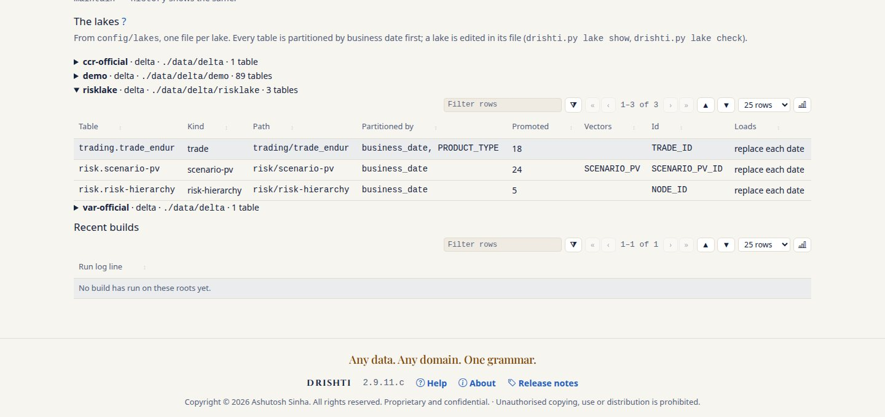

**You should see** `risklake` beside `demo`, at `./data/delta/risklake`, with three tables: `trading.trade_endur` partitioned by
`business_date, PRODUCT_TYPE` (18 promoted), `risk.scenario-pv` with the vector `SCENARIO_PV` (24 promoted) and `risk.var-limit`
(5 promoted), each *replace each date*.

## Step 2 · Route the files to it

The inbox sends a file where its `.ready` file says, else where the first matching rule says. Write the rules once, so a plain empty
`.ready` is enough every day.

**The YAML.** `config/dataload.yaml`:

```yaml
dataload:
  rules:
    - match: "trade_endur.*.jsonl.gz"
      pack: trading
      kind: trade
      connector: trade-endur          # the table that connector's entry names: trading/trade_endur
      lake: risklake
      date-from: name                 # the name must carry the business date
    - match: "scenario_pv.*.jsonl.gz"
      pack: market-risk
      kind: scenario-pv
      lake: risklake
      date-field: BUSINESS_DATE
    - match: "var_limit.*"
      pack: market-risk
      kind: var-limit
      lake: risklake
  unmatched: fail
```

The rules are read again at every cycle: no restart.

**The command line.** `python3 tools/drishti.py dataload status --json` gives the rules in effect under `rules`, each with its pack,
kind, lake and where the business date comes from (`"lake": "risklake"`, `"date": "from the name (required)"`).

**The UI.** Admin → Data loads → Inbox → **Routing rules in effect** shows the same three rules, read-only.

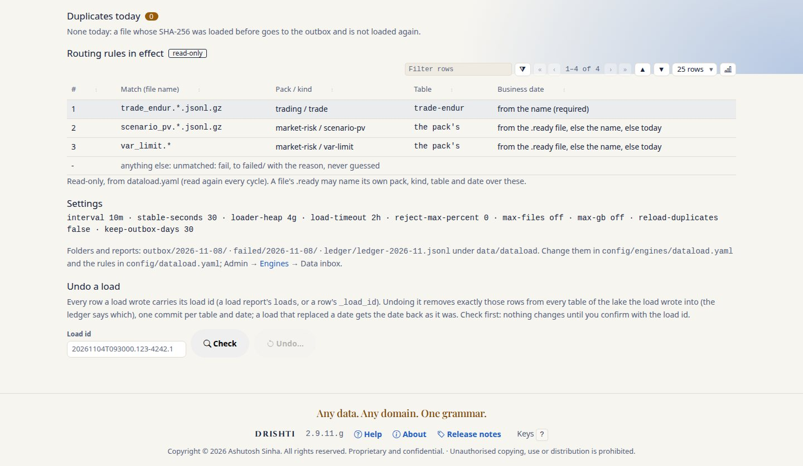

**You should see** three rules: `trade_endur.*.jsonl.gz` to *trading / trade*, table `trade-endur`, the date *from the name
(required)*; `scenario_pv.*.jsonl.gz` and `var_limit.*` to *market-risk*, the pack's table, the date *from the .ready file, else
the name, else today*; and a last line, *anything else: unmatched: fail*. The screen does not show the lake; `dataload status --json`
does.

## Step 3 · Make a day of data

**The command line.**

```bash
python3 docs/tutorials/data/risklake/make_day.py --out data/tmp/drop --date 2026-11-06
```

```text
data/tmp/drop/trade_endur.2026-11-06.jsonl.gz  rows: 2000  sha256: 521f496bb0793e6c2cbf2922c44c0aa58adfe7ca80440ed90dd0ca76283ee4e7
data/tmp/drop/scenario_pv.2026-11-06.jsonl.gz  rows: 300  sha256: e46294c4566b785f780d3f6dd8b9edaf71473b3cd4b87a0336cc448cd6b0eb90
data/tmp/drop/var_limit.2026-11-06.jsonl  rows: 26  sha256: 5e1e6523226a718f836f725d58650af2de53973add4a7733622e3fe5fb6df266
```

The script writes the same bytes every time for the same date, so your checksums are these. Use a date that is not in the future on
your machine (a business date may never be). Each file is named `<table>.<YYYY-MM-DD>.<extension>`: the load takes the business date
from the name, never from a row. Look at the first line of each:

```bash
for f in data/tmp/drop/*.jsonl*; do echo "== $f"; (zcat -f "$f" | head -1 | cut -c1-300); done
```

Each line is one record of its kind: a trade, a trade's scenario PVs (509 numbers, one per scenario day), a node's VaR limit. What every
field means is the kind's data contract, and a real record with every field explained is its example:

| File | Kind | Contract | Example |
|---|---|---|---|
| `trade_endur…` | `trade` | [trade](../contracts/packs/trading.md#trd-trade-trade) | [an Endur trade](../contracts/packs/trading.md#example-trades-endur) |
| `scenario_pv…` | `scenario-pv` | [scenario-pv](../contracts/packs/market-risk.md#spv-scenario-pvs-of-a-position-or-trade-one-pv-per-scenario-its-currency-scenario-pv) | [scenario PVs](../contracts/packs/market-risk.md#example-market-risk-scenario-pv) |
| `var_limit…` | `var-limit` | [var-limit](../contracts/packs/market-risk.md#vlim-var-limit-of-a-hierarchy-node-var-limit) | [a node's VaR limit](../contracts/packs/market-risk.md#example-market-risk-var-limit) |

**You should see** the three files in `data/tmp/drop/` with exactly the rows and checksums above: 2,000 trades, 300 scenario-PV
rows, 26 VaR limits.

## Step 4 · Drop the files with their `.ready` files

Copy each data file first, then its `.ready` file: the marker says the file is complete.

**The YAML.** A `.ready` may be empty (the rules route it). Here each one says more, to show the keys:

```yaml
# data/dataload/inbox/trade_endur.2026-11-06.jsonl.gz.ready
lake: risklake                  # over the rule's lake (the same here)
mode: replace                   # the date replaced if you load it again
sha256: 521f496bb0793e6c2cbf2922c44c0aa58adfe7ca80440ed90dd0ca76283ee4e7
rows: 2000                      # a file cut short fails before anything is written
```

```yaml
# data/dataload/inbox/scenario_pv.2026-11-06.jsonl.gz.ready
lake: risklake
pack: market-risk
kind: scenario-pv
sha256: e46294c4566b785f780d3f6dd8b9edaf71473b3cd4b87a0336cc448cd6b0eb90
rows: 300
hold: true                      # wait: the risk run is not signed off yet
```

```yaml
# data/dataload/inbox/var_limit.2026-11-06.ready     (the short form of the name)
lake: risklake
rows: 26
```

Every key, with what each does, is the guide's [section 4](../guides/DATA_LAKE_GUIDE.md#4-the-ready-file-every-key).

**The command line.**

```bash
cp data/tmp/drop/*.jsonl* data/dataload/inbox/
# then write the three .ready files above into data/dataload/inbox/
python3 tools/drishti.py dataload status
```

**The UI.** Admin → Data loads → Inbox → **Waiting**: the trades and the limits *ready* once stable for 30 seconds, each with the rule
that routes it and *2026-11-06 from the name*; the scenario PVs **held**.

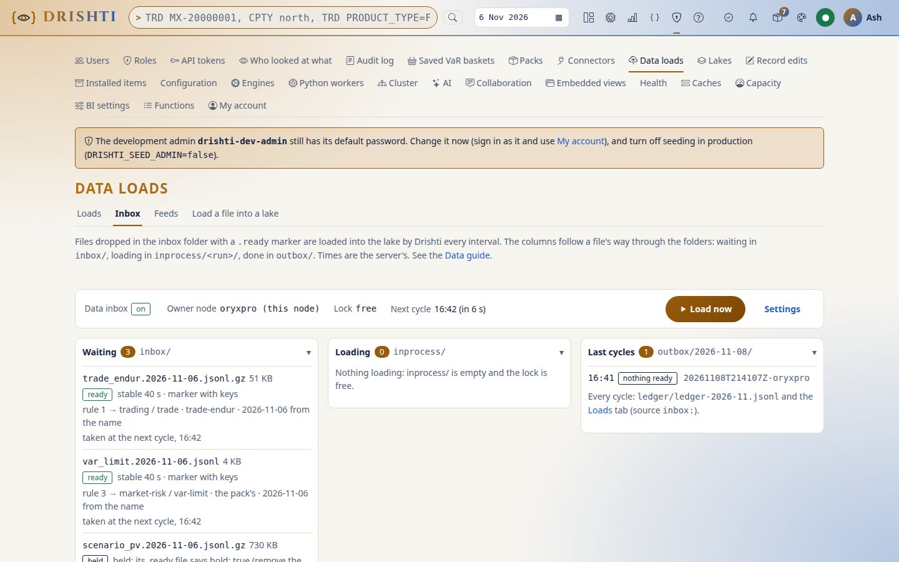

**You should see** **Waiting 3**: `var_limit.2026-11-06.jsonl` and `trade_endur.2026-11-06.jsonl.gz` *ready* (*stable 40 s · marker
with keys*, *rule 3 → market-risk / var-limit* and *rule 1 → trading / trade · trade-endur*, *2026-11-06 from the name*, *taken at
the next cycle*), and `scenario_pv.2026-11-06.jsonl.gz` *held: its .ready file says hold: true (remove the key to release it)*.
`dataload status` says the same:

```text
waiting (3):
  var_limit.2026-11-06.jsonl                      4.1 KB  ready: the next cycle takes it
                                                          business date: 2026-11-06 from the name
  trade_endur.2026-11-06.jsonl.gz                50.8 KB  ready: the next cycle takes it
                                                          business date: 2026-11-06 from the name
  scenario_pv.2026-11-06.jsonl.gz               729.9 KB  held: its .ready file says hold: true (remove the key to release it)
                                                          business date: 2026-11-06 from the name
```

## Step 5 · Load, and release the held file

**The UI.** Press **Load now** (or wait for the next cycle). **Loading** shows the run table by table (the limits, then the trades),
each with its date's version and rows while it commits; **Last cycles** then shows the cycle as loaded, with its two files, two tables,
one date and 2,026 rows. Each table was created in `data/delta/risklake/` as the lake file says.

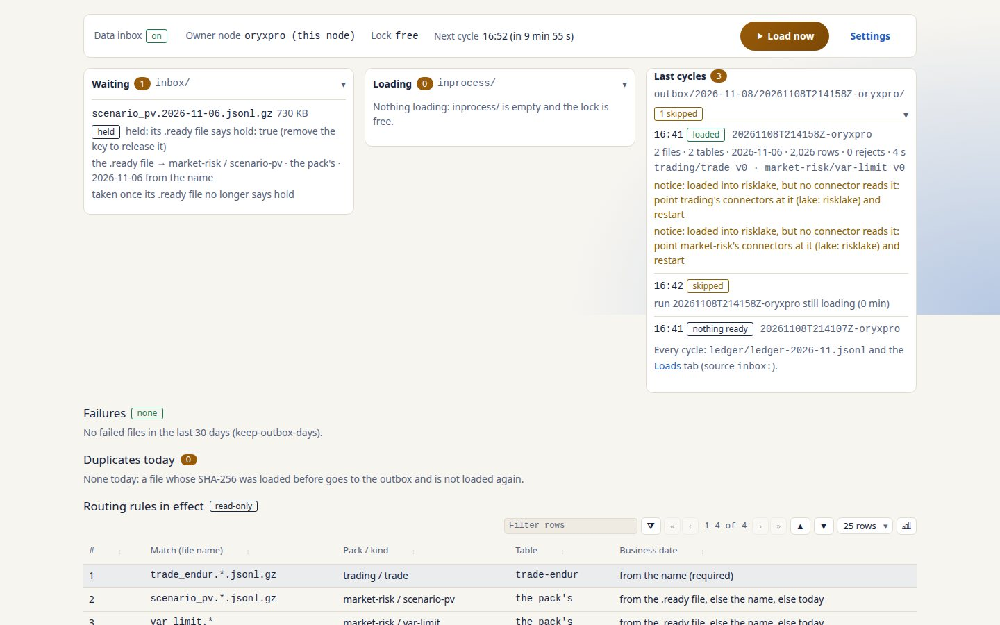

The cycle carries two notices, one per pack: *loaded into risklake, but no connector reads it: point market-risk's connectors at it
(lake: risklake) and restart*, and the same for trading. (A scheduled cycle that falls due while a run loads is shown *skipped: run …
still loading*: runs never overlap.)

Now remove the `hold: true` line from the scenario PVs' `.ready` file and press **Load now** again: it loads. The position rows carry
509 scenario PVs each, kept as a vector column.

**The command line.**

```bash
python3 tools/drishti.py dataload run
python3 tools/drishti.py dataload status
ls data/delta/risklake/trading/trade_endur/business_date=2026-11-06/
ls data/dataload/outbox/*/*/
```

The table's folder has one subfolder per `PRODUCT_TYPE` (fifteen here: `PRODUCT_TYPE=CDS` … `PRODUCT_TYPE=WARRANT`); the outbox holds
each file, its `.ready` and its `<file>.loaded.json` report (the route, each date's version and rows), and `loads/` the loader's own
log and summary.

Admin → Data loads → **Loads** lists every load by pack, as the packs were told of them:

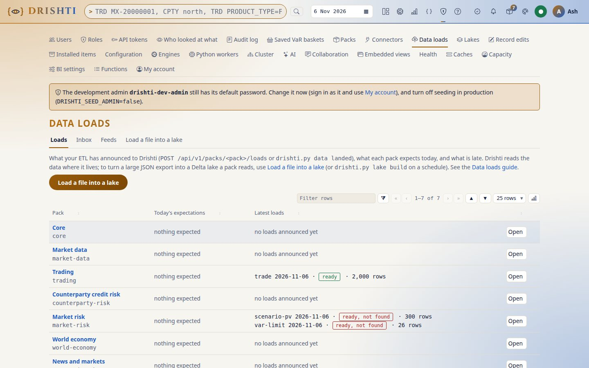

**You should see**, on Admin → Data loads → Inbox and in each report, the warning *loaded into risklake, but no connector reads it:
point trading's connectors at it (lake: risklake) and restart*; on **Loads**, *trade 2026-11-06 · ready · 2,000 rows* for Trading and,
for Market risk, *scenario-pv 2026-11-06 · ready, not found · 300 rows* and *var-limit 2026-11-06 · ready, not found · 26 rows*:
the rows are in the lake, but no connector of the pack reads it, so no page shows them yet. That is the next step.

## Step 6 · Point the connectors at risklake

A connector reads one lake. Edit the two connector files the packs wrote at the first start.

**The YAML.** `config/connectors/trade-endur.yaml`:

```yaml
plugin: delta
settings:
  lake: risklake                  # was: demo
  lake-tables: trading.trade_endur
  union: true                     # as the pack's template: read with calypso and murex as one store
  source-name: trade-endur
```

`config/connectors/risk-store.yaml`, with only the tables risklake holds (a table the lake file lacks is refused, naming it):

```yaml
plugin: delta
enabled: true
settings:
  lake: risklake
  lake-tables: risk.scenario-pv,risk.var-limit
  refresh-seconds: 30
```

**The command line.** Check, then restart the server:

```bash
python3 tools/drishti.py lake check
```

```text
lake check: 4 lakes, 0 errors
```

(each demo table not built on this machine is a *note*; an error is a connector naming a table its lake lacks, or a table on disk that
differs from its file).

**The UI.** After the restart, Admin → Connectors → `trade-endur` shows the connector's page: the kinds it serves, the packs that use
it, its settings in effect (`lake: risklake`, `lake-tables: trading.trade_endur`) and its file.

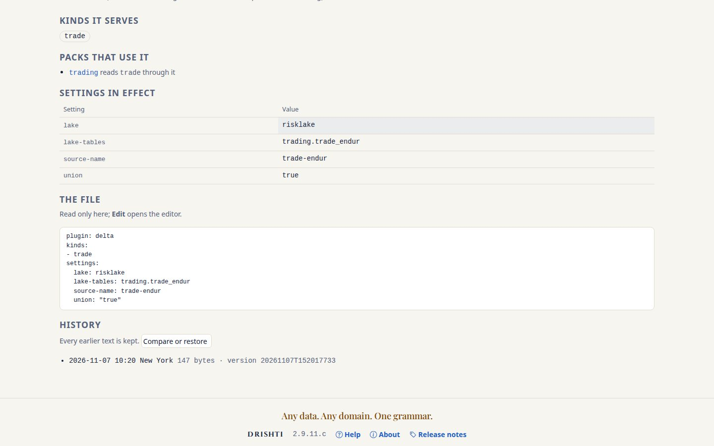

Now open a trade: `TRD 7000001 <GO>` shows the synthetic trade from risklake.

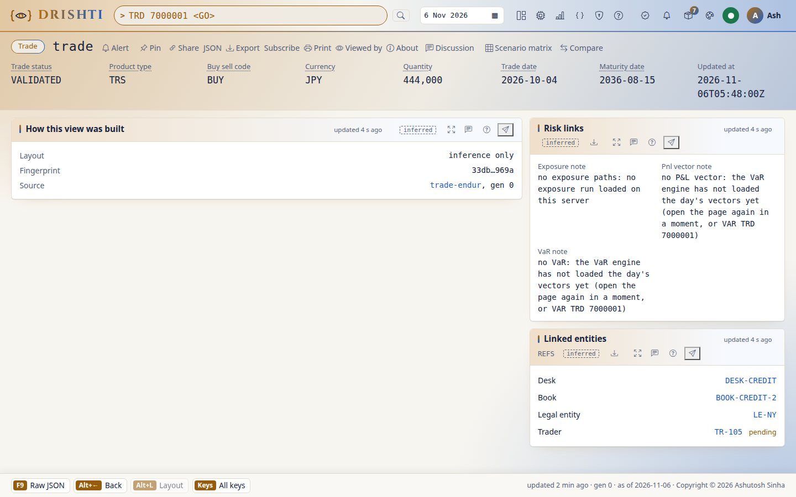

`trade-endur` now reads risklake only; a connector never reads two lakes at once. Demo and real data never mix: once a kind's connector
reads a lake other than `demo`, the packs' sample documents no longer answer for that kind, so the demo ComSwap `TRD 1000001` is not
found any more (by id or in a search). `trade-calypso` and `trade-murex` still say `lake: demo`, though, so the trading pack now reads two
lakes: Admin → Health shows the pack *DEGRADED* with *trading's connectors read different lakes: demo (trade-calypso, trade-murex);
risklake (trade-endur)*. For a server that shows only your data, point them at risklake too (if it holds their tables), or switch them
off. Keep `union: true` in `trade-endur.yaml` as the pack's template has it: a connector file replaces the template whole, and without it
the derived trade pages (CTRD, PTRD) leave its trades out.

**You should see** `lake check: 4 lakes, 0 errors`; after the restart, `trade-endur` *running* with `lake: risklake` in its settings;
and `TRD 7000001` as the trade above: *Trade status VALIDATED*, *Product type TRS*, *BUY*, *JPY*, *Quantity 444,000*, *Trade date
2026-10-04*, *Maturity date 2036-08-15*, source `trade-endur`, linked to `DESK-CREDIT`, `BOOK-CREDIT-2`, `LE-NY` and `TR-105`. Its VaR
and P&L-vector notes say the VaR engine has not loaded the day's vectors yet: this tutorial loads scenario PVs, not the VaR run.

## Step 7 · Check a load, undo it, and go back to the demo

**Check.** Admin → Data loads lists the three loads with *inbox:* and their files; `python3 tools/drishti.py dataload status --json`
gives the same as JSON; the ledger `data/dataload/ledger/ledger-<yyyy-MM>.jsonl` has a line for every step of every file. Drop
`trade_endur.2026-11-06.jsonl.gz` again with an empty `.ready`: the next cycle moves it straight to the outbox, *already loaded in run
…*. A file is never loaded twice.

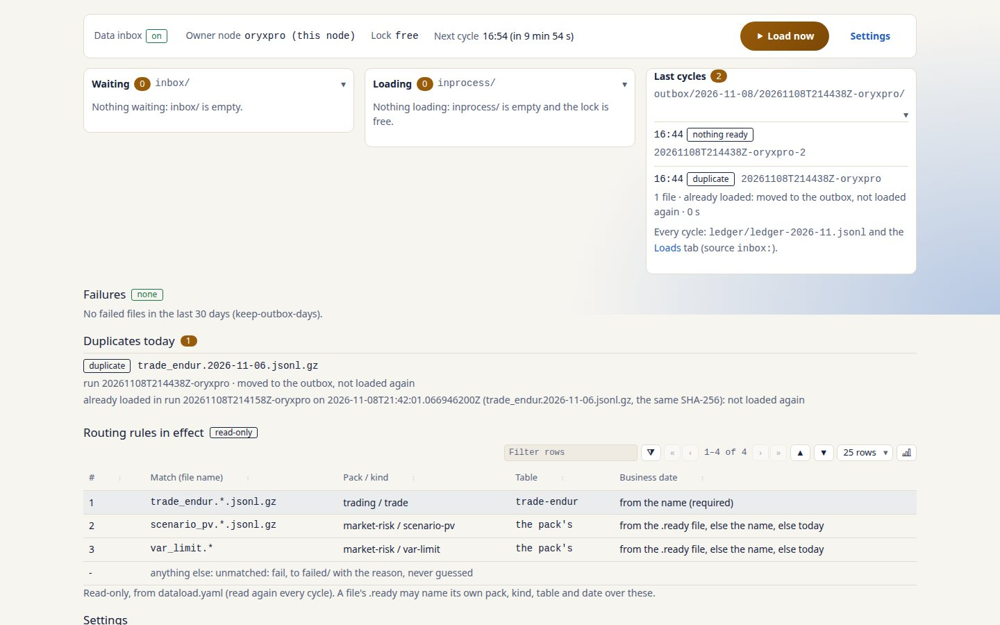

**Undo.** A load's id is in its report (`loads` in the loader's summary, `loaderRun` in `dataload status --json`, plus `.1` for its
first load) and on every row (`_load_id`).

**The command line.** Check first, on risklake's folder:

```bash
python3 tools/drishti.py lake undo 20261107T101740.754-2543825.1 --lake data/delta/risklake --dry-run
```

```text
would undo risk/var-limit 2026-11-06: 26 rows of load 20261107T101740.754-2543825.1 removed
```

Your id differs (it carries the time of your load). Run it again without `--dry-run` (it asks for the id once more; `--yes` in a
script). The limits were appended (its `.ready` names no mode, and the inbox's `default-mode` is `append`), so their rows simply go; an
undone replace restores the date as it was.

**The UI.** Admin → Data loads → Inbox → **Undo a load**: paste the id, **Check** (nothing changes), then **Undo…**, type the id again,
confirm. The server finds the load's lake in the ledger (the route's `lake`), so for this load it answers *would undo in risklake: 1
table date* and lists *risk/var-limit 2026-11-06: 26 rows removed*. A load the inbox did not make (a `lake build`) is looked for in
the inbox's own lake; use the command line for those.

**The command line, through the server.** The same check and undo, the lake found the same way:

```bash
python3 tools/drishti.py dataload undo 20261107T101740.754-2543825.1            # a dry run: what would be undone, and in which lake
python3 tools/drishti.py dataload undo 20261107T101740.754-2543825.1 --yes      # undo it
```

**You should see** **Duplicates today 1**: `trade_endur.2026-11-06.jsonl.gz`, *moved to the outbox, not loaded again*, *already loaded
in run … (the same SHA-256)*, and **Last cycles** *duplicate · 1 file · already loaded*; then the dry run's one line, *26 rows … removed*.

**Go back to the demo.** Set `lake: demo` back in both connector files (for `risk-store`, its full `lake-tables` list, or
delete the file: the pack writes its template again at the next start) and restart. Neither lake changes: risklake stays in
`data/delta/risklake/` for the next time, the demo in `data/delta/demo/`.

**The YAML** of the rules: comment out the three rules in `config/dataload.yaml`, or leave them: a file nobody drops is never loaded.

#### Clean up

```bash
rm -rf data/tmp/drop
# to remove the lake completely (with the server stopped):
rm -rf data/delta/risklake config/lakes/risklake.yaml
```


### Part B · Load it every day

In production your own job loads the store every day, and its last step tells Drishti: *this pack's data for this business date has landed*. Drishti then refreshes what it caches, checks that the data can be read, looks at the alerts that follow loads and tells the right people; if the job never calls, Drishti notices that too ([DATA_GUIDE.md](../guides/DATA_GUIDE.md#1-telling-drishti-new-data-has-landed) tells the whole story). Here you play the job on the demo lakes: the pack is `trading`, its kind `trade`, the dates 2026-10-13 to 2026-10-16 (use yours). The token needs the scope `loads:write` ([tutorial 1, step 9](01-first-15-minutes.md#step-9--make-a-token-for-the-command-line)).

## Step 8 · Say when you expect data

Open **Admin**, then **Data loads**, then the pack `trading`.

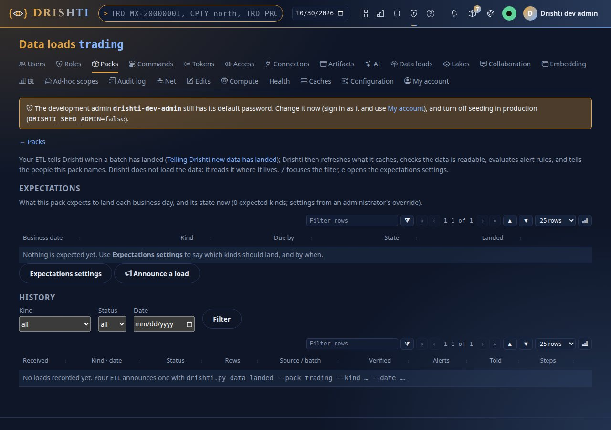

You should see two tables: **Expectations** (*Nothing is expected yet*) and **History** (*No loads recorded yet*), with the command your ETL would use. Press `e` or **Expectations settings**.

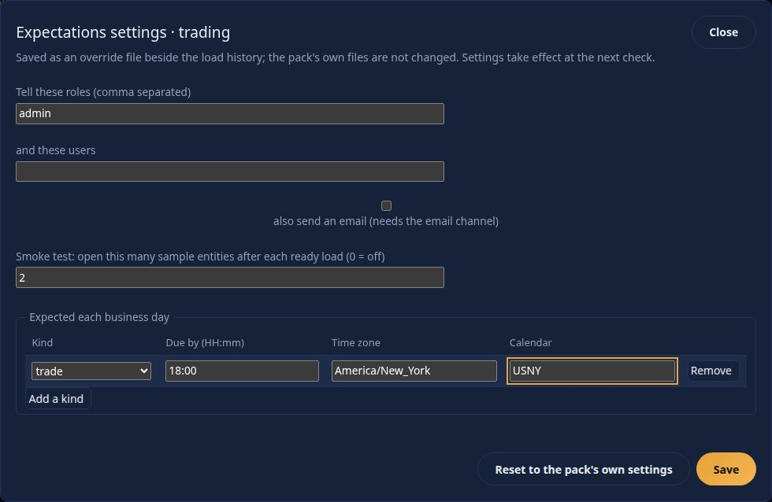

You should see a dialog: **Tell these roles** (`admin`), users, an email box, a **smoke test** count (after each ready load Drishti opens that many sample entities to prove they render), and *Expected each business day*: one row per expected kind (its kind, due by, time zone and calendar; each row can be moved or removed). Set the smoke test to `2`. **Add a kind**: `trade`, due by
`18:00`, zone `America/New_York`, calendar `USNY` (a day that is not a business day of that calendar expects nothing). **Save**. The setting is an override file beside the load history: the pack's own files are not touched.

**From the command line** there is no command for it: the page saves it with `PUT /api/v1/admin/loads/trading/config` from your signed-in session, and a personal API token
is refused (`403 DRS-5002 API tokens may not call this endpoint`), so a script cannot change who is told. `GET` the same address (or `drishti.py data loads --expectations`,
the guide, section 18.3) reads it. What the page writes:

```yaml
notify: { roles: [admin], users: [], email: false }
smoke: 2
expect:
  trade: { by: "18:00", zone: America/New_York, calendar: USNY }
```

## Step 9 · Announce a load from the command line

Your job's last step is one command:

Run these from the Drishti folder (the repository root, or the install folder of a release).

```text
$ python3 tools/drishti.py data landed --pack trading --kind trade --date 2026-10-15 --rows 15000 --rejected 0 --batch eod-20261015 --source nightly-trade-etl
trade for 2026-10-15 loaded: 15,000 rows, 0 rejected; 0 alerts fired
  load mvcxcxas-1  status ready  verified verified  attempt 1
  record  ok      recorded
  refresh ok      caches dropped: file, trade-calypso, trade-endur, trade-murex, trade-pages
  verify  ok      1000 or more trade entities on 2026-10-15
  alerts  ok      0 alerts fired
  smoke   ok      opened 2 of 2 sample entities
  notices ok      1 person told
```

You should see a summary line and six steps. `record` stored the announcement; `refresh` dropped the caches of every connector of the kind (the three trade stores and the
trade pages built from them), so screens and BI read the new data; `verify` opened the kind for that date and counted (it stops counting at `1000 or more`);
`alerts` evaluated the alerts that follow loads; `smoke` opened sample entities; `notices` told one person. The exit is 0 unless a `ready` load cannot be verified, so a scheduler sees failures.

Announce the very same batch again:

```text
$ python3 tools/drishti.py data landed --pack trading --kind trade --date 2026-10-15 --rows 15000 --rejected 0 --batch eod-20261015 --source nightly-trade-etl
trade for 2026-10-15 loaded: 15,000 rows, 0 rejected; 0 alerts fired
  load mvcxcxas-1  status ready  verified verified  attempt 1  (already announced: nothing ran again)
  record  ok      recorded
  refresh ok      caches dropped: file, trade-calypso, trade-endur, trade-murex, trade-pages
  verify  ok      1000 or more trade entities on 2026-10-15
  alerts  ok      0 alerts fired
  smoke   ok      opened 2 of 2 sample entities
  notices ok      1 person told
```

You should see `(already announced: nothing ran again)` on the load line. A load is keyed by pack, kind, business date **and batch id**: the same key with the same facts is a duplicate and does nothing, so a job may
be retried safely. A different batch id for the same date is a reload, and runs the steps again.

## Step 10 · See the history and a late day

Open **Admin**, **Data loads**, the pack `trading` again.

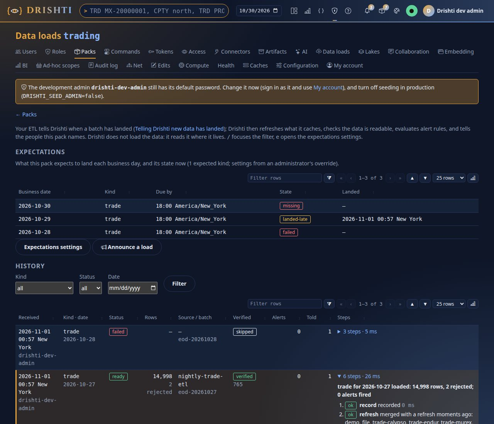

You should see a row for each announcement, a *ready* or *failed* badge, a *verified* badge, and the load's steps on a click. The command line shows the same: `python3 tools/drishti.py data loads --pack trading --limit 6 --expectations`.

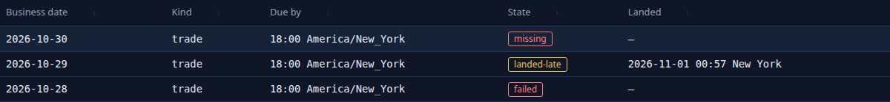

Each business day of the lookback window has a state: `on-time`, `landed-late`, `late`, `missing` or `failed`. A `late` or `missing` day is flagged **once**: a notice to the people the pack names and a line on Admin → Health.


You should see the late data listed on Health, linked to the pack's Data loads page. A `ready` load clears it.

## Step 11 · An alert for a missing day

An expectation tells the people the pack names; an **alert** can tell *you*. Open **Views**, **Reports**, **My alerts**, **New alert on a number**.

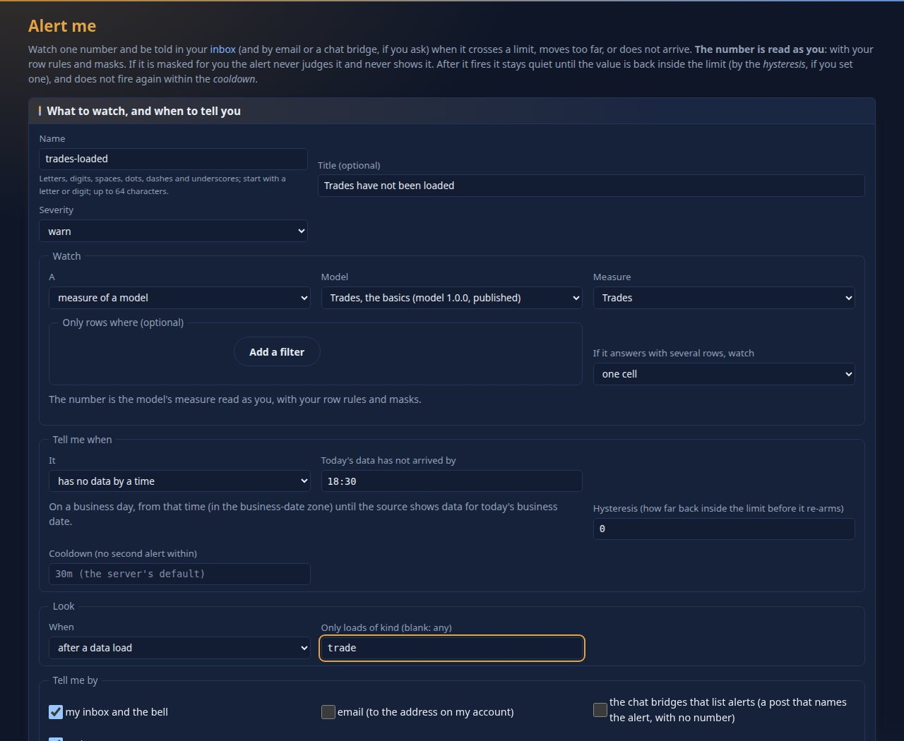

Fill in: name `trades-loaded`, severity `warn`; **Watch** *a measure of a model*, model `file:model:trades-basic`, measure `Trades`; **Tell me when** *has no data by a time*, `18:30`; **Look** *after a data load*, kind `trade`; **Tell me by** *my inbox and the bell*. Press **Check now**.

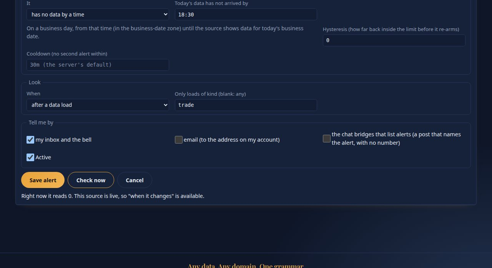

You should see what the alert read (here `15,000` trades of `2026-10-16`, so *no data* is not true). Check now saves and fires nothing. Press **Save alert**.

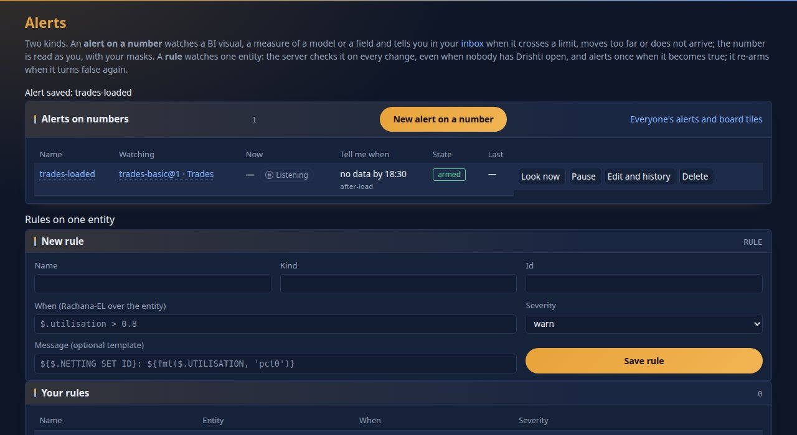

You should see the alert in **Alerts on numbers**, state `armed`. The body the form sends (there is no command for alerts) is in the [guide, section 18.4](../guides/DATA_LAKE_GUIDE.md#184-an-alert-for-a-missing-day).

## Where the rest of Part B is

A failed batch, the same call through REST, the history on the command line, the alert's body and taking a day back out are reference, not a walk-through: they are in the
[data lake guide, section 18](../guides/DATA_LAKE_GUIDE.md#18-announcing-a-load-expectations-late-data-and-alerts).


## Next steps

- [Tutorial 13 · One file per lake](13-one-file-per-lake.md) and [tutorial 14 · Load files with the data inbox](14-load-files-with-the-data-inbox.md): the next two on the same lake.
- [The data lake and data load guide](../guides/DATA_LAKE_GUIDE.md): sizing a real day (section 9), modes and repeats (section 5), a lake in S3 or Iceberg, reading an existing Databricks lakehouse (section 10).
- [The VaR tutorial, Part A](../guides/VAR_GUIDE.md#part-a--historical-var-from-the-bank-to-a-trade): VaR from the bank to a trade, now on your own scenario PVs.
- Wire your own job: [DATA_GUIDE.md](../guides/DATA_GUIDE.md#1-telling-drishti-new-data-has-landed) section 11 has copy-ready recipes; make a token with only `loads:write` for it ([Permissions](../guides/DATA_GUIDE.md#10-permissions)).
- [The reports tutorial, Part E](../guides/bi/DISTRIBUTION_AND_ALERTS.md#1-distribution-the-reports-page-export-and-subscriptions): alerts on numbers in full.
- [Data guide, section 1](../guides/DATA_GUIDE.md#1-telling-drishti-new-data-has-landed): the data-load signal each load sends, expectations and late data.

## If something goes wrong

| You see | Do |
|---|---|
| a connector refused: *lake risklake has no table risk.pnl-vector* | list only risklake's tables in `lake-tables:` |
| the page still shows demo trades | the connector file still says `lake: demo`, or the server was not restarted |

More in the guide's [troubleshooting table](../guides/DATA_LAKE_GUIDE.md#8-checking-a-load-and-troubleshooting).

| You see | Meaning |
|---|---|
| `403 ... lacks the scope loads:write` | the token was made without that scope; make another ([tutorial 1, step 9](01-first-15-minutes.md#step-9--make-a-token-for-the-command-line)) |
| `verified: failed` and exit 1 | the load was announced `ready` but Drishti cannot read the kind for that date: the data is not where the connector looks |
| an expectation `missing` for a day you did load | the load was announced for another kind, pack or business date: compare with `data loads` |
| nothing is expected on a weekend | the calendar has no business day there, by design |
