<!--
  Project Drishti · Any data. Any domain. One grammar.

  Copyright (c) 2026 Ashutosh Sinha <ajsinha@gmail.com>.
  All rights reserved.

  PROPRIETARY AND CONFIDENTIAL.

  This file is the confidential and proprietary property of Ashutosh Sinha.
  Unauthorised copying, use, modification, distribution or disclosure of this
  file, via any medium, is strictly prohibited except with the express prior
  written permission of the copyright holder.

  See the LICENSE file in the root of this repository for the full terms.
-->
# Tutorial 16 · Load your own data into a new lake

Lakes and loading, from a lake of your own to news held only in memory. Part A writes a new lake, routes and loads a day of your own
data into it and points the connectors at it. Part B reads the lake files: one file per lake, append tables, `lake check`. Part C loads files
automatically with the data inbox. Part D holds a feed in memory only. Part E moves the risk lake and the official results to Iceberg and back.
Every step shows the UI, the command line and the YAML.

## Time to complete

About 1 h 45 min in all; each part can be done on its own day.

- Part A · A new lake of your own: About 30 minutes.
- Part B · One file per lake: About 20 minutes.
- Part C · Load files automatically with the data inbox: About 20 minutes.
- Part D · News held in memory only: About 15 minutes.
- Part E · The risk lake and the official results on Iceberg: About 20 minutes.

## Before you start

- The server built (`./mvnw clean package -DskipTests`) and the demo lake in place (`drishti.py lake demo`,
  [tutorial 1, Part A](01-first-15-minutes.md#part-a--install-start-and-look-around)). The demo lake sits in its own folder, `data/delta/demo/`
  ([the guide, section 7](../guides/DATA_LAKE_GUIDE.md#7-the-demo-lakes-one-time-move)).
- Signed in as an administrator, with a personal token in `DRISHTI_TOKEN` (Admin → Engines, Admin → Data loads → Inbox and the
  `dataload` commands are for administrators).
- Run the commands from the server's working folder (the repository): the lake files are in `config/lakes/`, the inbox in
  `data/dataload/`.
- The data inbox on ([Part C](#part-c--load-files-automatically-with-the-data-inbox), step 14): Admin → Engines → **Data inbox** → On, or
  `python3 tools/drishti.py server engines on dataload --reason "tutorial 16"`.

**Part B · One file per lake.**

- Sign in as an administrator (Admin → Lakes and the `lake check` command are for administrators).
- A scratch folder for steps 11 to 13, so nothing under `data/` changes: `export SCRATCH=$(mktemp -d)` (remove it at the end).

**Part C · Load files automatically with the data inbox.**

- A personal token needs `loads:write` for `dataload run` and `retry`.

**Part D · News held in memory only.**

- The news-and-markets pack enabled (it is by default) and `NEWS Apple` opening a page.
- Sign in as an administrator (Admin → Lakes and the `lake memory` commands are for administrators).

**Part E · The risk lake and the official results on Iceberg.**

- [Tutorial 2, Part A](02-var-from-the-bank-to-a-trade.md#part-a--historical-var-from-the-bank-to-a-trade) step 1 done once: you know the VaR test data and `VAR BANK` (112,041,646 USD on
  2026-09-30).
- `build_demo_lakes.py` writes Iceberg with the loader in the server's jar, so the server is built first (above).
- The console's Python (`drishti-console/.venv/bin/python`; Windows `drishti-console\.venv\Scripts\python.exe`): it has `deltalake`.
- Stop the server while you build the lake; the examples use the default data folder, `data/` (`data/delta/demo`, `data/iceberg`).

## What you will learn

**Part A · A new lake of your own**

- what a lake file is and how to write one for your own tables, with partitions kept few and the layout set by rules of thumb;
- how a routing rule and a `.ready` file send a file to a table of that lake, and every key of the `.ready` file;
- how a load is seen from the Inbox screen, the command line and the files it leaves behind;
- how the connectors are pointed at a lake, why demo and real data never mix, and how to go back;
- how a load is checked and undone.

The reference for every step is the [data lake and data load guide](../guides/DATA_LAKE_GUIDE.md).

**Part B · One file per lake**

- what a lake file holds, and that `business_date` is always the first partition;
- how a connector names a lake (`lake:`, `lake-tables:`) and keeps only reading concerns;
- how a load takes its layout from the lake file, and why a contradicting `--partition-by` is refused;
- replace and append, and how a batch is never appended twice;
- the checks, Admin → Lakes, and migrating an older connector file.

**Part C · Load files automatically with the data inbox**

- how the inbox is switched on and configured (`config/engines/dataload.yaml`) and where its folders are;
- how a routing rule in `config/dataload.yaml` sends a file to a pack, a kind and a table, and why a file is never guessed;
- the hand-shake: a data file, its `.ready` marker, or one `ready.all` for every file;
- what one cycle does, and how the Inbox screen shows each file's way through `inbox/`, `inprocess/` and `outbox/`;
- what a failure looks like, how Retry puts a file back, and what the outbox and the ledger keep.

The reference is the [data guide, section 7](../guides/DATA_GUIDE.md#7-the-data-inbox-drop-files-and-they-load); the design is
[DATA_LAKE_GUIDE.md](../guides/DATA_LAKE_GUIDE.md#31-the-data-inbox).

**Part D · News held in memory only**

- how a connector reads a lake in memory (`root: mem://news`) and how a memory store and its tables are configured;
- how the replenish jobs fill the tables (warm-up, schedule, signal, refill) and what their runs record;
- what stays the same (pages, search, Export data) and what is refused (`DRS-5219`);
- how the store's cap, eviction and compaction show on Admin → Lakes and Health;
- how to go back to the disk lake.

**Part E · The risk lake and the official results on Iceberg**

- how `build_demo_lakes.py --store risk=iceberg` moves every table of the risk domain into Iceberg and switches `risk-store.yaml`;
- how to publish the official results to Iceberg (`drishti.var.official.format` and `.root`), and why a table keeps its format;
- that VaR, ES and the limit letters read from Iceberg equal Delta's;
- each table's **Format** in Admin → Lakes;
- how BI's `var-results` connector follows the official format, and how to put back a file `lake demo` wrote;
- how to go back to Delta.

### Part A · A new lake of your own

You have your own trades, positions with their scenario PVs, and the VaR limits of your hierarchy, and you want Drishti to read them instead of the demo.
In this part you create a lake of your own, `risklake`, in its own folder beside the demo lake; route files to it; drop one business
day of trades, scenario PVs and VaR limits with full `.ready` files; watch them load; point the connectors at the new lake; check and undo
a load; and go back to the demo. Each step shows the UI, the command line and the YAML.

The data is synthetic and Endur-style (`TRADE_ID`, `PRODUCT_TYPE`, `DESK`, `BOOK`, `COUNTERPARTY_ID`), written by a small script that
ships with the tutorials; your own files take its place once you have seen the way through.

## Step 1 · Describe the new lake

A lake is one file. Create `config/lakes/risklake.yaml`:

**The YAML.**

```yaml
lake: risklake                    # the file's name; its folder is data/delta/risklake (no root: needed)
format: delta
defaults:
  load-mode: replace              # a load replaces each business date it holds
  compression: zstd
tables:
  trading.trade_endur:
    kind: trade
    partition-by: [PRODUCT_TYPE]  # after business_date; for a million trades a day, use none (guide, section 9)
    promote: [TRADE_ID, TRADE_VERSION, SOURCE_SYSTEM, TRADE_STATUS, PRODUCT_TYPE, PRODUCT_GROUP, DESK, BOOK, PORTFOLIO, COUNTERPARTY_ID,
      LEGAL_ENTITY, TRADER_ID, BUY_SELL_CODE, CURRENCY, QUANTITY, NOTIONAL, TRADE_DATE, MATURITY_DATE]
    id: TRADE_ID
    latest-by: UPDATED_AT
    sort-by: [DESK, BOOK, id]
    file-rows: 250000
    row-group-rows: 1000
  risk.scenario-pv:
    promote: [VALUE_TYPE, GRAIN, TRADE_ID, POSITION_ID, CURRENCY, SOURCE_SYSTEM, SECURITY_ID, LEGAL_ENTITY, DIVISION, DESK, TT_BOOK,
      LIMIT_LETTER, PORTFOLIO, PRODUCT_GROUP, PRODUCT_TYPE, DIRECTION, QUANTITY, BASE_PV, VALUATION_DATE, SCENARIO_SET_ID, BATCH_ID, RUN_KIND,
      COMPUTED_AT, STATUS]
    vectors: [SCENARIO_PV]
    id: SCENARIO_PV_ID
    date: BUSINESS_DATE
    latest-by: COMPUTED_AT
    sort-by: [DESK, TT_BOOK, id]
    file-size-mb: 256
    row-group-mb: 64
  risk.var-limit:
    promote: [LIMIT_ID, HIERARCHY, NODE_ID, LIMIT_VAR, CURRENCY]
    id: LIMIT_ID
    date: BUSINESS_DATE
```

Why each key is there, and the arithmetic behind keeping `partition-by` short, is the guide's
[section 2](../guides/DATA_LAKE_GUIDE.md#2-the-lake-file-every-key). A partition column needs a plain name (letters, digits, `_`, `-`);
its values may hold anything (`Fixed income`, `100%`, `x/y`): the folders are named as Spark names them, so Databricks and delta-rs
read the lake as it is ([section 14](../guides/DATA_LAKE_GUIDE.md#14-delta-protocol-compliance)).

**The command line.**

```bash
python3 tools/drishti.py lake show
```

```text
  risklake: delta at data/delta/risklake, 3 tables
    trading.trade_endur                      trading/trade_endur                      partitioned by business_date, PRODUCT_TYPE; 18 promoted
    risk.scenario-pv                         risk/scenario-pv                         partitioned by business_date; 24 promoted, vectors SCENARIO_PV
    risk.var-limit                           risk/var-limit                           partitioned by business_date; 5 promoted
```

(The other lakes, `demo`, `var-official` and `ccr-official`, are listed too.) A mistake in the file is refused with the key named:
a fifth partition column, `business_date` in `partition-by`, a misspelt key (*unknown key tables.trading.trade_endur.promte*).

**The UI.** Admin → Lakes lists `risklake` with its format, root and three tables, read-only from the file. No table exists yet: the
first load creates each one exactly as the file says.

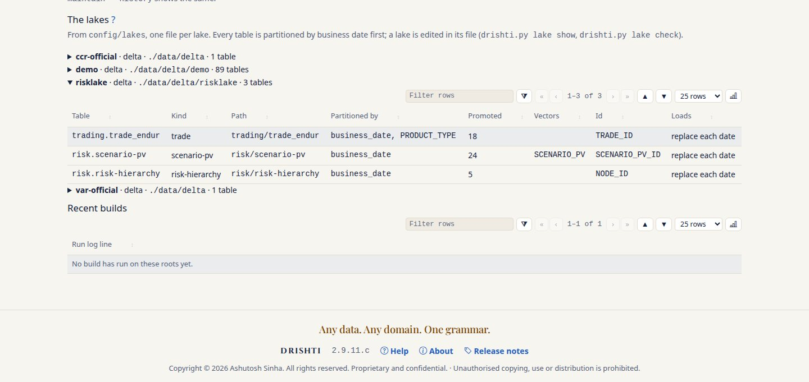

**You should see** `risklake` beside `demo`, at `./data/delta/risklake`, with three tables: `trading.trade_endur` partitioned by
`business_date, PRODUCT_TYPE` (18 promoted), `risk.scenario-pv` with the vector `SCENARIO_PV` (24 promoted) and `risk.var-limit`
(5 promoted), each *replace each date*.

## Step 2 · Route the files to it

The inbox sends a file where its `.ready` file says, else where the first matching rule says. Write the rules once, so a plain empty
`.ready` is enough every day.

**The YAML.** `config/dataload.yaml`:

```yaml
dataload:
  rules:
    - match: "trade_endur.*.jsonl.gz"
      pack: trading
      kind: trade
      connector: trade-endur          # the table that connector's entry names: trading/trade_endur
      lake: risklake
      date-from: name                 # the name must carry the business date
    - match: "scenario_pv.*.jsonl.gz"
      pack: market-risk
      kind: scenario-pv
      lake: risklake
      date-field: BUSINESS_DATE
    - match: "var_limit.*"
      pack: market-risk
      kind: var-limit
      lake: risklake
  unmatched: fail
```

The rules are read again at every cycle: no restart.

**The command line.** `python3 tools/drishti.py dataload status --json` gives the rules in effect under `rules`, each with its pack,
kind, lake and where the business date comes from (`"lake": "risklake"`, `"date": "from the name (required)"`).

**The UI.** Admin → Data loads → Inbox → **Routing rules in effect** shows the same three rules, read-only.

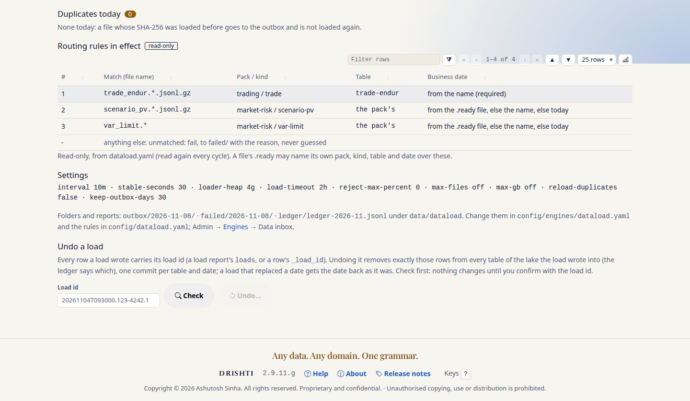

**You should see** three rules: `trade_endur.*.jsonl.gz` to *trading / trade*, table `trade-endur`, the date *from the name
(required)*; `scenario_pv.*.jsonl.gz` and `var_limit.*` to *market-risk*, the pack's table, the date *from the .ready file, else
the name, else today*; and a last line, *anything else: unmatched: fail*. The screen does not show the lake; `dataload status --json`
does.

## Step 3 · Make a day of data

**The command line.**

```bash
python3 docs/tutorials/data/risklake/make_day.py --out data/tmp/drop --date 2026-11-06
```

```text
data/tmp/drop/trade_endur.2026-11-06.jsonl.gz  rows: 2000  sha256: 521f496bb0793e6c2cbf2922c44c0aa58adfe7ca80440ed90dd0ca76283ee4e7
data/tmp/drop/scenario_pv.2026-11-06.jsonl.gz  rows: 300  sha256: e46294c4566b785f780d3f6dd8b9edaf71473b3cd4b87a0336cc448cd6b0eb90
data/tmp/drop/var_limit.2026-11-06.jsonl  rows: 26  sha256: 5e1e6523226a718f836f725d58650af2de53973add4a7733622e3fe5fb6df266
```

The script writes the same bytes every time for the same date, so your checksums are these. Use a date that is not in the future on
your machine (a business date may never be). Each file is named `<table>.<YYYY-MM-DD>.<extension>`: the load takes the business date
from the name, never from a row. Look at the first line of each:

```bash
for f in data/tmp/drop/*.jsonl*; do echo "== $f"; (zcat -f "$f" | head -1 | cut -c1-300); done
```

Each line is one record of its kind: a trade, a trade's scenario PVs (509 numbers, one per scenario day), a node's VaR limit. What every
field means is the kind's data contract, and a real record with every field explained is its example:

| File | Kind | Contract | Example |
|---|---|---|---|
| `trade_endur…` | `trade` | [trade](../contracts/packs/trading.md#trd-trade-trade) | [an Endur trade](../contracts/samples/trades.md#endur) |
| `scenario_pv…` | `scenario-pv` | [scenario-pv](../contracts/packs/market-risk.md#spv-scenario-pvs-of-a-trade-509-scenarios-its-currency-scenario-pv) | [scenario PVs](../contracts/samples/market-risk.md#scenario-pv) |
| `var_limit…` | `var-limit` | [var-limit](../contracts/packs/market-risk.md#vlim-var-limit-of-a-hierarchy-node-var-limit) | [a node's VaR limit](../contracts/samples/market-risk.md#var-limit) |

**You should see** the three files in `data/tmp/drop/` with exactly the rows and checksums above: 2,000 trades, 300 scenario-PV
rows, 26 VaR limits.

## Step 4 · Drop the files with their `.ready` files

Copy each data file first, then its `.ready` file: the marker says the file is complete.

**The YAML.** A `.ready` may be empty (the rules route it). Here each one says more, to show the keys:

```yaml
# data/dataload/inbox/trade_endur.2026-11-06.jsonl.gz.ready
lake: risklake                  # over the rule's lake (the same here)
mode: replace                   # the date replaced if you load it again
sha256: 521f496bb0793e6c2cbf2922c44c0aa58adfe7ca80440ed90dd0ca76283ee4e7
rows: 2000                      # a file cut short fails before anything is written
```

```yaml
# data/dataload/inbox/scenario_pv.2026-11-06.jsonl.gz.ready
lake: risklake
pack: market-risk
kind: scenario-pv
sha256: e46294c4566b785f780d3f6dd8b9edaf71473b3cd4b87a0336cc448cd6b0eb90
rows: 300
hold: true                      # wait: the risk run is not signed off yet
```

```yaml
# data/dataload/inbox/var_limit.2026-11-06.ready     (the short form of the name)
lake: risklake
rows: 26
```

Every key, with what each does, is the guide's [section 4](../guides/DATA_LAKE_GUIDE.md#4-the-ready-file-every-key).

**The command line.**

```bash
cp data/tmp/drop/*.jsonl* data/dataload/inbox/
# then write the three .ready files above into data/dataload/inbox/
python3 tools/drishti.py dataload status
```

**The UI.** Admin → Data loads → Inbox → **Waiting**: the trades and the limits *ready* once stable for 30 seconds, each with the rule
that routes it and *2026-11-06 from the name*; the scenario PVs **held**.

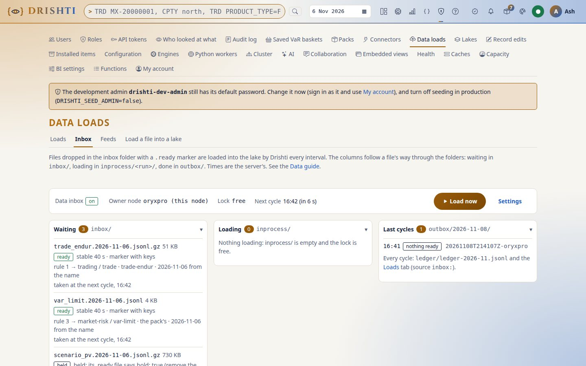

**You should see** **Waiting 3**: `var_limit.2026-11-06.jsonl` and `trade_endur.2026-11-06.jsonl.gz` *ready* (*stable 40 s · marker
with keys*, *rule 3 → market-risk / var-limit* and *rule 1 → trading / trade · trade-endur*, *2026-11-06 from the name*, *taken at
the next cycle*), and `scenario_pv.2026-11-06.jsonl.gz` *held: its .ready file says hold: true (remove the key to release it)*.
`dataload status` says the same:

```text
waiting (3):
  var_limit.2026-11-06.jsonl                      4.1 KB  ready: the next cycle takes it
                                                          business date: 2026-11-06 from the name
  trade_endur.2026-11-06.jsonl.gz                50.8 KB  ready: the next cycle takes it
                                                          business date: 2026-11-06 from the name
  scenario_pv.2026-11-06.jsonl.gz               729.9 KB  held: its .ready file says hold: true (remove the key to release it)
                                                          business date: 2026-11-06 from the name
```

## Step 5 · Load, and release the held file

**The UI.** Press **Load now** (or wait for the next cycle). **Loading** shows the run table by table (the limits, then the trades),
each with its date's version and rows while it commits; **Last cycles** then shows the cycle as loaded, with its two files, two tables,
one date and 2,026 rows. Each table was created in `data/delta/risklake/` as the lake file says.

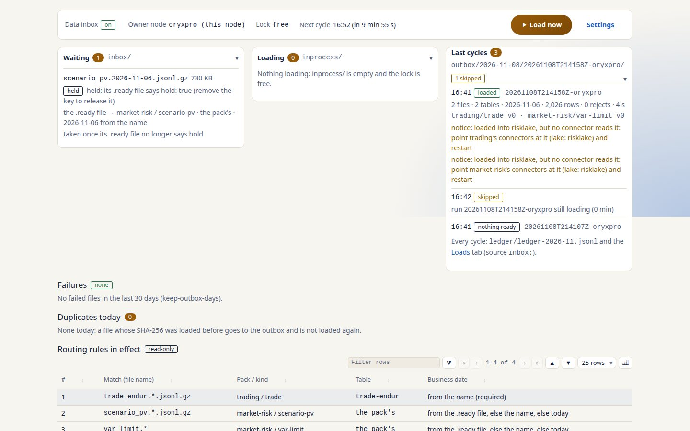

The cycle carries two notices, one per pack: *loaded into risklake, but no connector reads it: point market-risk's connectors at it
(lake: risklake) and restart*, and the same for trading. (A scheduled cycle that falls due while a run loads is shown *skipped: run …
still loading*: runs never overlap.)

Now remove the `hold: true` line from the scenario PVs' `.ready` file and press **Load now** again: it loads. The position rows carry
509 scenario PVs each, kept as a vector column.

**The command line.**

```bash
python3 tools/drishti.py dataload run
python3 tools/drishti.py dataload status
ls data/delta/risklake/trading/trade_endur/business_date=2026-11-06/
ls data/dataload/outbox/*/*/
```

The table's folder has one subfolder per `PRODUCT_TYPE` (fifteen here: `PRODUCT_TYPE=CDS` … `PRODUCT_TYPE=WARRANT`); the outbox holds
each file, its `.ready` and its `<file>.loaded.json` report (the route, each date's version and rows), and `loads/` the loader's own
log and summary.

Admin → Data loads → **Loads** lists every load by pack, as the packs were told of them:

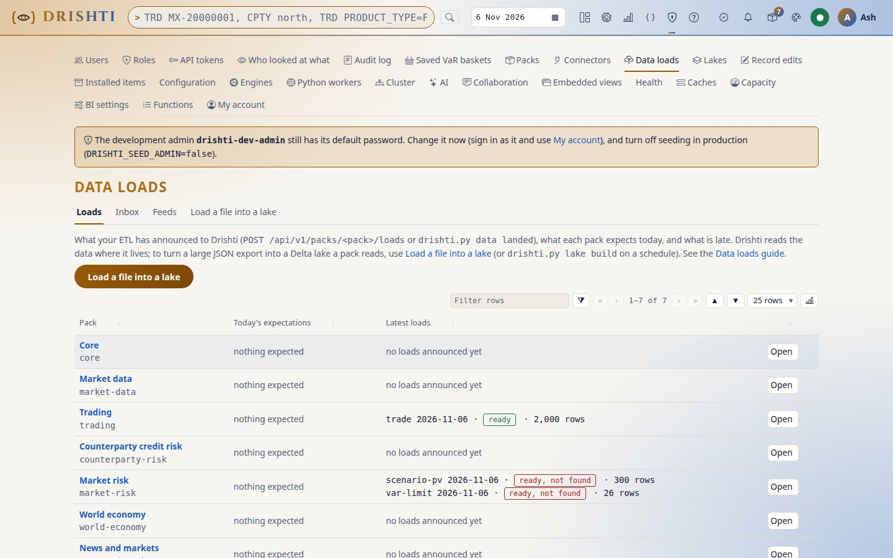

**You should see**, on Admin → Data loads → Inbox and in each report, the warning *loaded into risklake, but no connector reads it:
point trading's connectors at it (lake: risklake) and restart*; on **Loads**, *trade 2026-11-06 · ready · 2,000 rows* for Trading and,
for Market risk, *scenario-pv 2026-11-06 · ready, not found · 300 rows* and *var-limit 2026-11-06 · ready, not found · 26 rows*:
the rows are in the lake, but no connector of the pack reads it, so no page shows them yet. That is the next step.

## Step 6 · Point the connectors at risklake

A connector reads one lake. Edit the two connector files the packs wrote at the first start.

**The YAML.** `config/connectors/trade-endur.yaml`:

```yaml
plugin: delta
settings:
  lake: risklake                  # was: demo
  lake-tables: trading.trade_endur
  union: true                     # as the pack's template: read with calypso and murex as one store
  source-name: trade-endur
```

`config/connectors/risk-store.yaml`, with only the kinds risklake holds (a table the lake file lacks is refused, naming it):

```yaml
plugin: delta
enabled: true
settings:
  lake: risklake
  lake-tables: risk.scenario-pv,risk.var-limit
  refresh-seconds: 30
```

**The command line.** Check, then restart the server:

```bash
python3 tools/drishti.py lake check
```

```text
lake check: 4 lakes, 0 errors
```

(each demo table not built on this machine is a *note*; an error is a connector naming a table its lake lacks, or a table on disk that
differs from its file).

**The UI.** After the restart, Admin → Connectors → `trade-endur` shows the connector's page: the kinds it serves, the packs that use
it, its settings in effect (`lake: risklake`, `lake-tables: trading.trade_endur`) and its file.

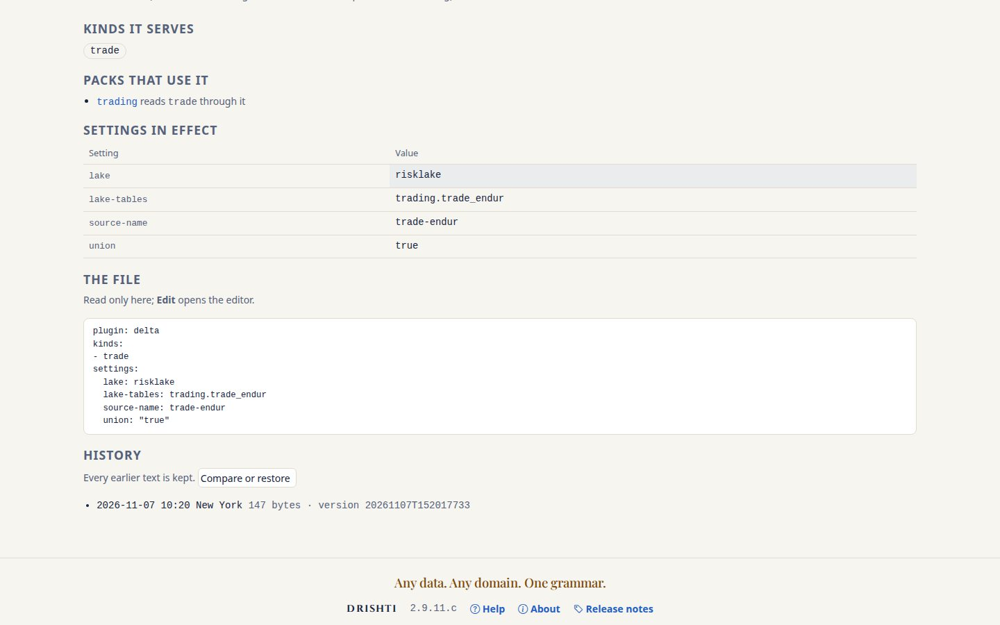

Now open a trade: `TRD 7000001 <GO>` shows the synthetic trade from risklake.

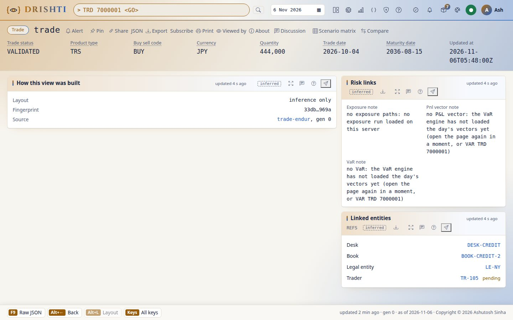

`trade-endur` now reads risklake only; a connector never reads two lakes at once. Demo and real data never mix: once a kind's connector
reads a lake other than `demo`, the packs' sample documents no longer answer for that kind, so the demo ComSwap `TRD 1000001` is not
found any more (by id or in a search). `trade-calypso` and `trade-murex` still say `lake: demo`, though, so the trading pack now reads two
lakes: Admin → Health shows the pack *DEGRADED* with *trading's connectors read different lakes: demo (trade-calypso, trade-murex);
risklake (trade-endur)*. For a server that shows only your data, point them at risklake too (if it holds their tables), or switch them
off. Keep `union: true` in `trade-endur.yaml` as the pack's template has it: a connector file replaces the template whole, and without it
the derived trade pages (CTRD, PTRD) leave its trades out.

**You should see** `lake check: 4 lakes, 0 errors`; after the restart, `trade-endur` *running* with `lake: risklake` in its settings;
and `TRD 7000001` as the trade above: *Trade status VALIDATED*, *Product type TRS*, *BUY*, *JPY*, *Quantity 444,000*, *Trade date
2026-10-04*, *Maturity date 2036-08-15*, source `trade-endur`, linked to `DESK-CREDIT`, `BOOK-CREDIT-2`, `LE-NY` and `TR-105`. Its VaR
and P&L-vector notes say the VaR engine has not loaded the day's vectors yet: this tutorial loads scenario PVs, not the VaR run.

## Step 7 · Check a load, undo it, and go back to the demo

**Check.** Admin → Data loads lists the three loads with *inbox:* and their files; `python3 tools/drishti.py dataload status --json`
gives the same as JSON; the ledger `data/dataload/ledger/ledger-<yyyy-MM>.jsonl` has a line for every step of every file. Drop
`trade_endur.2026-11-06.jsonl.gz` again with an empty `.ready`: the next cycle moves it straight to the outbox, *already loaded in run
…*. A file is never loaded twice.

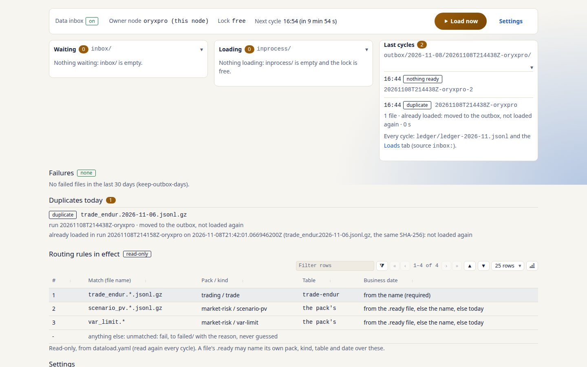

**Undo.** A load's id is in its report (`loads` in the loader's summary, `loaderRun` in `dataload status --json`, plus `.1` for its
first load) and on every row (`_load_id`).

**The command line.** Check first, on risklake's folder:

```bash
python3 tools/drishti.py lake undo 20261107T101740.754-2543825.1 --lake data/delta/risklake --dry-run
```

```text
would undo risk/var-limit 2026-11-06: 26 rows of load 20261107T101740.754-2543825.1 removed
```

Your id differs (it carries the time of your load). Run it again without `--dry-run` (it asks for the id once more; `--yes` in a
script). The limits were appended (its `.ready` names no mode, and the inbox's `default-mode` is `append`), so their rows simply go; an
undone replace restores the date as it was.

**The UI.** Admin → Data loads → Inbox → **Undo a load**: paste the id, **Check** (nothing changes), then **Undo…**, type the id again,
confirm. The server finds the load's lake in the ledger (the route's `lake`), so for this load it answers *would undo in risklake: 1
table date* and lists *risk/var-limit 2026-11-06: 26 rows removed*. A load the inbox did not make (a `lake build`) is looked for in
the inbox's own lake; use the command line for those.

**The command line, through the server.** The same check and undo, the lake found the same way:

```bash
python3 tools/drishti.py dataload undo 20261107T101740.754-2543825.1            # a dry run: what would be undone, and in which lake
python3 tools/drishti.py dataload undo 20261107T101740.754-2543825.1 --yes      # undo it
```

**You should see** **Duplicates today 1**: `trade_endur.2026-11-06.jsonl.gz`, *moved to the outbox, not loaded again*, *already loaded
in run … (the same SHA-256)*, and **Last cycles** *duplicate · 1 file · already loaded*; then the dry run's one line, *26 rows … removed*.

**Go back to the demo.** Set `lake: demo` back in both connector files (for `risk-store`, its full list of kinds and `lake-tables`, or
delete the file: the pack writes its template again at the next start) and restart. Neither lake changes: risklake stays in
`data/delta/risklake/` for the next time, the demo in `data/delta/demo/`.

**The YAML** of the rules: comment out the three rules in `config/dataload.yaml`, or leave them: a file nobody drops is never loaded.

#### Clean up

```bash
rm -rf data/tmp/drop
# to remove the lake completely (with the server stopped):
rm -rf data/delta/risklake config/lakes/risklake.yaml
```

### Part B · One file per lake

A lake is described once, in its own file, and everyone refers to it: the connectors that read it, the loader and the data inbox that
write it, `lake build` and the demo lakes. In this part you read the demo lake's file, see a connector name it, load a day through
it, watch a load that contradicts it being refused, add an append table and load the same batch twice, check the lake files against the
tables on disk, and migrate an older connector file. Each step shows the UI, the command line and the YAML behind it. The guide is
[DATA_LAKE_GUIDE.md](../guides/DATA_LAKE_GUIDE.md).

## Step 8 · Read the demo lake's file

**The YAML.** `config/lakes/demo.yaml` describes the demo lake: its root and every table in it.

```yaml
lake: demo
format: delta
root: ${DRISHTI_DELTA_ROOT:${drishti.data.dir:./data}/delta/demo}
defaults: {load-mode: replace}
tables:
  trading.trade_endur:
    kind: trade
    partition-by: [PRODUCT_TYPE]          # after business_date, which is always first
    promote: [TRADE_ID, SOURCE_SYSTEM, PRODUCT_TYPE, ...]
    id: TRADE_ID
    sort-by: [id]
    file-rows: 250000
    row-group-rows: 1000
  risk.pnl-vector:
    promote: [VALUE_TYPE, GRAIN, TRADE_ID, ...]
    vectors: [PNL]
  ...
```

**The command line.**

```bash
python3 tools/drishti.py lake show
```

```text
lakes in .../config/lakes: 3
  ccr-official: delta at .../data/delta, 1 tables
    risk-results.exposure-official-cpty      risk-results/exposure-official-cpty      partitioned by business_date; 26 promoted
  demo: delta at .../data/delta/demo, 86 tables
    compute-demo.path-book                   compute-demo/path-book                   partitioned by business_date; 4 promoted
    ...
    risk.pnl-vector                          risk/pnl-vector                          partitioned by business_date; 32 promoted, vectors PNL
    risk.scenario-pv                         risk/scenario-pv                         partitioned by business_date; 32 promoted, vectors SCENARIO_PV
    ...
    trading.trade_endur                      trading/trade_endur                      partitioned by business_date, PRODUCT_TYPE; 18 promoted
    trading.trade_calypso                    trading/trade_calypso                    partitioned by business_date, PRODUCT_TYPE; 18 promoted
    trading.trade_murex                      trading/trade_murex                      partitioned by business_date, PRODUCT_TYPE; 18 promoted
    ...
  var-official: delta at .../data/delta, 1 tables
    risk-results.var-official                risk-results/var-official                partitioned by business_date; 17 promoted
```

**The UI.** Admin → Lakes → **The lakes**: one line per lake file; open **demo** for its tables (kind, path, partitioned by, promoted,
vectors, id, loads).

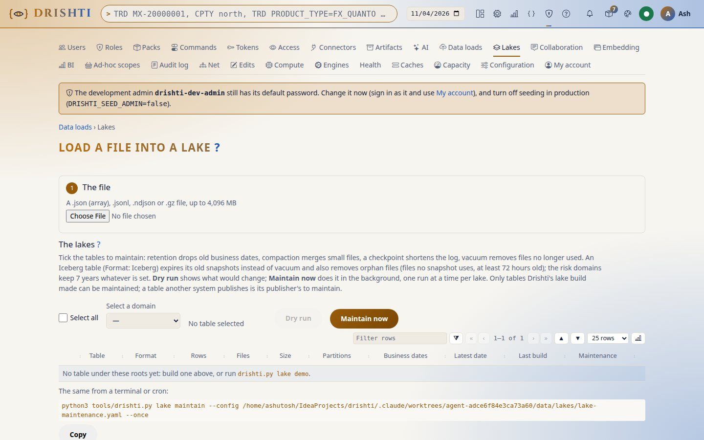

**You should see** three lake files (the demo lake and the two official-results lakes, `ccr-official` and `var-official`, on the same root),
every table partitioned by `business_date` first; the three trade tables also by `PRODUCT_TYPE`.

## Step 9 · A connector names the lake

**The YAML.** The trading pack's connector `trade-endur` names the lake and its entry; nothing of the table is written here.

```yaml
# config/packs/banking/trading/pack.yaml (the template written to config/connectors/trade-endur.yaml)
trade-endur:
  plugin: delta
  kinds: [trade]
  settings:
    lake: demo
    lake-tables: trading.trade_endur      # the kind trade has three tables: the entry is named
    union: true
    source-name: trade-endur
```

The pack recommends the entry in its own `lake:` block; it is copied into a lake file the first time a writer meets the kind.

**The UI.** Admin → Connectors → `trade-endur`: the file as above, health green.

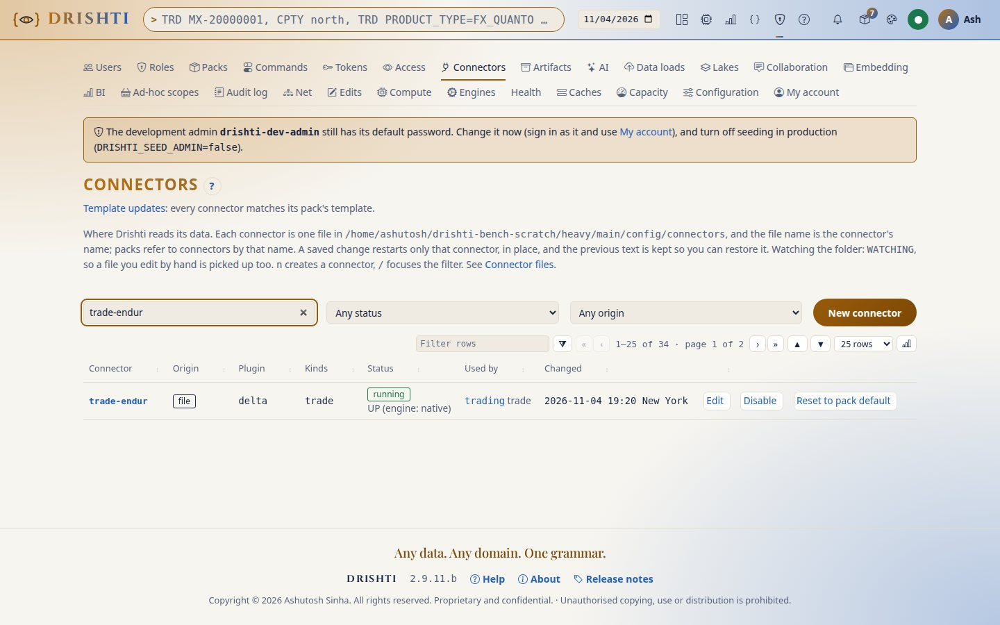

**You should see** `TRADE ENDUR` trades open as before: the connector's root, table folder and promoted columns now come from the lake file.

## Step 10 · Check the lake files against the tables

**The command line.**

```bash
python3 tools/drishti.py lake check
```

```text
  note  demo/risk.position-sensitivity: no table yet at .../data/delta/demo/risk/position-sensitivity (a writer creates it as the lake file says)
  note  demo/risk.risk-factor: no table yet at .../data/delta/demo/risk/risk-factor (a writer creates it as the lake file says)
lake check: 3 lakes, 0 errors
```

**The UI.** Admin → Lakes → The lakes lists the lake files the check compares; the screen does not run the check itself. The same
comparison as JSON is `GET /api/v1/admin/lakes/files?check=true`.


**You should see** no error: the tables `lake demo` built are partitioned as the file says. A *note* names a table the lake file
describes that no writer has made yet; it is not an error.

## Step 11 · Load a day through the lake file, and see a contradiction refused

**The command line.** Into the scratch folder, with the demo lake's layout:

```bash
python3 tools/drishti.py lake build --from data/testdata/trades/endur/trade_endur.2026-07-08.jsonl.gz --as-of 2026-07-08 \
    --pack config/packs/banking/trading --connector trade-endur --lake demo --lake-root $SCRATCH/lake
```

```text
engine: drishti (Drishti's Java writer in drishti-server-2.9.11.b-exec.jar)
business date  PRODUCT_TYPE           rows
2026-07-08     CallNot                  50
2026-07-08     Cash                    723
2026-07-08     ComFut                  883
2026-07-08     ComSwap                1994
2026-07-08     Commodity               757
documents read: 4407, rows written: 4407, rejected: 0
  business date 2026-07-08 from the command line: trade_endur.2026-07-08.jsonl.gz
summary: $SCRATCH/lake/_drishti-lake/runs/20261104T191809.840-257432.json
2026-11-04T19:18:13-05:00 lake-build ok exit=0 run=20261104T191809.840-257432 domain=trading kind=trade engine=drishti mode=overwrite-dates rows=4407 rejected=0 dates=1 partitions=5 seconds=4.114
```

Now ask for another partition:

```bash
python3 tools/drishti.py lake build --from data/testdata/trades/endur/trade_endur.2026-07-08.jsonl.gz --as-of 2026-07-08 \
    --pack config/packs/banking/trading --connector trade-endur --lake demo --lake-root $SCRATCH/lake --partition-by DESK
```

```text
lake build: --partition-by ['DESK'] differs from ['PRODUCT_TYPE'], the --partition-by of table trading.trade_endur in lake demo (config/lakes/demo.yaml): the lake file decides; drop --partition-by or correct the lake file
...
2026-11-04T19:18:24-05:00 lake-build failed exit=1 run=20261104T191823.542-258032 seconds=0.617 error="--partition-by ['DESK'] differs from ['PRODUCT_TYPE'], ..."
(exit code 1)
```

**The UI.** Admin → Lakes → The lakes: `trading.trade_endur` partitioned by `business_date`, `PRODUCT_TYPE`, the layout the load followed (the scratch copy under `$SCRATCH` is not one of the server's lakes, so it is not listed).

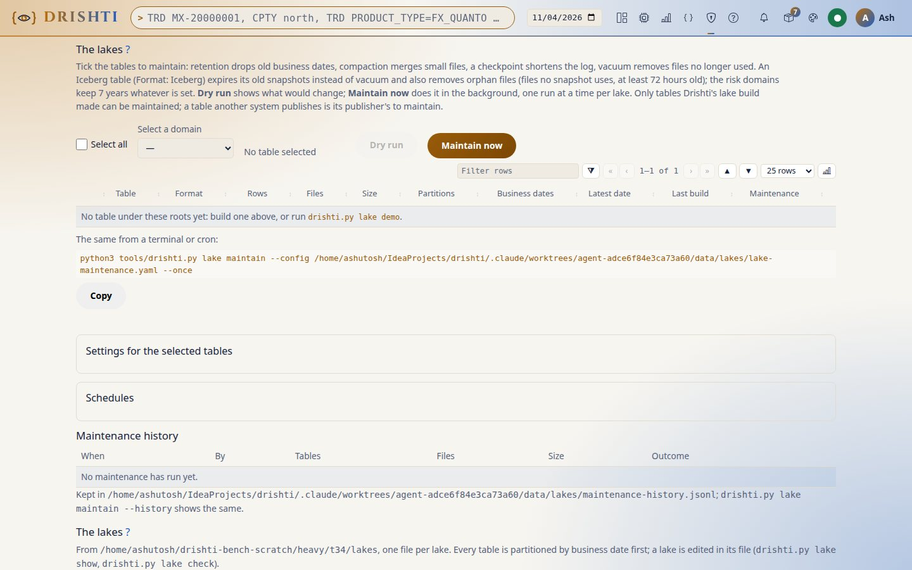

**You should see** the first load written partitioned by `business_date` and `PRODUCT_TYPE` (five partitions of 2026-07-08, one per
product type), and the second refused with both values named and nothing written.

## Step 12 · An append table: each batch once

**The YAML.** A lake of your own in a scratch lake folder (`DRISHTI_LAKES_DIR`), with one append table:

```bash
mkdir -p $SCRATCH/lakes && cp config/lakes/demo.yaml $SCRATCH/lakes/
cat > $SCRATCH/lakes/intraday.yaml <<EOF
lake: intraday
root: $SCRATCH/intraday
tables:
  risk.scenario-pv:
    load-mode: append
    id: SCENARIO_PV_ID
    date: BUSINESS_DATE
    promote: [POSITION_ID, DESK, CURRENCY]
    vectors: [SCENARIO_PV]
EOF
export DRISHTI_LAKES_DIR=$SCRATCH/lakes
```

**The command line.** The parallel loader appends and records the batch; the Python path refuses an append (it does not record batches):

```bash
python3 tools/drishti.py lake build --engine java --from data/testdata/market-risk/scenario-pv --pack config/packs/banking/market-risk \
    --kind scenario-pv --lake intraday --batch-id intraday-0915
python3 tools/drishti.py lake build --engine java --from data/testdata/market-risk/scenario-pv --pack config/packs/banking/market-risk \
    --kind scenario-pv --lake intraday --batch-id intraday-0915      # the same batch again
```

```text
  table scenario-pv: ok, 2026-09-28 1349 rows, 2026-09-29 1342 rows, 2026-09-30 2678 rows
2026-11-04T19:18:45-05:00 lake-build ok exit=0 run=20261104T191842.533-259227 seconds=3.083
  table scenario-pv: ok, 2026-09-28 1349 rows, 2026-09-29 1342 rows, 2026-09-30 2678 rows
2026-11-04T19:18:52-05:00 lake-build ok exit=0 run=20261104T191849.989-259751 seconds=2.198
```
The two runs print the same line: the rows each date's batch holds. What differs is the table: the first run made three commits (one
append per business date, each recorded as `drishti-batch:intraday-0915:<date>` in the Delta log); the second made none. Its summary
(`$SCRATCH/intraday/_drishti-lake/runs/<run>.json`) says so for each date:

```json
"dates": {
  "2026-09-28": {"skipped": "batch appended already", "files": 0, "rows": 0, "bytes": 0},
  ...
```

**The UI.** Admin → Lakes lists the lake files the server reads (`config/lakes/`, or the server's own `DRISHTI_LAKES_DIR`); a table whose file says `load-mode: append` shows it in its row. The scratch lake of this step is read by the command line only.


**You should see** the same batch never appended twice; a new `--batch-id` adds its rows, the earlier ones kept.

## Step 13 · Migrate an older connector file

**The YAML.** A connector that still describes its lake itself:

```bash
mkdir -p $SCRATCH/connectors && cat > $SCRATCH/connectors/old-store.yaml <<EOF
plugin: delta
settings:
  root: $SCRATCH/lake
  domain: risk
  layout.pnl-vector.columns: VALUE_TYPE,TRADE_ID
  layout.pnl-vector.vectors: PNL
EOF
```

**The command line.** A dry run first, then write:

```bash
python3 tools/drishti.py lake migrate-config --connectors-dir $SCRATCH/connectors --dir $SCRATCH/lakes
python3 tools/drishti.py lake migrate-config --connectors-dir $SCRATCH/connectors --dir $SCRATCH/lakes --write
```

```text
  old-store.yaml: now lake: lake (1 tables)

--- $SCRATCH/lakes/lake.yaml (would be written)
# lake.yaml: written by drishti.py lake migrate-config from the connector files (docs/guides/DATA_LAKE_GUIDE.md); edit here from now on
lake: lake
format: delta
root: $SCRATCH/lake
tables:
  risk.pnl-vector:
    promote:
    - VALUE_TYPE
    - TRADE_ID
    vectors:
    - PNL

--- $SCRATCH/connectors/old-store.yaml (would be written)
plugin: delta
settings:
  lake: lake

lake migrate-config: a dry run; nothing written (add --write)

  old-store.yaml: now lake: lake (1 tables)
lake migrate-config: wrote 1 lake files and rewrote 1 connector files; restart the server (or let it reload the connectors) and run drishti.py lake check
```
**The UI.** Admin → Lakes shows the same lake once the server reads the written lake file (`config/lakes/`); on a real installation the dry run is the place to read what `--write` will do.


**You should see** the connector file keep only `lake:` (and its own reading settings); nothing in the lake's folder changed.

#### Clean up

```bash
unset DRISHTI_LAKES_DIR
rm -rf "$SCRATCH"
```

### Part C · Load files automatically with the data inbox

Your ETL writes JSON Lines files; Drishti can load them by itself. In this part you turn the data inbox on, write a routing rule,
drop a day of Endur trades with its `.ready` marker, watch it on the Inbox screen (Admin → Data loads → Inbox) from *waiting* through
*loading* to *loaded*, release two files at once with `ready.all`, see a file fail, fix the rules and Retry it, and read the outbox's
reports. Each step shows the UI, the command line (`drishti.py dataload status|run|retry`) and the YAML behind it.

## Step 14 · Turn the inbox on

The inbox is an engine, off as shipped.

**The UI.** Admin → Engines → **Data inbox** → On, with a reason (*Part C*). The row says whether it took effect at once or needs
a restart; once on, **Admin → Data loads** gets an **Inbox** tab.

**The command line.**

```bash
python3 tools/drishti.py server engines on dataload --reason "tutorial 16"
python3 tools/drishti.py dataload status
```

```text
dataload on (live). Written to ./config/engines/dataload.yaml.
data inbox on, node oryxpro, every PT10M, folder .../data/dataload
  next cycle at 2026-11-05T00:25:39.723058862Z
waiting: none
failed: none
last cycles: none since the server started
```

The node is your server's own name (`oryxpro` on the machine these outputs come from); the interval is printed as an ISO-8601
duration (`PT10M`, ten minutes).

**The YAML.** The switch is written to `config/engines/dataload.yaml`; every other key is edited there by hand. For this tutorial shorten
the wait before a file is taken, so you do not wait half a minute at each step:

```yaml
drishti:
  engines:
    dataload:
      enabled: true                  # written by Admin -> Engines (or DRISHTI_DATALOAD_ENABLED=true)
      changed: { by: "admin", at: "...", reason: "tutorial 16" }
  dataload:
    owner: true                      # this node runs the cycles (in a cluster: one node only)
    dir: ./data/dataload             # inbox/, inprocess/, outbox/, failed/, ledger/
    interval: 10m                    # a cycle every ten minutes; Load now starts one at once
    stable-seconds: 5                # tutorial only: the shipped 30 is the safe value for a real landing folder
```

The switch takes effect at once, but the other keys of this file are read when the server starts: **restart the server** after
changing `stable-seconds` (until then the inbox waits the shipped 30 seconds: *not stable yet: changed less than 30 s ago*).

**You should see** the engine on and the Inbox tab on Admin → Data loads. The folders are made by the inbox's cycles, not by the
switch: run one cycle now (**Load now**, or the command below; with nothing to load it makes `inbox/` and `ledger/`); `inprocess/`,
`outbox/` and `failed/` appear the first time a file goes through them:

```bash
python3 tools/drishti.py dataload run
ls data/dataload
```

```text
Load now: a cycle started (drishti.py dataload status shows it).
inbox  ledger
```

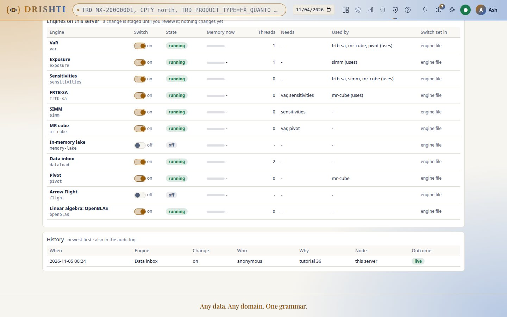

## Step 15 · Write a routing rule

A file goes to the table its rule names. The shipped `config/dataload.yaml` has no rules (`rules: []`), so every file would fail: a
file is **never guessed**.

**The YAML.** Edit `config/dataload.yaml`. So that the demo lake stays as `lake demo` built it, the rule writes to a scratch lake of
its own (`lake:`); without that key the file loads into the demo lake and replaces that business date there.

```yaml
dataload:
  rules:
    - match: "trades-endur.*.jsonl.gz"     # a glob on the file's name
      pack: trading
      kind: trade
      connector: trade-endur               # the table that connector reads (trading/trade_endur)
      date-from: name                      # the YYYY-MM-DD in the name is every row's business date
      lake: ./data/tutorial-36/delta       # tutorial only: a lake of its own
  unmatched: fail
```

The rules are read again at every cycle: no restart. With `date-from: name` the file's name must be `<name>.<YYYY-MM-DD>.jsonl.gz`
(the date after a dot): a file named `trades-endur-2026-09-30.jsonl.gz` carries no date the inbox reads and fails with *... carries none
(<table>.<YYYY-MM-DD>.jsonl.gz): rename it, or give business-date: in its .ready file*.

**The UI.** Admin → Data loads → Inbox, **Routing rules in effect** (read-only) shows the rule as a row: *1 · trades-endur.\*.jsonl.gz ·
trading / trade · trade-endur · from the name (required)*, then *anything else: unmatched: fail, to failed/ with the reason, never guessed*.

**You should see** your rule listed, numbered 1, and *unmatched: fail* under it.

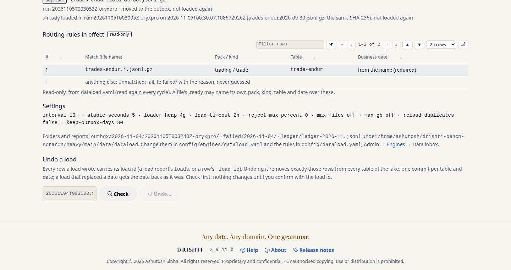

## Step 16 · Drop a file, then its marker

**The command line.** Copy one day of Endur trades from the demo data into the inbox under a name the rule matches:

```bash
cp data/testdata/trades/endur/trade_endur.2026-09-30.jsonl.gz data/dataload/inbox/trades-endur.2026-09-30.jsonl.gz
python3 tools/drishti.py dataload status
```

```text
data inbox on, node oryxpro, every PT10M, folder .../data/dataload
  next cycle at 2026-11-05T00:30:37.588670713Z
waiting (1):
  trades-endur.2026-09-30.jsonl.gz               93.5 KB  no trades-endur.2026-09-30.jsonl.gz.ready (or trades-endur.2026-09-30.ready) yet
                                                          business date: 2026-09-30 from the name
failed: none
last cycles:
  ...
```

**The UI.** The **Waiting** column shows the file, its size and *no marker*: a file without its `.ready` is never taken, however long
it sits there. Now say it is complete:

```bash
touch data/dataload/inbox/trades-endur.2026-09-30.jsonl.gz.ready
```

The state becomes *not stable yet* for a few seconds, then *ready*; `dataload status` then says:

```text
waiting (1):
  trades-endur.2026-09-30.jsonl.gz               93.5 KB  ready: the next cycle takes it
                                                          business date: 2026-09-30 from the name
```

**The YAML.** The marker may stay empty, or say how to load this one file, over the rules; with `rows` or `sha256` a file cut short is
refused before anything is written:

```yaml
# data/dataload/inbox/trades-endur.2026-09-30.jsonl.gz.ready (optional content)
pack: trading
kind: trade
connector: trade-endur
business-date: 2026-09-30
```

**You should see** the file go from *no marker* to *ready*, with its business date from the name beside it.

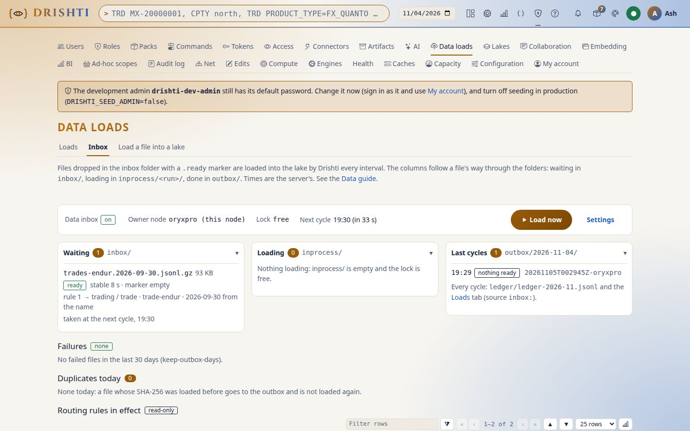

### The same step from a screen: Admin → Data loads → Upload

Instead of writing the `.ready` by hand, use **Upload** (DATA_LAKE_GUIDE section 3.5).

**In the console:** Admin → Data loads → **Upload**. Drop the file, or under **Already in the inbox folder** pick one. **Table** fills from the file name; the pack, kind and connector show beside it. The `.ready` updates on the right as you change the form. Read the checks below; a refusal blocks **Push to inbox**. A replace of a date that already has rows needs its tick.

**On the command line:**

```bash
export DRISHTI_TOKEN=...      # a token with loads:write
drishti-console/.venv/bin/python tools/drishti.py dataload ready --inbox trades-2026-11-03.jsonl --table trade --check
drishti-console/.venv/bin/python tools/drishti.py dataload ready --inbox trades-2026-11-03.jsonl --table trade --mode append --push
```

**The `.ready` it writes:**

```yaml
table: trade
business-date: 2026-11-03
mode: append
key: TRADE_ID
sha256: ...
rows: 2
```

## Step 17 · Load now and watch it load

A cycle runs every ten minutes; you need not wait.

**The UI.** Press **Load now**. The file leaves **Waiting**; **Loading** shows the run (its id, the start time and node:
`20261103T150000Z-drishti-main`), its table *loading 1 of 1 · trading / trade* and the loader's heap, then *committed 1 of 1* with the
date's version and rows. The page redraws itself every 5 seconds while a run loads. **Last cycles** then shows the run *loaded*: files,
tables, dates, rows, rejects, time.

**The command line.**

```bash
python3 tools/drishti.py dataload run
python3 tools/drishti.py dataload status
```

```text
Load now: a cycle started (drishti.py dataload status shows it).
data inbox on, node oryxpro, every PT10M, folder .../data/dataload
  next cycle at 2026-11-05T00:30:37.588670713Z
waiting: none
failed: none
last cycles:
  2026-11-05 00:30:05  20261105T003005Z-oryxpro           done     1 loaded
  ...
```

Press **Load now** again while a run still loads and the answer is *skipped: run … still loading*: runs never overlap, and the waiting
files stay for the next cycle.

**You should see** the run go from *loading* to *loaded* with one table, one date (2026-09-30) and its rows, and a new load on
Admin → Data loads made by `dataload` (*inbox:* and its file).

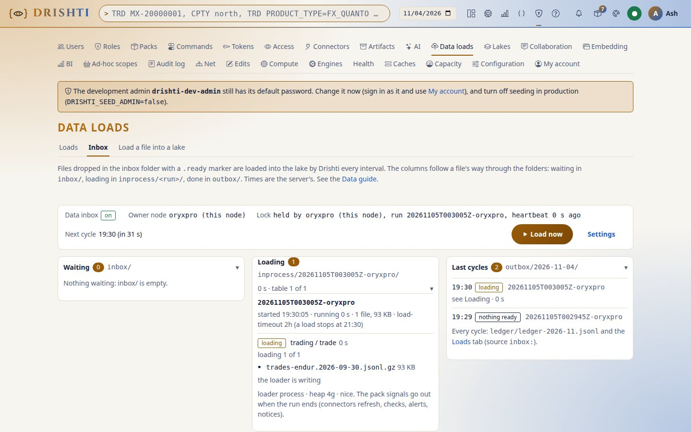

## Step 18 · Release several files at once with ready.all

**The command line.** Drop two days without markers, then one `ready.all`:

```bash
cp data/testdata/trades/endur/trade_endur.2026-09-28.jsonl.gz data/dataload/inbox/trades-endur.2026-09-28.jsonl.gz
cp data/testdata/trades/endur/trade_endur.2026-09-29.jsonl.gz data/dataload/inbox/trades-endur.2026-09-29.jsonl.gz
touch data/dataload/inbox/ready.all
python3 tools/drishti.py dataload status
```

```text
data inbox on, node oryxpro, every PT10M, folder .../data/dataload
  next cycle at 2026-11-05T00:30:37.588670713Z
  ready.all is in the inbox: every file there loads at the next cycle
waiting (2):
  trades-endur.2026-09-28.jsonl.gz               87.7 KB  ready: the next cycle takes it
                                                          business date: 2026-09-28 from the name
  trades-endur.2026-09-29.jsonl.gz              107.2 KB  ready: the next cycle takes it
                                                          business date: 2026-09-29 from the name
failed: none
...
```

**The UI.** **Waiting** shows both files *ready via ready.all* and since when `ready.all` is there. Press **Load now**: both files go
to one loader run (one table), each business date one commit. `ready.all` moves to that run's outbox folder, so it applies once.

**You should see** one run with two files and two dates in **Last cycles**, and `ready.all` gone from the inbox.

## Step 19 · A file that fails, and Retry

**The command line.** Drop a file whose name no rule matches:

```bash
cp data/testdata/trades/endur/trade_endur.2026-09-25.jsonl.gz data/dataload/inbox/endur.2026-09-25.jsonl.gz
touch data/dataload/inbox/endur.2026-09-25.jsonl.gz.ready
python3 tools/drishti.py dataload run
python3 tools/drishti.py dataload status
```

```text
Load now: a cycle started (drishti.py dataload status shows it).
data inbox on, node oryxpro, every PT10M, folder .../data/dataload
  next cycle at 2026-11-05T00:30:37.588670713Z
waiting: none
failed (1; drishti.py dataload retry <file>):
  endur.2026-09-25.jsonl.gz                   2026-11-04  endur: no pack, kind or table of that name (known: core/book, core/calendar, ...)
last cycles:
  2026-11-05 00:30:28  20261105T003028Z-oryxpro           done     1 failed
  2026-11-05 00:30:16  20261105T003016Z-oryxpro           done     2 loaded
  2026-11-05 00:30:05  20261105T003005Z-oryxpro           done     1 loaded
```

A name no rule matches is read as `<table>.<YYYY-MM-DD>.jsonl.gz`, so the reason names what the inbox looked for (a pack, kind or
table called `endur`) and lists the known ones. **The UI.** Before the cycle, **Waiting** shows the file *ready*: the route is decided
by the cycle. After it, **Failures** shows the file with its
run, time, the reason in words, a link to its `.failed.json`, and **Retry**; the Inbox tab carries the count of failed files.

**The YAML.** Fix the cause first: add a second rule to `config/dataload.yaml` (read again at the next cycle):

```yaml
    - match: "endur.*.jsonl.gz"
      pack: trading
      kind: trade
      connector: trade-endur
      date-from: name
      lake: ./data/tutorial-36/delta
```

Then press **Retry** on the failure, or:

```bash
python3 tools/drishti.py dataload retry endur.2026-09-25.jsonl.gz
python3 tools/drishti.py dataload run
```

```text
endur.2026-09-25.jsonl.gz: back in the inbox (from failed/2026-11-04/20261105T003028Z-oryxpro/endur.2026-09-25.jsonl.gz); the next cycle loads it (or Load now).
Load now: a cycle started (drishti.py dataload status shows it).
```

**You should see** the file back in **Waiting**, then loaded in the next run (*1 loaded*) and gone from **Failures**. Drop
the first file again (Step 16) and it is not loaded twice: it goes straight to the outbox as *already loaded in run …*, listed under
**Duplicates today**.

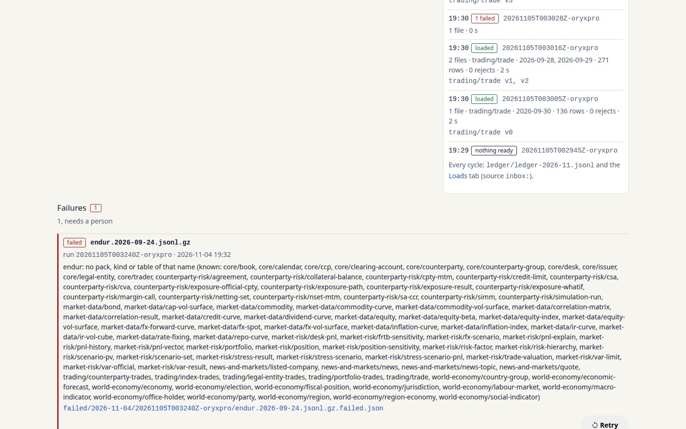

## Step 20 · The outbox, the reports and the ledger

Every loaded file ends in `outbox/<day>/<run>/` with its marker and its report; a failed one in `failed/<day>/<run>/` with
`<file>.failed.json`; every step of every file is a line of the ledger.

```bash
ls data/dataload/outbox/*/*/
python3 -m json.tool data/dataload/outbox/<day>/<the first run>/trades-endur.2026-09-30.jsonl.gz.loaded.json | head -30
tail -n 5 data/dataload/ledger/ledger-*.jsonl
```

```text
data/dataload/outbox/2026-11-04/20261105T003005Z-oryxpro/:
loads
trades-endur.2026-09-30.jsonl.gz
trades-endur.2026-09-30.jsonl.gz.loaded.json
trades-endur.2026-09-30.jsonl.gz.ready

data/dataload/outbox/2026-11-04/20261105T003016Z-oryxpro/:
loads
ready.all
trades-endur.2026-09-28.jsonl.gz
trades-endur.2026-09-28.jsonl.gz.loaded.json
trades-endur.2026-09-29.jsonl.gz
trades-endur.2026-09-29.jsonl.gz.loaded.json
...
{
    "file": "trades-endur.2026-09-30.jsonl.gz",
    "run": "20261105T003005Z-oryxpro",
    "node": "oryxpro",
    "at": "2026-11-05T00:30:07.114400276Z",
    "outcome": "loaded",
    "sha256": "679c41cdac138f3f5ab50c979b702c08678d705207bd5f63010e3962a337d96f",
    "size": 95702,
    "route": {
        "pack": "trading",
        "kind": "trade",
        "lake": "./data/tutorial-36/delta",
        "format": "delta",
        "by": "the rule trades-endur.*.jsonl.gz",
        "batch": "inbox:20261105T003005Z-oryxpro#1",
        "connector": "trade-endur",
        ...
        "dateBy": "2026-09-30 from the name",
        "mode": "append"
    },
    ...
{"at":"2026-11-05T00:30:34.132354270Z","run":"20261105T003028Z-oryxpro","file":"endur.2026-09-25.jsonl.gz","outcome":"retried","by":"anonymous","reason":"moved back to the inbox by anonymous"}
{"at":"2026-11-05T00:30:37.591508403Z","run":"20261105T003037Z-oryxpro","file":"endur.2026-09-25.jsonl.gz","outcome":"claimed","size":112425,"node":"oryxpro"}
{"at":"2026-11-05T00:30:38.995092960Z","run":"20261105T003037Z-oryxpro","file":"endur.2026-09-25.jsonl.gz","outcome":"loaded","sha256":"698f371c...","size":112425,"route":{...}}
{"at":"2026-11-05T00:30:53.531960260Z","run":"20261105T003053Z-oryxpro","file":"trades-endur.2026-09-30.jsonl.gz","outcome":"claimed","size":95702,"node":"oryxpro"}
{"at":"2026-11-05T00:30:53.533526624Z","run":"20261105T003053Z-oryxpro","file":"trades-endur.2026-09-30.jsonl.gz","outcome":"duplicate","sha256":"679c41cd...","size":95702,"reason":"already loaded in run 202..."}
```

**The UI.** On **Last cycles** and **Failures**, a file's report opens from its link (`GET /api/v1/admin/dataload/report?path=...`);
**Settings** shows every setting in one line and today's outbox, failed and ledger folders.

**You should see** each loaded file with its `.loaded.json` in the outbox, the failed file's first `.failed.json` in `failed/`, and the
ledger listing every step of all four files.

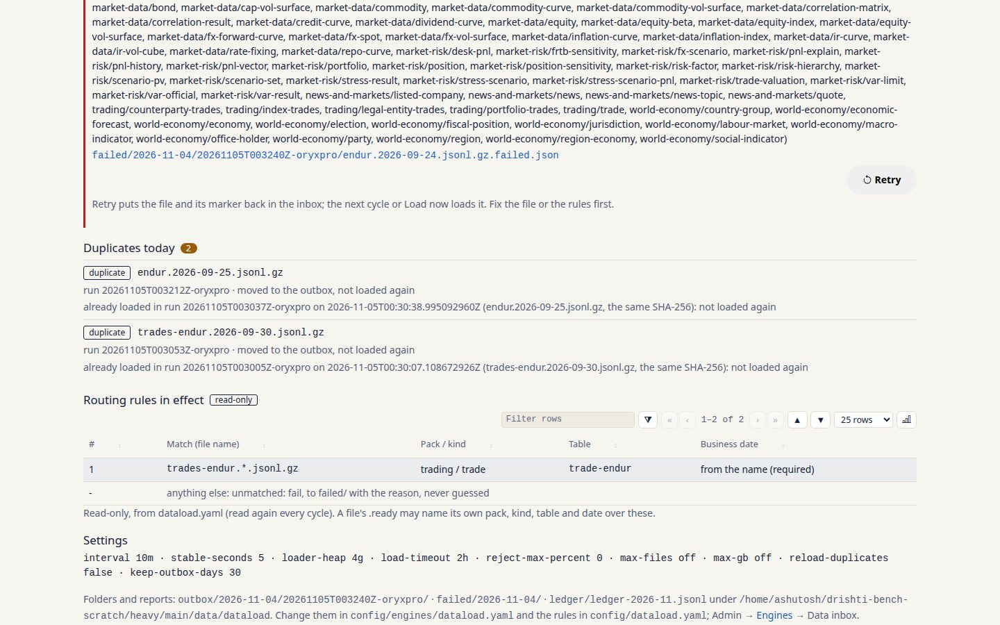

## Step 21 · Tidy up

```bash
rm -rf data/tutorial-36                    # the scratch lake
```

Remove the two rules from `config/dataload.yaml` (back to `rules: []`), put `stable-seconds: 30` back, and switch the engine off if you
do not want it: Admin → Engines → Data inbox → Off, or `python3 tools/drishti.py server engines off dataload --reason "Part C done"`.
The Inbox tab then disappears and `/admin/loads/inbox` answers 404.

**You should see** `data/tutorial-36` gone, Admin → Data loads → Inbox showing no rules (*unmatched: fail* only), or, with the engine
off, no Inbox tab and `drishti.py dataload status` exiting 3 (`DRS-1020`).

#### What you did

You turned the data inbox on, routed a file by a rule, handed it over with its `.ready` marker, watched it load on the Inbox screen,
released a batch with `ready.all`, fixed a failure and retried it, saw a duplicate skipped, and read the reports the outbox and the ledger
keep. The reference is the [data guide, section 7](../guides/DATA_GUIDE.md#7-the-data-inbox-drop-files-and-they-load); the design is
[DATA_LAKE_GUIDE.md](../guides/DATA_LAKE_GUIDE.md#31-the-data-inbox).

### Part D · News held in memory only

Some feeds may not, by contract, be saved on a disk. In this part you move the news-and-markets pack (headlines, quotes, news topics,
listed companies) from the disk lake into the server's memory, watch the replenish jobs fill it, read it as before, see what the guard
refuses and what it allows, and go back. Each step shows the UI, the command line and the YAML behind it. The figures are those of the
committed snapshot (71 headline sets, 20 quotes, 15 topics, 20 companies).

## Step 22 · Point the news connector at memory

**The YAML.** The store is a lake of its own (docs/guides/DATA_LAKE_GUIDE.md): copy its lake file, and the example connector over
the pack's own:

```bash
cp config/lakes.examples/memory/news.yaml config/lakes/news.yaml
cp config/connectors.examples/memory/news-store.yaml config/connectors/news-store.yaml
```

```yaml
# config/lakes/news.yaml
lake: news
format: delta
root: mem://news
memory: {max-mb: '${DRISHTI_NEWS_MEMORY_MB:256}', chunk-kb: 64, contract: '${DRISHTI_NEWS_CONTRACT:NEWS-MEMORY-ONLY}'}
tables:
  news.news-topic: {path: news-topic}      # the tables sit at mem://news/<kind>
  news.listed-company: {path: listed-company}
  news.news: {path: news}
  news.quote: {path: quote}
```

```yaml
# config/connectors/news-store.yaml
plugin: delta
settings:
  lake: news
  lake-tables: news.news-topic,news.listed-company,news.news,news.quote
```

**The UI.** Admin → Connectors → `news-store` shows the same text and its origin *your file*. Until the store exists the connector's health
reads *mem://news is held in memory only and is empty now*.

**You should see** `news-store` with root `mem://news` and its origin *your file*; until the store exists its health reads *mem://news is held in memory only and is empty now*.

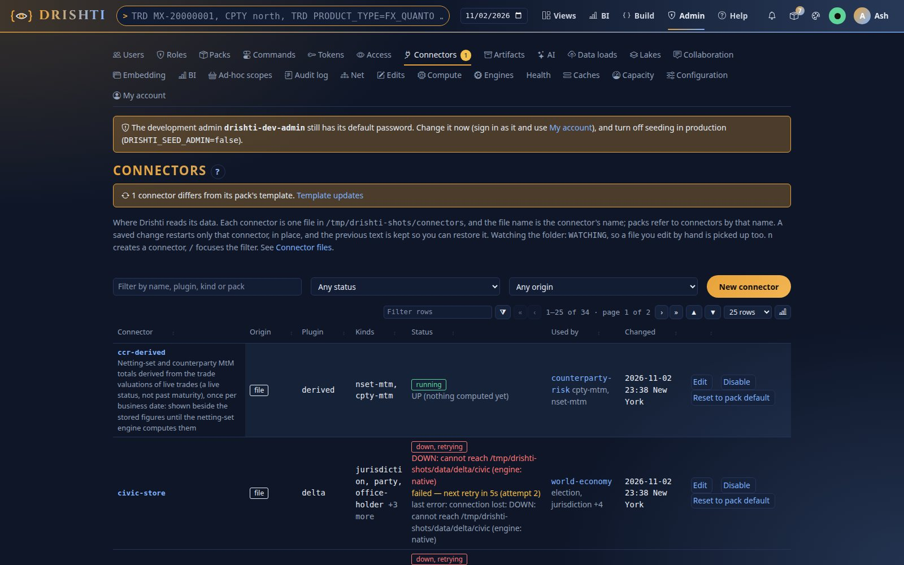

## Step 23 · Define the four tables' replenish jobs

**The YAML.** The store's cap and contract are in its lake file (step 22). Append the jobs that fill its tables to `application.local.yaml`
in the server's working folder (the repository, for the scripts):

```bash
cat config/examples/in-memory-lake.yaml >> application.local.yaml
```

```yaml
drishti:
  lake:
    memory:
      tables:                     # the store news: config/lakes/news.yaml
        - { name: news,  store: news, source: { file: data/testdata/news-and-markets/news/news.2026-10-18.jsonl.gz },  key: [NEWS_ID],  every: 15m, warm-up: 1, pin: true }
        - { name: quote, store: news, source: { file: data/testdata/news-and-markets/quote/quote.2026-10-18.jsonl.gz }, key: [QUOTE_ID], every: 15m, warm-up: 2 }
        - { name: news-topic,     store: news, source: { file: config/packs/economy/news-and-markets/samples/news-topic.jsonl },     key: [TOPIC_ID],   warm-up: 3 }
        - { name: listed-company, store: news, source: { file: config/packs/economy/news-and-markets/samples/listed-company.jsonl }, key: [COMPANY_ID], warm-up: 4 }
```

A live site points `source` at its feed instead: `url:` (a vendor's REST feed answering JSON Lines, `headers:` with `${ENV}` secrets), or
the news connector entity by entity (`{ connector: news, kind: news, ids-from: listed-company.NEWS_ID }`).

**The command line.** The launcher raises the JVM's direct-memory limit by the store's cap; see what it will use:

```bash
python3 tools/lake/memory_caps.py
```

```text
512
```

(256 MB for the server's own buffers plus the store's 256 MB.) Restart the server with its start script.

**You should see** `memory_caps.py` print 512 (the server's own 256 MB plus the store's 256 MB) and the server start again with no error about the direct-memory limit.

## Step 24 · Watch the warm-up fill the tables

**The command line.**

```bash
python3 tools/drishti.py lake memory status
```

```text
MEMORY STORES (1)
  news             owner        1.4 MB of      256.0 MB (1%)  files 22  refusals 0  contract NEWS-MEMORY-ONLY

TABLES (4)
  news                 ready          0.4 MB  rows        71  v0  ratio 4.2x   pinned evictions 0  refusals 0  compactions 0
    mem://news/news  ←  file data/testdata/news-and-markets/news/news.2026-10-18.jsonl.gz  (replace)  last 2026-11-02T14:42:42Z  next 2026-11-02T14:57:42Z
  quote                ready          0.4 MB  rows        20  v0  ratio 5.2x   evictions 0  refusals 0  compactions 0
  …
HEALTH  green
```

```bash
python3 tools/drishti.py lake memory jobs
```

```text
RUNS (4)
  2026-11-02T14:42:42  listed-company       warm-up          ok       rows        20      0.0 MB  v0  58 ms
  2026-11-02T14:42:42  news-topic           warm-up          ok       rows        15      0.0 MB  v0  20 ms
  2026-11-02T14:42:42  quote                warm-up          ok       rows        20      0.1 MB  v0  77 ms
  2026-11-02T14:42:42  news                 warm-up          ok       rows        71      0.1 MB  v0  1,580 ms
```

**The UI.** Admin → Lakes, *Held in memory only*: the store (used against its cap, the contract) and the four tables with their state,
memory, how much smaller they are than their rows, the version and the next refill.

**You should see** the store `news` owned by this node with its contract `NEWS-MEMORY-ONLY`, and the four tables *ready* with 71, 20, 15 and 20 rows, each a warm-up run in `lake memory jobs`.

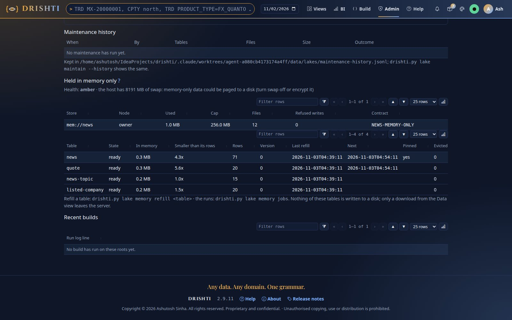

## Step 25 · Read it as before

**The UI.** Type `NEWS Apple`, `QUOTE AAPL`, `CO AAPL`: the pages are the same. Export data (`DATA`) lists the four datasets and
downloads a day as `.jsonl.gz`, streamed from memory with no temporary file, audited as `data.download … memory-only data`.

**The command line.**

```bash
python3 tools/drishti.py view get listed-company/CO-AAPL
```

**You should see** the same pages as on the disk lake, and the four datasets in Export data.

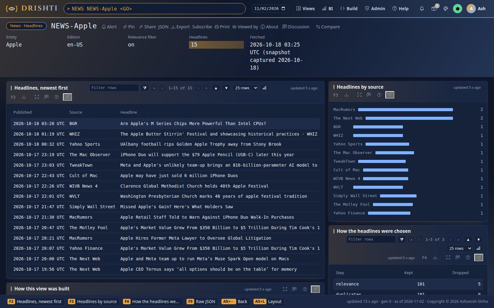

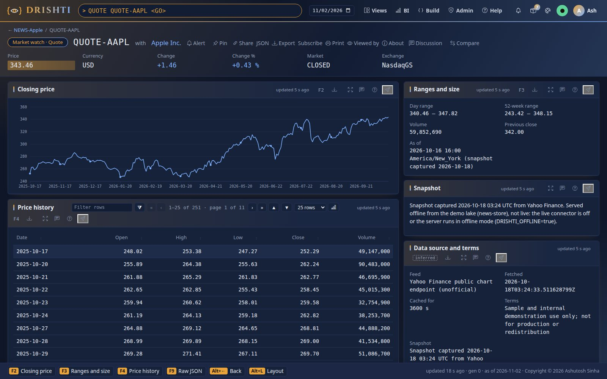

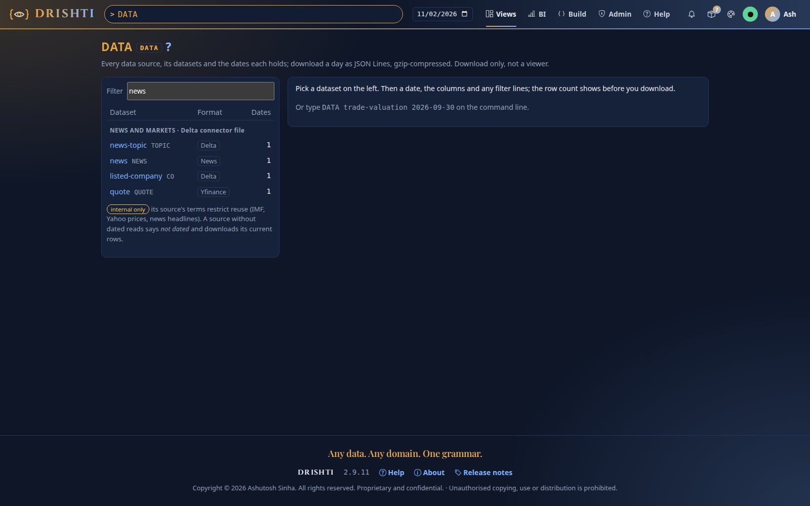

## Step 26 · What the guard refuses

**The UI.** Save a scheduled report on `NEWS where COUNT > 1` (My reports → New): it is refused, in words:

```text
DRS-5219 This report uses NEWS data held in memory only (contract NEWS-MEMORY-ONLY); it cannot be delivered by a scheduled report.
Only a download by you may leave the server.
```

A share of a news page is sent as a link; with a picture or by e-mail it is refused the same way; *Ask about this page* is refused; a BI
run on the news is not stored (it is computed again when opened). Nothing of the news is written to the data folder: no document cache,
no id-map files, no index segments for this connector.

**The API.**

```bash
curl -s -X PUT -H "Authorization: Bearer $DRISHTI_TOKEN" -H 'Content-Type: application/json' \
  -d '{"query":"NEWS where COUNT > 1","schedule":"business-days 18:30"}' http://localhost:18480/api/v1/me/reports/news-daily
```

**You should see** the save refused with `DRS-5219` and the contract named, and nothing of the news under the data folder.

## Step 27 · Refill on demand, and after a restart

```bash
python3 tools/drishti.py lake memory refill news
python3 tools/drishti.py lake memory jobs --table news --limit 2
```

```text
news: a refill is queued (drishti.py lake memory jobs --table news shows its run)
RUNS (2)
  2026-11-02T14:44:10  news                 by drishti-dev-admin ok  rows        71      0.1 MB  v1  95 ms
  2026-11-02T14:42:42  news                 warm-up          ok       rows        71      0.1 MB  v0  1,580 ms
```

Stop and start the server: the store is empty at start, by design, and the warm-up fills it again in order (`news` first, it is
pinned); while it runs the connector's health and the table's state say *refilling*.

**You should see** a new run *by* you with the table's version one higher, and after a restart the warm-up runs again with `news` first.

## Step 28 · The cap, eviction and Health

**The YAML.** Lower the cap to see the ladder: `max-mb: 1`. On the next refill the store frees old versions first, then evicts whole
unpinned tables, least recently read first (`quote: held in memory only; evicted at 14:52 to make room, a refill is queued`), and
refuses a write only when nothing more can go; the table then stays at its version.

**The UI.** Admin → Health, *In-memory lake*: amber with the refused write; the host checks (swap, heap dumps, JFR, the temporary folder
on a RAM disk); red if the server was started with a direct-memory limit below the caps. Busy protection shows a gauge for the store.

Put `max-mb: 256` back.

**You should see** with `max-mb: 1` an eviction or a refused write in `lake memory status` and Admin → Health turn amber; with 256 back, green again.

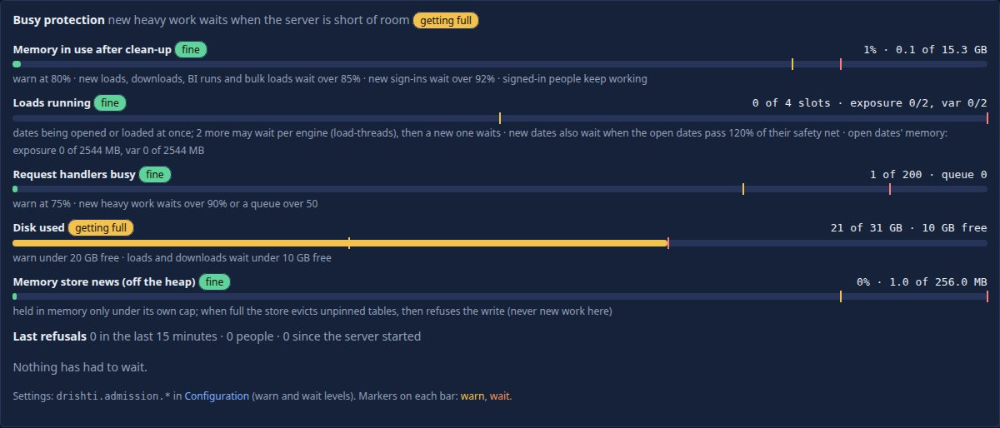

## Step 29 · Go back to the disk lake

```bash
rm config/connectors/news-store.yaml       # the pack's own connector reads data/delta/demo/news again
# and remove the drishti.lake.memory block from application.local.yaml
```

Restart. `NEWS Apple` reads the disk lake; Admin → Lakes no longer shows *Held in memory only*.

**You should see** `NEWS Apple` open from the disk lake and no *Held in memory only* section on Admin → Lakes.

#### What you did

You held a whole pack in memory only, filled by server jobs from its feed, read through the same connector, guarded at every place
Drishti writes, measured and compacted by itself, and went back. The reference is the
[in-memory lake guide](../guides/DATA_LAKE_GUIDE.md#13-the-in-memory-lake); the design is [IN_MEMORY_LAKE.md](../architecture/DATA_ARCHITECTURE.md#9-the-in-memory-lake-delta-tables-that-never-touch-a-disk).

### Part E · The risk lake and the official results on Iceberg

Delta Lake is Drishti's default lake format; Apache Iceberg is a full alternative, chosen by configuration. In this
part you move the market-risk pack's VaR inputs from Delta to Iceberg, publish the official end-of-day VaR results to Iceberg,
check that VaR is the same to the cent, see each table's format in Admin → Lakes, point BI's reader of the official results at the
new format, and go back to Delta. Each step shows the UI, the command line and the YAML behind it; every output was captured on the
committed test data.

## Step 30 · Build the VaR data into Iceberg

**From the command line.** The same `--only` list as tutorial 2, Part A, with `--store risk=iceberg`:

```bash
drishti-console/.venv/bin/python tools/build_demo_lakes.py --as-of data --store risk=iceberg \
  --only market-risk/pnl-vector,market-risk/scenario-pv,market-risk/fx-scenario,market-risk/scenario-set,market-risk/var-limit
```

```text
1/3 the demo lakes: only market-risk/pnl-vector,…,market-risk/var-limit, every business day, ending data → data/delta/demo
  …
  risk/pnl-vector into Iceberg: data/delta/demo/risk/pnl-vector -> data/iceberg/risk/pnl-vector
    iceberg: 8,233 rows read in 1 s; 1 business days of 1 tables to write
  risk/pnl-vector: 8,233 rows in Iceberg, newest business date 2026-09-30 (data/iceberg/risk/pnl-vector)
  …
  risk/var-limit: 129 rows in Iceberg, newest business date 2026-09-30 (data/iceberg/risk/var-limit)
3/3 done in 14 s.
  Risk domain: iceberg data/iceberg/risk; risk-store: now reads iceberg, was delta (data/connectors/risk-store.yaml; …);
  exposure-store: now reads iceberg, was delta (…)
```

The tables are built as Delta first (`lake demo`), then each is copied into Iceberg by Drishti's own loader and the Delta copy removed:
one store per domain. Your own `--lake` folder: the Iceberg root is the folder beside it (`<lake>/../iceberg`; `DRISHTI_ICEBERG_ROOT`
moves it).

**The YAML.** The script writes the connector file `risk-store.yaml` from the market-risk pack's template, switched to Iceberg (the
text it replaced is kept in `data/connectors/history/`), and does the same for the counterparty-risk pack's `exposure-store.yaml`:

```yaml
# Written by tools/build_demo_lakes.py --store risk=iceberg: every risk table in Iceberg (data/iceberg/risk), …
plugin: iceberg
kinds: [stress-scenario, stress-result, frtb-sensitivity, pnl-explain, trade-valuation, portfolio, pnl-vector, scenario-pv,
        fx-scenario, scenario-set, var-limit]
settings:
  root: ${DRISHTI_ICEBERG_ROOT:${drishti.data.dir:./data}/iceberg}
  engine: native
  domain: risk
  layout:
    pnl-vector:
      columns: [VALUE_TYPE, GRAIN, TRADE_ID, …, TT_BOOK, LIMIT_LETTER, …]
      vectors: [PNL]
    …
```

**In the UI.** Nothing to do yet; step 33 shows the tables, and [tutorial 2, step 26](02-var-from-the-bank-to-a-trade.md#step-26--the-same-var-on-iceberg) reads VaR from them, the same to the cent.

**You should see** `data/iceberg/risk/<kind>/metadata` and `data` folders for the seven VaR kinds, `data/delta/demo/risk` empty, and
`plugin: iceberg` at the top of `data/connectors/risk-store.yaml`.

These are standard Apache Iceberg v2 tables: Spark, Trino, Snowflake or pyiceberg read them as they are. To try it with pyiceberg,
see [the data lake guide, section 15.5](../guides/DATA_LAKE_GUIDE.md#155-check-it-yourself).

**Further:** [ICEBERG_CONNECTOR.md](../../plugins/drishti-plugin-iceberg/README.md) (the connector, sections 18 and 19),
[../guides/DATA_GUIDE.md section 11](../guides/DATA_GUIDE.md#112-mixed-delta-and-iceberg-storage) (mixed storage). What Drishti reads and writes of the Iceberg spec:
[DATA_LAKE_GUIDE.md section 15](../guides/DATA_LAKE_GUIDE.md#15-iceberg-spec-compliance).

## Step 31 · Publish the official results to Iceberg

The server captures every node of every hierarchy officially when a date loads, and appends the figures to
`<root>/risk-results/var-official` for other systems ([VAR_GUIDE.md section 19](../guides/VAR_GUIDE.md#19-official-end-of-day-results)).
Delta is the default; Iceberg is one setting. **A table keeps the format it was created in**, so give the Iceberg table a root of its
own; the Iceberg root of step 30 is the natural one.

**The YAML** (`application.local.yaml` in the server's working folder; [CONFIGURATION.md](../admin/CONFIGURATION.md)):

```yaml
drishti:
  var:
    official:
      format: iceberg                  # delta (the default) or iceberg; DRISHTI_VAR_OFFICIAL_FORMAT
      root: ./data/iceberg             # the table: data/iceberg/risk-results/var-official
  ccr:
    exposure:
      official:
        format: iceberg                # the same for the official exposure results (DRISHTI_EXPOSURE_OFFICIAL_FORMAT)
        root: ./data/iceberg
```

**From the command line**, the same by environment for the format (the root has no variable of its own):
`DRISHTI_VAR_OFFICIAL_FORMAT=iceberg`.

**In the UI.** None: settings are read at start.

**You should see**, if you change the format but not the root of a lake whose Delta table already exists, the capture still made and
the publish refused in words, in `drishti.py var official` and the log:

```text
"publishError": "iceberg table data/delta/risk-results/var-official: the table data/delta/risk-results/var-official is a Delta table
and the official format is iceberg: an official table keeps its format; give the new format another root (drishti.*.official.root)"
```

With the root of the YAML above it publishes (step 32). A date already captured is not published again by a restart; the new format
applies from the next capture.

**Further:** [VAR_GUIDE.md section 19](../guides/VAR_GUIDE.md#19-official-end-of-day-results),
[EXPOSURE_GUIDE.md](../guides/EXPOSURE_GUIDE.md) (section 20), on S3: [CLUSTER_GUIDE.md › Drishti on AWS: ECS, EFS and S3, section 22](../guides/CLUSTER_GUIDE.md#1212-iceberg-on-aws-and-official-results-in-s3).

## Step 32 · Start the server and look at the connectors

Start the server and the console as in tutorial 1, Part A, with the samples off (`DRISHTI_DEMO_ENABLED=false`). For Admin → Lakes to list the
Iceberg tables too, give the console both roots: `DRISHTI_LAKE_ROOTS=data/delta/demo,data/iceberg`.

**In the UI.** **Admin → Connectors**, filter `market-risk`: `risk-store` on **iceberg**, `var-results` on **iceberg** (after step 34).

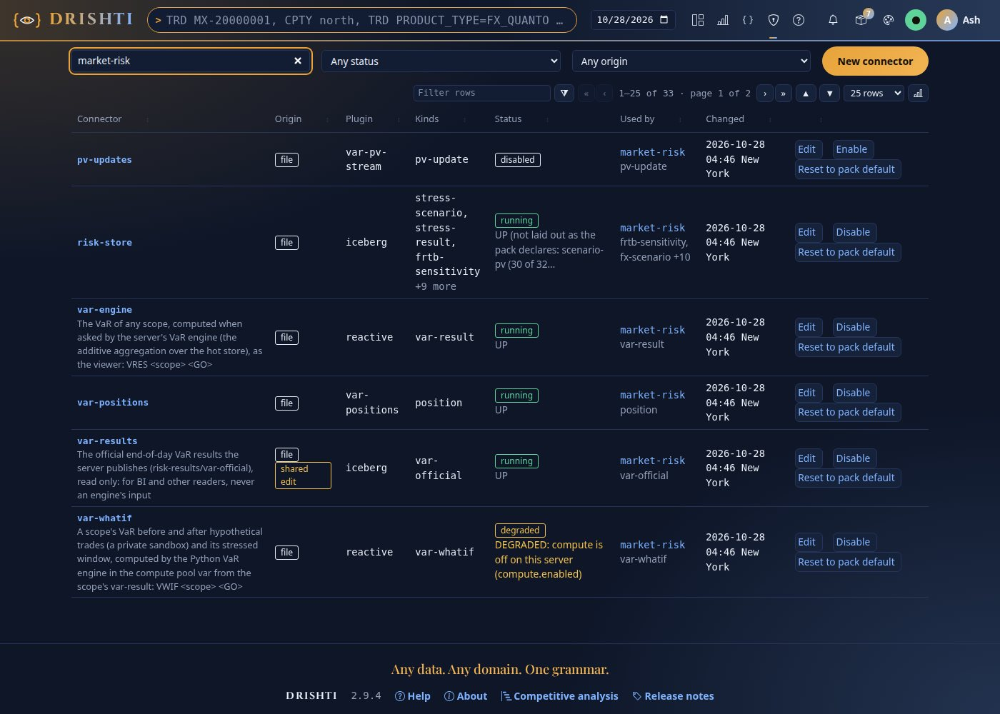

**From the command line:**

```text
$ drishti.py connector list
  name                origin  plugin         kinds                                                        state     used by
  exposure-store      file    iceberg        simulation-run,exposure-path                                 running   counterparty-risk
  risk-store          file    iceberg        stress-scenario,stress-result,frtb-sensitivity +9            running   market-risk
  trade-murex         file    delta          trade                                                        running   trading
  var-results         file    delta          var-official                                                 running   market-risk
  …
$ drishti.py var official
  … "nodes": 131 …, "published": true …
```

**The YAML** is step 30's and step 31's.

**You should see** `risk-store` on `iceberg`, the official capture of 2026-09-30 with 131 nodes **published**, and the table
`data/iceberg/risk-results/var-official` with its JSON Lines beside it (`data/iceberg/risk-results/jsonl/var-official/2026-09-30/var-official-v1.jsonl`).
`var-results` still says `delta`: step 34 is about it.

**Further:** [../guides/DATA_GUIDE.md section 9](../guides/DATA_GUIDE.md#9-connector-files-and-admin--connectors) (Admin → Connectors).

## Step 33 · Each table's format in Admin → Lakes

**In the UI.** **Admin → Lakes**: the tables of both roots with a **Format** column.

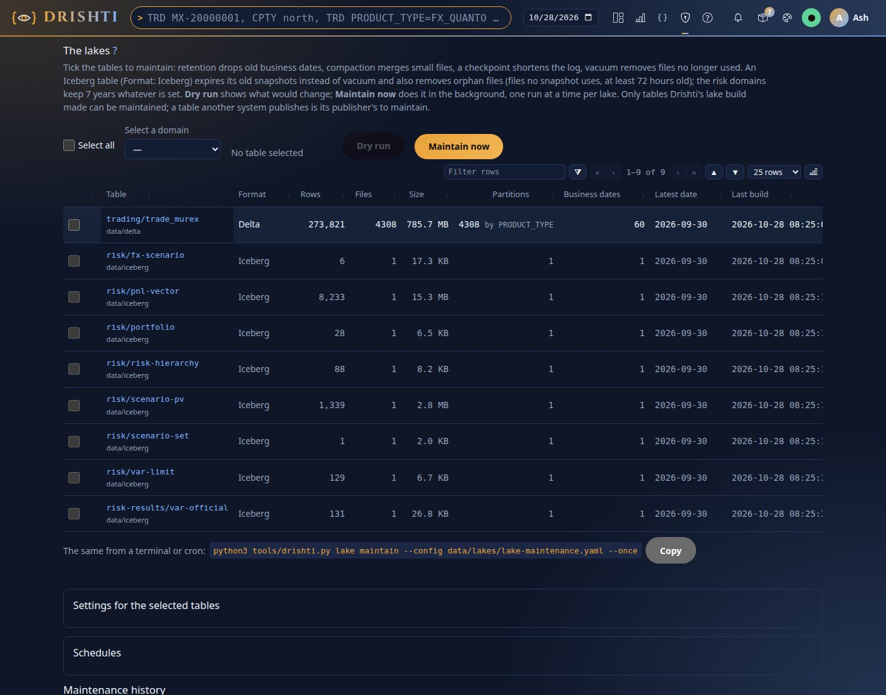

**From the command line:** the page prints its twin under the table (*The same from a terminal or cron*: `drishti.py lake maintain
--config data/lakes/lake-maintenance.yaml --once`); add `--dry-run` to see what a run would change, changing nothing.

**The YAML** (`data/lakes/lake-maintenance.yaml`, what the page writes): a lake `format: auto` (the default) maintains each table in
its own format, Iceberg's by snapshot expiry and orphan-file removal under the 7-year floor of `risk` and `risk-results`
([OPERATIONS_GUIDE.md › Lake maintenance: Admin → Lakes → Maintain and `lake maintain`, section 8](../guides/OPERATIONS_GUIDE.md#163-iceberg-lakes)).

**You should see** `trading/trade_murex` as **Delta**, the seven risk tables and `risk-results/var-official` as **Iceberg**. The risk
tables are maintained here like the ones `drishti.py lake build --format iceberg` writes: the copy leaves the same build record
(`<iceberg root>/_drishti-lake/tables-built.json`, with the Delta table's pack and kind).

**Further:** lake maintenance and its schedule are in [OPERATIONS_GUIDE.md](../guides/OPERATIONS_GUIDE.md#16-lake-maintenance-and-scheduling).

## Step 34 · BI's reader of the official results follows the format

The market-risk pack's `var-results` connector (BI's `VOFF`) is `plugin: delta` in the pack; with `format: iceberg` the server reads
that template as `plugin: iceberg` over `${drishti.var.official.root}`. The file the server generated (stamped) and nobody edited
follows by itself: nothing to do. `lake demo` and `build_demo_lakes.py` leave this file to the server; one an earlier `lake demo` wrote
(its first line *Written by drishti.py lake demo*) is moved to the history by the build of step 30, so the server writes the stamped one.
An edited file is kept, and the change of plugin is listed under **Admin → Connectors → Template updates** (**Use the pack's value**).

**In the UI.** **Admin → Connectors → var-results**:

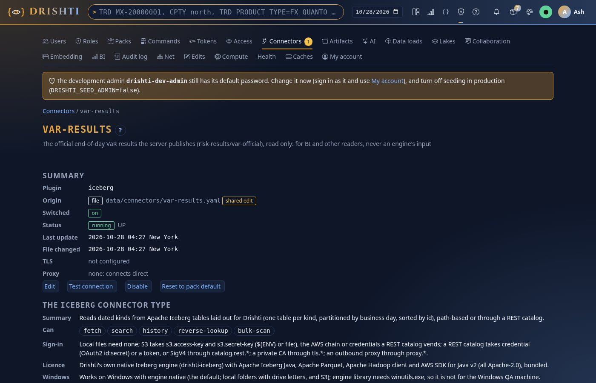

**From the command line:**

```text
$ drishti.py connector get var-results
connector var-results   origin file   plugin iceberg   running   …
  root                         ${drishti.var.official.root:${DRISHTI_DELTA_ROOT:${drishti.data.dir:./data}/delta}}
  domain                       risk-results
  engine                       native
```

**The YAML** the server reads (the pack's template seen through the official format; `OfficialReaders`):

```yaml
plugin: iceberg
settings:
  root: ${drishti.var.official.root:${DRISHTI_DELTA_ROOT:${drishti.data.dir:./data}/delta}}
  domain: risk-results
  engine: native
```

**You should see** `var-results` on `iceberg` and running, and the official records read back: `VOFF HIERARCHY == 'LL'` on
2026-09-30 finds 43 of the 131 rows.

**Further:** [../guides/DATA_GUIDE.md section 9 "Upgrades"](../guides/DATA_GUIDE.md#upgrades) (stamped files, edited files, Use the
pack's value).

## Step 35 · Back to Delta

**From the command line** (server stopped):

```text
$ drishti-console/.venv/bin/python tools/build_demo_lakes.py --as-of data --store risk=delta --only market-risk/pnl-vector,…,market-risk/var-limit
  the risk domain is in Delta now: its Iceberg tables are removed (data/iceberg/risk)
  Risk domain: delta data/delta/risk; risk-store: now reads delta, was iceberg (the pack's own connector; …); exposure-store: now reads delta, was iceberg (…)
```

**The YAML.** `risk-store.yaml` and `exposure-store.yaml` are removed (their text kept in the history), so the packs' own Delta
connectors serve again; remove the `official` block of step 31 to publish to Delta again (the Iceberg official table stays where it is:
a table keeps its format). A full build without `--store risk=…` also puts the risk domain back in Delta.

**In the UI.** Admin → Connectors: `risk-store` on `delta`.

**You should see** `data/iceberg/risk` gone, `data/iceberg/risk-results` kept, and `VAR BANK` still 112,041,646.

## Next steps

- [The data lake and data load guide](../guides/DATA_LAKE_GUIDE.md): sizing a real day (section 9), modes and repeats (section 5),
  a lake in S3 or Iceberg, reading an existing Databricks lakehouse (section 10).
- [Tutorial 2, Part A](02-var-from-the-bank-to-a-trade.md#part-a--historical-var-from-the-bank-to-a-trade): VaR from the bank to a trade, now on your own scenario PVs.
- [DATA_LAKE_GUIDE.md](../guides/DATA_LAKE_GUIDE.md): every key, a Delta lake in S3, an Iceberg lake over REST, an in-memory store.
- [the data lake guide, section 3.1](../guides/DATA_LAKE_GUIDE.md#31-the-data-inbox): every part of the Inbox screen and where each figure comes from.
- [Data guide, section 1](../guides/DATA_GUIDE.md#1-telling-drishti-new-data-has-landed): the data-load signal each load sends, expectations and late data.
- The parallel lake loader the inbox runs: [CLI_REFERENCE.md, section 4.13](../guides/CLI_REFERENCE.md#713-the-parallel-lake-loader).
- The [in-memory lake guide](../guides/DATA_LAKE_GUIDE.md#13-the-in-memory-lake): every setting, the replenish sources and the guard.
- The design: [IN_MEMORY_LAKE.md](../architecture/DATA_ARCHITECTURE.md#9-the-in-memory-lake-delta-tables-that-never-touch-a-disk).
- Your own lake on Iceberg, Databricks or a REST catalog: [Using Drishti with Databricks Delta Lake or Apache Iceberg](../guides/DATA_GUIDE.md#3-using-drishti-with-databricks-delta-lake-or-apache-iceberg).
- On AWS (S3, Glue, S3 Tables, the scripts in `deploy/aws/iceberg/`): [CLUSTER_GUIDE.md › Drishti on AWS: ECS, EFS and S3, section 22](../guides/CLUSTER_GUIDE.md#1212-iceberg-on-aws-and-official-results-in-s3).
- Exposure on the same lake: [tutorial 3](03-exposure-from-the-bank-to-a-trade.md) after a full `--store risk=iceberg` build.

## If something goes wrong

| You see | Do |
|---|---|
| a file stays *no marker* | its `.ready` is missing or misnamed: `<file>.ready` or the name without its data extension |
| `failed/`: *the .ready file's key … is not one of …* | a typo in the `.ready`; correct it and **Retry** (`drishti.py dataload retry <file>`) |
| `failed/`: *its .ready file says 2000 rows, the file holds …* | the copy was cut short: copy it again, then Retry |
| `failed/`: the date in the name is refused | a business date is a real date, not in the future: run `make_day.py` with today's date or an earlier one |
| a connector refused: *lake risklake has no table risk.pnl-vector* | list only risklake's tables in `lake-tables:` and `kinds:` |
| the page still shows demo trades | the connector file still says `lake: demo`, or the server was not restarted |
| *this Python lacks deltalake* | run the script with the console's Python (Before you start) |
| *could not find the server jar* or the copy into Iceberg fails | build the server first (`./mvnw clean package -DskipTests`) |
| `VAR BANK` answers *no P&L vectors in any connector* | the server reads another Iceberg root: set `DRISHTI_ICEBERG_ROOT` to the folder beside your `--lake` |
| `publishError` *… is a Delta table and the official format is iceberg* | give the official results another root (step 31) |
| `var-results` stays `delta` | the file was edited: Admin → Connectors → Template updates → **Use the pack's value** for `plugin` (step 34) |
| Admin → Lakes lists no Iceberg table | the console's `DRISHTI_LAKE_ROOTS` lacks `data/iceberg` (step 32) |

**Part A · A new lake of your own.**

More in the guide's [troubleshooting table](../guides/DATA_LAKE_GUIDE.md#8-checking-a-load-and-troubleshooting).

**Part C · Load files automatically with the data inbox.**

- A file stays *no marker* or *not yet stable*: its `.ready` is missing, or the file or the marker is still changing (`stable-seconds`).
- A file fails with *<name>: no pack, kind or table of that name*: no rule's `match` fits it and its marker names no pack and kind; add a rule and Retry.
- A file fails with *... carries none (<table>.<YYYY-MM-DD>.jsonl.gz)*: its rule says `date-from: name` but the name has no date after a dot; rename it, or give `business-date:` in its `.ready`.
- A file fails because it holds *lake rows* or *loader rows*: the inbox loads documents only (data guide, section 7.3).
- **Load now** answers *skipped*: a run is still loading, or busy protection says the server is short of memory or disk; the files wait.
- `drishti.py dataload` exits 3 (`DRS-1020`): the inbox is off on every server; turn it on (Step 14).

**Part D · News held in memory only.**

- The connector's health stays *empty now*: the in-memory lake engine is off (Admin → Engines, then restart) or the
  `drishti.lake.memory` block is not in the `application.local.yaml` of the server's working folder.
- Admin → Health is red about the direct-memory limit: start the server with its start script, which raises the limit by the caps
  (`tools/lake/memory_caps.py`).
