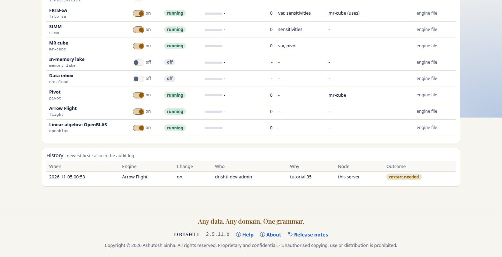
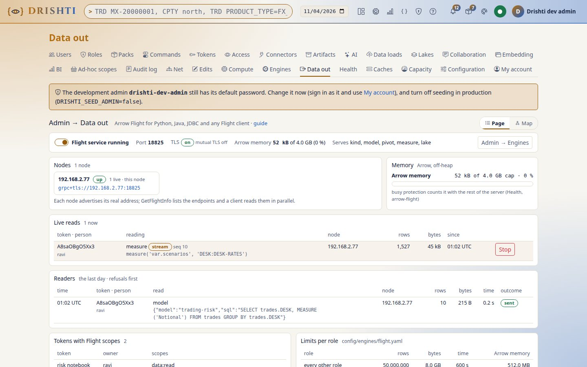
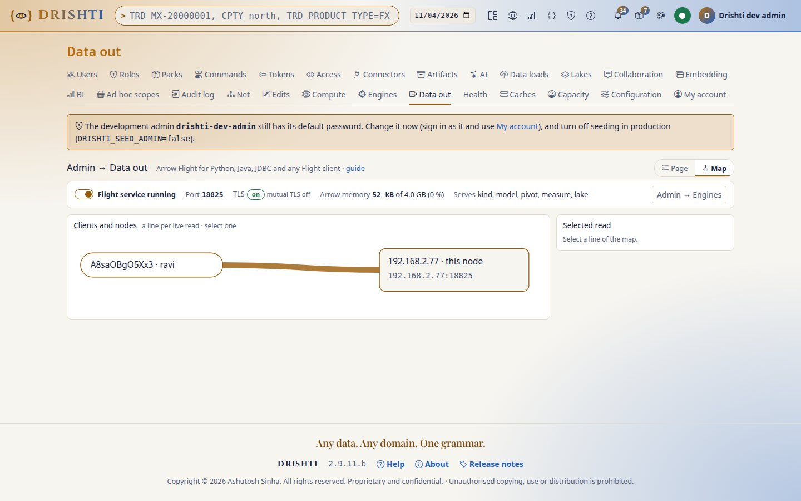
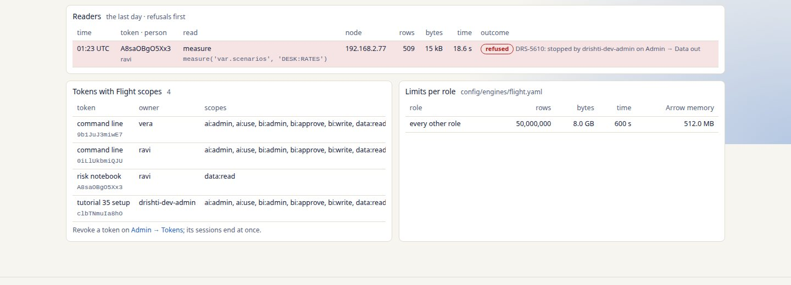

<!--
  Project Drishti · Any data. Any domain. One grammar.

  Copyright (c) 2026 Ashutosh Sinha <ajsinha@gmail.com>.
  All rights reserved.

  PROPRIETARY AND CONFIDENTIAL.

  This file is the confidential and proprietary property of Ashutosh Sinha.
  Unauthorised copying, use, modification, distribution or disclosure of this
  file, via any medium, is strictly prohibited except with the express prior
  written permission of the copyright holder.

  See the LICENSE file in the root of this repository for the full terms.
-->
# Tutorial 17 · Data out: from a token to a pandas DataFrame of a desk's VaR scenario P&L

In this tutorial you turn Arrow Flight on, make a token that may read data, read a desk's VaR scenario P&L into pandas, read the same
from Java and from a JDBC tool, follow a live intraday stream, and see your reads on Admin → Data out. Each step shows the UI, the command
line and the code. The guide is [FLIGHT_GUIDE.md](../guides/FLIGHT_GUIDE.md); every request is in [../guides/FLIGHT_GUIDE.md](../guides/FLIGHT_GUIDE.md).

The outputs below are real: a server on the VaR test data of 2026-09-30, a test PKI, and a reader of their own (`ravi`). That server's
Flight port was 18825 (`DRISHTI_FLIGHT_PORT`); the shipped port is 18815, as in the commands.

## Time to complete

About 20 minutes.

## Before you start

- The server and console running on the demo lake ([tutorial 1, Part A](01-first-15-minutes.md#part-a--install-start-and-look-around)), VaR on (the default).
- Python 3.10 or newer with `pyarrow` and `pandas`; for step 5 a JDK 17 or newer; for step 6 DBeaver.
- The server's certificate and its CA as PEM files (a test PKI is fine on your own machine).

## What you will learn

- how Arrow Flight is turned on (the engine file, Admin → Engines) and where Admin → Data out shows it;
- how a token with the `data:read` scope is made, and that Flight reads as the person the token belongs to;
- how a desk's VaR scenario P&L and its positions' vectors arrive in pandas, Java and a JDBC tool, with the VaR checked by hand;
- how a live stream follows intraday batches and resumes where it stopped;
- what administrators see of every read, and how a stream is stopped.

## Step 1 · Turn Flight on

**UI.** Admin → Engines → Arrow Flight → On, reason "this tutorial"; restart the server.
**File.** `config/engines/flight.yaml`: `enabled: true`, `tls.certificate` and `tls.private-key` naming your PEM files.
**Check.** Admin → Data out shows *Running, port 18815, TLS*.



The row first says *restart needed* (the port opens at start). After the restart the server's log says:

```text
c.a.d.server.engines.EngineRegistry      : engines: 9 running here (var, exposure, sensitivities, frtb-sa, simm, pivot, mr-cube, flight, openblas); not running: dataload off, memory-lake off
com.ash.drishti.flight.FlightService     : Arrow Flight on 0.0.0.0:18825 (TLS), Arrow memory cap 4294967296 bytes
```

Turning an engine on is an administrator's change made signed in (Admin → Engines, or `drishti.py server engines on flight` with a
signed-in session); an API token is refused: `403 DRS-5002: API tokens may not call this endpoint`.

**You should see** Admin → Data out say *Running, port 18815, TLS*, and the server's log one line naming the Flight port.

## Step 2 · Make a token with data:read

**UI.** My account → API tokens → name "risk notebook", 30 days, scope **data:read** → Create; copy the `drk_…` token.


**Command line.** A token cannot make tokens: the first one is always made signed in, on My account. The same call with a token is refused:

```bash
curl -s -X POST -H "Authorization: Bearer $DRISHTI_TOKEN" -H "Content-Type: application/json" \
  -d '{"name": "risk notebook", "days": 30, "scopes": ["data:read"]}' https://localhost:18480/api/v1/me/tokens
```

```text
{"title":"forbidden","status":403,"code":"DRS-5002","detail":"API tokens may not call this endpoint"}
```

**You should see** the secret shown once under **Create token** (*Copy it now: this is the only time it is shown*); after a reload, My
account → API tokens lists the token with *Can: data:read* and its expiry, without its secret. Keep the secret in a file
(`DRISHTI_TOKEN_FILE`) or `DRISHTI_TOKEN`.

## Step 3 · Who am I

```python
from drishti_flight import Flight
f = Flight("grpc+tls://<your real IP>:18815", token="drk_…", ca="ca.pem")
f.whoami()
f.catalogue()[:5]
```

```text
{'person': 'ravi', 'onBehalfOf': None, 'tokenId': 'A8saOBgO5Xx3', 'roles': ['admin'], 'scopes': ['data:read'], 'limits': {'rows': 50000000, 'bytes': 8589934592, 'seconds': 600, 'memory': 536870912}}
[{'form': 'kind', 'request': {'kind': 'counterparty'}}, {'form': 'kind', 'request': {'kind': 'counterparty-group'}}, {'form': 'kind', 'request': {'kind': 'issuer'}}, {'form': 'kind', 'request': {'kind': 'ccp'}}, ...]
```

**You should see** `whoami()` name you and the token's scopes, and the catalogue's first entries: the kinds, models and measures you may read.

## Step 4 · A desk's VaR scenario P&L in pandas

```python
tbl = f.measure("var.scenarios", "DESK:DESK-RATES")      # an Arrow table
tbl.schema.metadata                                       # scope, date, VaR, ES (the Arrow schema's; pandas does not keep it)
pnl = tbl.to_pandas()
pnl.sort_values("PNL").head(6)                            # the worst scenarios
```

Check by hand: the 6th worst of the 509 scenarios is the 99% VaR shown on the VaR screen for the same desk and date.

```text
{'drishti.scope': 'DESK:DESK-RATES', 'drishti.var': '7.463368E7', 'drishti.es': '7.5377415E7', 'drishti.measure': 'var.scenarios', 'drishti.date': '2026-09-30', 'drishti.currency': 'USD', 'drishti.intraday': '0'}
     SCENARIO SCENARIO_DATE          PNL
315       315    2025-12-22 -119535289.0
322       322    2026-01-02  -93752610.0
177       177    2025-06-03  -85318588.0
92         92    2025-01-31  -83146544.0
87         87    2025-01-24  -76715667.0
317       317    2025-12-24  -74633680.0
```

Then the positions' vectors (float32, as stored) and their sum against the desk's vector:

```python
import numpy as np
parts = f.measure("var.parts", "DESK:DESK-RATES", by="position").to_pandas()
len(parts), np.asarray(parts.PNL[0]).dtype
summed = np.stack(parts.PNL).astype("float64").sum(axis=0)
abs(summed - pnl.PNL.to_numpy()).max()
```

```text
                            KEY                             SCOPE                                         LABEL      KIND  PNL
0  POS-BOOK-RATES-1~MX-20000002  POS:POS-BOOK-RATES-1~MX-20000002  Interest rate swap (fixed/float) EUR 2031-04  position  [-106409.0, 149024.0, -84365.0, ...]
1  POS-BOOK-RATES-1~MX-20000003  POS:POS-BOOK-RATES-1~MX-20000003  Interest rate swap (fixed/float) USD 2036-05  position  [-97104.0, -63472.0, -187350.0, ...]
...
(1358, dtype('float32'))
0.0
```

**You should see** 509 rows, one per scenario; the 6th worst (−74,633,680, the scenario of 2025-12-24) equals the desk's 99% VaR on the
VaR screen and `drishti.var` in the metadata, and the 1,358 positions' vectors summed equal the desk's vector exactly.

## Step 5 · The same in Java

The program of the [Java page](../guides/FLIGHT_GUIDE.md#72-java) with the request
`{"form": "measure", "request": {"measure": "var.scenarios", "scope": "DESK:DESK-RATES"}}`, sorting the rows and printing the six worst.
Run it on Java 17 to 21: with Arrow 19 on Java 25 the memory module fails to start (`ExceptionInInitializerError` in
`DefaultAllocationManagerFactory`).

```text
schema: Schema<SCENARIO: Int(64, true), SCENARIO_DATE: Utf8, PNL: FloatingPoint(DOUBLE)>(metadata: {drishti.scope=DESK:DESK-RATES, drishti.var=7.463368E7, drishti.es=7.5377415E7, drishti.measure=var.scenarios, drishti.date=2026-09-30, drishti.currency=USD, drishti.intraday=0})
509 scenarios; the six worst:
  #1  scenario 315  -119,535,289
  #2  scenario 322  -93,752,610
  #3  scenario 177  -85,318,588
  #4  scenario 92  -83,146,544
  #5  scenario 87  -76,715,667
  #6  scenario 317  -74,633,680
```

**You should see** the same rows as in pandas, scenario for scenario, and the same 6th worst P&L.

## Step 6 · Through JDBC

Any JDBC client takes the Flight SQL JDBC driver and the URL of the [JDBC page](../guides/FLIGHT_GUIDE.md#73-jdbc-dbeaver-datagrip-any-jdbc-program) with your token and `model=` a
BI model you may read. Below is a JDBC client's result: the example program
[`JdbcFlightSql.java`](../../examples/clients/java/JdbcFlightSql.java) on the same driver. A tool such as DBeaver takes the same jar and URL
(Database → New connection → Arrow Flight SQL, or a generic JDBC connection), shows the model's aliases as tables in its navigator, and
runs the same statement. With a private CA give the trust store and `useSystemTrustStore=false`, or the TLS handshake fails.

```bash
export DRISHTI_FLIGHT_TRUSTSTORE=ca.jks DRISHTI_FLIGHT_TRUSTSTORE_PASSWORD=…
java --add-opens=java.base/java.nio=ALL-UNNAMED -cp "lib/*" JdbcFlightSql.java                 # the models and their tables
java --add-opens=java.base/java.nio=ALL-UNNAMED -cp "lib/*" JdbcFlightSql.java trading-risk \
     "SELECT trades.DESK, MEASURE('Notional') FROM trades GROUP BY trades.DESK"
```

```text
model file:model:counterparty-exposure
  table netting_sets (COUNTERPARTY, TRADE_COUNT, NET_MTM, COLLATERAL, LIMIT)
  ...
model file:model:trading-risk
  table trades (VALUATION_ID, TRADE_ID, SOURCE_SYSTEM, DESK, PORTFOLIO, COUNTERPARTY, NETTING_SET, PRODUCT_TYPE, PRODUCT_GROUP, CURRENCY, TRADE_STATUS, NOTIONAL, MTM, PNL_1D, DV01, TRADE_DATE, MATURITY_DATE)
  table netting_sets (COUNTERPARTY, TRADE_COUNT, NET_MTM, COLLATERAL, LIMIT)
  ...
  table desks (NAME, HEAD)
  table books (NAME, DESK_NAME)

trades.DESK	Notional
DESK-COMM	8.850170019852502E11
DESK-CREDIT	3.4835024551415E11
DESK-EQD	4.3052971792252997E11
DESK-FI	4.0315015623297003E11
DESK-FX	3.7284221311835E11
DESK-INFL	1.299456220881E11
DESK-MM	1.30992079528E11
DESK-RATES	6.0533722239374E11
DESK-SFT	2.27897073212E11
DESK-STRUCT	1.06026316978E11
```

**You should see** the models you may read with their aliases as tables, and one row per desk with its notional.

## Step 7 · A live intraday stream

```python
req = f.request("measure", "measure('var.scenarios', 'DESK:DESK-RATES')")
for seq, batch in f.stream(req):
    print(seq, batch.num_rows)
```

In another window apply an intraday batch (VaR → Intraday → Apply, `POST /api/v1/risk/var/intraday/streams/{name}/apply`, or, without a PV
topic, the stand-in pricing system `tools/pvgen/intraday.py --batches 1 --lake … --server …`): a new batch arrives with a higher sequence.
Stop the loop, then `f.stream(req, resume=seq)`.

```text
0 509
8 509
10 509
ended: DRS-5610: stopped by drishti-dev-admin on Admin → Data out. ...
```

After `f.stream(req, resume=10)` and a second intraday batch:

```text
16 509
18 509
```

Sequence 0 is the desk's vector as it stands; 8 and 10 came with the intraday batch. One intraday batch of the stand-in system loads two kinds (P&L vectors and scenario PVs), so it sends two batches.

**You should see** a line per batch with its sequence; after the intraday apply a new batch with a higher sequence; after the resume, only batches after the one you stopped at.

## Step 8 · Admin → Data out

Open Admin → Data out: your live stream with its rows and bytes; switch to the map and select its line; press **Stop**: the loop ends
with `DRS-5610`. The last day's readers list your earlier reads.



The same reads as a map, one line per live read from its client to the node:



After **Stop**, the stream is among the last day's readers, listed first as *refused* with the reason:



```text
ended: DRS-5610: stopped by drishti-dev-admin on Admin → Data out. gRPC client debug context: UNKNOWN:Error received from peer ipv4:192.168.2.77:18825 {grpc_status:1, grpc_message:"DRS-5610: stopped by drishti-dev-admin on Admin → Data out"}. Client context: OK
```

**You should see** your stream with its rows and bytes, its line on the map, the loop ending with `DRS-5610` after **Stop**, and your earlier reads among the last day's readers.

## What you learned

Flight reads Drishti's data as the person a token belongs to, in Arrow, from the node that holds it; VaR's vectors are the engine's own
numbers, computed when asked; a stream resumes where it stopped; every read is limited, audited and visible to administrators.

## Next steps

- [FLIGHT_GUIDE.md](../guides/FLIGHT_GUIDE.md): turning Flight on, tokens and scopes, what can be read, the cluster, limits and troubleshooting.
- [../guides/FLIGHT_GUIDE.md](../guides/FLIGHT_GUIDE.md): every ticket form, its schema, its errors and the scopes it needs.
- The client pages: [Python](../guides/FLIGHT_GUIDE.md#71-python), [Java](../guides/FLIGHT_GUIDE.md#72-java), [JDBC](../guides/FLIGHT_GUIDE.md#73-jdbc-dbeaver-datagrip-any-jdbc-program) and [ODBC](../guides/FLIGHT_GUIDE.md#74-odbc-excel-power-bi-tableau).
- The [client examples](../../examples/clients/README.md), notebooks and programs to start your own from (a pivot over trade legs, the VaR scenario and ES tail plotted, a join in DuckDB, the in-memory lake, Excel through Python).
