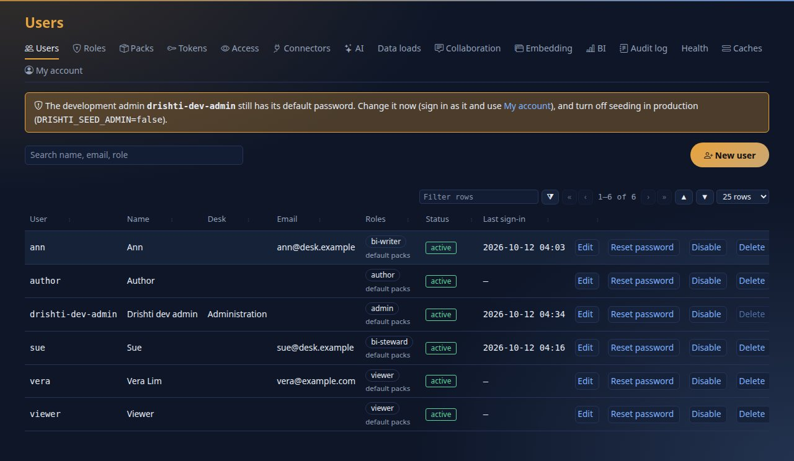
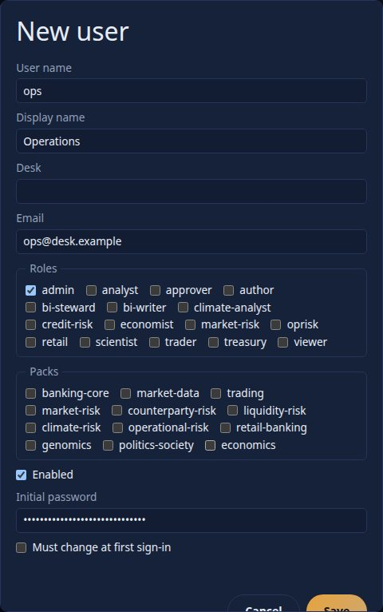
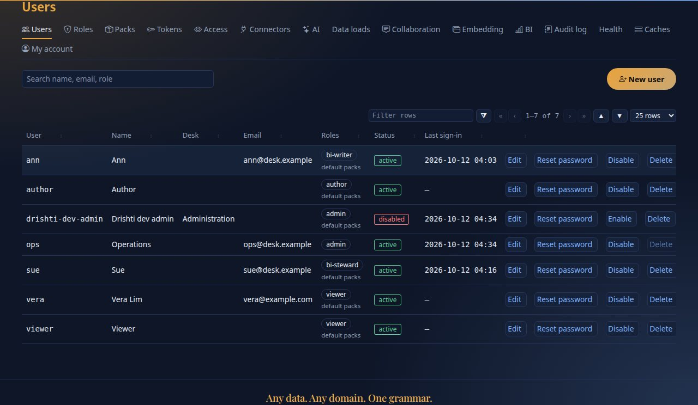
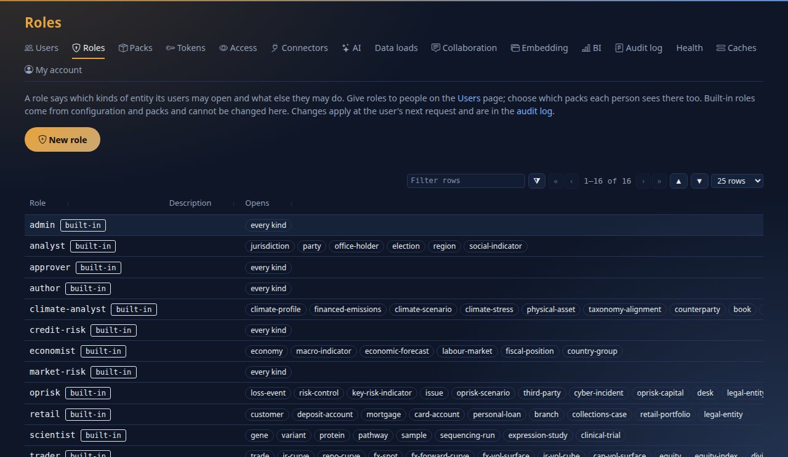
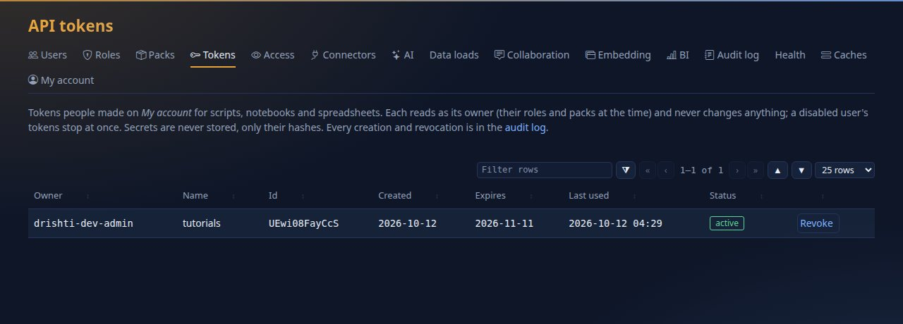
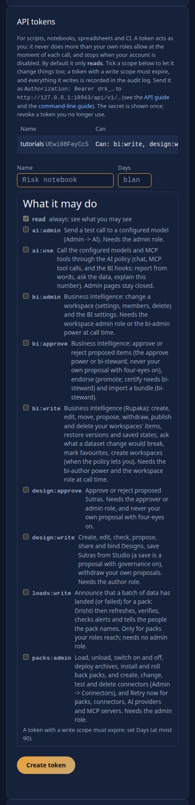
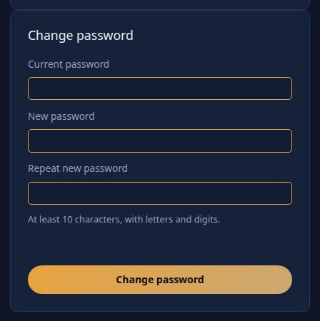
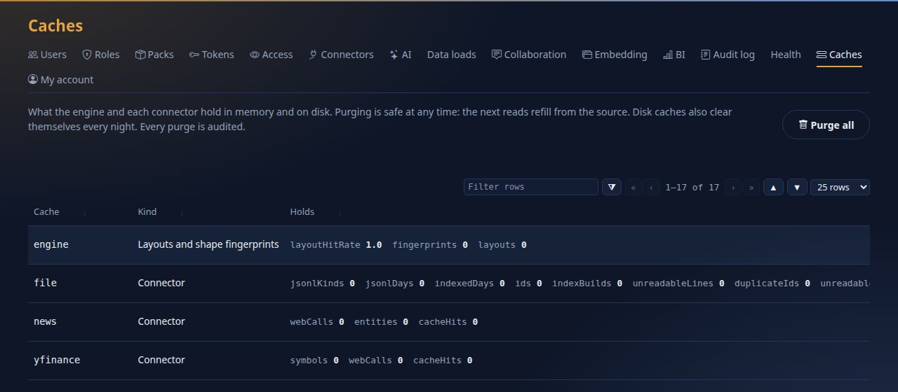
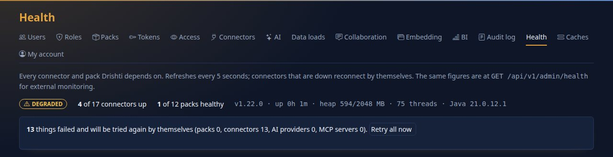
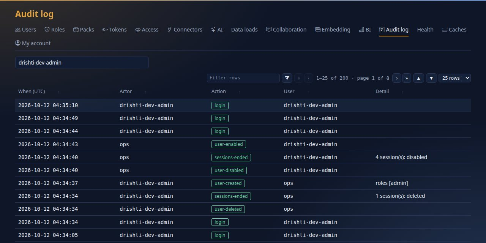

<!--
  Project Drishti · Any data. Any domain. One grammar.

  Copyright (c) 2026 Ashutosh Sinha <ajsinha@gmail.com>.
  All rights reserved.

  PROPRIETARY AND CONFIDENTIAL.

  This file is the confidential and proprietary property of Ashutosh Sinha.
  Unauthorised copying, use, modification, distribution or disclosure of this
  file, via any medium, is strictly prohibited except with the express prior
  written permission of the copyright holder.

  See the LICENSE file in the root of this repository for the full terms.
-->
# Tutorial 17 · Run it in production

Everything so far ran on your own machine as the development administrator. This tutorial is the walk from there to a shared installation you can hand to other people: **security on**, **your own administrator** instead of the development one, **roles and BI powers** that give each person what they need and no more, **tokens** and the secret that signs them, **backups** that you have tried
to restore, the **heap** and the **connection pools** sized for the machine and the databases, **health** you can watch, an **upgrade** you can roll back, and where to look when something goes wrong. It is a checklist you do, with the real output of each check. The complete reference is [OPERATIONS.md](../admin/OPERATIONS.md), and every step
names its section.

## Time to complete

About 60 minutes (most of it waiting for a restart or a backup you then read).

## Before you start

- A running server and console with sign-in on ([tutorial 1](01-first-15-minutes.md)); you have used Admin, Users and Roles in tutorials 8, 11 and 13.
- Shell access to the machine that runs the server (you restart it a few times) and `tar`, `curl` and `python3`.
- The pictures and outputs were made on ports 18943 and 17943; yours are 18480 and 17480. Paths and ports in the outputs are shortened to `~/drishti` and the defaults.

## What you will learn

- the production checklist of [OPERATIONS.md section 9](../admin/OPERATIONS.md#9-production-checklist), item by item, and how to check each one;
- how to retire the development administrator the safe way;
- users, roles and BI powers; what a token can and cannot do; why `DRISHTI_TOKEN_SECRET` is a master key and how to rotate it;
- what to back up, a backup script, and how to look inside the archive;
- how to set the heap, and what to look at to know it is enough; how to size database connection pools;
- the health endpoints and the **Admin → Health** page; the steps of an upgrade and of a rollback; troubleshooting.

## Step 1 · Security on, and proof that it is

On the **server**: `DRISHTI_SECURITY_ENABLED=true` and `DRISHTI_TOKEN_SECRET` of at least 32 bytes. On the **console**: `DRISHTI_AUTH_ENABLED=true`, `DRISHTI_SESSION_SECRET` of at least 32 characters, and **the same** token secret as the server. Generate secrets, do not invent them, and keep them in a file only the service user can read:

```bash
openssl rand -hex 32                                  # a value for DRISHTI_TOKEN_SECRET; run again for DRISHTI_SESSION_SECRET
install -m 0600 /dev/null /etc/drishti/drishti.env    # the environment file the services read (systemd: EnvironmentFile=)
```

Never put a secret in a configuration file, an image, a repository or a ticket. Check that the server refuses a caller with no token:

```text
$ curl -s localhost:18480/api/v1/sources
{"title":"unauthenticated","status":401,"code":"DRS-5010","detail":"DRS-5010 missing bearer token"}
```

You should see `401 DRS-5010`. (A server with security off answers the request: never do that on a shared machine.) And check the console: a private browser window opening it must be sent to the sign-in page; sessions follow the user, so disabling or demoting someone takes effect within ten seconds.

The other switches of the checklist, each with its check in OPERATIONS.md: **demo source off** (`DRISHTI_DEMO_ENABLED=false`: the tutorials used its live ticks; production reads your real sources), **authoring off** (`DRISHTI_STUDIO_SAVE=false` except where you author, with `DRISHTI_SUTRA_REVIEW=true` and `DRISHTI_SUTRA_FOUR_EYES=true`), **TLS at a reverse proxy** with `DRISHTI_SECURE_COOKIE` left at `true`
([section 8](../admin/OPERATIONS.md#8-tls-and-the-reverse-proxy)), and **the ports**: only the proxy reaches the console, only the console reaches the server's `/api`, only monitoring reaches `/actuator`.

## Step 2 · Your own administrator, and the development one gone

A fresh install seeds an administrator, `drishti-dev-admin`, with a published password. Look at **Admin → Users**.



You should see the amber banner on every Admin page, and the users with their roles. The server reports the same fact:

```text
$ curl -s -H "Authorization: Bearer $DRISHTI_TOKEN" localhost:18480/api/v1/admin/status
{"defaultAdminPasswordInUse":true,"installedPacks":["banking-core","market-data","trading", ...],"forceChangeOnCreate":false,"users":6}
```

Make your own administrator first (**New user**): a name, an email, the role `admin`, and a password (or *Must change at first sign-in*, which you will usually want).



You should see the dialog filled in. Save, sign out, and **sign in as the new administrator**. Then retire the development one: change its password or **disable** it (a user who is disabled stops at once: their sessions end and their API tokens stop). Press **Disable** on the `drishti-dev-admin` row.



You should see `disabled` on its row and **no banner**: with the account off, nobody can sign in with the published password. The server agrees:

```text
$ curl -s -H "Authorization: Bearer $OPS_TOKEN" localhost:18480/api/v1/admin/status
{"defaultAdminPasswordInUse":false, ...}
```

The system will not let you disable **the last enabled administrator** (`DRS-6006`): make the second one first, as you just did. Last, tell the server never to seed it again: `DRISHTI_SEED_ADMIN=false` (or, for a first start on a fresh machine, `DRISHTI_SEED_USERNAME` and `DRISHTI_SEED_PASSWORD` for the administrator you want). Every one of these actions is in **Admin → Audit log** (picture in step 7).

## Step 3 · Roles, BI powers, masks

A role is a name with what it may see and do: the kinds it opens, whether it sees fields unmasked (`raw`), may author, approve, administer, and its **BI powers**. Look at **Admin → Roles**.



You should see the built-in roles (read-only, from configuration) and the ones you made. Rules of thumb for a shared installation:

- **Give people the smallest role that does their job.** `viewer` reads; `trader` and the pack roles read their own packs' kinds; `author` designs screens; `approver` approves them; `admin` administers.
- **`raw` is the power to see masked fields.** Keep `drishti.security.redact` listing every field that must read `•••` to people without `raw`: a mask hides only the field it names, so list every field that holds the value ([CONFIGURATION.md](../admin/CONFIGURATION.md#field-masks)). Embedded views always mask, whatever the user's roles.
- **BI powers** are in **Admin → BI** ([tutorial 13](13-govern-bi.md)): `bi` opens BI, `bi-author` creates and publishes in workspaces, `bi-steward` certifies, `bi-admin` manages and can force. The BI settings page also says who may create shared workspaces.
- **Packs** limit what a user's kinds can reach: a user sees only the packs ticked on their account.


Single sign-on is optional: `DRISHTI_OIDC_ENABLED=true`, the issuer and client id on both processes, the client secret and redirect address on the console, and a map from the identity provider's groups to Drishti roles on the server ([USER_MANAGEMENT.md](../admin/USER_MANAGEMENT.md)).

## Step 4 · Tokens, and the secret that signs them

There are three kinds of token, and they are not the same thing.

| Token | Made by | Does | Lives |
|---|---|---|---|
| **Session** (the cookie) | signing in at the console | what the user's roles allow | until sign-out or until the user is disabled |
| **Personal API token** (`drk_...`) | the user, in **My account → API tokens** | **reads** as its owner; may change things only if given a write scope, and then must expire | up to 90 days; stops at once when the owner is disabled |
| **Embed token** | a host application's backend ([tutorial 16](16-embed-drishti.md)) | read-only and always masked, for one origin and scope | minutes |

Personal tokens are listed for everyone in **Admin → Tokens**:



You should see the token of tutorial 1 (`tutorials`), who owns it, when it was last used and its status, and **Revoke**. A secret is never stored, only its hash; every creation and revocation is in the audit log. On **My account** a person makes their own:



You should see the form with **read** always on and each write scope explained; a token with a write scope must expire. The same page has **Change password**:



Now the important one. **`DRISHTI_TOKEN_SECRET` is a master key**: the console signs every token it hands the server with it (HS256) and the server accepts *any* token signed with it, so whoever holds it can act as any user with any role. Protect it like a database root password: `0600` file, only on the two hosts that need it, a different value in every environment, never in a repository. **Rotate** it on a schedule (90 days is common), when someone who knew it leaves, and at once after a suspected leak:

1. generate a new value (`openssl rand -hex 32`);
2. put it in the server's **and** the console's environment;
3. restart both together. Every token signed with the old secret stops working (users sign in again); personal `drk_` tokens are not signed with it and keep working: revoke them in **Admin → Tokens** if the leak could have reached them.

There is no overlap window for two secrets, so choose a quiet moment. Review **Admin → Audit log** after a suspected leak: actions are recorded under the user name in the token, including one that was made up.

## Step 5 · Back it up, and look inside

Drishti's own state is a few folders: the **identity database** (users, password hashes, the audit log, saved preferences, BI drafts and history), the **governance** folder (proposals and approvals), your **sutras**, `config/` (connectors, BI, AI), and your **environment file**. The lake is yours to back up with your data platform. The console writes nothing. [OPERATIONS.md section 10](../admin/OPERATIONS.md#10-backups-and-restore) has the full table;
this is the script, and it works on any machine with `python3` (the database is copied with SQLite's own backup call, which is safe while the server runs; `sqlite3 data/identity/drishti.db ".backup ..."` does the same where that program is installed):

```bash
#!/usr/bin/env bash
# /opt/drishti/backup.sh: 14 nightly archives of Drishti's own state
set -euo pipefail
cd /opt/drishti
stamp=$(date +%Y%m%d-%H%M)
if [ -f data/identity/drishti.db ]; then
  python3 -c "import sqlite3; s = sqlite3.connect('data/identity/drishti.db'); d = sqlite3.connect('data/identity/backup.db'); s.backup(d); d.close()"
fi
keep=()                                    # only what exists here
for p in data/identity data/governance data/packs data/loads data/designs data/collab sutras config/connectors config/bi config/ai config/mcp application.local.yaml; do
  [ -e "$p" ] && keep+=("$p")
done
tar czf /backup/drishti/drishti-$stamp.tgz --exclude=data/identity/drishti.db* "${keep[@]}"
ls -1t /backup/drishti/drishti-*.tgz | tail -n +15 | xargs -r rm --
```

Run it from cron (`30 1 * * * /opt/drishti/backup.sh`) as the service user. A backup you have not read is a hope: look inside the archive.

```text
$ tar tzf /backup/drishti/drishti-20261012-0028.tgz | grep -v config/connectors/ | head -12
data/identity/
data/identity/backup.db
data/governance/
sutras/
config/bi/
config/bi/datasets/
config/bi/datasets/live-trading.dataset.yaml
config/bi/datasets/world-economics.dataset.yaml
config/bi/datasets/trades-basic.dataset.yaml
config/bi/datasets/live-exposure.dataset.yaml
config/bi/datasets/trading-risk.dataset.yaml
config/bi/datasets/trading-cashflows.dataset.yaml
```

You should see `data/identity/backup.db` (the consistent copy of the live database; the live `drishti.db` and its `-wal` and `-shm` files are left out on purpose), `data/governance/`, your sutras and your BI folder (this archive is 360,016 bytes). **Restore** is the reverse, and you try it once on another machine: stop the server; move the damaged folders aside; unpack the archive; `mv data/identity/backup.db data/identity/drishti.db`; fix the owner; start; sign in as an administrator and open **Admin → Users** and **Admin → Audit log**: the users and the recent events are there.
The ActiveMQ and RabbitMQ connectors' state folders (`data/state/`) are the exception: copy them with the server stopped.

## Step 6 · The heap, the caches and the pools

**The heap.** Without a limit the JVM takes a quarter of the machine's memory as its ceiling. Look at what you have:

```text
$ curl -s -H "Authorization: Bearer $DRISHTI_TOKEN" localhost:18480/api/v1/admin/health | python3 -c "import json,sys; print(json.load(sys.stdin)['server'])"
{'version': '1.22.0', 'uptimeSeconds': 567, 'java': '21.0.12.1', 'heapUsedMb': 637, 'heapMaxMb': 15576, 'threads': 67, 'cpus': 24}
```

On this 64 GB machine the ceiling is `15576` MB (a quarter). Set it on purpose in the service's environment, with a collector that suits a server (`-XX:+UseZGC -XX:+ZGenerational`, [OPERATIONS.md section 7](../admin/OPERATIONS.md#7-running-as-services-systemd)):

```bash
Environment=JAVA_TOOL_OPTIONS=-Xmx2g -XX:+UseZGC -XX:+ZGenerational     # in the systemd unit, or export it before starting the server
```

```text
$ curl -s -H "Authorization: Bearer $DRISHTI_TOKEN" localhost:18480/api/v1/admin/health | python3 -c "import json,sys; print(json.load(sys.stdin)['server'])"
{'version': '1.22.0', 'uptimeSeconds': 7, 'java': '21.0.12.1', 'heapUsedMb': 866, 'heapMaxMb': 2048, 'threads': 64, 'cpus': 24}
```

You should see `heapMaxMb` at `2048`. How big? Give the server a heap of **8 GB or more** when it serves a big lake or many live streams ([OPERATIONS.md section 11](../admin/OPERATIONS.md#11-the-lake-where-it-lives-and-keeping-it-bounded)), leave the machine memory for the BI engine (`drishti.bi.query.memory-limit`, 768 MB by default, and its threads), and watch **Heap high** in monitoring: `sum(jvm_memory_used_bytes{area="heap"}) / sum(jvm_memory_max_bytes{area="heap"}) > 0.9` for ten minutes means raise it or lower a cache.
Every cache has a bound you can set; **Admin → Caches** lists them with their statistics and a purge button.



You should see each cache with its statistics; `layoutHitRate` well below 0.99 after warm-up means the data's shapes vary a lot (raise `drishti.engine.layout-cache-size`).

**Database connection pools.** Every database connector, and the identity database on PostgreSQL, has a pool of up to `pool-size` connections (20 by default). The database must accept all of them at once:

```text
max_connections  >=  (sum of the pool sizes of every connector that points at it + the identity pool + loaders + your own clients)  x  server instances
```

With the six banking connectors of the `postgres` profile, the identity database and a loader, on two server instances (a worked sum you can run):

```text
$ python3 docs/tutorials/data/pools.py
connectors 120 + identity 20 + loader 20 = 160 per server instance; x 2 instances = 320
PostgreSQL's default max_connections is 100: NOT enough
```

You should see that the default is **not enough**, and the symptom when it is not: `FATAL: sorry, too many clients already` from the database, long before a Drishti pool is exhausted. Raise `max_connections`, put PgBouncer in front (transaction mode), or lower the pools (`pool-size` per connector, or `drishti.db.pool.size`). A pool opens connections only as used and closes extras after `pool-idle-timeout`, so the sum is a ceiling; start from the busiest reads, since a pool needs `scan-threads` plus the reads you expect at once, and a quiet connector needs 2 to 4.
[OPERATIONS.md section 16](../admin/OPERATIONS.md#16-capacity) has the rest, and says what MongoDB, Redis and Aerospike limit.

## Step 7 · Health: what to watch

There are three levels. For a **load balancer or an orchestrator**, no token:

```text
$ curl -s localhost:18480/actuator/health/liveness       # restart the process if this fails
{"status":"UP"}
$ curl -s localhost:18480/actuator/health/readiness      # send traffic only when this is UP
{"status":"UP"}
$ curl -s localhost:17480/healthz                        # the console process answers
{"status":"UP","pythonRuntime":"not installed: run tools/fetch-pyodide.sh"}
$ curl -s localhost:17480/readyz                         # the console can reach the server
{"status":"UP","server":"reachable"}
```

You should see `UP` four times. (`pythonRuntime` says whether Calc's browser Python is installed: only a Calc panel needs it.) For **people**, **Admin → Health**:



You should see the status (`OK`, `DEGRADED` when any source is down, stale or a pack has a problem, `DOWN` when no source is up), the version and the heap against its ceiling, and what is being retried: below it each connector with its state, last update, read latency and last error. (On this stack the lake of the banking demo was never built, so thirteen connectors are `DOWN` and retried with growing waits: a fresh install looks like this until you build it, as tutorial 1 said. The heap figure is the 2 GB ceiling you set above.)
For **monitoring**, Prometheus scrapes `/actuator/prometheus` with `Authorization: Bearer $DRISHTI_METRICS_TOKEN` (with security on every `/actuator` endpoint but health needs it), and there is a Grafana dashboard and a list of suggested alerts in [OPERATIONS.md section 13](../admin/OPERATIONS.md#13-monitoring). The one-call summary for a script is `GET /api/v1/admin/health`:

```text
{"status": "DEGRADED", "summary": {"packs": 12, "failedToStart": 0, "packsWithProblems": 12, "sourcesDown": 14, "sourcesDegraded": 0, "sources": 18},
 "server": {"version": "1.22.0", "uptimeSeconds": 567, "java": "21.0.12.1", "heapUsedMb": 637, "heapMaxMb": 15576, "threads": 67, "cpus": 24},
 "sutras": {"hotReload": "WATCHING", "problemFiles": 0}, "live": {"p99Ms": 0.0, "streams": 0, "p50Ms": 0.0, "frames": 112, "droppedFrames": 0, "topics": 750}}
```

And the machine itself, in one command, before you start anything:

```text
$ python3 tools/drishti.py doctor --server http://localhost:18480
GREEN  java                    /usr/lib/jvm/java-21-openjdk-amd64/bin/java: Java 21.0 (Ubuntu)
GREEN  server jar              ~/drishti/drishti-server/target/drishti-server-1.22.0-exec.jar (version 1.22.0)
GREEN  python                  /usr/bin/python3: Python 3.14.4
GREEN  python pyyaml           installed
YELLOW python deltalake        not installed (needed for data ingest --store delta)
                               fix: pip install deltalake   or run through uv: uv run --with pyyaml --with deltalake --with pyarrow python tools/drishti.py ...
YELLOW python pyarrow          not installed (needed for data ingest --store delta)
                               fix: pip install pyarrow   or run through uv: uv run --with pyyaml --with deltalake --with pyarrow python tools/drishti.py ...
GREEN  repo config/packs/      ~/drishti/config/packs
GREEN  console venv            ~/drishti/drishti-console/.venv
GREEN  configured directories  none of DRISHTI_DELTA_ROOT, DRISHTI_FILES_ROOT, DRISHTI_PACKS_INSTALLED is set
GREEN  port 18480              in use by Drishti: status UP
GREEN  port 17480              in use by Drishti: answers 404 on /actuator/health, as the Drishti console does
YELLOW server                  http://localhost:18480: version 1.22.0, java 21.0.12.1, status DEGRADED
GREEN  token                   accepted; this token acts as drishti-dev-admin: scopes bi:write, design:write, loads:write, packs:admin
doctor: 0 red, 3 yellow
```

The **audit log** is the other thing to watch. Everything an administrator does is in it:



You should see the story of step 2, filtered to the development administrator with the box at the top (a user name; empty shows everything): `user-created` for `ops` (by the development administrator), `user-disabled` by `ops`, `sessions-ended` (its sessions: `4 session(s): disabled`), `user-enabled` by `ops`, and the logins between them. (Unfiltered, the log also lists the system's own events such as a connector that could not be reached and is being retried.) Logs go to the service's standard output ([OPERATIONS.md section 14](../admin/OPERATIONS.md#14-logs)); the AI layer's Test connection and retry actions are lines in the console's log.

## Step 8 · Upgrade, and roll back

1. **Read the release notes** (`RELEASE_NOTES.md`, `CHANGELOG.md`) for anything marked as a change in configuration or storage.
2. **Back up** (step 5) and keep the old jar: `cp drishti-server.jar drishti-server-$(date +%F).jar`.
3. **Build or fetch** the new release: `./mvnw -q clean package -DskipTests`.
4. **Stop** the console and the server: `sudo systemctl stop drishti-console drishti-server`.
5. **Replace** the jar, `config/packs/`, `drishti-console/` and `docs/`; keep `drishti-console/.venv` and your `application.local.yaml`. Re-run `uv pip install --python drishti-console/.venv/bin/python -r drishti-console/requirements.txt` in case the console's libraries changed.
6. **Start** the server, then the console. (Upgrade them **together**: a new console cannot sign anyone in to an older server.)
7. **Verify** the version and readiness, and open **Admin → Health**:

```text
$ curl -s -H "Authorization: Bearer $DRISHTI_TOKEN" localhost:18480/api/v1/admin/health | python3 -c "import json,sys; print(json.load(sys.stdin)['server']['version'])"
1.22.0
$ curl -s localhost:18480/actuator/health/readiness
{"status":"UP"}
```

You should see the new version and `UP`. **Rollback** is the reverse: stop, put the old jar (or image tag) back, restore the backup **if** the new version changed stored data (the release notes say), start. Some upgrades make people sign in once more (after an upgrade that moved sessions to the server, cookies from before carry no session); the notes say so.

## Next steps

- [OPERATIONS.md](../admin/OPERATIONS.md) for everything above in full, and [CONFIGURATION.md](../admin/CONFIGURATION.md) for every setting. [USER_MANAGEMENT.md](../admin/USER_MANAGEMENT.md) for users, roles, single sign-on and embedding.
- [PERFORMANCE.md](../admin/PERFORMANCE.md) and [LOAD_AND_MEMORY.md](../admin/LOAD_AND_MEMORY.md) before you size a big installation; [TROUBLESHOOTING.md](../guides/TROUBLESHOOTING.md) and the runbooks in [the runbooks](../admin/OPERATIONS.md#17-runbooks) for incidents.
- The tutorials again, now as users: [tutorial 8](08-share-and-collaborate.md) and [tutorial 9](09-reports.md) are what your people will do first.

## If something goes wrong

| You see | Meaning and the first thing to do |
|---|---|
| everyone gets `401 DRS-5010` from the console | the two processes have different `DRISHTI_TOKEN_SECRET` values, or the server restarted with a new one and the console did not; make them equal and restart both |
| `DRS-6006` disabling a user | they are the last enabled administrator: make another first |
| the console is blank after sign-in | the server is unreachable: `curl localhost:17480/readyz` says `503`; start the server, check the address in the console's environment |
| users are signed out every few minutes | `DRISHTI_SESSION_SECRET` differs between console instances, or the proxy drops the cookie (`DRISHTI_SECURE_COOKIE=true` needs https) |
| `FATAL: sorry, too many clients already` | database pools exceed `max_connections`: step 6 |
| `OutOfMemoryError` or a heap above 90% for long | raise `-Xmx`, lower a cache (Admin → Caches), check live streams (`drishti.live.max-streams`) |
| a connector is `DOWN` | Admin → Health names it and the error; it is retried by itself with growing waits; **Retry all now** tries at once ([runbook](../admin/runbooks/source-down.md)) |
| live views lag | [runbook: live latency high](../admin/runbooks/live-latency-high.md) |
| a restore does not show the users | the unpacked `data/identity/backup.db` was not renamed to `drishti.db`, or the owner is wrong |
