<!--
  Project Drishti · Any data. Any domain. One grammar.

  Copyright (c) 2026 Ashutosh Sinha <ajsinha@gmail.com>.
  All rights reserved.

  PROPRIETARY AND CONFIDENTIAL.

  This file is the confidential and proprietary property of Ashutosh Sinha.
  Unauthorised copying, use, modification, distribution or disclosure of this
  file, via any medium, is strictly prohibited except with the express prior
  written permission of the copyright holder.

  See the LICENSE file in the root of this repository for the full terms.
-->
# Tutorial 18 · Several datasets in one report

A report usually starts from one dataset. Real questions do not stop there: *what is each sector's P&L next to its counterparty exposure?* needs the **trades** (where P&L lives) and the **netting sets** (where exposure lives), two things measured at two different grains. Since release 2.2.0 the answer is **one model with two facts**: the trades and the netting sets sit in one model with the dimensions they share (the counterparty, the desk), every measure is aggregated **at its own grain first** and the answers are then joined on the fields you asked for, so one visual can show MTM and exposure side by side and the totals stay the true ones. This tutorial builds that model in the **model designer**, puts both measures in one visual, shows why Drishti **never joins the rows** of two facts for you (and what a row join does to your totals), writes a measure that spans both facts, makes a table with a **Python Transform**, and shows two readers getting different, correct answers from one definition. Every step is done in the **UI**, again from the **command line**, and shown as the **YAML** the item keeps, with the real numbers of the demo data.

## Time to complete

About 60 minutes.

## Before you start

- [Tutorial 10](10-first-bi-report.md) done (reports, workspaces, models) and [tutorial 14](14-python-and-analyse.md) for Python and Analyse. You sign in as the development administrator, who holds `bi-author`.
- A token for the command line ([tutorial 1, step 9](01-first-15-minutes.md#step-9--make-a-token-for-the-command-line)); the commands below read it from `DRISHTI_TOKEN` and the server from `DRISHTI_SERVER`. Step 7 also uses two colleagues; make them in **Admin → Users** ([tutorial 17](17-run-it-in-production.md)): `rita` with a role `risk` (raw power on, BI power `bi`), and `hana` with a role `desk-head` (raw power **off**, BI power `bi`) and **Desk** `DESK-FX`.
- A shared workspace called **Exposure desk** (**Workspaces → New workspace**): a model and a report are published from a shared workspace; a private one cannot publish.
- The console's Python environment from tutorial 1 (it carries `pandas` and `pyarrow`), for steps 4, 6 and 8.
- **The one-day lake.** Every number below (`750` trades, MTM `138,562,638`, P&L `2,671,113`, `66` netting sets, exposure `1,447,544,943`, the sector rows) was taken on a lake of **one business day**. Tutorial 1 builds ten days, and then the sums are about ten times larger. To get the same numbers, make a one-day lake and point the server at it:

  ```bash
  uv run --with deltalake --with pyarrow --with pyyaml python tools/packgen/banking/make_data.py --lake data/delta-1day --days 1
  DRISHTI_DELTA_ROOT=data/delta-1day  # then restart the server
  ```

  With ten days every step still works and every check (the per-fact totals, the refusal, the trap) holds; only the digits differ.
- Files in [data/](data/): [cp-risk.model.yaml](data/cp-risk.model.yaml) (the model of step 2, for the command-line path), [cp-risk-view.report.yaml](data/cp-risk-view.report.yaml), [cp-risk-extracts.notebook.yaml](data/cp-risk-extracts.notebook.yaml), [cp-table.python.yaml](data/cp-table.python.yaml) and [cp-table.dataset.yaml](data/cp-table.dataset.yaml).

## What you will learn

- the two pack datasets, **Trade** and **Netting set**, and the **grain** of each (one row per trade, one row per netting set);
- a **model with two facts** in the model designer: datasets ticked, a role corrected, relationships accepted from the packs (and one proposed *inactive* with the reason), measures from columns, a measure over both facts in the **expression editor**, a row rule and the **safeguard**;
- **MTM and exposure in one visual**: each fact aggregated alone at the visual's grain, then joined, so the totals are the true ones, and the same question in Drishti SQL with the same plan;
- why Drishti **does not join rows** of two facts, with the inflated totals a row join gives, and why exposure **by desk** is refused (`DRS-9156`) rather than guessed;
- a **dataset made by a Python Transform** whose inputs are model queries, kept per reader;
- two readers with **different row rules and masks**, and why one reader's exposure is the same in the model and different in the Python table;
- the same analysis in **Analyse**, promoted to a visual, and how this compares with Power BI.

## Step 1 · The two datasets and their grains

Open **Models** in the BI rail. Every kind of every pack you may open is already a dataset (nobody builds them); search `trade` and open **Trade**.

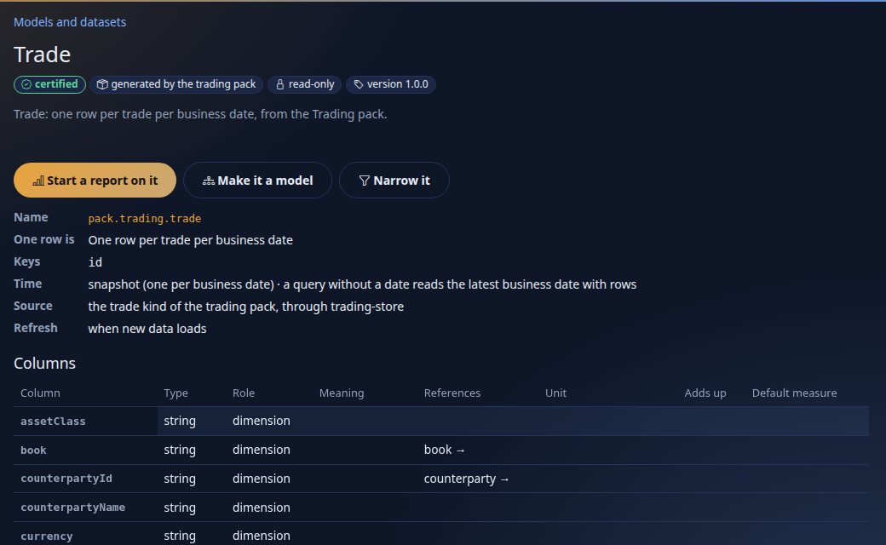

You should see what one row is (*One row per trade per business date*), the key (`id`), the time mode (*snapshot*), the source (*the trade kind of the trading pack, through trading-store*) and the columns: `counterpartyId` **references** `counterparty`, `desk` references `desk`, `nettingSet` references `netting-set`. Now open **Netting set** (search `netting`).

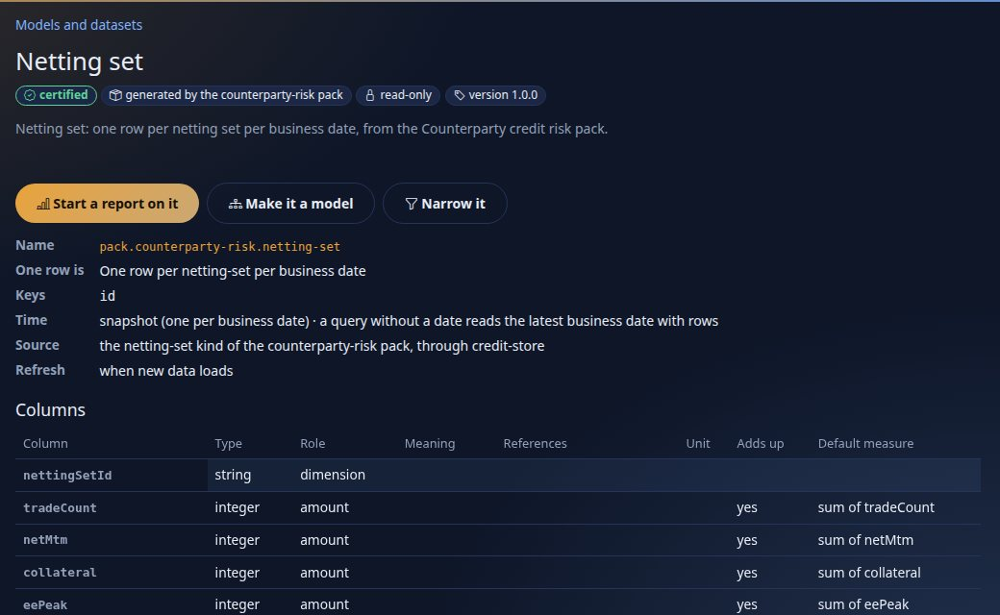

You should see *One row per netting-set per business date*: a different grain. A netting set has a counterparty (`counterparty` references it) and exposure figures (`eePeak`, `pfePeak`); it has **no desk**. Both datasets reach the counterparty, which is what lets them meet; only trades reach a desk.

**From the command line** each dataset is asked through its **implicit model** (`dataset:<name>`: the dataset as a fact, its pack dimensions one hop away, a default measure per amount column):

```text
$ python3 tools/drishti.py bi mq --model dataset:pack.trading.trade --measures "Count of trade,Sum of mtm,Sum of pnl1d"
Count of trade  Sum of mtm      Sum of pnl1d
--------------  --------------  ------------
750             138,562,638.00  2,671,113.00
1 row(s)  as of 2026-09-30  plan p_bc76418684fe0a05

$ python3 tools/drishti.py bi mq --model dataset:pack.counterparty-risk.netting-set --measures "Count of netting_set,Sum of eePeak"
Count of netting_set  Sum of eePeak
--------------------  -------------
66                    1447544943
1 row(s)  as of 2026-09-30  plan p_9cb5250ccd23f71f
```

**The YAML** of a pack dataset is written by Drishti from the pack (read-only; **Narrow it** makes a dataset of your own that `extends` it, [DATASETS.md section 14](../guides/DATASETS.md#14-derivation-subset-filter-grain-derive-group-22-wave-a)). The part that matters here is the grain:

```yaml
rachana: 2
dataset: pack.counterparty-risk.netting-set
version: 1.0.0
title: Netting set
source:
  pack: counterparty-risk
  kind: netting-set
  connector: credit-store
grain:
  says: One row per netting-set per business date
  date: businessDate
  keys:
  - id
time:
  as-of: business-date
  mode: snapshot
```

Keep four numbers: **750 trades, MTM 138,562,638, P&L 2,671,113** and **66 netting sets with expected exposure 1,447,544,943**. They are the true totals; the rest of the tutorial is about never losing them.

## Step 2 · One model, two facts

Still on **Models**, press **New model**. Title it `CP risk`, choose the workspace **Exposure desk**, and tick **Counterparty**, **Desk**, **Netting set** and **Trade**.

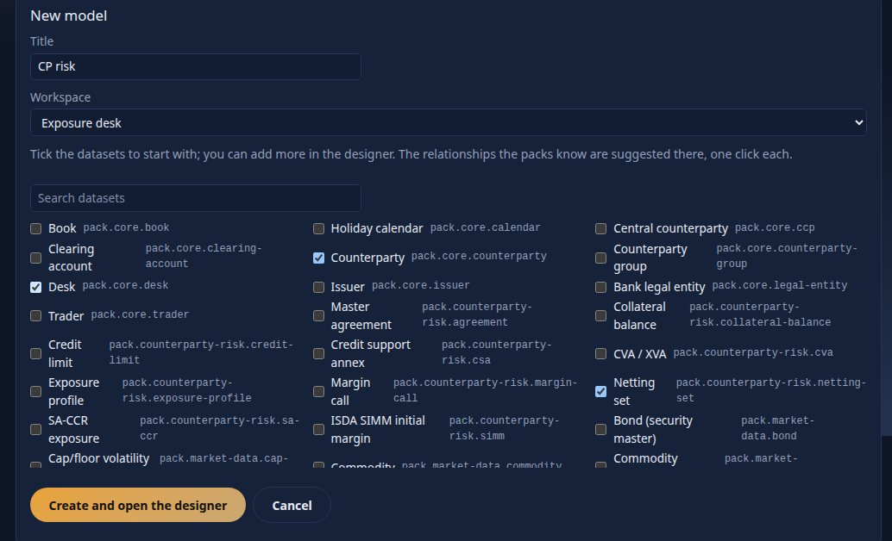

Press **Create and open the designer**. You land on the **canvas** with four boxes. The designer guessed each box's **role**: `trade` is a fact (it has amounts to add up); `counterparty` and `desk` are dimensions (other datasets reference them); and `netting_set` was guessed a dimension too, because trades reference netting sets. **A netting set has amounts to add (its exposure): change its role to `fact`** with the select on its box. Each box still carries a pinned problem (`DRS-9121`: no relationship yet), and under the canvas the **Suggested relationships** come from the packs' references:


You should see four suggestions, each one click: `netting_set.counterparty → counterparty.id`, `trade.counterpartyId → counterparty.id` and `trade.desk → desk.id` with **Add**, and `trade.nettingSet → netting_set.id` with **Add as inactive** and the reason *two facts: proposed inactive; relate both to a shared dimension instead*. That reason is the whole idea of this tutorial: two facts meet **through a dimension they share**, never row to row. Press **Add** on the first three and **Dismiss** the fourth.

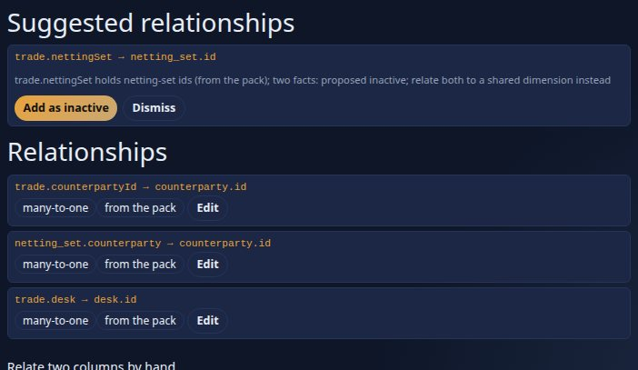

The pinned problems are gone and the lines are drawn (`* → 1`). Open the **Measures** tab. **New measure from a column** gives a measure with the right default: choose the dataset `trade`, the column `mtm`, **Add measure**; it arrives as `Sum of mtm`, `sum(trade.mtm)`, adding up. Rename it `MTM` in its row. Do the same for `trade` `pnl1d` (`P&L 1d`), `trade` *count the rows* (`Trades`), `netting_set` `eePeak` (`Exposure (EE peak)`) and `netting_set` *count the rows* (`Netting sets`):

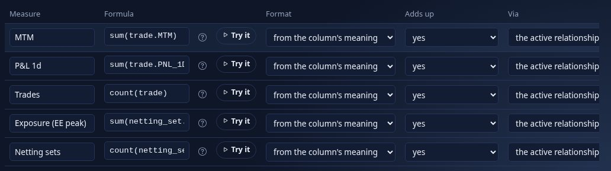

Then **Write a formula**: the name `MTM per exposure`, and in the formula type `MT`; the editor lists the measures that start so (a capital letter lists measures first) and writes `measure('MTM')` when you pick one. Type ` / Exp` and pick **Exposure (EE peak)**:

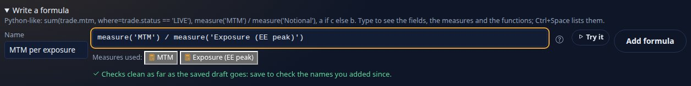

You should see the formula `measure('MTM') / measure('Exposure (EE peak)')`, the two measures it uses as **chips**, and the server's check: *Checks clean as far as the saved draft goes* (the model is not saved yet, so the two measures you just made are not on the server; Save and the check is complete). Press **Add formula**. A ratio of two sums is the right way to divide: it is worked out **after** each sum, so a sector's figure is MTM over exposure, never an average of per-row ratios. Give `MTM`, `P&L 1d` the format *signed amount, no decimals*, `Exposure (EE peak)` *amount, no decimals* and `MTM per exposure` *signed amount, 2 decimals*.

**Security.** Open the **Security** tab and **Add a rule for this model**: on `trade`, the role `desk-head` sees rows where *the column matches the reader*, `trade.desk` in *the reader's desks*; then `risk` and `admin` see *every row*. The rule restricts `desk-head` on trades and on nothing else, and the **safeguard** says so before you can publish:

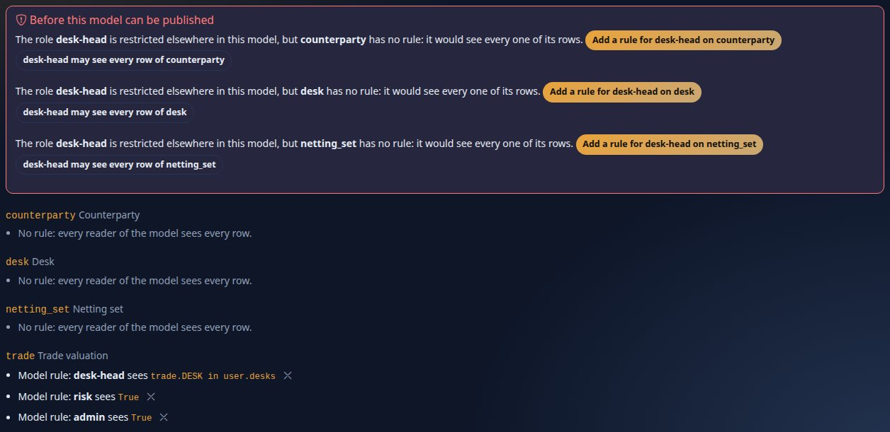

A desk head may see every counterparty, desk and netting set (the exposure of the whole bank is not secret to them; their trades are): press **desk-head may see every row of …** for the three. Each writes an audited note (`may-see-all`), not a rule. Under **Masked columns** mask `counterparty.name` (readers without the raw power read `•••`). On the **Contract** tab set the title `Counterparty P&L and exposure`. The **YAML** tab shows what the designer wrote; nobody typed it:

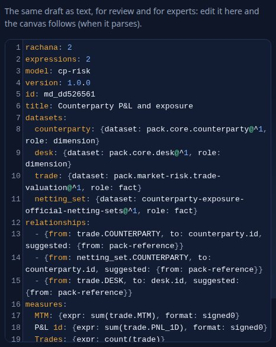

**Save** (`Saved draft`), then **Publish** (`Published`). The designer also saves the draft by itself two seconds after each change (*Draft saved at 14:02:31* beside the state; Ctrl+S saves the field you are still typing in too), and if someone saved the model meanwhile it opens a **merge view** (theirs and yours, part by part) instead of overwriting. If Publish is refused, the reason stays under the toolbar with the tab that fixes it (a contract change needing a new major opens **Contract**, which proposes the version). On the model's item page, give it the **Audience** `risk` and `desk-head` (tick them in the role list under *Roles*), so rita and hana may read it (step 7). The model as stored, with the stable ids the server adds on save (captured):

```yaml
rachana: 2
expressions: 2
model: cp-risk
version: 1.0.0
id: md_803c840d
title: Counterparty P&L and exposure
datasets:
  counterparty: {dataset: pack.banking-core.counterparty@^1, role: dimension}
  desk: {dataset: pack.banking-core.desk@^1, role: dimension}
  netting_set: {dataset: pack.counterparty-risk.netting-set@^1, role: fact}
  trade: {dataset: pack.trading.trade@^1, role: fact}
relationships:
  - { id: r_1,from: trade.counterpartyId, to: counterparty.id, suggested: {from: pack-reference}}
  - { id: r_2,from: netting_set.counterparty, to: counterparty.id, suggested: {from: pack-reference}}
  - { id: r_3,from: trade.desk, to: desk.id, suggested: {from: pack-reference}}
measures:
  MTM: { expr: sum(trade.mtm), format: signed0, id: m_mtm }
  P&L 1d: { expr: sum(trade.pnl1d), format: signed0, id: m_p_l_1d }
  Trades: { expr: count(trade), id: m_trades }
  Exposure (EE peak): { expr: sum(netting_set.eePeak), format: amount0, id: m_exposure_ee_peak }
  Netting sets: { expr: count(netting_set), id: m_netting_sets }
  MTM per exposure: { expr: measure('MTM') / measure('Exposure (EE peak)'), format: signed2, id: m_mtm_per_exposure }
security:
  rows:
    trade:
      - {role: desk-head, where: trade.desk in user.desks}
      - {role: risk, where: 'True'}
      - {role: admin, where: 'True'}
  may-see-all:
    netting_set: [desk-head]
    counterparty: [desk-head]
    desk: [desk-head]
  masked: [counterparty.name]
```

**From the command line** the same model is the file [cp-risk.model.yaml](data/cp-risk.model.yaml) (the YAML above without the server's ids). Check it, create it as an item in the workspace and publish it (the item calls are the ones every BI item uses; the answers are cut to the keys that matter):

```text
$ python3 tools/drishti.py bi model check docs/tutorials/data/cp-risk.model.yaml
valid  (model cp-risk)
  warning DRS-9131  security.rows.trade: roles without a rule see no rows of 'trade': approver, author, viewer. Add a rule for them (where: "True" lets a role see every row), or leave them out on purpose: they get "you have no access to rows of trade in this model"

$ curl -s -X POST -H "Authorization: Bearer $DRISHTI_TOKEN" -H 'Content-Type: application/json' \
    -d "$(python3 -c 'import json;print(json.dumps({"kind":"model","title":"Counterparty P&L and exposure","audienceRoles":["risk","desk-head"],"body":open("docs/tutorials/data/cp-risk.model.yaml").read()}))')" \
    $DRISHTI_SERVER/api/v1/bi/workspaces/exposure-desk/items
{"id":"bi-ebfd31d1dc","workspace":"exposure-desk","kind":"model","title":"Counterparty P&L and exposure","status":"draft", ...}
$ curl -s -X POST -H "Authorization: Bearer $DRISHTI_TOKEN" -H 'Content-Type: application/json' -d '{"note":"tutorial 18"}' $DRISHTI_SERVER/api/v1/bi/items/bi-ebfd31d1dc/publish
{"id":"bi-ebfd31d1dc","status":"published","publishedVersion":1, ...}

$ python3 tools/drishti.py bi model list --kind model
query    kind   title                          version  state
-------  -----  -----------------------------  -------  ---------
cp-risk  model  Counterparty P&L and exposure  1.0.0    published
```

The warning `DRS-9131` is Check naming the readers no rule matches: they get no trades, and their answers say so. It never stops a publish; leaving a role out may be the point. `python3 tools/drishti.py bi model describe cp-risk@1` lists every field of the four datasets and every measure, yours and the defaults (`Sum of mtm`, `Count of netting_set`, ...), as you see them.

## Step 3 · MTM and exposure in one visual

On the model's page press **New report on this model**, or create the report [cp-risk-view.report.yaml](data/cp-risk-view.report.yaml) in the workspace and publish it. Its bar puts `MTM` (a trades measure) and `Exposure (EE peak)` (a netting-set measure) on one axis, `counterparty.sector`:

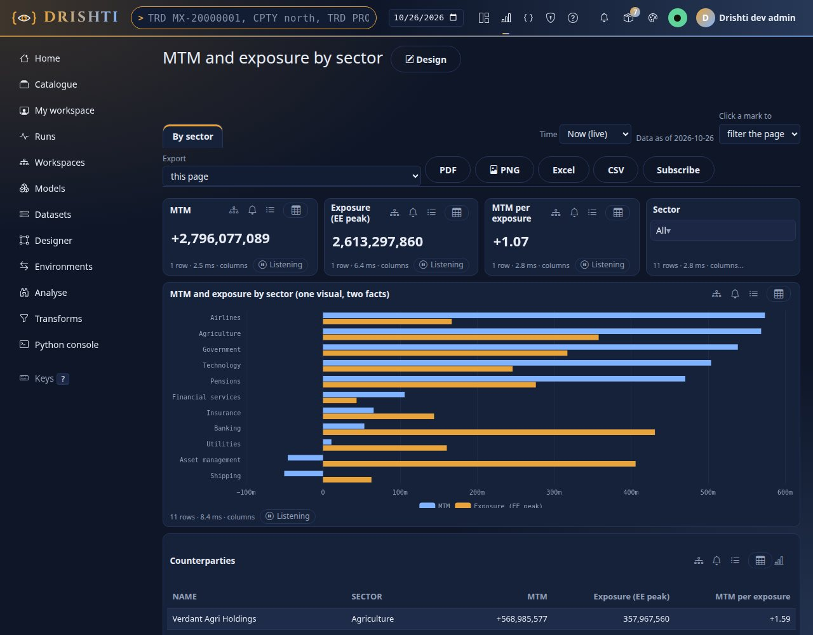

You should see the true totals of step 1 on the cards (`+138,562,638` and `1,447,544,943`) and, in **one visual**, both measures for eleven sectors. In the designer, drop `Exposure (EE peak)` on the bar that already shows MTM: it simply joins it, because both are measures of one model. The report reads the model by reference (`model: cp-risk@1`); a visual's wells name the model's fields and measures:

```yaml
rachana: 1
report: cp-risk-view
title: MTM and exposure by sector
model: cp-risk@1
pages:
  - id: view
    title: By sector
    visuals:
      - { id: sector, type: slicer, title: Sector, at: { x: 9, y: 0, w: 3, h: 2 }, wells: { field: [counterparty.sector] }, format: { mode: dropdown } }
      - { id: mtm, type: card, title: MTM, at: { x: 0, y: 0, w: 3, h: 2 }, wells: { values: [MTM] } }
      - { id: by-sector, type: bar, title: "MTM and exposure by sector (one visual, two facts)", at: { x: 0, y: 2, w: 12, h: 6 },
          wells: { axis: [counterparty.sector], values: [MTM, Exposure (EE peak)] } }
      - { id: table, type: table, title: Counterparties, at: { x: 0, y: 8, w: 12, h: 6 },
          wells: { columns: [counterparty.name, counterparty.sector, MTM, Exposure (EE peak), MTM per exposure] },
          sort: { by: Exposure (EE peak), desc: true }, limit: 8 }
```

Choose **Banking** in the **Sector** slicer:

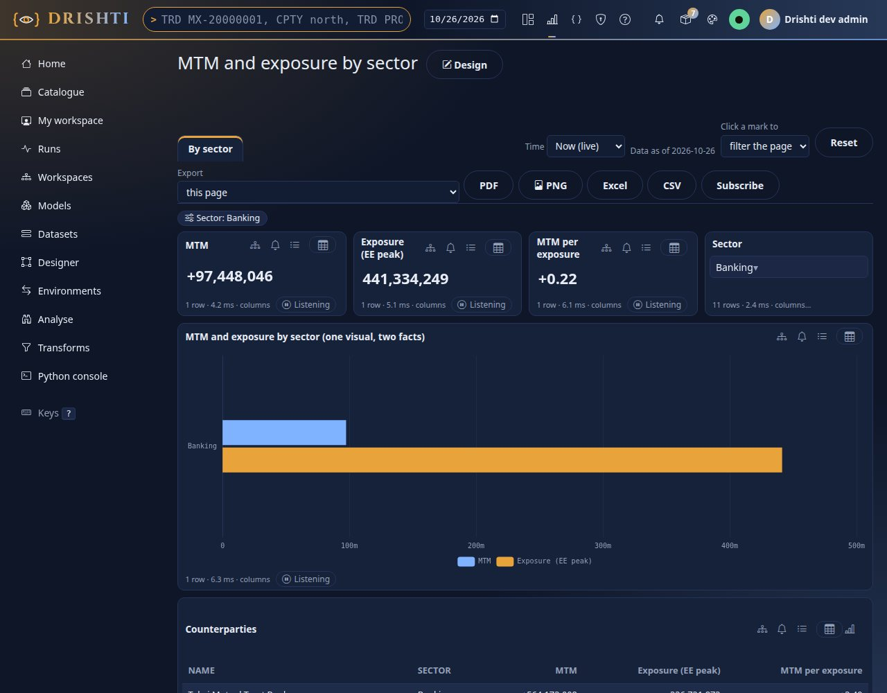

You should see MTM `+23,279,594` beside exposure `240,271,956`: one filter, both facts, because the sector belongs to the counterparty both facts reach. **How it is computed.** Each fact is **aggregated alone** at the question's grain (trades summed by sector, netting sets summed by sector), then the two answers are joined on the sector. The server says so in the answer:

```text
$ python3 tools/drishti.py bi mq --model cp-risk@1 --select counterparty.sector --measures "MTM,Exposure (EE peak),MTM per exposure"
counterparty.sector  MTM             Exposure (EE peak)  MTM per exposure
-------------------  --------------  ------------------  ----------------
Agriculture          20,378,377.00   59019457            0.35
Airlines             15,984,208.00   73868165            0.22
Asset management     70,776,928.00   289738661           0.24
Banking              23,279,594.00   240271956           0.10
Financial services   -553,996.00     91244622            -0.01
Government           -6,997,084.00   131131659           -0.05
Insurance            -31,823,216.00  210183239           -0.15
Pensions             16,462,059.00   98882895            0.17
Shipping             66,874,016.00   133327214           0.50
Technology           -46,466,242.00  44073211            -1.05
Utilities            10,647,994.00   75803864            0.14
11 row(s)  as of 2026-09-30  plan p_e087b3d383e37444
warning: 2 fact tables, each aggregated alone at the query's fields and then joined: [trade, counterparty, netting_set]
warning: a measure that combines measures of different grains is worked out over the joined results: MTM per exposure
```

The sector rows add up to the totals of step 1, to the unit. The same question in **Drishti SQL** ([SQL.md](../guides/SQL.md)): tables are the model's aliases, `JOIN` needs no `ON` (the model's relationships are used), a measure is `MEASURE('name')`:

```text
$ python3 tools/drishti.py bi sql "SELECT counterparty.sector, MEASURE('MTM') AS mtm, MEASURE('Exposure (EE peak)') AS ee
    FROM trade JOIN counterparty JOIN netting_set GROUP BY counterparty.sector ORDER BY ee DESC LIMIT 3" --model cp-risk@1
counterparty.sector  mtm             ee
-------------------  --------------  ---------
Asset management     70,776,928.00   289738661
Banking              23,279,594.00   240271956
Insurance            -31,823,216.00  210183239
3 row(s)  shape mq  plan p_79872d53b83c265d
warning: 2 fact tables, each aggregated alone at the query's fields and then joined: [trade, counterparty, netting_set]
```

`shape mq`: the statement was one model query, compiled into the same plan a visual asks. In the designer, **Query of the selected visual** shows the bar's question as a model query or as this SQL, with **Run as SQL** ([REPORTS.md section 19](../guides/REPORTS.md#19-languages-in-the-report-designer-wave-a)): the visual, the model query and the SQL are one question, so they share one plan and one cached answer per reader.

**What "aggregated alone, then joined" protects you from.** Exposure has no trade in it and P&L has no netting set in it, so a sector's exposure is the sum of that sector's 66-or-fewer netting sets **once each**, however many trades the sector has; and a sector's MTM is the sum of its trades **once each**, however many netting sets its counterparties have. Add the eleven sector rows of either column and you get step 1's totals, which is the check to run on any model with two facts: the sum of the parts is the whole. A sector whose counterparties have exposure but no trades today keeps its exposure and shows no MTM (empty, not zero), because the join of the two answers keeps both sides.

## Step 4 · Why Drishti does not join rows across facts

If both facts reach the counterparty, why not join each trade to its counterparty's netting sets and add up? Because the honest answer needs care. Open **Analyse** and the notebook [cp-risk-extracts.notebook.yaml](data/cp-risk-extracts.notebook.yaml) (create it as an item in the workspace, then choose it in the **Notebook** box). It holds **two extracts** of the model, each built by the server for you (your row rules, your masks): `df` is the trades (`counterpartyId`, `mtm`, `pnl1d`), and `extract("exposure")` is the netting sets (`counterparty`, `eePeak`):

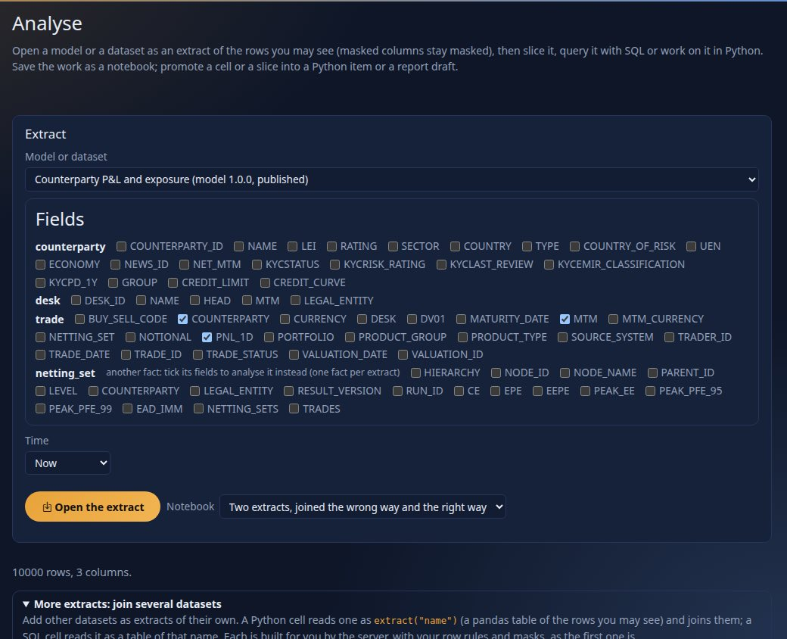

You should see `750 rows, 3 columns.` and, under **More extracts**, `exposure`. In the **Python** tab, the first cell does what a person who thinks in rows would do: join each trade to the netting sets of its counterparty, and add up.


You should see:

```text
trade rows 750  netting-set rows 66  rows after the row join 2571
P&L 1d   true 2671113   row join 13709123
EE peak  true 1447544943   row join 61962950266
```

Every trade of a counterparty with four netting sets became four rows, so its P&L was counted four times; every netting set met every trade of its counterparty, so exposure was counted once per trade. The P&L is **5.1 times** too big and the exposure **42.8 times**; nothing failed, and the table looks like a table. That is the **fan-out** trap. The second cell does what the model does for you: add each side up to the counterparty first, then join the sums, and draw it:

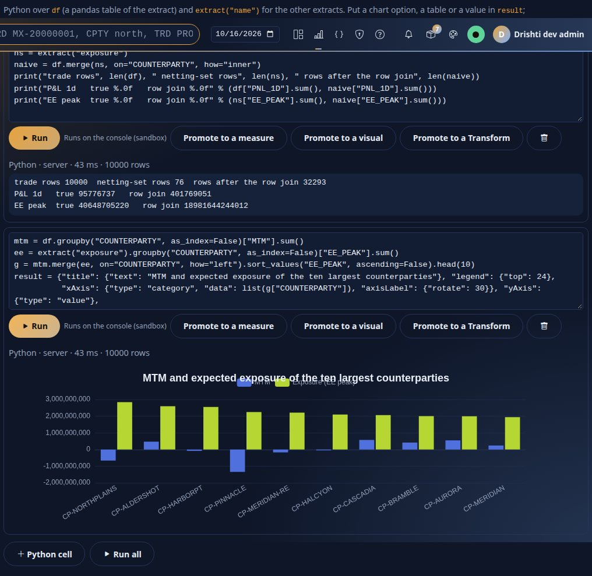

Its sums are step 1's totals again. **From the command line**, Analyse is the console's route (a signed-in session, not a token); with a cookie from `curl -c jar -d 'user=...&password=...' $CONSOLE/login` the first cell is one call:

```text
$ curl -s -b jar -H 'Content-Type: application/json' -X POST $CONSOLE/bi/explore/python -d '{"extract":{"dataset":"mq:cp-risk@1","fields":["trade.counterpartyId","trade.mtm","trade.pnl1d"]},
    "extracts":[{"name":"exposure","dataset":"mq:cp-risk@1","fields":["netting_set.counterparty","netting_set.eePeak"]}], "source":"..."}'
{"kind":"cell","stdout":"trade rows 750  netting-set rows 66  rows after the row join 2571\nP&L 1d   true 2671113   row join 13709123\n...","inputRows":750,"target":"server", ...}
```

**What the model refuses.** A desk is a grain of trades only: a netting set has no desk. Ask the model for exposure by desk and it refuses rather than guess:

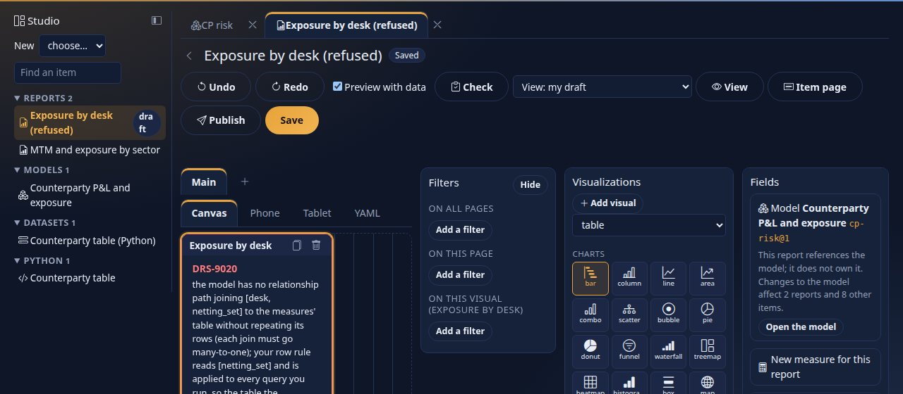

```text
$ python3 tools/drishti.py bi mq --model cp-risk@1 --select desk.name --measures "Exposure (EE peak)"
drishti: the server said 422 DRS-9156: DRS-9156 the model has no relationship path joining [desk, netting_set] to the measures' table without repeating its rows
(each join must go many-to-one). Group by a field they all reach (counterparty.counterpartyId, counterparty.name, counterparty.lei, counterparty.rating) or ask the measures apart.

$ python3 tools/drishti.py bi mq --model cp-risk@1 --select desk.name --measures "MTM,Trades"
desk.name                    MTM             Trades
---------------------------  --------------  ------
Bonds and securitised        -2,977,676.00   78
Commodities                  16,954,390.00   90
...
G10 and EM FX                -15,759,419.00  84
...
Rates · Swaps and options    161,766,771.00  156
10 row(s)  as of 2026-09-30  plan p_29897ddd851b06f7
```

The fix the message offers is the design: group by what both facts reach (the counterparty and its sector, rating, country), or ask exposure alone. **In YAML** there is nothing to write: the refusal comes from the relationships of step 2 (`trade.desk → desk.id` exists; nothing joins a netting set to a desk).

## Step 5 · A measure over two facts

`MTM per exposure` of step 2 is a measure **over measures of two facts**: `measure('MTM') / measure('Exposure (EE peak)')`. It is worked out **after** each fact's aggregate, over the joined result, so at any grain it is the sum of MTM over the sum of exposure (Shipping `66,874,016 / 133,327,214 = 0.50`). The server's warning in step 3 says exactly that (*a measure that combines measures of different grains is worked out over the joined results*).

**In the UI** you wrote it in the expression editor (step 2); its check can be asked at any time from the command line, against the model as you see it:

```text
$ python3 tools/drishti.py bi expr validate "measure('MTM') / measure('Exposure (EE peak)')" --model cp-risk@1
valid  (del2, aggregate scope, type decimal)

$ python3 tools/drishti.py bi expr validate "sum(trade.mtm) / sum(netting_set.eePeak)" --model cp-risk@1
valid  (del2, aggregate scope, type decimal)
```

You should see `valid` for both, typed `decimal`. Both give the same numbers: `measure('…')` reuses the model's own definitions (and follows them if they change); the second spells the aggregates out. Prefer the first. **In YAML** it is one line of `measures:` (step 2). A measure that **divides row by row** across facts reads the language well but has no meaning, because a row of one fact has no row of the other; it is refused when it is asked (the check of the text alone cannot know it):

```text
$ python3 tools/drishti.py bi mq --model cp-risk@1 --define "X=sum(trade.mtm / netting_set.eePeak)" --measures X
drishti: the server said 422 DRS-9156: DRS-9156 the measures aggregate [trade, netting_set], which no many-to-one path connects: ask for them in separate queries.
Group by a field they all reach (counterparty.counterpartyId, counterparty.name, counterparty.lei, counterparty.rating) or ask the measures apart.
```

(`--define` adds a measure of this query only, as a report's own measure travels.) Inside one aggregate every column belongs to one fact; ratios inside one fact are recipes R35 and R40 of [EXPRESSIONS.md](../guides/EXPRESSIONS.md#11-recipes).

## Step 6 · A dataset made by a Python Transform

When the combination is more than sums and a ratio (a rank, a clean-up, a model), write it in Python. A **Transform** is a Python item with `interface: transform`: a function `run(pnl, exposure, params)` that gets each **input's answer** as a pandas frame, **already masked for the reader**, and returns a table. Create [cp-table.python.yaml](data/cp-table.python.yaml) as a *python* item (**New item**, kind *python*, **What does it make? A table**) and publish it:

```python
def run(pnl, exposure, params):
    """pnl: id, name, sector, MTM, Trades (the counterparty's fields, without their alias).  exposure: id, Exposure (EE peak)."""
    short = lambda f: f.rename(columns=lambda c: c.split(".")[-1])          # counterparty.id and id are the same column
    p = short(pnl).rename(columns={"id": "counterparty", "MTM": "mtm", "Trades": "trades"})
    e = short(exposure).rename(columns={"id": "counterparty", "Exposure (EE peak)": "ee_peak"})
    m = p.merge(e, on="counterparty", how="left")
    floor = float(params.get("floor", 1.0))
    m["mtm_per_exposure"] = m["mtm"] / m["ee_peak"].clip(lower=floor)
    m["exposure_rank"] = m["ee_peak"].rank(ascending=False, method="min")
    return m[["counterparty", "name", "sector", "mtm", "trades", "ee_peak", "mtm_per_exposure", "exposure_rank"]]
```

The dataset [cp-table.dataset.yaml](data/cp-table.dataset.yaml) names the Transform (by its title or catalogue id), asks **two model queries** of `cp-risk` as its inputs, each **already at the counterparty grain** (so the join in Python is one row to one row), and declares the columns it returns:

```yaml
rachana: 2
expressions: 2
dataset: cp-table
version: 1.0.0
title: Counterparty table (Python)
source:
  python: Counterparty table          # the Python item, by its title (or its catalogue id)
  inputs:
    pnl: {model: cp-risk@1, select: {fields: [counterparty.id, counterparty.name, counterparty.sector], measures: [MTM, Trades]}}
    exposure: {model: cp-risk@1, select: {fields: [counterparty.id], measures: [Exposure (EE peak)]}}
  params: {floor: 1.0}
grain: {says: One row per counterparty, keys: [counterparty]}
columns:
  counterparty: {type: string, role: key, references: counterparty}
  mtm: {type: decimal, role: amount, additive: true, aggregate: sum, format: signed0}
  ee_peak: {type: decimal, role: amount, additive: true, aggregate: sum, format: amount0}
  mtm_per_exposure: {type: decimal, role: ratio, additive: false, format: signed2}
  ...
```

Create it in the workspace (**New item**, kind *dataset*, **Paste YAML**, or the dataset wizard's *Python Transform* source, [DATASETS.md section 15](../guides/DATASETS.md#15-the-dataset-wizard-version-2-wave-a)) and publish it. You should see its page say what one row is and where it comes from:

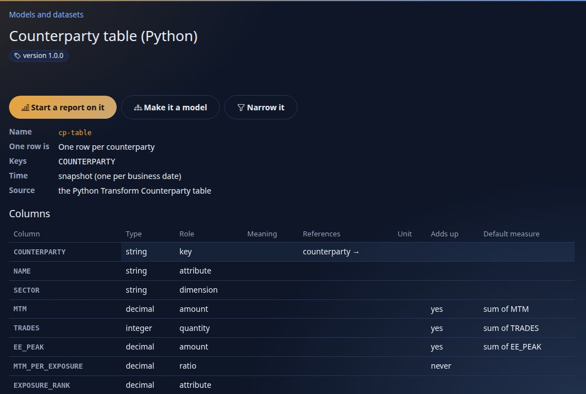

Ask it through its implicit model, like any dataset:

```text
$ python3 tools/drishti.py bi mq --model dataset:cp-table --measures "Sum of mtm,Sum of ee_peak"
Sum of mtm      Sum of ee_peak
--------------  ----------------
138,562,638.00  1,447,544,943.00
1 row(s)  as of 2026-10-09  plan p_71aab2c9d98254f6

$ python3 tools/drishti.py bi mq --model dataset:cp-table --select cp_table.name,cp_table.sector --measures "Sum of mtm,Sum of ee_peak" --limit 3
cp_table.name                 cp_table.sector   Sum of mtm     Sum of ee_peak
----------------------------  ----------------  -------------  --------------
Aldershot Pension Trust       Pensions          16,462,059.00  98,882,895.00
Aurora Sovereign Wealth Fund  Government        43,062,593.00  67,990,537.00
Bramble Asset Management      Asset management  60,210,878.00  75,741,467.00
3 row(s)  as of 2026-10-09  plan p_10fc09388627168a
```

The totals are step 1's, to the unit. The Transform's answer is **kept per reader** (until an input changes or `drishti.bi.transform.cache-ttl` passes): a second reader has other rows and masks, so it runs again for them. It runs in the console's sandboxed Python runner (no network, a scratch folder, CPU, memory and time limits: [PYTHON_BI.md section 7](../guides/PYTHON_BI.md#7-the-sandbox-exactly)), never in the browser; a failure in the code is `DRS-9071` with Python's message, a missing declared column `DRS-9075`. Because its inputs are model queries, a Python dataset can never read more than its reader may: it receives answers that rules and masks have already shaped. When to choose which: **the model** for sums and ratios at any grain (no code; the default); **a Python dataset** when you need code (a rank, a clean-up, a statistical model) and can accept a table computed per reader at one grain; a report on that dataset then reads it through its implicit model, like any other.

## Step 7 · Two readers: each dataset is filtered as the reader, before anything is joined

Drishti applies each dataset's rules **as the person reading, before any join or aggregate**: nothing a rule hides reaches a sum, a join or a Transform. In `cp-risk`, `desk-head` sees `trade.desk in user.desks` on trades and every row of the other three (the `may-see-all` notes); `risk` sees everything; the counterparty's name is masked for a reader without the raw power. Sign in as **rita** (role `risk`, raw power) and open the report; then as **hana** (a desk head of `DESK-FX`, no raw power):

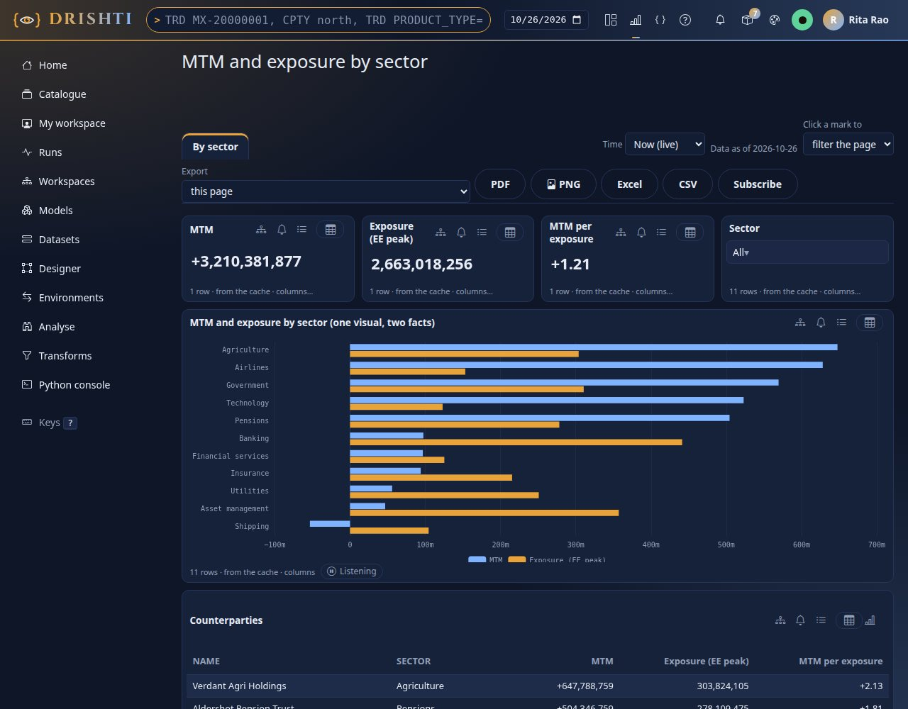

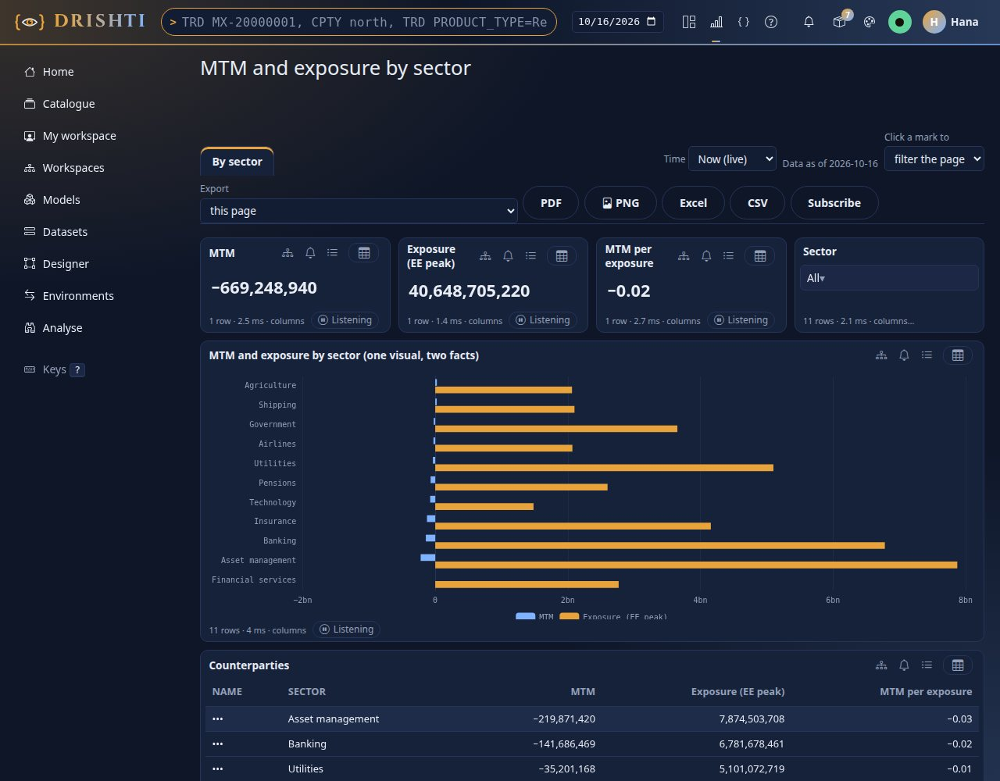

You should see two different reports from one definition. Rita's numbers are the totals of step 1. Hana's **MTM is `-15,759,419`**, her desk's trades only (the `G10 and EM FX` row of step 4); her **exposure is `1,447,544,943`**, the whole bank's, because the model lets a desk head see every netting set (step 2's note), and the two facts are aggregated **apart** before they meet, so her trade rule does not shrink the exposure. Her names read `•••`. From the command line, each with their own token (make one on **My account**, tutorial 1 step 9):

```text
rita$ python3 tools/drishti.py bi mq --model cp-risk@1 --measures "Trades,MTM,Exposure (EE peak)"
Trades  MTM             Exposure (EE peak)
------  --------------  ------------------
750     138,562,638.00  1447544943

hana$ python3 tools/drishti.py bi mq --model cp-risk@1 --measures "Trades,MTM,Exposure (EE peak)"
Trades  MTM             Exposure (EE peak)
------  --------------  ------------------
84      -15,759,419.00  1447544943

hana$ python3 tools/drishti.py bi mq --model cp-risk@1 --select counterparty.name --measures "MTM,Exposure (EE peak)" --limit 3
counterparty.name  MTM             Exposure (EE peak)
-----------------  --------------  ------------------
•••                -15,759,419.00  1447544943
1 row(s)  as of 2026-09-30  plan p_8ea85f7205a15b7e  masked counterparty.name
warning: counterparty.name is masked
```

A masked column holds one value for hana, so grouping by it gives one row (a masked dimension is not grouped on). Now the **Python table** of step 6, as each of them:

```text
rita$ python3 tools/drishti.py bi mq --model dataset:cp-table --measures "Sum of mtm,Sum of ee_peak"
Sum of mtm      Sum of ee_peak
--------------  ----------------
138,562,638.00  1,447,544,943.00
1 row(s)  as of 2026-10-09  plan p_71aab2c9d98254f6

hana$ python3 tools/drishti.py bi mq --model dataset:cp-table --measures "Sum of mtm,Sum of ee_peak"
Sum of mtm      Sum of ee_peak
--------------  ----------------
-15,759,419.00  1,356,300,321.00
1 row(s)  as of 2026-10-09  plan p_71aab2c9d98254f6
```

(The plan is the same for both: a plan is the question; who asks it is the security signature, kept apart, so the answers differ and each is cached for its reader.)

Hana's exposure there is **`1,356,300,321`**, not `1,447,544,943`: the Transform's inputs were asked as hana, her `pnl` input has a row only for the **17 counterparties her desk trades with**, and the Transform's `how="left"` keeps exposure only for those. The 18th counterparty (`Financial services`, exposure `91,244,622`, exactly the difference) is dropped **by the code**, not by a rule. Both answers are right for what they say: the model answers *the bank's exposure next to my trades*; this Python table answers *the exposure of my counterparties*. Choose the one your question means, and say it in the dataset's description.

**In YAML** the readers' difference is the `security:` block of step 2, nothing else: the rule is on one dataset (`trade`), the notes on the others, the mask on one field. A join or filter on a masked field is refused (`DRS-9161`), which is why the Transform's inputs join on the counterparty's **id**, never its name.

## Step 8 · The same analysis in Analyse, promoted to a visual

When you do not yet know the question, work it out in **Analyse** before you build anything (step 4 did the first half). Opening this two-fact model in Analyse ticks the fields of one fact (trades) and the dimensions; the netting sets' fields are marked *another fact* and stay unticked, because one extract has one grain. Open the notebook of step 4, in the **Python** tab, and press **Promote to a visual** under the second cell (the chart):

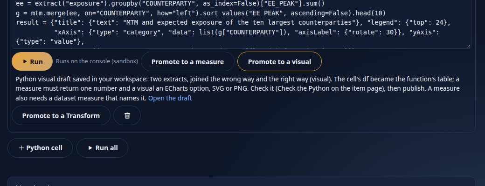

You should see `Python visual draft saved in your workspace` **beside the button you pressed** (with an *Open the draft* link; pressing it again offers **Update that draft** or **Save another**), and the notes: the cell's `df` became the function's `table`, a visual returns an ECharts option, SVG or PNG, and nothing is published for you. Be exact about what was kept: a visual reads **one model query** of its report, so the draft keeps `df` (the first extract); a cell that reads `extract("exposure")` as well belongs in a **Transform** (step 6): **Promote to a Transform** writes the function with each `extract("name")` as a parameter of `run(...)`. The path from an idea to a shared number is therefore: explore in Analyse, put the measures in the **model** when sums and ratios do it (most of the time), or **promote to a Transform** and make a Python dataset when they do not, then build the report. **From the command line** a notebook is an item like the others (`python3 tools/drishti.py bi catalogue get <id>` shows its YAML); its SQL cells run Drishti SQL over the model on the server ([ANALYSE.md section 4](../guides/ANALYSE.md#4-sql)).

## Step 9 · How this compares with Power BI

You should see a short, honest table, not a scorecard (the claims about Power BI are the ones of [BI_PARITY_PLAN.md](../architecture/BI_PARITY_PLAN.md), whose own knowledge of Power BI may be stale; check before you quote it):

| | Power BI | Drishti (2.2.0) |
|---|---|---|
| Several tables of different grains | one model, **relationships** between tables (many-to-one, many-to-many, bidirectional), DAX that follows them | one **model** with several **facts** and shared **dimensions**; each measure is aggregated **at its own fact's grain**, then the answers are joined on the asked fields |
| A slicer on a shared dimension | filters every fact through relationships | the same, one way (the dimension filters the facts); *both ways* arrives in a later wave |
| A field only one fact reaches | blank or repeated values, depending on the relationships | **refused** with the fields that work (`DRS-9156`), never a guessed or repeated number |
| A measure over two facts | DAX over two tables | `measure('MTM') / measure('Exposure (EE peak)')`, worked out over the joined results ([EXPRESSIONS.md](../guides/EXPRESSIONS.md)) |
| Row-level security | a rule per role in the model | a rule **per dataset, applied as the reader before any join**; a model can only tighten; the **safeguard** names a role left open on another dataset |
| Behind the tools | DAX, the Power BI service, capacity licences | one closed, compiled expression language (DEL, Python-like), Drishti SQL over the same plan, one open server, your own infrastructure |

Where Drishti is **behind**: no bidirectional or many-to-many relationships yet, no context transition and no `CALCULATE` until wave B (`calc`, `share_of`). Where it is deliberately different: it refuses to guess, and nothing joins the rows of two facts.

## Next steps

- [BI_GUIDE.md sections 23 and 24](../guides/BI_GUIDE.md#24-the-languages-in-the-console-wave-a-220) for models and the model designer, [EXPRESSIONS.md](../guides/EXPRESSIONS.md) for measures (fifty-odd recipes), [SQL.md](../guides/SQL.md) for Drishti SQL, [PYTHON_BI.md section 13](../guides/PYTHON_BI.md#13-transforms-a-table-in-a-table-out) for Transforms, [ANALYSE.md](../guides/ANALYSE.md) for extracts and promotion.
- [Tutorial 13](13-govern-bi.md): a change to the model is set against the reports and datasets that read it (impact), and the model travels in an environments bundle.
- [Tutorial 11](11-bi-that-runs-itself.md): a subscription or an alert on a measure of the model runs as its owner, and the reader's rules apply.

## If something goes wrong

| You see | Meaning and the first thing to do |
|---|---|
| a dataset with amounts guessed a *dimension* | another dataset references it: change its role to *fact* with the select on its box (step 2) |
| *Add as inactive* on a suggestion | it joins two facts directly; relate both to a dimension they share instead, and dismiss it |
| `DRS-9156` for a field and a measure | the field's dataset is not reached many-to-one from the measure's fact (a netting set has no desk): group by a field both facts reach, or ask the measure alone |
| a total several times what the source says | rows were joined, not sums (step 4): put the measures in one model, or aggregate each side to the key first |
| `DRS-9130` when publishing | the safeguard: a role restricted on one dataset is open on another; add a rule or press *may see every row* (step 2) |
| `DRS-9151` for a reader | they may not read the model: give the model an **Audience** (its item page), or share the report only |
| `DRS-9070` "no Python item" on a Python dataset | name the Transform by its catalogue id or its title, and publish it first |
| `DRS-9071` from a Transform | the code failed on the frames it got (a column named differently, for example); the message is Python's |
| *Checks clean as far as the saved draft goes* in the formula editor | the formula uses measures you made since the last save: wait for *Draft saved at …* (the autosave, two seconds after a change) or press Save, and the check is complete |
| *Saved elsewhere since you opened it* with a table of parts | someone saved the model while you edited it: the autosave stopped; keep theirs or yours for each part and press **Merge and save** |
