<!--
  Project Drishti · Any data. Any domain. One grammar.

  Copyright (c) 2026 Ashutosh Sinha <ajsinha@gmail.com>.
  All rights reserved.

  PROPRIETARY AND CONFIDENTIAL.

  This file is the confidential and proprietary property of Ashutosh Sinha.
  Unauthorised copying, use, modification, distribution or disclosure of this
  file, via any medium, is strictly prohibited except with the express prior
  written permission of the copyright holder.

  See the LICENSE file in the root of this repository for the full terms.
-->
# Tutorial 18 · Several datasets in one report

A report usually reads one dataset. Real questions do not stop there: *what is each sector's P&L next to its counterparty exposure?* needs the **trades** (a P&L dataset) and the **netting sets** (an exposure dataset), which are different things measured at different grains. This tutorial shows the four ways Drishti lets you put two datasets in front of one reader, why it **will not join their rows for you**, and how to pick the right one: a **report over two datasets** with links, a **composed dataset** written in YAML, a **derived dataset** made by a Python Transform, and a join you work out by hand in **Analyse**. Every step is done in the UI and again from the command line, with the real numbers of the demo data.

## Time to complete

About 60 minutes.

## Before you start

- [Tutorial 10](10-first-bi-report.md) done (reports, workspaces, the shipped *Desk P&L vs counterparty exposure* sample) and [tutorial 14](14-python-and-analyse.md) for Python and Analyse. You sign in as the development administrator, who holds `bi-author`.
- A token for the command line with the `bi:write` scope ([tutorial 1, step 9](01-first-15-minutes.md#step-9--make-a-token-for-the-command-line)); the commands below read it from `DRISHTI_TOKEN`. Step 7 also uses two colleagues; make them in **Admin → Users** ([tutorial 17](17-run-it-in-production.md)): `rita` with a role `risk` (raw power on, BI power `bi`), and `hana` with a role `desk-head` (raw power **off**, BI power `bi`) and **Desk** `DESK-FX`. The shipped `trading-risk` dataset has a row rule for each of those two role names; nothing else about them is special.
- The console's Python environment from tutorial 1 (it carries `pandas` and `pyarrow`), for steps 6 and 8.
- Files in [data/](data/): [two-datasets.report.yaml](data/two-datasets.report.yaml), [wrong-link.report.yaml](data/wrong-link.report.yaml), [cp-pnl-exposure.dataset.yaml](data/cp-pnl-exposure.dataset.yaml), [counterparty-view.report.yaml](data/counterparty-view.report.yaml), [mtm-vs-exposure.python.yaml](data/mtm-vs-exposure.python.yaml), [cp-pnl-exposure-py.dataset.yaml](data/cp-pnl-exposure-py.dataset.yaml) and [two-extracts.notebook.yaml](data/two-extracts.notebook.yaml). Put them in a shared workspace called **Exposure desk** (a report reads *published* datasets; a draft in your private workspace cannot be published).

## What you will learn

- the two datasets, `trading-risk` and `counterparty-exposure`, and the **grain** of each (one row per trade, one row per netting set);
- a **report with a visual on each**: *Main dataset* and *Also add*, the dataset tag on a visual, and **links** that carry a slicer or a click across, while an unlinked field does not and a wrong link gives an empty visual;
- why Drishti **does not join rows across datasets**, with the inflated total you get if you do;
- a **composed dataset** (`from:` and `join:`): MTM and exposure in one visual, a ratio measure, and what the checks say about a bad key;
- the same table made by a **Python Transform** (a derived dataset), kept per reader;
- two readers with **different row rules and masks**: each source is filtered as the reader before the join;
- the same analysis in **Analyse** with pandas over two masked extracts, promoted to a visual;
- how this compares with Power BI.

## Step 1 · The two datasets and their grains

Open **Datasets**, **Trading and counterparty risk** and run a preview grouped by `desks.name` with the measures `P&L 1d`, `MTM` and `Trades`.

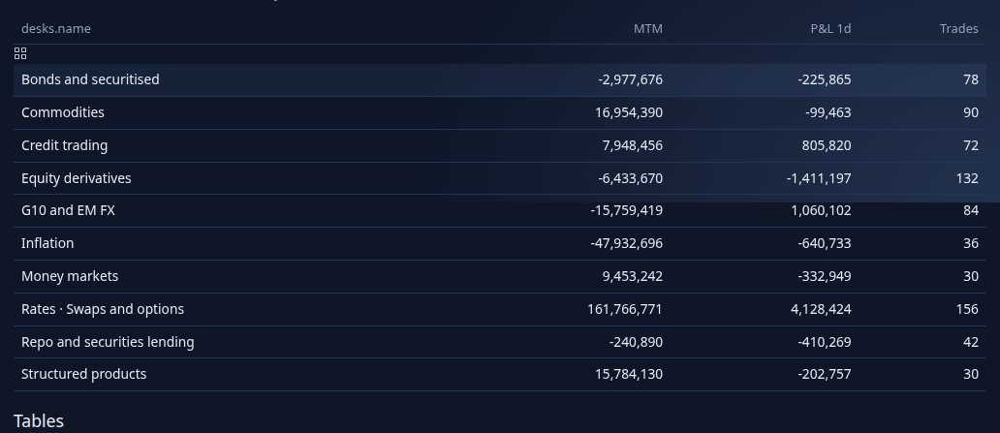

You should see ten desks. The dataset's fact table is `trades`: **one row per trade**, 750 of them. Now open **Counterparty exposure** and group by `counterparties.sector` with `Exposure (EE peak)` and `Netting sets`.

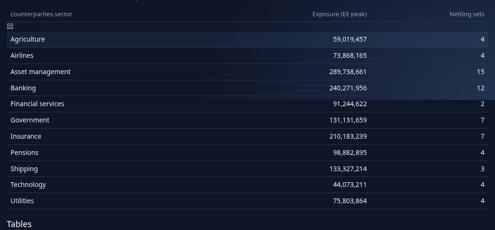

You should see eleven sectors. This dataset's fact table is `netting_sets`: **one row per netting set**, 66 of them, each with an expected and a potential future exposure peak. Both datasets know the counterparty and its sector (the `counterparties` table), which is what lets you line them up; only `trading-risk` knows a desk. **From the command line** the same grains are two queries (the token is the one of tutorial 1):

```text
$ curl -s -X POST -H "Authorization: Bearer $DRISHTI_TOKEN" -H 'Content-Type: application/json' \
    -d '{"fields":[],"measures":["Trades","P&L 1d","MTM"]}' http://localhost:18480/api/v1/bi/datasets/file:dataset:trading-risk/query
{"columns":[{"type":"integer","name":"Trades"},{"type":"decimal","name":"P&L 1d"},{"type":"decimal","name":"MTM"}],"rows":[[750,2671113.0,138562638.0]],"rowCount":1}

$ curl -s -X POST -H "Authorization: Bearer $DRISHTI_TOKEN" -H 'Content-Type: application/json' \
    -d '{"fields":[],"measures":["Netting sets","Exposure (EE peak)"]}' http://localhost:18480/api/v1/bi/datasets/file:dataset:counterparty-exposure/query
{"columns":[{"type":"integer","name":"Netting sets"},{"type":"decimal","name":"Exposure (EE peak)"}],"rows":[[66,1447544943.0]],"rowCount":1}
```

(The real answers also carry a `meta` block with the layer and timing; it is left out here and below.) Keep four numbers: **750 trades, P&L 2,671,113, MTM 138,562,638** and **66 netting sets, expected exposure 1,447,544,943**. They are the true totals; the rest of the tutorial is about not losing them.

## Step 2 · A report with a visual on each

Open the **Designer**. The start form asks for a **Main dataset** (the report's own) and an optional **Also add** list (hold Ctrl or Shift for several). Choose *Trading and counterparty risk* as the main one, *Counterparty exposure* under **Also add**, and the title `Side by side`.

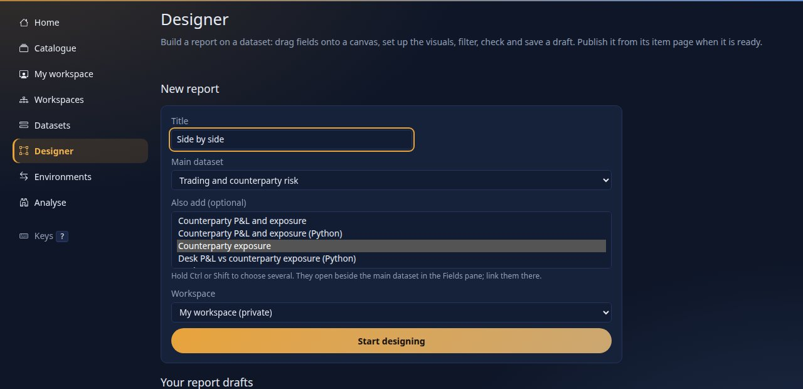

A dataset that cannot be used is listed greyed with the reason (*a draft: publish it first*, *has errors: open it*) instead of hidden. Press **Start designing**.

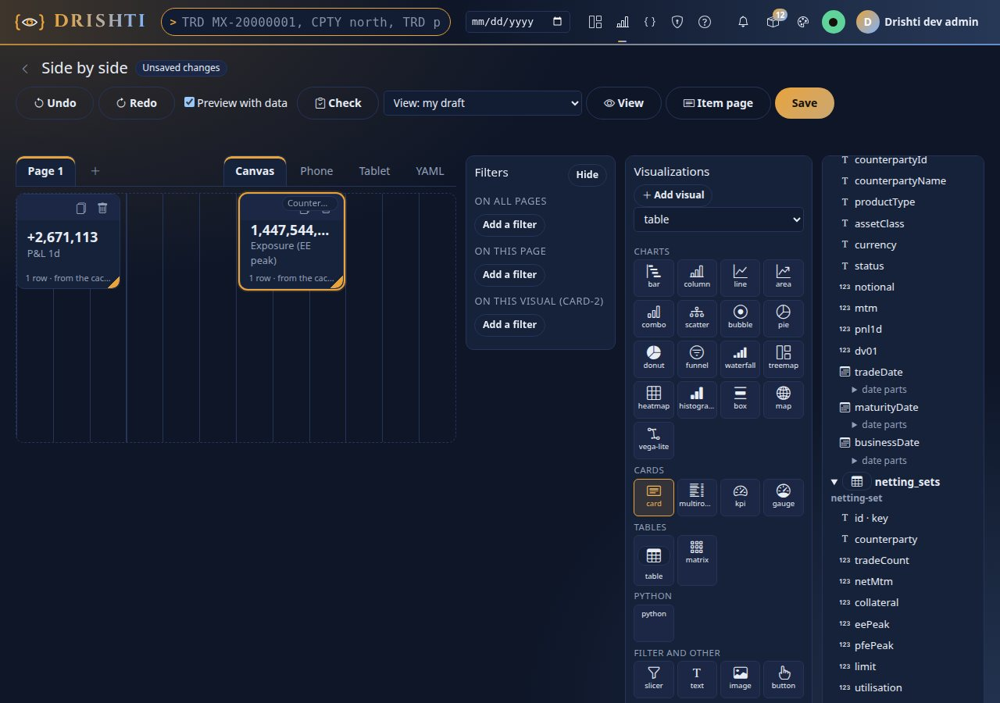

You should see the **Fields** pane with one tree for each dataset (the second is labelled; **Add dataset** at the top adds more later). Drag `P&L 1d` from the first tree onto the canvas, then `Exposure (EE peak)` from the second. You should see two cards, the second with a **tag** naming its dataset: an empty visual takes the dataset of the first field dropped on it. A visual reads **one** dataset: drop a field of the other tree on a visual that already holds fields and you are told *Refused: this visual reads ...; put ... fields in another visual, or make a composed dataset*.

**The YAML both give.** The designer writes `dataset:` on every visual that reads the second dataset; the report keeps its own in the top key. Here is the report the rest of the step uses ([two-datasets.report.yaml](data/two-datasets.report.yaml), shortened):

```yaml
rachana: 1
report: two-datasets
title: P&L and exposure side by side
dataset: file:dataset:trading-risk          # the main dataset: a visual with no dataset: of its own reads this
links:
  - fields: [counterparties.sector, counterparties.sector]     # step 3
pages:
  - id: side-by-side
    visuals:
      - { id: sector, type: slicer, dataset: file:dataset:counterparty-exposure, wells: { field: [counterparties.sector] }, format: { mode: dropdown, scope: report } }
      - { id: country, type: slicer, title: Country (not linked), dataset: file:dataset:counterparty-exposure, wells: { field: [counterparties.country] }, format: { mode: dropdown, scope: report } }
      - { id: pnl, type: card, wells: { values: [P&L 1d] } }
      - { id: ee, type: card, dataset: file:dataset:counterparty-exposure, wells: { values: [Exposure (EE peak)] } }
      - { id: pnl-by-sector, type: bar, wells: { axis: [counterparties.sector], values: [P&L 1d] } }
      - { id: ee-by-sector, type: bar, dataset: file:dataset:counterparty-exposure, wells: { axis: [counterparties.sector], values: [Exposure (EE peak)] } }
      - { id: pnl-by-desk, type: bar, wells: { axis: [desks.name], values: [P&L 1d] } }
```

**From the command line** there is no designer, but a report is an item like any other, so the call the designer's **Save** and the item page's **Publish** make is two REST calls (workspace `exposure-desk`; the answer is cut to the keys that matter):

```text
$ curl -s -X POST -H "Authorization: Bearer $DRISHTI_TOKEN" -H 'Content-Type: application/json' \
    -d "$(python3 -c 'import json;print(json.dumps({"kind":"report","title":"Side by side (CLI)","body":open("docs/tutorials/data/two-datasets.report.yaml").read()}))')" \
    http://localhost:18480/api/v1/bi/workspaces/exposure-desk/items
{"id":"bi-82bf63b602","workspace":"exposure-desk","kind":"report","title":"Side by side (CLI)","status":"draft","publishedVersion":0, ...}
$ curl -s -X POST -H "Authorization: Bearer $DRISHTI_TOKEN" -H 'Content-Type: application/json' -d '{"note":"from the command line"}' \
    http://localhost:18480/api/v1/bi/items/bi-82bf63b602/publish
{"id":"bi-82bf63b602","status":"published","publishedVersion":1, ...}
```

The id is yours to receive; the commands that follow use `bi-fd0d0420d0`, the id this report had on the stack the outputs came from. Find yours with `python3 tools/drishti.py bi catalogue list --workspace exposure-desk`.

## Step 3 · Links: what carries across and what does not

Under the Fields pane, once two datasets are in play, a **Links between datasets** panel appears. It lists fields of the two datasets with the same name and type (or the same stated meaning); a tick writes the link into the report's `links:`.

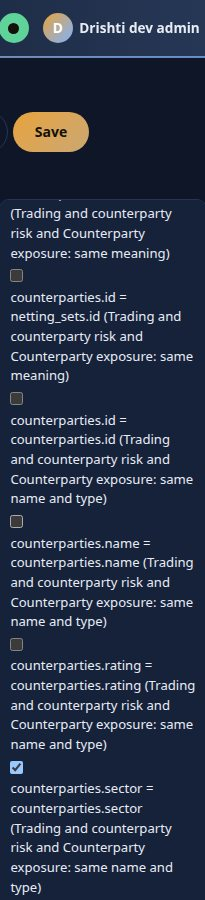

You should see a long list: the panel is generous (every `id` and `businessDate` pairs with every other, "same meaning"). **Tick only what is true**, here `counterparties.sector = counterparties.sector`. Two buttons sit below: remove a link, and **Make a composed dataset from these** (step 5). A link is **your statement** that two fields mean the same thing. Open the report from the catalogue.

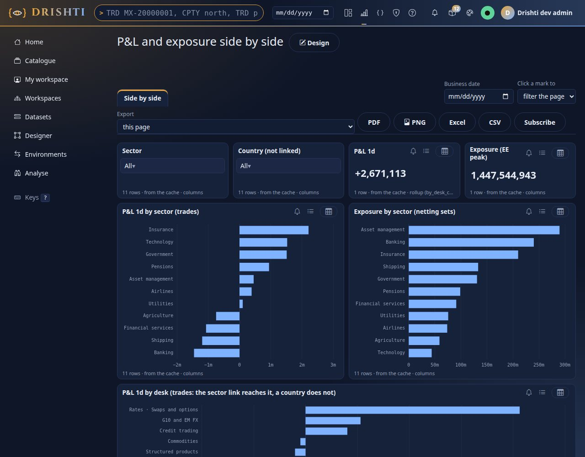

You should see the true totals of step 1 on the two cards (`+2,671,113` and `1,447,544,943`). In the **Sector** slicer, which reads `counterparty-exposure`, choose **Banking**.

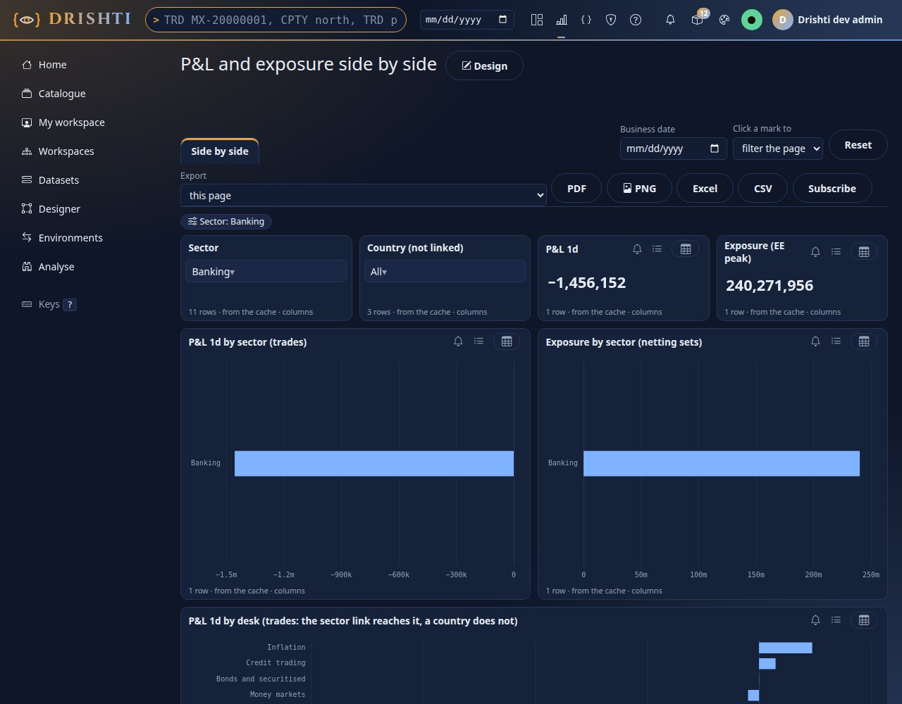

You should see a chip `Sector: Banking`; **the visuals of the other dataset followed**: P&L is `-1,456,152` (a trades number) beside exposure `240,271,956` (a netting-set number), and the by-desk chart is narrowed too, because it is a `trading-risk` visual and the link maps the sector across. The server's question for each, from the command line, shows what each dataset was actually asked (`explain=true` returns the query):

```text
$ curl -s -X POST -H "Authorization: Bearer $DRISHTI_TOKEN" -H 'Content-Type: application/json' \
    -d '{"page":"side-by-side","visual":"pnl","state":{"slicers":{"sector":["Banking"]}}}' \
    "http://localhost:18480/api/v1/bi/reports/bi-fd0d0420d0/query?explain=true"
{"rows":[[-1456152.0]],"query":{"fields":[],"measures":["P&L 1d"],"filters":["counterparties.sector IN [Banking]"],"orderBy":[],"limit":500}, ...}
$ ... "visual":"ee" ...
{"rows":[[240271956.0]],"query":{"fields":[],"measures":["Exposure (EE peak)"],"filters":["counterparties.sector IN [Banking]"],"orderBy":[],"limit":500}, ...}
```

Now the **unlinked** field. Reset, and choose a country on the **Country (not linked)** slicer, `GB`.

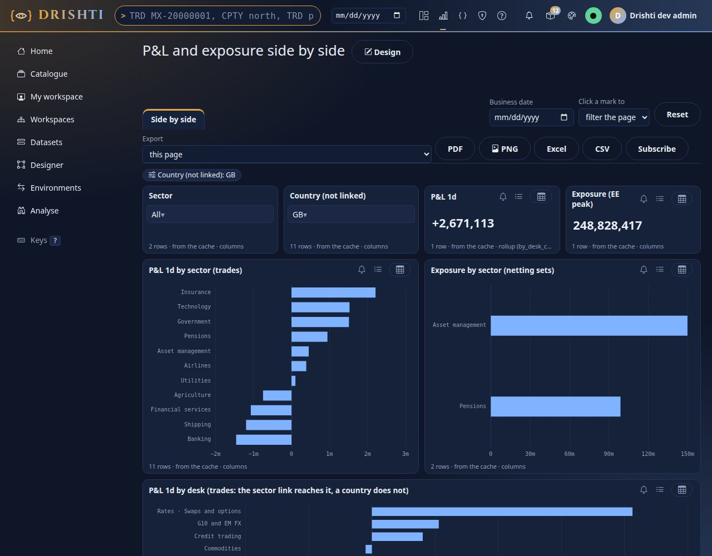

You should see exposure fall to `248,828,417` and its sector bar shrink to two sectors, while **P&L stays at `2,671,113`** and the P&L bars do not change at all. `trading-risk` has a `counterparties.country` too, but fields of the same name in two datasets are **not assumed** to be the same: with no link nothing is carried (and it is not an error). The proof from the command line is the filters the two questions carried:

```text
$ ... -d '{"page":"side-by-side","visual":"pnl","state":{"slicers":{"country":["GB"]}}}' ...
{"rows":[[2671113.0]],"query":{"fields":[],"measures":["P&L 1d"],"filters":[],"orderBy":[],"limit":500}, ...}
$ ... -d '{"page":"side-by-side","visual":"ee","state":{"slicers":{"country":["GB"]}}}' ...
{"rows":[[248828417.0]],"query":{"fields":[],"measures":["Exposure (EE peak)"],"filters":["counterparties.country IN [GB]"],"orderBy":[],"limit":500}, ...}
```

A **click on a mark** is carried the same way. Click the **Insurance** bar of *P&L 1d by sector*:

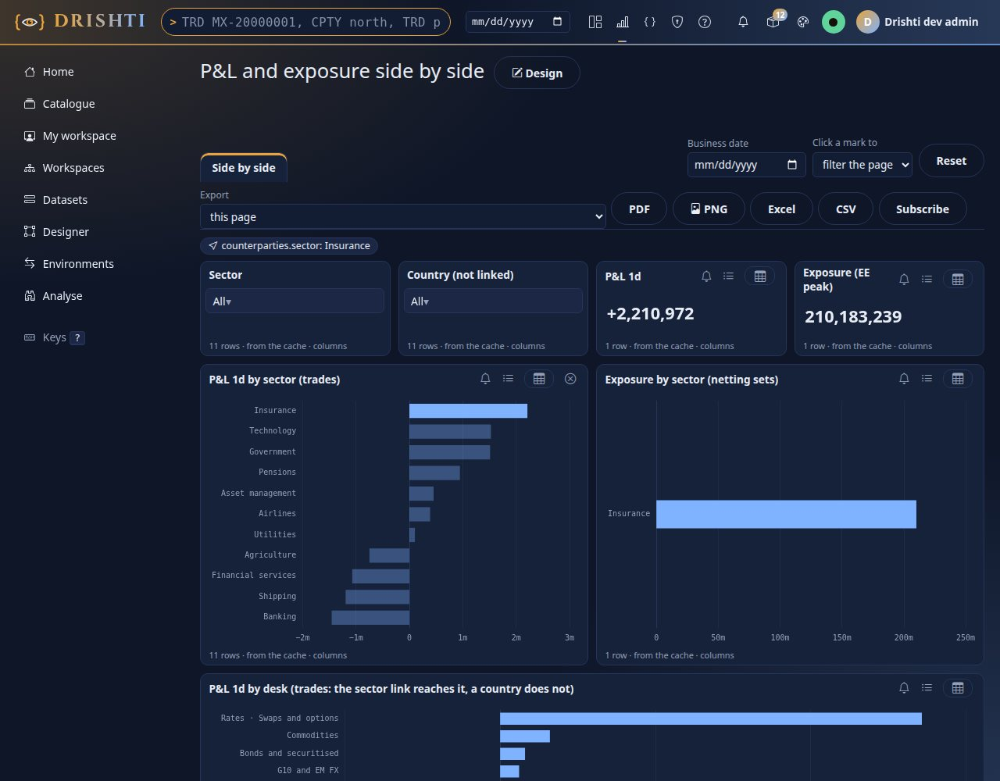

You should see the chip, P&L `+2,210,972` and exposure `210,183,239`: the selection made on a trades visual narrowed a netting-set visual. In the state of a query it is `"selections":[{"visual":"pnl-by-sector","field":"counterparties.sector","values":["Insurance"]}]`, and the answer for the `ee` card is `[[210183239.0]]` with `"counterparties.sector IN [Insurance]"`.

**A wrong link gives an empty visual, not an error.** [wrong-link.report.yaml](data/wrong-link.report.yaml) links `economies.iso3` of *World economics* (countries as ISO-3: `GBR`) to `counterparties.country` of `trading-risk` (ISO-2: `GB`). Open it and choose `GBR` on the slicer.

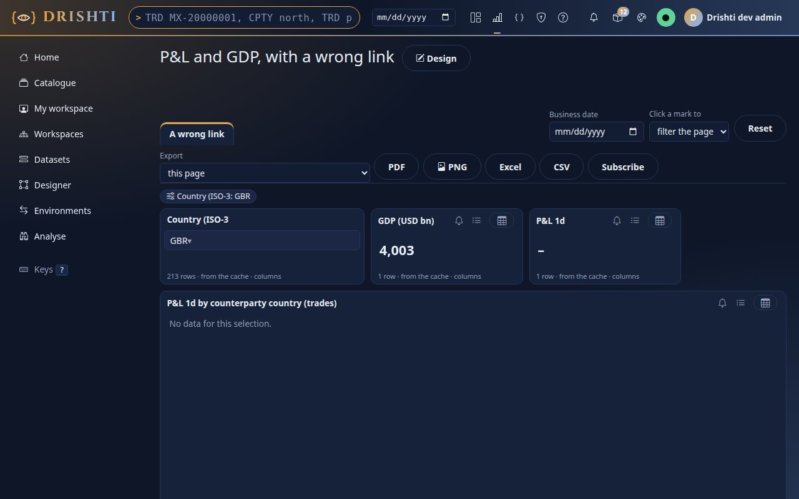

You should see GDP `4,003` (the slicer's own dataset knows `GBR`) and, for the trades, `-` and *No data for this selection*. Drishti carried the value as it is, and no trade has a country called `GBR`:

```text
$ ... -d '{"page":"wrong","visual":"pnl-by-country","state":{"slicers":{"iso":["GBR"]}}}' "http://localhost:18480/api/v1/bi/reports/bi-047af950e3/query?explain=true"
{"columns":[{"type":"string","name":"counterparties.country"},{"type":"decimal","name":"P&L 1d"}],"rows":[],"rowCount":0,"query":{"fields":["counterparties.country"],"measures":["P&L 1d"],"filters":["counterparties.country IN [GBR]"], ...}}
```

The checker cannot know that `GBR` and `GB` are two spellings of one thing; **you** have to. Links carry values without translating them (a code to a name is "not built", [REPORTS.md section 16](../guides/REPORTS.md#16-reports-over-several-datasets)).

## Step 4 · Why Drishti does not join rows across datasets

If a slicer can reach two datasets, why not put both in one visual? Because the honest answer needs care. Open **Analyse** and the notebook [two-extracts.notebook.yaml](data/two-extracts.notebook.yaml) (**Notebook** box; create it as an item in the workspace). It holds **two extracts**, each built by the server for you (your row rules, your masks): `df` is the trades (`counterpartyId`, `mtm`, `pnl1d`), and `extract("exposure")` is the netting sets (`counterparty`, `eePeak`).

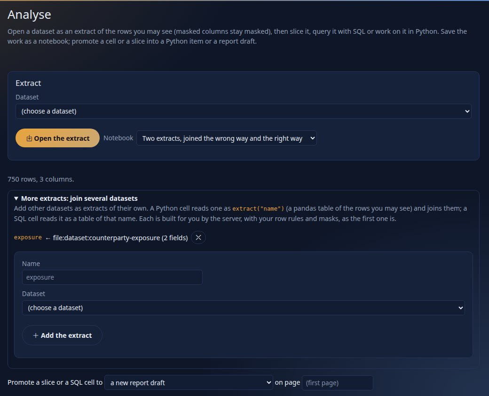

You should see `750 rows, 3 columns.` and, under **More extracts**, `exposure`. In the **Python** tab, the first cell does what a person who thinks in rows would do: join each trade to the netting sets of its counterparty, and add up.

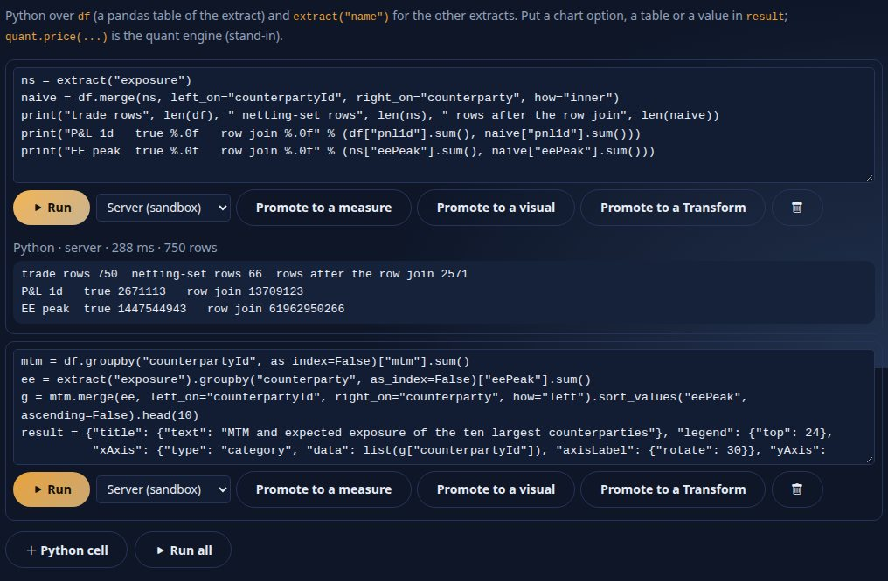

You should see:

```text
trade rows 750  netting-set rows 66  rows after the row join 2571
P&L 1d   true 2671113   row join 13709123
EE peak  true 1447544943   row join 61962950266
```

Every trade of a counterparty with four netting sets became four rows, so its P&L was counted four times; every netting set met every trade of its counterparty, so exposure was counted once per trade. The P&L is **5.1 times** too big and the exposure **42.8 times**; nothing failed, and the table looks like a table. That is the **fan-out** trap, and it is why a visual in Drishti reads **one dataset**, and why two datasets meet only at **a grain they share**: add each side up to the counterparty first, then join the sums. The second cell does that and draws it:

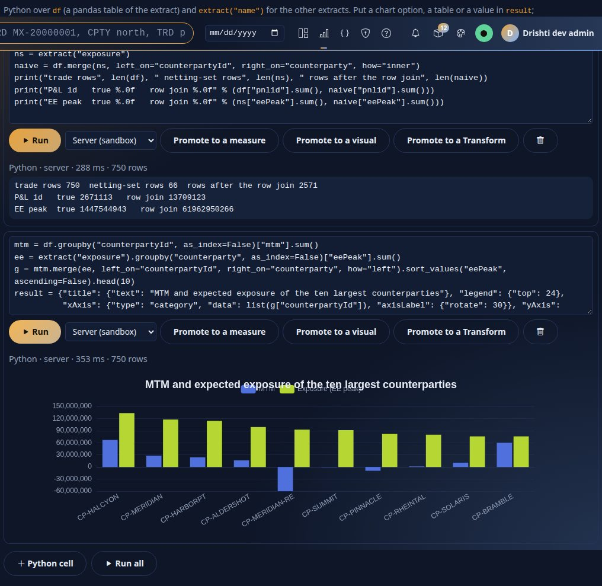

Adding up the per-counterparty sums (a check run on the same two extracts; it is not in the saved notebook) gives `P&L 2671113  MTM 138562638  EE 1447544943`: **the totals of step 1 again**. **From the command line**, Analyse is the console's own route (a signed-in session, not a token); with a cookie from `curl -c jar -d 'user=...&password=...' .../login` the first cell is one call, which printed:

```text
$ curl -s -b jar -H 'Content-Type: application/json' -X POST http://localhost:17480/bi/explore/python -d '{"extract":{"dataset":"file:dataset:trading-risk","fields":["trades.counterpartyId","trades.mtm","trades.pnl1d"]},
    "extracts":[{"name":"exposure","dataset":"file:dataset:counterparty-exposure","fields":["netting_sets.counterparty","netting_sets.eePeak"]}], "source":"..."}'
{"kind":"cell","stdout":"750 66 2571\n2671113 13709123\n1447544943 61962950266\n","inputRows":750,"masked":[],"target":"server", ...}
```

Drishti's own engine does the right thing even inside one dataset. Ask `trading-risk` for `MTM` (a trades measure) and `Exposure (EE peak)` (a netting-set measure) together:

```text
$ ... -d '{"fields":[],"measures":["Trades","MTM","Exposure (EE peak)"]}' .../datasets/file:dataset:trading-risk/query
rows [[750, 138562638.0, 1447544943.0]]    meta.warnings: "2 fact tables, each aggregated alone at the query's fields and then joined: [trades, netting_sets]"
```

Each fact table is **aggregated alone at the grain of the question, then joined**; the true totals come back. A desk, though, is a grain of trades only: a netting set has no desk, so `Exposure (EE peak)` by `desks.name` is refused:

```text
$ ... -d '{"fields":["desks.name"],"measures":["Exposure (EE peak)"]}' .../datasets/file:dataset:trading-risk/query
{"code":"DRS-9020","detail":"DRS-9020 the model has no relationship path joining [desks, netting_sets] to the measures' table without repeating its rows (each join must go many-to-one)"}
```

This is also why this tutorial's composed dataset is **per counterparty** and not per desk: the counterparty is the grain both datasets have. Everything that follows is how to get two datasets to a grain they share.

## Step 5 · A composed dataset: MTM and exposure in one visual

A **composed dataset** asks each source dataset a question *as the reader*, grouped to the grain you choose, and joins the answers. Here the shared grain is the **counterparty**. In **My workspace** (or your shared workspace) choose **New item**, kind *dataset*, and paste [cp-pnl-exposure.dataset.yaml](data/cp-pnl-exposure.dataset.yaml); or open the dataset wizard ([tutorial 10, step 13](10-first-bi-report.md#step-13--a-dataset-of-your-own-in-the-wizard)). Publish it, then open its page.

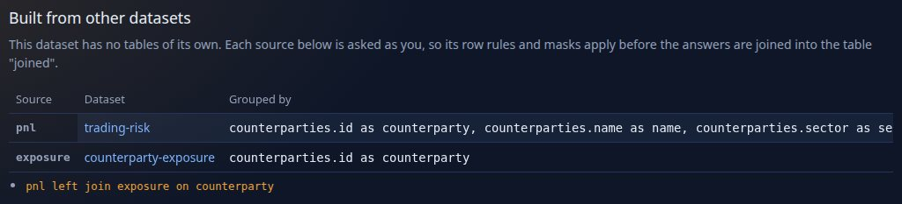

You should see two sources and one join line, and no tables of its own. The YAML is the whole of it:

```yaml
rachana: 1
dataset: cp-pnl-exposure
version: 1
title: Counterparty P&L and exposure
from:
  pnl:
    dataset: trading-risk
    by: ["counterparties.id as counterparty", "counterparties.name as name", "counterparties.sector as sector"]
    measures: [MTM, "P&L 1d as Desk P&L", Trades]
    key: [counterparty]            # name and sector are attributes of the counterparty: one row per counterparty
  exposure:
    dataset: counterparty-exposure
    by: ["counterparties.id as counterparty"]
    measures: [Exposure (EE peak), Exposure (PFE peak)]
    key: [counterparty]
join:
  - { left: pnl, right: exposure, on: [counterparty], type: left }
measures:
  MTM per exposure:
    expr: "[MTM] / [Exposure (EE peak)]"
    format: signed2
```

Three things to notice. The key is the counterparty's **id**, not its name: the name is masked for some readers, and a join on a masked column is refused (step 7). `key:` says the other grouping columns are attributes of it, which is what the **fan-out check** reads. And **`MTM per exposure` is a measure of the composed dataset over the two sums**, not an average of per-row ratios: at any grain a visual groups by, it is `sum(MTM) / sum(Exposure)`. Source measures are plain sums over the joined rows, which is right for additive ones (P&L, exposure, counts) and wrong for ratios: leave ratios to the dataset's own measures. Ask it from the command line (the dataset's id is yours):

```text
$ curl -s -X POST -H "Authorization: Bearer $DRISHTI_TOKEN" -H 'Content-Type: application/json' \
    -d '{"fields":["joined.sector"],"measures":["MTM","Exposure (EE peak)","MTM per exposure"],"limit":3}' http://localhost:18480/api/v1/bi/datasets/bi-55d205f94e/query
rows [["Agriculture", 20378377.0, 59019457.0, 0.3452823532415759], ["Airlines", 15984208.0, 73868165.0, 0.21638831829652191], ["Asset management", 70776928.0, 289738661.0, 0.24427850862470854]]    meta.layer "composed"
$ ... -d '{"fields":[],"measures":["MTM","Exposure (EE peak)","MTM per exposure"]}' ...
rows [[138562638.0, 1447544943.0, 0.09572251187782292]]
```

The totals are step 1's, to the unit. Now the report [counterparty-view.report.yaml](data/counterparty-view.report.yaml) reads this one dataset:

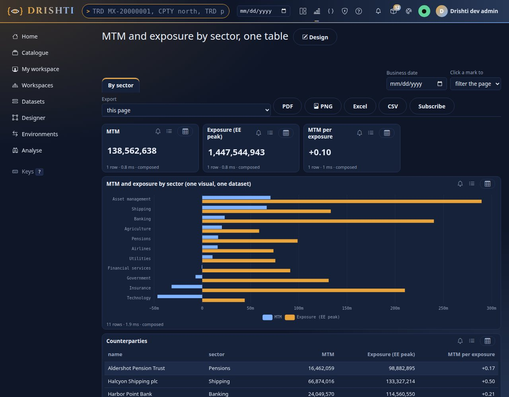

You should see MTM and exposure **in one visual**, which step 3 could not give you, and the ratio. Without the ids, in the designer, **Make a composed dataset from these** (the Links panel, step 3) writes a first draft of this YAML on the first linked pair for you to read; **Create the draft and review it** is the only thing that saves it.

**The checks.** A composed dataset is checked on the dataset page, by `POST /datasets/validate`, and when you publish. Change the join to the sector and make the second source finer than the first (the draft is in the picture below): the page marks it *valid* and prints the **warning**:

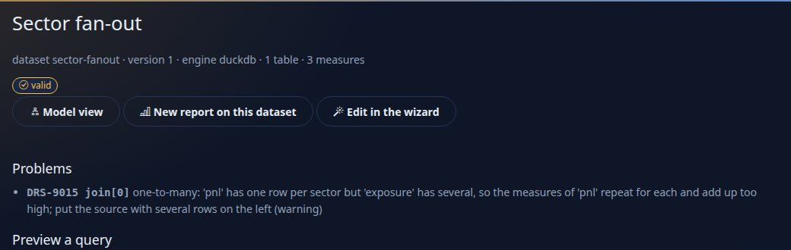

```text
$ curl -s -X POST -H "Authorization: Bearer $DRISHTI_TOKEN" -H 'Content-Type: application/json' -d '{"yaml": "<the draft: pnl by sector, exposure by who and sector, join on sector>"}' http://localhost:18480/api/v1/bi/datasets/validate
{"valid":true,"problems":[{"message":"one-to-many: 'pnl' has one row per sector but 'exposure' has several, so the measures of 'pnl' repeat for each and add up too high; put the source with several rows on the left","path":"join[0]","code":"DRS-9015","level":"warning"}], ...}
```

Be exact about what this is. `DRS-9015` is a **warning** (the dataset still saves and publishes): the check knows the grain of each source from its grouping columns (or the `key:` you declared) and warns when the join would repeat rows. It cannot see a `key:` you declared falsely, and it does not warn about a lookup (a source unique on the key on the right), so it will not catch every inflation; **declare keys you can defend, and compare a total with the source's total** as step 4 did. The **refusals** (`error`, so no save-and-publish) are the structural mistakes, real output:

| Mistake | Real answer of the check |
|---|---|
| a join key a source does not have | `DRS-9014 join[0].on: 'sector' is not a column of 'exposure' (its columns: counterparty, Exposure (EE peak), Exposure (PFE peak))` |
| a column of one name in both sources that is not a key | `DRS-9014 from.exposure: the column 'counterparty' is in 'pnl' and in 'exposure' and is not a join key: rename one with `as` ("counterparties.id as other_name")` |
| keys of different types | `DRS-9014 join[0].on: the key 'counterparty' of 'pnl' is string but 'counterparty' of 'exposure' is decimal: both sides of a join are of one type` |
| a measure the source lacks | `DRS-9014 from.pnl.measures[0]: dataset 'trading-risk' has no measure 'MTM tomorrow' (measures: MTM, Notional, P&L 1d, ...)` |
| a measure of this dataset over one that is not there | `DRS-9011 measures.MTM per exposure: [MTM] is not a measure of this dataset (measures: Exposure (EE peak), Exposure (PFE peak), MTM per exposure)` |

All are in [DATASETS.md section 11.1](../guides/DATASETS.md#111-composed-datasets-from-and-join).

## Step 6 · The same as a Python Transform: a derived dataset

When the combination is more than a join (a rank, a clean-up, a model), write it in Python. A **Transform** is a Python item with `interface: transform`: a function `run(pnl, exposure, params)` that gets each source's answer as a pandas frame, **already masked for the reader**, in the order of its `inputs`, and returns a table. Create [mtm-vs-exposure.python.yaml](data/mtm-vs-exposure.python.yaml) as a *python* item (**New item**, kind *python*, **What does it make? A table**) and publish it:

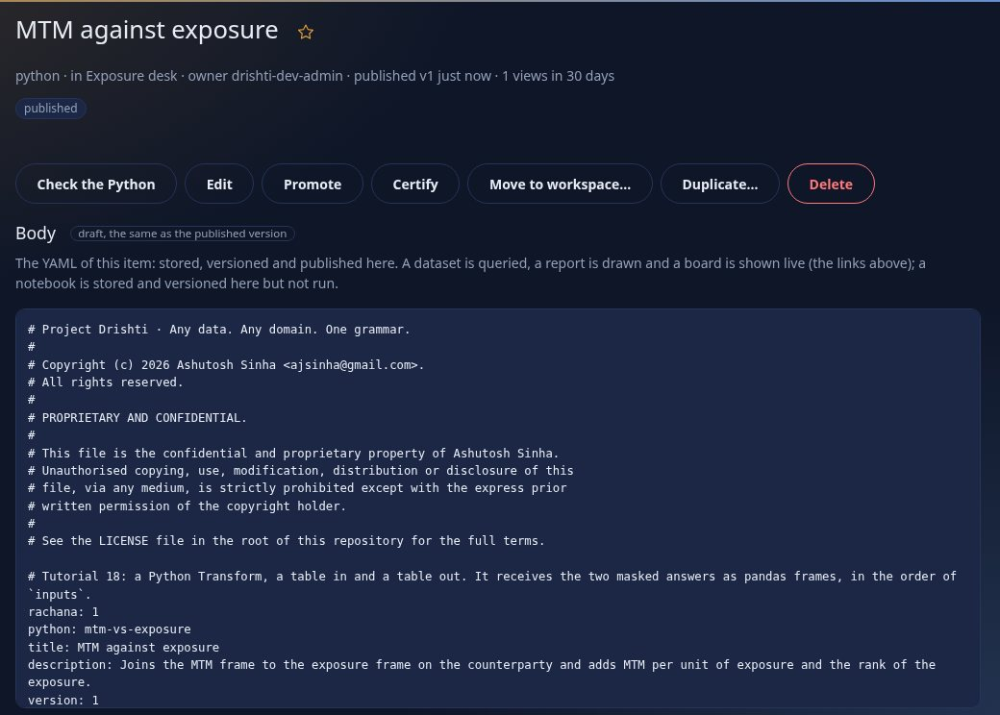

```python
def run(pnl, exposure, params):
    m = pnl.merge(exposure, on="counterparty", how="left")
    m = m.rename(columns={"MTM": "mtm", "Trades": "trades", "Exposure (EE peak)": "ee_peak", "Exposure (PFE peak)": "pfe_peak"})
    floor = float(params.get("floor", 1.0))
    m["mtm_per_exposure"] = m["mtm"] / m["ee_peak"].clip(lower=floor)
    m["exposure_rank"] = m["ee_peak"].rank(ascending=False, method="min")
    return m[["counterparty", "name", "sector", "mtm", "trades", "ee_peak", "pfe_peak", "mtm_per_exposure", "exposure_rank"]]
```

The **derived dataset** [cp-pnl-exposure-py.dataset.yaml](data/cp-pnl-exposure-py.dataset.yaml) names the Transform (by id or title), asks the same two questions, declares the columns it returns (a contract: a missing declared column is `DRS-9075`) and writes its measures over the one table `result`:

```yaml
derived:
  transform: MTM against exposure          # the Python item
  inputs:
    pnl:      { dataset: trading-risk, by: ["counterparties.id as counterparty", "counterparties.name as name", "counterparties.sector as sector"], measures: [MTM, Trades] }
    exposure: { dataset: counterparty-exposure, by: ["counterparties.id as counterparty"], measures: [Exposure (EE peak), Exposure (PFE peak)] }
  params: { floor: 1.0 }
columns: { counterparty: string, name: string, sector: string, mtm: decimal, trades: integer, ee_peak: decimal, pfe_peak: decimal, mtm_per_exposure: decimal, exposure_rank: decimal }
measures:
  MTM:                { expr: "sum(result.mtm)", format: signed0 }
  Exposure (EE peak): { expr: "sum(result.ee_peak)", format: amount0 }
  MTM per exposure:   { expr: "ratio(sum(result.mtm), sum(result.ee_peak))", format: signed2 }
```

Open the dataset page and press **Run the Transform now**.

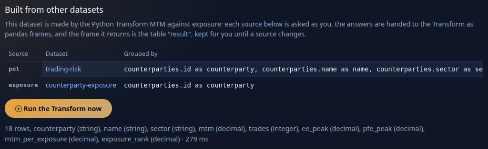

You should see `18 rows` and the nine typed columns. The frame is **kept for the reader** it was made for, until a source changes or `drishti.bi.transform.cache-ttl` (30 minutes) passes. From the command line, the same call twice (an author's token; the second answer is the kept one):

```text
$ curl -s -X POST -H "Authorization: Bearer $DRISHTI_TOKEN" -H 'Content-Type: application/json' -d '{}' http://localhost:18480/api/v1/bi/datasets/bi-30414465ec/transform/run
{"dataset":"bi-30414465ec","rows":18,"cached":false,"millis":256,"columns":[{"name":"counterparty","type":"string"}, ... ,{"name":"exposure_rank","type":"decimal"}]}
(again)  {"dataset":"bi-30414465ec","rows":18,"cached":true,"millis":0, ...}
$ curl -s -H "Authorization: Bearer $DRISHTI_TOKEN" http://localhost:18480/api/v1/bi/engine      # "transforms": {runs, cacheHits, failures, kept}
{"enabled":true,"runs":16,"cacheHits":17,"failures":0,"kept":16,"maxConcurrent":2}
```

(The counters count every run since the server started, including the ones earlier in this tutorial's preparation, so yours differ.) The derived dataset answers the same question as the composed one:

```text
$ ... -d '{"fields":[],"measures":["MTM","Exposure (EE peak)"]}' .../datasets/bi-30414465ec/query
rows [[138562638.0, 1447544943.0]]
```

A second reader has other rows and other masks, so the Transform runs again for them: that is the next step. When to choose which: **composed** for a join and sums (it asks sources at query time, answers any grain, and needs no code); **derived** when you need code (ranks, clean-up, a model) and can accept a table that is computed per reader and kept; **a report over two datasets** (steps 2 and 3) when the two visuals only need to share a *filter*.

## Step 7 · Two readers: each source is filtered as the reader before the join

Drishti asks each source **as the person reading**, with that dataset's own row rules, masks and entitlements, **before** the join: nothing a source hides reaches the joined table or the Transform. `trading-risk` has a row rule per role: `desk-head` sees `trades.desk in user.desks`, `risk` sees everything; `counterparty-exposure` has no row rule. Sign in as **rita** (role `risk`, raw power) and open the report [counterparty-view.report.yaml](data/counterparty-view.report.yaml); then as **hana** (a desk head of `DESK-FX`, no raw power).

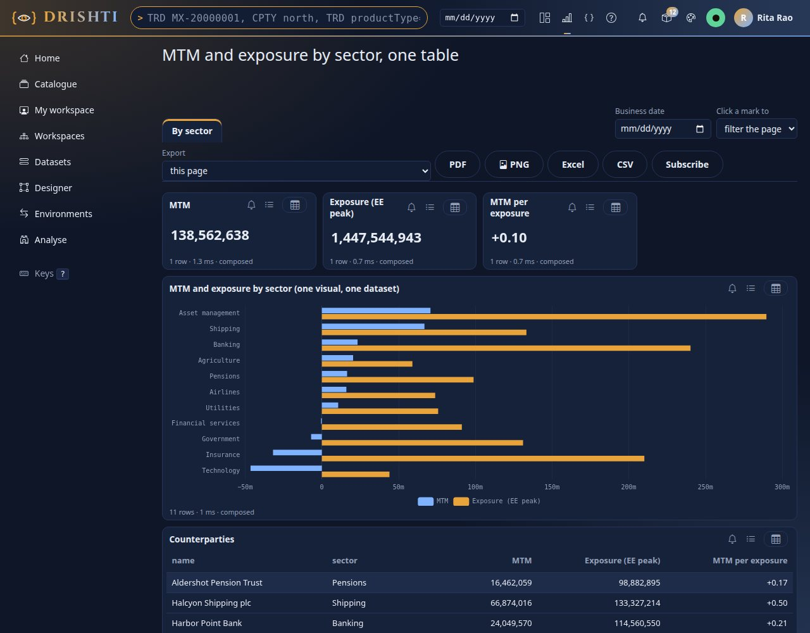

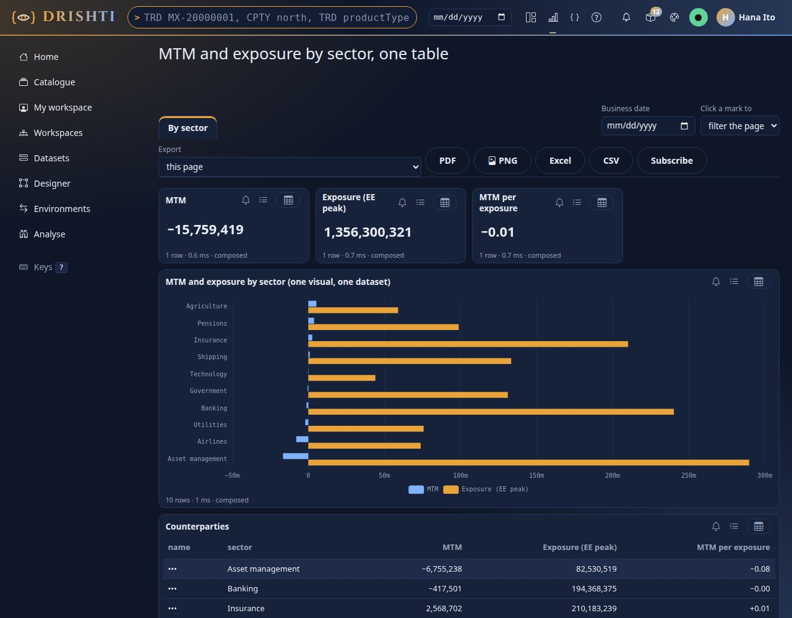

You should see two different reports from one definition. Rita's numbers are the totals of step 1. Hana's **MTM is `-15,759,419`**, her desk's trades only (the `G10 and EM FX` desk of step 1); her **exposure is `1,356,300,321`**, which is **not** 1,447,544,943 and not a share of it: it is the whole exposure of the **17 counterparties her desk trades with**. The 18th counterparty (`Financial services`, exposure `91,244,622`, exactly the difference) has no trade of hers, so its pnl source has no row for her and the left join keeps nothing for it. Her names read `•••`: the name is masked for a reader without the raw power, and the key is the id, so the join still works. From the command line, with each person's own token (Make one on **My account**, tutorial 1 step 9):

```text
rita$ ... -d '{"fields":["joined.name"],"measures":["MTM","Exposure (EE peak)"],"orderBy":[{"by":"Exposure (EE peak)","desc":true}],"limit":3}' .../datasets/bi-55d205f94e/query
rows [["Halcyon Shipping plc", 66874016.0, 133327214.0], ["Meridian Life Assurance", 28149163.0, 117599671.0], ["Harbor Point Bank", 24049570.0, 114560550.0]]
rita$ ... measures MTM, Exposure (EE peak) ... trading-risk: Trades, MTM
rows [[138562638.0, 1447544943.0]]      rows [[750, 138562638.0]]

hana$ (the same three calls)
columns [{"name":"joined.name","masked":true}, ...]   rows [["•••", -15759419.0, 1356300321.0]]    # one row: a masked column is not grouped on
rows [[-15759419.0, 1356300321.0]]      rows [[84, -15759419.0]]
```

The derived dataset gives hana the same totals (`[[-15759419.0, 1356300321.0]]`), because its Transform was handed hana's masked frames. A source's mask is a mask in the joined table; a **join on a masked key is refused** (`DRS-9021`, because a masked column holds one value and would match everything), which is why the sample and this tutorial join on the id ([DATASETS.md section 11.3](../guides/DATASETS.md#113-who-sees-what)).

## Step 8 · The same analysis in Analyse, promoted to a visual

When you do not yet know the question, work it out in **Analyse** before you build anything (step 4 did the first half). Its two extracts are each *your* masked rows, and the join is pandas, so you can see the grains. Open the notebook of step 4, in the **Python** tab, and press **Promote to a visual** under the second cell (the chart):

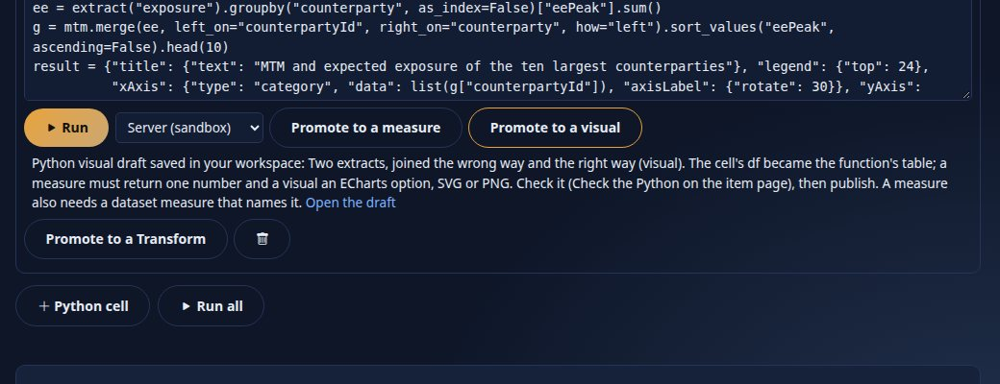

You should see `Python visual draft saved in your workspace`, with the note that the cell's `df` became the function's `table`, that a visual must return an ECharts option, SVG or PNG, and that nothing is published for you. Check it with **Check the Python** on the item page and publish it ([tutorial 14](14-python-and-analyse.md)). Be exact about what was kept: a visual reads **the one table** of its dataset, so the draft keeps `df` (the first extract); a cell that reads `extract("exposure")` as well belongs in a Transform instead. The cell has three promotions, all drafts you review: *a measure*, *a visual* and **Promote to a Transform** (it becomes the function of step 6, each `extract("name")` a parameter of `run(...)`, the inputs the extracts' datasets in order). The path from an idea to a shared number is therefore: explore in Analyse, **promote to a Transform**, publish, write the derived dataset (or rewrite the join in YAML as a composed one), build the report. Analyse itself is the console's (the first extract and further extracts, [ANALYSE.md section 2](../guides/ANALYSE.md#2-the-extract)); there is no `tools/drishti.py` command for it, and step 4 shows the REST call.

## Step 9 · How this compares with Power BI

You should see a short, honest table, not a scorecard (the claims about Power BI are the ones of [BI_PARITY_PLAN.md](../architecture/BI_PARITY_PLAN.md), whose own knowledge of Power BI may be stale; check before you quote it):

| | Power BI | Drishti |
|---|---|---|
| Several tables of different grains | one model with **relationships** between tables (many-to-one, many-to-many, bidirectional) and DAX that follows them | each **dataset** is its own model; a visual reads one dataset; its own multi-fact queries are **aggregated per fact, then joined** |
| A slicer across models | slicers filter through relationships; across separate models you use a composite model or a shared dimension | **links** (`links:`) carry a slicer, a click or a drill value, **by value** and without translation, to the visuals of another dataset |
| Two sources in one table | Power Query merge (rows) or a composite model with limited relationships | a **composed** dataset (sums joined at a declared grain) or a **derived** one (Python), asked as the reader |
| A bad join | a many-to-many or bidirectional filter can over-count silently | the **fan-out check** warns (`DRS-9015`) and rejects structural errors (`DRS-9014`); grain-split queries inside one dataset; it does not catch a `key:` you declare falsely |
| Row-level security | a rule per role in the model, applied by the model | a rule and a mask **per dataset, applied as the reader to each source before the join** |
| Behind the tools | DAX, the Power BI service, capacity licences | closed, compiled measure language, one open server, your own infrastructure |

Where Drishti is **behind** (the plan says so too): there is no relationship that filters one dataset by another's keys (a link is only a value), no bidirectional or many-to-many propagation, no cross-model measure language, and a composed dataset is a table of sums at one grain, not a live model. Where it is deliberately different: it refuses to guess, and nothing joins at the row level across datasets.

## Next steps

- [DATASETS.md section 11](../guides/DATASETS.md#11-composed-and-derived-datasets) and [REPORTS.md section 16](../guides/REPORTS.md#16-reports-over-several-datasets) are the reference for composed and derived datasets and for links; [PYTHON_BI.md section 13](../guides/PYTHON_BI.md#13-transforms-a-table-in-a-table-out) for Transforms; [ANALYSE.md](../guides/ANALYSE.md) for extracts and promotion.
- [Tutorial 13](13-govern-bi.md): a change to a source dataset is set against the composed and derived datasets built on it (impact analysis), and a Transform and a composed dataset travel in an environments bundle.
- [Tutorial 11](11-bi-that-runs-itself.md): a subscription or alert on a composed dataset's measure runs as its owner and the reader's rules apply.

## If something goes wrong

| You see | Meaning and the first thing to do |
|---|---|
| a slicer changes one dataset's visuals and not the other's | no **link** names the field, or the field is not in that dataset: tick the link in the Links panel, or write `links:` ([REPORTS.md section 16](../guides/REPORTS.md#16-reports-over-several-datasets)) |
| a visual goes empty after a slicer is used | the link joins fields whose values differ (`GB` and `GBR`, a name and a code); link fields that mean the same, in the same spelling |
| a total is several times what the source says | a join repeated rows: `DRS-9015`; group the sources to the key, declare `key:` only when it is true, compare with the source's own total |
| `DRS-9014` on a composed dataset | a source, a measure, a join key or a type is wrong; the message names the path |
| `DRS-9021` on a composed dataset | a join key is masked for you; join on the id, not on the name |
| `DRS-9020` for exposure by desk | a netting set has no desk: group the sources by a grain they share (the counterparty) |
| `DRS-9070` "no Python item" on a derived dataset | name the Transform by its catalogue id or its title, and publish it first |
| `Refused: this visual reads A; put B fields in another visual` | a visual reads one dataset: make a second visual, or compose the datasets (step 5) |
