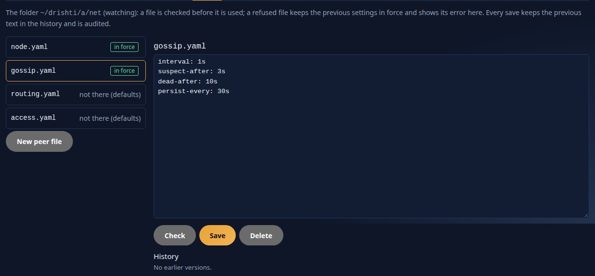
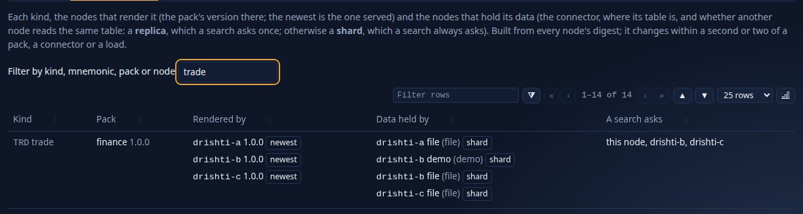
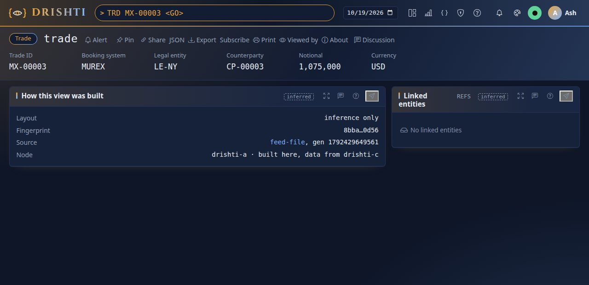
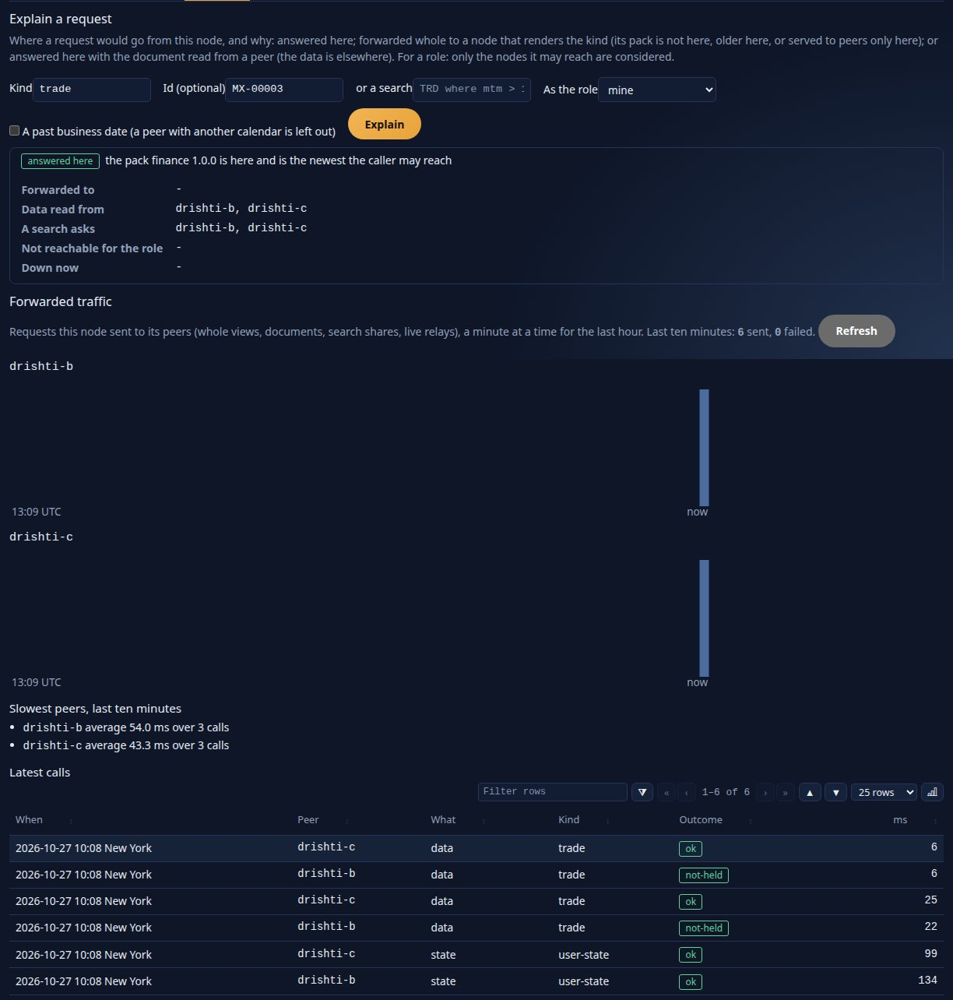
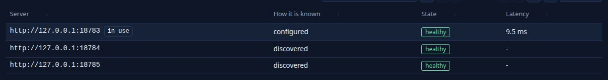
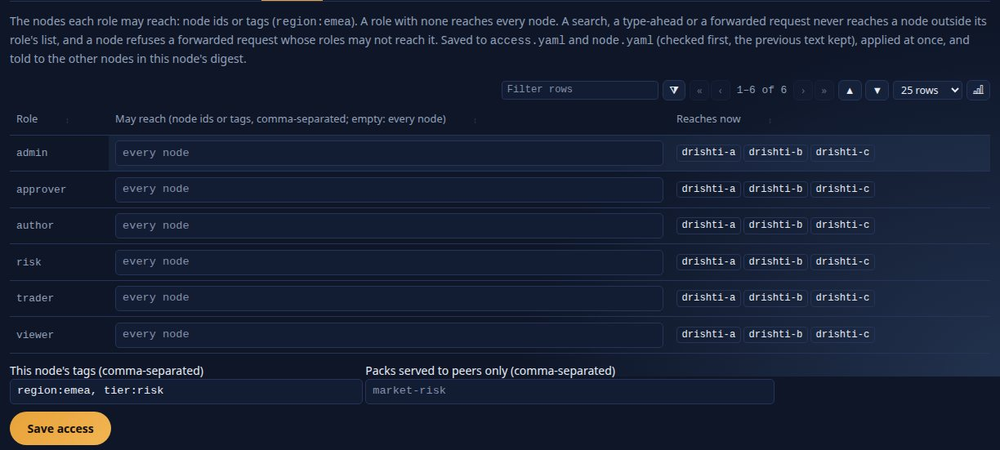
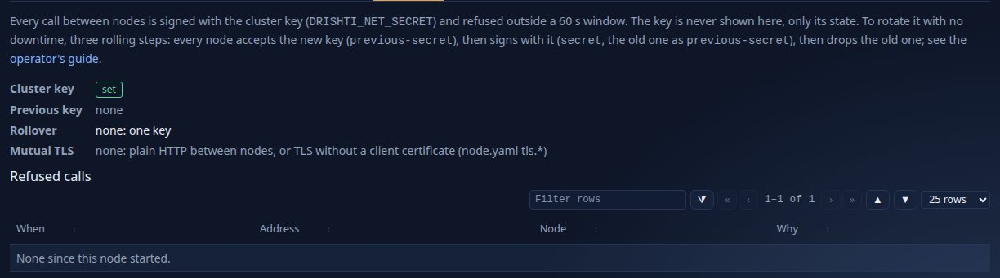
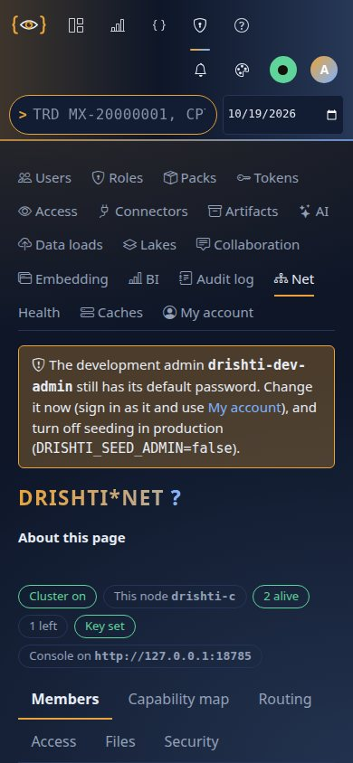

<!--
  Project Drishti · Any data. Any domain. One grammar.

  Copyright (c) 2026 Ashutosh Sinha <ajsinha@gmail.com>.
  All rights reserved.

  PROPRIETARY AND CONFIDENTIAL.

  This file is the confidential and proprietary property of Ashutosh Sinha.
  Unauthorised copying, use, modification, distribution or disclosure of this
  file, via any medium, is strictly prohibited except with the express prior
  written permission of the copyright holder.

  See the LICENSE file in the root of this repository for the full terms.
-->
# Tutorial 19 · A cluster of three (Drishti*net)

One Drishti server answers everything it holds. **Drishti*net** joins several servers into one: each keeps its own packs, connectors and data,
they find each other by gossip, and any of them answers any request, forwarding it to the node that holds the data and applying the caller's
masks on both. The console is given one server and learns the others; when that server stops, the console moves to another and the user does
not sign in again. This tutorial builds three nodes on one machine, opens a trade that only one of them holds through another, asks
**Explain** where a request goes, drains a node, stops one and watches the console carry on. The reference is [OPERATIONS.md](../admin/OPERATIONS.md#18-drishtinet-running-several-servers-as-one); the
design is [DRISHTI_NET.md](../architecture/DRISHTI_NET.md).

## Time to complete

About 45 minutes.

## Before you start

- Tutorial 1 done: the built server jar (`./mvnw -o -q package -DskipTests -pl drishti-server -am`), the console's Python, the demo lakes.
- Three free ports for the servers (here 18783, 18784, 18785) and one for the console (17784). On three machines, use each machine's address.
- A cluster key: one secret of at least 32 bytes, the same on every node, given to each server as `DRISHTI_NET_SECRET`. Generate it, never
  invent it: `openssl rand -hex 32`.
- Without a `config/net/` folder (or with `enabled: false`) a server runs alone exactly as before: nothing in this tutorial changes a single
  server.

The outputs of the command line below were captured on this version; paths are shortened to `~/drishti`.

**The ready-made local cluster: `drishti-stack/`.** This tutorial builds a cluster by hand so that you see each file. To have one running
without the steps, use `drishti-stack/` at the repository's root: `drishti-stack/start.sh` starts three servers (your own stack on 18480 with
the demo lakes, and two more on 18791 and 18792 with synthetic ENDUR, CALYPSO and MUREX trades) and a console on 17480 given the first
alone; `status.sh` shows the members and `stop.sh` stops them by process id. The secrets are made on the first start and stay out of git.
See [drishti-stack/README.md](../../drishti-stack/README.md).

## What you will learn

- the five files of `config/net/` and how the CLI, the UI and the server refuse a wrong one;
- how three nodes find each other from one seed, and what Admin → Net → Members shows;
- how a request for data held elsewhere is answered (forwarded, or the data fetched), and how **Explain** shows it;
- the cluster key, nodes per role and peer-only packs;
- a console with several servers: discovery, failover and recovery; draining a node for maintenance;
- what follows a user from node to node (saved searches, layouts, pivots) and what does not (alerts).

## Step 1 · Each node's folder and its key

Each server has its own `config/net/` folder (`DRISHTI_NET_DIR`, default `./config/net`; examples in `config/net.examples/`). `node.yaml` says
the node is on, the address the others call it at, its tags and the key, which is only ever a reference to the environment variable.

**From the command line.** `drishti.py net set` writes one setting and checks the file as the server would. It refuses `enabled: true`
until the key is there:

```text
$ drishti.py net set node.enabled true
drishti: node.yaml was not written: enabled: true needs the cluster key: secret: ${DRISHTI_NET_SECRET} with the variable set (at least 32 bytes)
  error   node.yaml  secret: enabled: true needs the cluster key: secret: ${DRISHTI_NET_SECRET} with the variable set (at least 32 bytes)
```

Give the key, the node id and the address (this machine's real one), then switch it on (on node b; the same on a and c with their ports):

```text
$ export DRISHTI_NET_SECRET=...                       # the generated key, the same on every node
$ drishti.py net set node.node-id drishti-b
wrote ~/drishti/b/net/node.yaml
$ drishti.py net set node.secret '${DRISHTI_NET_SECRET}'
wrote ~/drishti/b/net/node.yaml
$ drishti.py net set node.advertise-url http://$IP:18784
wrote ~/drishti/b/net/node.yaml
$ drishti.py net set node.enabled true
wrote ~/drishti/b/net/node.yaml
```

**The YAML** it wrote:

```yaml
# config/net/node.yaml (Drishti*net, docs/admin/OPERATIONS.md)
node-id: drishti-b
secret: ${DRISHTI_NET_SECRET}
advertise-url: http://<this machine's IP>:18784
enabled: true
```

Give node a tags (nodes per role, Step 6, use them): `drishti.py net set node.tags region:emea,tier:risk`. Every write keeps the previous text
under `<data dir>/net/history/` (`node.20261019T125447821.yaml`, ...), as the server's own writes do.

**In the UI** (once a server runs): **Admin → Net → Files**, open `node.yaml`, edit, **Check** (the problems with their line), **Save**. A save
carries the version you read; if someone saved in between, it is refused and the page says so.



**You should see:** a key in clear (`secret: abc...`) is refused by the CLI, the UI and the server alike; the key never appears in a file,
a page, an answer or a log. So is a loopback address:

```text
$ drishti.py net set node.advertise-url http://127.0.0.1:18784
drishti: node.yaml was not written: 'http://127.0.0.1:18784' is a loopback or wildcard address (loopback): the address this node advertises must be an address other machines can call (this machine's address is 192.168.1.20: use http://192.168.1.20:18784); or leave advertise-url out and the node advertises that address with its port
```

## Step 2 · One seed

Only node a needs to be named anywhere. On b and c, one peer file:

```text
$ drishti.py net add-peer drishti-a $IP:18783
wrote ~/drishti/b/net/peers/drishti-a.yaml
$ drishti.py net list
config/net at ~/drishti/b/net: Drishti*net is ON
  node drishti-b  at http://192.168.1.20:18784  tags -  key set
  seed drishti-a  http://192.168.1.20:18783
  node.yaml             in force
  gossip.yaml           absent (defaults)
  routing.yaml          absent (defaults)
  access.yaml           absent (defaults)
  peers/drishti-a.yaml  in force
```

```yaml
# config/net/peers/drishti-a.yaml (Drishti*net, docs/admin/OPERATIONS.md)
url: http://<this machine's IP>:18783
```

`drishti.py net check` checks every file as the server does (exit 0 when all would be taken, 1 otherwise). Without the variable set:

```text
$ drishti.py net check
2 file(s) checked in ~/drishti/b/net: 1 error(s); those files would be refused
  error   node.yaml:3  secret: enabled: true needs the cluster key: secret: ${DRISHTI_NET_SECRET} with the variable set (at least 32 bytes)
```

And a wrong value names its line:

```text
$ drishti.py net set gossip.interval lots
drishti: gossip.yaml was not written: 'lots' is not a duration (150ms, 5s, 10m, 24h)
  error   gossip.yaml:2  interval: 'lots' is not a duration (150ms, 5s, 10m, 24h)
```

**In the UI:** **Admin → Net → Members**, **Add a seed**, type `<this machine's IP>:18783` (here `192.168.1.20:18783`), **Add seed**: it is saved as a peer file and tried at once.

**You should see:** `drishti.py net list` on b naming its seed `drishti-a` and `peers/drishti-a.yaml in force`; with the key unset, `net check`
exits 1 and names `node.yaml:3`.

## Step 3 · Start the three and watch them meet

Start each server with its own data folder and its own `config/net/` folder, and the key in its environment:

```bash
DRISHTI_NET_SECRET=$KEY DRISHTI_NET_DIR=~/drishti/b/net DRISHTI_DATA_DIR=~/drishti/b/data \
  java -jar drishti-server/target/drishti-server-*-exec.jar --server.port=18784
```

Each logs its join and each member it learns. Node b's log, as captured:

```text
INFO ... NetService : net: node drishti-b joined Drishti*net at http://192.168.1.20:18784 (incarnation 1, seeds [http://192.168.1.20:18783], 0 saved members)
INFO ... NetService : net: member drishti-a joined
INFO ... NetService : net: member drishti-c joined
```
 A server already running picks a change of its folder up within `drishti.net.poll` (5 s): saving `enabled: true` joins it, saving
`false` makes it leave cleanly.

**In the UI:** **Admin → Net → Members** on any node lists the three, each `alive`, with its version, tags, packs, the latency this node
measured and when it last heard of it; the page refreshes by itself. Beside the table the **hash ring** draws one arc per member, green while
it is alive (amber suspect, red dead, grey left), sized by the kinds whose data it holds; this node is outlined, the console's server has a
dashed band, and the centre counts the members alive. Hover an arc for the kinds it holds; click it to select its row.


**From the command line** (an administrator's token in `DRISHTI_TOKEN`, or sign-in off):

```text
$ drishti.py net members --server http://$IP:18784
3 member(s); this node drishti-b
  node                   state  address                 version  tags                   latency  incarnation
  drishti-b (this node)  alive  http://192.168.1.20:18784  2.4.0    region:emea            -        1
  drishti-a              alive  http://192.168.1.20:18783  2.4.0    region:emea,tier:risk  6.4 ms   1
  drishti-c              alive  http://192.168.1.20:18785  2.4.0    region:apac            8.8 ms   1
```

**You should see:** the three `alive` on every node within a few gossip rounds (rounds of 1 s). In the in-process test of three servers
(`NetMembershipTest`), they listed each other about 50 ms after the third started; on three real servers the console listed all three 1.5 s
after it started ([OPERATIONS.md › Drishti*net: running several servers as one, section 13](../admin/OPERATIONS.md#13-measured-the-soak-on-real-processes)). A node killed is `suspect` after `suspect-after`
and `dead` after `dead-after` more (gossip.yaml; with the 3 s and 10 s used here every node saw it in about 3 s), and its data is then asked of
the other holders.

**The capability map** (**Admin → Net → Capability map**) shows, for each kind, the nodes that render it with their pack's version, and the
nodes that hold its data with the connector and the table it reads:



## Step 4 · A trade only one node holds

Give each node different trades (each its own connector or folder). Open, through node a, a trade that only c holds: `TRD MX-00003`. Node a
does not hold it, so it asks the node that does for the document (signed, on behalf of you, with a token that lives 30 s), masks it as your
role on a, and renders it; c has masked it as your role already. If the pack of the kind is not on a at all, a forwards the whole request to a
node that renders it and passes the answer back unchanged. Either way the page is the one c would give, and the UI never says which server
answered.



**In the UI:** **Admin → Net → Routing**, **Explain a request**: kind `trade`, id `MX-00003`, a role. It names the route the server takes
(answered here, with the data fetched from drishti-c; or forwarded, to which nodes in which order; which nodes the role may not reach; which
are down) and the reason. Below it: forwarded calls per peer and minute, the slowest peers and the latest calls.



**From the command line:**

```bash
curl -s -H "Authorization: Bearer $DRISHTI_TOKEN" "http://$IP:18783/api/v1/net/explain?kind=trade&id=MX-00003&role=trader"
```

The answer, as captured on a:

```json
{"kind":"trade","id":"MX-00003","roles":["*"],"route":"local","reason":"the pack finance 1.0.0 is here and is the newest the caller may reach",
 "forwardTo":[],"localPack":"finance 1.0.0","dataPeers":["drishti-b","drishti-c"],"scatter":["drishti-b","drishti-c"],"unreachable":[],"down":[]}
```

A search is asked of every node that holds other data of the kind (never a replica of a node already asked) and merged into one answer; if a
node is late or down, the answer is marked partial and names it.

**You should see:** the trade's page through a exactly as c shows it, and Explain naming `drishti-c` among the nodes the data is read from; the
latest calls list `data trade ok` for drishti-c.

## Step 5 · The console with several servers

The console's `config/application.yaml` (or `DRISHTI_BACKEND_URLS`):

```yaml
backend:
  urls: http://<this machine's IP>:18783              # one is enough: the others are learnt
  discover: true                           # pull the member list from the server in use every discover_every
  discover_every: 60s
  check_every: 5s
  fail_after: 2                            # failures in a row before a server is set aside
  data_dir: ~/drishti/console              # keeps net/servers.json, so a restart knows the cluster even if the named server is down
```

**In the UI:** **Admin → Net → Members**, the box **This console's servers**: every server it knows, configured or discovered, and whether it
is healthy. **Admin → Health** shows the same list and the failovers.



**You should see:** the server you configured marked *configured* and *in use*, the other two *discovered* within `discover_every`, all
*healthy*; `<console data dir>/net/servers.json` lists the three.

## Step 6 · Who may reach which node

`access.yaml` lists, per role, the nodes (by id or tag) its users' requests may reach; a role not listed reaches every node:

```yaml
roles:
  trader:
    nodes: [region:emea]
```

**In the UI:** **Admin → Net → Access** edits it and shows the members each role reaches now.

 A forwarded request whose roles may not reach a
node is refused there (`403 DRS-5054`), whatever the forwarding node thought. A pack listed in `peer-only-packs` in node.yaml is served to the
other nodes but hidden from the node's own users. **Admin → Net → Security** shows the key's state (never the key), the previous key during a
rotation and refused calls; the key rotates in three steps with no downtime ([OPERATIONS.md › Drishti*net: running several servers as one, section 6](../admin/OPERATIONS.md#6-security-the-key-mutual-tls-nodes-per-role)).



**You should see:** a role limited to `region:emea` reaching drishti-a and drishti-b only; the Security tab saying the key is set and listing
no refused calls.

## Step 7 · Drain a node, then stop one

**Drain** (Admin → Net → Members, **Drain**, or `POST /api/v1/net/drain`): the node stops taking forwarded traffic and searches and the other
nodes see it within a gossip round; requests for data it shares with another node go to that node. **Undrain** brings it back. Drain before
maintenance; then stop it, and it leaves the cluster cleanly.

Now stop node a, the one the console was given. Within `fail_after` failed requests or health checks the console sets a aside and moves your
session to another server: a read that failed is retried once there, a write is never repeated (it fails with an error naming the server, and you check and make it again). The
open page carries on, its live view ticking on through the new server with no reload, and you stay signed in (your sign-in session is copied
to every node). When a comes back it is used again for new sessions after a minute.

The logs, as captured: node a leaves, b and c see it go, the console moves.

```text
a:       net: node drishti-a left Drishti*net (the server is stopping)
b:       net: member drishti-a is gone
console: console moved from http://192.168.1.20:18783 to http://192.168.1.20:18785: ConnectError
```

```text
$ drishti.py net members --server http://$IP:18784
3 member(s); this node drishti-b
  node                   state  address                 version  tags                   latency  incarnation
  drishti-b (this node)  alive  http://192.168.1.20:18784  2.4.0    region:emea            -        1
  drishti-a              left   http://192.168.1.20:18783  2.4.0    region:emea,tier:risk  6.1 ms   1
  drishti-c              alive  http://192.168.1.20:18785  2.4.0    region:apac            6.7 ms   1
```


At a phone's width (390 px) the page keeps its tabs and its summary: the cluster on, this node, three alive, the server the console is on.



**You should see:** the next page within a second (0.8 s in the browser suite, 0.27 s in the soak with a killed server), no sign-in page, an
open live view still ticking; **Admin → Health** counts the failover, and the server is told of it (audited).

## Step 8 · What follows you

Save a search on a, make a layout or a pivot: they are on b and c within a second (`POST /api/v1/net/state`, the newest write wins), so after
the failover of Step 7 they are where you are. A node that was down is given what it lacks when it comes back. Alerts, monitors and scheduled
reports stay on the node they were made on: they act, and would act once per node. With one shared identity database, set `user-state: off` in
routing.yaml.

Your account follows you too. Create a user on a (**Admin → Users → New user**, or the REST call below; the CLI has no user command): within a second b and c know them, with their
roles, the roles you defined on **Admin → Roles**, and their API tokens; so they can sign in through any node and stay signed in when the console
falls over, as in Step 7, even if a is gone for good. Disable or delete them on b while a is stopped: when a comes back it learns that too, and a
does not bring them back.

```text
$ curl -s -X POST http://$IP:18783/api/v1/admin/users -H "Authorization: Bearer $DRISHTI_TOKEN" -H 'Content-Type: application/json' \
    -d '{"username":"rita","roles":["viewer"],"password":"a-long-pass-1"}'                        # on a
$ curl -s http://$IP:18785/api/v1/admin/users/rita -H "Authorization: Bearer $DRISHTI_TOKEN"   # on c, a second later: rita
```

**You should see:** Admin → Net → Members on b counting the changes applied from a (*Users' saved searches, layouts, pivots and workspaces are
copied ...: N changes sent, M applied here*), your saved search in the list on b after the failover, and on b's **Admin → Audit** the user
`rita` as `user-created` by `net:drishti-a`.

## Next steps

- [OPERATIONS.md](../admin/OPERATIONS.md#18-drishtinet-running-several-servers-as-one): every file and setting, the capability map, sizing, the meters (`drishti.net.members`, `.forwarded`,
  `.gossip.rounds`, `.peer.latency`).
- [OPERATIONS.md section 12a](../admin/OPERATIONS.md): backups of `config/net/` and `<data dir>/net/`, rolling upgrades.

## If something goes wrong

| You see | Why, and what to do |
|---|---|
| `node.yaml was not written: enabled: true needs the cluster key` | `DRISHTI_NET_SECRET` is not set (or shorter than 32 bytes) in the environment of the server or the CLI. |
| A node never appears in Members | Its seed's address is wrong or not reachable from it, or its key differs: the other nodes refuse its calls (Admin → Net → Security, refused calls). |
| `502 DRS-5052` naming a node | The node that holds the data is down or did not answer; the message names it. |
| `403 DRS-5054` | Your role may not reach the node that holds the data (access.yaml). |
| A search says partial | A node was late (`scatter-budget`, routing.yaml) or down; the answer names it. |
| The console does not move off a stopped server | `backend.urls` is empty and discovery off, or the console never reached the cluster to learn it (`<console data dir>/net/servers.json`). |

More in [TROUBLESHOOTING.md](../guides/TROUBLESHOOTING.md) (Drishti*net).
