<!--
  Project Drishti · Any data. Any domain. One grammar.

  Copyright (c) 2026 Ashutosh Sinha <ajsinha@gmail.com>.
  All rights reserved.

  PROPRIETARY AND CONFIDENTIAL.

  This file is the confidential and proprietary property of Ashutosh Sinha.
  Unauthorised copying, use, modification, distribution or disclosure of this
  file, via any medium, is strictly prohibited except with the express prior
  written permission of the copyright holder.

  See the LICENSE file in the root of this repository for the full terms.
-->
# Tutorial 19 · Build a pack and a screen

> Commands: Linux and macOS `python3 tools/drishti.py X`; Windows `py -3.13 tools\drishti.py X` (same arguments).

From your own data to a pack and a screen. Part A turns a schema and a folder of data into a pack and deploys it. Part B designs a screen for it in the Build workbench. The next tutorials continue on the same page: [the Sutra designer on a live page](24-customize-a-live-page.md) and [computed panels](25-computed-panels.md). Every step shows the UI, the command line and the YAML.

## Time to complete

About 70 minutes in all; each part can be done on its own day.

- Part A · Build a pack from your data: About 30 minutes.
- Part B · Design a screen in the workbench: About 40 minutes (steps 8 to 15).

## Before you start

- [Tutorial 15](15-connect-your-data.md) done: the connector `desk-quotes` exists and runs (check with `python3 tools/drishti.py connector list --origin file`).
- Signed in as the development administrator. The server needs `DRISHTI_STUDIO_SAVE=true` ([tutorial 1, step 2](01-first-15-minutes.md#step-2--start-the-server-and-the-console-with-sign-in-on)), and deploying a pack needs the administrator.
- The console's Python ([tutorial 1, Part A](01-first-15-minutes.md#part-a--install-start-and-look-around)) for the command-line part: it has the Drishti Lake wheel and `pyarrow`, which `pack make` uses to write its Delta store.
- The data: `docs/tutorials/data/schemas/desk-quote.schema.json` (a JSON Schema titled *Desk quote*, with a description for every field) and `docs/tutorials/data/desk-quotes/` (the ten day folders, one `desk-quote.jsonl` each).
- For Part B (the workbench): a running server and console with the `trading`, `core` and `counterparty-risk` packs (all on by default) and the demo lakes (`drishti.py lake demo`), signed in, and the server started with `DRISHTI_STUDIO_SAVE=true`. The data: three desk documents in `docs/tutorials/data/desks/` (`desk-rates.json`, `desk-fx.json`, `desk-credit.json`: each a desk with its currencies and their trades), and the Sutra itself, `docs/tutorials/data/desk-book.sutra.yaml`. The fields are UPPER_SNAKE (`DESK_ID`, `REGION`, `MTM`, `CURRENCIES[].TRADES[].NOTIONAL`), as production data is. For the command-line checks: the console's Python; `sutra lint` and `sutra preview` run the server jar's Sutra tool locally, with no server needed.

The country pages of the map step are the `world-economy` pack's, published data from the World Bank (CC BY 4.0), UNDP (CC BY 3.0 IGO) and the CIA World Factbook (public domain), plus IMF forecasts that are **internal only**, fetched by `drishti.py feed run world-economy`. Each source, its licence and how to refresh it: [External data](../guides/WORLD_DATA_GUIDE.md).

## What you will learn

**Part A · Build a pack from your data**

- what **Create → New pack** does with schemas and a folder, in five steps;
- how the schema's descriptions, enums and formats become labels, help text and the look of the screen;
- how to read the checks the server runs before it deploys, and what a deploy changes;
- how to roll a pack back, and what is kept for it;
- `pack make`, `pack verify`, `server packs deploy`, `history` and `rollback`.

**Part B · Design a screen in the workbench**

- how to start a design from documents, and what the auto-design gives you;
- the parts of a Sutra: `match`, `title`, `strip`, `controls`, `panels`;
- a `tabs` panel with several panels inside each tab, and a **slider** that filters what is inside;
- column filters and phone width;
- the *About this page* text and glossary, and where it is written;
- the **`map`** panel: a country highlighted, its regions, a click that opens the country's page;
- `sutra lint` and `sutra preview` from the command line;

### Part A · Build a pack from your data

A **pack** teaches Drishti about one kind of thing: what a desk quote is, which field is its id, how its screen looks, what each field means. In tutorial 15 you connected a folder
of desk quotes, but no pack knew what a desk quote is. Now you build that pack from a JSON Schema and the folder itself, check it, deploy it without a restart, roll it back, and
do the same from the command line with `pack make`.

## Step 1 · Bring the sources

Open **Build**, then **New pack**. Choose the file `desk-quote.schema.json`, then **Choose a folder** and pick `docs/tutorials/data/desk-quotes`.

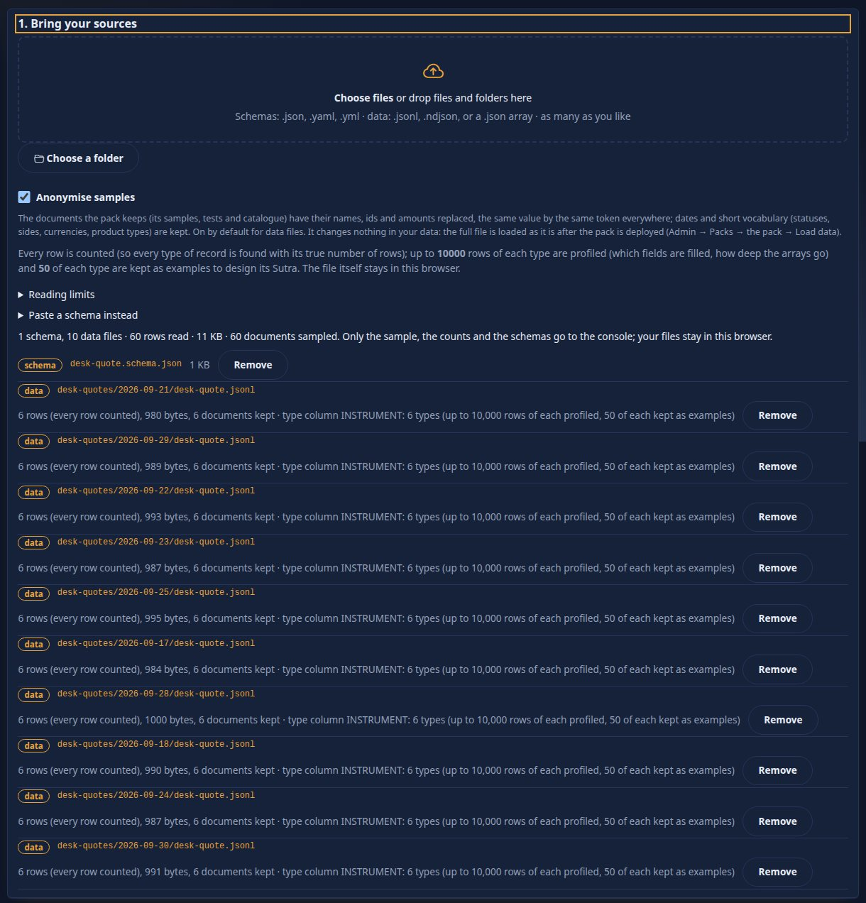

You should see the schema listed, then the ten `desk-quote.jsonl` files with their rows (6 each), sizes and *6 documents sampled*, and a total line: `1 schema, 10 data files, 60 rows read`. **Your files are
read in your browser**: a reservoir sample of each, with the counts and the schema, goes to the console, never the whole folder. Press **Next**.

## Step 2 · Read what was detected

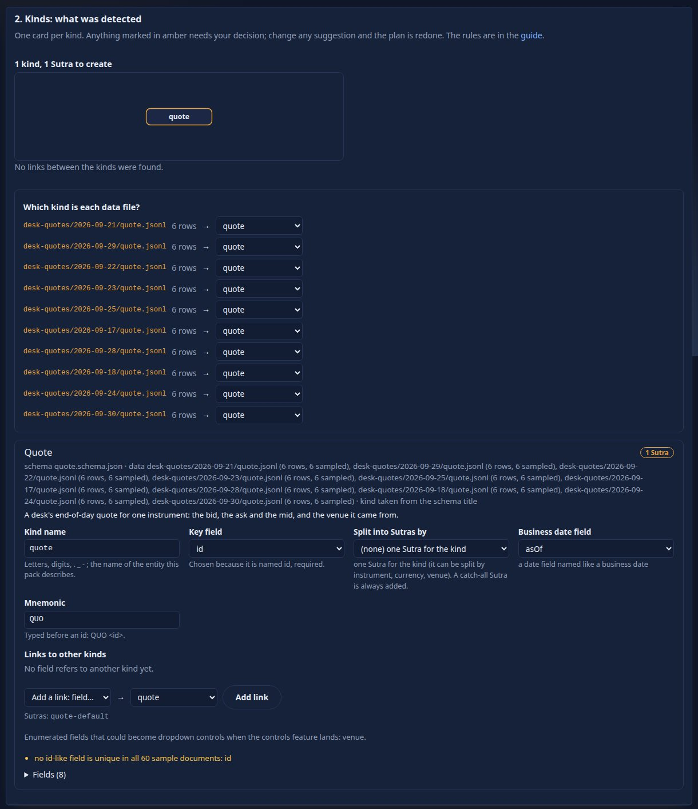

You should see one kind, **desk-quote** (named from the schema's title, *Desk quote*), with every data file matched to it (by its file name), and a card: **Key field** `ID`
(chosen because it is named id, and required), **Business date field** `AS_OF` (a date-time named like a business date), the **mnemonic** `DQ`, links to other kinds (none), and
the field list (8 fields). The amber line says `no id-like field is unique in all 60 sample documents: ID`. That is a heads-up, not an error: every day has a quote with the same
id, because each day is a snapshot of the same six instruments. Within one day `ID` is unique, and the business date separates the days.

The card is where you decide: rename the kind, pick another key, split into Sutras by a field (a Sutra is one screen layout) or add links. Every change redoes the plan. Had you
named the kind `quote`, the card would flag it: *another pack already defines it* (`news-and-markets`). Press **Next**.

## Step 3 · Name the pack

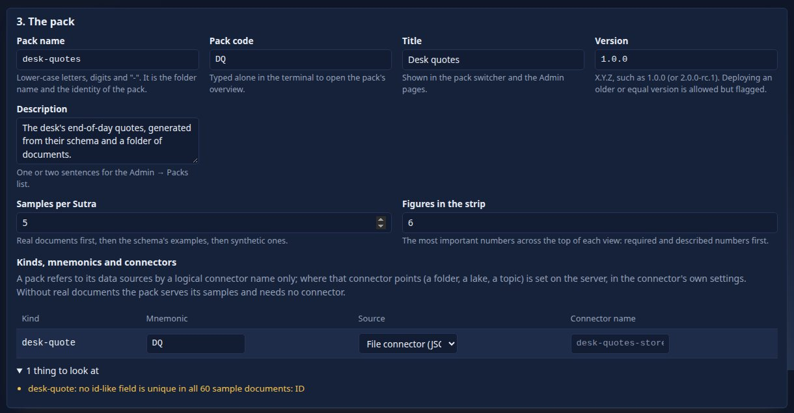

Set name `desk-quotes`, title `Desk quotes`, a description, leave the version `1.0.0` and set the code `DQP` (typed alone on the command line, `DQP` opens the pack's overview).
In the table of kinds set the **Source** of `desk-quote` to *File connector (JSON Lines per day)* and its **connector name** to `desk-quotes`: a pack refers to its data by a
logical connector name only, and that is the connector you made in tutorial 15. You should see the table read `desk-quote | DQ | File connector | desk-quotes`. Press **Next**.

## Step 4 · Preview every screen

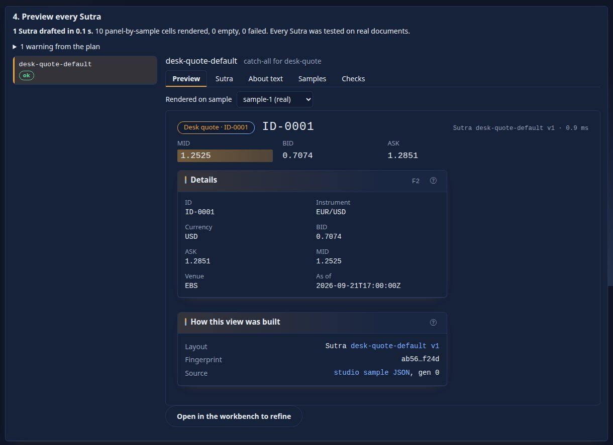

You should see the server draft the screen (a background job with a progress bar), then a list with one entry, `desk-quote-default`, badged *ok*, and its **Preview**: the real
view of a desk quote built from a real sample (`Q-BUND10Y` or another), with a strip of bid, ask and mid and a *Details* panel. The `df4` format on `BID`, `ASK` and `MID` is in the
schema (`x-drishti-format`), because a price of 1.0835 must not show as `1`. The tabs: **Sutra** is the YAML, **About text** is what *About this page* will say, **Samples** and
**Checks** show each panel against each sample.

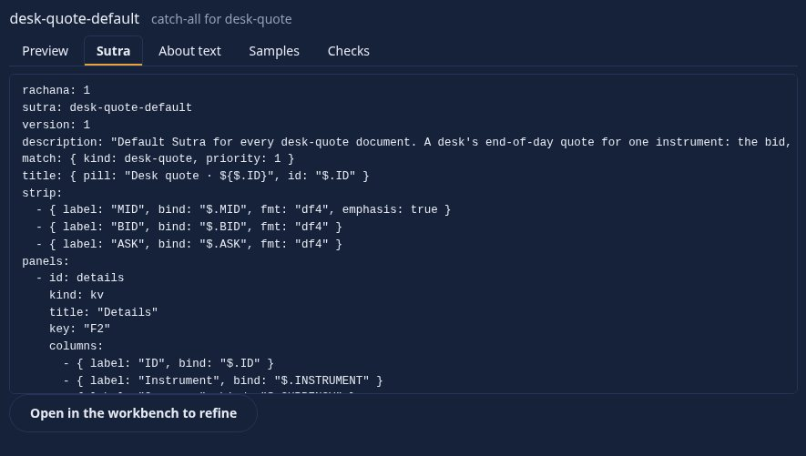

You should see the screen as text: a `match` (kind desk-quote), a `title`, a `strip` and a `kv` panel whose labels come from the schema, each bound to an UPPER_SNAKE path
(`bind: $.MID`). A Sutra is just a file; *Open in the workbench to refine* makes a design of it (Part B).

## Step 5 · Output and deploy

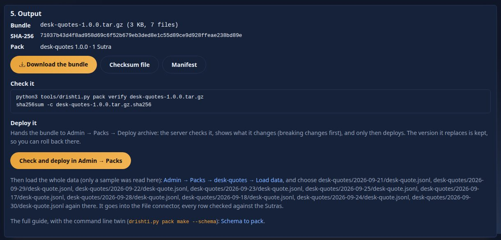

You should see the **bundle** `desk-quotes-1.0.0.tar.gz` with its SHA-256 and the command that verifies it (`drishti.py pack verify`). Press **Check and deploy in Admin → Packs**.

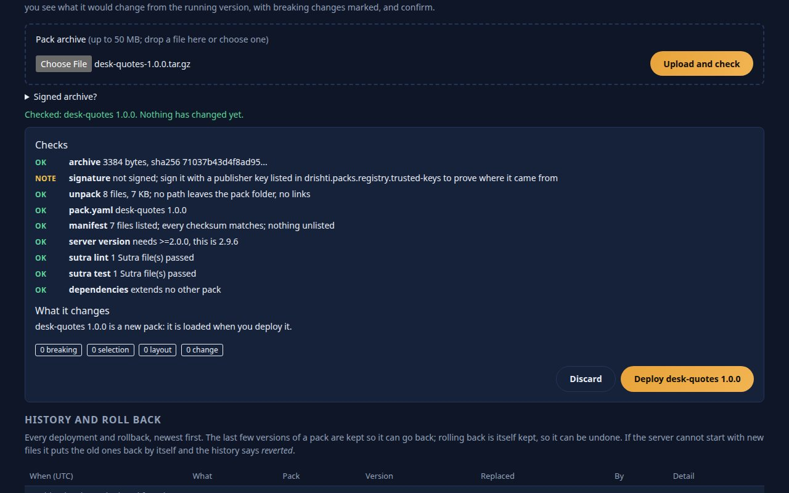

You should see the server unpack the archive and check it: checksum, unsigned (a note, not an error), no path leaves the pack folder, `pack.yaml`, every file listed and matching, the server version it
needs, `sutra lint` and `sutra test` passed, and the dependencies. Under **What it changes**: `desk-quotes 1.0.0 is a new pack: it is loaded when you deploy it`, with counters
for breaking, selection, layout and other changes (all 0 for a new pack). Press **Deploy desk-quotes 1.0.0** and confirm in the page's own dialog (the version must be X.Y.Z, as here).

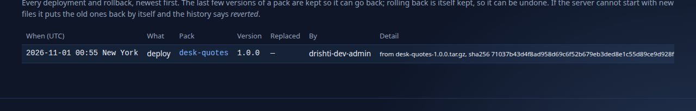

You should see, after a moment, a line in **History and roll back**: `deploy desk-quotes 1.0.0`. The pack is in use now, with no restart. Open one of its quotes:

```text
DQ Q-EURUSD <GO>
```

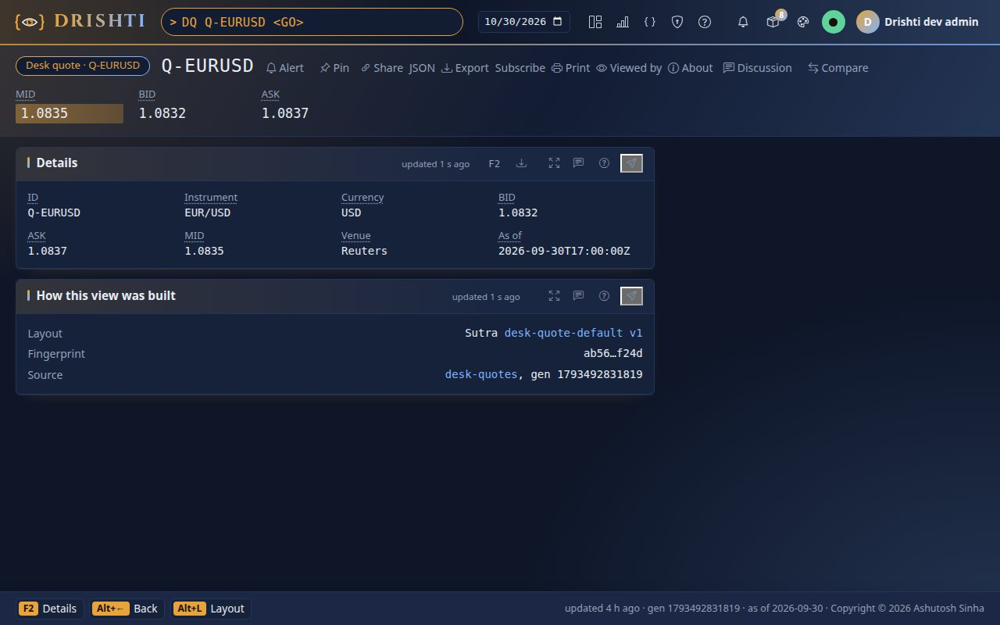

You should see the quote's view: `Q-EURUSD` with the title pill `Desk quote · Q-EURUSD`, the strip (mid, bid, ask), the panel of details (id, instrument, currency, bid, ask, mid, venue,
when it was struck). The panel *How this view was built* names the layout (`Sutra desk-quote-default v1`) and the source that served the view: `desk-quotes`, the connector of
tutorial 15. The figures are the ones of the desk's quotes of tutorial 15. Type `DQP` alone to see the pack at a glance.

If the deploy is refused with `DRS-5001 cannot load 'desk-quotes': kind quote is defined by both pack 'news-and-markets' and pack 'desk-quotes'`, the kind was left as `quote`:
the server puts the old files back by itself (the history says *reverted*); rename the kind in Step 2 and build again.

## Step 6 · Deploy again, and roll back

Build the pack a second time with the version `1.1.0` (it takes the same steps) and deploy it. Admin → Packs now keeps the version it replaced.

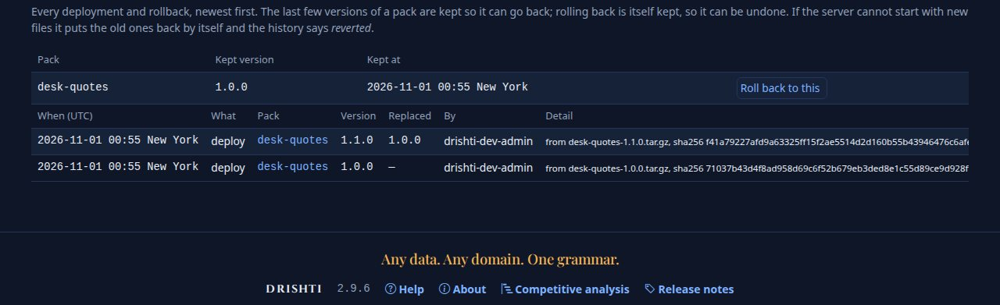

You should see a table **Versions kept for a rollback**: `desk-quotes 1.0.0`, with a **Roll back to this** button, above the history. Press it and confirm in the dialog. The running version is never offered here, and a version deployed twice is kept once.

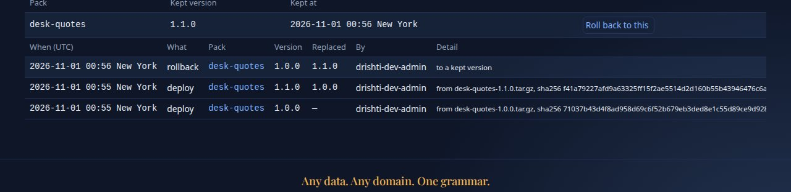

You should see a new line in the history, `rollback desk-quotes 1.0.0`, replacing `1.1.0`. A rollback is itself kept, so it can be undone. If a new version cannot be started the server puts the old
files back by itself, and the history says *reverted*.

**From the command line**, Steps 5 and 6 are `server packs deploy` and `server packs rollback` on the bundle the page downloaded (Step 7 shows both with real output).

## Step 7 · The same from the command line: `pack make`

Without the page: one command turns a folder of JSON Lines into one folder you can deploy: the pack, the data in a Delta Lake partitioned by business date, a checksummed bundle, a server
configuration and start scripts. `pack make` wants the ids in what it reads to be unique, so give it one day's file (later days are added with `data ingest`):

Run these from the Drishti folder (the repository root, or the install folder of a release).

```text
$ python3 tools/drishti.py pack make docs/tutorials/data/desk-quotes/2026-09-30/desk-quote.jsonl --kind desk-quote --match VENUE --name desk-quotes --version 1.2.0 --out build/desk-quotes
read 6 desk-quote document(s)
key:   ID  (named id, present and unique in all 6 documents)
date:  AS_OF  (date-valued, named like a business date, 1 distinct date(s))
6 documents, 1 kind(s), 2 group(s)
drafting 2 Sutra(s) with one `sutra design --each` run ...
kind            group                                          docs samples  sutra
desk-quote      VENUE=Reuters                                     6       5  desk-quote-reuters
desk-quote      (all)                                             6       5  desk-quote-default
  desk-quote 2026-09-30: 6 rows
kind                business date        rows
desk-quote          2026-09-30              6
total rows: 6
Dated store (delta): 6 rows written to build/desk-quotes/data/delta (domain desk-quotes); 0 document(s) without a date or id skipped
pack written to build/desk-quotes/pack/desk-quotes
sutra lint: exit 0
ok      build/desk-quotes/pack/desk-quotes/sutras/desk-quote/desk-quote-default.v1.sutra.yaml
ok      build/desk-quotes/pack/desk-quotes/sutras/desk-quote/desk-quote-reuters.v1.sutra.yaml
sutra test: exit 0
     desk-quote-default: help coverage 7/7 (100%)
ok   build/desk-quotes/pack/desk-quotes/sutras/desk-quote/desk-quote-default.v1.sutra.yaml (5 samples)
     desk-quote-reuters: help coverage 7/7 (100%)
ok   build/desk-quotes/pack/desk-quotes/sutras/desk-quote/desk-quote-reuters.v1.sutra.yaml (5 samples)

== pack check
== desk-quotes: sutra lint: exit 0
ok      build/desk-quotes/pack/desk-quotes/sutras/desk-quote/desk-quote-default.v1.sutra.yaml
ok      build/desk-quotes/pack/desk-quotes/sutras/desk-quote/desk-quote-reuters.v1.sutra.yaml
== desk-quotes: sutra test: exit 0
     desk-quote-default: help coverage 7/7 (100%)
ok   build/desk-quotes/pack/desk-quotes/sutras/desk-quote/desk-quote-default.v1.sutra.yaml (5 samples)
     desk-quote-reuters: help coverage 7/7 (100%)
ok   build/desk-quotes/pack/desk-quotes/sutras/desk-quote/desk-quote-reuters.v1.sutra.yaml (5 samples)

== pack bundle
bundled desk-quotes 1.2.0: 19 files
  build/desk-quotes/bundle/desk-quotes-1.2.0.tar.gz
  sha256 2ef97e13fb4c877ccacb3e784fac0e9155de9035db937dd793283c5a42940d5c

== pack verify
verify build/desk-quotes/bundle/desk-quotes-1.2.0.tar.gz: desk-quotes 1.2.0
  checksums ok
  schema    ok
  server    ok
  sutra     ok
verified

pack make: build/desk-quotes
  2 Sutra group(s) for 6 desk-quote document(s), 1 date(s) in data/delta; pack check passed, pack verify passed
next: read build/desk-quotes/README.txt; for a new server  DRISHTI_HOME=<install> DRISHTI_PORT=18480 build/desk-quotes/run-server.sh; on a running one, copy build/desk-quotes/pack/desk-quotes into its ...
```

You should see it choose the key and the date and say why, one Sutra for each venue (Reuters has one of its own, plus a catch-all), then run `pack check` and `pack verify` and finish with
`pack check passed, pack verify passed`. (`pack make` reads the data only, not the schema: its Sutras show the prices with the default number format. The page of Steps 1 to 5 reads the
schema's `x-drishti-format: df4` too.) This is the folder it made:

```text
$ find build/desk-quotes -maxdepth 3
build/desk-quotes
build/desk-quotes/bundle
build/desk-quotes/bundle/desk-quotes-1.2.0.manifest.json
build/desk-quotes/bundle/desk-quotes-1.2.0.tar.gz
build/desk-quotes/bundle/desk-quotes-1.2.0.tar.gz.sha256
build/desk-quotes/config
build/desk-quotes/config/drishti-site.yaml
build/desk-quotes/data
build/desk-quotes/data/delta
build/desk-quotes/data/delta/desk-quotes
build/desk-quotes/MANIFEST.json
build/desk-quotes/pack
build/desk-quotes/pack/desk-quotes
build/desk-quotes/pack/desk-quotes/config
build/desk-quotes/pack/desk-quotes/generated
build/desk-quotes/pack/desk-quotes/pack.yaml
build/desk-quotes/pack/desk-quotes/README.md
build/desk-quotes/pack/desk-quotes/samples
build/desk-quotes/pack/desk-quotes/sutras
build/desk-quotes/pack/desk-quotes/tests
build/desk-quotes/README.txt
build/desk-quotes/run-server.ps1
build/desk-quotes/run-server.sh
```

The pack it made, `build/desk-quotes/pack/desk-quotes/pack.yaml`, names the kind, its mnemonic and the columns a search shows, and routes the kind to its own Delta store:

```yaml
pack: desk-quotes
version: 1.2.0
code: DQ
kinds:
- desk-quote
mnemonics:
  DQ:
    kind: desk-quote
    label: Desk quote
columns:
  desk-quote: [INSTRUMENT, CURRENCY, BID, ASK, MID, VENUE, AS_OF]
connectors:
- desk-quotes-store
routes:
  desk-quote: desk-quotes-store
```

On this server that store reads `<data>/delta/desk-quotes`, which is empty until you copy `build/desk-quotes/data/delta/desk-quotes` there (Admin → Health then lists
`desk-quotes-store` as `DOWN: cannot reach ...`); the quotes keep being served by the `desk-quotes` connector of tutorial 15, which serves the same kind.

Verify the bundle, as a colleague would before deploying it:

```text
$ python3 tools/drishti.py pack verify build/desk-quotes/bundle/desk-quotes-1.2.0.tar.gz
verify build/desk-quotes/bundle/desk-quotes-1.2.0.tar.gz: desk-quotes 1.2.0
  checksums ok
  schema    ok
  server    ok
  sutra     ok
verified
```

Ask the server what a deploy would do, without doing it (`--preview` discards the upload):

```text
$ python3 tools/drishti.py server packs deploy build/desk-quotes/bundle/desk-quotes-1.2.0.tar.gz --preview
archive desk-quotes-1.2.0.tar.gz (4559 bytes, sha256 2ef97e13fb4c877c...)
  ok    archive         4559 bytes, sha256 2ef97e13fb4c877c...
  ok    checksum        matches the sha256 you gave
  warn  signature       not signed; sign it with a publisher key listed in drishti.packs.registry.trusted-keys to prove where it came from
  ok    unpack          20 files, 16 KB; no path leaves the pack folder, no links
  ok    pack.yaml       desk-quotes 1.2.0
  ok    manifest        19 files listed; every checksum matches; nothing unlisted
  ok    server version  needs >=2.2.0, this is 2.6.7
  ok    sutra lint      2 Sutra file(s) passed
  ok    sutra test      2 Sutra file(s) passed
  ok    dependencies    extends no other pack

Preview: desk-quotes 1.0.0 (loaded) -> 1.2.0 (newer)
  CHANGE (1)
    version                    desk-quotes   1.0.0 -> 1.2.0
  summary: 1 change

preview only: nothing was deployed
```

You should see the checks again and a **Preview** that says `desk-quotes 1.0.0 (loaded) -> 1.2.0 (newer)` with the changes counted. (This output was captured with a 1.0.0 that
was itself made by `pack make`, so only the version differs; after the page's 1.0.0 the preview also lists `sutra added desk-quote-reuters` under SELECTION and the changed
Sutra and glossary under CHANGE.) Then deploy it for real, look at the history, roll back and look again:

```text
$ python3 tools/drishti.py server packs deploy build/desk-quotes/bundle/desk-quotes-1.2.0.tar.gz
archive desk-quotes-1.2.0.tar.gz (4559 bytes, sha256 2ef97e13fb4c877c...)
  ok    archive         4559 bytes, sha256 2ef97e13fb4c877c...
  ok    checksum        matches the sha256 you gave
  warn  signature       not signed; sign it with a publisher key listed in drishti.packs.registry.trusted-keys to prove where it came from
  ok    unpack          20 files, 16 KB; no path leaves the pack folder, no links
  ok    pack.yaml       desk-quotes 1.2.0
  ok    manifest        19 files listed; every checksum matches; nothing unlisted
  ok    server version  needs >=2.2.0, this is 2.6.7
  ok    sutra lint      2 Sutra file(s) passed
  ok    sutra test      2 Sutra file(s) passed
  ok    dependencies    extends no other pack

Preview: desk-quotes 1.0.0 (loaded) -> 1.2.0 (newer)
  CHANGE (1)
    version                    desk-quotes   1.0.0 -> 1.2.0
  summary: 1 change

deployed desk-quotes 1.2.0 (replacing 1.0.0): Applied now; no restart.
```

```text
$ python3 tools/drishti.py server packs history --pack desk-quotes --limit 6
  when (UTC)           action    pack         version  replaced  by
  -------------------  --------  -----------  -------  --------  -----------------
  2026-10-17 21:42:46  deploy    desk-quotes  1.2.0    1.0.0     drishti-dev-admin
  2026-10-17 21:41:43  rollback  desk-quotes  1.0.0    1.1.0     drishti-dev-admin
  2026-10-17 21:41:43  deploy    desk-quotes  1.1.0    1.0.0     drishti-dev-admin
  2026-10-17 21:41:01  deploy    desk-quotes  1.0.0              drishti-dev-admin
  kept for rollback, desk-quotes: 1.0.0, 1.1.0
```

```text
$ python3 tools/drishti.py server packs rollback desk-quotes --version 1.0.0
rolled desk-quotes back to 1.0.0 (replacing 1.2.0): Applied now; no restart.
```

```text
$ python3 tools/drishti.py server packs history --pack desk-quotes --limit 3
  when (UTC)           action    pack         version  replaced  by
  -------------------  --------  -----------  -------  --------  -----------------
  2026-10-17 21:42:47  rollback  desk-quotes  1.0.0    1.2.0     drishti-dev-admin
  2026-10-17 21:42:46  deploy    desk-quotes  1.2.0    1.0.0     drishti-dev-admin
  2026-10-17 21:41:43  rollback  desk-quotes  1.0.0    1.1.0     drishti-dev-admin
  kept for rollback, desk-quotes: 1.2.0, 1.1.0
```

You should see the rollback recorded and the pack back at `1.0.0`. A **breaking** change (a kind or mnemonic removed or renamed) makes `deploy` stop with exit 1 until you add `--accept-breaking`.


### Part B · Design a screen in the workbench

A screen in Drishti is a **Sutra**: a small YAML file that says which entities it applies to and what to show. The Build workbench makes one from your own sample documents, with a live preview. You design a desk screen with a strip of key figures, **tabs that each hold two panels** (a currency's totals and its trades), a **slider** that narrows the trades by size, the text behind **About this page** and a **map**, see the column filters every table has, and check the Sutra from the command line. Each step shows the UI, the command line where there is one, and the YAML. The references are [RACHANA_REFERENCE.md › Screen designer and the Build workbench](../guides/RACHANA_REFERENCE.md#screen-designer-and-the-build-workbench) and the grammar behind it, [RACHANA_REFERENCE.md](../guides/RACHANA_REFERENCE.md#sutra-next-fragments-events-children-sources-layout-and-forms).

## Step 8 · Bring your documents

Choose **Build**, then **New screen**. Choose the three desk files, name the design `Desk book` and give it the kind `desk`.

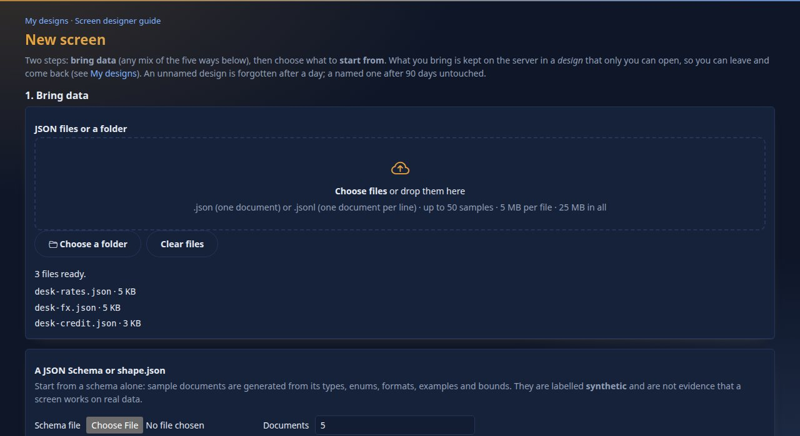

You should see `3 files ready.`, the name and the kind filled in, and the start choices (auto-design on). Press **Create**.

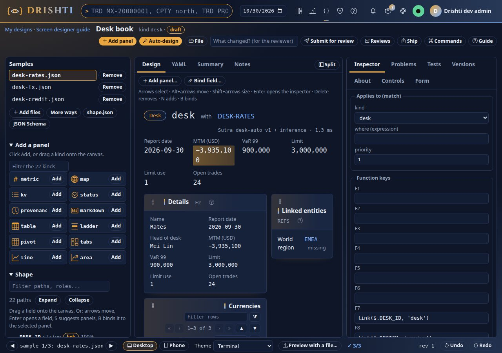

You should see the workbench: your files as **Samples** on the left (switch between them with the arrows at the bottom), the **Design** canvas in the middle with a first draft the auto-designer made
(a title, a strip of the document's figures, a *Details* panel, a *Currencies* table), and the **Inspector** on the right. The first draft is a start: its figures show as raw values
(`LIMIT_USE` as `0.58`, not `58%`), and the currencies are a plain table. Next you replace it with a designed one.

## Step 9 · Read the Sutra, and replace it

Open the **YAML** tab. Select everything, and paste the contents of `docs/tutorials/data/desk-book.sutra.yaml`.

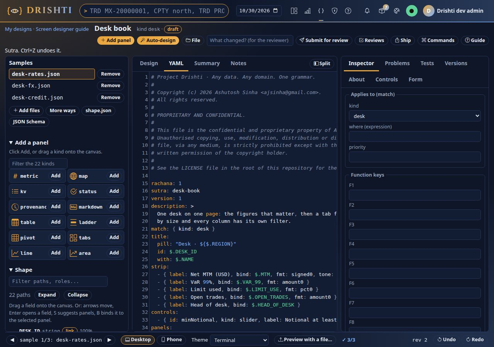

You should see the Sutra in the editor. Read it from the top:

- `match: { kind: desk }`: it applies to every document of the kind `desk`.
- `title`: a pill (`Desk · ${$.REGION}`), the id (`$.DESK_ID`) and the desk's name (`$.NAME`).
- `strip`: five key figures, each a label, a path into the document (`bind: $.MTM`) and a format (`signed0`, `pct0`); `tone: sign` colours a number by its sign.
- `controls`: one control, a slider called `minNotional`.
- `panels`: one `tabs` panel; `each: $.CURRENCIES` makes one tab for each currency, named by `tabTitle: "@.CODE"`, and `panels:` lists what each tab holds. Inside a tab `@` is that currency.
  The second panel's `where: "@.NOTIONAL >= ctl.minNotional"` keeps the trades at least as big as the slider says.

The top of the file, as you pasted it:

```yaml
match: { kind: desk }
title:
  pill: "Desk · ${$.REGION}"
  id: $.DESK_ID
  with: $.NAME
strip:
  - { label: Net MTM (USD), bind: $.MTM, fmt: signed0, tone: sign, emphasis: true }
  - { label: VaR 99%, bind: $.VAR_99, fmt: amount0 }
  - { label: Limit used, bind: $.LIMIT_USE, fmt: pct0 }
  - { label: Open trades, bind: $.OPEN_TRADES, fmt: amount0 }
  - { label: Head of desk, bind: $.HEAD_OF_DESK }
controls:
  - { id: minNotional, kind: slider, label: Notional at least, min: 0, max: 250000000, step: 25000000, placement: strip }
```

Click the **Design** tab.

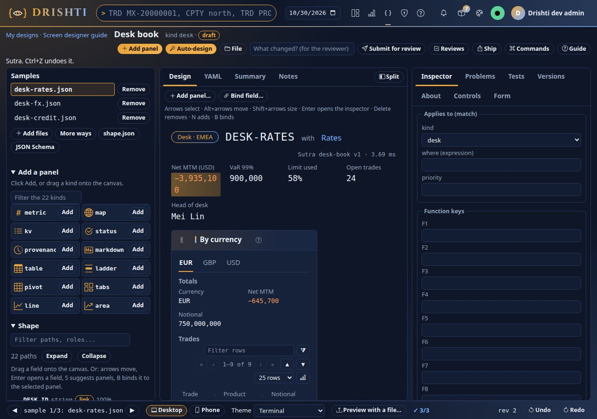

You should see `Desk · EMEA` and `DESK-RATES`, the strip, and a panel **By currency** with three tabs, `EUR`, `GBP`, `USD`. The selected tab holds two panels: **Totals** (currency, net MTM
coloured by sign, notional) and **Trades**, a table with a **Filter rows** box and paging. Click another tab, and switch sample with the arrow at the bottom: the tabs follow the data, however many currencies a desk has.
The panel is narrower than the canvas: **drag its edges** or press `Shift+→` on it to resize, `Alt+arrows` to move it.

## Step 10 · The slider

Open the **Controls** tab. The slider you wrote is there, as a card you can edit: its label, **Min** `0`, **Max** `250000000`, **Step** `25000000`, whether it has two handles (a range) and where it sits
(`strip`, `header` or `side`).

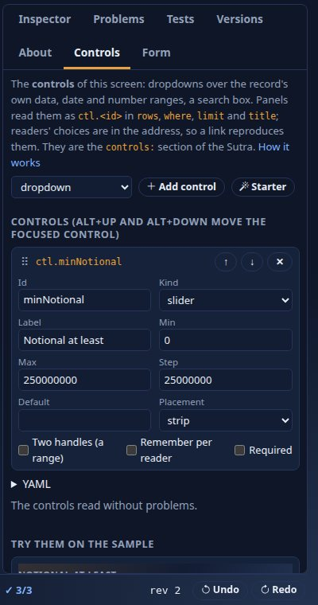

You should see the card and `The controls read without problems.` Scroll to **Try them on the sample** and drag the slider (or focus it and press `→` for one step).

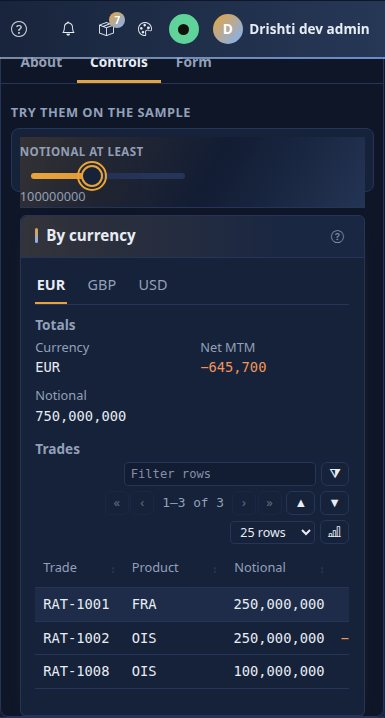

You should see the label `Notional at least`, the handle and its value, and the trades table shrink: with the handle at 100,000,000 only 3 of the 9 EUR trades are left
(GBP keeps 3 of 6, USD 2 of 9). A reader on the live screen gets the
same slider, and what they choose is in the page's address, so a link reproduces it. Keys: `←` `→` one step, `PageUp` `PageDown` ten, `Home` `End` the ends; on a phone the handle is 44 pixels. A slider
with `range: true` has two handles and gives `from..to`.

## Step 11 · Column filters, and the phone

Every table in Drishti has a funnel on each column heading, like a spreadsheet. The workbench preview is a sketch, so look at one on a live view: open `TRD MX-20000001`, find the
**Events** table (the trade's booking events and cash settlements, leg by leg) and click the funnel in the **Amount** heading.

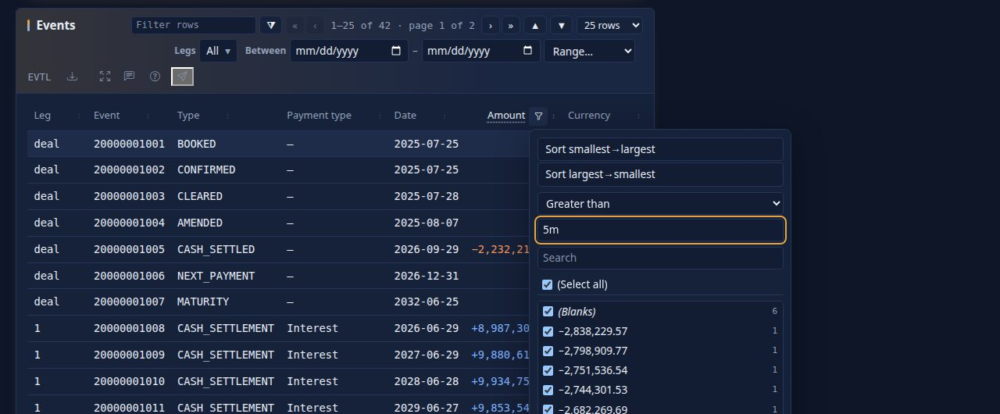

You should see a menu with two sort buttons, a **condition** (equals, greater than, between, top 10 ...) with its value box, a search box over the column's values and the list of values with tick boxes, and **OK**, **Cancel** and **Clear**. Choose *Greater than*, type `5m` and press **OK**: only the settlements above 5 million stay (`+8,987,301.85` on 2026-06-29 is one), and the funnel on the heading is filled in. The table's own **Legs** and **Between** controls, in the panel's header, narrow it too. A tick-box list works for text, a date condition for dates. [USER_GUIDE.md › Filter a table like Excel](../guides/USER_GUIDE.md#filter-a-table-like-excel) has them all.

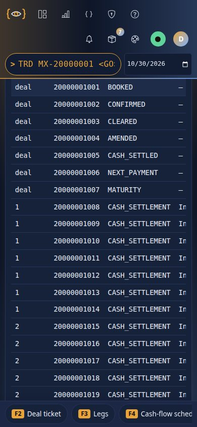

You should see the same table on a phone, one column, with 44-pixel targets. In the workbench use the **Phone** button at the bottom to see your own screen that way before you propose it.

## Step 12 · Check it

The Problems tab lists everything wrong; the Tests tab checks every sample.

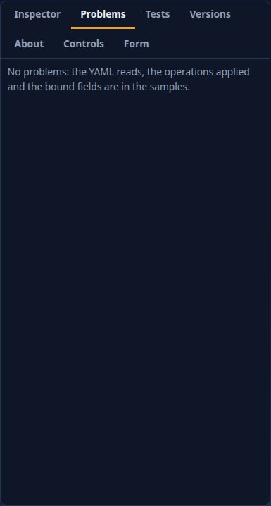

You should see `No problems: the YAML reads, the operations applied and the bound fields are in the samples.` Introduce a mistake (change `kind: tabs` to `kind: tab`) and the tab names the line and the
reason, with the code (`DRS-2021 unknown panel kind`). Undo with `Ctrl+Z`.

The command line runs the same checks, which is what a CI job would do. Put the Sutra and one document side by side and lint it:

```bash
mkdir -p desk-test && cp docs/tutorials/data/desk-book.sutra.yaml desk-test/
cp docs/tutorials/data/desks/desk-rates.json desk-test/desk-book.json
python3 tools/drishti.py sutra lint desk-test/desk-book.sutra.yaml
```

```text
$ python3 tools/drishti.py sutra lint desk-test/desk-book.sutra.yaml
ok      desk-test/desk-book.sutra.yaml
desk-test/desk-book.sutra.yaml:15 warning DRS-2047 field 'MTM' is shown but has no glossary entry (kinds.desk.glossary in config/about.yaml, or a vocabulary entry)
desk-test/desk-book.sutra.yaml:15 warning DRS-2047 field 'VAR_99' is shown but has no glossary entry (kinds.desk.glossary in config/about.yaml, or a vocabulary entry)
...
[exit 0]
```

You should see `ok desk-test/desk-book.sutra.yaml` and a list of warnings, one per field the screen shows, `DRS-2047 field 'MTM' is shown but has no glossary entry`: the screen works, but nothing yet says what its fields mean. (Lint is quiet by
default about help text: exit 0; `--strict` makes these warnings fail the run.)

```text
$ python3 tools/drishti.py sutra lint --strict desk-test/desk-book.sutra.yaml
ok      desk-test/desk-book.sutra.yaml
desk-test/desk-book.sutra.yaml:15 warning DRS-2047 field 'MTM' is shown but has no glossary entry (kinds.desk.glossary in config/about.yaml, or a vocabulary entry)
desk-test/desk-book.sutra.yaml:15 warning DRS-2047 field 'VAR_99' is shown but has no glossary entry (kinds.desk.glossary in config/about.yaml, or a vocabulary entry)
desk-test/desk-book.sutra.yaml:15 warning DRS-2047 field 'LIMIT_USE' is shown but has no glossary entry (kinds.desk.glossary in config/about.yaml, or a vocabulary entry)
desk-test/desk-book.sutra.yaml:15 warning DRS-2047 field 'OPEN_TRADES' is shown but has no glossary entry (kinds.desk.glossary in config/about.yaml, or a vocabulary entry)
desk-test/desk-book.sutra.yaml:15 warning DRS-2047 field 'HEAD_OF_DESK' is shown but has no glossary entry (kinds.desk.glossary in config/about.yaml, or a vocabulary entry)
desk-test/desk-book.sutra.yaml:15 warning DRS-2047 field 'CODE' is shown but has no glossary entry (kinds.desk.glossary in config/about.yaml, or a vocabulary entry)
desk-test/desk-book.sutra.yaml:15 warning DRS-2047 field 'NET_MTM' is shown but has no glossary entry (kinds.desk.glossary in config/about.yaml, or a vocabulary entry)
desk-test/desk-book.sutra.yaml:15 warning DRS-2047 field 'NOTIONAL' is shown but has no glossary entry (kinds.desk.glossary in config/about.yaml, or a vocabulary entry)
desk-test/desk-book.sutra.yaml:15 warning DRS-2047 field 'TRADES.ID' is shown but has no glossary entry (kinds.desk.glossary in config/about.yaml, or a vocabulary entry)
desk-test/desk-book.sutra.yaml:15 warning DRS-2047 field 'TRADES.PRODUCT' is shown but has no glossary entry (kinds.desk.glossary in config/about.yaml, or a vocabulary entry)
desk-test/desk-book.sutra.yaml:15 warning DRS-2047 field 'TRADES.NOTIONAL' is shown but has no glossary entry (kinds.desk.glossary in config/about.yaml, or a vocabulary entry)
desk-test/desk-book.sutra.yaml:15 warning DRS-2047 field 'TRADES.MTM' is shown but has no glossary entry (kinds.desk.glossary in config/about.yaml, or a vocabulary entry)
desk-test/desk-book.sutra.yaml:15 warning DRS-2047 field 'TRADES.MATURITY' is shown but has no glossary entry (kinds.desk.glossary in config/about.yaml, or a vocabulary entry)
[exit 1]
```

`preview` renders every sample and reports panels in error:

```text
$ python3 tools/drishti.py sutra preview desk-test/desk-book.sutra.yaml
desk-book / desk-book.json: 1 panels, 0 in error
```

You should see `1 panels, 0 in error`.

## Step 13 · About this page

The warnings point to the *About this page* text: press `?` on any view.

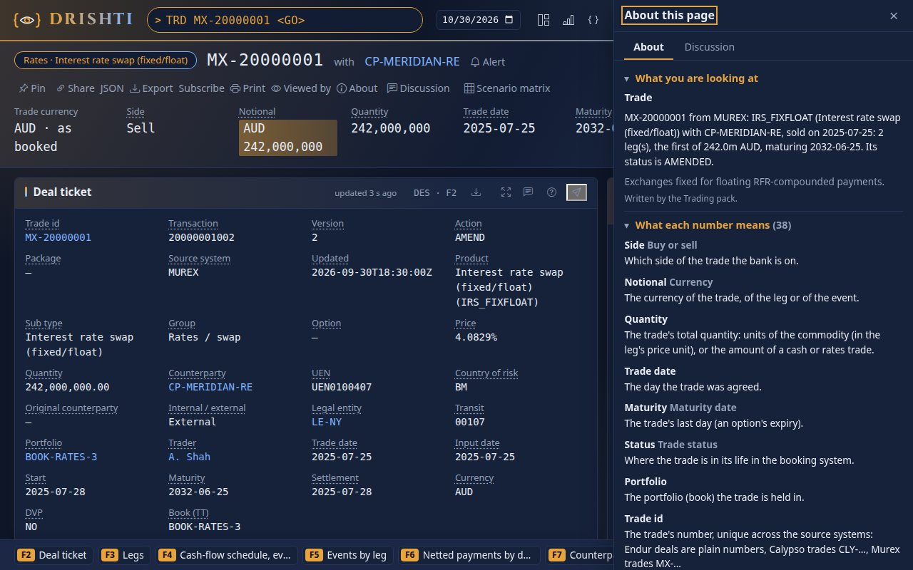

You should see a drawer with the page's text, a line for each panel, a glossary (term, meaning, unit) of the fields you can see, where the data came from and why this layout was chosen. Your Sutra's
`description` and each panel's `description` fill it; the glossary and the page text are the pack's `config/about.yaml`. In the workbench, open the **About** tab and press **Starter**.

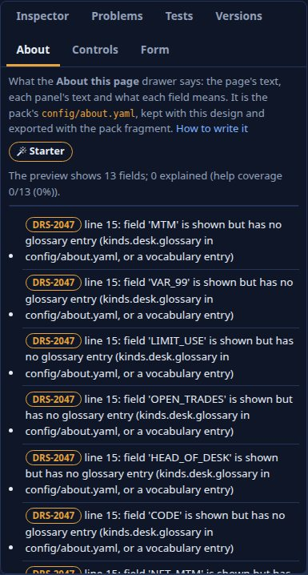

You should see a skeleton for the kind, the panel texts and a glossary entry for each field the preview shows, marked as still to write (`What mtm means.`), and the **About card** under it. The line under the
button counts the fields and how many are explained (the thirteen fields `--strict` listed above). Write real sentences in the box and the card updates as you type; the lint warnings vanish as entries appear. The text is saved with the design and
travels with the pack fragment you export; it goes live when an administrator deploys the pack ([RACHANA_REFERENCE.md › The About tab](../guides/RACHANA_REFERENCE.md#the-about-tab)).

## Step 14 · A map on a screen

A panel of kind **`map`** draws a world map from a country code in the document, with shapes that ship with the console (no tiles, no map service, nothing fetched from the internet). Look at one that is already in the world-economy pack: type `JUR JUR-AUS` and press Enter, the jurisdiction of Australia.

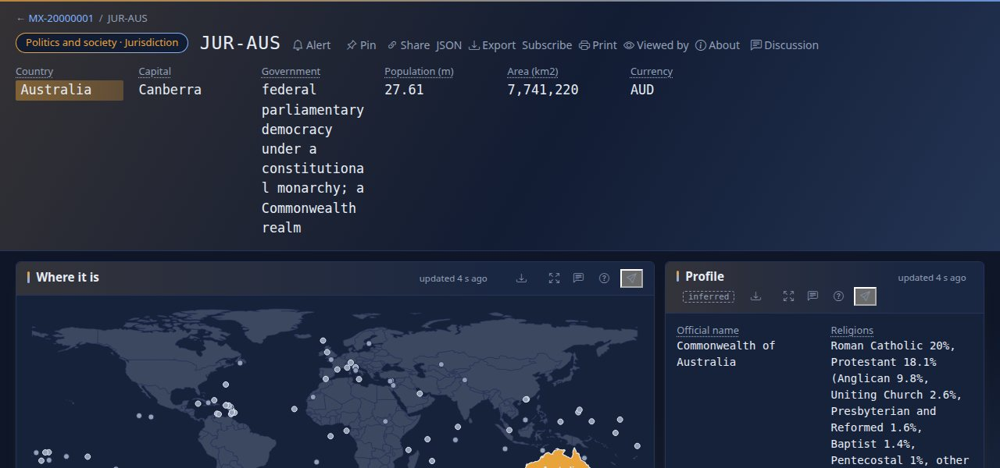

You should see, in the panel **Where it is**, the world with **Australia highlighted** and named, the small island states as **dots** (they are too small for the world shapes, but they can still be clicked), and **Open a country** under the map: the same countries as a list, for the keyboard and for screen readers. Move the pointer over another country.

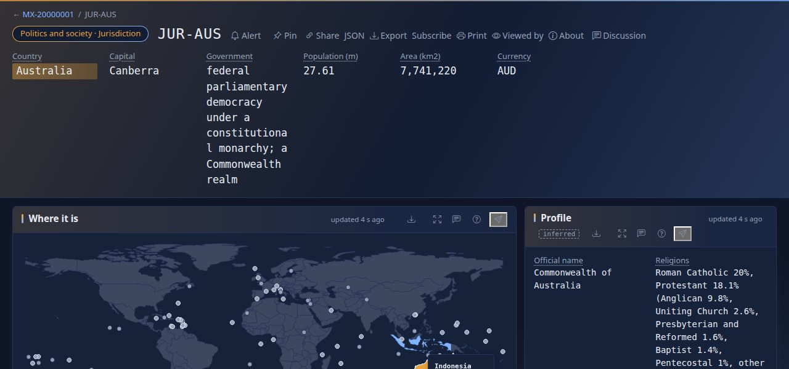

You should see the country change colour and a tip, `Indonesia · click to open`. Click it.

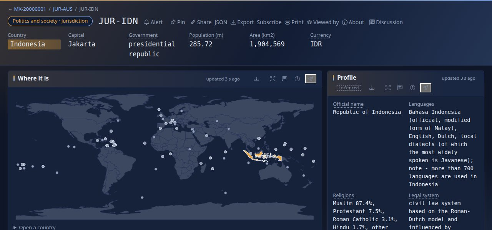

You should see **Indonesia's own page** (`JUR-IDN`), with the map now highlighting Indonesia, and the trail of pages you came by at the top (`JUR-AUS / JUR-IDN`). The panel that did all of this is three lines of the pack's Sutra, `modules/external-data/packs/world-economy/sutras/politics-and-society/jurisdiction.v1.sutra.yaml`:

```yaml
- id: geography
  kind: map
  title: Where it is
  highlight: $.ISO3                                   # the country to colour: an ISO alpha-3 or alpha-2 code, or its English name
  link: { kind: jurisdiction, id: "JUR-{iso3}" }      # a click on a country opens this entity (the id is built from the country's code)
  height: 11
```

`highlight` takes the country (or a list of them) from the document; `region: $.ISO3` draws the **regions** of a country instead (its states, provinces or counties, from ISO 3166-2 codes such as `AU-NSW`); `link` makes a click open another entity (`{iso3}` is the map's own code of the country clicked), and a `shade: { kind: economy, field: $.GDP_PER_CAPITA, by: $.ISO3, fmt: amount0, label: GDP per capita (USD) }` colours the countries by a figure read across a kind (the economy page of the same pack does exactly that). Now build one yourself in the workbench: **Build**, **New screen**, the tab **Examples**, and open **map**: it opens as **your own copy**, with its own sample document.

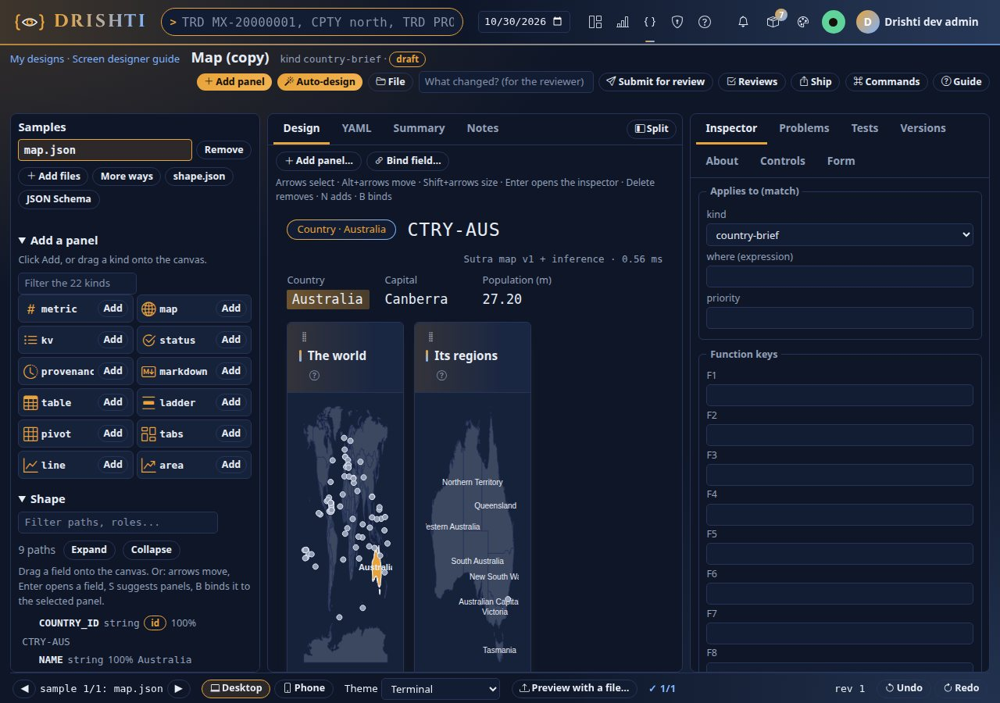

You should see the canvas with **two map panels** (the world with Australia in the accent colour, and Australia's regions: Northern Territory, Queensland, Western Australia, South Australia, New South Wales ...) and a **Facts** panel below them. The **palette** on the left, **Add a panel**, lists the kinds; `map` is the one with the globe.

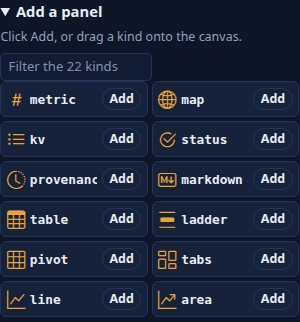

You should see `map` among the kinds with an **Add** button (or drag it onto the canvas); the **YAML** tab shows the lines above, and the **Inspector** takes `highlight`, `region`, `link` and `shade` as boxes. In the example's YAML the two panels are `highlight` and `region` on the same country field: the same field, two views of it. [RACHANA_REFERENCE.md](../guides/RACHANA_REFERENCE.md#screen-designer-and-the-build-workbench) and [RACHANA_REFERENCE.md](../guides/RACHANA_REFERENCE.md#panels-the-twenty-two-kinds-and-developing-a-new-one) have the rest of the options, and the reports have a map visual of their own ([the reports tutorial, Part A](../guides/bi/REPORTS.md#part-a--your-first-bi-report)).

## Step 15 · Save it, and how it goes live

The design is yours (see **My drafts** on the Build home). To make it live for everyone: **Submit for review**, a reviewer with the approve power reads the diff and the evidence, and approves; or export it as a pack
fragment (**Ship**) and put it in a pack. [RACHANA_REFERENCE.md](../guides/RACHANA_REFERENCE.md#screen-designer-and-the-build-workbench) walks through proposing and approving as two people; from the command line,
`drishti.py design create|save|check|propose|approve` do the same over REST ([CLI_REFERENCE.md](../guides/CLI_REFERENCE.md)).

You should see, under **Create → Build home → My drafts**, `Desk book` with the status *draft* and your edits listed.

#### On a live page: the Sutra designer

When an administrator has switched the **Sutra designer** on, much of the workbench's work is simpler on a page that already exists: open it, press **Customize** in
the page header and change it on the real page with real data. The result is kept as a design in **My drafts** on the Build home, like the workbench's, so the same `design`
commands work on it.

## Next steps

- [Tutorial 24 · Customize a live page](24-customize-a-live-page.md): change an existing page in plain words.
- [DATA_GUIDE.md](../guides/BUILD_GUIDE.md#8-the-pack-designer-create--new-pack) lists every rule (keys, links, formats, enums, splitting a kind); [CLI_REFERENCE.md](../guides/CLI_REFERENCE.md) the commands; [BUILD_GUIDE.md](../guides/BUILD_GUIDE.md) how a pack is laid out; [OPERATIONS_GUIDE.md](../guides/OPERATIONS_GUIDE.md#8-deploy-promote-and-roll-back-by-copying) how to promote a pack between servers.
- [Tutorial 16 · Load your own data into a new lake](16-load-your-own-data-into-a-new-lake.md) keeps the screens' data fresh.
- [RACHANA_REFERENCE.md](../guides/RACHANA_REFERENCE.md#screen-designer-and-the-build-workbench) is the workbench reference; [RACHANA_REFERENCE.md](../guides/RACHANA_REFERENCE.md#panels-the-twenty-two-kinds-and-developing-a-new-one) shows each of the 22 panel kinds with a picture.
- [BUILD_GUIDE.md](../guides/BUILD_GUIDE.md#11-what-a-sutra-is-and-when-one-applies) is the language guide; its [section 11a](../guides/BUILD_GUIDE.md#201-fragments-events-children-refresh-and-forms) writes a screen by hand.

## If something goes wrong

| You see | Meaning |
|---|---|
| the amber `no id-like field is unique` | your ids repeat across days; with a business-date field that is correct. If the ids should be unique, pick another key in the card |
| a kind flagged *another pack already defines it*, or `DRS-5001 ... kind quote is defined by both pack ...` | rename your kind in the card (`desk-quote`): two packs cannot own one kind |
| the deploy checks show a red line | read it: a checksum, a `pack.yaml` problem or a Sutra that fails its tests; the pack is not deployed |
| `DQ` does not open anything | the pack is not loaded: look at Admin → Packs; and the connector must run (tutorial 15) |
| `pack make` says no unique key | pass `--key FIELD`, or give it one day's file |
| a problem naming a line | the Problems tab says which line and why; click it to put the cursor there |
| `DRS-2023` | an option on a panel that does not take it (`panels:` is only for `tabs`, `body` likewise) |
| the Trades table is empty | the slider is above every trade, or the `where` reads a control that has no value |
| the workbench says the design changed in another tab | reload it: the other tab's edit wins, nothing is lost (Versions) |
