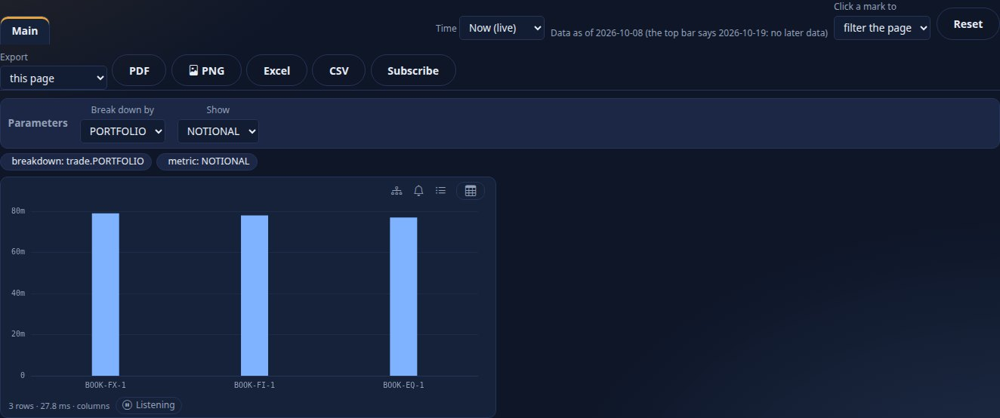
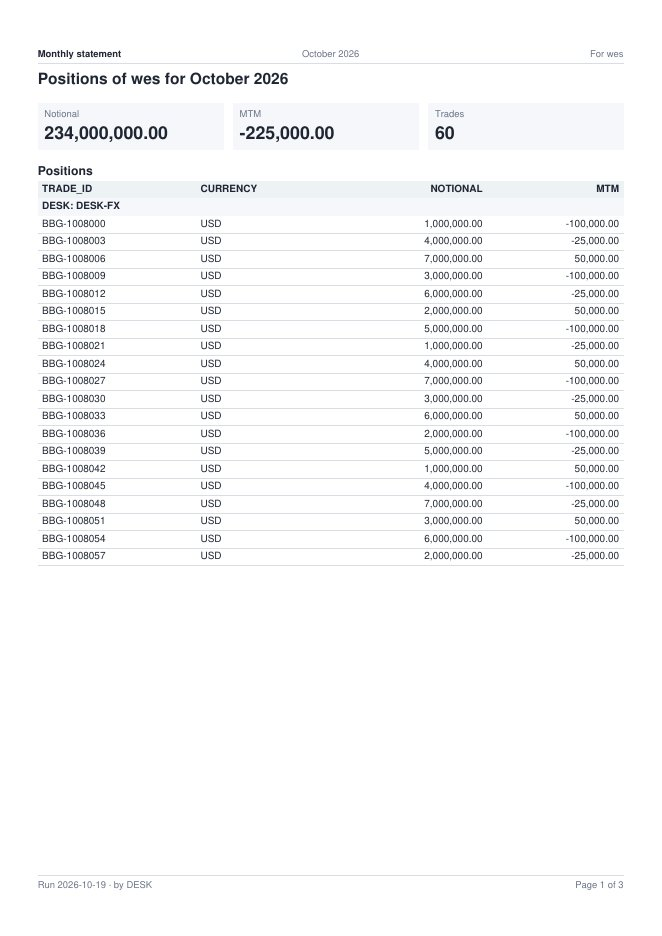
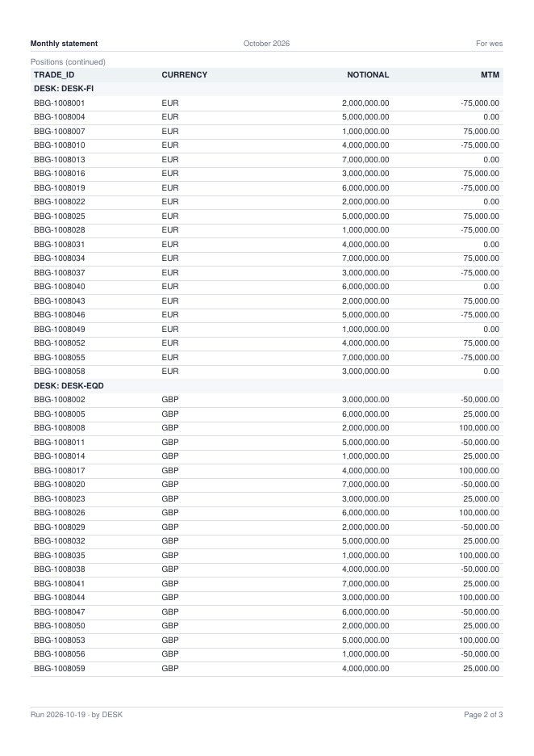
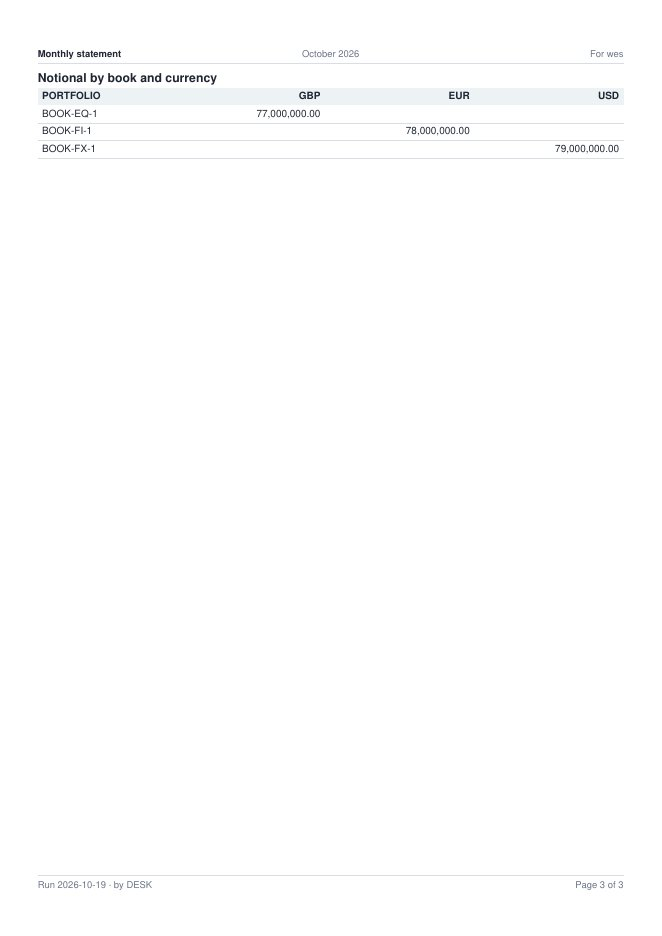

<!--
  Project Drishti · Any data. Any domain. One grammar.

  Copyright (c) 2026 Ashutosh Sinha <ajsinha@gmail.com>.
  All rights reserved.

  PROPRIETARY AND CONFIDENTIAL.

  This file is the confidential and proprietary property of Ashutosh Sinha.
  Unauthorised copying, use, modification, distribution or disclosure of this
  file, via any medium, is strictly prohibited except with the express prior
  written permission of the copyright holder.

  See the LICENSE file in the root of this repository for the full terms.
-->
# Tutorial 20 · Statements and field parameters

Two things a Power BI or SSRS author expects arrive in 2.6.0. **Field parameters in a visual's wells**: the reader chooses which field a chart breaks
down by and which measure it shows. **Statements**: a report page laid out on paper, page by page (paper size, margins, a header and footer with page
numbers, page breaks, column titles on every page, groups kept together), made as a PDF or Excel and sent by a subscription to many people, **each made as
that person**. This tutorial builds a model with two field parameters, a report whose chart the reader switches, and a monthly statement that bursts to a
role. Each step shows the UI, the command line and the YAML. The references are [REPORTS.md section 21](../guides/REPORTS.md#21-field-parameters-in-a-well-260)
and [STATEMENTS.md](../guides/STATEMENTS.md).

## Time to complete

About 40 minutes.

## Before you start

- Tutorial 10 done: a running server and console, signed in as a BI author (`bi-author`), the sample model *Trades, the basics* (`trades-basic@1`) and its
  dataset `trades-basic-trade` (the trade valuations).
- For step 6, a server that can send mail (`spring.mail.host`) and two or more users with an email address.
- A token for the command line: `DRISHTI_SERVER=http://localhost:18480` and `DRISHTI_TOKEN=...` (My account → API tokens, scope `bi:read`; [CLI_GUIDE.md](../guides/CLI_GUIDE.md#3-connecting-to-a-server-url-tokens-and-permissions)).

The outputs below were captured on this version against the test stack of `drishti-console/tests/test_bi_wave_d_browser.py` (the sample's 60 valuations of
2026-10-08); your numbers are your data's.

## What you will learn

- what a field parameter is and how it goes in a well, in Build and in the YAML;
- how a reader's parameter slicer switches a chart's field and measure, and that masks still hold;
- how to make a page a statement, set its paper, header and footer, and preview it page by page;
- how a statement's tables run over pages: repeated column titles, groups kept together, page breaks;
- how one subscription sends each person their own statement, and the CLI for the same.

## Step 1 · A model with two field parameters

A field parameter is a model's list of fields (or of measures) the reader chooses from.

**In the UI.** Open the model designer on a new model (BI Studio → Explorer → New → Model, the dataset `trades-basic-trade`), add the measures `MTM`
(`sum(trade.MTM)`) and `NOTIONAL` (`sum(trade.NOTIONAL)`), then the **Calculations** tab → *New parameter* `breakdown`, kind **field (switch a
breakdown)**, ticking `trade.DESK` and `trade.PORTFOLIO`; and `metric`, kind **field**, ticking the measures `MTM (measure)` and `NOTIONAL (measure)`
(since 2.6.0 a field parameter's choices may be measures). Save and publish.

**From the command line**, the same model from its file:

```
$ drishti.py bi item new me docs/tutorials/data/desk-params.model.yaml
```

**The YAML** ([desk-params.model.yaml](data/desk-params.model.yaml)):

```yaml
model: fp-desk
datasets:
  trade: { dataset: trades-basic-trade, role: fact }
measures:
  MTM:      { expr: "sum(trade.MTM)", format: signed0 }
  NOTIONAL: { expr: "sum(trade.NOTIONAL)", format: amount0 }
  Trades:   { expr: "count(trade)" }
parameters:
  breakdown: { kind: field, fields: [trade.DESK, trade.PORTFOLIO], default: trade.DESK, title: Break down by }
  metric:    { kind: field, fields: [MTM, NOTIONAL], default: MTM, title: Show }
```

**You should see:** the model published as `fp-desk@1`, its **Calculations** tab listing the parameters `breakdown` (the fields `trade.DESK` and
`trade.PORTFOLIO`, *Break down by*) and `metric` (the measures `MTM` and `NOTIONAL`, *Show*).

## Step 2 · A chart the reader switches

**In the UI.** New report on the model `fp-desk@1`, add a **column** visual and open **Build**. The *Add a field…* list of the **axis** well ends with
*Field parameters*: choose `param.breakdown`; the **values** well's list offers `param.metric` (a parameter of measures goes in a measure well only). Each
chip says it is a field parameter, and the canvas draws the default: MTM by desk. Save, and open the report: **Parameters** above the page has *Break down
by* and *Show*. Choose *PORTFOLIO* and *NOTIONAL*: the chart is asked again and draws notional by book; each choice is a chip, and **Reset** brings the
defaults back.




**The YAML** of the visual: `wells: { axis: [param.breakdown], values: [param.metric] }`. A parameter that does not fit its well is refused by Check,
`DRS-9037`: put `param.breakdown` in **values** and Problems says, once for the parameter, *the values well takes measures, and the field parameter
'breakdown' can be trade.DESK, trade.PORTFOLIO, fields: put it in a field well*.

**From the command line**, the model query the chart asks with the reader's choice (a field parameter of measures goes among the measures), written as a
file `switch.mq.yaml`:

```yaml
mq: 2
model: fp-desk@1
select: { fields: [param.breakdown], measures: [param.metric] }
params: { breakdown: trade.PORTFOLIO, metric: NOTIONAL }
```

```
$ drishti.py bi mq switch.mq.yaml          # notional by book, as you
```

A reader without raw sees MTM masked whichever way they choose: the choice is only a name; the visual is asked as them.

**You should see:** the column chart drawing MTM by desk by default; with *PORTFOLIO* and *NOTIONAL* chosen, notional by book and the two choices
as chips above the page (**Reset** brings MTM by desk back); `param.breakdown` in the values well refused with `DRS-9037`.

## Step 3 · A statement page

**In the UI.** In the same report, **+** a page, then in **Format** with no visual selected, **Layout → statement**. The **Paper** tab appears beside
Canvas. Add the bands as on any page: a **text** (`Positions of {reader} for {period}`, Format → Size → heading), three **cards** side by side (Notional,
MTM, Trades), a **table** of `param.breakdown`, `trade.TRADE_ID`, `trade.CURRENCY`, `NOTIONAL`, `MTM` sorted by `trade.TRADE_ID`, and a **matrix** of
`trade.PORTFOLIO` by `trade.CURRENCY` with `NOTIONAL`. A table and a matrix run over pages, so each has a row of its own.

**The YAML** ([monthly-statement.report.yaml](data/monthly-statement.report.yaml)), the statement page:

```yaml
  - id: statement
    title: Statement
    layout: statement
    visuals:
      - { id: intro, type: text, at: { x: 0, y: 0, w: 12, h: 1 }, text: "Positions of {reader} for {period}", format: { size: heading } }
      - { id: notional, type: card, title: Notional, at: { x: 0, y: 1, w: 4, h: 2 }, wells: { values: [NOTIONAL] } }
      - { id: mtm, type: card, title: MTM, at: { x: 4, y: 1, w: 4, h: 2 }, wells: { values: [MTM] } }
      - { id: trades, type: card, title: Trades, at: { x: 8, y: 1, w: 4, h: 2 }, wells: { values: [Trades] } }
      - { id: positions, type: table, title: Positions, at: { x: 0, y: 3, w: 12, h: 8 },
          wells: { columns: [param.breakdown, trade.TRADE_ID, trade.CURRENCY, NOTIONAL, MTM] }, sort: { by: trade.TRADE_ID },
          format: { groupBy: param.breakdown } }
      - { id: by-currency, type: matrix, title: Notional by book and currency, at: { x: 0, y: 11, w: 12, h: 4 },
          wells: { rows: [trade.PORTFOLIO], columns: [trade.CURRENCY], values: [NOTIONAL] }, format: { pageBreak: before } }
```

**You should see:** the page's layout *statement*, the **Paper** tab beside Canvas, and the bands one under another: the heading, the three cards
in a row, the *Positions* table and the *Notional by book and currency* matrix, each table on a row of its own.

## Step 4 · The paper, and how the pages break

**In the UI.** The **Paper** tab: *Size* A4, *Orientation* portrait, the margins in millimetres, the **Header** (left `{title}`, centre `{period}`, right
`For {reader}`) and **Footer** (left `Run {run-date} · by {param.breakdown}`, right `Page {page} of {pages}`), *Covers* **the month of its date**. Select
the table, and in **Format → Statement**: **Keep rows together by** `param.breakdown` (each desk's rows on one page when they fit, under a heading),
**Repeat the column titles on every page** (on by default). Select the matrix: **Page break** *before* (it starts a page of its own).

**The YAML** of the paper:

```yaml
statement:
  paper: A4
  orientation: portrait
  margins: { top: 15, right: 12, bottom: 15, left: 12 }
  header: { left: "{title}", center: "{period}", right: "For {reader}" }
  footer: { left: "Run {run-date} · by {param.breakdown}", right: "Page {page} of {pages}" }
  period: month
  fontSize: 9
```

Try a wrong one in the YAML tab (`paper: B5`, a token `{nope}`): Problems lists each with `DRS-9038` and its path.

**You should see:** the Paper tab holding A4 portrait, the margins, the header and footer as typed and *Covers* the month; the table's Format →
Statement keeping rows together by `param.breakdown` with the column titles repeated, the matrix's page break *before*; and for `paper: B5` or
`{nope}`, a `DRS-9038` in Problems naming the key's path.

## Step 5 · Preview page by page

**In the UI.** Paper tab → *Statement date* 2026-10-08 → **Preview pages**. The server lays the statement out for you, with your masks and row rules, and
the preview shows one sheet at a time: **›** for the next (or Page Down), *Page 2 of 3 · A4 portrait · October 2026* beside it. Page 1 holds the heading,
the cards and the first desk's rows; page 2 starts with the column titles again and keeps each desk whole; page 3 is the matrix. Change the orientation to
landscape and preview again: more pages, as fewer rows fit a landscape page. **PDF** and **Excel** download the saved draft.








**From the command line** (the report's id from step 2):

```
$ drishti.py bi statement preview bi-39eb12fe47 --date 2026-10-08
Monthly statement: 3 pages, A4 portrait, October 2026, 66 rows
  page 1: Monthly statement | October 2026 | For wes  ...  Run 2026-10-19 · by DESK | Page 1 of 3  (80 cells)
  page 2: Monthly statement | October 2026 | For wes  ...  Run 2026-10-19 · by DESK | Page 2 of 3  (160 cells)
  page 3: Monthly statement | October 2026 | For wes  ...  Run 2026-10-19 · by DESK | Page 3 of 3  (6 cells)

$ drishti.py bi statement preview bi-39eb12fe47 --date 2026-10-08 --param breakdown=trade.PORTFOLIO
Monthly statement: 3 pages, A4 portrait, October 2026, 66 rows
  page 1: Monthly statement | October 2026 | For wes  ...  Run 2026-10-19 · by PORTFOLIO | Page 1 of 3  (80 cells)
  ...
$ drishti.py bi statement file bi-39eb12fe47 --date 2026-10-08 -o statement.pdf
wrote statement.pdf (5,000 bytes)
$ drishti.py bi statement file bi-39eb12fe47 --date 2026-10-08 --format xlsx -o statement.xlsx
wrote statement.xlsx (7,823 bytes)
```

The workbook's sheets print on the same paper, with the header and footer and the column titles on every printed page.

**You should see:** *Page 1 of 3 · A4 portrait · October 2026* in the preview; page 2 headed *Positions (continued)* with the column titles
`TRADE_ID`, `CURRENCY`, `NOTIONAL`, `MTM` again and each desk (*DESK: DESK-FI*, *DESK: DESK-EQD*) whole under its heading; page 3 the matrix alone;
the footer *Run … · by DESK* and *Page n of 3* on every page. On the command line, `3 pages, A4 portrait, October 2026, 66 rows`, the footer saying
*by PORTFOLIO* with `--param breakdown=trade.PORTFOLIO`, and `statement.pdf` and `statement.xlsx` written.

## Step 6 · One statement per person: a subscription

Move the report to a shared workspace and publish it (tutorial 13). Then on the report's **Statement** page, **Subscribe**: *Send as* **pdf**, *To*
`role:desk-head` (or the people), *When* `monthly 1 07:30 business`, *Data for* `previous` (the business day before the run: the statement covers that
month). **Run now** in the subscription's history: one mail per person, each with their own PDF, *Monthly statement October 2026 hana.pdf*; the history
shows each delivery with `statement: true` and its page count. A desk head's statement holds their desk's trades only; an analyst's has MTM masked;
two people with the same rights get the same pages but their name ([DISTRIBUTION.md section 2](../guides/DISTRIBUTION.md#2-subscriptions)).

**From the command line.** A subscription is yours, so it is saved and run from the console while you are signed in: saving one
(`PUT /api/v1/me/subscriptions/{name}`) or running it (`POST …/{name}/run`) with a personal API token answers `403 DRS-5002 API tokens
may not call this endpoint`, whatever the token's scopes, because every `/me/**` write is never open to a token
([API_GUIDE.md › Personal API tokens](../guides/API_GUIDE.md#personal-api-tokens)). A token can read it back once the console has saved it,
with its runs and deliveries:

```
$ curl -s -H "Authorization: Bearer $DRISHTI_TOKEN" $DRISHTI_SERVER/api/v1/me/subscriptions \
    | jq '.[] | {name, title, schedule, format, recipients, runs: [.runs[] | {at, status, sent}]}'
```

and make your own statement as a file, which only reads (step 5's `drishti.py bi statement file`, or
`POST /api/v1/bi/reports/statement/file`, [STATEMENTS.md](../guides/STATEMENTS.md)).

**You should see:** after **Run now**, one mail per person in `role:desk-head`, each with their own PDF (*Monthly statement October 2026
hana.pdf*), and in the subscription's history one delivery per person with `statement: true` and its page count; a desk head's PDF holds
only their desk's trades. On the command line, the subscription with `format: pdf`, `recipients: ["role:desk-head"]` and the run.

## What you did

- a model's field parameters in a chart's wells, switched by the reader, masks intact (`DRS-9037` for one that does not fit);
- a statement page with its paper, header and footer, page breaks, repeated column titles and groups kept together (`DRS-9038` for a wrong one);
- a page-by-page preview in the Studio, the PDF and Excel from the CLI, and one statement per person from one subscription.

## Next steps

- [STATEMENTS.md](../guides/STATEMENTS.md): every key of a statement and how the layout decides where a page breaks.
- [DISTRIBUTION.md](../guides/DISTRIBUTION.md): schedules, recipients and retries of a subscription.
- [REPORTS.md section 21](../guides/REPORTS.md#21-field-parameters-in-a-well-260): field parameters in every kind of well.
- [Tutorial 13](13-govern-bi.md): workspaces, publishing and who may see a shared report.
