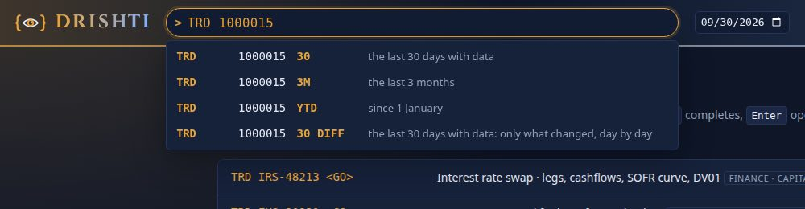
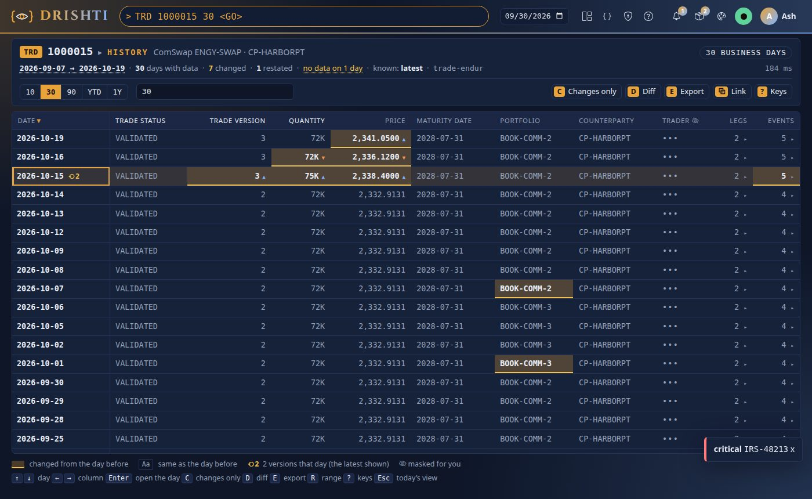
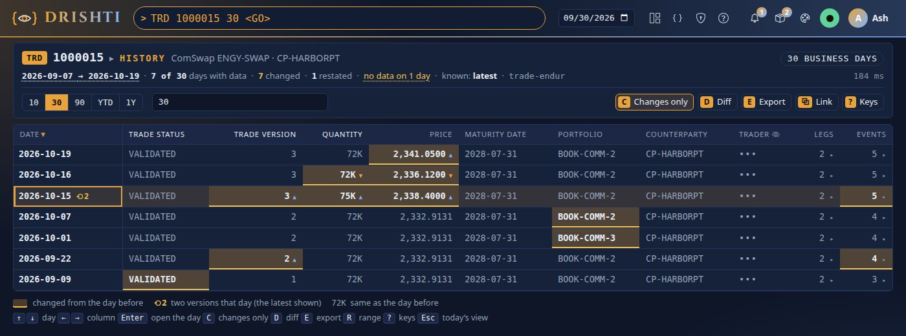
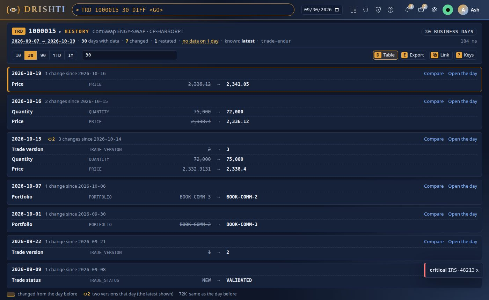
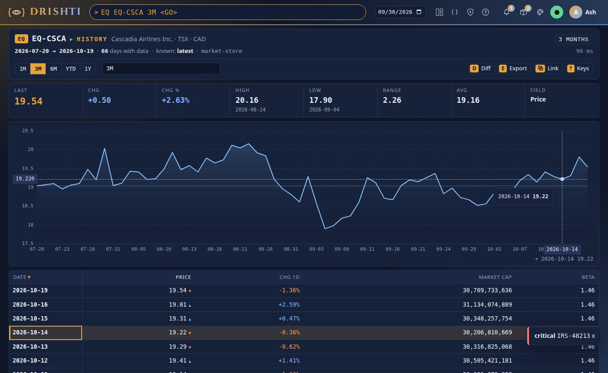
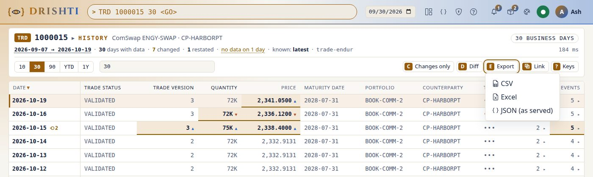

<!--
  Project Drishti · Any data. Any domain. One grammar.

  Copyright (c) 2026 Ashutosh Sinha <ajsinha@gmail.com>.
  All rights reserved.

  PROPRIETARY AND CONFIDENTIAL.

  This file is the confidential and proprietary property of Ashutosh Sinha.
  Unauthorised copying, use, modification, distribution or disclosure of this
  file, via any medium, is strictly prohibited except with the express prior
  written permission of the copyright holder.

  See the LICENSE file in the root of this repository for the full terms.
-->
# Tutorial 21 · An entity over time

Add a range after an id and the screen becomes that entity over time: `TRD 1000015 30 <GO>` shows the trade's last 30 business days with
data, one row per day. What moved is tinted, and you can open any day as it was. `EQ EQ-CSCA 3M <GO>` adds a price chart and the headline
numbers. This tutorial walks through a trade and an equity, changes only and DIFF, opening a day, exporting, the `history:` block that
shapes a kind's screen, and the limits. Each step shows the UI, the command line and, where there is one, the YAML. The references are
[USER_GUIDE › History](../guides/USER_GUIDE.md#history-an-entity-over-time),
[CLI_GUIDE › history](../guides/CLI_GUIDE.md#history-an-entity-over-time) and the design,
[HISTORY_QUERIES.md](../architecture/HISTORY_QUERIES.md).

## Time to complete

About 30 minutes.

## Before you start

- Tutorial 2 done: a running server and console with the `trading` and `market-data` packs and their demo lakes (`drishti.py lake demo`),
  signed in. Tutorial 2 also shows how a view, the business date and Compare work.
- A token for the command line: `DRISHTI_SERVER=http://localhost:18480` and `DRISHTI_TOKEN=...` (My account → API tokens;
  [CLI_GUIDE.md](../guides/CLI_GUIDE.md#3-connecting-to-a-server-url-tokens-and-permissions)).

The screens and outputs below come from this version's console and `drishti.py`, reading the history contract's two reference answers:
trade `1000015` over 30 data days and equity `EQ-CSCA` over 3 months
(`drishti-testkit/src/main/resources/history/`, [HISTORY_QUERIES.md section 8](../architecture/HISTORY_QUERIES.md#8-the-json-contract)).
Your dates and values are your data's. Trade `1000015` and its *Trader* column are the reference answer's: on the demo lakes the
trading pack's `history:` block (step 6) lists no trader column. On the sixty-day demo lakes, the
trades amended most (ten times each) are ENDUR `1000279` and `1001049`, CALYPSO `CLY-4000509` and MUREX `MX-30001745`: try
`TRD 1000279 60`. `MX-20000001` is cancelled part-way through the sixty days.

## What you will learn

- how to type a range after an id, and what each range means;
- how to read the history table: changed cells, restated days, masks and the days with no data;
- how changes only and DIFF find what moved, and how to open a day as it was;
- how a market kind's chart and headline numbers work;
- how to export the history and send a link that shows the same rows later;
- what a pack's `history:` block controls, and the limits and errors.

## Step 1 · A range after the id

**In the UI.** Press `/` to reach the command line and type `TRD 1000015` followed by a space. Once the id names one trade, the
suggestions offer ranges:



Choose `30`, or type `TRD 1000015 30` and press Enter. The address becomes `/v/trade/1000015/history?days=30`.

| You type | You get |
|---|---|
| `TRD 1000015 30` | the last 30 business days on which the trade has data |
| `TRD 1000015 30D`, `2W`, `3M`, `1Y` | every business day with data in the last 30 calendar days, 2 weeks, 3 months, 1 year |
| `TRD 1000015 YTD`, `MTD`, `QTD` | since 1 January, the first of the month, the start of the quarter |
| `TRD 1000015 FROM 2026-09-01 TO 2026-09-30` | between two dates (leave out `TO` to run to the date box) |
| `TRD 1000015 30 DIFF` | the same days, as a change log (step 3) |

The range always comes last. `TRD 30` still opens trade `30`, `TRD desk=rates 30` is still a search, and an alias keeps its range:
`MYTRD 30`, where `MYTRD` is `TRD 1000015`, works too. The short link `/v/trade/1000015?days=30` opens the same page.

**From the command line:**

```
$ drishti.py history trade 1000015 --days 30
```

```text
TRD 1000015  HISTORY  2026-09-07 -> 2026-10-19  30 days with data, 7 changed, no data on 2026-09-14
ComSwap ENGY-SWAP · CP-HARBORPT
Date           Trade status  Trade version  Quantity  Price        Maturity date  Portfolio     Counterparty  Trader  Legs  Events
-------------  ------------  -------------  --------  -----------  -------------  ------------  ------------  ------  ----  ------
2026-10-19     VALIDATED     3              72K       2,341.0500*  2028-07-31     BOOK-COMM-2   CP-HARBORPT   •••     2     5
2026-10-16     VALIDATED     3              72K*      2,336.1200*  2028-07-31     BOOK-COMM-2   CP-HARBORPT   •••     2     5
2026-10-15 ⟲2  VALIDATED     3*             75K*      2,338.4000*  2028-07-31     BOOK-COMM-2   CP-HARBORPT   •••     2     5*
2026-10-14     VALIDATED     2              72K       2,332.9131   2028-07-31     BOOK-COMM-2   CP-HARBORPT   •••     2     4
…
2026-09-08     NEW           1              72K       2,332.9131   2028-07-31     BOOK-COMM-2   CP-HARBORPT   •••     2     3
2026-09-07     NEW           1              72K       2,332.9131   2028-07-31     BOOK-COMM-2   CP-HARBORPT   •••     2     3
```

`--range 3M`, `--from 2026-09-01 --to 2026-09-30` and `--json` are the other forms.

**You should see:** the page titled *TRD 1000015 ▸ HISTORY* with *30 business days* at the right, the dates 2026-09-07 → 2026-10-19,
and 30 rows; the command line keeps `TRD 1000015 30 <GO>`, so `↑` recalls it as typed.

**Programs** read `GET /api/v1/history/trade/1000015?days=30`, or `Drishti.history("trade", "1000015", days=30)` in the Python client
([CLIENTS.md](../guides/CLIENTS.md)).

## Step 2 · Reading the table



- **The header** gives the range (*30 business days*), the first and last dates, *30 days with data*, *7 changed*, *1 restated* and
  *no data on 1 day*. Hover the last one for the date (2026-09-14). *known: latest* means each day is shown as it is known now.
- **One row per business day, newest first.** The columns are the kind's top-level fields. `Legs` and `Events` are lists, shown as
  their counts with `▸`.
- **What moved stands out.** A cell that differs from the day before is tinted and bold, with `▲`/`▼` for a number. Hover it for the old
  value (*changed from 72K*). Values that stayed the same are dimmed. The oldest row is shown in full, because it is the starting point.
- **`⟲2`** beside 2026-10-15 means the store kept two versions of that day (a restatement). The row is the latest.
- **`•••`** under *Trader* is a field masked for you. It reads the same on every row, never shows as changed, and the column header
  carries the masked icon.

Move with `↑` `↓` (or `j` `k`). `←` `→` pick a column, and the cell is read out with its header. `?` lists every key.

**You should see:** seven days with tinted cells (2026-09-09, 09-22, 10-01, 10-07, 10-15, 10-16, 10-19); hovering *75K* on 2026-10-15
says *changed from 72K*; the selected row is marked on the left.

## Step 3 · Changes only, and DIFF

**Changes only.** Press `C`. The days on which nothing moved are hidden, and the header now reads *7 of 30 days*. The address gains
`&only=1`, so a link keeps it.



**DIFF.** Press `D`, or end the command with `DIFF` (`TRD 1000015 30 DIFF`). Each changed day becomes a block listing its changes, before
and after. *Compare* opens the full comparison of that day and the one before, and *Open the day* opens the view as it was.



**From the command line:**

```
$ drishti.py history trade 1000015 --days 30 --changes-only
```

```text
TRD 1000015  HISTORY  2026-09-07 -> 2026-10-19  30 days with data, 7 changed, no data on 2026-09-14
ComSwap ENGY-SWAP · CP-HARBORPT
Date           Trade status  Trade version  Quantity  Price        Maturity date  Portfolio     Counterparty  Trader  Legs  Events
-------------  ------------  -------------  --------  -----------  -------------  ------------  ------------  ------  ----  ------
2026-10-19     VALIDATED     3              72K       2,341.0500*  2028-07-31     BOOK-COMM-2   CP-HARBORPT   •••     2     5
2026-10-16     VALIDATED     3              72K*      2,336.1200*  2028-07-31     BOOK-COMM-2   CP-HARBORPT   •••     2     5
2026-10-15 ⟲2  VALIDATED     3*             75K*      2,338.4000*  2028-07-31     BOOK-COMM-2   CP-HARBORPT   •••     2     5*
2026-10-07     VALIDATED     2              72K       2,332.9131   2028-07-31     BOOK-COMM-2*  CP-HARBORPT   •••     2     4
2026-10-01     VALIDATED     2              72K       2,332.9131   2028-07-31     BOOK-COMM-3*  CP-HARBORPT   •••     2     4
2026-09-22     VALIDATED     2*             72K       2,332.9131   2028-07-31     BOOK-COMM-2   CP-HARBORPT   •••     2     4*
2026-09-09     VALIDATED*    1              72K       2,332.9131   2028-07-31     BOOK-COMM-2   CP-HARBORPT   •••     2     3
7 of 30 days changed
```

`--diff` adds each day's changes after the table (`Quantity  72000.0 -> 75000.0`).

**You should see:** *7 of 30 days* in the header with `C` on, and with `D` one block per changed day, newest first; on the command line,
`7 of 30 days changed` under the table.

**The YAML.** A field that changes on every load but means nothing (a load timestamp) would make every day a change. The kind's
`history:` block in `pack.yaml` lists it under `ignore-changes`: it is still shown, but it is never counted as a change (step 6).

## Step 4 · Open a day

Select 2026-10-15 and press `Enter` (or double-click the row). The trade's normal view opens as of that day, at
`/v/trade/1000015?asOf=2026-10-15&gen=59&via=history`. Its banner says *You are seeing 2026-10-15, as it was, from its history* or, when the
data has moved on since, *changed since the history read that day*, with **Back to the history** (the same range); the back link above the
view leads there too. `Esc` on the history page goes back to today's view.

**From the command line,** the same day's view:

```
$ drishti.py view get trade/1000015 --date 2026-10-15
```

**You should see:** the trade's usual view with the date box on 2026-10-15 and the pinned banner, *Quantity* 75,000 as it was that day.

## Step 5 · An equity: the chart and the headline numbers

**In the UI.** Type `EQ EQ-CSCA 3M` and press Enter.



- **The headline numbers** come from the chart's field (*Price*): *Last* 19.54, *Chg* +0.50 (+2.63%) over the range, *High* 20.16 on
  2026-08-24, *Low* 17.90 on 2026-09-04, *Range* 2.26 and *Avg* 19.16.
- **The chart** is drawn in the theme's own colours: its *up* colour when the range ended higher, its *down* colour when lower. A dotted line marks where the
  range began. The crosshair follows the row you select, and hovering the chart shows the day and its value.
- **The range buttons** `1M` `3M` `6M` `YTD` `1Y` (keys `1` `3` `6` `T` `Y`) ask for a new range, and the address follows, so *Back* works.
  `R` lets you type any range in place: `90`, `2W`, `FROM 2026-08-01`.

**From the command line:**

```
$ drishti.py history equity EQ-CSCA --range 3M
```

```text
EQ EQ-CSCA  HISTORY  2026-07-20 -> 2026-10-19  66 days with data, 66 changed
Cascadia Airlines Inc. · TSX · CAD
PRICE: last 19.54  chg +0.50 (+2.63%)  high 20.16 (2026-08-24)  low 17.90 (2026-09-04)  range 2.26  avg 19.16
Date        Price   Chg 1D   Market cap       Beta
----------  ------  -------  ---------------  ----
2026-10-19  19.54*  -1.36%*  30,709,733,636*  1.46
2026-10-16  19.81*  +2.59%*  31,134,074,889*  1.46
2026-10-15  19.31*  +0.47%*  30,348,257,754*  1.46
…
```

**You should see:** eight headline boxes, a line chart of 66 days and the table under it; `1` reloads the page as one month
(`?range=1M`).

**The YAML** that makes a kind a market kind: `chart:` names the fields to draw, and `headline:` the one the numbers are taken from.

```yaml
history:
  equity:
    chart: [PRICE]                        # a chart makes the market shape
    headline: PRICE                       # high, low, change; default the first chart field
    columns: [PRICE, CHANGE_1D, MARKET_CAP, BETA]
```

## Step 6 · Your own pack's `history:` block

Every kind has history without any YAML. Its columns are then its key columns followed by every other top-level field, and its lists show
as counts. The `history:` block in `pack.yaml` changes that per kind, beside `ingest:`, `form:` and `mnemonics:`:

```yaml
history:
  trade:
    columns: [TRADE_STATUS, TRADE_VERSION, QUANTITY, PRICE, MATURITY_DATE, PORTFOLIO, COUNTERPARTY]   # default: key columns, then the rest
    exclude: [_meta]                     # never shown
    ignore-changes: [SOURCE_UPDATE_TIME] # shown, but a change here is not "a change"
    parts: [LEGS, EVENTS]                # the lists shown as counts
    default-days: 30
    max-days: 250                        # at most drishti.history.max-days
  news-topic:
    enabled: false                       # no history for this kind
```

The full schema is in [HISTORY_QUERIES.md section 6](../architecture/HISTORY_QUERIES.md#6-the-history-block-in-packyaml). Check it the way
you check any pack (an unknown key is a warning, a bad value the error `DRS-2061`):

```
$ drishti.py sutra lint config/packs/trading --strict
```

In the UI, a pack with a bad block shows its problem on Admin → Packs (and Health marks the pack DEGRADED) as soon as it is loaded: at the
server's start and after a reload.

**You should see:** `sutra lint` clean for a correct block; a misspelt key (`colums:`) as a warning naming it, and `headline: PRICE2`
(not one of `chart`) as `DRS-2061`.

## Step 7 · Export, and a link that shows the same rows

**In the UI.** Press `E` for the export menu: CSV, Excel, or the server's JSON as served. With *changes only* on, only the changed days are
exported, in all three. The JSON keeps the server's order (oldest first); CSV and Excel are newest first, and Excel's dates are dates. Every export reads through the server with your token, so your masks travel with it.



`Alt+S` (*Link*) copies a link that pins the last date: `…/v/trade/1000015/history?days=30&to=2026-10-19`. A colleague opening it next week
sees the same 30 rows. With *changes only* on, the link keeps `&only=1`. A link without `to` moves with the business date. You should see the
link in a field under the toolbar and *Copied: the link is on the clipboard.* beside it, on a LAN address too.

**From the command line:**

```
$ drishti.py history trade 1000015 --days 30 --csv > trade-1000015.csv
```

```text
Date,Trade status,Trade version,Quantity,Price,Maturity date,Portfolio,Counterparty,Trader,Legs,Events,Changed
2026-10-19,VALIDATED,3,72000.0,2341.05,2028-07-31,BOOK-COMM-2,CP-HARBORPT,•••,2,5,PRICE
2026-10-16,VALIDATED,3,72000.0,2336.12,2028-07-31,BOOK-COMM-2,CP-HARBORPT,•••,2,5,QUANTITY PRICE
…
```

Numbers stay numbers, the file opens in Excel with its accents (UTF-8 with a BOM), and text that a spreadsheet would run as a formula is
kept as text. The console's file is named `1000015-history-2026-09-07-2026-10-19.csv`.

**You should see:** 31 lines (the header and 30 days, newest first), the trader as `•••`, and the *Changed* column naming the paths
that moved each day.

## Step 8 · Limits and errors

A history reads one entity on many days, so the server bounds it. The settings (`drishti.history.*`, in
[CONFIGURATION.md](../admin/CONFIGURATION.md)) are: at most `max-days` business days (366 by default; a pack's `max-days` can only lower
it), `max-rows` rows and `timeout` for the whole request.

| You see | Why | What to do |
|---|---|---|
| `DRS-4021` *366 business days at most (asked 500)* | the range is larger than allowed | narrow it with `FROM … TO`, or follow the page's *The last 30 days* link |
| `DRS-4022` *FROM 2026-10-15 is after TO 2026-10-01* | the dates are the wrong way round (a `FROM` after the business date is *FROM … is in the future*) | put the earlier date first (the page's range field says so too, and never swaps them) |
| `DRS-4022` *'-5' is not a range: use a number of days (30), a span …* | a range typed after the id that cannot be read (`0`, `-5`, `1.5M`, `3X`, `30.`, `1e3`, `FROM yesterday`, `FROM 2026-10-01 TO`, `TO 2026-10-01`, `DIFF DIFF`, `DIFF 30`, `30 30`, a bare `DIFF`; also after a bare id, `1000015 -5`) | type it as the message says; the command line shows the message, never today's view |
| `DRS-1013` *no data from … to …* | the entity has no data in the range | the message says from when to when it has data (*its days with data run from … to …*); with `knownAt` (the CLI's `--known-at`), it says nothing in that window was known then, and that the days it has now may have been loaded later: leave it out or ask with a later instant; the page links to it (*From its first day with data*) |
| `DRS-1012` *keeps no daily history here* | the kind's connector holds today's data only, or the pack turned history off | today's view is one link away |
| *Some days could not be read* | a source did not answer for some days in time (`DRS-1014`) | the rows that were read are shown, and the banner lists the missing days |

In the console every error keeps the page's header and gives a link to today's view. On the command line, `drishti.py history` exits
1 with the code and message.

**You should see:** for `TRD 1000015 500`, the page with `DRS-4021`, its fix, and the links *Today's view of 1000015* and *The last 30
days*.

## Next steps

- [Tutorial 2](02-look-up-anything.md): Compare two days of one entity field by field.
- [Tutorial 7](07-load-data-daily.md): load a day at a time, so history has days to show.
- [HISTORY_QUERIES.md](../architecture/HISTORY_QUERIES.md): how each store answers a history fast (Delta, Iceberg, Cassandra, JDBC, …).

---

*Copyright (c) 2026 Ashutosh Sinha <ajsinha@gmail.com>. All rights reserved.
Proprietary and confidential. Unauthorised copying, use or distribution is prohibited.*
