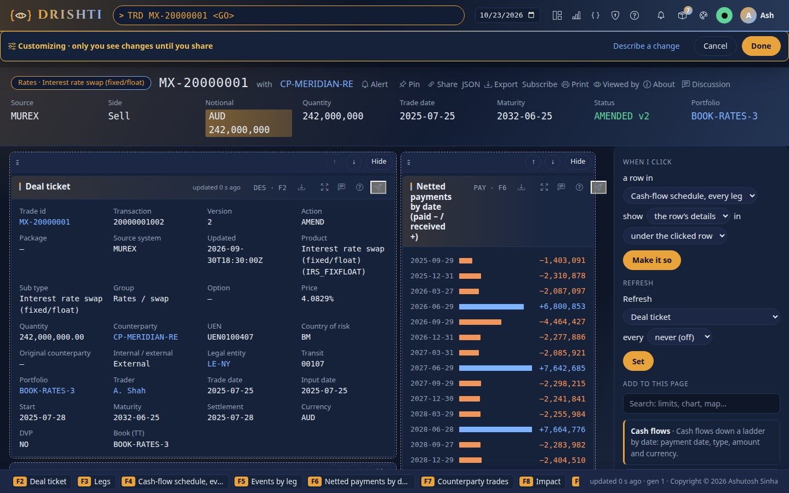
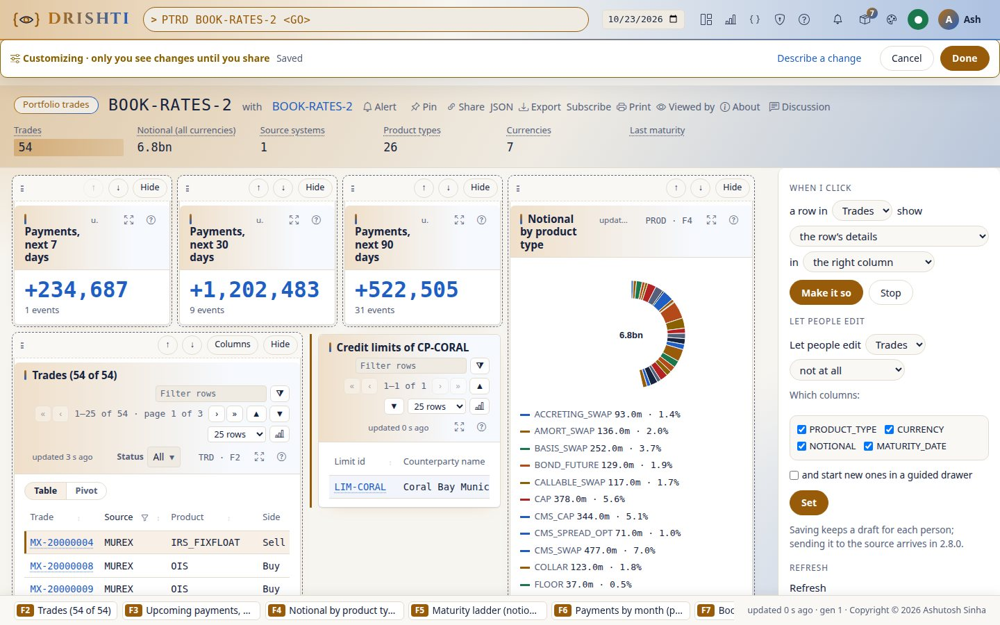
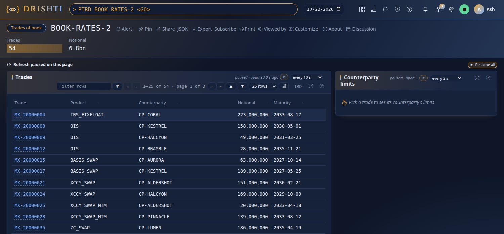
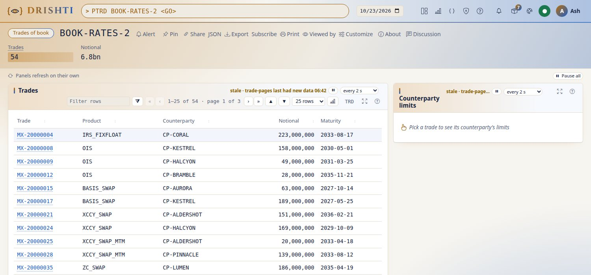
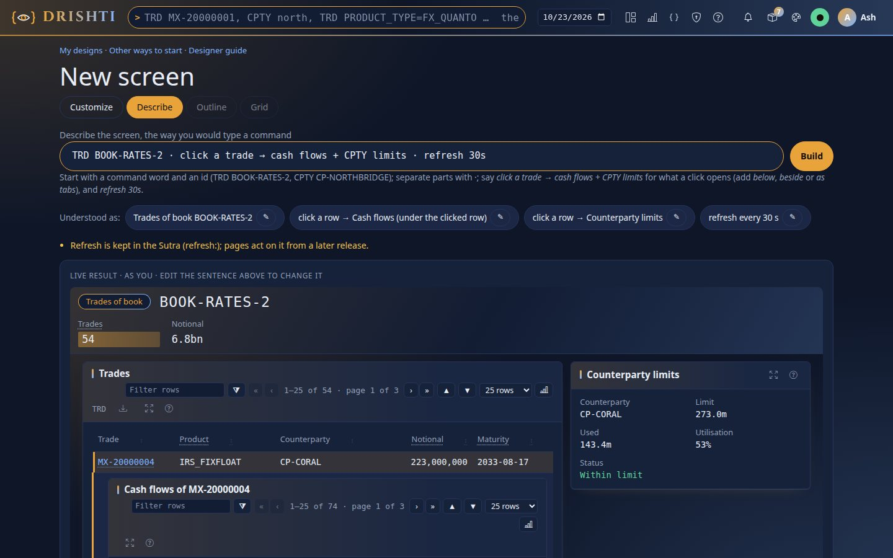
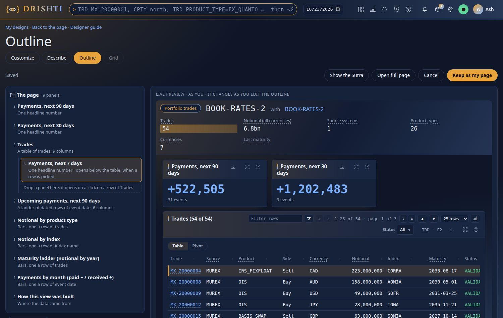
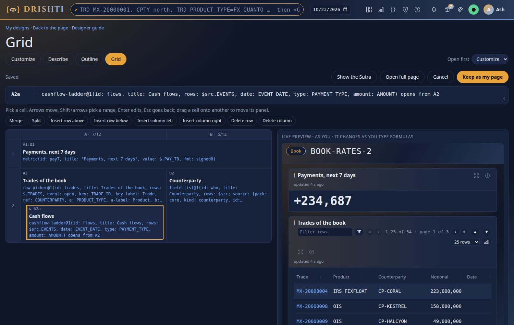

<!--
  Project Drishti · Any data. Any domain. One grammar.

  Copyright (c) 2026 Ashutosh Sinha <ajsinha@gmail.com>.
  All rights reserved.

  PROPRIETARY AND CONFIDENTIAL.

  This file is the confidential and proprietary property of Ashutosh Sinha.
  Unauthorised copying, use, modification, distribution or disclosure of this
  file, via any medium, is strictly prohibited except with the express prior
  written permission of the copyright holder.

  See the LICENSE file in the root of this repository for the full terms.
-->
# Tutorial 22 · Build a screen with the designer

The **Sutra designer** changes a screen in plain words, on the real page with real data. In this tutorial you take a book's trades
page and make it a desk: a click on a trade opens the counterparty's credit limits beside the table, the trades refresh every 30
seconds with a pause button, and people may edit a trade in a form beside the table and start a new one in a drawer. Then you build
the same screen from one line with **Describe**, and look at it in **Outline** and **Grid**. Each step shows the UI, the command line
where there is one, and the YAML the designer writes. The reference is [SCREEN_DESIGNER.md section 31](../guides/SCREEN_DESIGNER.md#31-the-sutra-designer-customize-describe-outline-and-grid);
the grammar behind it is [SUTRA_NEXT.md](../architecture/SUTRA_NEXT.md).

## Time to complete

About 35 minutes.

## Before you start

- [Tutorial 1](01-first-15-minutes.md) done: a running server and console with the `trading`, `core` and `counterparty-risk` packs
  (all on by default) and the demo lakes (`drishti.py lake demo`), signed in.
- The designer switched on. It is off by default; in the console's `config/application.yaml` set `ui.designer: true`, or start the
  console with `DRISHTI_UI_DESIGNER=true` ([CONFIGURATION.md](../admin/CONFIGURATION.md)), and restart the console. Off, there is no
  **Customize** button and `/designer/*` answers 404.
- For the command-line steps: a token, `DRISHTI_SERVER=http://localhost:18480` and `DRISHTI_TOKEN=...` (My account → API tokens;
  [CLI_GUIDE.md](../guides/CLI_GUIDE.md#3-connecting-to-a-server-url-tokens-and-permissions)), and `B=$DRISHTI_SERVER/api/v1` for `curl`.

Nothing you do here changes the pack's screen: the designer keeps **your own design**, which only you see until you share it.

## What you will learn

- how **Customize** moves, hides and adds panels on a live page, and what it writes;
- how to say what a click on a row opens: **a linked record** from another pack;
- how to make a panel **refresh**, and how readers pause it and read its freshness;
- how to **let people edit** a table's records, and where their drafts go;
- how **Describe** builds the same screen from one line, and how **Outline** and **Grid** show it;
- how to find, check and reset your page from the command line.

## Step 1 · Open the page and press Customize

**In the UI.** Type `PTRD BOOK-RATES-2 <GO>`: the trades of book `BOOK-RATES-2`. Press **Customize** in the page header. A yellow bar
says *Customizing · only you see changes until you share*, with **Cancel** and **Done**; every panel gets a dashed outline, a handle
and its tools; the side panel on the right lists what you can do. The data stays live and is read as you (your roles and masks).



Try the basic tools: drag a panel's handle onto another panel (or use ↑ and ↓) to **move** it; **Hide** a panel (it is listed under
*Hidden*, where **Show** brings it back); on the trades table, **Columns** picks the fields to show. **Add to this page** searches the
UI kit by what a part shows (*limits*, *chart*, *note*): click a card or drag it onto the page.

**You should see** the yellow bar, a dashed outline and tools on every panel, and the side panel with *When I click*, *Refresh*
and *Add to this page*. A part you add opens its **settings** at once (*Which number? [NOTIONAL ▾]*, *Label*, *Format*); a part you
added has **Remove** (with **Undo** for a few seconds), the pack's panels have **Hide**.

**What it writes.** **Show the Sutra**, at the foot of the side panel, shows the whole YAML read-only. Your page has its own name, so
it never stands for the pack's Sutra:

```yaml
# My page, saved by the Sutra designer (Customize). Only I see it until I share it; Reset goes back to the pack's page.
rachana: 1
sutra: my-portfolio-trades
version: 1
match: { kind: portfolio-trades }
panels:
  - { use: trading/payments-metrics@1, with: { ... } }   # the pack's own fragments, as on the pack's page
  - { use: trading/trade-table@1, with: { ... } }
  - { use: explainer-note@1, with: { id: note } }         # added from the kit
```

A hidden panel is kept in the design's notes, not in the Sutra, so *Show* restores it exactly.

**Command line.** Nothing yet: the change is drawn at once but not kept until **Done** (step 5).

## Step 2 · A linked record on a click

**In the UI.** In the side panel, **When I click** a row in *[Trades ▾]* show *[what ▾]* in *[the right column ▾]*. Open *what*: it
lists the row's details, and every record linked to a trade the way the packs link entities, across packs, each with the pack that
serves it: *the trade itself (trading)*, *its events*, *its counterparty (core)*, *its counterparty's credit limits*... Pick **its
counterparty's credit limits (counterparty-risk)** and press **Make it so**. Click a trade: its counterparty's limits open on the right.
**Stop** removes it.



**You should see** *Pick a row of Trades to see it here* on the right until you click a trade, then a table of that
counterparty's credit limits titled *Credit limits of CP-...*.

**What it writes.** The table now emits an `open` event on a row click, and a child reads the clicked row through its own `source:`:

```yaml
  - id: trades
    kind: table
    ...
    emits:
      - name: open
        on: row-click
        payload: { SOURCE_SYSTEM: { bind: "@.SOURCE_SYSTEM", type: id }, COUNTERPARTY: { bind: "@.COUNTERPARTY", type: any }, ... }
    children:
      - place: detail-right
        waits: Pick a row of Trades to see it here
        source: { pack: counterparty-risk, kind: credit-limit, where: "@.COUNTERPARTY == @parent.open.COUNTERPARTY", limit: 20 }
        panels:
          - id: trades-credit-limit
            kind: table
            title: "Credit limits of ${@parent.open.COUNTERPARTY}"
            rows: $src
            columns: [ { label: Limit id, bind: "@.LIMIT_ID" }, { label: Counterparty name, bind: "@.COUNTERPARTY_NAME" }, ... ]
```

A table that came from a shared part of the page (a fragment) is first written out on the page, as above, so it can take the event.
The limits are read as you: a counterparty masked for you is never followed, and the panel says *Hidden for you*.

**Command line.** The pack's page as your token sees it, in text tables, and which Sutra draws it and why:

```bash
python3 tools/drishti.py view get portfolio-trades/BOOK-RATES-2
python3 tools/drishti.py view explain portfolio-trades/BOOK-RATES-2
```

The child's limits are read only when a row is clicked, so they are not in `view get`; your designed page is checked from the command
line in step 5.

## Step 3 · Refresh every 30 seconds

**In the UI.** In the side panel, **Refresh** *[Trades ▾]* every *[30 seconds ▾]* (*never (off)* removes it). The trades are fetched
again every 30 seconds without reloading the page: only panels that changed are redrawn, the picked row stays picked and the limits it
opened stay open. In the panel's header: **pause/resume**, **every …** (only as slow as the Sutra's interval or slower) and how fresh it
is, *updated 12 s ago*, ticking. **Pause all**, above the panels, pauses the page.



When a source is behind, the panel says *stale* in amber; when it fails, the panel keeps what it showed and names the source:
*trade-endur isn't answering; showing data from 10:42*.



**You should see** *updated … s ago* ticking in the trades' header, and the panel fetched again every 30 seconds with the
page left where you scrolled.

**What it writes.** On the panel (or on the use, or the whole Sutra):

```yaml
  - id: trades
    kind: table
    refresh: 30                 # or { every: 30, user-can-pause: false }
```

Never faster than the console's `views.refresh_min_seconds` (default 5).

**Command line.** Your pause and interval choices are kept for you, per screen, in your settings:

```bash
curl -s -H "Authorization: Bearer $DRISHTI_TOKEN" $B/me/settings            # ... "refresh": {"portfolio-trades/my-portfolio-trades": {...}}
curl -s -X PATCH -H "Authorization: Bearer $DRISHTI_TOKEN" -H 'Content-Type: application/json' \
     -d '{"refresh": {"portfolio-trades/my-portfolio-trades": {"panels": {"trades": {"paused": true}}}}}' $B/me/settings
```

## Step 4 · Let people edit

**In the UI.** In the side panel, **Let people edit** *[Trades ▾]* *[in a form beside it ▾]* (or *in its cells*), tick the columns people
may change (the notional, the maturity date) and *and start new ones in a guided drawer*; press **Set**. Click a trade: a form opens
beside the table, the read-only fields saying why, a bad value explained under its field. **Save draft** keeps it; **Discard** forgets it.


**New trade** opens the drawer: steps *Who → What → Check* over the dimmed page.


**You should see** a form beside the trades when you click one, the trade id read-only and the notional a number field.

**What it writes.** A `form:` on the table. The first column names the record and is read-only; a number column becomes a number
field, a `*_DATE` column a date field:

```yaml
  - id: trades
    kind: table
    ...
    form:
      key: trade_id
      edit: beside              # or cells
      new: drawer
      fields:
        - { id: trade_id, label: Trade, bind: TRADE_ID, readonly: true }
        - { id: notional, label: Notional, bind: NOTIONAL, type: number }
        - { id: maturity_date, label: Maturity, bind: MATURITY_DATE, type: date }
```

Rules, money and linked-record fields, masks and roles are in [WRITE_BACK.md](../guides/WRITE_BACK.md). Saving keeps a
**draft** for each person; nothing is written to the source system until write-back (2.8.0).

**Command line.** Your drafts, checked again on the server with the same rules:

```bash
curl -s -H "Authorization: Bearer $DRISHTI_TOKEN" "$B/drafts?kind=portfolio-trades&id=BOOK-RATES-2"
```

## Step 5 · Done: your page

**In the UI.** Press **Done**. The page now opens with your version, marked *Your page* in the header (that link opens the pack's page).
Customize again to go on; **Share** makes a read-only link to your design; **Reset to the pack's page** removes your version.

**You should see** the page without the yellow bar, with *Your page* in its header and your changes in place.

**Command line.** Your page is an ordinary design in **Build → My designs** (first called *My page · portfolio-trades*), so the
`design` commands work on it, and a flag says which design is your version of each kind's page:

```bash
python3 tools/drishti.py design list                                    # find My page · portfolio-trades and its id
python3 tools/drishti.py design get <id> --yaml -o my-desk.sutra.yaml   # the Sutra the designer wrote
python3 tools/drishti.py sutra lint my-desk.sutra.yaml                  # the same checks the server runs
python3 tools/drishti.py design check <id>                              # run it against its samples
curl -s -H "Authorization: Bearer $DRISHTI_TOKEN" $B/me/pages            # {"portfolio-trades": "<id>"}
curl -s -X DELETE -H "Authorization: Bearer $DRISHTI_TOKEN" $B/me/pages/portfolio-trades   # Reset: the pack's page again
```

Edit `my-desk.sutra.yaml` in your editor and `design save <id> my-desk.sutra.yaml` puts it back: the page shows your edit.

## Step 6 · The same screen from one line: Describe

**In the UI.** **Build → New screen** offers *describe the screen in one line* (Customize has **Describe a change**). Type:

```
TRD BOOK-RATES-2 · click a trade → cash flows + CPTY limits · refresh 30s · edit trades beside · new trade in a drawer
```

and press **Build**. **Understood as** shows one token per part; an unsure one has a **fix…** list, a part it cannot read is red with a
sentence saying why. The live result below draws the screen as you: click a trade and its cash flows open under the row, the
counterparty's limits on the right. The parser is deterministic: the same line always gives the same screen, and no AI is involved.
**Save to my workspace** keeps it as a design (*My screen · Trades of book BOOK-RATES-2*).



**You should see** one token per part under *Understood as*, none of them red, and the live result filling the cash flows
under a trade you click.

**What it writes** (shortened; the whole text is under **Show the Sutra**):

```yaml
rachana: 1
sutra: my-portfolio-trades-book-rates-2
version: 1
description: TRD BOOK-RATES-2 · click a trade → cash flows + CPTY limits · refresh 30s · ...
match: { kind: portfolio-trades }
refresh: 30
panels:
  - use: row-picker@1
    with: { id: trades, title: Trades, rows: $.TRADES, event: open, key: TRADE_ID, ref: COUNTERPARTY, ... }
    form: { edit: beside, new: drawer, ... }
    children:
      - place: expand-row
        waits: Pick a trade to see its cash flows
        source: { pack: trading, kind: trade, id: "@parent.open.id" }
        panels:
          - use: cashflow-ladder@1
            with: { id: flows, title: "Cash flows of ${@parent.open.id}", rows: $src.EVENTS, date: EVENT_DATE, amount: AMOUNT }
  - id: limit
    kind: kv
    title: Counterparty limits
    area: right
    waits: Pick a trade to see its counterparty's limits
    source: { pack: counterparty-risk, kind: credit-limit, where: "@.COUNTERPARTY == @trades.open.ref", limit: 1 }
    columns: [ ... ]
  - { use: data-provenance@1 }
```

The trading pack ships a screen written this way, by hand: the book desk, `/v/portfolio-trades/BOOK-RATES-2?sutra=book-desk`
(`config/packs/trading/sutras/pages/book-desk.v1.sutra.yaml`).

**Command line.** As in step 5: `design list` shows *My screen · Trades of book BOOK-RATES-2*, and `design get <id> --yaml` prints it.

## Step 7 · Outline and Grid: the same draft, two other views

The four modes edit one draft; the switcher carries it from one to the other.

**You should see** the same draft in each mode: a change made in Outline is there in Grid and in Customize.

**Outline** shows the screen as a list: its sections, the panels in each, and under the trades table the panels a click opens, each
with a line in plain words. Drag to reorder; drag a panel onto a table's *Drop a panel here* line to make it open on a click (*nest*);
**Un-nest** puts it back; each item has its width, area, section and refresh interval.



**Grid** shows the screen as a spreadsheet: columns A, B, C (each header says its width, such as *7/12*) over the Sutra's
`layout.areas`, and each cell's panels written as formulas. The cash flows a click opens are a cell of their own, `A2a`, under the
trades:

```
A2 = row-picker@1(id: trades, title: Trades of the book, rows: $.TRADES, event: open, key: TRADE_ID, ref: COUNTERPARTY)
A2a = cashflow-ladder@1(id: flows, title: Cash flows, rows: $src.EVENTS, date: EVENT_DATE, amount: AMOUNT) opens from A2
B2 = field-list@1(id: who, title: Counterparty, rows: $src; source: {pack: core, kind: counterparty, id: @A2.open.ref})
```

`@A2.open.ref` is `@trades.open.ref` in the Sutra: B2 waits until a trade is picked. A screen without areas is one column; **Make it a
grid** gives each panel an area. Drag the edge between two column headers to change the widths (`layout.columns`).



Grid edits two levels of panels a click opens as cells; pack screens nest at most two levels, and anything deeper is edited in Outline
or Customize. On a phone Grid offers Outline.

**Command line.** The mode you open first is a setting of yours (`customize`, `describe`, `outline` or `grid`; **Open first** beside
the modes does the same):

```bash
curl -s -X PATCH -H "Authorization: Bearer $DRISHTI_TOKEN" -H 'Content-Type: application/json' \
     -d '{"designerMode": "grid"}' $B/me/settings
```

With Grid or Outline, Customize on a page then opens that mode with the page's draft.

## What you have, and what comes next

Your own version of the book's trades page (a linked record on a click, a refresh, a form) and a second screen from one line, both in
**Build → My designs**, seen by nobody else. To make one live for everyone, open it in the workbench and **Submit for review**
([SCREEN_DESIGNER.md section 22](../guides/SCREEN_DESIGNER.md#22-saving-and-proposing)), or `drishti.py design propose <id>`.

## Next steps

- [SCREEN_DESIGNER.md section 31](../guides/SCREEN_DESIGNER.md#31-the-sutra-designer-customize-describe-outline-and-grid): every mode in full.
- [SUTRA_DEVELOPER_GUIDE.md section 11a](../guides/SUTRA_DEVELOPER_GUIDE.md#11a-fragments-events-children-refresh-and-forms): the
  same screen written by hand.
- [Tutorial 6 · Design a screen](06-design-a-screen.md): the Build workbench, for a screen built from your own sample documents.

## If something goes wrong

| You see | Meaning |
|---|---|
| no **Customize** button; `/designer/...` answers 404 | the designer is off: `ui.designer: true` (or `DRISHTI_UI_DESIGNER=true`) and restart the console |
| the linked-record list has no *credit limits* | the counterparty-risk pack is not enabled, or not among your active packs, or the table has no field the packs link |
| a panel says *Hidden for you* | the clicked row's value is masked for you; the panel is not looked up |
| a part of the Describe line is red | the sentence beside it says why; the result says *Fix the red part to see the screen* until it reads |
| a refresh interval faster than 5 s is not offered | the console's `views.refresh_min_seconds` (default 5) |
| `DRS-2057` in `sutra lint` | an event or source reads a panel that does not exist (a renamed panel id) |
| `DRS-2058` | the `form:` does not read: an unknown key or field type ([WRITE_BACK.md](../guides/WRITE_BACK.md)) |
| `DRS-2059` | the `layout:` names an area the picture does not have |
