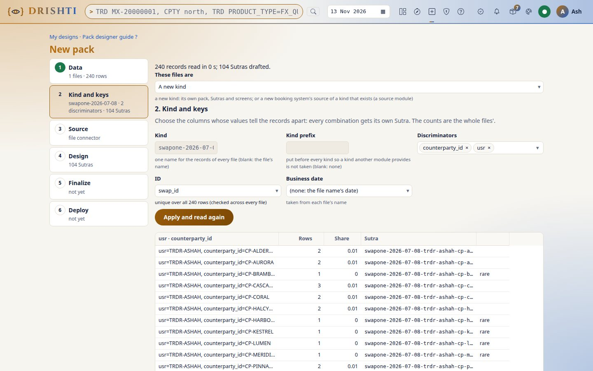

<!--
  Project Drishti · Any data. Any domain. One grammar.

  Copyright (c) 2026 Ashutosh Sinha <ajsinha@gmail.com>.
  All rights reserved.

  PROPRIETARY AND CONFIDENTIAL.

  This file is the confidential and proprietary property of Ashutosh Sinha.
  Unauthorised copying, use, modification, distribution or disclosure of this
  file, via any medium, is strictly prohibited except with the express prior
  written permission of the copyright holder.

  See the LICENSE file in the root of this repository for the full terms.
-->
# Tutorial 23 · Add a source system (SwapOne)

A bank has one canonical `trade`. Every booking system, Endur, Murex, Calypso and the rest, is another **source** of it: its own file layout, its
own field names, one module that maps them to the canonical trade and says where they land. This tutorial adds a new one. A mocked system called
**SwapOne** (OTC swaps; its fields are `swap_id`, `pay_leg`, `rec_leg`, `upd_ts`, nothing like ours) sends one file. You read the whole file,
check the proposed map, let the Pack designer write the module `source-swapone`, drop the file in the data inbox, and find the trades in
`trading.trades_shared` stamped `SWAPONE`, in `TRD`, on the blotter, behind a row rule, and gone when you switch the module off.

Every step shows the same thing three ways: in the **UI**, on the **command line**, and as the **YAML** that is written. The reference is
[BUILD_GUIDE.md section 8.9](../guides/BUILD_GUIDE.md#89-a-source-for-an-existing-kind); the data is mocked (`tools/samplegen/src_swapone.py`:
invented names and numbers, no real system's layout).

## Time to complete

About 40 minutes.

## Before you start

- Tutorial 16, Part A done, or its starting point: the built server jar, the console's Python, a demo lake of the trades and reference data
  (`drishti.py lake demo --only trades/,core/`), the data inbox on (`DRISHTI_DATALOAD_ENABLED=true`).
- The repository ships a finished `source-swapone` as a sample. To follow along, start the server **without the shipped sample modules**
  (`DRISHTI_MODULES_SHIPPED=false`), so yours is the only one; or give yours another name (`--name source-swapone-mine`) and leave the sample on.
- The file. `make_day.py` writes the first day of the mocked SwapOne data as the system would send it, named for the module's inbox rule, and its
  `.ready` file (the SHA-256, so the inbox knows the file is complete):

```bash
python3 docs/tutorials/data/swapone/make_day.py --out drop --date 2026-07-08 --ready
```

```text
drop/swapone-2026-07-08.jsonl.gz  240 rows  sha256 4e8e…
drop/swapone-2026-07-08.jsonl.gz.ready
```

## What you will learn

- how the designer reads a whole file of another system and proposes, for each canonical trade field, the native field that fits, with the evidence;
- how to correct the map, and what stays unmapped (and where it is shown);
- what a source module holds (`connectors/`, `mappings/`, `dataload.yaml`, `sections:`) and how it is deployed;
- how the inbox routes a file by its name, stamps `SOURCE_SYSTEM`, and where the rows land;
- how the one canonical trade pages, `TRD` and the blotter show the new system with no new screen, and how a row rule limits who sees it;
- how a source is switched off and on without touching anything else.

## Step 1 · Read the file

**In the UI.** Open **Build → New pack**. Drop `drop/swapone-2026-07-08.jsonl.gz` on the page. The server reads **every record** (not a sample) and
the page asks what the files are. Choose **A source for an existing kind**: the kinds whose fields overlap the file's are suggested, `trade`
first.



**On the command line.** The same pass, written as a proposal, with nothing deployed:

```bash
python3 tools/drishti.py pack new --source-for trade --system SWAPONE --map-out swapone-map.json drop/swapone-2026-07-08.jsonl.gz
```

It prints each canonical field of the kind and the native field it was matched to (see step 2).

**The YAML.** Nothing is written yet; `swapone-map.json` is the proposal as data.

## Step 2 · Map the fields

**In the UI.** The **Map** step shows the kind's fields in a grid: the canonical field, whether it is required, the SwapOne field proposed for it,
the confidence and the reason. Choose a row to see its evidence (name, type and values) and the other candidates. Fields marked *missing* are
required fields no native field fits: you can map one by hand, give a constant (`= value`) or leave it, as the kind allows. Under the grid are
the native fields no canonical field takes (here the `pay_leg` and `rec_leg` objects' extras): the module shows them on the trade page (step 6).

To change a mapping, change the native field in its cell (or choose *(none)*), then **Propose again**: the server reads again with your edits.

**On the command line.**

```bash
python3 tools/drishti.py pack new --source-for trade --system SWAPONE --map-edits '{"TT_GROUP": null}' --map-out swapone-map.json drop/swapone-2026-07-08.jsonl.gz
```

`--map-edits` is a JSON object: `{CANONICAL: null}` drops a guess, `{CANONICAL: {"from": "native"}}` maps one, `{CANONICAL: {"value": "x"}}` gives a
constant, `{CANONICAL: {"values": {"Y": "YES"}}}` a value map.

**The YAML.** The map becomes `mappings/swapone-trade.yaml` in the module (step 3): `canonical field: native field`, constants and value maps.

## Step 3 · The module the designer writes

**In the UI.** **Layout**: choose **A shared table + where**, table `trading.trades_shared` (WSS and ICI share it; SwapOne's rows are told apart by
`SOURCE_SYSTEM`). The page shows the connector it will write. **Finalize** makes the module `source-swapone` and runs the fifteen checks;
**Deploy** installs it.

**On the command line.** One command writes, checks and installs it (on one node, into the server's `modules` folder; on a cluster add `--server`):

```bash
python3 tools/drishti.py pack new --source-for trade --system SWAPONE --shared-table trading.trades_shared \
    --lake-name swaplake --out modules/source-swapone --deploy --modules-dir modules drop/swapone-2026-07-08.jsonl.gz
```

**The YAML.** The module's parts, under one set of manifest keys:

```text
source-swapone/
  module.yaml                              connectors, mappings, dataload, sections
  connectors/source-swapone.yaml           the connector
  mappings/swapone-trade.yaml              the field map
  dataload.yaml                            the inbox rule
  sutras/trade-swapone.v1.fragment.yaml    its section of the trade page
```

```yaml
# connectors/source-swapone.yaml
plugin: delta
kinds: [trade]
settings:
  lake: swaplake
  lake-tables: trading.trades_shared
  where: "SOURCE_SYSTEM = 'SWAPONE'"
  set: { SOURCE_SYSTEM: SWAPONE }
  map: mappings/swapone-trade.yaml
```

```yaml
# dataload.yaml
dataload:
  rules:
    - match: swapone-*.jsonl*
      pack: trading
      kind: trade
      connector: source-swapone
      date-from: name
```

Auto-deploy loads the module within seconds; **Admin → Modules** lists `source-swapone` as running.

## Step 4 · Drop the file in the inbox

**In the UI.** **Admin → Data inbox** shows the folder and its rules (the module's rule is among them). Upload the file and its `.ready`, or copy them.

**On the command line.** The inbox is a folder; a file is loaded when its `.ready` file (written last) names its SHA-256:

```bash
cp drop/swapone-2026-07-08.jsonl.gz drop/swapone-2026-07-08.jsonl.gz.ready data/dataload/inbox/
python3 tools/drishti.py dataload status
```

**The YAML.** The rule of step 3 is all there is: the name `swapone-2026-07-08.jsonl.gz` matches `swapone-*.jsonl*`, so the file goes to the
trade kind through the connector `source-swapone`, and `date-from: name` makes `2026-07-08` its business date.

## Step 5 · It lands in `trading.trades_shared`, stamped SWAPONE

**In the UI.** **Admin → Loads** shows the load: the file, its rows, the table it went to and the date.

**On the command line.**

```bash
python3 tools/drishti.py dataload status
python3 tools/drishti.py lake table swaplake trading.trades_shared
```

**The YAML.** The connector's `set: { SOURCE_SYSTEM: SWAPONE }` stamped the column into every row the inbox stored; `partition-by: [SOURCE_SYSTEM]` in the
lake file keeps the systems' rows apart on disk; `where:` reads back only SwapOne's.

## Step 6 · `TRD` and the blotter

**In the UI.** Type `TRD` in the command line: the list of trades now includes SwapOne's (the `S1-…` ids), each with the canonical fields the map filled.
Open one: `TRD S1-700001`. The page is the canonical trade page, with one more section the module brought: **SWAPONE fields**, the native fields the map
left out, shown only when `SOURCE_SYSTEM` is SWAPONE.

The blotter (the live trading table) lists them with the other systems' trades and can be filtered by source system:

**On the command line.**

```bash
python3 tools/drishti.py get trade S1-700001
python3 tools/drishti.py search trade "SOURCE_SYSTEM = 'SWAPONE'" --limit 5
```

**The YAML.** The section is the module's `sections:` entry; no pack file was edited:

```yaml
# module.yaml
sections:
  - { kind: trade, fragment: sutras/trade-swapone.v1.fragment.yaml, when: "$.SOURCE_SYSTEM == 'SWAPONE'" }
```

While the module runs, its fragment's panels are appended to every Sutra of the kind `trade`; they leave with the module.

## Step 7 · A row rule

A role may see only some records of a kind. A desk that books only SwapOne swaps should see only SwapOne trades.

**In the UI.** **Admin → Roles** lists the roles (the rule is shown with the role); give the role to a person on **Admin → Users**.

**On the command line.** `drishti.py security roles` lists them; the rule is configuration.

**The YAML.** In `config/application.yaml`:

```yaml
drishti:
  security:
    roles:
      swapone-desk:
        kinds: [trade]
        rows:
          trade: "SOURCE_SYSTEM = 'SWAPONE'"
```

A person with this role (and no other that opens trades) sees only SwapOne's trades in `TRD`, search and the blotter; a trade of another system is
*not found*. Aggregates (VaR, BI totals) keep their own scope model ([ACCESS_MODEL.md section 10](../architecture/ACCESS_MODEL.md#10-row-rules)).

## Step 8 · Switch it off and on

**In the UI.** **Admin → Modules**, `source-swapone`, **Disable**. The trades of SwapOne leave the trade kind, the section leaves the page, and nothing
else changes. **Enable** brings them back.

**On the command line.**

```bash
python3 tools/drishti.py module disable source-swapone
python3 tools/drishti.py module enable source-swapone
```

**The YAML.** `config/modules/source-swapone.yaml` holds `enabled: false` while it is off.

## What you built

A module of content only: a connector, a field map, an inbox rule and a section of the trade page, written from your file by the Pack designer and
deployed like any module. Another system is the same steps with its own file. The reference is
[BUILD_GUIDE.md section 8.9](../guides/BUILD_GUIDE.md#89-a-source-for-an-existing-kind); the layouts of the shared and the own table are in the
[trading module's guide](../../modules/trading/docs/guide.md).
