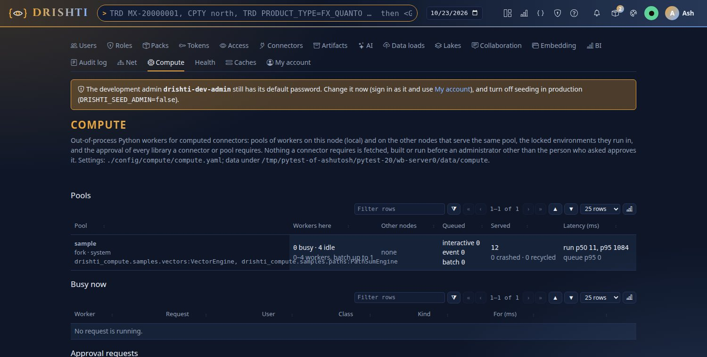
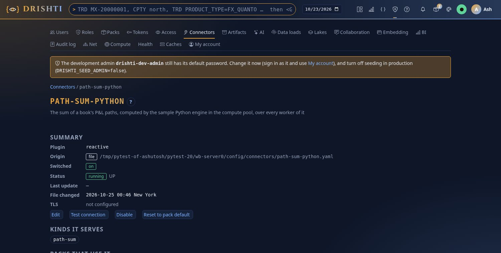
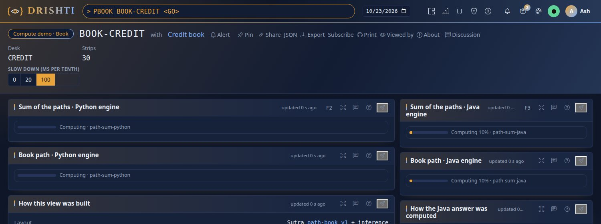
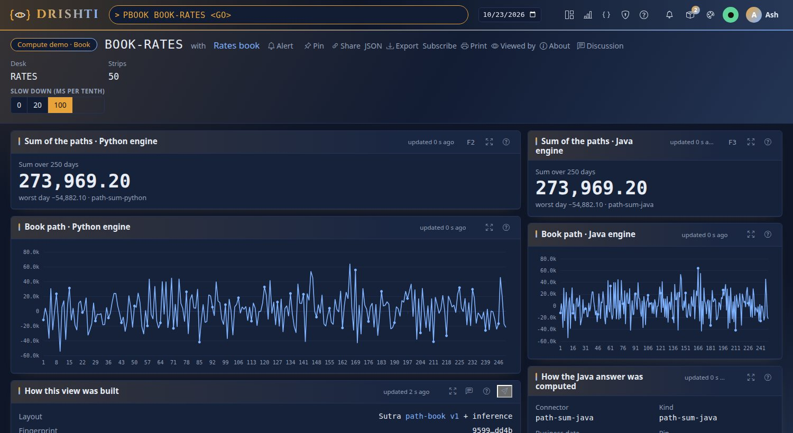
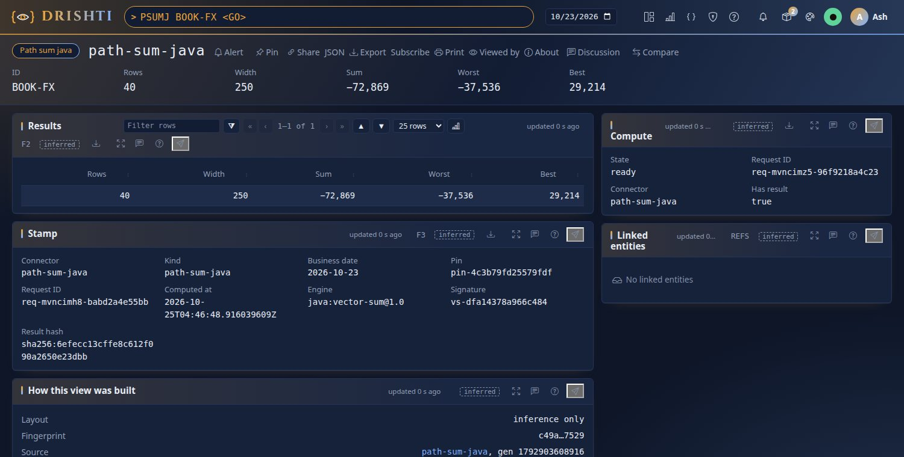
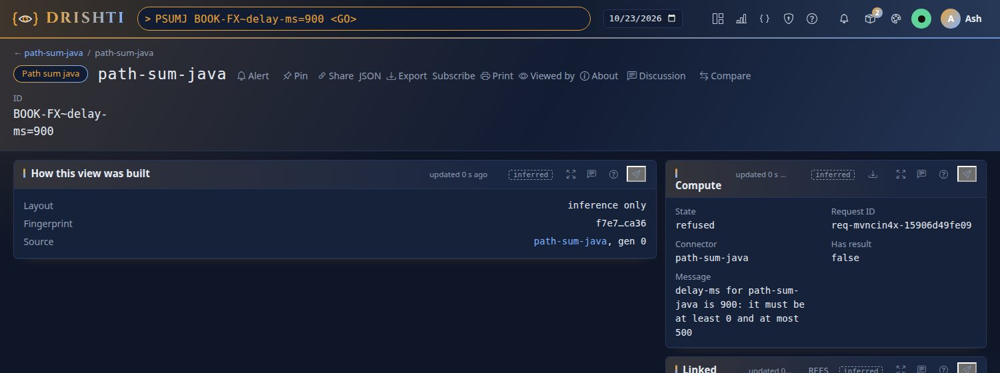

<!--
  Project Drishti · Any data. Any domain. One grammar.

  Copyright (c) 2026 Ashutosh Sinha <ajsinha@gmail.com>.
  All rights reserved.

  PROPRIETARY AND CONFIDENTIAL.

  This file is the confidential and proprietary property of Ashutosh Sinha.
  Unauthorised copying, use, modification, distribution or disclosure of this
  file, via any medium, is strictly prohibited except with the express prior
  written permission of the copyright holder.

  See the LICENSE file in the root of this repository for the full terms.
-->
# Tutorial 23 · Computed panels: a reactive connector

A **reactive connector** computes its answer when a screen asks for it, as the person asking, and again when something changes. In
this tutorial you switch on the compute workers and the **compute-demo** sample pack, open a book whose P&L path is computed twice (by a
Python engine fanned out over the workers of a pool, and by its Java twin inside the server), watch a panel go from *computing* with its
progress to the result without a reload, ask the same computation from the command line, see a parameter refused in words, and send a
write-back event that recomputes what a screen shows. Each step shows the UI, the command line and the YAML. The reference is
[REACTIVE_CONNECTOR.md](../connectors/REACTIVE_CONNECTOR.md); the design is [DATA_ARCHITECTURE.md](../architecture/DATA_ARCHITECTURE.md#4-reactive-connectors).

## Time to complete

About 25 minutes.

## Before you start

- [Tutorial 1](01-first-15-minutes.md) done: a server and console you can start and stop.
- The compute workers need a Python 3.10 or newer; the console's own (`drishti-console/.venv/bin/python`) is enough: the sample engine
  uses the standard library only.
- For the command-line steps: `DRISHTI_SERVER=http://localhost:18480` and `DRISHTI_TOKEN=...` (My account → API tokens), or `--user`
  with sign-in off.

The compute-demo pack is **synthetic** (a seeded random walk): nothing in it is market data.

## What you will learn

- how a connector file of plugin `reactive` declares kinds with typed parameters, inputs, an engine and triggers;
- how a Sutra panel names a computed kind and its parameters (`source: { kind, id, params }`);
- what a panel shows while it computes, when it is ready, and when it is refused, and that the page never waits;
- how a Python engine runs over every worker of a pool, and how its Java twin gives the same number;
- how to ask a computation, cancel it and send it an event from the command line;
- how a write-back event recomputes only what somebody watches.

## Step 1 · Switch on the compute workers and the sample pack

**On the server.** Start it with the pack added and compute on (both are off as shipped):

```bash
DRISHTI_PACKS=core,market-data,trading,counterparty-risk,market-risk,world-economy,news-and-markets,compute-demo \
DRISHTI_COMPUTE_ENABLED=true DRISHTI_PYTHON=$PWD/drishti-console/.venv/bin/python \
  java -jar drishti-server/target/drishti-server-*-exec.jar
```

**You should see** in the server's log:

```text
connectors: connector file path-sum-python.yaml generated from the template of pack 'compute-demo'
connectors: connector file path-sum-java.yaml generated from the template of pack 'compute-demo'
compute: on, node local, 1 pool(s): sample 0..4 fork (settings config/compute/compute.yaml, ...)
reactive connectors: host installed (2 running; in-process Java engines other than Drishti's own: refused)
```

**What it uses.** The pool `sample` of `config/compute/compute.yaml` runs the sample engines; `workers.max` is how many this node runs
(`DRISHTI_COMPUTE_SAMPLE_WORKERS`, 4 by default): configuration only, as many as you want, on every node of a cluster. **In the UI**,
Admin → Compute lists the pool, its workers and both sample engines:



```yaml
pools:
  sample:
    type: python
    engines: [drishti_compute.samples.vectors:VectorEngine, drishti_compute.samples.paths:PathSumEngine]
    environment: system
    workers: { min: 0, max: ${DRISHTI_COMPUTE_SAMPLE_WORKERS:4} }
```

## Step 2 · Read the connector file

**In the UI.** Admin → Connectors → `path-sum-python`: plugin `reactive`, the file it came from, *running · UP*, the kind it serves.



**You should see** the connector running, its plugin `reactive` and the kind `path-sum`.

**On the command line.** `cat config/connectors/path-sum-python.yaml`:

```yaml
plugin: reactive
mode: reactive
kinds:
  path-sum:
    compute: sum-vectors                       # what the engine calls it
    params:
      delay-ms: { type: int, default: 0, min: 0, max: 500 }
    result: { required: [SUM, WORST], types: { SUM: number, WORST: number } }
reads:                                         # read as the person asking, in this order
  - { kind: path-book, as: book, id: "{id}" }
  - { kind: path-strip, as: values, ids: "{inputs.book.MEMBERS}", limit: 5000 }
engine:
  type: python
  entry: drishti_compute.samples.paths:PathSumEngine
  pool: sample
  split: values                                # the strips are cut over every worker of the pool
  chunk-rows: 20
  reduce: { sum: [ROWS, SUM], tables: { total: [PNL] }, then: { WORST: "min:total.PNL", BEST: "max:total.PNL" } }
triggers:
  - { on: data-version, kinds: [path-strip], affects: all }
  - { on: write-back, kinds: [path-strip], affects: "{payload.BOOK_ID}" }
limits: { timeout: 30s, wait: 25ms, max-inflight-per-user: 4 }
```

`path-sum-java.yaml` is the same computation with `engine: { type: java, class: com.ash.drishti.compute.reactive.samples.VectorSumEngine }`.
The pack routes the kinds to them (`routes: { path-sum: path-sum-python, path-sum-java: path-sum-java }`) and nothing else in the pack
knows how they are computed.

## Step 3 · Open a book and watch it compute

**In the UI.** Type `PBOOK BOOK-CREDIT <GO>` and pick **100** under *Slow down* (the engines pause per tenth of the strips, so you can
watch). The page opens at once. The computed panels say *Computing · path-sum-python* and *Computing 10% · path-sum-java*, each with a
progress bar; the book's own fields are already there.



A second or two later each panel fills in place, without a reload: the sum over 250 days, the worst day and the book's path as a chart,
from Python and from Java, the same number. *How the Java answer was computed* shows the stamp: the pin of the inputs' versions, the
engine, when, the result's hash.



**What the screen says** (`config/packs/compute-demo/sutras/path-book.v1.sutra.yaml`):

```yaml
controls:
  - { id: slow, kind: segmented, label: Slow down (ms per tenth), options: ["0", "20", "100"], default: "0" }
panels:
  - id: py-sum
    kind: metric
    source: { kind: path-sum, id: "$.BOOK_ID", params: { delay-ms: ctl.slow } }
    value: "$src.SUM"
  - id: java-path
    kind: line
    source: { kind: path-sum-java, id: "$.BOOK_ID", params: { delay-ms: ctl.slow } }
    rows: "$src.TABLES.total"
    x: DAY
    y: PNL
```

**You should see** the panels computing, then ready; open the same book again: it is answered from the cache at once (*updated 0 s
ago*). Pick **20**: a new parameter is a new question, computed once more.

## Step 4 · The same computation from the command line

```bash
python3 tools/drishti.py compute run path-sum-java path-sum-java BOOK-FX --param delay-ms=20
python3 tools/drishti.py compute run path-sum-python path-sum BOOK-FX --wait 15000
```

**You should see** (captured on a workstation, 2026-10-25):

```text
path-sum-java BOOK-FX~delay-ms=20  READY  (req-mvncbp26-22d83e2f83dc)
  ROWS         40
  WIDTH        250
  SUM          -72869.06999999999
  WORST        -37535.829999999994
  BEST         29214.140000000003
  computed 2026-10-25T04:41:25.883332524Z by java:vector-sum@1.0, pin pin-4c3b79fd25579fdf, sha256:6efecc13cffe8c612f090a2650e23dbb
path-sum-python BOOK-FX  READY  (req-mvncbpap-cd3a5fa3f80a)
  ...
  ran on {'worker': '2 workers', 'node': 'local', 'chunks': 2, 'workers': 2, 'nodes': {'local': 2}, 'queuedMs': 0, 'runMs': 98}
```

The id carries the parameters: `BOOK-FX~delay-ms=20`. The same id opens the computed kind in the browser
(`/v/path-sum-java/BOOK-FX~delay-ms=20`) and over HTTP (`POST /api/v1/compute/path-sum-java/path-sum-java {"id": "BOOK-FX", "params":
{"delay-ms": 20}}`). `ran on` says the Python one was cut into 2 chunks over 2 workers. `--json` prints the whole answer;
`drishti.py compute cancel <request>` cancels one of yours. In the browser the computed kind itself shows its result, the
`RESULTS` and `TABLES` and the stamp:



## Step 5 · A parameter out of bounds is refused in words

```bash
python3 tools/drishti.py compute run path-sum-java path-sum-java BOOK-FX --param delay-ms=900; echo "exit $?"
```

**You should see** the refusal in words and exit code 1:

```text
path-sum-java BOOK-FX~delay-ms=900  REFUSED  (req-mvncbpgc-b05a980336d9)
  delay-ms for path-sum-java is 900: it must be at least 0 and at most 500
exit 1
```

**In the UI**, `PSUMJ BOOK-FX~delay-ms=900 <GO>` says the same in the answer's `COMPUTE` part: state *refused*, the request id, the message.

 A panel whose parameter is refused shows *Not computed: …* in that panel
only; the rest of the screen is drawn as usual. Nothing was read or computed.

## Step 6 · An event recomputes what somebody watches

Keep `PBOOK BOOK-FX` open in the browser. As an administrator, send the event a saved change will send once write-back lands (W6):

```bash
python3 tools/drishti.py compute event write-back chg-101 --kind path-strip --entity STRIP-FX-001 \
  --payload BOOK_ID=BOOK-FX --watermark L3=13
```

```json
{ "connectors": { "path-sum-java": { "affected": 1, "recomputing": 1 }, "path-sum-python": { "affected": 1, "recomputing": 1 } },
  "event": "chg-101" }
```

**You should see** the book's computed panels turn amber (*Stale · path-sum-java is recomputing after write-back of STRIP-FX-001*), then
fill again. The new stamp says `watermark: {L3: 13}` and `trigger: {type: write-back, eventId: chg-101}`. Send the same command again:
`"ignored": "already processed chg-101"`. With the page closed, `recomputing` is `0`: the result is only marked stale and recomputed on
its next read. A burst of events is coalesced (`coalesce: { quiet: 250ms, max-wait: 2s }`): twenty changes in a second are one or two
computations.

## Step 7 · What Admin sees

```bash
python3 tools/drishti.py compute reactive
```

**You should see** both sample connectors with `"available": "ready"` and their cache counts.

Each reactive connector with its kinds and parameters, engine, `available` (*ready*, or why not: *compute is off on this server*), the
cache (results, hits, misses, late results dropped), coalescing (events in, computations), computations running, joined and failed, and
each kind's latency. The pools and workers behind the Python one are under Admin → Compute.

## Next steps

You read a computed kind on a screen (typed parameters on a panel's source), watched it compute without the page waiting, compared a
Python engine fanned out over a pool's workers with a Java engine in the server, asked and refused the computation from the command line,
and recomputed a watched result from an event. Next: the [reactive connector reference](../connectors/REACTIVE_CONNECTOR.md) (sandboxes for
private what-ifs, live and scheduled triggers, the HTTP API) and [operating compute](../admin/OPERATIONS.md#19-compute-workers).
