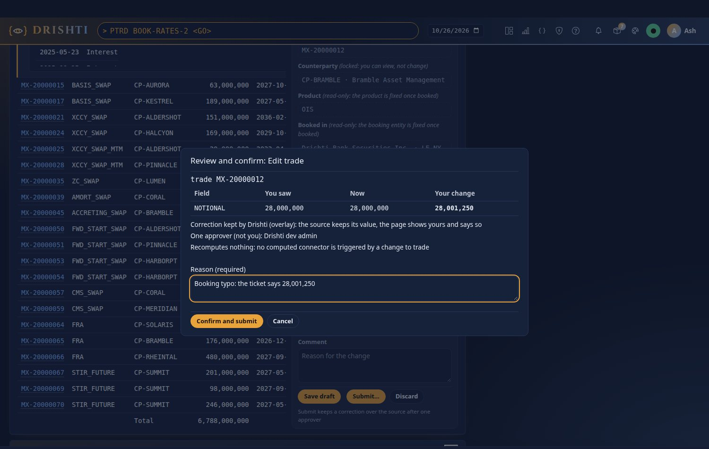
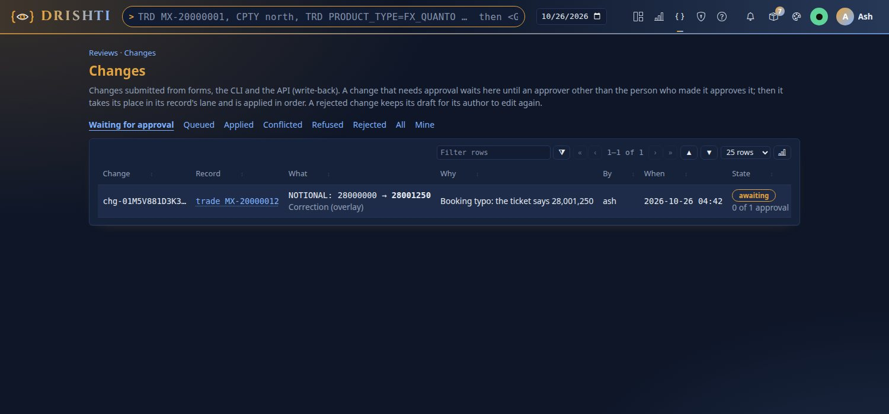
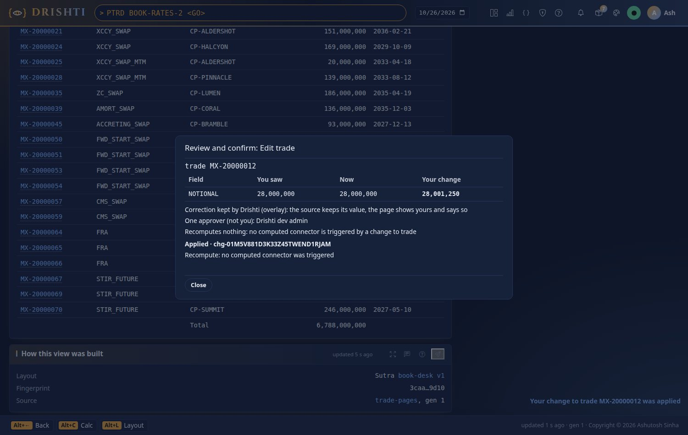
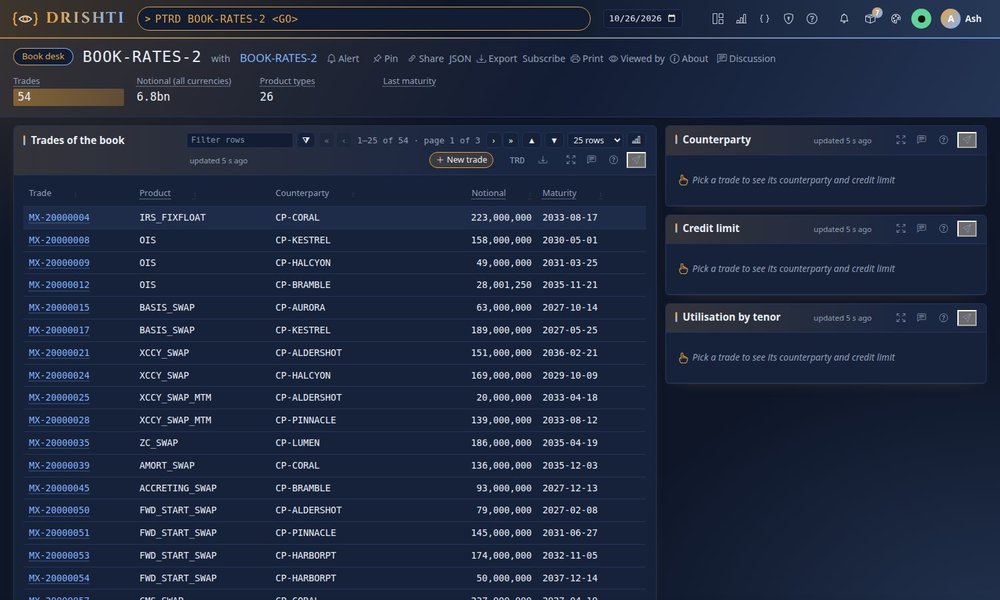
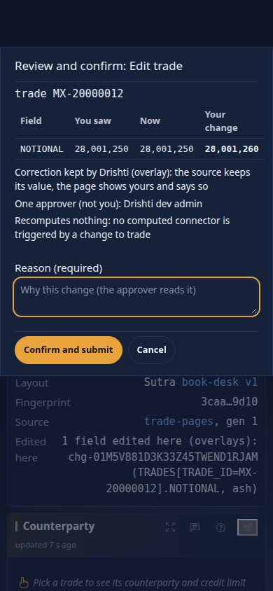

<!--
  Project Drishti · Any data. Any domain. One grammar.

  Copyright (c) 2026 Ashutosh Sinha <ajsinha@gmail.com>.
  All rights reserved.

  PROPRIETARY AND CONFIDENTIAL.

  This file is the confidential and proprietary property of Ashutosh Sinha.
  Unauthorised copying, use, modification, distribution or disclosure of this
  file, via any medium, is strictly prohibited except with the express prior
  written permission of the copyright holder.

  See the LICENSE file in the root of this repository for the full terms.
-->
# Tutorial 24 · Correct a trade and approve it: write-back

**Write-back** lets people change records from a screen's forms, as change requests: checked as the person, approved by someone else
where the policy says so, applied one at a time per record and audited. In this tutorial you switch editing on, correct a trade's
notional on the book desk, read the review and confirm sheet, approve the change as another person, watch it applied and shown to a
second browser, and do the same from the command line, including a change that is refused because the trade moved underneath. Each
step shows the UI, the command line and the YAML. The reference for authors is
[WRITE_BACK.md section 4a](../guides/WRITE_BACK.md#4a-submitting-a-change-280-write-back); for administrators
[WRITE_BACK.md, for administrators](../guides/WRITE_BACK.md#for-administrators-write-back-is-off-as-shipped); the design is [WRITE_BACK.md](../guides/WRITE_BACK.md#16-the-design-and-its-reasons).

## Time to complete

About 20 minutes.

## Before you start

- [Tutorial 1](01-first-15-minutes.md) done: a server and console you can start and stop, with the trading pack (it is on by default).
- Two people: the one who corrects and an approver. With sign-in off (the default for a laptop) you are everyone; the approval step
  calls the API as a second name. With sign-in on, give one person a role with **Submit edits** and another a role with the approve power.
- For the command-line steps: `DRISHTI_SERVER=http://localhost:18480` and `DRISHTI_TOKEN=...` (My account → API tokens, with the
  **edit** scope ticked), or `--user` with sign-in off.

## What you will learn

- The three switches write-back needs: the site's (`config/edit/edit.yaml`), the form's (`save:` in a Sutra), and for an amendment sent to
  a booking system the connector's (`writes:`, switched on in Admin → Edits).
- The review and confirm sheet: what you saw, what is there now, your change, where it goes, who approves and what it recomputes.
- Four eyes: the person who submits never approves.
- That a correction (an overlay) is shown on every page that reads the trade, and why a stale change is conflicted, never written over.

## Step 1 · Switch editing on

Editing is **off as shipped**: a fresh install is read-only. Turn the site switch on and restart the server:

```yaml
# config/edit/edit.yaml
edit:
  enabled: ${DRISHTI_EDIT_ENABLED:false}   # or: true
  log: auto
```

```bash
DRISHTI_EDIT_ENABLED=true java -jar drishti-server/target/drishti-server-*-exec.jar
```

**You should see** in the server's log `write-back: on; edit log sqlite (auto: this node is alone), 64 lanes, node local`. **In the UI**,
Admin → Edits says where the edit log lives and why; **on the command line**:

```bash
drishti-console/.venv/bin/python tools/drishti.py edits status --user ada
# {"enabled": true, "mode": "single", "store": "sqlite", "why": "auto: this node is alone", ...}
```

## Step 2 · Read the form that submits

The book desk's trades form says where a submitted change goes. It is the trading pack's
`config/packs/trading/sutras/pages/book-desk.v1.sutra.yaml`:

```yaml
form:
  title: Edit trade
  key: trade_id
  edit: beside
  save:
    kind: trade            # the rows are trades (the page is a book's)
    target: overlay        # a correction kept beside the booking system's value
    approval: one          # one approver, never the person who submitted
    reason: required
  fields:
    - { id: notional, label: Notional, bind: NOTIONAL, type: money, currency: currency, min: 0, required: true }
```

**You should see**, when you open the book desk (`PTRD BOOK-RATES-2 <GO>`, then the Book desk screen) and click a trade, the form
beside the table with **Save draft**, **Submit…** and the note *Submit keeps a correction over the source after one approver*. Without
`save:` a form keeps drafts only, and says so.

## Step 3 · Correct a notional and review it

Click trade **MX-20000012**, type the notional the ticket says (28,001,250 instead of 28,000,000) and press **Submit…**. The draft is
saved, then the review and confirm sheet opens:



**You should see** one row per field (what you saw, what is there now, your change; a field that moved since you opened the trade would
be flagged here, before you send anything), *Correction kept … (overlay)*, *One approver (not you)*, *Recomputes nothing* (no computed
connector is triggered by a change to a trade on this server), and a required **Reason**. Write it and press **Confirm and submit**: the
sheet says *Waiting for an approver* with the change id.

The same submission from the command line (a change rather than a draft):

```bash
drishti-console/.venv/bin/python tools/drishti.py change propose --kind trade --id MX-20000012 \
  --set NOTIONAL=28001250 --from NOTIONAL=28000000 --reason "booking typo: ticket 4411" --user ash
# chg-01M5V881D3K33Z45TWEND1RJAM  trade MX-20000012  AWAITING (1 approval needed)
```

## Step 4 · Approve it as someone else

The change waits in **Review → Changes** (Build → Govern → Changes). You submitted it, so you see it without Approve or Reject:



**You should see** *0 of 1 approval*. An approver (another person) presses **Approve**, or from the command line:

```bash
drishti-console/.venv/bin/python tools/drishti.py change approve chg-01M5V881D3K33Z45TWEND1RJAM --note "checked against ticket 4411" --user kim
```

Approving your own change answers `403 DRS-9302` *you submitted this change: someone else approves it (four eyes)*.

## Step 5 · Watch it applied, everywhere

The approval puts the change in its trade's lane; the lane's owner checks it again against the trade as it is now and applies it. The
sheet you left open follows it:



**You should see** *Applied · chg-…*, a toast *Your change to trade MX-20000012 was applied*, and your draft gone (it was closed with the
change id). A second browser watching the book shows the new notional by itself, with *Changed … just now*:



*How this view was built* on the trade's page now says **Edited here** with the change id, the field and who made it. Admin → Edits lists
it under *Open overlays*, with the booking system's value beside it. The record's history:

```bash
drishti-console/.venv/bin/python tools/drishti.py change history trade MX-20000012 --user ash
```

## Step 6 · A change based on an old value is conflicted

Propose another change that still says you saw 28,000,000:

```bash
drishti-console/.venv/bin/python tools/drishti.py change propose --kind trade --id MX-20000012 \
  --set NOTIONAL=28000500 --from NOTIONAL=28000000 --reason "late correction" --user kim
drishti-console/.venv/bin/python tools/drishti.py change approve <its id> --user ada
drishti-console/.venv/bin/python tools/drishti.py change show <its id> --user kim
# chg-…  trade MX-20000012  CONFLICTED  (overlay, by kim)
#   NOTIONAL: you saw 28000000, it is now 28001250, you wanted 28000500
```

**You should see** *CONFLICTED* with the three values, and the trade unchanged: a change based on a value that has moved is never
written over it. Open the trade again and edit from what is there now.

## Step 7 · On a phone

Open the book desk at phone width (or narrow the window), click a trade, change its notional and press **Submit…**. **You should see**
the sheet take the whole screen, with the difference, the destination and the reason readable and nothing scrolling sideways:



## Next steps

- Make your own screen's form submit: add `save:` to its `form:` ([WRITE_BACK.md section 4a](../guides/WRITE_BACK.md#4a-submitting-a-change-280-write-back)).
- Send amendments to a booking system: a JDBC connector's `writes:` with its guard and idempotency clause, switched on in Admin → Edits
  ([WRITE_BACK.md section 13](../guides/WRITE_BACK.md#13-writing-to-a-source-writes), [JDBC_QUERIES.md section 16](../connectors/JDBC_QUERIES.md#16-writes-commands-that-change-a-record-280)).
- Recompute on a change: a reactive connector with a `write-back` trigger ([tutorial 23](23-computed-panels.md)).
- Run several servers: PostgreSQL for the Drishti database, or an edit primary ([WRITE_BACK.md section 11](../guides/WRITE_BACK.md#11-the-edit-log-lanes-and-the-cluster)).
