<!--
  Project Drishti · Any data. Any domain. One grammar.

  Copyright (c) 2026 Ashutosh Sinha <ajsinha@gmail.com>.
  All rights reserved.

  PROPRIETARY AND CONFIDENTIAL.

  This file is the confidential and proprietary property of Ashutosh Sinha.
  Unauthorised copying, use, modification, distribution or disclosure of this
  file, via any medium, is strictly prohibited except with the express prior
  written permission of the copyright holder.

  See the LICENSE file in the root of this repository for the full terms.
-->
# Tutorial 25 · VaR from the bank to a trade

Value at risk answers *how much could this lose in a day, and where does that loss come from?* In this tutorial you build the market-risk
pack's VaR data into a lake, open the bank's VaR, drill down to one trade without a page load, read the P&L path and the contributions,
write your own scopes (a desk minus a book plus a portfolio; a rule), see how Drishti derives positions, save a basket and capture it,
read the history and the backtest, look at how the date sits in memory and on disk, read VaR as an ordinary computed kind, and ask the
Python engine what a hedge would do. Each step shows the UI, the command line (`drishti.py var …`) and the YAML behind it, with real
output from the committed test data. Everything else about VaR (every measure, column, setting, endpoint and error code, the data
contract and how the engine stores a date) is in the one reference, [VAR_GUIDE.md](../guides/VAR_GUIDE.md); each step ends with the guide's sections
that go further.

## Time to complete

About 45 minutes.

## Before you start

- [Tutorial 1](01-first-15-minutes.md) done: a server and console you can build, start and stop.
- The market-risk pack loaded (it is in the quick-start packs).
- For the command-line steps: `DRISHTI_SERVER=http://localhost:18480` and `DRISHTI_TOKEN=...` (My account → API tokens), or `--user`
  with sign-in off. The outputs below were captured as the user `rita` with sign-in off.
- For step 11 only: the compute workers (a Python 3.10 or newer; the console's own is enough, the VaR engine uses the standard library).

The VaR data is **synthetic** (a correlated, fat-tailed factor market over the committed trades), not prices.

## What you will learn

- where the VaR inputs live (one P&L vector of 509 scenario days per live trade) and how a date is loaded;
- what VaR, ES, component, incremental VaR and diversification mean on real numbers, and that components add up;
- how to drill from the bank to a trade, and how longs and shorts net in a position;
- the scope grammar: nodes, positions, trades, portfolios, rules, with `+`, `-` and `&`;
- how positions are derived by the pack's rules, never delivered;
- baskets, captures and compare; the history, the traffic light, Kupiec's and Christoffersen's tests;
- the memory tiers: the date's memory-mapped hot file, float32 rows summed in float64;
- VaR as a kind (`VRES`) and a what-if by the Python engine (`VWIF`);
- a hierarchy built from the trades' own columns: the limit letters, a letter holding part of a book (2.9.5).
- the scenario matrix (`SMAT`, 2.9.7): a book's scenarios across five business dates, its tail outlined each day, a scenario charted against −VaR.

## Step 1 · Build the VaR data and open the bank

**From the command line.** Build the four VaR tables into the lake on the test data's own date (2026-09-30), so your numbers are the
ones below (`--as-of today`, the default, moves the date to your today and trades that have matured since drop out):

```bash
python3 tools/drishti.py lake demo --as-of data \
  --only market-risk/pnl-vector,market-risk/scenario-pv,market-risk/fx-scenario,market-risk/scenario-set,market-risk/risk-hierarchy,market-risk/portfolio,market-risk/var-limit
```

Start the server and console (tutorial 1), then ask for the bank:

```text
$ drishti.py var show BANK
VAR BANK  ·  Drishti Bank  ·  node  ·  2026-09-30
  VaR 99%   112,041,646 USD   (the 6th worst of 509)
  ES 97.5%   160,143,809 USD   (mean of the 13 worst)
  limit      150,000,000 USD   use 74.7%
  parts      2 division   standalone sum 130,101,896   diversification 18,060,250
  backtest   amber  5 exceptions in 249 days   Kupiec p 0.160   Christoffersen p 0.076
  9572 trades in 7993 positions
  pnl-vector and scenario-pv (1339 trades from scenario PVs) · batch B-2026-09-30-01 of 2026-09-30 · data version …
  in USD, crosses through USD; FX CAD supplied (0.719942 USD); EUR supplied (1.174 USD); USD base (1 USD)
  node aggregate (float64) · historical, equal weights, 1-day, k = 6th worst of 509 · 2 ms (miss)
  warning: 9 positions had trades under two nodes of a hierarchy built from columns and are split, one part per node (<position>@<value>)
```

**In the UI.** Type `VAR BANK` and press Enter:

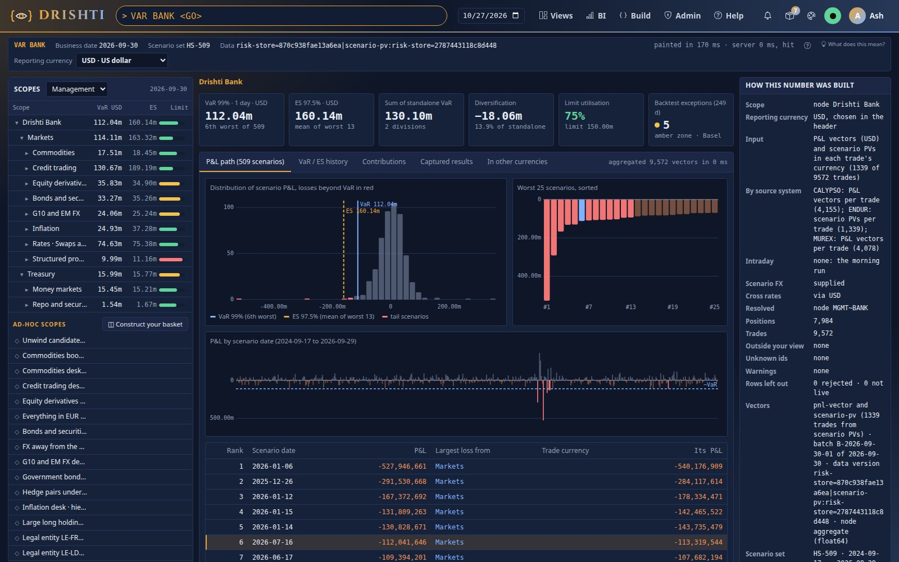

**What it reads.** The market-risk pack's connector `risk-store` keeps the P&L vector as a `list<double>` column of the `pnl-vector`
table, and (2.9.4) the trades a batch sends as **scenario PVs** in their own currency as the `list<double>` column `SCENARIO_PV` of
the `scenario-pv` table, with each currency's scenario FX in `fx-scenario` (`config/packs/market-risk/pack.yaml`):

```yaml
connectors:
  risk-store:
    plugin: delta
    settings:
      domain: risk
      layout:
        pnl-vector:
          columns: [TRADE_ID, SECURITY_ID, INSTRUMENT, LEGAL_ENTITY, DIVISION, DESK, TT_BOOK, LIMIT_LETTER, PORTFOLIO, ..., QUANTITY, PV, TRADE_STATUS,
                    MATURITY_DATE, STATUS, REPORTING_CCY, SCENARIO_SET_ID, BATCH_ID]
          vectors: [PNL]
        scenario-pv:
          columns: [TRADE_ID, ..., CURRENCY, ..., BASE_PV, VALUATION_DATE, BASE_VALUATION_DATE, ..., SCENARIO_SET_ID, BATCH_ID]
          vectors: [SCENARIO_PV]
        fx-scenario:
          columns: [CURRENCY, RATE, SCENARIO_SET_ID]
```

The demo's Endur trades (1,339) come that way: when the date loads, the engine turns each into its USD P&L,
`PV(s) × FX(s) − PV(base) × FX(base)`, and from then on they are trades like any other.

**You should see** VaR 112,041,646 and ES 160,143,809 on 2026-09-30, over 9,572 trades in 7,993 positions, 1,339 of them from scenario
PVs (7,984 positions before 2.9.5: the limit letters of step 14 split nine positions in two, as the warning says). On the 6th worst of the 509 days the bank loses 112 million; the two divisions alone would add up to 130 million: holding them
together saves 18 million. (Until 2.9.3 every trade was a P&L vector and the bank's VaR was 112,035,906: the 250 Endur trades in EUR and
CAD now also carry the move of their currency on their value.)

**In another currency.** In the console, pick **EUR** in the **Reporting currency** select at the right end of the status line (or type
`VAR BANK IN EUR <GO>`): every tile, the tree, the path and the provenance move to euros, the link gains `&ccy=EUR`, and the choice stays
while you move around this tab. Open the tab **In other currencies**: one row per configured currency (USD, EUR, CAD, JPY, GBP), each
with its own VaR and ES, that VaR in euros at today's rate, and the difference; click **CAD** to move the page to it. On the command
line every `drishti.py var` command takes `--ccy` (the API: `ccy=EUR`):

```text
$ drishti.py var show BANK --ccy EUR
VAR BANK  ·  Drishti Bank  ·  node  ·  2026-09-30
  VaR 99%   111,837,045 EUR   (the 6th worst of 509)
  ES 97.5%   137,631,546 EUR   (mean of the 13 worst)
  …
  in EUR, crosses through USD; FX CAD supplied (0.719942 USD); EUR supplied (1.174 USD); USD base (1 USD)
  …
$ drishti.py var show BANK --ccy INR
the server said 422 DRS-5207: DRS-5207 no INR FX for the scenarios of 2026-09-30: INR: neither supplied (fx-scenario) nor in the FX history
(fx-spot); the currencies with FX on the date: AUD, CAD, CHF, EUR, GBP, JPY, USD
```

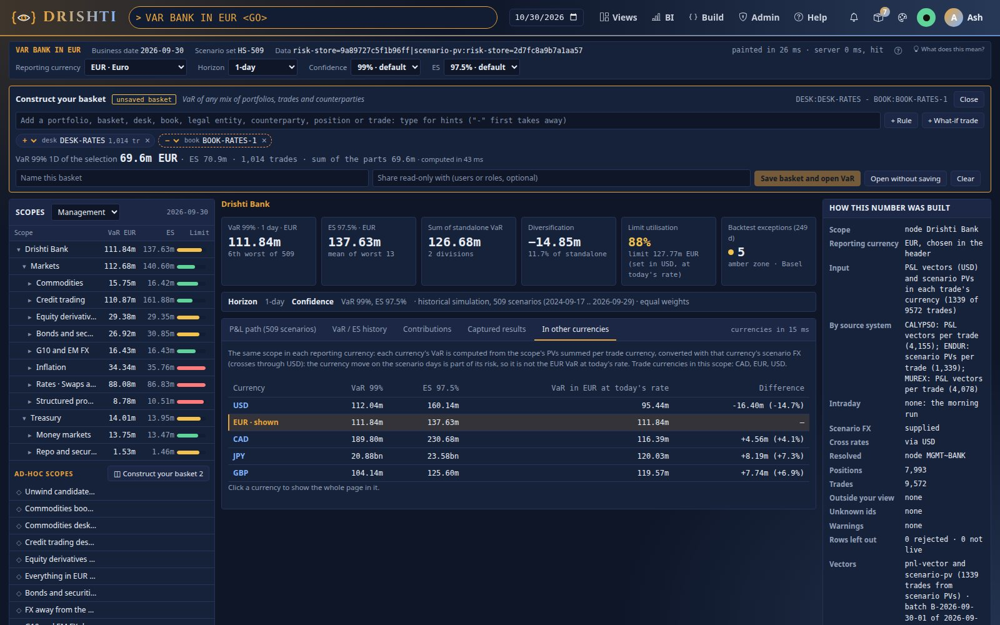

**You should see** 111.8 million EUR, not the 95.4 million that 112.0 million USD makes at today's 1.174: in euros the bank's whole value
(3.65 billion USD) moves with the euro on every scenario day, and that move is part of a euro-based owner's risk. The configured
currencies (`drishti.var.currencies`: USD, EUR, CAD, JPY, GBP) are built ahead in the background once the USD book has loaded, so the
picker never waits; `drishti.py var status` says it under `currencies.builtAhead` (`built ahead in 148 ms, 21399944 bytes`). Any other
currency (**More…**, or `--ccy CHF`) is built the first time it is asked. The headline in any currency comes from every node's PVs
summed per trade currency, exact to the cent. A trade page's strip now says its **Trade currency** (`EUR · as priced` for an Endur trade
sent as scenario PVs, `USD · as booked` for one sent as a P&L vector).

**Further in the guide:** [section 15.1](../guides/VAR_GUIDE.md#151-where-they-live) (the inputs), [section 2.2](../guides/VAR_GUIDE.md#22-on-the-test-data) (the bank's numbers read), [section 15.9](../guides/VAR_GUIDE.md#159-scenario-pv-scenario-pvs-per-trade-in-the-trades-currency-as-built-294) (scenario PVs and their FX), [section 15.10](../guides/VAR_GUIDE.md#1510-reporting-currency-as-built-294) (reporting currencies), [section 15.11](../guides/VAR_GUIDE.md#1511-reporting-currencies-built-ahead-per-trade-currency-totals-and-the-picker-as-built-294) (built ahead, the totals, the picker).

## Step 2 · Drill down from the bank to a trade

**In the UI.** Click *Markets*, then *Rates · Swaps and options*, then `BOOK-RATES-1`, open the **Contributions** tab, click a position,
then one of its trades. Every panel moves in place; the breadcrumb grows (bank › division › desk › book › position › trade); the
browser's Back steps back up.

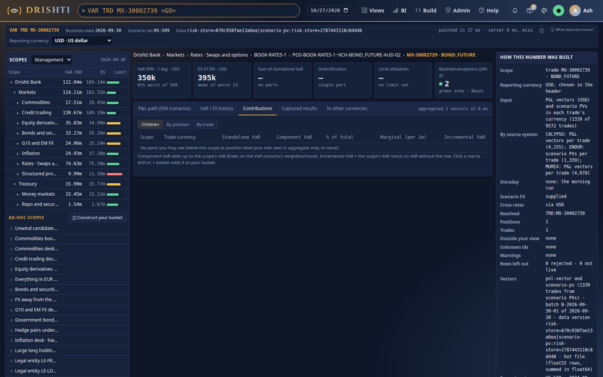

A book lists its positions, each LONG or SHORT, with its VaR and its component in the book:


**From the command line.** The tree of either hierarchy with every node's figures:

```text
$ drishti.py var tree --hierarchy LEGAL
LEGAL on 2026-09-30, in USD
Node                             VaR          ES           Limit use  Trades
-------------------------------  -----------  -----------  ---------  ------
Drishti Bank                     112,041,646  160,143,809      74.7%    9572
  LE-FRA                           1,536,322    1,665,992      66.8%     611
  LE-LDN                          48,350,793   53,764,068      63.6%    2679
    Equity derivatives            35,827,767   34,901,016      77.9%    1201
      BOOK-EQD-2                  33,619,633   66,673,176      65.9%     374
  LE-NY                          144,262,258  174,617,643      80.1%    6008
    Credit trading               130,670,864  189,194,564      65.3%     943
```

Other ways in: `VAR LE LE-NY`, `VAR BOOK BOOK-RATES-1`, `VAR CPTY CP-SUMMIT` (every trade with a counterparty), `VAR PORT
PF-USD-RATES`; the retired stored ids still work (`VAR VAR-RATES` opens `DESK:RATES` and says so).

(The output lists every node; a few rows are shown.) The same with `--hierarchy MGMT`, and in the UI with the *Legal entities* choice above
the tree.

**You should see** that New York alone (144.3 million) has a larger VaR than the whole bank: London's and Frankfurt's trades gain on
New York's worst days.

**Further in the guide:** [section 3.3](../guides/VAR_GUIDE.md#33-drill-down-bank-desk-book-position-trade) (drill down), [section 10](../guides/VAR_GUIDE.md#10-the-command-line) (the command line).

## Step 3 · Read the P&L path: what the VaR is

**In the UI.** `VAR DESK DESK-RATES`: the distribution of the desk's 509 scenario P&Ls with the VaR and ES lines, the 25 worst sorted,
the P&L by scenario date, and the ranked table. The highlighted row is rank 6: the VaR.

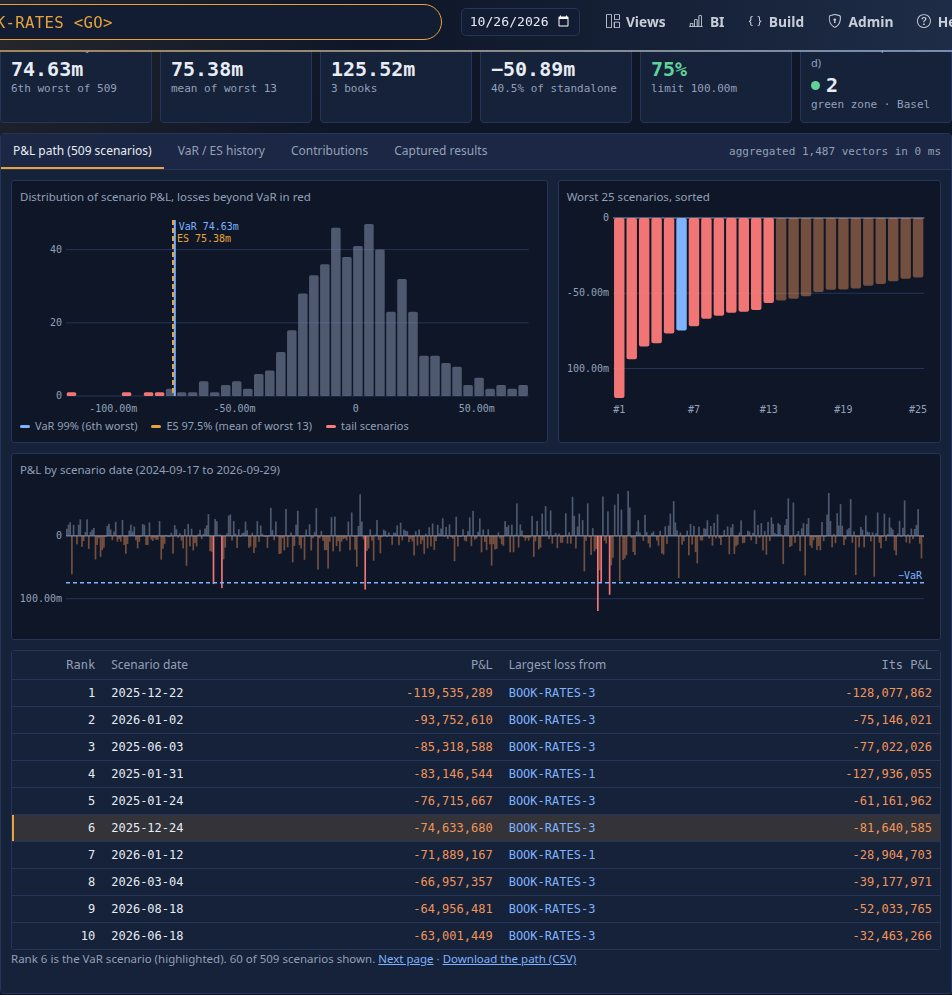

**From the command line:**

```text
$ drishti.py var path DESK:RATES --size 8
DESK:RATES  VaR 74,633,680 (rank 6)  ES 75,377,415 (worst 13)  USD
Rank  Scenario day  P&L           Lost most
----  ------------  ------------  -------------------------
1       2025-12-22  -119,535,289  BOOK-RATES-3 -128,077,862
2       2026-01-02   -93,752,610   BOOK-RATES-3 -75,146,021
3       2025-06-03   -85,318,588   BOOK-RATES-3 -77,022,026
4       2025-01-31   -83,146,544  BOOK-RATES-1 -127,936,055
5       2025-01-24   -76,715,667   BOOK-RATES-3 -61,161,962
6       2025-12-24   -74,633,680   BOOK-RATES-3 -81,640,585
7       2026-01-12   -71,889,167   BOOK-RATES-1 -28,904,703
8       2026-03-04   -66,957,357   BOOK-RATES-3 -39,177,971
```

**What it means.** At 99% the VaR is the 6th worst of 509 days (509 × 1% = 5.09, rounded up): 74,633,680. ES at 97.5% is the mean of
the 13 worst (509 × 2.5% = 12.7, rounded up): 75,377,415. Click a row in the UI to see which books lost what that day.

**You should see** rank 6 (2025-12-24) equal to the VaR, and `BOOK-RATES-3` losing most on five of the six worst days.

**Further in the guide:** [section 3.4](../guides/VAR_GUIDE.md#34-the-tabs) (the tabs), [sections 18.1 and 18.2](../guides/VAR_GUIDE.md#181-var) (the formulas).

## Step 4 · Contributions: who makes the VaR

**In the UI.** The **Contributions** tab of the desk: its three books, their standalone, component, incremental and marginal VaR.


**From the command line:**

```text
$ drishti.py var parts DESK:RATES
DESK:RATES  by book  VaR 74,633,680  ES 75,377,415 USD  sum of components 74,633,680
Part          Standalone VaR  Component VaR  % of VaR  Incremental VaR  Component ES
------------  --------------  -------------  --------  ---------------  ------------
BOOK-RATES-1      33,153,425     30,612,282      41.0       -5,131,638    10,403,265
BOOK-RATES-2      30,872,370     25,280,825      33.9       21,654,002    20,263,766
BOOK-RATES-3      61,499,103     18,740,573      25.1       26,690,191    44,710,384
```

`--by position` or `--by trade` breaks the desk down further (`drishti.py var parts BOOK:BOOK-EQD-2 --by position --top 8`).

**You should see** the components adding up to the desk's VaR to the dollar (74,633,680), and `BOOK-RATES-1`'s **negative** incremental
VaR: take the book out and the desk's VaR rises by 5.1 million. `BOOK-RATES-3` is the riskiest alone (61.5 million) but contributes the
least: its worst days are not the desk's.

**Further in the guide:** [section 2](../guides/VAR_GUIDE.md#2-the-measures-with-worked-numbers) (the measures by hand), [section 18.3](../guides/VAR_GUIDE.md#183-decomposition-of-a-scope-into-parts) (the decomposition).

## Step 5 · Your own scope: nodes, portfolios, rules

**In the UI: Construct your basket.** On the rates desk, click **+ basket** on its row in the tree (point at the row to see it): the
basket tray opens as a strip at the top. Type `pf usd` in it: the engine's hints list *PORT · PF-USD-RATES · USD rates exposure*, its
trades and its VaR alone; **Enter** adds it. Type `-book-rates-1` and **Enter**: the book is taken away (a dashed **−** chip; the **+ / −**
on any chip switches it). As you pick, the tray shows the selection's VaR and ES, its trades, the sum of the parts' VaRs and the
diversification, computed by the engine. **Open without saving** moves the explorer to it: *unsaved basket*, its contributions are its
parts. The basket lives on the VaR page: **◫ Construct your basket** (or **Alt+B**) opens it; what it holds stays in your browser.

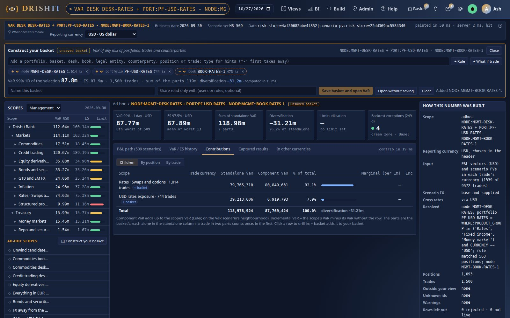

The tray writes `NODE:MGMT~DESK-RATES + PORT:PF-USD-RATES - NODE:MGMT~BOOK-RATES-1`: the parts to add, then those to take away. A part
that matches nothing on the date (try `TRD:10000000`) turns red at once and the tray says why (*not a live trade on 2026-09-30 (no P&L
vector)*), never a VaR of 0.

**From the command line**, a desk without another desk, and the desk without one trade:

```text
$ drishti.py var show 'BANK - DESK:CREDIT'
VAR BANK - DESK:CREDIT  ·  BANK - DESK:CREDIT  ·  adhoc  ·  2026-09-30
  VaR 99%   76,605,857 USD   (the 6th worst of 509)
  ES 97.5%   76,775,085 USD   (mean of the 13 worst)
  ...
  8629 trades in 7050 positions
$ drishti.py var show 'DESK:RATES - TRD:MX-30000121' --json        (abridged)
{"canonical": "DESK:RATES - TRD:MX-30000121", "kind": "adhoc", "var": 74720890, "es": 75093413, ...}
```

and a rule over the positions' columns:

```text
$ drishti.py var show "WHERE:CURRENCY == 'EUR' and DIRECTION == 'SHORT'"
VAR WHERE:CURRENCY == 'EUR' and DIRECTION == 'SHORT'  ·  ...  ·  rule  ·  2026-09-30
  VaR 99%   134,918,298 USD   (the 6th worst of 509)
  ES 97.5%   140,529,561 USD   (mean of the 13 worst)
  parts      596 position   standalone sum 231,439,042   diversification 96,520,744
  700 trades in 596 positions
```

**The grammar** (the full table is in [VAR_GUIDE.md section 5.2](../guides/VAR_GUIDE.md#52-the-grammar)): nodes (`BANK`, `DESK:RATES`,
`BOOK:…`, `LE:NY`), `POS:`, `TRD:`, `CPTY:`, `PORT:`, `BASKET:`, `CAPTURE:`, `WHERE:<rule>`, combined with `+` (union), `-` (minus) and `&`
(both, binding first); operators stand between spaces, so `MX-30000121` stays one id. A bad scope is refused in words:

```text
$ drishti.py var show 'DESK:('
drishti: the server said 400 DRS-5001: DRS-5001 DESK: names nothing
```

**You should see** that the rates desk without the swap `MX-30000121` has a VaR of 74,720,890, 87,210 more than with it: that one swap
hedges the desk (its incremental VaR is −87,210).

**Further in the guide:** [section 5](../guides/VAR_GUIDE.md#5-scopes-portfolios-and-baskets) (scopes, portfolios and baskets).

## Step 6 · Positions are derived, never delivered

**In the UI.** `POS POS-BOOK-EQD-2~SEC-WARRANT-USD-01`: nine trades of one warrant in one book, each with its own VaR and its component
of the position's.

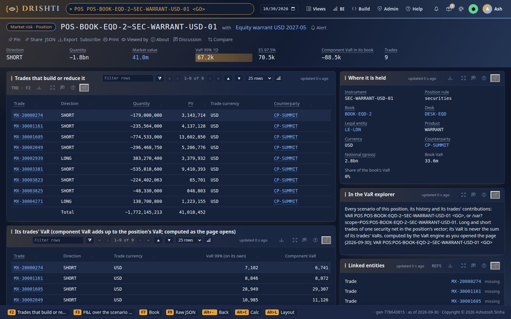

**The YAML.** The market-risk pack's `positions:` rules decide what a position is, each time a date loads:

```yaml
positions:
  live-statuses: [NEW, VALIDATED, AMENDED]
  rules:
    - name: securities                  # by book and security
      groups: [Fixed income]
      types: [EQ_CASH, WARRANT, CONVERTIBLE_BOND, INFL_LINKED_BOND, T_BILL, COMMERCIAL_PAPER, CERT_DEPOSIT]
      key: [SECURITY_ID, ISIN, TICKER]
    - name: listed                      # by book and exchange contract
      types: [BOND_FUTURE, STIR_FUTURE, STIR_FUT_OPT, EQ_FUTURE_SINGLE, EQ_INDEX_FUTURE, EQ_OPTION_LISTED, EQ_INDEX_OPTION, CMD_FUTURE,
              CMD_FUT_OPTION, ComFut, EMISSIONS_FUTURE]
      key: [SECURITY_ID, CONTRACT]
    - name: otc                         # everything else: one position per trade
```

**From the command line:**

```text
$ drishti.py var show 'POS:POS-BOOK-EQD-2~SEC-WARRANT-USD-01'
VAR POS:POS-BOOK-EQD-2~SEC-WARRANT-USD-01  ·  POS-BOOK-EQD-2~SEC-WARRANT-USD-01 · Equity warrant USD 2027-05  ·  position  ·  2026-09-30
  VaR 99%   67,209 USD   (the 6th worst of 509)
  ES 97.5%   70,531 USD   (mean of the 13 worst)
  parts      9 trade   standalone sum 111,930   diversification 44,721
  9 trades in 1 positions
```

**You should see** a position VaR (67,209) far below its trades' VaRs added up (111,930): buys and sells of one warrant net before the
quantile is taken. The bond future of step 2 is in `POS-BOOK-RATES-1~XCH-BOND_FUTURE-AUD-02` (the *listed* rule); a swap is a position of
its own (`POS-<book>~<trade>`, the *otc* rule).

**Further in the guide:** [section 4](../guides/VAR_GUIDE.md#4-positions-derived-never-delivered) and [section 15.6](../guides/VAR_GUIDE.md#156-positions-derived-by-drishti-as-built) (every rule and column).

## Step 7 · Save a basket, capture it, compare

**In the UI.** In the basket tray of step 5, name it (`rates-mix`) and **Save basket and open VaR** (tick nothing more: it is private;
name users or roles in *Share read-only with* to share it). The explorer opens `VAR SCOPE BASKET:<you>/rates-mix`, the tray reads
*saved basket · \<you>/rates-mix*, and the basket is listed under *Ad-hoc scopes* as ★ rates-mix. Opening it later (from the list, a
link, `VAR SCOPE rates-mix <GO>`) loads its parts back into the tray to edit and save again. Then the **Captured results** tab, a note,
**Capture VaR**, and **Compare with now**:

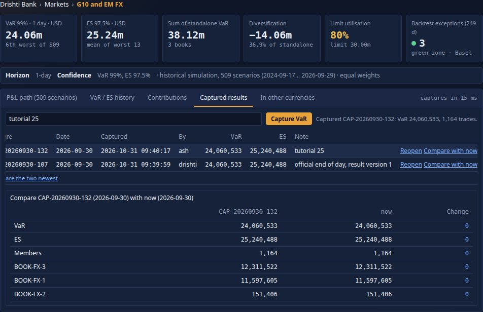

**What-if, before you deal.** **+ What-if trade** in the tray: a booked trade (say one of the desk's swaps) and a factor (−1 its unwind):
the basket's VaR and ES before → after and the incremental, by the Python VaR engine. It needs the compute workers
(`DRISHTI_COMPUTE_ENABLED=true`); without them the tray says so ([VAR_GUIDE.md section 8.5](../guides/VAR_GUIDE.md#85-the-pre-deal-what-if-in-the-basket-tray)).

**From the command line**, a basket of the rates desk's shorts, saved, captured and compared:

```text
$ drishti.py var basket rates-short "DESK:RATES & WHERE:DIRECTION == 'SHORT'" --title 'Rates shorts'
{ "id": "rita/rates-short", "name": "Rates shorts", "type": "BASKET", "scope": "DESK:RATES & WHERE:DIRECTION == 'SHORT'",
  "owner": "rita", "sharedWith": [], "version": 1, ... }
$ drishti.py var capture BASKET:rita/rates-short --note 'before the unwind'
{ "id": "CAP-20260930-89", "capturedAt": "2026-10-26T05:12:54.392356455Z", "var": 282428035, "es": 271474611, "memberCount": 800 }
$ drishti.py var compare CAP-20260930-89
{ "a": { "id": "CAP-20260930-89", "label": "Rates shorts", "var": 282428035, ... },
  "b": { "id": "now", "var": 282428035, ... },
  "varChange": 0.0, "esChange": 0.0, "membersAdded": [], "membersRemoved": [], "components": [ ... ] }
```

**CSV** on the capture downloads its vector by scenario date (or, with `?part=components`, its components). Your capture id differs
(the content store numbers them). The basket opens anywhere as `BASKET:rita/rates-short`, or `VAR SCOPE
rates-short <GO>`.

**You should see** the shorts alone with a VaR of 282.4 million, nearly four times the desk's 74.6 million: the desk's longs hedge them.
A capture never changes: restate the batch and it still reopens with these numbers.

**Further in the guide:** [section 5.8](../guides/VAR_GUIDE.md#58-baskets) (baskets), [section 6](../guides/VAR_GUIDE.md#6-captures-and-compare) (captures and compare).

## Step 8 · History and the backtest

**In the UI.** The **VaR / ES history** tab of `VAR DESK DESK-FX`: VaR and ES over 250 days, the P&L, exceptions in red, the traffic
light with Kupiec's and Christoffersen's tests.

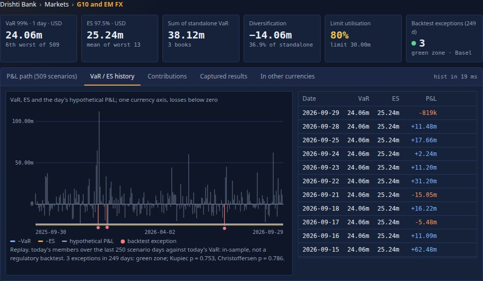

**From the command line:**

```text
$ drishti.py var history DESK:FX
history (replay, USD): today's members over the last 250 scenario days against today's VaR: in-sample, not a regulatory backtest
  green  3 exceptions in 249 days   Kupiec LR 0.099 (p 0.753)   Christoffersen LR 0.073 (p 0.786)
Date        VaR         ES          P&L          Exception
----------  ----------  ----------  -----------  ---------
2026-09-09  24,060,533  25,240,488  -15,013,476
2026-09-10  24,060,533  25,240,488   -2,107,799
...
```

**What it means.** With only one official date the history *replays* today's trades over the last 250 scenario days against today's
VaR (in-sample). From the second official end-of-day capture of a node, the history is the official one (each day's VaR against the next
day's hypothetical P&L). Green is up to 4 exceptions in 250 days, amber 5 to 9, red 10 or more; a Kupiec p-value below 0.05 says the
exceptions are too many or too few, a Christoffersen p-value below 0.05 that they cluster.

**You should see** green with 3 exceptions for the FX desk (2.5 expected at 99%); the bank replays amber with 5.

**Further in the guide:** [section 7](../guides/VAR_GUIDE.md#7-history-and-backtesting) (history), [section 18.4](../guides/VAR_GUIDE.md#184-history-and-backtest) (the backtest's formulas), [section 19](../guides/VAR_GUIDE.md#19-official-end-of-day-results) (official records).

## Step 9 · How the date sits in memory and on disk

**In the UI.** *How this number was built*, on the right: **Tier** says where the vector came from. A node is its float64 aggregate; any
other scope sums the date's float32 position rows in float64:

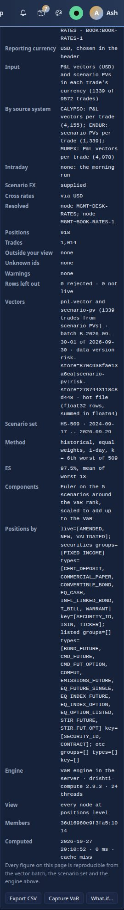

**From the command line:**

```text
$ drishti.py var status        (abridged)
  "tier": { "mode": "mapped", "diskDates": 60, "keepOnShutdown": false, "closeGraceSeconds": 60,
            "mapping": "shared arena (unmapped on close)", "built": 5, "reopened": 0, "files": 5, "open": 5, "diskBytes": 121569900,
            "currencies": { "files": 4, "bytes": 96688112 } },
  "loaded": [ { "businessDate": "2026-09-30", "trades": 9572, "positions": 7993, "nodes": 131, "vectorBytes": 20465872,
                "tier": "mapped", "aggregateBytes": 785896, "hotFile": "2026-09-30/inputs-438361ce8f808055.vhot", "loadMs": 646, ... },
              { "businessDate": "2026-09-30", "currency": "JPY", "trades": 9572, "tier": "mapped", "hotFile": "2026-09-30-JPY/inputs-….vhot", ... },
              ... ]
```

**The YAML** (the server's `application.yaml`; every key has this default):

```yaml
drishti:
  var:
    hot-dates: 2                     # dates open at once
    tier:
      mode: ${DRISHTI_VAR_TIER:mapped}                 # mapped: a float32 hot file per date; heap: float64 on the heap
      dir: ${DRISHTI_VAR_HOT_DIR:${drishti.data.dir:./data}/var/hot}
      disk-dates: 60                 # hot files kept on disk
      keep-on-shutdown: false
      close-grace-seconds: 60
```

The first request of a date read the lake and wrote `var/hot/2026-09-30/inputs-….vhot` under the data folder (24.9 MB here, against 39
MB of float64 vectors on the heap before 2.8.0); the four other configured currencies, built ahead in the background (step 1), have a
file each beside it (`2026-09-30-EUR/…`, 96.7 MB together). An administrator's `drishti.py var reload` drops the open dates; the next request maps
the same file again (`reopened` goes up) without reading the lake. At shutdown the files are deleted.

**You should see** `mode: mapped`, five files (USD and the four currencies built ahead), 131 nodes (88 MGMT and LEGAL, 43 limit
letters), and `node aggregate (float64)` as the tier of every node; `hot file (float32 rows, summed in
float64)` for any other scope. On the test data both give exactly the lake's numbers ([VAR_GUIDE.md section
26.6](../guides/VAR_GUIDE.md#266-precision-float32-rows-float64-sums)).

**Further in the guide:** [section 26](../guides/VAR_GUIDE.md#26-the-tiered-memory-and-the-hot-file) (the tiers and the hot file), [section 27](../guides/VAR_GUIDE.md#27-sizes-performance-and-the-benchmark) (sizes and the benchmark).

## Step 10 · VaR as an ordinary kind

**In the UI.** `VRES DESK:DESK-RATES`: the computed kind `var-result` drawn like any entity, its worst scenarios, its stamp:

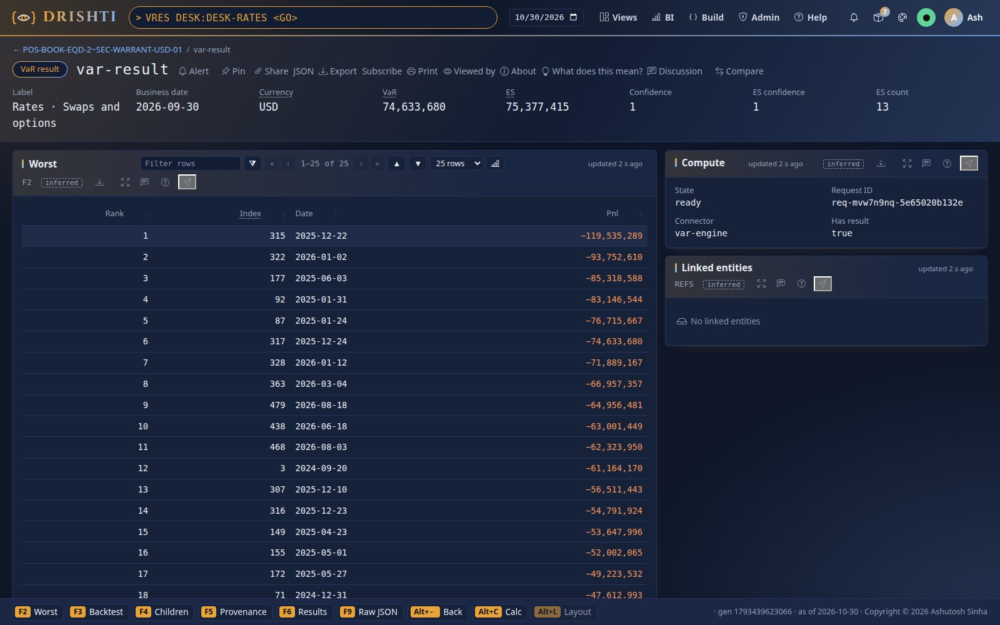

**From the command line:**

```text
$ drishti.py compute run var-engine var-result DESK:RATES
var-engine DESK:RATES  READY  (req-mvosw177-c6042d15feb9)
  SCOPE        DESK:RATES
  SCOPE_KIND   node
  LABEL        Rates · Swaps and options
  NODE         MGMT~DESK-RATES
  BUSINESS_DATE 2026-09-30
  VAR          74633680
  ES           75377415
  K            6
  LIMIT_USE    0.7463368
  DIVERSIFICATION 50891218
  computed 2026-10-26T05:12:54.554938067Z by java:var-engine@2.7.0, pin pin-e0cd3fe57e54607c, sha256:fd1912ea94a8fb93f1acb005507655d3
```

**The YAML** (the market-risk pack's connector, written to `connectors/var-engine.yaml` at first start):

```yaml
var-engine:
  plugin: reactive
  mode: reactive
  kinds:
    var-result:
      compute: var-result
      result: { required: [VAR, ES, PNL], types: { VAR: number, ES: number } }
  engine: { type: java, class: com.ash.drishti.server.var.VarResultEngine, version: "1.0" }
  triggers:
    - { on: data-version, kinds: [pnl-vector, risk-hierarchy, scenario-set, portfolio], affects: all }
```

**You should see** the explorer's figures (74,633,680 and 75,377,415): it is the same engine, computed as you, with your entitlements.

**Further in the guide:** [section 8.1](../guides/VAR_GUIDE.md#81-var-result-the-java-engine) (`var-result`).

## Step 11 · What would a hedge do? The Python engine

**On the server.** Start it with the compute workers on (`DRISHTI_COMPUTE_ENABLED=true DRISHTI_PYTHON=$PWD/drishti-console/.venv/bin/python`).
The pool `var` of `config/compute/compute.yaml` runs the Python VaR engine:

```yaml
pools:
  var:
    type: python
    engines: [drishti_compute.var.whatif:VarWhatIfEngine]
    environment: system            # standard library only: no package to approve
    workers: { min: 0, max: ${DRISHTI_COMPUTE_VAR_WORKERS:4} }
```

**From the command line.** A hypothetical trade is a P&L over the 509 scenario days (priced elsewhere, or copied from a booked trade's
vector) with a factor. Here: a hedge shaped like half of `BOOK-RATES-3`, sold (`new-hedge.json`):

```json
[{"LABEL": "hedge of BOOK-RATES-3 (half)", "FACTOR": -0.5, "PNL": [509 numbers: BOOK-RATES-3's vector, read with VRES BOOK:BOOK-RATES-3]}]
```

```text
$ drishti.py var whatif DESK:RATES --trades new-hedge.json --stress-window 250
what-if on DESK:RATES  READY  (req-mvot2fc8-0c51138d9548)
  BEFORE_VAR           74,633,680
  AFTER_VAR            47,599,220
  CHANGE_VAR           -27,034,460
  BEFORE_ES            75,377,415
  AFTER_ES             56,247,260
  CHANGE_ES            -19,130,155
  STRESSED_VAR_BEFORE  85,318,588
  STRESSED_VAR_AFTER   59,556,766
```

The command made a private sandbox of the trades and asked the computed kind `var-whatif` (`VWIF DESK:RATES` in the UI). With `--json`
the answer also carries each trade's standalone VaR (34,296,045), its incremental VaR (−27,034,460) and its component in the desk after
the trade (−32,542,152), and the desk's P&L day by day before and after. **In the UI**, `VWIF DESK:RATES` (no sandbox) opens the
desk's stressed window; with a sandbox the id carries it (`DESK:RATES~sandbox=sbx-…`, as every computed id carries its parameters). The
sandbox is yours alone (`drishti.py compute sandboxes`).

**You should see** the desk's VaR fall by 27.0 million (from 74.6 to 47.6 million) and the stressed VaR (the worst run of 250
consecutive scenario days) from 85.3 to 59.6 million: the hedge takes out most of `BOOK-RATES-3`'s tail.

**Further in the guide:** [section 8.2](../guides/VAR_GUIDE.md#82-var-whatif-the-python-engine) and [section 8.3](../guides/VAR_GUIDE.md#83-where-it-runs-the-java-engine-and-the-python-engine-as-built-280) (the Python engine).

## Step 12 · Who sees what

**The YAML.** Restrict a role to nodes, at one of two levels:

```yaml
drishti:
  var:
    access:
      division-head: { "[MGMT~DIV-MARKETS]": aggregate }     # numbers of the division and every node beneath, never a position
      rates-risk:    { "[MGMT~DESK-RATES]": positions }      # the desk's numbers, positions and trades
```

**In the UI and on the command line**, as a user of `rates-risk`, `VAR BANK` shows the bank computed over the rates desk only, with
*Outside your view* counting the rest; `drishti.py var show 'POS:…'` for a position outside the desk answers `403 DRS-5002`. The
computed kinds of steps 10 and 11 answer the same way: they are computed as you.

**You should see** in *How this number was built*, as a restricted user, *View: restricted by node (… trades outside your
entitlement)* for the bank: the bank's 9,572 trades less the rates desk's 1,487, so 8,085 outside, and the bank's VaR equal to the desk's.

**Further in the guide:** [section 9](../guides/VAR_GUIDE.md#9-who-sees-what-entitlements-and-audit) (entitlements and audit).

## Step 13 · Intraday: a pricing system re-sends trades

During the day a pricing system sends only the trades that changed. `tools/pvgen` is a stand-in for one (pure Python, JSONL only, every
line one row of the contract; [VAR_GUIDE.md section 15.12](../guides/VAR_GUIDE.md#1512-producing-pl-vectors-and-scenario-pvs-as-built-294)).

**From the command line**, with the server of step 1 running (Windows: `tools\windows\pvgen-intraday.ps1` with the same options):

```text
$ tools/pvgen/intraday.sh --batches 3 --trades-per-batch 10 --lake data/delta --server http://<host>:<port>
lake-build ok exit=0 ... kind=pnl-vector engine=drishti mode=append rows=8 rejected=0 dates=1 partitions=1 seconds=1.75
lake-build ok exit=0 ... kind=scenario-pv engine=drishti mode=append rows=2 rejected=0 dates=1 partitions=1 seconds=1.742
...
I-2026-09-30-001: 10 trades (7 amended, 3 new, 0 cancelled), 8 pnl-vector, 2 scenario-pv
I-2026-09-30-002: 10 trades (6 amended, 4 new, 0 cancelled), 9 pnl-vector, 1 scenario-pv
I-2026-09-30-003: 10 trades (6 amended, 1 new, 3 cancelled), 7 pnl-vector, 3 scenario-pv
wrote 3 batches to data/pvgen/intraday-2026-09-30
```

Each batch is a small JSONL file per kind (`data/pvgen/intraday-2026-09-30/I-2026-09-30-001.pnl-vector.jsonl`, `….scenario-pv.jsonl`),
marked `RUN_KIND: INTRADAY` with its own `BATCH_ID` and a later `COMPUTED_AT`, appended to the lake and signalled: the engine applies it
without a reload.

**In the UI**, the VaR page's status line shows the **intraday** badge; point at it for the batches:

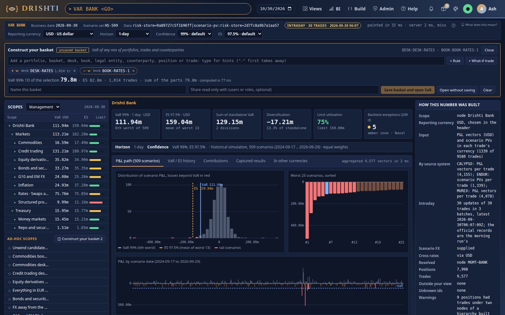

```text
$ drishti.py var intraday
2026-09-30: intraday, 30 updates of 30 trades (19 amended, 8 new, 3 cancelled) in 3 batches, latest 2026-09-30T06:07:09Z
  batches I-2026-09-30-001, I-2026-09-30-002, I-2026-09-30-003; ignored as older 0, before the morning run 0
```

**Check it.** `tools/pvgen/check.sh` recomputes the bank's and every desk's VaR and ES from the files themselves (the morning run of
`tools/pvgen/morning.sh --out data/pvgen`, then the batches) and compares them with the server:

```text
$ tools/pvgen/check.sh --morning data/pvgen/morning-2026-09-30 --intraday data/pvgen/intraday-2026-09-30 --server http://<host>:<port>
2026-09-30: the morning run (9,572 trades) and 30 intraday rows
  BANK                     VaR      111,939,005  ES      159,035,721   server VaR      111,939,005  ES      159,035,721  ok  (intraday updates 30)
  DESK:DESK-COMM           VaR       16,590,438  ES       17,486,765   server VaR       16,590,438  ES       17,486,765  ok  (intraday updates 30)
  ...
  DESK:DESK-RATES          VaR       75,756,517  ES       75,852,800   server VaR       75,756,517  ES       75,852,800  ok  (intraday updates 30)
  DESK:DESK-STRUCT         VaR        9,987,431  ES       11,163,708   server VaR        9,987,431  ES       11,163,708  ok  (intraday updates 30)
every figure agrees
```

**You should see** the bank move from 112,041,646 to **111,939,005** (ES 160,143,809 to 159,035,721), the badge, *intraday* in *How this number was built*, and every line of the check `ok`. The official end-of-day
record is still the morning run's. The same updates can come from Kafka (the `pv-updates` connector, off by default; the publisher
`tools/pvgen/publish-kafka.sh`): [VAR_GUIDE.md section 8.4](../guides/VAR_GUIDE.md#84-what-if-pricing-and-intraday-recomputes-what-if-planned-intraday-updates-as-built-in-294).

**Further in the guide:** [section 8.4](../guides/VAR_GUIDE.md#84-what-if-pricing-and-intraday-recomputes-what-if-planned-intraday-updates-as-built-in-294)
(the rules: latest `COMPUTED_AT` wins, cancels, new trades), [section 15.12](../guides/VAR_GUIDE.md#1512-producing-pl-vectors-and-scenario-pvs-as-built-294)
(the scripts, both forms side by side).

## Step 14 · Limit letters: a hierarchy from the trades' own columns

A **limit letter** is the letter of authority a trade's VaR limit is granted under. Every P&L and scenario-PV row of the demo carries one
(`LIMIT_LETTER`: twelve letters dealt over the books, two books split between two letters), and the market-risk pack configures a third
hierarchy built from it, beside MGMT and LEGAL from the `risk-hierarchy` rows:

```yaml
# config/packs/market-risk/pack.yaml (generated from tools/packgen/banking/kept/market-risk.yaml); drishti.var.hierarchies wins over it
hierarchies:
  MGMT:  { title: Management, source: risk-hierarchy, limits: var-limit }
  LEGAL: { title: Legal entities, source: risk-hierarchy, limits: var-limit }
  LL:    { title: Limit letters, levels: "LIMIT_LETTER > DESK", word: LL, limits: var-limit }
```

Its nodes are every distinct path of the rows' values (`LL~LL-0011`, `LL~LL-0011/DESK-RATES`), its limits come from the new kind
`var-limit` (one row per node, USD), and its word names a node in any scope (`LL:LL-0011`). Since 2.9.7 every VaR limit lives in
`var-limit`, with its currency: MGMT's and LEGAL's too (`limits: var-limit` above) and each portfolio's (a row of hierarchy `PORTFOLIO`);
the `risk-hierarchy` rows and the portfolios carry none. The limits are the same, so every limit use below reads as before.

**In the UI**, choose **Limit letters** in the select above the tree (the link keeps it: `&hierarchy=LL`), then **LL-0011**:

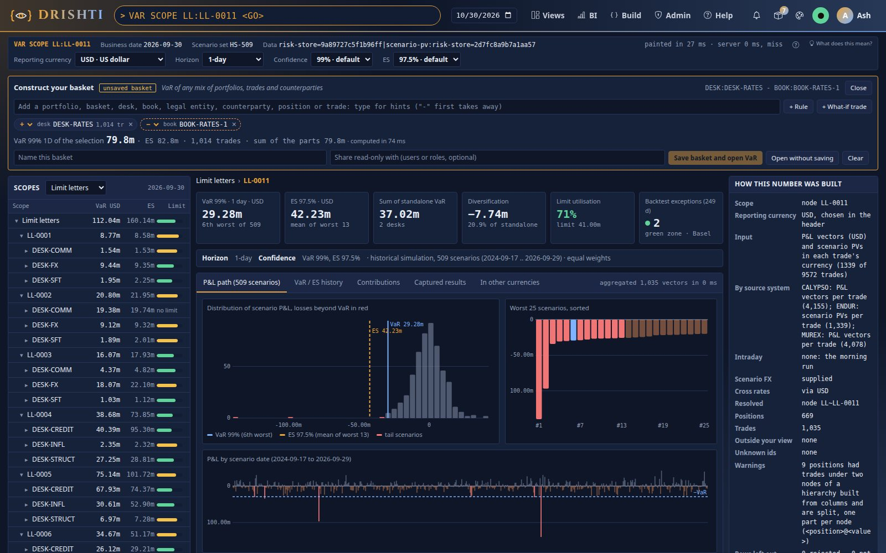

LL-0011 holds BOOK-FI-2, BOOK-RATES-2 and **part of BOOK-RATES-1** (the rest of that book is LL-0010). Its **Contributions** tab lists
its desks:

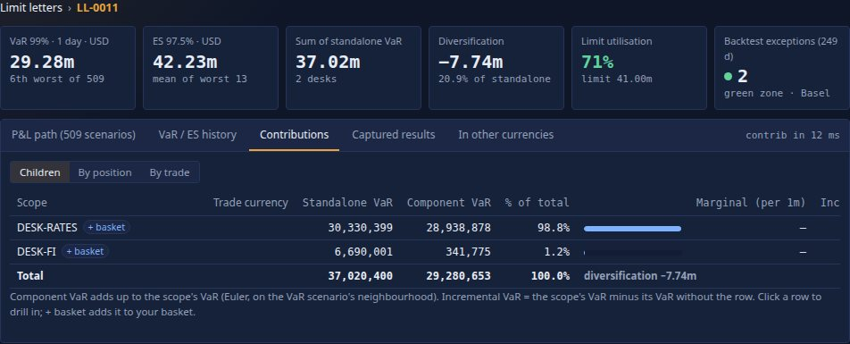

**From the command line:**

```text
$ drishti.py var tree --hierarchy LL
LL on 2026-09-30, in USD
Node             VaR          ES           Limit use  Trades
---------------  -----------  -----------  ---------  ------
Limit letters    112,041,646  160,143,809      74.7%    9572
  LL-0001          8,768,015    8,582,767      87.7%    1163
    DESK-COMM      1,537,187    1,527,166      80.9%     715
  ...
  LL-0002         20,801,848   21,949,223      83.2%    1437
    DESK-COMM     19,384,902   19,741,119                709
  ...
  LL-0011         29,280,653   42,227,782      71.4%    1035
    DESK-FI        6,690,001    8,556,441      81.6%     385
    DESK-RATES    30,330,399   43,711,977      72.2%     650

$ drishti.py var show LL:LL-0011
VAR LL:LL-0011  ·  LL-0011  ·  node  ·  2026-09-30
  VaR 99%   29,280,653 USD   (the 6th worst of 509)
  ES 97.5%   42,227,782 USD   (mean of the 13 worst)
  limit      41,000,000 USD   use 71.4%
  parts      2 desk   standalone sum 37,020,400   diversification 7,739,747
  ...
  warning: 9 positions had trades under two nodes of a hierarchy built from columns and are split, one part per node (<position>@<value>)

$ drishti.py var show 'BOOK:BOOK-RATES-1 & LL:LL-0011'
VAR BOOK:BOOK-RATES-1 & LL:LL-0011  ·  BOOK:BOOK-RATES-1 & LL:LL-0011  ·  adhoc  ·  2026-09-30
  VaR 99%   6,664,282 USD   (the 6th worst of 509)
  ...
  142 trades in 134 positions
```

**You should see** the bank's VaR at the top of the letters' tree (112,041,646: the same trades, another tree), LL-0002's DESK-COMM
with no limit (blank, never zero: `var-limit` has no row for it), and the part of BOOK-RATES-1 under LL-0011: 142 trades. A position
whose trades sit under both letters is split in two, one part per letter: `POS:POS-BOOK-RATES-1~XCH-BOND_FUTURE-GBP-01@LL-0010` and
`…@LL-0011`, four trades each; the provenance says how many were split (nine). A letter's VaR is exactly that of its trades, to the cent:
`LL:LL-0011` equals the same trades named one by one.

**Your own hierarchy.** Any column the trades carry can be a hierarchy: add it to the connector's layout and to the rows, then a block in
`drishti.var.hierarchies` (or the pack's `hierarchies:`). A row that leaves the column empty is refused (`DRS-5211`); data without the column
skips that hierarchy alone, with a `DRS-5211` warning, and everything else answers; a configuration that is not valid refuses the
start (`DRS-5213`).

**Further in the guide:** [section 15.14](../guides/VAR_GUIDE.md#1514-hierarchies-from-the-rows-or-from-the-trades-columns-as-built-295)
(the configuration, cells, split positions, the equality tests), [section 15.15](../guides/VAR_GUIDE.md#1515-var-limit-the-nodes-var-limits-as-built-295)
(`var-limit`).

## Step 15 · The scenario matrix: scenarios across the days

The explorer shows one business date. The **scenario matrix** (`SMAT`, 2.9.7) shows one trade, position or node across several: the
scenarios down by their historical day, the business dates across. The test data has one date, so first add four business dates before
it: each is the same data moved back a day, its 509-day scenario window sliding with it (as a real window rolls). `--keep-other-dates`
keeps the dates already in the lake (without it `lake demo` rebuilds each table); the data-load signal tells the running server.

```text
$ for d in 2026-09-24 2026-09-25 2026-09-28 2026-09-29; do
    python3 tools/drishti.py lake demo --as-of $d --keep-other-dates -q \
      --only market-risk/pnl-vector,market-risk/scenario-pv,market-risk/fx-scenario,market-risk/scenario-set,market-risk/risk-hierarchy
  done
```

**In the UI**, type `SMAT BOOK BOOK-RATES-1 5 <GO>` (or open a book, a position or a trade in the explorer and click **Scenario
matrix** in its header strip; a trade's, position's, `PNLV` or `SPV` page has the same link beside Compare):

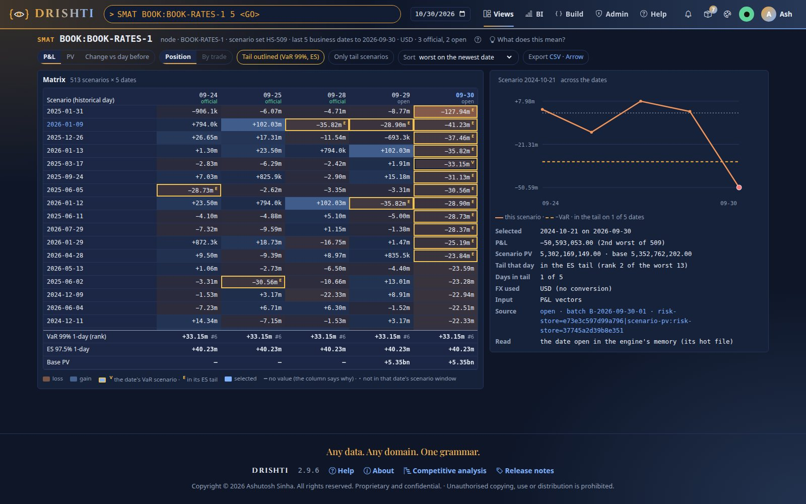

- The **column headers** are the dates; under each, where its numbers came from: `open` (the date in the engine's memory) or `engine`
  (the engine opened it). A trade on a date not open says `lake` (its one record read by id); a node with an official capture, `official`.
- The **foot** keeps each date's **VaR 99% 1-day (rank #6)**, **ES 97.5% 1-day** and **base PV**.
- Each date's **VaR scenario** is outlined twice and marked **V**; the rest of its **ES tail** (the 13 worst) is outlined and marked **E**.
  The rows open sorted by the worst on the newest date, so the tail is at the top; **Only tail scenarios** keeps just those.
- **Click a row**: the right-hand panel charts it across the dates against **−VaR** (dashed), and lists the cell's P&L and its rank that
  day, its scenario PV against the base PV, the FX used, its days in the tail and the source (batch and data version, linked).
- **PV** shows base PV plus the P&L; **Change vs day before** each cell less the date before. **Export CSV · Arrow** downloads it all.
- Open a position (`SMAT POS POS-BOOK-EQD-2~SEC-WARRANT-USD-01`) and **By trade** shows its nine trades under the selected scenario.

A date the engine refuses (its inputs not one run) shows **DRS-5203** in its header and `—` in its cells, never zeros. On a phone the page
is the selected scenario's line and its tail count:

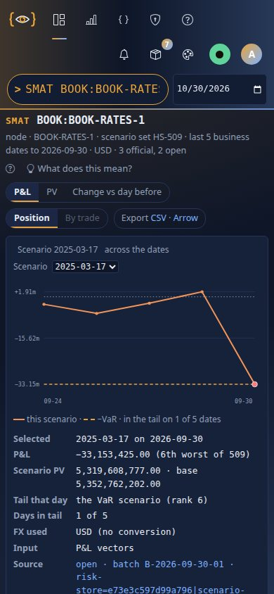

**From the command line:**

```text
$ drishti.py var matrix BOOK:BOOK-RATES-1 --days 5
SMAT BOOK:BOOK-RATES-1  ·  node  ·  5 business dates  ·  USD
Date        Source  VaR (rank)        ES          Base PV  Gap
...
Scenario    09-24   09-25   09-28   09-29   09-30
...
  * in that date's VaR or ES tail; the newest 6 dates shown (--json or --csv has them all)

$ drishti.py var matrix BOOK:BOOK-RATES-1 --days 5 --csv > book-rates-1.csv     the whole matrix, as the page's export
$ drishti.py var matrix POS-BOOK-EQD-2~SEC-WARRANT-USD-01 --by trade            the position's trades under the newest VaR scenario
$ curl -s -H "Authorization: Bearer $TOKEN" "$SERVER/api/v1/var/matrix?id=BOOK:BOOK-RATES-1&days=5" | jq '.dates[] | {date, source, var, k}'
```

**The configuration.** N is capped on the server, and the command belongs to the Risk and Trading editions:

```yaml
# drishti-server application.yaml (or DRISHTI_VAR_SMAT_MAX_DAYS)
drishti:
  var:
    smat:
      max-days: 60          # the most business dates one matrix reads; more asked: this many, and the page says so

# config/editions/risk.yaml and trading.yaml: SMAT on; market.yaml and world.yaml: off (the command answers DRS-4023)
commands:
  words: { VAR: on, EXP: on, SMAT: on }
```

**You should see** five columns, the book's VaR scenario marked **V** on the newest date, and the same historical day sitting at a
different rank on each date as the window slides. A date read from the lake gives the same numbers the engine gives when the date is
open; that is tested on every build.

**Further in the guide:** [VAR_GUIDE.md section 3.9](../guides/VAR_GUIDE.md#39-the-scenario-matrix-smat-297) (the sources, the gaps,
the controls, the API).

## Next steps

- Read [VAR_GUIDE.md](../guides/VAR_GUIDE.md): the measures by hand on ten scenarios, the data flow and restatements, the scope grammar in full, the
  data contract (Part II), sizing for a bank of a million trades and the benchmark (Part III), troubleshooting.
- Load your own batch: the columns are in [VAR_GUIDE.md section 15](../guides/VAR_GUIDE.md#15-inputs-from-upstream-engines); send the data-load
  signal ([tutorial 7](07-load-data-daily.md)) and the date is reloaded and captured officially.
- Put a computed VaR on your own screen: a Sutra panel can read `var-result` like [tutorial 23](23-computed-panels.md)'s computed panels.

## When something goes wrong

| You see | Do |
|---|---|
| *no P&L vectors in any connector* | build the lake (step 1); is the market-risk pack loaded? |
| other numbers than these | you built the lake with `--as-of today`: trades matured since 2026-09-30 drop out; rebuild with `--as-of data` |
| the bank's VaR is 112,035,906 and the provenance says only `pnl-vector` | the lake has no `scenario-pv` table (built before 2.9.4, or `--only` without it): the Endur trades are missing too (8,233 trades); rebuild with the `--only` list of step 1 |
| `--ccy` answers `422 DRS-5207` | the date has no rates for that currency: supply them in `fx-scenario`, or load enough FX history in `fx-spot` ([VAR_GUIDE.md section 15.9](../guides/VAR_GUIDE.md#159-scenario-pv-scenario-pvs-per-trade-in-the-trades-currency-as-built-294)) |
| `PORT <id>` says *no source holds portfolio/…* | the page opens on today's date; pick **2026-09-30** in the date box (the explorer finds the newest date by itself) |
| step 11 answers *could not start* | the compute workers are off: `DRISHTI_COMPUTE_ENABLED=true`, and Admin → Compute shows the pool `var` |
| *the vectors of … were unloaded while this answer was computed* | ask again ([VAR_GUIDE.md section 13](../guides/VAR_GUIDE.md#13-troubleshooting)) |
| `SMAT` shows one date only | the lake holds one business date: add the four of step 15 (`lake demo --as-of <date> --keep-other-dates`); the newest date is the date box's |
| `SMAT` answers *DRS-4023 SMAT is not part of …* | your edition or lens is Drishti Market or World: the scenario matrix is Risk's and Trading's |
| no *Limit letters* in the select | the lake was built before 2.9.5 (no `LIMIT_LETTER`, no `var-limit`): rebuild it with step 1's `--only` list, which includes `market-risk/var-limit` |
| *Limit letters (not available)* in the select; the warning *DRS-5211 the hierarchy LL … is not built …: pnl-vector does not keep its level column LIMIT_LETTER* | the lake's rows predate the letters, or a `config/connectors/risk-store.yaml` written before 2.9.5 lacks the column in its layout: rebuild the data with step 1, and let the server's template update add the column (Admin → Connectors → Template updates); VaR answers meanwhile without LL |
