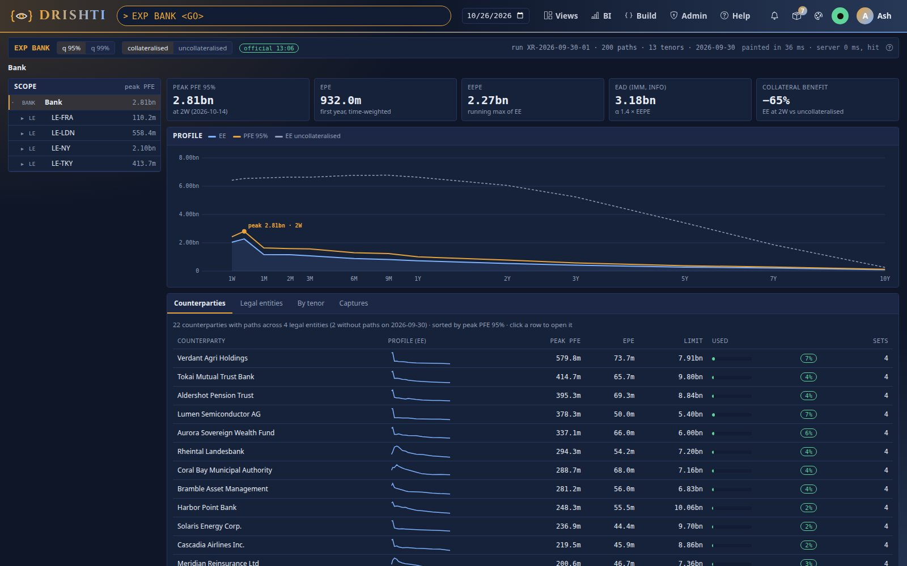
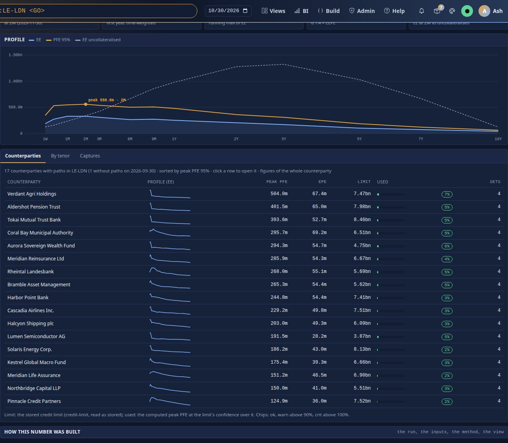
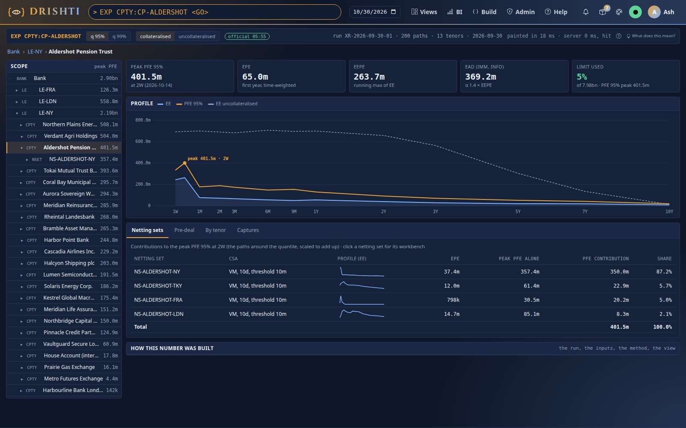
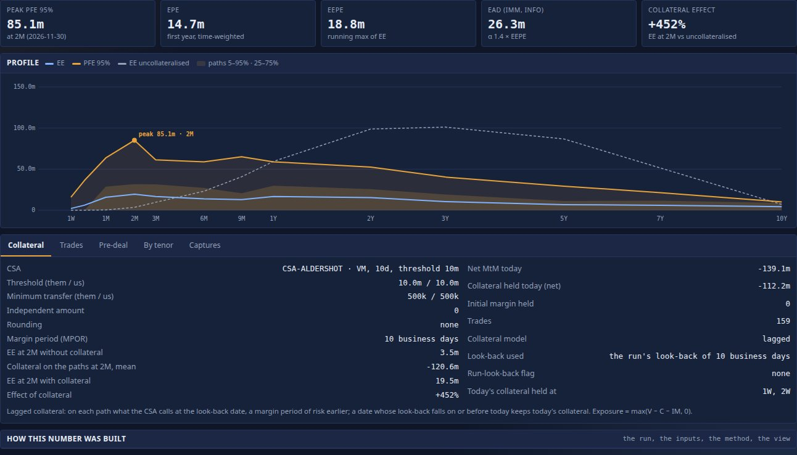
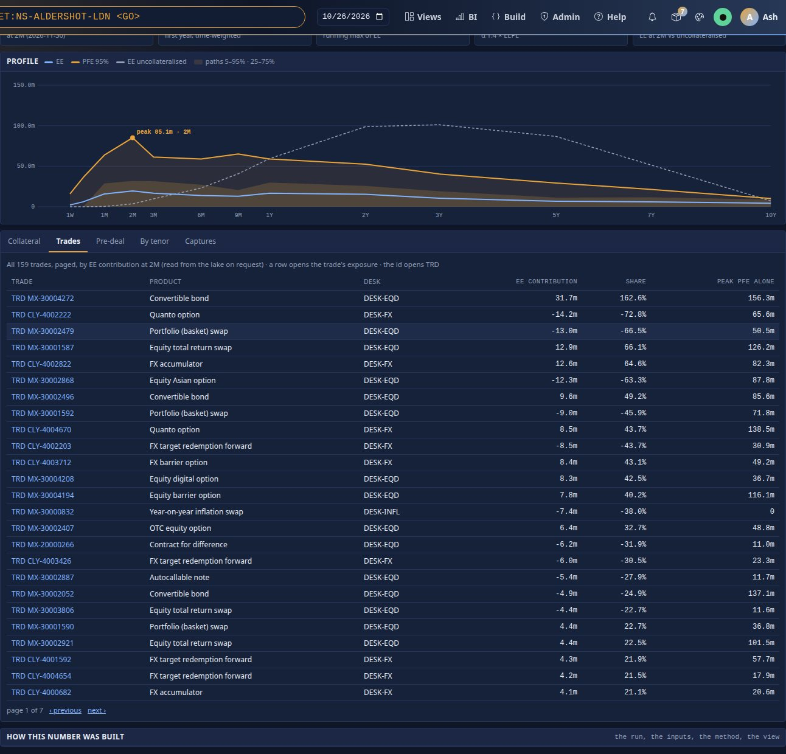
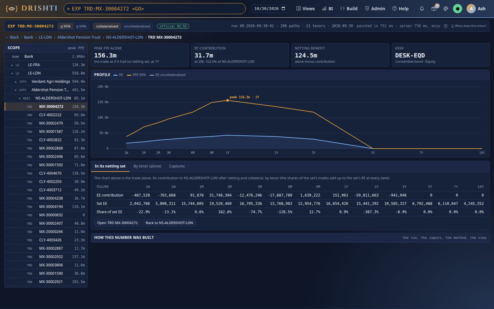
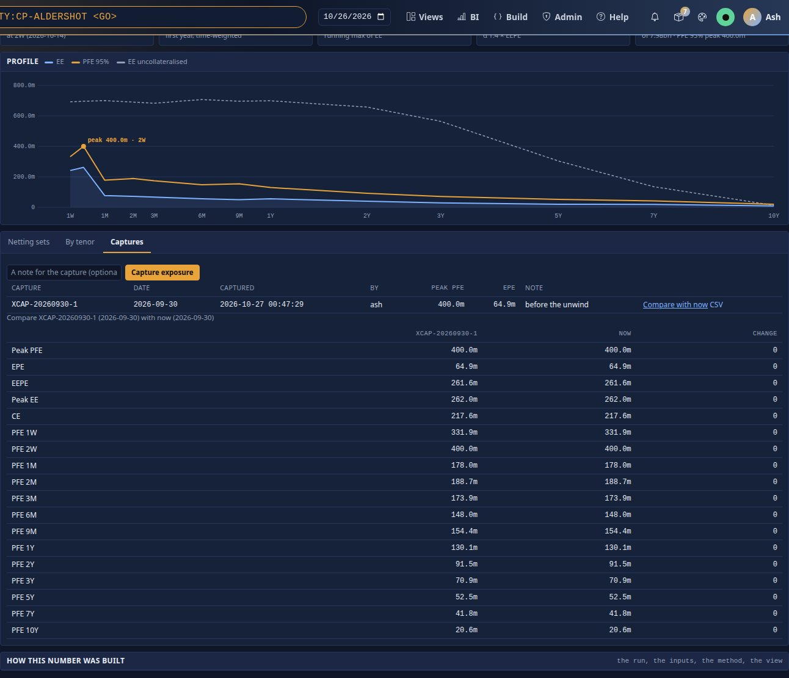
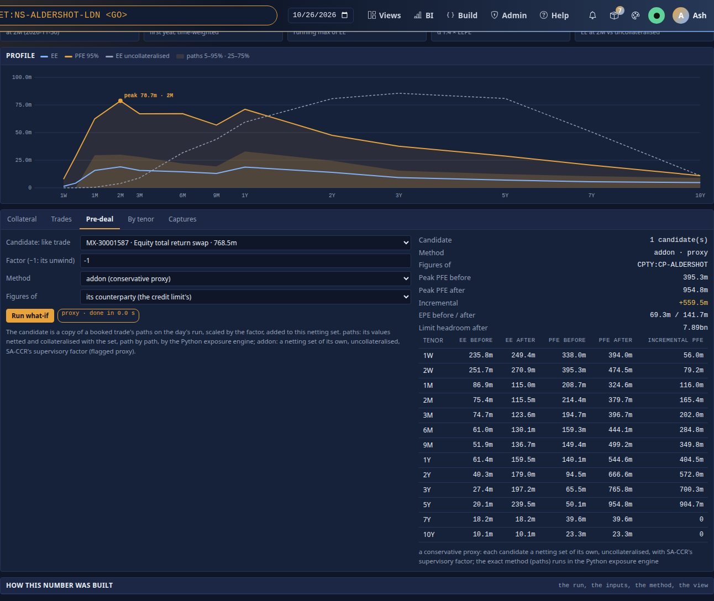

<!--
  Project Drishti · Any data. Any domain. One grammar.

  Copyright (c) 2026 Ashutosh Sinha <ajsinha@gmail.com>.
  All rights reserved.

  PROPRIETARY AND CONFIDENTIAL.

  This file is the confidential and proprietary property of Ashutosh Sinha.
  Unauthorised copying, use, modification, distribution or disclosure of this
  file, via any medium, is strictly prohibited except with the express prior
  written permission of the copyright holder.

  See the LICENSE file in the root of this repository for the full terms.
-->
# Tutorial 26 · Exposure from the bank to a trade

Counterparty exposure answers *if this counterparty defaulted at some date in the future, how much would we lose, on an average path
and on a bad one?* In this tutorial you build the counterparty-risk pack's exposure run into a lake, open the bank's exposure profile,
read a legal entity's counterparty board, open CP-ALDERSHOT and its four netting sets, look at how collateral changes
NS-ALDERSHOT-LDN's exposure and which trades make it, compare a trade alone with the same trade inside its netting set, capture a
counterparty and compare it, ask what an unwind would do before dealing (the exact `paths` method and the `addon` proxy), and read the
official end-of-day record. Each step shows the UI, the command line (`drishti.py exposure …`) and the YAML behind it, with real output
from the demo lake. Everything else about exposure (every measure, column, setting, endpoint and error code, the data contract and how
the engine stores a date) is in the one reference, [EXPOSURE_GUIDE.md](../guides/EXPOSURE_GUIDE.md); each step ends with the guide's
sections that go further.

## Time to complete

About 35 minutes.

## Before you start

- [Tutorial 1](01-first-15-minutes.md) done: a server and console you can build, start and stop.
- The counterparty-risk and core packs loaded (they are in the quick-start packs).
- For the command-line steps: `DRISHTI_SERVER=http://localhost:18480` and `DRISHTI_TOKEN=...` (My account → API tokens), or `--user`
  with sign-in off. The outputs below were captured as the user `rita` with sign-in off.
- For step 7's exact method only: the compute workers on (`DRISHTI_COMPUTE_ENABLED=true`; a Python 3.10 or newer, the console's own is
  enough: the exposure engine uses the standard library). Without them the `paths` method answers `503 DRS-5446` and the `addon` proxy
  still works.

The exposure paths are **synthetic** (one correlated factor per asset class and a walk of each trade's own, made by
`tools/packgen/ccr/`), not a bank's simulator.

## What you will learn

- where the exposure inputs live (every trade's MtM on 200 paths at 24 grid dates) and how a date is loaded into a hot file;
- what EE, ENE, EEE, PFE, EPE, EEPE and EAD mean on real numbers;
- how to walk from the bank to a legal entity, a counterparty, a netting set and a trade without a page load;
- why collateral can raise exposure (when the bank has posted it) and how the path fan shows the spread;
- the difference between a trade alone and its contribution inside its netting set (the netting benefit);
- scopes with `+`, `-` and `&`; captures and compare;
- a pre-deal what-if by the exact `paths` method (the Python engine, `XWIF`) and by the conservative `addon` proxy;
- the official end-of-day record and where it is published.

## Step 1 · Build the exposure data and open the bank

**From the command line.** `lake demo` generates the exposure run of the demo (`--exposure demo`, the default: one run
`XR-2026-09-30-01` of 200 paths on a 24-date grid for 73 netting sets of 22 counterparties, 9,000 trades). Build it with the reference
tables beside it, on the data's own date (2026-09-30), so your numbers are the ones below:

```bash
python3 tools/drishti.py lake demo --as-of data \
  --only counterparty-risk/simulation-run,counterparty-risk/exposure-path,counterparty-risk/netting-set,counterparty-risk/csa,counterparty-risk/collateral-balance,counterparty-risk/credit-limit,core/counterparty,core/counterparty-group,core/legal-entity
```

(`--exposure committed` loads only the eight netting sets committed in `data/testdata/`; their figures are the same.) Start the server
and console (tutorial 1), then ask for the bank:

```text
$ drishti.py exposure show BANK
EXP BANK  ·  Bank  ·  bank  ·  2026-09-30
  peak PFE 95%   2,810,548,173 USD at 2W (2026-10-14)   PFE 99% 3,206,146,568
  EPE 932,040,446   EEPE 2,273,100,403   peak EE 2,277,693,394   CE 1,538,664,088   EAD (IMM, info) 3,182,340,564
  run XR-2026-09-30-01, 200 paths, collateral lagged, horizon 1.0 years
Tenor  Date        EE             ENE             EEE            PFE            PFE 99         EE uncoll
-----  ----------  -------------  --------------  -------------  -------------  -------------  -------------
1W     2026-10-07  2,038,201,704  -1,115,236,177  2,038,201,704  2,423,429,675  2,624,072,678  6,424,716,159
2W     2026-10-14  2,277,693,394  -1,261,811,836  2,277,693,394  2,810,548,173  3,206,146,568  6,544,324,499
1M     2026-10-30  1,168,281,326  -1,120,030,821  2,277,693,394  1,640,723,237  1,857,247,481  6,586,814,481
...
5Y     2031-09-30    284,991,439    -242,003,577  2,277,693,394    385,001,643    422,909,190  3,404,847,296
10Y    2036-09-30     98,754,110     -77,045,071  2,277,693,394    126,984,655    131,898,317    262,419,438
  73 netting sets, 9000 trades · hot file (float32 netting-set matrices, summed in float64) · 1 ms (hit)
```

(Thirteen primary dates are printed; a few rows are shown.) `drishti.py exposure status` shows how the date was loaded: 129,570 rows of
9,000 trades, 73 netting sets, none rejected, a 2.9 MB matrix in a 5.6 MB hot file, loaded in about 1.5 s; and the three netting sets the
run does not cover (`NS-NORTHPLAINS-NY`, `NS-SUMMIT-LDN`, `NS-SUMMIT-NY`).

**In the UI.** Type `EXP BANK` and press Enter (or open `/exposure`):



The command line at the top carries the PFE confidence (q 95% or 99%), collateralised or uncollateralised, and the official-capture chip;
the tree on the left holds the bank, its legal entities, counterparties, netting sets and an open set's trades, each with its peak PFE.

**What it reads.** The counterparty-risk pack's connector `exposure-store` keeps the paths as a vector column of the `exposure-path`
table (`config/packs/counterparty-risk/pack.yaml`):

```yaml
connectors:
  exposure-store:
    plugin: delta
    kinds: [simulation-run, exposure-path]
    settings:
      domain: risk
      layout:
        simulation-run:
          columns: [RUN_ID, CALIBRATION, PATHS, STATUS, BATCH_ID]
        exposure-path:
          columns: [TRADE_ID, NETTING_SET, COUNTERPARTY, LEGAL_ENTITY, DESK, TT_BOOK, ASSET_CLASS, PRODUCT, SOURCE_SYSTEM,
                    MATURITY_DATE, NOTIONAL, GRID_INDEX, GRID_DATE, RUN_ID, BATCH_ID, STATUS]
          vectors: [MTM]
```

**You should see** a peak PFE 95% of 2,810,548,173 at two weeks and an EPE of 932,040,446. The bank's EE uncollateralised (6.5 billion at
2W) is almost three times its collateralised EE (2.3 billion): collateral removes most of the bank's exposure.

**Further in the guide:** [section 1](../guides/EXPOSURE_GUIDE.md#1-the-question-exposure-answers) (the question),
[section 2](../guides/EXPOSURE_GUIDE.md#2-the-measures-with-worked-numbers) (the measures with worked numbers),
[section 15](../guides/EXPOSURE_GUIDE.md#15-inputs-from-upstream-engines) (the inputs).

## Step 2 · A legal entity's counterparty board

**In the UI.** Click `LE-LDN` in the tree. The tabs follow the level: at a legal entity, **Counterparties** (the board: each
counterparty's EE sparkline, peak PFE, EPE, its stored credit limit and how much of it is used, its netting sets) and **By tenor**. At the
bank there is also **Legal entities**.



**From the command line**, the whole tree with limit use, then the entity and its counterparties' contributions:

```text
$ drishti.py exposure tree
2026-09-30  run XR-2026-09-30-01  q 0.95  netting sets with paths 73 of 76
Node                                Peak PFE       EPE          Limit used
----------------------------------  -------------  -----------  ----------
Bank                                2,810,548,173  932,040,446
  LE-FRA                              110,169,381   18,824,186
  LE-LDN                              558,444,526  287,724,306
  LE-NY                             2,099,522,960  446,296,174
  LE-TKY                              413,651,335  189,819,841
    Aldershot Pension Trust           395,309,044   69,278,939        4.5%
      NS-ALDERSHOT-FRA                 29,390,280    2,510,953
      NS-ALDERSHOT-LDN                 78,724,064   15,254,804
      NS-ALDERSHOT-NY                 353,333,440   41,226,608
      NS-ALDERSHOT-TKY                 56,918,292   11,703,715
...
    Summit Clearing LLC                  no paths            —
      NS-SUMMIT-LDN                      no paths            —
      NS-SUMMIT-NY                       no paths            —
$ drishti.py exposure parts LE:LE-LDN --by counterparty --top 4
LE:LE-LDN  by counterparty  PFE 558,444,526 at 2026-11-30
Part                          Contribution  % of total  Incremental
----------------------------  ------------  ----------  -----------
Tokai Mutual Trust Bank         69,160,770        12.4   40,925,866
Aurora Sovereign Wealth Fund    50,179,359         9.0   31,198,324
Pinnacle Credit Partners        48,347,295         8.7   31,198,324
Rheintal Landesbank             41,123,026         7.4   16,564,342
```

**What it means.** London's peak PFE (558.4 million at 2M) is far below the sum of its counterparties' own peaks: their bad paths are
not the same paths and their peaks fall on different dates. The contributions are the paths around London's 95% quantile at its peak
date, scaled to add up to it. The limit column reads the pack's stored `credit-limit` rows as stored: they were sized on the retired
stored profiles, so the use is low (4.5% for Aldershot).

**You should see** LE-LDN at 558,444,526 with 17 netting sets and 2,946 trades (`drishti.py exposure show LE:LE-LDN`), Tokai the
largest contributor, and two counterparties without paths marked *no paths*.

**Further in the guide:** [section 3](../guides/EXPOSURE_GUIDE.md#3-the-explorer-screen-by-screen) (the explorer, the board),
[section 18](../guides/EXPOSURE_GUIDE.md#18-the-computation) (contributions), [section 13](../guides/EXPOSURE_GUIDE.md#13-troubleshooting) (*no paths*).

## Step 3 · CP-ALDERSHOT and its netting sets

**In the UI.** Click *Aldershot Pension Trust* on the board (or type `EXP CPTY:CP-ALDERSHOT`). The breadcrumb grows (Bank › legal
entity › counterparty), the browser's Back steps back up, and the **Netting sets** tab lists the four sets with their CSA, EE sparkline,
EPE, peak PFE alone and PFE contribution:



**From the command line:**

```text
$ drishti.py exposure show CPTY:CP-ALDERSHOT
EXP CPTY:CP-ALDERSHOT  ·  Aldershot Pension Trust  ·  counterparty  ·  2026-09-30
  peak PFE 95%   395,309,044 USD at 2W (2026-10-14)   PFE 99% 463,462,640
  EPE 69,278,939   EEPE 251,356,423   peak EE 251,660,238   CE 194,424,607   EAD (IMM, info) 351,898,992
  limit 8,843,000,000 USD (LIM-ALDERSHOT, PFE 95 peak)   used 4.5%
  run XR-2026-09-30-01, 200 paths, collateral lagged, horizon 1.0 years
...
  4 netting sets, 564 trades · hot file (float32 netting-set matrices, summed in float64) · 0 ms (hit)
$ drishti.py exposure parts CPTY:CP-ALDERSHOT
CPTY:CP-ALDERSHOT  by netting-set  PFE 395,309,044 at 2026-10-14
Part                             Contribution  % of total  Incremental
-------------------------------  ------------  ----------  -----------
NS-ALDERSHOT-NY · CP-ALDERSHOT    346,434,588        87.6  292,460,760
NS-ALDERSHOT-FRA · CP-ALDERSHOT    20,319,972         5.1   20,663,206
NS-ALDERSHOT-TKY · CP-ALDERSHOT    16,102,106         4.1   15,798,320
NS-ALDERSHOT-LDN · CP-ALDERSHOT    12,452,378         3.2    7,291,042
```

A counterparty's netting sets never net against each other: its paths are the **sum of each set's exposure**, path by path. Scopes
combine with `+`, `-` and `&`:

```text
$ drishti.py exposure show 'CPTY:CP-ALDERSHOT - NSET:NS-ALDERSHOT-NY'
EXP CPTY:CP-ALDERSHOT - NSET:NS-ALDERSHOT-NY  ·  CPTY:CP-ALDERSHOT - NSET:NS-ALDERSHOT-NY  ·  adhoc  ·  2026-09-30
  peak PFE 95%   102,848,284 USD at 2M (2026-11-30)   PFE 99% 156,829,328
  ...
  3 netting sets, 259 trades · hot file (float32 netting-set matrices, summed in float64) · 1 ms (miss)
$ drishti.py exposure show 'LE:LE-LDN & CPTY:CP-ALDERSHOT'
EXP LE:LE-LDN & CPTY:CP-ALDERSHOT  ·  LE:LE-LDN & CPTY:CP-ALDERSHOT  ·  adhoc  ·  2026-09-30
  peak PFE 95%   78,724,064 USD at 2M (2026-11-30)   PFE 99% 122,426,136
  ...
  1 netting sets, 194 trades · hot file (float32 netting-set matrices, summed in float64) · 2 ms (miss)
```

The group `GROUP:GRP-ALDERSHOT` has one counterparty, so its figures are Aldershot's.

**You should see** a peak PFE of 395,309,044 at 2W, EEPE 251,356,423, EAD (α 1.4 × EEPE, informational) 351,898,992, and New York
making 87.6% of the peak. Without New York the peak falls to 102.8 million and moves to 2M; London and Aldershot intersect in one set,
NS-ALDERSHOT-LDN.

**Further in the guide:** [section 4](../guides/EXPOSURE_GUIDE.md#4-scopes) (scopes and the grammar),
[section 2](../guides/EXPOSURE_GUIDE.md#2-the-measures-with-worked-numbers) (EEPE and EAD).

## Step 4 · NS-ALDERSHOT-LDN: collateral and trades

**In the UI.** Click `NS-ALDERSHOT-LDN`. At a netting set the chart adds the **path fan** (the 5–95% and 25–75% bands of the 200 paths),
and the tabs are **Collateral**, **Trades**, **Pre-deal**, **By tenor** and **Captures**. The **Collateral** tab shows the CSA's terms
(variation margin, a 10-business-day margin period, thresholds of 10 million each way, minimum transfers of 500 thousand) beside what is
held today and its effect at the peak date:



The **Trades** tab lists the set's 194 trades, paged, each with its EE contribution, share and peak PFE alone; click a trade to open it:



**From the command line**, the set with and without collateral, and the distribution of its 200 paths at one year:

```text
$ drishti.py exposure show NSET:NS-ALDERSHOT-LDN
EXP NSET:NS-ALDERSHOT-LDN  ·  NS-ALDERSHOT-LDN · Aldershot Pension Trust  ·  netting-set  ·  2026-09-30
  peak PFE 95%   78,724,064 USD at 2M (2026-11-30)   PFE 99% 122,426,136
  EPE 15,254,804   EEPE 18,223,800   peak EE 18,989,108   CE 0   EAD (IMM, info) 25,513,319
  run XR-2026-09-30-01, 200 paths, collateral lagged, horizon 1.0 years
Tenor  Date        EE          ENE          EEE         PFE         PFE 99       EE uncoll
-----  ----------  ----------  -----------  ----------  ----------  -----------  ----------
1W     2026-10-07   1,422,914  -46,422,204   1,422,914   7,813,274   33,596,964           0
2W     2026-10-14   4,223,823  -47,554,528   4,223,823  28,407,740   62,576,744           0
1M     2026-10-30  15,675,532  -20,674,115  15,675,532  62,468,440   84,182,712     449,039
2M     2026-11-30  18,989,108  -23,186,271  18,989,108  78,724,064  122,426,136   3,952,491
...
  1 netting sets, 194 trades · hot file (float32 netting-set matrices, summed in float64) · 0 ms (hit)
$ drishti.py exposure show NSET:NS-ALDERSHOT-LDN --collateral none
EXP NSET:NS-ALDERSHOT-LDN  ·  NS-ALDERSHOT-LDN · Aldershot Pension Trust  ·  netting-set  ·  2026-09-30
  peak PFE 95%   371,719,168 USD at 3Y (2029-09-28)   PFE 99% 580,062,912
  EPE 34,962,577   EEPE 34,962,577   peak EE 85,601,986   CE 0   EAD (IMM, info) 48,947,608
  run XR-2026-09-30-01, 200 paths, collateral none, horizon 1.0 years
...
$ drishti.py exposure distribution NSET:NS-ALDERSHOT-LDN --at 1Y
NSET:NS-ALDERSHOT-LDN at 1Y (2027-09-30): mean 18,726,064, 44.5% of 200 paths without exposure
  quantiles  50% 5,828,450   90% 56,594,296   95% 71,093,920   97.5% 81,409,872   99% 96,513,528
...
$ drishti.py exposure parts NSET:NS-ALDERSHOT-LDN --by trade --top 3
NSET:NS-ALDERSHOT-LDN  by trade  PFE 78,724,064 at 2026-11-30
Part                                       Contribution  % of total  Incremental
-----------------------------------------  ------------  ----------  -----------
MX-30003316 · Equity Asian option          -125,310,135      -159.2  -13,628,673
MX-30001537 · Equity Asian option            93,661,718       119.0  -10,331,092
MX-30002052 · Convertible bond               85,294,748       108.3  -37,442,241
```

`drishti.py exposure profile NSET:NS-ALDERSHOT-LDN --csv` writes the profile as CSV (the UI's *Download the profile (CSV)*).

**What it means.** The set's net MtM today is −122.4 million (the bank owes Aldershot) and the bank has **posted** 98.8 million of
collateral. Early on, the uncollateralised EE is zero (the set is far out of the money) but the collateralised EE is not: on the paths
where the MtM recovers within the margin period, the posted collateral is owed back. That is why the Collateral tab's *Effect of collateral* at 2M
is **+380%** (EE 19.0 million with collateral against 4.0 million without; the bank's *Collateral effect* tile, by contrast, reads **−65%**:
collateral cuts the bank's EE at 2W by 65%). Later, collateral works for the bank: without it the peak PFE is 371.7 million at 3Y, with it 78.7 million at 2M. Trades'
contributions inside a set can be large and of either sign; they add up to the set's figure.

**You should see** EE 18,989,108 with collateral and 3,952,491 without at 2M, the peak PFE 78,724,064 at 2M, and at 1Y 44.5% of the paths
without exposure.

**Further in the guide:** [section 5](../guides/EXPOSURE_GUIDE.md#5-collateral-and-netting) (collateral and netting),
[section 18](../guides/EXPOSURE_GUIDE.md#18-the-computation) (collateral on each path, the formulas).

## Step 5 · A trade alone and in its netting set

**In the UI.** On the **Trades** tab click `MX-30001587` (an equity total return swap). The trade's tiles are its **peak PFE alone** (as if
it had no netting set), its **EE contribution** to the set at the set's peak date, the **netting benefit** (alone minus contribution) and
its desk. The chart is the trade alone; the **In its netting set** tab shows its contribution to NS-ALDERSHOT-LDN tenor by tenor:



**From the command line:**

```text
$ drishti.py exposure show TRD:MX-30001587
EXP TRD:MX-30001587  ·  MX-30001587 · Equity total return swap  ·  trade  ·  2026-09-30
  peak PFE 95%   126,221,133 USD at 2Y (2028-09-29)   PFE 99% 147,956,650
  EPE 22,960,827   EEPE 22,960,827   peak EE 31,360,953   CE 9,227,785   EAD (IMM, info) 32,145,157
  run XR-2026-09-30-01, 200 paths, collateral lagged, horizon 1.0 years, flags standalone
...
  1 netting sets, 1 trades · hot file (float32 netting-set matrices, summed in float64); trade paths from the lake · 4 ms (hit)
$ drishti.py exposure parts NSET:NS-ALDERSHOT-LDN --by trade --figure EE --at 2M --top 3
NSET:NS-ALDERSHOT-LDN  by trade  EE 18,989,108 at 2026-11-30
Part                                    Contribution  % of total  Incremental
--------------------------------------  ------------  ----------  -----------
MX-30001587 · Equity total return swap   -39,014,839      -205.5            —
MX-30002052 · Convertible bond            37,500,200       197.5            —
MX-30001544 · Equity digital option       24,895,426       131.1            —
```

A trade's figures alone are flagged `standalone`: the trade's paths are read from the lake (the hot file holds netting-set matrices),
which is why the first ask takes longer.

**You should see** the swap's peak PFE alone 126,221,133 at 2Y, and its EE contribution in the set **−39,014,839** at 2M (−205.5% of the
set's EE): alone it would carry 126 million of potential exposure, inside its netting set it reduces the set's exposure. The netting
benefit tile shows 126.2 million.

**Further in the guide:** [section 5](../guides/EXPOSURE_GUIDE.md#5-collateral-and-netting) (netting, the benefit),
[section 18](../guides/EXPOSURE_GUIDE.md#18-the-computation) (Euler contributions).

## Step 6 · Capture and compare

**In the UI.** On `CPTY:CP-ALDERSHOT`, open **Captures**, type a note (*before the unwind*) and press **Capture exposure**. The capture is
listed with its peak PFE and EPE; **Compare with now** puts it beside the current figures, PFE tenor by tenor; **CSV** downloads it:



**From the command line:**

```text
$ drishti.py exposure capture CPTY:CP-ALDERSHOT --note 'before the unwind'
{
  "id": "XCAP-20260930-1",
  "capturedAt": "2026-10-26T13:06:48.857460484Z",
  "epe": 69278939,
  "peakPfe": 395309044,
  "memberCount": 564
}
$ drishti.py exposure captures
[
  {
    "id": "XCAP-20260930-1",
    "scope": "CPTY:CP-ALDERSHOT",
    "label": "Aldershot Pension Trust",
    "businessDate": "2026-09-30",
    "owner": "rita",
    "note": "before the unwind",
    "confidence": 0.95,
    "epe": 69278939,
    "peakPfe": 395309044,
    ...
  }
]
$ drishti.py exposure compare XCAP-20260930-1 now        (abridged)
{
  "a": {"id": "XCAP-20260930-1", "peakPfe": 395309044, "epe": 69278939, "memberCount": 564, "dataVersion": "exposure-store=16888440e052bf4f", ...},
  "b": {"id": "now", "peakPfe": 395309044, "epe": 69278939, ...},
  "change": {"ce": 0.0, "epe": 0.0, "eepe": 0.0, "peakEe": 0.0, "peakPfe": 0.0, "eadImm": 0.0},
  "membersAdded": [], "membersRemoved": [],
  "pfeProfile": [{"tenor": "1W", "a": 338010344, "b": 338010344, "change": 0.0}, ...]
}
```

A capture keeps the scope's members (564 trades), the figures and the data version; compare lists trades added and removed. Captures are
yours: another user's capture answers `404 DRS-1001 no exposure capture … you may read`.

**You should see** no change against now (the run has not changed); after tomorrow's run, or another lake, the change column fills in.

**Further in the guide:** [section 6](../guides/EXPOSURE_GUIDE.md#6-captures-and-compare) (captures and compare),
[section 9](../guides/EXPOSURE_GUIDE.md#9-who-sees-what-entitlements-and-audit) (whose captures you read).

## Step 7 · Before dealing: a what-if by paths and by the addon

**In the UI.** On `NSET:NS-ALDERSHOT-LDN`, open **Pre-deal**. Pick a trade to copy (*Candidate: like trade* `MX-30001587`), a **factor**
of `-1` (its unwind), the **method** and whose figures to show (*its counterparty (the credit limit's)*), then **Run what-if**. With
`paths` the chip says *exact*; the result lists the peak PFE and EPE before and after, the incremental PFE by tenor and the limit headroom
after:


The same with the method `addon`: the chip says *proxy*:



The same pre-deal what-if is on the counterparty too: on `CPTY:CP-ALDERSHOT` open **Pre-deal**, pick *Into the netting set* (its
largest by peak PFE comes first), the candidate and the factor, and read the counterparty's figures before and after
([EXPOSURE_GUIDE.md section 7](../guides/EXPOSURE_GUIDE.md#7-pre-deal-what-if)).

**From the command line**, the exact method:

```text
$ drishti.py exposure whatif CPTY:CP-ALDERSHOT --like MX-30001587 --factor -1 --set NS-ALDERSHOT-LDN
what-if on CPTY:CP-ALDERSHOT  method paths  exact  run XR-2026-09-30-01
Figure    Before       After        Incremental
--------  -----------  -----------  -----------
Peak PFE  395,309,044  394,339,356     -969,688
EPE        69,278,939   69,973,948      695,009
Peak EE   251,660,238  250,032,684   -1,627,554
  exact: each candidate's paths on the run XR-2026-09-30-01 added to its netting set path by path, collateral and exposure computed again by the Python exposure engine (exposure-whatif)
```

and the proxy (`--like` sends the trade's asset class, notional, maturity, MtM and delta, read from its netting set's contributions:
the addon is sized on them):

```text
$ drishti.py exposure whatif CPTY:CP-ALDERSHOT --like MX-30001587 --factor -1 --set NS-ALDERSHOT-LDN --method addon
what-if on CPTY:CP-ALDERSHOT  method addon  proxy  run XR-2026-09-30-01
Figure    Before       After        Incremental
--------  -----------  -----------  -----------
Peak PFE  395,309,044  954,803,774  559,494,730
EPE        69,278,939  141,723,078   72,444,139
Peak EE   251,660,238  270,874,278            —
  a conservative proxy: each candidate a netting set of its own, uncollateralised, with SA-CCR's supervisory factor; the exact method (paths) runs in the Python exposure engine
```

A candidate that is not a copy of a booked trade comes from a candidates file with the same terms; this one gives the same answer:

```json
[{"tradeId": "CANDIDATE-1", "label": "the unwind of MX-30001587", "nettingSet": "NS-ALDERSHOT-LDN",
  "paths": {"copyOf": "MX-30001587", "factor": -1},
  "assetClass": "Equity", "notional": 768495000, "maturityDate": "2031-10-20", "mtm": -9227785}]
```

```text
$ drishti.py exposure whatif CPTY:CP-ALDERSHOT --candidates unwind.json --method addon
what-if on CPTY:CP-ALDERSHOT  method addon  proxy  run XR-2026-09-30-01
Figure    Before       After        Incremental
--------  -----------  -----------  -----------
Peak PFE  395,309,044  954,803,774  559,494,730
EPE        69,278,939  141,723,078   72,444,139
Peak EE   251,660,238  270,874,278            —
  a conservative proxy: each candidate a netting set of its own, uncollateralised, with SA-CCR's supervisory factor; the exact method (paths) runs in the Python exposure engine
```

The exact method is the Python exposure engine, the computed kind `exposure-whatif` (`XWIF`) on the compute pool `exposure`
(`config/compute/compute.yaml`):

```yaml
compute:
  enabled: ${DRISHTI_COMPUTE_ENABLED:false}
  pools:
    exposure:                      # the Python exposure engine (the exact what-if)
      type: python
      engines: [drishti_compute.exposure.whatif:ExposureWhatIfEngine]
      environment: system          # standard library only
      memory: 2GB
```

**What it means.** Unwinding the swap barely moves Aldershot's peak (−969,688) and raises its EPE slightly: inside its netting set it
was an offset, so taking it out removes protection as well as risk. The proxy cannot see that: it puts the candidate in a netting set of
its own, uncollateralised, sized by SA-CCR's supervisory factor on its notional, so an unwind *adds* 559.5 million. Use `addon` as a
conservative first answer when the compute workers are off; `paths` is the answer.

**You should see** `exact` with −969,688 by paths, `proxy` with +559,494,730 by the addon. With the compute workers off, `paths` answers
`503 DRS-5446` (the Python exposure engine is not running).

**Further in the guide:** [section 7](../guides/EXPOSURE_GUIDE.md#7-pre-deal-what-if) (pre-deal, the two methods),
[section 8](../guides/EXPOSURE_GUIDE.md#8-exposure-as-a-kind) (`exposure-result` and `exposure-whatif` as kinds),
[section 12](../guides/EXPOSURE_GUIDE.md#12-settings) (the compute pool).

## Step 8 · The official end-of-day results

**In the UI.** The chip *official 13:06* on the command line says the business date has its official record, captured when the date's
run was complete (at start, `on-start: true`, once the lake's connectors are up). Every netting set, counterparty, group and hierarchy
node of the date is captured at q 95%, collateral lagged, as the system (not as a viewer).

**From the command line** (abridged):

```text
$ drishti.py exposure official
{
  "businessDate": "2026-09-30",
  "resultVersion": 1,
  "computedAt": "2026-10-26T13:06:17.539118436Z",
  "contractVersion": "1.1",
  "runId": "XR-2026-09-30-01",
  "confidence": 0.95,
  "collateralModel": "lagged",
  "trades": "exposure/official/2026-09-30-trades-v1.json",
  "scopes": {
    "NSET:NS-ALDERSHOT-FRA": {"ce": 1679379, "epe": 2510953, "eepe": 19136592, "peakEe": 19830592, "peakPfe95": 29390280, ...},
    ...
    "CPTY:CP-ALDERSHOT": {"ce": 194424607, "epe": 69278939, "eepe": 251356423, "peakPfe95": 395309044, "peakPfe99": 463462640,
                          "peakPfeDate": "2026-10-14", "eadImm": 351898992, "pfe95At1Y": 140057056, "pfe95At5Y": 50067016, ...},
    ...
  }
}
$ drishti.py exposure official --capture
{
  "businessDate": "2026-09-30",
  "status": "unchanged",
  "resultVersion": 1
}
$ drishti.py exposure retention        (abridged)
{
  "tradePathsDays": 20, "tradePathsMonthEndYears": 1, "setMatricesYears": 1, "setMatricesMonthEndYears": 7,
  "statisticsYears": 7, "tradeContributionsYears": 7,
  "dates": [{"businessDate": "2026-09-30", "monthEnd": true, "tradePaths": "keep", "setMatrices": "keep", "statistics": "keep", "tradeContributions": "keep"}],
  "tradePathsBeyond": []
}
```

The record holds 121 scopes (73 netting sets, 22 counterparties, 21 groups, the four legal entities and the bank's management node),
and is also appended to the Delta tables `risk-results/exposure-official` and `risk-results/exposure-official-cpty` of the lake. A
second capture of the same run is `unchanged`; a new run of the date makes `resultVersion` 2. `--capture` is for administrators.

The settings (`drishti-server/src/main/resources/application.yaml`):

```yaml
drishti:
  ccr:
    exposure:
      official:
        enabled: ${DRISHTI_EXPOSURE_OFFICIAL:true}
        publish: true                # append to <root>/risk-results/exposure-official and exposure-official-cpty
        retention-years: 7
        on-start: true
```

**You should see** `resultVersion` 1 for 2026-09-30, CP-ALDERSHOT's official peak PFE 395,309,044 equal to step 3's, and the two
published tables in the lake.

**Further in the guide:** [section 20](../guides/EXPOSURE_GUIDE.md#20-official-end-of-day-results) (the official results),
[section 27](../guides/EXPOSURE_GUIDE.md#27-sizes-performance-and-retention) (retention),
[section 10](../guides/EXPOSURE_GUIDE.md#10-the-command-line) (every `drishti.py exposure` command).

## Next steps

- Read [EXPOSURE_GUIDE.md](../guides/EXPOSURE_GUIDE.md): the measures by hand, the explorer screen by screen, the scope grammar, the
  API ([section 11](../guides/EXPOSURE_GUIDE.md#11-the-api)), the data contract (Part II) and how a date is held in memory and on disk
  ([section 26](../guides/EXPOSURE_GUIDE.md#26-one-date-in-memory-and-the-hot-file)).
- Load your own simulator's run: the columns are in [EXPOSURE_GUIDE.md section 15](../guides/EXPOSURE_GUIDE.md#15-inputs-from-upstream-engines);
  send the data-load signal ([tutorial 7](07-load-data-daily.md)) and the date is reloaded and captured officially.
- Compare with VaR: [tutorial 25](25-var-from-the-bank-to-a-trade.md) walks the same way from the bank to a trade for market risk.

## When something goes wrong

| You see | Do |
|---|---|
| *no exposure paths for this netting set* (or `404 DRS-1001 no exposure paths for the netting set …`) | the run does not cover it: in the demo, CP-SUMMIT and CP-NORTHPLAINS have no paths; the tree marks them *no paths* |
| other numbers than these | you built the lake with `--as-of today` or `--exposure committed`; rebuild with `--as-of data` and the default `--exposure demo` |
| the `paths` what-if answers `503 DRS-5446` | the compute workers are off: `DRISHTI_COMPUTE_ENABLED=true`, and Admin → Compute shows the pool `exposure` |
| the `addon` what-if adds nothing | a `--candidates` entry without `assetClass`, `notional` or `maturityDate` (the addon is sized on them; `--like` fills them from the booked trade) |
| no *official* chip | the date's record is not taken yet: it is taken at start once the connectors are up, or by an administrator with `drishti.py exposure official --capture` |
